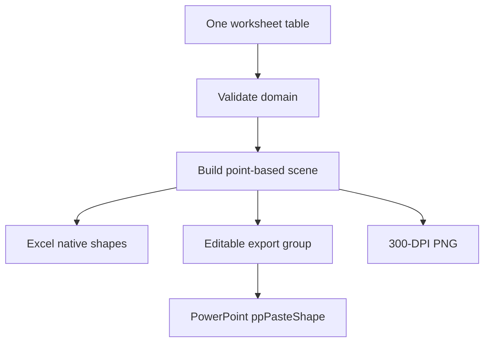

# Product and architecture — revision 3

> Created 2 September 2026 under a new filename. This revision defines the scope, schema, lifecycle, migration and non-security status of the approved `_GanttCreatorConfig` VeryHidden worksheet. When installed, use the path `docs/02-ARCHITECTURE.md`.

<!-- SKILL-SUMMARY:START -->
Product boundary, worksheet contracts, scene-first rendering model,
and COM/error-handling rules for the add-in.

Do not get wrong:
- Exactly one visible worksheet plus one `xlSheetVeryHidden`
  `_GanttCreatorConfig` worksheet for the adopted-blank target, or two
  visible worksheets for the create path (the preserved original worksheet
  plus the new `Gantt Data` sheet) plus one `xlSheetVeryHidden`
  `_GanttCreatorConfig` worksheet — never a second helper sheet, never
  schedule rows, shapes, or logs on the VeryHidden sheet, and never hiding
  an existing worksheet during initialization.
- `verify-quick.ps1`/`verify.ps1` are the only authoritative producers
  of `bin/`, `publish/`, and `coverage/` — a test that reads one of
  these artifacts without naming the producing step is a drift risk
  (see docs/04-TEST-STRATEGY.md "Build pipeline traceability").
- This is not a CPM scheduling engine; it must never imply it
  calculates contractual entitlement or delay causation.
- The "C# and architecture conventions" section at the end of this doc
  is binding for every C# change: nullable/analyzers on, immutable Core
  types with `DateOnly`, point-based geometry with one rounding policy,
  injected clock/dialog/clipboard/Office/logging boundaries, no
  `dynamic`, Excel state save/restore in `try/finally`.
<!-- SKILL-SUMMARY:END -->

<!-- SKILL-TOOLS:START -->
- `vscode-mcp__get_diagnostics` — surface nullable/analyzer violations; the binding C# conventions are compiler-grade checks.
- `roslyn_analyze` — enforce architecture invariants (dependency direction, no `dynamic`, no chained COM calls) during review.
- `dotnet_packages` — verify Core has no Office/Excel-DNA/SkiaSharp/UI dependency.
- `ast_grep_search` — find pattern violations (`Thread.Sleep`, `Task.Run` around COM, chained COM property access).
- `vscode-mcp__get_symbol_lsp_info` / `get_references` — trace DI boundaries and verify injected vs. direct instantiation.
- `dotnet_test` on `GanttCreator.Architecture.Tests` — run the architecture test layer after any structural change.
<!-- SKILL-TOOLS:END -->

## Product boundary

The add-in creates fast, presentation-quality construction-delay visuals from one visible worksheet. It is a drawing tool backed by tabular schedule events, not a critical-path scheduling engine. It must not imply that it calculates contractual entitlement, CPM logic, or delay causation.

## Build pipeline artifact contract

The build pipeline produces artifacts in a deterministic order. Tests may
only consume artifacts that a verify-script step guarantees:

- `verify-quick.ps1` and `verify.ps1` are the authoritative producers of
  `bin/` and `publish/` artifacts; `verify.ps1` additionally produces
  `coverage/`.
- A test that reads from `bin/` or `publish/` must be traceable to a
  specific step in those scripts. The traceability lives in the work item.
- A test must not assume prior build state. It either creates its own
  inputs, or depends on a verify-script step whose existence is asserted
  by the work item.

## User worksheet contract

The first supported schema is an Excel Table named `tblGanttData` on the active worksheet. The table is visible and adjacent to the Gantt plot.

Required columns:

| Column | Type | Meaning |
| --- | --- | --- |
| `Id` | text | Stable event identifier; generated once, never row-number based |
| `LaneId` | text or blank | Engine-generated visual-lane identifier shared by events on the same line; blank is the normal scaffolded state, and the render lane is derived in Core (R4.7B) |
| `StackIndex` | whole number or blank | Schema-v1 compatibility value; Core derives the effective vertical slot from deterministic row/parent-child position and never trusts or requires this cell for layout |
| `Type` | catalogue text | In-cell dropdown from the single `EntityTypeCatalog` defined by the entity guide |
| `Description` | text | User-facing label |
| `Start` | Excel date or blank | Inclusive start for span events; the single date for a milestone/delineator |
| `Finish` | Excel date or blank | Inclusive finish for span events; not read for milestones/delineators |
| `ParentId` | text or blank | Owning activity for critical/child entities |
| `StyleKey` | catalogue text or blank | Blank uses Type default; otherwise an approved named style |
| `LabelPosition` | catalogue text or blank | Explicit supported position; blank resolves to the Type default/Auto |
| `FillColour` | `#RRGGBB` or blank | Per-row rectangle/diamond/splitter fill override |
| `StrokeColour` | `#RRGGBB` or blank | Per-row outline, hatch, critical, or delineator colour override |
| `Visible` | Boolean or blank | Blank/true renders; false retains the row without rendering |

Optional columns can be added only by an approved schema ADR, initially `SortOrder` and user notes. Core data columns remain on the same worksheet and are never moved to the configuration sheet; every user-visible column, including the core data columns, may be hidden and restored from the Ribbon's Columns control, and zero visible columns is a supported state (ADR-0065). Property columns may be shown/hidden the same way. Do not introduce one column per critical interval. A critical interval is another event record tied to a lane or parent.

Workbook-level configuration uses one worksheet named `_GanttCreatorConfig` with `Visible = xlSheetVeryHidden`, plus workbook-defined names prefixed `GanttCreator.` that point to its validation ranges. Shape ownership uses a deterministic shape name plus tags/alternative text.

### Sheet initialisation (R2.2)

The Initialise-sheet command brings a workbook into the supported state in one action. It creates the `_GanttCreatorConfig` helper worksheet but no additional helper sheets, and never modifies any sheet other than the target:

- **Hybrid sheet selection.** The active worksheet is adopted when it is blank and is an `Excel.Worksheet` (a chart sheet is not, so it takes the create path); otherwise a new worksheet is created immediately after the active sheet. "Blank" means `WorksheetFunction.CountA(UsedRange) = 0`. Non-target sheets are never modified, hidden, or deleted by this command. An adopted target worksheet may be renamed and receive the table.
- **Uniform labelling.** The target is always labelled `Gantt Data`, whether it was adopted in place or created. On a name collision Excel's own `" (n)"` suffix convention applies (`OrdinalIgnoreCase`, first free `n`, starting at 2). Sheet-name uniqueness is case-insensitive in Excel, so collision detection is `OrdinalIgnoreCase`.
- **Mutation order.** All read-only checks run first (configuration sheet present? target blank? target already carries `tblGanttData`?), then rename, header row, table, configuration sheet, defined name. A failure before the rename mutates nothing; a failure after it leaves at most a renamed blank worksheet (cosmetic) and surfaces through the command boundary. A protected target is detected at the rename, the first mutation.
- **Plot anchor.** Initialise writes the sheet-scoped defined name `GanttCreator.PlotAnchor` referring to the cell one column right of the table's last column on the header row (default `$O$1`, since the schema has 14 columns). Sheet-scoping, not workbook-scoping, leaves a future multi-Gantt-sheet extension needing no name migration. The Phase-4 renderer always derives the anchor from the live table and treats stored-vs-derived disagreement as an integrity finding (R2.10); the stored name is a claim, not the source of truth.

See `docs/work-items/R2.2-initialise-sheet.md` decisions D1/D2/D3/D4/D7.

## VeryHidden configuration worksheet contract

The workbook contains exactly:

- one visible user worksheet containing `tblGanttData` and the live Gantt; and
- one add-in-managed `_GanttCreatorConfig` worksheet with `xlSheetVeryHidden` visibility.

The configuration worksheet contains versioned tables/ranges only:

| Item | Purpose |
| --- | --- |
| `tblGanttTypes` | Materialised built-in Type values, display names, entity kind, date mode, default style and capability flags |
| `tblGanttStyles` | Workbook style presets and user-approved custom named styles, including explicit default/allowed label positions and colour-override capability (ADR-0009) |
| `tblGanttMetrics` | Rectangle heights, milestone size, gaps, line widths and other named geometry tokens |
| `tblGanttSettings` | First-release chart/export/plot settings as key/value rows; written by approved dialogs only (ADR-0007 D3) |
| `tblGanttConfig` | Schema version, catalogue hash, workbook ID and add-in version last used |
| `GanttCreator.TypeOptions` | Workbook name referring to the active Type display-name range used by data validation |

In the first release the valid label choices grouped by entity capability are carried by the `AllowedLabelPositions` column of `tblGanttTypes` (ADR-0007 D2); a separate `tblGanttLabelPositions` table is deferred until a consumer needs it.

Built-in Type definitions remain code-owned and are materialised deterministically. The helper worksheet is the workbook-scoped validation/configuration representation, not a second competing type catalogue.

The helper must never contain activity/event rows, descriptions, schedule dates, scene primitives, rendered shapes, formulas that determine chart geometry, logs, or export staging. It is excluded from all exports and normal navigation. `xlSheetVeryHidden` and worksheet protection prevent accidental edits but are not treated as security.

On initialise/open/Refresh, validate sheet name, visibility, schema version, table headers, defined names and catalogue hash. Rebuild missing built-in catalogue rows safely. Preserve valid user style presets during a schema migration. If repair could lose custom configuration, stop and request confirmation rather than silently recreating the sheet.

If a user copies only the visible worksheet into another workbook, the add-in detects the missing configuration sheet and offers to initialise it from code defaults. It does not refuse to read the visible schedule data or copy schedule content into the helper.

## Domain model

Use immutable Core types. Suggested concepts, not mandated class names:

- `GanttDocument`: validated data, plot range, lanes, delineators, and style theme.
- `Lane`: ordered visual row with one or more events.
- `SpanEvent`: start/finish event such as planned, actual, baseline, procurement, or critical.
- `PointEvent`: milestone, date label, or delineator.
- `EventStyle`: explicit fill, stroke, thickness, hatch, marker, font, and label placement.
- `TimeScale`: maps `DateOnly` values to plot-space point coordinates.
- `Scene`: immutable ordered primitives in points.
- `ScenePrimitive`: rectangle, line, polygon, text, and group metadata with an explicit `SceneOwnerId` that is either one real row ID or the reserved chart-level owner.
- `ExportSize`: width, calculated height, pixel dimensions, and DPI.

Validation returns all actionable issues in deterministic table/row order. It must distinguish blocking errors from warnings. Do not throw for routine bad user input.

Key rules:

- IDs are stable and unique.
- span start is not after finish;
- lane order is deterministic; effective stack slots are derived in Core from deterministic row position and later parent/child display position, never from the visible compatibility cell;
- milestones and delineators require one date;
- Type values come only from the central entity catalogue; unknown pasted values are blocking errors;
- row colour and label-position overrides are validated against the selected Type's capabilities;
- text is trimmed but not silently rewritten;
- date parsing uses the Excel cell value and workbook date system, not locale-dependent display text;
- events outside the selected plot range are clipped or warned according to an explicit policy;
- no shape is emitted with NaN, Infinity, negative width, or negative height.

## Scene-first rendering

Every renderer consumes the same immutable scene. Worksheet reading and layout are not repeated independently by each renderer.



The scene contains explicit z-order, geometry, style, text bounds, clipping, and stable IDs. Renderers may translate representation, but may not recalculate dates or lane geometry.

### Coordinate and rounding policy

- Scene coordinates use points (`1 inch = 72 points`) as `double` values.
- Convert dates to a day index before geometry calculation.
- Date X maps the start of a calendar day. Activity dates are inclusive: `DurationDays = Finish.DayNumber - Start.DayNumber + 1`; the activity left edge is `DateToX(Start)`, its width is `DurationDays * DayWidth`, and its right edge is `left + width`. `Finish` is never incremented. Point events use their exact date without duration width.
- Snap at one defined boundary; never round repeatedly through the pipeline.
- Excel comparisons allow a documented tolerance because COM exposes `Single` shape geometry.
- Raster mapping is `pixels = round(points / 72 * dpi * scale)`, with edge rounding chosen once and covered by boundary tests.
- One injected deterministic text-metrics service measures labels during scene construction. Its implementation, font, and version are pinned for tests. Renderers consume the resolved text bounds and may not choose a different label side.
- The scene also resolves the label side, so the cascade order and the blocked-label outcome are part of the scene contract, not a renderer policy. The per-type `Auto` orders and the widest-gap truncation fallback are fixed by the entity guide and [ADR-0015](adr/0015-label-cascade-and-widest-gap-fallback.md).

## Live Excel renderer

The live renderer owns only shapes with the `GanttCreator` tag/prefix. It never deletes or reformats unowned content.

Refresh is idempotent:

1. Read and validate the current table/configuration.
2. Build a complete scene in memory.
3. If blocking errors exist, show them without changing existing shapes.
4. Enter an Excel application-state scope.
5. Update, create, or delete owned shapes by stable scene ID.
6. Apply z-order deterministically.
7. Restore application state even after failure.

Chart-affecting table edits and successful chart-setting/property commands schedule a coalesced automatic refresh; selection and navigation changes never render. The automatic pass is suspended while the workbook's persisted `AutoRefreshEnabled` switch (schema version 25, R5.20, ADR-0050 D6) is off, in which case only the Ribbon Refresh rebuilds; the explicit Refresh is never suspended, and sheet activation and a workbook switch still reconcile. The Ribbon Refresh command remains a full validation and repair pass. Automatic refresh reads and validates the complete current table/configuration and builds a complete scene before any shape mutation. If blocking errors exist, the last valid chart remains unchanged and the validation state is surfaced without a modal error loop. Excel shape writes are not transactional: if a host failure occurs after mutation begins, report refresh as incomplete, invalidate the in-memory delta cache, and make the next attempt perform a full reconciliation. Do not claim the previous scene survived unless tested compensation actually restored it.

Per-entity Ribbon properties are enabled only for one selected expanded entity row. They write `FillColour`, `StrokeColour`, or `LabelPosition` in the table; they never directly modify the current generated shape. Collapsed roll-ups, multi-row selections, headers, and unsupported entity capabilities disable the corresponding controls.

Prefer updating existing shapes to delete/recreate when it materially preserves user selection and performance. Delta reconciliation may reduce host writes only after a complete validated scene exists; compare deterministic content signatures as well as stable IDs, and update/create/delete only changed entities. Structural, ordering, chart-wide style/theme, date-range, time-scale, and metrics changes may invalidate broad portions or all of the scene. Cache state is in memory only, never on `_GanttCreatorConfig`; cache misses, workbook switches, initialization, explicit Refresh, or a failed partial write use full reconciliation. Profile before introducing incremental scene construction, and document the dependency/invalidation closure and benchmark evidence.

## Editable export composition

The editable export must contain no live cells because PowerPoint cannot preserve cell ranges and shapes as one reliably editable shape group. The export composer therefore reproduces selected table cells, headers, grid lines, time headers, background bands, bars, markers, delineators, and labels as native Excel shapes.

Process:

1. Build the export scene only when **Copy Editable** or **Send to PowerPoint** is clicked.
2. Place temporary shapes at a deterministic staging origin on the same worksheet, outside the user's working view, without writing cells or adding a sheet. The staging identity is fixed (R6.2): a staged shape's `Name` is `GanttCreatorStaging:` followed by the primitive identifier, and its `AlternativeText` is `GanttCreator.Staging.v1:{hash}` recomputed from that name. Because the live reconciler proves ownership by recomputing the expected tag from the shape name, neither ownership scan can classify the other family's shapes, so a coalesced refresh during staging cannot touch the staging shapes and a staging cleanup cannot touch the chart (`ShapeOwnershipScheme`).
3. Group all temporary shapes and verify group bounds against the scene bounds.
4. Copy the group with `ShapeRange.Copy`.
5. For clipboard-only copy, verify an expected Office drawing clipboard format is present before reporting success.
6. For PowerPoint, call `Shapes.PasteSpecial` with `ppPasteShape` and verify the returned `ShapeRange` — one `msoGroup` plus its flattened children — its count, and non-zero bounds.
7. Delete all temporary owned shapes in `finally` and restore selection/view state when possible.

Phase 6 contains a compatibility spike (R6.7, which runs first in that phase). If deletion invalidates a delayed clipboard format on a supported Office build, the approved fallback is a short-lived staging workbook retained until the copy operation is materialised—not a permanent helper worksheet. This must be decided from measured evidence.

## PowerPoint automation

Use a narrow `IPowerPointTransfer` port. The port is primitive-typed — no interop type in
a signature — and the Office adapter is **statically typed against the PowerPoint PIA**.
Phase-7 code must not use `dynamic` or `Microsoft.CSharp`; the R6.7 test fixture is
migrated to the same typed surface. The adapter:

- attaches to or starts desktop PowerPoint according to a user-visible policy: a typed
  `new Application()` starts PowerPoint if it is not running and returns the running
  instance otherwise; a pre-call `POWERPNT` snapshot decides `StartedByUs`;
- resolves the active **editable** presentation and slide by reading
  `Application.ActiveWindow` / `View.Slide`; it never activates a slide, window or
  presentation;
- refuses a typed outcome when no presentation is open, the presentation is read-only or
  in Protected View, there is no document window, there is no slide, the active view is
  not slide, notes page or normal (for example slide sorter, outline, thumbnails or a
  master), or a slide show window is active;
- calls `PasteSpecial(ppPasteShape)` and validates the returned `ShapeRange`: exactly one
  `msoGroup`, a count of `1 + staged child count`, finite positive bounds, and a bounds/
  aspect match within `HostOwnedGeometry.GeometryMatchTolerancePt`. A non-throwing call
  is never success. A missing clipboard payload or a partial document is a distinct
  stage failure;
- positions/scales the pasted **group** once from `ExportBounds.Bounds` (the zero-origin
  rectangle), preserving aspect ratio. It never resizes the returned range (which also
  lists the group's flattened children) and never re-applies `PlacementDelta`, which the
  staging composition has already consumed. The export pre-flight refuses a resolved
  `Bounds` that is not finite and strictly positive as `InvalidBounds` before any shape is
  created;
- treats unsupported clipboard format, protected presentation, missing active slide, no
  window, no slide, unsupported view, active slide show, partial document and COM
  busy/rejected-call errors as distinct failures;
- never saves, closes, or overwrites a user's presentation without a separate explicit
  command; never calls `Quit`, `Close` or `Save`; never terminates an existing PowerPoint
  instance;
- releases only COM proxies it owns, in reverse order, with `Marshal.ReleaseComObject` —
  never `FinalReleaseComObject`, never a force release of a shared root. If it subscribes
  to a PowerPoint event, it owns exactly one connection and detaches it exactly once.

Retry only the measured transient COM rejections, with a bounded **attempt count** and a
measured HRESULT filter; `Stopwatch` elapsed time is diagnostics, not a loop condition.
Never use arbitrary sleeps, a spin loop or `Task.Run` around COM. The 25-transfer soak is
tagged `TransferSoak` and runs through its own measured gate; the routine
`OfficeIntegration` gate keeps its 780 s deadline.

## PNG renderer

The raster renderer consumes the same scene, at the chart's own size and with the theme background.

The pixel dimensions are the export composition's scene bounds in points, rendered at 300 DPI:

```text
pixelWidth  = round(sceneWidthPoints  / 72 * 300)
pixelHeight = round(sceneHeightPoints / 72 * 300)
```

There is no separate width or unit input (owner ruling 2026-11-23): the image is the chart the user sees, so the composition's bounds are the size. In every case:

- height follows the composition, never independently entered;
- the exact scene bounds are the crop bounds;
- dimensions must be positive and under a documented memory/pixel safety limit;
- background transparency/colour is explicit;
- the PNG contains `pHYs` density values for 300 DPI (`11811` pixels per metre, subject to integer rounding);
- a post-write validator reopens the file and checks signature, dimensions, density, and non-empty image content before success is shown.

The Ribbon exposes the export action, not a width control. The main Export PNG button delivers to the currently selected target — the clipboard by default — and the split button's menu toggles that target between the clipboard and a verified file write. A file write's dialog opens at the remembered export folder, else the workbook's folder, and remembers the chosen folder on success. The button is gated on the same state as Copy Editable; the command itself ensures freshness, running the explicit-refresh pipeline only when the workbook has not rendered since it was opened, so a first export after opening never demands a manual Refresh. Before any target action the command resolves the scene's text families through the renderer's pinned font resolver; an unresolvable family renders through the pinned label font and reports the substitution in the status bar (ADR-0070 D3 amendment), while a missing pinned set remains the typed refusal.

## Ribbon and commands

Use RibbonX, not Office.js or a task-pane web UI. The first release groups commands by workflow:

- **Data**: initialise table, add activity, add milestone, add delineator, validate.
- **Chart**: refresh, date range, scale, workbook styling, show/hide labels.
- **Selected Entity**: shape/line colour, label position, use Type default; enabled only for one expanded entity row.
- **Export**: copy editable, send to PowerPoint, export PNG (clipboard by default, verified file on the menu).
- **Support**: diagnostics, logs, version, offline help.

Every callback is a thin error boundary that invokes an application command. No callback contains parsing, geometry, shape-building, or PowerPoint logic. Dynamic Ribbon state getters must be fast and side-effect-free.

The RibbonX document is data, not code. It lives in a `.resx` resource as a
`ResXFileRef` to a sibling `.xml` file
(`src/GanttCreator.AddIn/RibbonResources.resx` →
`src/GanttCreator.AddIn/RibbonResources/Ribbon.xml`), read through the committed
`src/GanttCreator.AddIn/RibbonResources.Designer.cs` accessor (the Excel-DNA
CSfull pattern). Never author RibbonX as a C# string literal: multiline string
constants trip the in-build formatter (IDE0055) and are hard to diff. This
applies to any future embedded XML/HTML/document text, not only the Ribbon.

## COM ownership and application state

Interop is the highest-risk layer. Follow these rules:

- Access Office only from the Excel main STA thread unless an approved marshaling design says otherwise.
- Avoid `foreach` on COM collections when it creates hidden enumerator proxies.
- Avoid chained expressions such as `app.ActiveWorkbook.Worksheets[1].Range[...]`.
- Capture each proxy, define who releases it, and release in reverse order.
- Never aggressively call `FinalReleaseComObject` on shared/root proxies without a documented ownership proof.
- Use one tested state-scope type to save and restore application settings.
- Include operation ID, HRESULT, Office build, and stage in technical logs. Exclude schedule content by default.

## Error handling

Expected user/data errors return typed results. Unexpected exceptions cross one command boundary where they are logged and translated to a concise message containing an operation ID. Do not scatter message boxes through lower layers.

Failure must be transactional where practical:

- invalid data leaves the existing chart unchanged;
- partial temporary export shapes are removed;
- Excel settings and selection are restored;
- PowerPoint is not closed or saved;
- incomplete PNG files are deleted or written through an atomic temporary path.

## Performance budgets

Initial budgets, to be confirmed with representative synthetic fixtures:

- validate and build a scene for 1,000 events: under 250 ms on the reference machine;
- refresh 1,000 live shapes: under 2 seconds after warm-up;
- build/copy a 1,000-object editable export: under 5 seconds;
- render a 5,000-pixel-wide PNG: under 3 seconds and under 500 MB peak working memory.

Do not optimise before profiling. Record the reference hardware and Office build with benchmark results.

## Out of scope for the first release

- Mac, Excel Online, Office.js, Google Sheets, and mobile;
- native CPM calculation, calendars, resource levelling, or schedule-file import;
- automatic legal/contractual delay analysis;
- collaborative co-authoring conflict resolution;
- arbitrary user-authored shape templates;
- editable `.pptx` file generation or automatic presentation saving;
- cloud storage, telemetry, accounts, or licensing services.

## C# and architecture conventions

- Nullable reference types, implicit usings, analyzers, and warnings-as-errors remain enabled.
- Prefer immutable records/value objects in Core. Use `DateOnly` for date-only schedule data.
- Define geometry in points with central rounding/tolerance policies. Do not scatter pixel conversions or magic offsets.
- Inject clock, file dialog, clipboard, Office application, and logging boundaries.
- Avoid `dynamic` unless an isolated, documented late-binding compatibility adapter requires it.
- Avoid chained COM property calls. Hold each COM proxy in a local variable and release it through one tested ownership helper.
- Excel/PowerPoint calls execute on the required STA/main thread. Do not use `Task.Run` around COM.
- Save and restore `ScreenUpdating`, `EnableEvents`, `DisplayAlerts`, status bar (both `DisplayStatusBar` and `StatusBar`), and selection only when changed, using `try/finally`. Calculation mode is **not** in this list: `Application.Calculation` is unusable on the reference host and [ADR-0020](adr/0020-application-state-scope-five-settings.md) removed it because rendering writes shapes, never cells. A command that writes cells must reinstate it with a probed path. The scope supports all five; which of them a given command invokes is its own decision, and **status-bar visibility is the user's setting, not the add-in's** — Refresh writes progress text without suppressing `DisplayStatusBar`, so a user who hides the status bar keeps it hidden (ADR-0020 D4).
- User errors are concise and actionable. Technical details go to a local rolling log with no workbook content unless explicitly opted in.
- Every public member carries XML documentation, enforced by `GenerateDocumentationFile` + CS1591 with warnings-as-errors; add detail beyond the summary when the contract is non-obvious. Internal comments explain why, invariants, or Office quirks—not line-by-line mechanics.
