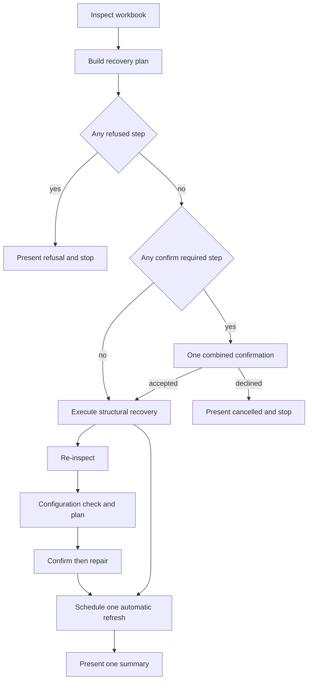

# Work item — R5.17 Repair rebuilds a missing data table

## Outcome

Deleting `tblGanttData` and pressing **Fix** recovers the workbook: the table
returns on the same worksheet, the rows that were on that sheet are adopted as
body rows, the Type-column list rule and the plot anchor are re-materialised, and
the command says what it did. No Fix path is silent, including the path where
there is genuinely nothing to repair.

Owner ruling 2026-11-11, after the live report "when deleting the table, the fix
button does nothing". Governed by [ADR-0057](../adr/0057-repair-rebuilds-a-missing-data-table.md).

## Context

R5.16's `Needs repair` mode shows the full ribbon with **Fix** as the one enabled
action, on the stated promise that Fix is the recovery. It is not:

- [`RepairConfigCommand.Run`](../../src/GanttCreator.AddIn/RepairConfigCommand.cs)
  returns **silently** when the configuration integrity plan is empty, and a lost
  data table does not make it empty-non-empty: the configuration is intact, so
  nothing is found and nothing is said.
- `Initialise` refuses `ConfigSheetExists` while `_GanttCreatorConfig` exists.
- Deleting that sheet from the normal Excel UI is impossible: `xlSheetVeryHidden`
  keeps it out of the sheet-tab and Unhide lists, and a direct programmatic
  delete is refused with `0x800A03EC` (measured 2026-11-10). It is still
  reachable by code that changes the visibility first, by external editing, or
  by corruption, which is why R5.17b and R5.17c are planned.

So the state the add-in itself creates has no way out.

## Scope

- A typed rebuild outcome and its OFFICE adapter: locate the single worksheet
  carrying `GanttWorkbookContract.GanttSheetLabel` with no table, write the schema
  header row, create `tblGanttData` over the header plus any existing body rows,
  and apply the neutral appearance and column presentation. The scheduled
  refresh, not the rebuild, normalises the reserved row heights and renders.
- Wire it as the pre-step of `RepairConfigCommand.Run`, triggered only by
  `TableMissing` + `ConfigurationPresent` from the table read.
- Replace the silent early return with a reported "nothing to repair" outcome.
- Confirmation when the rebuild would adopt existing body rows (ADR-0011
  classification), automatic when the sheet is header-only or empty.
- AddIn-level summary that names what was rebuilt and what was repaired.

## Explicit exclusions

- No second worksheet is ever created. A rebuild that cannot use the one
  standard-labelled sheet refuses and says why.
- `Initialise` keeps its `ConfigSheetExists` refusal. This item does not move the
  recovery into Initialise.
- No workbook-schema change and no new VeryHidden content; the rebuild reuses the
  existing schema, catalogue, and Type rule.
- No change to the configuration repair plan or its classifications beyond the
  empty-plan message.

## Design decisions

- **D1 — Reuse, don't re-implement.** The header row, table naming, neutral
  appearance, column presentation, Type rule, and plot anchor come from the same
  code paths `Initialise` uses, so a repaired workbook is indistinguishable from
  an initialised one. Reserved row heights are the refresh's responsibility in
  both paths.
- **D2 — Narrow trigger.** Only `TableMissing` with `ConfigurationPresent`; a
  readable table means the rebuild never runs.
- **D3 — One sheet, named by contract.** Exactly one worksheet with the standard
  label and no table. Zero matches, several matches, or a table present → typed
  refusal naming the reason, nothing muted.
- **D4 — Adoption asks.** Body rows already present make the rebuild
  confirm-required; the count is stated in the confirmation.
- **D5 — Every outcome speaks.** Rebuilt, repaired, skipped, refused, or nothing
  to repair — `RepairConfigCommand` presents one of them on every path.

## Acceptance tests

Automated (Core and Office contract):

- The rebuild trigger fires only for `TableMissing` + `ConfigurationPresent`
  (positive test for the trigger, negative test for `ConfigurationPresent` false).
- Zero standard-labelled sheets, two of them, or one that already carries a table
  each produce a distinct typed refusal and **no mutation**.
- An empty plan presents "nothing to repair" instead of returning silently
  (**positive test** on the message).
- Adoption of existing body rows is classified confirm-required; a header-only
  sheet is automatic.
- The rebuilt table has the schema headers in order; after the automatic
  refresh, the reserved rows carry the expected heights.

Office host gate (**Required**):

- Delete `tblGanttData` on the Gantt sheet, press **Fix**: the table returns on
  the same sheet, the rows below the header are body rows, the Type dropdown works,
  the chart renders, and the summary names the rebuild.
- Press **Fix** again: it reports nothing to repair and changes nothing.

## Evidence commands

```powershell
dotnet test tests/GanttCreator.Office.ContractTests
dotnet test tests/GanttCreator.AddIn.Tests
pwsh ./scripts/verify-quick.ps1
pwsh ./scripts/verify.ps1
pwsh ./scripts/verify-office.ps1     # Required: the rebuild is COM work
```

## Stop conditions

- The rebuild cannot avoid creating a second visible worksheet for a shape the
  owner expects to recover.
- Recreating the table would require guessing the header origin on a sheet whose
  used range has moved.
- Adoption of existing rows turns out to lose user cells in the live host.

## Risk and rollback

- The command's blast radius grows from the hidden configuration sheet to the
  visible one. The mitigations are D2, D3, D4, and a typed outcome for every
  refusal.
- Rollback is one commit: the adapter and its wiring are independent of the
  configuration repair itself.

---

# Recovery family work plan — R5.17, R5.17a, R5.17b, R5.17c, R5.17d

> Added 2026-11-11 after [the recovery review](../../plans/r5.17-fix-recovery-review.md).
> Every design below was checked against the named code and, where the host is the
> authority, against primary Microsoft documentation. The verified fact list is in
> the review; this section is the implementation plan. R5.17 remains the accepted
> narrow item. R5.17a to R5.17d are the adjacent damage states that must share one
> recovery pipeline rather than becoming four independent special cases.

## 0. Corrections this plan makes to the base item

| # | Base item says | Code and evidence say | Plan response |
|---|---|---|---|
| 0.1 | ADR-0057 point 3: write the header at the sheet's used-range origin | [`GanttSheetLayout.HeaderRowIndex`](../../src/GanttCreator.Core/GanttSheetLayout.cs) fixes the header at row 3; [`BuildPlotAnchorRefersTo`](../../src/GanttCreator.Core/GanttSheetLayout.cs) derives the plot anchor from the same constant. A deleted table usually leaves a used range starting at the title row, not the header row. | Use row 3. Amend ADR-0057. Refuse when row 3 no longer aligns. |
| 0.2 | D3: a sheet carrying a table is a refusal | A renamed `tblGanttData` is a table with the correct headers under the wrong name. Renaming it is loss-free and needs no adoption. | Approved (D5): rename only after verifying the sheet contains the Gantt chart — standard label, header row 3 aligned, positional schema headers, and either the sheet-scoped plot anchor or at least one owned chart shape. Otherwise refuse. |
| 0.3 | Acceptance: "the chart renders" | [`RepairConfigCommand`](../../src/GanttCreator.AddIn/RepairConfigCommand.cs) never schedules a refresh; [`OnRepairConfigClick`](../../src/GanttCreator.AddIn/GanttRibbon.cs) only invalidates ribbon state. [`InitialiseSheetCommand`](../../src/GanttCreator.AddIn/InitialiseSheetCommand.cs) does schedule one. | Every recovery path schedules exactly one coalesced refresh after mutation. |
| 0.4 | D1: reuse the Initialise code paths | The header, table, presentation, and config-sheet methods are private in [`ExcelWorkbookInitialiser`](../../src/GanttCreator.Office/ExcelWorkbookInitialiser.cs), so a second implementation would drift. | Extract one shared sheet writer and have Initialise delegate to it. |
| 0.5 | "Reserved rows at the expected heights" | Initialise does not normalise row heights; [`ExcelRowHeightNormaliser`](../../src/GanttCreator.Office/ExcelRowHeightNormaliser.cs) is called by the refresh. | The rebuild writes structure only; the scheduled refresh normalises heights and renders. Reword the acceptance to "after the automatic refresh". |
| 0.6 | ADR-0057: the config sheet cannot be deleted | VeryHidden deletion is refused by the host, but the property can be changed to hidden or visible by code and then deleted; see the review section 5 and [XlSheetVisibility](https://learn.microsoft.com/office/vba/api/excel.xlsheetvisibility). | Treat config absence as reachable. Plan R5.17b and R5.17c. |
| 0.7 | Rollback removes a created config sheet | [`RollBackConfigurationSheet`](../../src/GanttCreator.Office/ExcelWorkbookInitialiser.cs) calls `Delete()` on a sheet that [`CreateConfigurationSheet`](../../src/GanttCreator.Office/ExcelWorkbookInitialiser.cs) has already set to VeryHidden; the host refuses that delete and the catch swallows it. | Fix the rollback: set hidden or visible first, then delete, under `DisplayAlerts = false`; positive test. This is shared pre-work. |

## 1. One recovery pipeline

### 1.1 Why one pipeline

The four adjacent states differ only in which container is missing or damaged. If
each command branch discovers the workbook independently, the order of check,
confirmation, mutation, verification, refresh, and reporting will diverge. The
same divergence is what made `Needs repair` advertise a Fix that did nothing.



### 1.2 Command sequence

[`RepairConfigCommand.Run`](../../src/GanttCreator.AddIn/RepairConfigCommand.cs)
is reworked to take four injected ports: an inspector, a recovery executor, the
existing checker, and the existing repairer. The sequence is fixed:

1. **Inspect** the workbook read-only: table state, configuration state, Gantt
   worksheet state, body row count, header alignment, protection.
2. **Build** a pure Core recovery plan from those facts.
3. If any step is refused, **present the typed refusal and stop**. Nothing is
   mutated.
4. If any step is confirm-required, ask **one** confirmation that states every
   confirm-required step and every adopted row count. Declining presents
   "cancelled, nothing changed" and stops.
5. **Execute** the structural recovery steps in the plan's fixed order.
6. **Re-inspect** the table. The configuration check runs only after the table
   exists, because before the rebuild it cannot see the table and therefore
   cannot report `TypeOptionsMissing` or `PlotAnchorDisagreement`.
7. Run the existing **configuration check -> plan -> confirmation -> repair**
   flow for whatever remains.
8. If anything was mutated, call
   [`RibbonStateService.ScheduleAutomaticRefresh`](../../src/GanttCreator.AddIn/RibbonStateService.cs)
   exactly once.
9. **Present one summary** naming every step that ran, every step that refused,
   and the repair counts. No path is silent.

### 1.3 Shared Core types

All are pure, immutable, and Office-free:

- `WorkbookRecoveryState`: `TableState` (`Readable`, `Missing`, `Unreadable`),
  `ConfigurationState` (`Present`, `Missing`, `Renamed`, `NameCollision`,
  `Ambiguous`), `GanttSheetState` (`Present`, `Missing`, `Ambiguous`),
  `BodyRowCount`, `HeaderAligned`, `GanttSheetHasContent`,
  `ConfigurationSheetName`, and non-sensitive diagnostic detail.
- `WorkbookRecoveryStep`: `RebuildTable`, `RepairTableStructure`,
  `RenameTable`, `CreateConfigurationSheet`, `RenameConfigurationSheet`,
  `CreateGanttSheet`; each carries `AutoRepair`, `ConfirmRequired`, or `Refuse`.
- `WorkbookRecoveryPlan`: deterministic order, built by
  `WorkbookRecoveryPlan.Build(state)`. Tests are pure.
- `WorkbookRecoveryOutcome`: per-step results, adopted row count, headers or
  columns written, `PartiallyApplied`, and a typed refusal.

No schedule content, row text, or user data appears in any of these records.

### 1.4 Shared Office ports

- `IWorkbookRecoveryInspector` — read-only; returns `WorkbookRecoveryState`.
  It may use the extended `IGanttTableReader`, the config locator, and the
  protection guard, but it mutates nothing.
- `IWorkbookRecovery` — executes a plan and returns
  `WorkbookRecoveryOutcome`. It composes the extracted sheet writer, the
  catalogue writer, the TypeOptions materialiser, the protection guard, and the
  application-state scope. It does not render.
- `ExcelGanttSheetWriter` — the extracted shared writer. It owns header writing,
  table creation, naming, neutral presentation, column presentation, config
  sheet creation, label resolution, and the plot-anchor name. Both
  `ExcelWorkbookInitialiser` and `ExcelWorkbookRecovery` call it. The extraction
  is a pure refactor and lands before any recovery behaviour.

### 1.5 Read-outcome facts

[`GanttTableReadOutcome`](../../src/GanttCreator.Office/GanttTableReadOutcome.cs)
grows the facts the recovery pipeline and the Ribbon need:

- `ConfigurationPresent` is computed on **every** read, not only on
  `TableMissing`. Today
  [`HasConfigurationSheet`](../../src/GanttCreator.Office/ExcelGanttTableReader.cs)
  is only called from the refusal path.
- `TablePresent` is true when a `tblGanttData` exists even if it is unreadable.
- `GanttSheetCount` and `GanttSheetHasContent` describe the standard-labelled
  worksheets.
- `TableUnreadable` joins the refusal enum for R5.17a; it is distinct from
  `TableMissing`.

The workbook schema is unchanged. These are read-model facts, not stored data.

### 1.6 Ribbon state and mode

The mode derivation in
[`RibbonStateService.CaptureMode`](../../src/GanttCreator.AddIn/RibbonStateService.cs)
must stop equating "table reads" with "workbook healthy":

- `Ready` requires a readable table **and** a present configuration. A present
  but corrupt configuration stays `Ready`: the table is intact, Fix is enabled,
  and the next Refresh or Fix reports the catalogue error. Reading all five
  catalogues on every Ribbon refresh would add COM cost for a state the
  integrity checker already owns.
- `NeedsRepair` covers a readable table with a missing, renamed, or colliding
  configuration, and a missing or unreadable table with a configuration or any
  standard-labelled Gantt sheet.
- `FirstRun` is reserved for no configuration, no table, and no recoverable
  Gantt sheet.

Table-dependent controls in
[`RibbonState.IsEnabled`](../../src/GanttCreator.AddIn/RibbonState.cs) then
require `ConfigurationPresent` as well as `SheetInitialised`. Without that, the
`Ready` face enables Refresh on a workbook whose configuration cannot be read,
and the refresh fails after the control was offered. Fix stays enabled whenever
a workbook is active.

## 2. R5.17a — a partially damaged table

### 2.1 Outcome

A table that exists under the contract name but whose required headers no longer
resolve is repaired **only when the mapping is provable**. A deleted column is
re-inserted at its schema position; a blanked or renamed header is restored only
when every other header still aligns by position. Anything ambiguous is refused
with a typed reason and no mutation. The user is never told to delete their data
to make Fix work.

### 2.2 Trigger

The table read returns the new `TableUnreadable` reason. The table is present,
the configuration is present, and the sheet is not protected.

### 2.3 Pure repair plan

Inputs: the schema column list in order, including `IsRequired`, and the live
column names in order. Output: renames, insertions, or a refusal.

1. Build the set of schema names present in the table.
2. `missing` = required schema names not present.
3. `unknown` = live names that are not schema names, limited to the first
   `schema.Count` columns.
4. If `missing` is empty, the reader should have succeeded; refuse
   `Inconsistent`.
5. If `unknown` is non-empty:
   - Every known name at an ordinal up to `schema.Count` must equal the schema
     name at that ordinal. Otherwise refuse `ColumnOrderShifted`; a rename plus a
     deletion cannot be distinguished safely.
   - Every unknown ordinal must correspond to a missing schema name at that same
     ordinal. Otherwise refuse `HeaderAmbiguous`.
   - Plan a rename for each such column.
6. If `unknown` is empty:
   - The known names must form a subsequence of the schema in order. If not,
     refuse `ColumnOrderShifted`.
   - Plan an insertion for each missing schema column at its schema position,
     in ascending order.
   - If the table has more columns than the schema and a required column is
     missing, refuse `ExtraColumnsPresent`; the fixed plot anchor assumes the
     schema width.
7. Any other shape refuses `HeaderAmbiguous`.

The rule is deliberately positional. The reader already maps by name when the
table is healthy, so a reordered table never reaches this path. A name-at-position
check is therefore the smallest proof that a rewrite will not mislabel data.

### 2.4 Office adapter

`ExcelGanttTableStructureRepairer` composes the plan and applies it through the
`ListObject`. Verified primary API facts:

- `ListColumns.Add(Position)` inserts at a 1-based relative position and shifts
  the previous column outward; the name is generated and can be set afterwards
  ([ListColumns.Add](https://learn.microsoft.com/office/vba/api/excel.listcolumns.add),
  [PIA signature](https://learn.microsoft.com/dotnet/api/microsoft.office.interop.excel.listcolumns.add?view=excel-pia)).
- `ListColumn.Name` is a read/write string and must be unique within the list
  ([ListColumn.Name](https://learn.microsoft.com/office/vba/api/excel.listcolumn.name)).

Mutation order:

1. The AddIn command opens the ADR-0055 release window before calling the
   recovery adapter, through
   [`RefreshSheetCommand.OpenProtectionWindow`](../../src/GanttCreator.AddIn/RefreshSheetCommand.cs),
   matching [`AddRowCommand`](../../src/GanttCreator.AddIn/AddRowCommand.cs).
   The Office adapter itself never names an AddIn type; it starts with the shared
   protection guard, as every mutating adapter must.
2. Enter the five-setting application-state scope through
   [`ExcelApplicationStateScope`](../../src/GanttCreator.Office/ExcelApplicationStateScope.cs).
3. Apply renames in place; apply insertions in ascending schema order.
4. Re-read the table. If it still refuses, roll back renames and delete only the
   blank inserted columns, then return `VerificationFailed`.
5. Do not normalise row heights or render. The command schedules the refresh.

The protection and scope work is the same shape every mutating adapter uses, so
the new adapter has no private protection path.

### 2.5 Typed outcomes and positive tests

| Refusal | Positive test |
|---|---|
| `TableMissing` | reader fixture with no contract table |
| `TableUnreadable` | reader fixture with a missing required header |
| `TargetProtected` | sheet and workbook structure protection |
| `ColumnOrderShifted` | schema A B C D, live A B D C |
| `HeaderAmbiguous` | two unknown headers and two missing names at different ordinals |
| `ExtraColumnsPresent` | extra user column plus a deleted required column |
| `RenameFailed` | host refuses `ListColumn.Name` |
| `InsertFailed` | host refuses `ListColumns.Add` |
| `VerificationFailed` | host accepts the writes but the re-read still refuses |

`TableMissing` and `TableUnreadable` are reader reasons that select the repair
path; the rest are structure-repair refusals.

Every refusal asserts zero mutation where the refusal occurs before the first
write, and asserts the rollback state where it occurs after.

### 2.6 Codebase review

- [`ExcelGanttTableReader.TryBuildColumnMap`](../../src/GanttCreator.Office/ExcelGanttTableReader.cs)
  is the site that conflates unreadable with missing. It must return the new
  reason and `TablePresent = true`.
- [`GanttTableReaderTests.Read_refuses_when_a_required_header_is_missing`](../../tests/GanttCreator.Office.ContractTests/GanttTableReaderTests.cs)
  currently pins the conflation and must be split into `TableUnreadable` and
  `TableMissing` cases.
- [`ExcelGanttRowIdentityRepairer`](../../src/GanttCreator.Office/ExcelGanttRowIdentityRepairer.cs)
  is the existing pattern for finding the contract table and walking its
  columns; reuse its seams rather than inventing another table walk.
- [`ExcelWorkbookInitialiser.ApplyColumnPresentation`](../../src/GanttCreator.Office/ExcelWorkbookInitialiser.cs)
  already knows how to re-apply hidden and locked column state after a structural
  change; call it through the shared writer.
- No Core dependency is added. The plan is pure.

### 2.7 Office gate

- Rename `Description` to `Notes`; Fix restores the header and the chart.
- Rename two headers; Fix restores both when the positions prove the mapping.
- Delete `Type`; Fix inserts a blank `Type` column at the correct position, the
  Type dropdown is re-materialised, and the validation reports the now-empty
  Types.
- Delete `Description`, reorder another column, and press Fix; the refusal names
  the ambiguity and nothing is written.
- Add an extra user column, delete a required column, and press Fix; refusal.

### 2.8 Stop conditions

- The live host loses data or formatting when `ListColumns.Add` inserts a column.
  The probe settles this before implementation; if it fails, R5.17a reduces to a
  typed refusal with an actionable message.
- The owner prefers refusal-only over automatic header repair. The plan supports
  either; the pure planner and the adapter are the same code with the execution
  step disabled.

## 3. R5.17b — a missing configuration sheet

### 3.1 Outcome

A workbook that has lost `_GanttCreatorConfig` recovers on Fix: the single
VeryHidden sheet is created, the five catalogues are materialised from code
defaults, the visible table and its rows are untouched, the Type rule and plot
anchor are repaired, and the chart renders. The recovery never creates a second
helper sheet and never creates a second Gantt sheet.

### 3.2 Trigger and identity

The inspector finds no configuration candidate. "Missing" is only true when **no
worksheet can plausibly be the configuration**: no canonical name and no
VeryHidden candidate carrying contract tables. A renamed or damaged candidate
belongs to R5.17c; creating a new sheet beside a damaged original would violate
the one-helper-sheet invariant.

Identity rules:

| Observation | State |
|---|---|
| exactly one sheet named `_GanttCreatorConfig` case-insensitively, VeryHidden, with or without contract tables | `Present` — accept as-is; the checker repairs missing catalogues. A VeryHidden sheet cannot be created from the normal Excel UI, so the exact name plus that state is our sheet even when every catalogue table has been deleted |
| exactly one such-named sheet, hidden or visible, carrying at least one contract table | `Present` — visibility repair is the existing `WrongVisibility` path |
| exactly one such-named sheet, hidden or visible, carrying no contract table | `NameCollision` — refuse, never hide or write a user sheet |
| more than one such-named sheet | `Ambiguous` — refuse |
| no such-named sheet, exactly one VeryHidden sheet carrying at least one contract table | `Renamed` — R5.17c renames it |
| no such-named sheet, any VeryHidden sheet with no contract table | `Unrecognised` — refuse; it may be a stripped configuration, and creating a new helper beside it risks a second helper sheet |
| no such-named sheet, any visible sheet carrying a contract table | `AmbiguousCandidate` — refuse rather than create a second config |
| no candidate at all | `Missing` — create |

### 3.3 Creation

Creation runs only in the `Missing` state and only after re-asserting that no
canonical or VeryHidden candidate exists. If no Gantt sheet exists either, this
slice does not create the configuration alone: the pipeline creates the Gantt
sheet first through R5.17d when the configuration exists, or leaves the workbook
to Initialise when neither container nor a Gantt sheet exists.

1. Protection guard first; `WorkbookStructureProtected` refuses with its own
   message, because `Sheets.Add` is the mutation structure protection blocks
   ([`ProtectionGuardOutcome`](../../src/GanttCreator.Office/ProtectionGuardOutcome.cs)).
2. Resolve the position: after the Gantt sheet when one exists. Use the extracted
   label and sheet-creation helpers.
3. Name the sheet from `GanttWorkbookContract.ConfigSheetName` and set
   `xlSheetVeryHidden`, exactly as
   [`CreateConfigurationSheet`](../../src/GanttCreator.Office/ExcelWorkbookInitialiser.cs)
   does today.
4. Call [`IConfigCatalogueWriter.Write`](../../src/GanttCreator.Office/ExcelConfigCatalogueWriter.cs).
   Verified: a blank config worksheet is a supported input. `Write` resolves the
   sheet by name (line 128), treats absent key/value tables and absent style
   tables as empty (lines 1012, 1064), captures absent tables as absent for
   rollback (lines 519), and generates a new `WorkbookId` when none is stored
   (lines 1370 to 1383). It writes all five contract tables.
5. The ordinary configuration repair then materialises `GanttCreator.TypeOptions`
   and the plot anchor, because the checker now sees both the config and the
   table. Do not duplicate those calls in the recovery adapter.
6. Schedule one refresh.

The new sheet resets settings and user styles to code defaults and generates a new
workbook ID. That is stated in the summary. There is no user content to lose: the
sheet is absent.

### 3.4 Both containers missing

This is the state that currently creates a second Gantt sheet. Sequence:

1. Inspect: table missing, config missing, one standard-labelled Gantt sheet,
   with or without content. An empty labelled sheet is still the target: Initialise
   would create `Gantt Data (2)` when that sheet is not the active sheet, so the
   recovery pipeline, not Initialise, owns this state.
2. Build a plan with two steps: create configuration, rebuild table with
   adoption.
3. Ask one confirmation that states the adopted row count and that the
   configuration is recreated from defaults.
4. Create the config sheet and write the catalogues.
5. Rebuild the table on the existing Gantt sheet, using the R5.17 header
   alignment and adoption rules.
6. Repair TypeOptions and the plot anchor through the checker, then refresh.

If either step fails, roll back only what this run created. Never delete a
pre-existing container. The config rollback uses the VeryHidden-safe delete from
section 0.7.

The Ribbon must classify this state as `NeedsRepair`, not `FirstRun`, or the user
is sent to Initialise, which is the command that creates `Gantt Data (2)`.

### 3.5 Rollback

- Created config sheet: set `Visible` to `xlSheetHidden`, then `Delete`, under
  `DisplayAlerts = false`; restore `DisplayAlerts` and the prior visibility on a
  refusal. This is the fix for the existing VeryHidden-delete bug.
- Catalogue tables: the writer's own snapshots and rollback already remove tables
  that did not exist before the write
  ([`CapturePriorState`](../../src/GanttCreator.Office/ExcelConfigCatalogueWriter.cs)).
- Table rebuild: the R5.17 rollback.
- Renamed sheet (R5.17c): rename and visibility restored.
- Never delete a pre-existing sheet.

### 3.6 Typed outcomes and positive tests

| Refusal | Positive test |
|---|---|
| `NoActiveWorkbook` | null application |
| `WorkbookStructureProtected` | `ProtectStructure = true` |
| `TargetProtected` | the Gantt sheet or config sheet is protected |
| `ConfigurationNameCollision` | visible user sheet named `_GanttCreatorConfig` |
| `ConfigurationAmbiguous` | two config-named sheets |
| `ConfigurationCandidateAmbiguous` | a visible sheet carrying a contract table |
| `ConfigurationUnrecognised` | a non-canonical VeryHidden sheet with no contract table |
| `SheetCreateFailed` | host refuses `Sheets.Add` |
| `CatalogueWriteFailed` | host refuses the catalogue write |
| `VerificationFailed` | catalogue read still refuses after the write |
| `RollbackFailed` | the host refuses the hidden-then-delete sequence |

The collision test must assert the user sheet's visibility and contents are
unchanged. That is the regression that stops Fix from hijacking a user sheet.

### 3.7 Codebase review

- [`ExcelConfigIntegrityChecker.Check`](../../src/GanttCreator.Office/ExcelConfigIntegrityChecker.cs)
  returns immediately on a missing config and never inspects the table. The
  recovery pre-step must run before this method, or the two facts can never be
  combined.
- [`ConfigIntegrityPlan.Classify`](../../src/GanttCreator.Core/ConfigIntegrity/ConfigIntegrity.cs)
  still classifies `ConfigSheetMissing` as `Refuse`. The recovery creates the
  sheet before the checker sees it, so the classification does not need to
  change for Fix to work. ADR-0011's blanket "repair never creates a worksheet"
  does need an amendment for this path.
- [`docs/02-ARCHITECTURE.md:120`](../02-ARCHITECTURE.md) already promises
  recovery from a missing configuration sheet. This slice makes the promise
  true.
- [`ExcelConfigCatalogueReader.Read`](../../src/GanttCreator.Office/ExcelConfigCatalogueReader.cs)
  refuses `ConfigSheetMissing` before reading any table, so the inspector must
  not use the catalogue reader to decide the sheet state.
- [`ExcelWorkbookInitialiser.NameTakenByOtherSheet`](../../src/GanttCreator.Office/ExcelWorkbookInitialiser.cs)
  is case-insensitive and is the right uniqueness check; extract it with the
  sheet writer.
- [`RibbonStateService.Refresh`](../../src/GanttCreator.AddIn/RibbonStateService.cs)
  only knows the table outcome today. It needs the always-computed
  `ConfigurationPresent` fact and the mode change from 1.6.

### 3.8 Office gate

- Delete `_GanttCreatorConfig` through a VBA visibility change; Fix recreates it;
  the visible rows, the Type dropdown, and the chart are intact; the summary
  says the configuration was recreated from defaults.
- Delete the config sheet and the table; Fix rebuilds both on the existing Gantt
  sheet; no `Gantt Data (2)` appears.
- Protect the workbook structure; Fix refuses before creating anything.
- Create a visible sheet named `_GanttCreatorConfig`; Fix refuses and that sheet
  keeps its visibility and contents.

### 3.9 Stop conditions

- The owner does not accept the ADR-0011 amendment. Then this slice cannot
  create a sheet and must remain a typed refusal; the Initialise cascade in 4.5
  still has to be closed by the mode change and a documented manual route.
- The live host loses user styles or settings when the catalogue writer runs on
  a brand-new sheet. Verified code says absent tables are empty and defaults are
  written; the live gate confirms.

## 4. R5.17c — a renamed or colliding configuration sheet

### 4.1 Outcome

Every configuration lookup uses one case-insensitive, identity-checked locator.
A case-only rename is accepted without mutation. A sheet renamed to something
else is renamed back when it is the only candidate. A user sheet that merely
takes the contract name is refused, never hidden or written. A second candidate
is refused.

### 4.2 The inconsistency this fixes

The same contract name is compared two ways across the lookup sites:

| Site | Comparison |
|---|---|
| [`ExcelGanttTableReader.HasConfigurationSheet`](../../src/GanttCreator.Office/ExcelGanttTableReader.cs) | `Ordinal` |
| [`ExcelConfigIntegrityChecker.FindConfigSheet`](../../src/GanttCreator.Office/ExcelConfigIntegrityChecker.cs) | `Ordinal` |
| [`ExcelConfigIntegrityChecker` second-helper check](../../src/GanttCreator.Office/ExcelConfigIntegrityChecker.cs) | `OrdinalIgnoreCase` |
| [`ExcelConfigCatalogueReader.FindConfigSheet`](../../src/GanttCreator.Office/ExcelConfigCatalogueReader.cs) | `Ordinal` |
| [`ExcelConfigCatalogueWriter.FindConfigSheet`](../../src/GanttCreator.Office/ExcelConfigCatalogueWriter.cs) | `Ordinal` |
| [`ExcelTypeOptionsMaterialiser.FindSheet`](../../src/GanttCreator.Office/ExcelTypeOptionsMaterialiser.cs) | `Ordinal` |
| [`ExcelConfigSheetVisibilityRepairer.Repair`](../../src/GanttCreator.Office/ExcelConfigSheetVisibilityRepairer.cs) | `OrdinalIgnoreCase` |
| [`ExcelWorkbookInitialiser.NameTakenByOtherSheet`](../../src/GanttCreator.Office/ExcelWorkbookInitialiser.cs), called at line 113 | `OrdinalIgnoreCase` |
| [`ExcelWorkbookInitialiser.RollBackConfigurationSheet`](../../src/GanttCreator.Office/ExcelWorkbookInitialiser.cs) | `OrdinalIgnoreCase` |

[`CreateConfigurationSheet`](../../src/GanttCreator.Office/ExcelWorkbookInitialiser.cs)
is the only site that writes the name; it is not a lookup.

The checker is internally inconsistent: it finds the primary sheet Ordinally and
the duplicate case-insensitively. A case-only rename therefore reads as "missing"
to the reader and the catalogue, but as "present" to Initialise, which produces
the dead end where Initialise refuses `ConfigSheetExists` and Fix refuses
`ConfigSheetMissing`.

### 4.3 Shared locator

`ConfigSheetLocator` (Office, read-only) returns:

- `State`: `Present`, `Missing`, `Renamed`, `NameCollision`, `Ambiguous`,
  `AmbiguousCandidate`, `Unrecognised`.
- `Sheet`: the resolved worksheet when there is exactly one candidate.
- `Name`: the actual sheet name.
- `ContractTableCount`: how many of the five catalogue tables the candidate
  carries.

All lookup sites in 4.2 consume it. The locator uses `OrdinalIgnoreCase` for
sheet names, matching the initialiser's name-uniqueness rule and the reader's
existing case-insensitive table search. The existing `Ordinal` **table-name**
lookups in the catalogue reader
([line 160](../../src/GanttCreator.Office/ExcelConfigCatalogueReader.cs)),
the catalogue writer
([line 1246](../../src/GanttCreator.Office/ExcelConfigCatalogueWriter.cs)),
and the TypeOptions materialiser
([line 364](../../src/GanttCreator.Office/ExcelTypeOptionsMaterialiser.cs))
are the same latent defect and are normalized in this slice.

### 4.4 Repair rules

- Case-only difference: accept and do not rename. Excel sheet-name uniqueness is
  case-insensitive, so a rename would risk external references for no benefit.
- Different name, unique VeryHidden candidate with at least one contract table:
  rename to the canonical name, then set VeryHidden and run the catalogue writer
  to repair any missing or corrupt tables. Do not create a sheet.
- Canonical name, no contract tables, **not** VeryHidden: `NameCollision`; refuse.
  Do not hide, write, or delete the user sheet. This also fixes the current
  possibility that
  [`ExcelConfigSheetVisibilityRepairer`](../../src/GanttCreator.Office/ExcelConfigSheetVisibilityRepairer.cs)
  hides any sheet that happens to carry the name.
- Canonical name, no contract tables, **VeryHidden**: `Present`; let the
  catalogue writer recreate every table. This is the fully stripped
  configuration case and is recoverable, not a collision.
- More than one candidate: `Ambiguous`; refuse and name the sheets.
- A visible sheet carrying a contract table, or a non-canonical VeryHidden sheet
  with no contract table: `AmbiguousCandidate` / `Unrecognised`; refuse rather
  than create a second config.

### 4.5 Ribbon and the second-Gantt-sheet cascade

Case-renamed config with a readable table is `Ready` after the locator fix,
because the configuration is present. Missing config with a readable table
becomes `NeedsRepair`, so Fix is the enabled remedy rather than a Refresh that
fails. Both-missing with any standard-labelled Gantt sheet becomes `NeedsRepair`,
not `FirstRun`. This is the guard that stops `Initialise` from creating
`Gantt Data (2)` while a recovery is available.

### 4.6 Tests

- Every locator consumer recognizes a case-renamed config sheet.
- A case-only rename is accepted with no mutation.
- A different-name unique VeryHidden candidate is renamed back; settings and
  user styles survive because the catalogue writer preserves them.
- A canonical-name visible user sheet with no contract tables is refused and left
  untouched.
- A canonical-name VeryHidden sheet with no contract tables is repaired by the
  catalogue writer, not refused.
- A non-canonical VeryHidden sheet with no contract tables is refused as
  unrecognised, and no second helper sheet is created.
- Two candidates are refused.
- A visible sheet carrying a contract table is refused, not adopted.
- Ribbon mode tests for the three states in 4.5.

### 4.7 Codebase review

- The search for `ConfigSheetName` in `src` returns the lookup sites in 4.2, the
  constant declaration, and the one assignment in `CreateConfigurationSheet`
  (line 1024). There is no other comparison. The initialiser's uniqueness call at
  line 113 is included because it is the check that currently makes Initialise
  refuse `ConfigSheetExists`.
- [`ExcelConfigCatalogueWriter.ReadPreservation`](../../src/GanttCreator.Office/ExcelConfigCatalogueWriter.cs)
  preserves settings, user styles, and the workbook ID, so a rename repair does
  not reset them.
- [`ExcelTypeOptionsMaterialiser.RefersToMatches`](../../src/GanttCreator.Office/ExcelTypeOptionsMaterialiser.cs)
  already compares the sheet name case-insensitively, which is the correct model
  for the locator.

### 4.8 Office gate

- Rename the config sheet to `_ganttcreatorconfig`; Refresh, Add row, Fix, and
  Validate all work; Fix reports nothing to repair.
- Rename it to `ConfigBackup`; Fix restores `_GanttCreatorConfig` and preserves a
  custom style and a changed setting.
- Create a visible `_GanttCreatorConfig` sheet as a user sheet; Fix refuses and
  the sheet is still visible and unchanged.

## 5. R5.17d — a missing Gantt worksheet

### 5.1 Outcome

A workbook that still has `_GanttCreatorConfig` but no standard-labelled Gantt
worksheet can recover on Fix only with explicit consent. Fix creates one new Gantt
worksheet, writes the contract header and table, repairs the Type rule and plot
anchor, and renders an empty chart. It states that the old schedule rows are not
restored. It never creates a second Gantt worksheet.

### 5.2 Trigger

Table missing, configuration present, `GanttSheetCount == 0`, and no table with
schema headers elsewhere in the workbook. If a table with schema headers exists
on another sheet, refuse `TableOnUnexpectedSheet`; the user can move or rename it
deliberately.

### 5.3 Design

- Confirm-required. The confirmation states: the Gantt worksheet is missing, a
  new empty one will be created from the stored configuration, and schedule rows
  are not restored.
- Declining presents "cancelled, nothing changed" and stops.
- On consent: create the worksheet immediately before the configuration sheet
  when one exists, otherwise after the last visible sheet; name it from
  `GanttWorkbookContract.GanttSheetLabel`; write the header at
  `GanttSheetLayout.HeaderRowIndex`; create the table; apply presentation; let
  the checker repair the plot anchor and TypeOptions; schedule one refresh.
- Rollback: delete the created visible worksheet under `DisplayAlerts = false`.
  A visible sheet deletes normally; only VeryHidden needs the visibility step.
- If the label is taken by a sheet that is not a Gantt sheet, the inspector has
  already counted it as a labelled sheet, so it is not "missing"; d does not run.
  A `LabelUnavailable` refusal remains as a guard.

### 5.4 Codebase review

- [`ExcelWorkbookInitialiser.CreateTargetSheet`](../../src/GanttCreator.Office/ExcelWorkbookInitialiser.cs)
  and [`ResolveAvailableLabel`](../../src/GanttCreator.Office/ExcelWorkbookInitialiser.cs)
  are the creation and naming rules; extract them with the shared writer.
- [`ExcelPlotAnchorRepairer`](../../src/GanttCreator.Office/ExcelPlotAnchorRepairer.cs)
  re-derives the anchor from the live table's sheet name; the checker reports the
  disagreement after the new sheet exists.
- [`ExcelTypeOptionsMaterialiser`](../../src/GanttCreator.Office/ExcelTypeOptionsMaterialiser.cs)
  needs both the config and the table; both exist after step 5.3.
- [`InitialiseSheetCommand`](../../src/GanttCreator.AddIn/InitialiseSheetCommand.cs)
  is the precedent for scheduling the first empty render after creating a sheet.
- [`GanttSheetLayout.BuildPlotAnchorRefersTo`](../../src/GanttCreator.Core/GanttSheetLayout.cs)
  uses the fixed header row, so the new sheet must use that row.

### 5.5 Typed outcomes and positive tests

| Refusal | Positive test |
|---|---|
| `TableOnUnexpectedSheet` | schema-header table on a non-Gantt sheet |
| `TargetProtected` | workbook structure protected |
| `LabelUnavailable` | label taken by a non-Gantt sheet |
| `SheetCreateFailed` | host refuses `Sheets.Add` |
| `TableCreateFailed` | host refuses `ListObjects.Add` |
| `VerificationFailed` | re-read does not find the new table |

The confirm-declined test asserts zero mutation and a spoken cancelled message.

### 5.6 Office gate

- Delete the Gantt worksheet, keep the config, press Fix, confirm: one new Gantt
  sheet appears with the contract header and table and an empty chart; the
  config sheet is still VeryHidden; no second Gantt sheet exists.
- Repeat and decline: nothing is created and the message says so.
- Protect the workbook structure: refusal before creation.

### 5.7 Stop conditions

- The owner prefers refusal-only because creating an empty schedule could mask
  data loss. The plan supports refusal; the confirmation text and the typed
  outcome are the same either way.
- The live host cannot create the worksheet without changing the active sheet
  state. The application-state scope must restore it; if it cannot, the slice
  refuses instead of surprising the user.

## 6. Cross-slice test matrix

| Scenario | Core | Office contract | AddIn | Office gate |
|---|---|---|---|---|
| Table object gone, rows present | plan and confirmation | rebuild, adoption, rollback | trigger, summary, refresh once | required |
| Header cell blanked, rest aligned | alignment plan | rename write | summary | required |
| Header renamed, rest aligned | alignment plan | rename write | summary | required |
| Required column deleted | insertion plan | insert, re-read | summary | required |
| Column deleted plus reorder | refusal plan | zero mutation | typed refusal | required |
| Table present but unreadable | state mapping | reader reason | trigger | required |
| Config missing, table healthy | config plan | create, catalogue write | trigger, summary, mode | required |
| Config and table missing, Gantt sheet present | combined plan | create config, rebuild table | confirmation only when rows would be adopted, no second sheet | required |
| Config case-renamed | locator | all consumers | mode, Fix no-op | required |
| Config renamed | locator and rename | rename, preserve | summary | required |
| User sheet takes the config name | locator collision | zero mutation | typed refusal | required |
| No Gantt sheet, config present | create plan | create sheet, table | confirm, decline | required |
| Any success | — | — | exactly one refresh | required |
| Any refusal | — | zero mutation | one spoken message | required |

Every new refusal gets a positive test in the same commit. There is no
catch-and-ignore path.

## 7. Commit and gate sequence

One concern per commit:

1. `docs: plan the R5.17 recovery family` — the review and this section.
2. `refactor: extract the Gantt sheet writer from the initialiser` — pure
   extraction, existing tests unchanged.
3. `refactor: introduce the single-chart locator seam` — no behaviour change;
   one chart reference and one locator replace the hardcoded single chart
   assumptions.
4. `fix: delete a recreated VeryHidden config sheet in rollback` — regression
   test for the hidden-then-delete sequence.
5. `feat: rebuild a missing tblGanttData from Fix` — R5.17.
6. `feat: locate the configuration sheet by identity and case` — R5.17c, before
   R5.17b consumes it.
7. `feat: repair a partially damaged table` — R5.17a.
8. `feat: recreate a missing configuration sheet` — R5.17b, plus the Ribbon mode
   change.
9. `feat: create a missing Gantt worksheet on confirmation` — R5.17d.
10. `docs: update roadmap, status, ADRs and the implementation plan`.

Each commit runs `pwsh -NoProfile -File scripts/verify-quick.ps1`. The branch-final
gate is `pwsh -NoProfile -File scripts/verify.ps1` on a clean tree.
`pwsh -NoProfile -File scripts/verify-office.ps1` is required for every slice
that touches COM and is run by the human host. Any gate not run is reported as
`Not run` with the reason.

## 8. Decisions — approved 2026-11-11

| # | Decision | Ruling | Qualification recorded |
|---|---|---|---|
| D1 | ADR-0011 amendment: create exactly one `_GanttCreatorConfig` in the recovery path | Approved | Never a second helper sheet; never delete a pre-existing container; the created sheet is rolled back with the hidden-then-delete sequence |
| D2 | ADR-0057 correction: fixed header row 3, and config-sheet deletion is reachable | Approved | Deletion is only possible when the affected cells are unlocked. A direct VeryHidden delete is rejected; changing visibility to hidden or visible first, then deleting, is the documented code route. ADR-0055 unlocks the table's data cells before protecting, and the config sheet is never protected, which is why the damaged states are reachable without the add-in forcing them |
| D3 | R5.17d: create an empty Gantt worksheet on confirmation | Approved | Confirmation required; state that the old schedule rows are not restored; never a second Gantt sheet |
| D4 | R5.17a: automatic header and column repair | Approved | Only when the positional mapping is provable; anything ambiguous refuses with zero mutation |
| D5 | Rename a misnamed `tblGanttData` | Approved | Only after verifying the sheet contains the Gantt chart: standard label, header row 3 aligned, positional schema headers, and either the sheet-scoped plot anchor or at least one owned chart shape. A foreign table refuses |
| D6 | Ribbon mode: `Ready` requires configuration; `NeedsRepair` covers recoverable states | Approved | A present but corrupt configuration stays `Ready`; Fix and Refresh report the catalogue error |

## 9. Probes before the first recovery commit

- State after Convert to Range, Delete Table Rows, clearing the header cells,
  deleting one column, renaming the table, and inserting rows above the header.
- VeryHidden config delete: direct `Delete`, then `Visible = xlSheetHidden` and
  `Delete`, recording the HRESULT for each.
- `ListColumns.Add(Position)` on a live table: data stays with its column, the
  inserted column is blank, and formatting is acceptable.
- Whether `ListObjects.Add` raises `SheetChange`, so the explicit refresh is
  confirmed as the single trigger.
- How `UsedRange` reports formatted blank rows below the body, so the adoption
  boundary trims only genuinely empty trailing rows.
- Whether a recreated config sheet's default settings allow the stored chart
  title and metrics to render an empty chart.

## 10. Risk register

| Risk | Mitigation |
|---|---|
| A positional header rewrite mislabels data | Pure planner refuses anything but a proven mapping; live probe before enabling insertion |
| Creating a config sheet resets settings and user styles | The sheet is absent, so no content exists to lose; the summary says defaults and a new workbook ID |
| Fix hijacks a user sheet named `_GanttCreatorConfig` | Identity by contract tables; collision refusal with zero mutation; positive test |
| A second config or Gantt sheet is created | Locator requires zero candidates before creation; every refusal and success asserts the sheet count |
| The VeryHidden rollback leaves a stray sheet | Hidden-then-delete fix with a positive test, shared by Initialise and recovery |
| The ribbon offers Refresh on a config-less workbook | `Ready` requires configuration; `IsEnabled` gates table controls on it |
| Recovery is silent or claims more than it did | One summary with per-step results and `PartiallyApplied`; every path speaks |
| Extra user columns break the fixed plot anchor | R5.17a refuses column repair when extras exist; a follow-up derives the anchor from the live table |
| Untagged or renamed owned shapes, moved table origins, and schedule data on the config sheet have no repair owner | Recorded in section 11.3; manual cleanup today, follow-up R5.17f proposed |
| A future multi-chart change is implemented by accident | Section 12 adds a locator seam only; no schema or invariant change without a new ADR |
| The recovery conflicts with the one-in-progress rule | Ten commits, one concern each, each green before the next |

## 11. What a full refresh already repairs, and what it cannot

### 11.1 Verified refresh coverage

A full refresh is a repair pass for presentation and derived values, not for
containers or configuration. The live composition wires the repair steps in
[`RefreshSheetCommand.CreateLiveOrchestrator`](../../src/GanttCreator.AddIn/RefreshSheetCommand.cs):

| Broken element | Repaired by refresh | Evidence |
|---|---|---|
| Engine column hidden/locked drift | yes | [`ExcelColumnPresentationRestorer`](../../src/GanttCreator.AddIn/RefreshSheetCommand.cs); [`EnsureClassification`](../../src/GanttCreator.Office/ExcelColumnPresentationRestorer.cs); refuses `SchemaColumnMissing` before any write at lines 119 to 129 |
| Malformed or duplicate row `Id` | yes | [`ExcelGanttRowIdentityRepairer`](../../src/GanttCreator.AddIn/RefreshSheetCommand.cs); orchestrator step 5 at [`GanttRefreshOrchestrator.cs:334`](../../src/GanttCreator.Office/GanttRefreshOrchestrator.cs) |
| Type-dependent engine columns | yes | [`ExcelTypeChangeNormaliser`](../../src/GanttCreator.AddIn/RefreshSheetCommand.cs); orchestrator step 5b |
| Stale `StyleKey` from a Type change | yes | [`ExcelStyleKeyWriter`](../../src/GanttCreator.AddIn/RefreshSheetCommand.cs); orchestrator step 7b at [`GanttRefreshOrchestrator.cs:492`](../../src/GanttCreator.Office/GanttRefreshOrchestrator.cs) |
| Outline groups | yes | orchestrator step 6 at [`GanttRefreshOrchestrator.cs:464`](../../src/GanttCreator.Office/GanttRefreshOrchestrator.cs) |
| Duration cells | yes | orchestrator step 7 at [`GanttRefreshOrchestrator.cs:472`](../../src/GanttCreator.Office/GanttRefreshOrchestrator.cs) |
| Row heights and the reserved rows | yes | [`ExcelRowHeightNormaliser`](../../src/GanttCreator.AddIn/RefreshSheetCommand.cs); orchestrator step 8 at [`GanttRefreshOrchestrator.cs:524`](../../src/GanttCreator.Office/GanttRefreshOrchestrator.cs) |
| Missing, stale, moved, or extra owned shapes | yes | shape reconciliation step 13; [`ShapeReconciler.Plan`](../../src/GanttCreator.Office/ShapeReconciler.cs) |
| Locked shape state and protection arming | best effort; a refused arm does not block the render | orchestrator step 2b at [`GanttRefreshOrchestrator.cs:276`](../../src/GanttCreator.Office/GanttRefreshOrchestrator.cs) |
| Validation highlights | yes | orchestrator step 6b at [`GanttRefreshOrchestrator.cs:423`](../../src/GanttCreator.Office/GanttRefreshOrchestrator.cs) |

### 11.2 Not repairable by a full refresh

| Broken element | Refresh behaviour | Current remedy | Gap or action |
|---|---|---|---|
| Table object missing, renamed, or unreadable | refuses at [`GanttRefreshOrchestrator.cs:247`](../../src/GanttCreator.Office/GanttRefreshOrchestrator.cs) | R5.17 / R5.17a | none once the family lands |
| A required header or column missing or renamed | refuses before validation; column restoration returns `SchemaColumnMissing` | R5.17a | none once R5.17a lands |
| Configuration sheet missing, renamed, or colliding | config read refuses at [`GanttRefreshOrchestrator.cs:261`](../../src/GanttCreator.Office/GanttRefreshOrchestrator.cs) | R5.17b / R5.17c | none once b and c land |
| Schema version or catalogue hash mismatch | config read refuses at [`ExcelConfigCatalogueReader.cs:731`](../../src/GanttCreator.Office/ExcelConfigCatalogueReader.cs) | Fix catalogue writer; a newer schema needs a newer add-in | manual for newer schema |
| `GanttCreator.TypeOptions` missing, stale, or invalid | refresh never calls the materialiser; the chart can render while the dropdown is broken | Add Row `EnsureCurrent` at [`ExcelGanttRowInserter.cs:294`](../../src/GanttCreator.Office/ExcelGanttRowInserter.cs), or Fix `MaterialiseForRepair` | record as Fix/Add Row owned; no refresh repair |
| Plot-anchor defined name missing or stale | refresh never calls [`ExcelPlotAnchorRepairer`](../../src/GanttCreator.Office/ExcelPlotAnchorRepairer.cs) | Fix | record as Fix owned |
| Configuration sheet visibility wrong | refresh reads it normally and does not change visibility | [`ExcelConfigSheetVisibilityRepairer`](../../src/GanttCreator.Office/ExcelConfigSheetVisibilityRepairer.cs) via Fix | record as Fix owned |
| Second helper sheet | refresh ignores it | Fix refuses `SecondHelperSheet` | manual cleanup; the checker detects it and Fix reports a refusal |
| Schedule data on the configuration sheet | refresh ignores it | none today; `ScheduleDataOnConfig` is declared but never emitted by [`ExcelConfigIntegrityChecker.Check`](../../src/GanttCreator.Office/ExcelConfigIntegrityChecker.cs) | **undetected**; add a finding or a follow-up |
| Table style, autofilter, or banding drift | refresh does not reset them | only Initialise sets them at [`ExcelWorkbookInitialiser.cs:928`](../../src/GanttCreator.Office/ExcelWorkbookInitialiser.cs) | cosmetic; no owner, low severity |
| Header row moved, table shifted off column A, or extra columns | refresh measures the live table but the fixed layout, title column, and plot anchor assume the contract origin; it can render wrong or refuse without repairing | R5.17/R5.17a refuse the moved origin; no repair | manual move; follow-up should derive the anchor from the live table or add an integrity finding |
| Untagged or renamed owned shape | invisible to [`ListOwned`](../../src/GanttCreator.Office/ExcelShapeWriter.cs); refresh never deletes it | none in Fix or refresh | **manual deletion**; L18's over-long name can leave one; follow-up R5.17f should report orphans |
| Parent cycles, ambiguous or orphan `ParentId`, unknown Type, invalid or missing dates | validation blocks the render; refresh deliberately does not guess | user edits the row | correct by design; not a repair |
| Workbook or sheet protection not owned by the add-in | refresh refuses at [`GanttRefreshOrchestrator.cs:300`](../../src/GanttCreator.Office/GanttRefreshOrchestrator.cs) | user unprotects | correct by design |
| Workbook uses the 1904 date system | table read refuses | user changes the workbook date system | correct by design |
| Schema newer than the running add-in | config read refuses | upgrade the add-in | correct by design |
| `tblGanttData` on an unexpected worksheet | reader finds it by name and refresh renders there; no integrity finding | none | add an integrity finding; R5.17d only guards creation |
| A copied Gantt sheet whose table Excel renamed | the copy is ignored; only `tblGanttData` is read | none | multi-chart gap; section 12 |
| Missing `WorkbookId` or corrupt configuration values | config read refuses | Fix catalogue writer repairs or quarantines | none once R5.17b lands |
| Shape name beyond the host limit (L18) | create fails after the shape is added; the untagged shape is discarded or orphaned | none | known limitation; manual cleanup |

### 11.3 Items with no repair owner today

These are the actionable gaps the review found outside the R5.17 family:

1. **Untagged or renamed owned shapes.** No refresh or Fix path deletes them;
   they sit beside the live chart forever. Propose R5.17f: inventory, report, and
   a confirm-required cleanup of shapes whose names match the chart form but whose
   ownership tag is missing or malformed. Never delete shapes that do not look
   like ours.
2. **Moved table origin.** A header row other than 3, a table shifted off column
   A, or inserted rows above the table. Refresh can render from the measured
   table but the fixed title, period-band, and plot-anchor constants assume the
   contract origin. R5.17 refuses the rebuild; add an integrity finding and a
   manual repair route.
3. **Extra user columns.** They break the fixed plot anchor derived from the
   schema width. R5.17a refuses the column repair when extras exist. The proper
   fix is to derive the anchor and title column from the live table's first and
   last columns, which is a Core layout change and needs its own item.
4. **Schedule data on the configuration sheet.** The finding kind exists but the
   checker never emits it. Add the detection before relying on the refusal.
5. **A contract table on an unexpected sheet.** The reader finds it by name and
   the chart follows it, silently accepting a sheet topology the product does
   not describe. Add an integrity finding.
6. **A copied Gantt sheet.** The copied table is auto-renamed and ignored; the
   copy looks like a chart but never updates. This is the multi-chart case in
   section 12; until then, report the second sheet rather than ignore it.

### 11.4 Tests to add for the refresh boundary

- A missing schema column makes Refresh refuse `SchemaColumnMissing` before any
  write; Fix R5.17a is the only repair.
- A missing `TypeOptions` name does not stop a render but is repaired by Add Row
  or Fix, not by Refresh.
- A stale plot anchor does not stop a render but is repaired by Fix, not by
  Refresh.
- An untagged shape with a chart-shaped name is left untouched and inventory
  logged by `ListOwned`; no refresh path deletes it.
- A configuration sheet carrying schedule data is either detected by the checker
  or explicitly recorded as undetected; the test pins the chosen behaviour.

## 12. Multi-chart extension — investigation and seam

### 12.1 Verdict

More than one Gantt chart sheet is technically possible, but it is a
product-contract and workbook-schema change, not a recovery slice. It is **not**
implemented in this family. The family adds a locator seam so the change is
localised later instead of being spread across every adapter.

### 12.2 What already helps

- [`ResolveAvailableLabel`](../../src/GanttCreator.Office/ExcelWorkbookInitialiser.cs)
  already applies Excel's `" (n)"` suffix convention, so a second sheet can be
  labelled deterministically.
- The plot-anchor defined name is sheet-scoped and
  [`BuildPlotAnchorRefersTo`](../../src/GanttCreator.Core/GanttSheetLayout.cs)
  takes the sheet name, so each chart can own its anchor without a name change.
- One VeryHidden configuration sheet can serve many charts: types, styles,
  metrics, and the TypeOptions name are shared.
- The workbook ID remains workbook-scoped; only the chart identity is new.

### 12.3 What blocks it

| Blocker | Evidence |
|---|---|
| One table name, found by name everywhere | [`GanttTableSchema.TableName`](../../src/GanttCreator.Core/GanttTableColumns.cs); [`ExcelGanttTableReader.TryFindTable`](../../src/GanttCreator.Office/ExcelGanttTableReader.cs) |
| One visible worksheet invariant | [`AGENTS.md`](../../AGENTS.md), [`docs/02-ARCHITECTURE.md`](../02-ARCHITECTURE.md) |
| Settings are workbook-scoped | `tblGanttSettings` at [`ExcelConfigCatalogueWriter.WriteContractTables`](../../src/GanttCreator.Office/ExcelConfigCatalogueWriter.cs) |
| One workbook ID and one config row set | [`BuildConfigRows`](../../src/GanttCreator.Office/ExcelConfigCatalogueWriter.cs) |
| Delta cache is a singleton | [`RefreshSheetCommand`](../../src/GanttCreator.AddIn/RefreshSheetCommand.cs) `shapeDeltaCache` |
| Protection ownership is session-global | [`ExcelWorksheetProtectionGuard.ProtectedOutcome`](../../src/GanttCreator.Office/ExcelWorksheetProtectionGuard.cs) and ADR-0055 |
| Ribbon state is one snapshot | [`RibbonState`](../../src/GanttCreator.AddIn/RibbonState.cs) |
| Commands resolve one table implicitly | `AddRowCommand`, `RemoveCommand`, `MoveUpCommand`, and the rest through their adapters |

### 12.4 The seam

Add the seam in the `refactor: introduce the single-chart locator seam` commit.
It changes no behaviour and writes nothing new to the workbook.

Core:

- `GanttChartRef`: `ChartId`, `SheetName`, `TableName`, `PlotAnchorName`,
  `SettingsScopeKey`.
- `GanttChartContract`: pure functions that map a chart reference to the current
  contract values. Today `TableName = GanttTableSchema.TableName`,
  `PlotAnchorName = GanttWorkbookContract.PlotAnchorDefinedName`, and
  `SettingsScopeKey = "workbook"`.

Office:

- `IGanttChartLocator` with `FindActiveChart()`, `FindAllCharts()`, and
  `FindChartForSheet(string sheetName)`.
- `ExcelSingleChartLocator` returns exactly one `GanttChartRef` with
  `ChartId = "default"` and the current contract values. It resolves the table
  by the same walk the reader already uses.
- The reader, checker, catalogue writer, repairers, refresh orchestrator, and
  commands take a `GanttChartRef` or the locator instead of comparing against
  the literal table name or sheet label.
- The delta cache and protection arming are keyed by `ChartId`; with one chart
  the behaviour is identical, and the seam is where a future per-chart cache and
  per-sheet ownership attach.
- The Ribbon state capture asks the locator for the active chart; with one
  chart it is the same chart.

Tests:

- The single-chart locator returns the same table, anchor, and settings the
  current code uses.
- A fake two-chart locator drives the reader, checker, refresh, and ribbon
  without changing their code, proving the seam is real.
- An architecture test asserts no adapter outside the locator and the contract
  compares a table or sheet label for lookup. This is the guard that stops the
  single-chart assumption creeping back.

### 12.5 What a future multi-chart ADR must add

- A stored chart identity. The seam computes one for now; a schema migration
  would store it in a sheet-scoped defined name or a configuration table row.
- A unique table-name scheme (`tblGanttData`, `tblGanttData_2`, ...) and a
  migration for existing workbooks. Excel table names are workbook-unique.
- Per-chart settings for chart title, plot range, time scale, margins, size,
  and protection opt-out, in the existing `tblGanttSettings` key space or a new
  configuration table.
- Per-chart delta cache and per-sheet protection ownership.
- Ribbon state and command targeting by the active chart.
- Export and PowerPoint composition by the active chart.
- An AGENTS, docs/02, docs/07, and ADR amendment replacing "exactly one visible
  worksheet" with the multi-chart topology.

### 12.6 What must not happen in this family

- No `ChartId` is written to the workbook.
- No table name changes.
- No second Gantt sheet is created by any recovery path.
- No relaxation of the one-visible-Gantt-sheet invariant without the ADR in
  12.5.

## 13. Implementation record — 2026-11-11

### 13.1 What landed

One pipeline in [`ExcelWorkbookRecovery`](../../src/GanttCreator.Office/ExcelWorkbookRecovery.cs):
inspect read-only → confirm when rows would be adopted or a sheet would be
created → recover → the ordinary configuration check and repair → exactly one
coalesced refresh. Every refusal is typed and spoken; there is no silent return.

| Slice | What the code does | Tests |
|---|---|---|
| R5.17 | Rebuilds `tblGanttData` on the one standard-labelled sheet from the fixed header row 3 plus whatever body rows exist; rolls back on a failed verify | Core alignment plan; AddIn trigger, confirmation, refresh-once |
| R5.17a | Header cells are filled only where blank; renamed or missing columns are repaired only when the positional mapping is provable; anything ambiguous refuses with zero mutation | `GanttTableHeaderAlignment` / `GanttTableStructureRepair` plans |
| R5.17b | Creates `_GanttCreatorConfig` and materialises the five catalogues through the existing writer, only when `ConfigSheetLocator` reports `Missing`; the created sheet is rolled back with the hidden-then-delete sequence | `ConfigSheetLocatorTests`; `ConfigSheetInspectorTests` |
| R5.17c | Case-insensitive lookups in the reader, checker, catalogue reader/writer, and TypeOptions materialiser; one renamed VeryHidden candidate is renamed back; name collisions, ambiguity, a visible sheet carrying a contract table, and an unrecognised VeryHidden sheet all refuse | `ConfigSheetLocatorTests` (states), `ConfigSheetInspectorTests` (enumeration) |
| R5.17d | Creates one Gantt worksheet on explicit confirmation, states that old schedule rows are not restored, and refuses on decline with zero mutation | AddIn declined-confirmation test |
| D5 | Renames one proxied `tblGanttData` when the labelled sheet's header row 3 is positionally aligned and the sheet carries the plot anchor; otherwise `TargetHasForeignTable` | `GanttWorkbookContract.IsPlotAnchorName` positives and negatives |
| Ribbon | `Ready` requires the configuration; `NeedsRepair` covers the recoverable container states; `GanttSheetPresent` is always computed | `RibbonStateServiceTests` |

### 13.2 Deviations from the planned commit sequence

- **The ten commits became three feature commits.** Slices a–d share one adapter
  and one inspection record, so splitting them further would have produced
  non-compiling intermediate states. The boundaries that did land are the
  pipeline (`9ce717d`) and this change.
- **`refactor: extract the Gantt sheet writer from the initialiser` was not done.**
  `ApplyCreateGanttSheet` re-applies the contract header, table, presentation, and
  plot-anchor steps locally. That is the divergence risk ADR-0057 names under
  "a second opinion about the same workbook state", and it is recorded as debt:
  the extraction is still the right change and belongs with R5.17f's integrity
  work rather than a mechanical move at the end of this family.
- **`IGanttChartLocator` (planned commit 3) is deferred to
  [R5.17e](R5.17e-single-chart-locator-seam.md).** A locator with one
  implementation and no second consumer is a dead abstraction; the measured
  adoption surface is 28 comparison sites across 20 adapters, which is a
  behaviour-free refactor that deserves its own gate.
- **D5's owned-shape alternative was not implemented.** The identity proof is the
  aligned fixed header row plus the sheet-scoped plot anchor; both are workbook
  facts the add-in wrote. A shapes walk would add a COM pass for a signal the
  anchor already carries. If the anchor is absent the recovery refuses rather
  than guessing.

### 13.3 Evidence

- `dotnet build GanttCreator.slnx -c Release -warnaserror`: **0 warnings,
  0 errors**.
- Targeted suites, observed: Core 18, Office contract 5, AddIn 9, Architecture 20
  — all passed.
- Full-suite counts at `9ce717d`: Core 1911, Office contract 1332, AddIn 673,
  Architecture 120.
- `verify-office.ps1`: **Not run** — the recovery paths that mutate a worksheet
  and a VeryHidden sheet can only be proved in the human Excel host. The gate
  steps are section 3.8, 4.8, and 5.6 plus the ADR-0057 live gate.

### 13.4 Still owed

1. `verify-office.ps1`, with the section 3.8/4.8/5.6 scripts.
2. R5.17e (locator seam) and R5.17f (states with no repair owner).
3. The Gantt-sheet-writer extraction recorded in 13.2.
