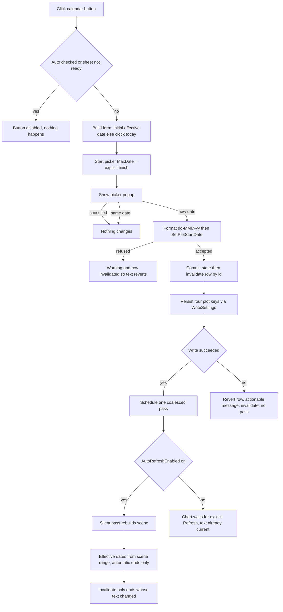

# R5.1a — Plot-date calendar pickers and never-stale plot-date text

**Parent work item:** [`docs/work-items/R5.1-plot-range-modes.md`](../docs/work-items/R5.1-plot-range-modes.md)
**Work item to author:** `docs/work-items/R5.1a-plot-date-calendar-picker.md`
**Status:** plan, revision 2 (critiqued)
**Driving skill:** `docs/00-PONYTAIL.md`

## 0. Corrections this revision makes to the first draft

| # | Defect in draft 1 | Fix in revision 2 |
|---|---|---|
| C1 | "Borderless popup, Escape or click-away cancels" — a **borderless modal** form swallows outside clicks and has no close affordance, so click-away cannot work without a message filter. | `FormBorderStyle.FixedToolWindow`, no icon, no minimise/maximise, positioned at the cursor and clamped to `Screen.WorkingArea`. Real close box, real Escape, no custom outside-click plumbing. |
| C2 | Themed `BackColor`/`TitleBackColor` unconditionally, which breaks Windows high contrast. | Theme only when `SystemInformation.HighContrast` is false; reuse the existing palette resolver rather than new theme code. |
| C3 | Only the two **date** setters lost the blanket `Invalidate`; the two **Auto** setters kept it, so the new buttons are re-queried two different ways. | One private `InvalidatePlotDateRow(side)` used by all four setters. |
| C4 | Invented a `protected virtual Today` seam while the AddIn already owns a clock boundary. | Reuse the existing `TimeProvider` boundary. |
| C5 | A separate `PlotDatePickerRequest` type. | Dropped. The established seam passes the form itself, as [`ShowThemeSettingsDialog`](../src/GanttCreator.AddIn/RibbonStateService.cs:1486) does. One fewer file. |
| C6 | No short-circuit when the picked date equals the current effective value: a wasted 10-key write plus a full rebuild. | Equal value is a no-op — no write, no pass, no invalidation. |
| C7 | `UpdateEffectivePlotDates` invalidated both edit boxes on **every** automatic pass, including passes where the derived dates did not move. | Compare the formatted text first; invalidate only the ends whose text actually changed. |
| C8 | Keytip collisions were unverified. | Keytips must be unique within the tab; add the check to the slice. |
| C9 | Invalidate-then-schedule ordering left the perceived latency to the debounce. | Invalidate the row **before** scheduling, so the text lands immediately and the heavy pass starts after it. |
| C10 | Draft 2 called the ten-key write "amplification" and hinted at narrowing it for speed. | **Wrong, and now corrected.** [`WriteSettings`](../src/GanttCreator.Office/ExcelConfigCatalogueWriter.cs:402) rebuilds the table from the full catalogue key set, so four keys and ten keys cost the same. Narrowing is still right, but for a correctness reason, not a timing one — see §5A. |

## 1. Outcome

The Chart group's two plot-date rows gain a calendar button between the edit box and
the `Auto` checkbox:

```text
[ Start ][ edtPlotStartDate ][ btnPlotStartCalendar ][ Auto ]
[ Finish][ edtPlotFinishDate ][ btnPlotFinishCalendar][ Auto ]
```

- **Two buttons**, one per end. Both carry the **same `calendar` glyph** (owner ruling D3).
- A picked date populates the matching custom plot date through the existing commit path.
- Each button is disabled whenever its `Auto` checkbox is checked, and whenever the
  active sheet is not an initialised Gantt sheet.
- The edit-box text is never stale: typed dates, picked dates, and every pass that
  actually redraws the chart re-query `getText` immediately.

## 2. Owner rulings

| # | Question | Ruling |
|---|---|---|
| D1 | Does a plot-date change override R5.20's `AutoRefreshEnabled` suspension? | **No — R5.20 wins.** Text and button states update instantly; the chart rebuilds on the coalesced automatic pass only while the switch is on. |
| D2 | Calendar rendering | **Native `MonthCalendar`** in a themed popup; keyboard/wheel month scrolling, screen-reader and high-contrast support come free; no new dependency; no custom-drawn grid. |
| D3 | Icon reuse | **Two icons, one glyph slug.** Recorded as an owner ruling, but note it is **not a gate exception**: the generator already maps many controls to one slug (`add-activity` serves seven controls, `add-milestone` five — [`gen-ribbon-glyphs.ps1:223`](../scripts/gen-ribbon-glyphs.ps1:223)), and the gate checks assets, not slug uniqueness. |
| D4 | Work item identity | **`R5.1a`**, a slice of the landed R5.1 row. No new roadmap row; `check-status` normalises `R5.1a` to `R5.1`. |
| D5 | A cleared plot-date box: revert to the previous date, or default the end to Auto? | **Revert.** A revert is a pure in-memory no-op — no COM, no write, no render. Defaulting to Auto would be one settings-table round-trip plus a full validate-and-rebuild pass, and it would duplicate a control that already exists two centimetres to the right. Auto stays the checkbox's job. |
| D6 | Where is the start-after-finish guard enforced, and against which value? | **At input, before any write or pass, against the opposite end's effective date**, then revert. The effective date is the stored explicit date in explicit mode and the data-derived date in Auto mode — the same value the disabled box already displays, so the rule matches what the user can see. |

## 3. Verified facts

| Fact | Evidence |
|---|---|
| Date rows are `labelControl → editBox → checkBox`; no gap for a button | [`Ribbon.xml:136`](../src/GanttCreator.AddIn/RibbonResources/Ribbon.xml:136) |
| The edit box enabled predicate already exists | [`RibbonState.cs:330`](../src/GanttCreator.AddIn/RibbonState.cs:330) |
| The enabled switch **fails open**, so a new id without a case is always enabled | [`RibbonState.cs:352`](../src/GanttCreator.AddIn/RibbonState.cs:352) |
| The two **Auto** setters still end in a blanket `Invalidate()` | [`RibbonStateService.cs:604`](../src/GanttCreator.AddIn/RibbonStateService.cs:604) |
| The two **date** setters do the same | [`RibbonStateService.cs:672`](../src/GanttCreator.AddIn/RibbonStateService.cs:672) |
| A commit writes **every** catalogue key: the supplied map is merged over the table and `BuildSettingRows` emits one row per catalogue entry | [`ExcelConfigCatalogueWriter.cs:402`](../src/GanttCreator.Office/ExcelConfigCatalogueWriter.cs:402), [`ExcelConfigCatalogueWriter.cs:1343`](../src/GanttCreator.Office/ExcelConfigCatalogueWriter.cs:1343) |
| The writer deletes and re-creates `tblGanttSettings` on every commit | [`ExcelConfigCatalogueWriter.cs:1132`](../src/GanttCreator.Office/ExcelConfigCatalogueWriter.cs:1132) |
| The settings Value column is re-formatted as Text after the table is created, so date text survives locale coercion | [`ExcelConfigCatalogueWriter.cs:1181`](../src/GanttCreator.Office/ExcelConfigCatalogueWriter.cs:1181) |
| The reader validates plot **modes** but never validates plot **date** text | [`ExcelConfigCatalogueReader.cs:693`](../src/GanttCreator.Office/ExcelConfigCatalogueReader.cs:693) |
| The silent pass never reloads ribbon state and omits both plot-date boxes from invalidation | [`RefreshSheetCommand.cs:249`](../src/GanttCreator.AddIn/RefreshSheetCommand.cs:249) |
| `getText` returns a cached effective date | [`RibbonStateService.cs:1084`](../src/GanttCreator.AddIn/RibbonStateService.cs:1084) |
| The outcome carries warnings but no plot range; the built scene has one | [`IGanttRefreshOrchestrator.cs:129`](../src/GanttCreator.Office/IGanttRefreshOrchestrator.cs:129), [`GanttRefreshOrchestrator.cs:766`](../src/GanttCreator.Office/GanttRefreshOrchestrator.cs:766) |
| Glyphs are one table, two projections, gated by asset identity | [`gen-ribbon-glyphs.ps1:220`](../scripts/gen-ribbon-glyphs.ps1:220), [`check-ribbon-glyphs.ps1:279`](../scripts/check-ribbon-glyphs.ps1:279) |
| The glyph cache is keyed by asset suffix, so one slug decodes once | [`RibbonImages.cs:32`](../src/GanttCreator.AddIn/RibbonImages.cs:32) |
| The AddIn already has a `TimeProvider` clock boundary | [`CommandBoundary.cs:70`](../src/GanttCreator.AddIn/CommandBoundary.cs:70) |
| Command-driven passes coalesce through `_commandRefreshPending` | [`GanttRefreshScheduler.cs:80`](../src/GanttCreator.AddIn/GanttRefreshScheduler.cs:80) |
| Dialogs follow the `protected virtual Show...Dialog(form)` seam | [`RibbonStateService.cs:1486`](../src/GanttCreator.AddIn/RibbonStateService.cs:1486) |

## 4. Behaviour contract

### 4.1 Surface

- Ids `btnPlotStartCalendar` / `btnPlotFinishCalendar`; constants `RibbonControlIds.PlotStartCalendar` / `PlotFinishCalendar`.
- Order inside each box: `labelControl`, `editBox`, `button`, `checkBox`. Normal size, 16 px glyph, so row height is unchanged.
- Both buttons use `getImage="GetGlyph"` with the same `calendar` slug — no new image callback, so the ribbon-load cost is unchanged.
- Super tips must name the side ("Choose the start date from a calendar…", "Choose the finish date…"). Two identical glyphs in one group are only unambiguous because the label column and the supertips differ.
- Keytips must be unique within the tab (`SD`/`SA`/`FD`/`FA` are taken); the slice verifies uniqueness, because Excel binds the first match and silently drops a duplicate.
- Static `screentip`/`supertip` only — no new `getSupertip` callback.

### 4.2 Enabled rule

```text
btnPlotStartCalendar  -> HasActiveWorkbook && SheetInitialised && ActiveSheetIsGanttSheet && !PlotStartAuto
btnPlotFinishCalendar -> HasActiveWorkbook && SheetInitialised && ActiveSheetIsGanttSheet && !PlotFinishAuto
```

Greyed, never hidden, so the affordance does not move. A positive test pins that an
unmapped id still fails open, so forgetting a case is a red gate rather than a live bug.

### 4.3 Picker interaction

1. `PickPlotStartDate()` / `PickPlotFinishDate()` return immediately when the matching end is automatic or the sheet is not ready (defence in depth; the button is already disabled).
2. Initial selection: the parsed effective date, else the AddIn clock's today.
3. Bounds are best effort: start picker `MaxDate` = the finish end's **effective** date when it parses, finish picker `MinDate` = the start end's effective date when it parses, so the calendar cannot normally offer an inverted pair. A bound is skipped when that text does not parse, because `MinDate > MaxDate` throws. The authoritative guard is the commit-time cross-check in §4.5, which also covers typing and the Auto-toggle seeding.
4. `null` result (close box, Escape, cancel) means no state change, no write, no pass, no invalidation.
5. A picked date equal to the current effective value is a **no-op** (C6).
6. Otherwise the pick routes through `SetPlotStartDate` / `SetPlotFinishDate` with `GanttDateFormatting.FormatDdMMMyy`, so parse, cross-check, persistence, warnings and refresh scheduling stay one path.
7. The stored value is always `dd-MMM-yy`, produced by the existing formatter, so the picker cannot introduce a culture-specific stored format. `MonthCalendar` follows the OS calendar system and first day of week; a non-Gregorian OS calendar is documented as a display-only limitation.

### 4.4 Never-stale text

| Trigger | Required outcome |
|---|---|
| Typed date accepted | State committed → row invalidated by id → persisted → one coalesced pass |
| Typed date refused | No state change → same row invalidated so the reverted text is re-queried |
| Cleared or blank entry | **Silent revert** to the stored date: no warning, no write, no pass, no mode change; the row is invalidated so the box repaints with the previous date at once |
| Inverted pair | Refused **before** the state commit, the settings write and any pass scheduling: one actionable warning naming both dates, the stored date kept, the row invalidated so the rejected entry disappears at once |
| Picked date | Same as accepted |
| Picked date equal to current | Nothing at all |
| Picker cancelled | Nothing at all |
| Silent pass succeeds | Effective dates updated from the scene range, automatic ends only; an end whose formatted text did not change is **not** invalidated (C7) |
| Silent pass refused | Effective text untouched; the chart still shows the previous range |
| Explicit Refresh | Unchanged: full reload already recomputes; the two boxes are invalidated with the rest of the surface |
| `AutoRefreshEnabled` off | No pass, so neither chart nor text moves — they stay consistent with each other |

The four setters (date ×2, Auto ×2) share one `InvalidatePlotDateRow(side)` helper that
invalidates exactly `edtPlot*Date`, `btnPlot*Calendar`, `chkPlot*Auto`. The blanket
`RibbonStateService.Invalidate()` stops being used on these four paths: it re-queries every
getter on the tab to refresh three controls.

**Why blank reverts and never flips to Auto (D5).** Three costs separate the options by
orders of magnitude, so this needs no measurement: a revert is a method return plus one
`InvalidateControl`; Auto would be a mode change, a settings-table round-trip
([`ExcelConfigCatalogueWriter.cs:361`](../src/GanttCreator.Office/ExcelConfigCatalogueWriter.cs:361)),
and a full validate-and-rebuild pass. It would also change the chart range without being
asked, and it would give the same state two controls — the `Auto` checkbox that is already
there. A blank box is therefore treated as "no input", not as an instruction.

Blank handling is explicit, not incidental: today a cleared box falls into the
unparsable-date branch and warns that `'' is not a plot start date`
([`RibbonStateService.cs:628`](../src/GanttCreator.AddIn/RibbonStateService.cs:628)), which
nags the user for doing nothing wrong. The new order is: blank → silent revert and
invalidate; non-blank unparsable → warning plus revert; parsable → commit. The existing pin
`SetPlotStartDate_ignores_blank_input`
([`RibbonStateServiceTests.cs:1414`](../tests/GanttCreator.AddIn.Tests/RibbonStateServiceTests.cs:1414))
is extended to assert no warning, no write, no pass and one row invalidation.

### 4.5 Ordering of the inversion check

Every mutation path runs the same check, in this order:

1. blank → silent revert (§4.4), stop;
2. parse the entry → unparsable → warning plus revert, stop;
3. **cross-check the candidate against the opposite end's effective date** → inverted → warning plus revert, stop;
4. commit state → invalidate row → persist → schedule the coalesced pass.

Steps 1 to 3 all return before `PersistPlotSettings`, so an inverted pair never reaches
`ValidateSettings`, never writes the settings table, and never schedules a pass. That
ordering already holds in the current setters
([`RibbonStateService.cs:647`](../src/GanttCreator.AddIn/RibbonStateService.cs:647),
[`RibbonStateService.cs:870`](../src/GanttCreator.AddIn/RibbonStateService.cs:870));
this slice pins it rather than re-implementing it, and closes one real hole: both helpers
currently **skip the check entirely when the opposite end is automatic**
([`RibbonStateService.cs:693`](../src/GanttCreator.AddIn/RibbonStateService.cs:693),
[`RibbonStateService.cs:734`](../src/GanttCreator.AddIn/RibbonStateService.cs:734)).
That is how an explicit start later than the data-derived finish reaches `PlotRangeResolver`,
which then refuses the whole refresh with `StartAfterFinish` — a chart-wide failure at the
end of a long pass instead of a one-line refusal at the input. Reading the opposite
**effective** date removes the branch: in explicit mode it is the stored date, in Auto mode
it is the derived date the disabled box is already showing, so the rule matches what the
user can see.

When the opposite effective text does not parse — a freshly initialised workbook with an
Auto end and no data — there is nothing to invert against, so the commit proceeds. That is
the only remaining pass-through, and it is pinned.

## 5. Cost model — where the time goes

| Step | Cost | Compared with today |
|---|---|---|
| Open picker | one `Form` + one `MonthCalendar` construction, one nested message loop (user-bound) | new, sub-millisecond of CPU |
| Pick → commit | parse + two `DateOnly` compares | identical to typing the same date |
| Inversion check | one parse plus one comparison, exited before the write and the pass | strictly cheaper than today's late `StartAfterFinish` refusal, which runs a whole pass before failing |
| Persist | one settings-table round-trip: read the table, delete and re-create the list object, write the whole matrix, re-apply the Text format | identical to typing the same date; supplying 4 keys or 10 changes nothing, because every catalogue row is rewritten either way |
| Ribbon update | 3 `InvalidateControl` calls → 3 `get*` re-queries | **cheaper** than today's blanket `Invalidate()` (whole-tab getter sweep) |
| Refresh | one debounced pass, `_commandRefreshPending` folds the command's own sheet events in | one pass, not two; same as typing |
| After the pass | two `DateOnly` compares, zero or one `InvalidateControl` per end | new, negligible; **avoids** a `RibbonStateService.Refresh()` full reload, which is the expensive alternative that was rejected |
| Glyph | 2 new PNGs (light/dark, 16 px), one decode shared by both controls | zero incremental decode versus two distinct slugs |

Two rules protect the budget:

- Invalidate the row **before** scheduling, so the text is repainted ahead of the 50 ms debounce rather than behind it.
- Never call `RibbonStateService.Refresh()` from a pass-close path; the scene range is already in hand.

## 5A. `PersistPlotSettings` — investigation and verdict

Read: [`RibbonStateService.cs:1240`](../src/GanttCreator.AddIn/RibbonStateService.cs:1240),
[`ExcelConfigCatalogueWriter.cs:361`](../src/GanttCreator.Office/ExcelConfigCatalogueWriter.cs:361),
[`ExcelConfigCatalogueWriter.cs:1123`](../src/GanttCreator.Office/ExcelConfigCatalogueWriter.cs:1123),
[`ExcelConfigCatalogueWriter.cs:1343`](../src/GanttCreator.Office/ExcelConfigCatalogueWriter.cs:1343),
[`ExcelConfigCatalogueReader.cs:693`](../src/GanttCreator.Office/ExcelConfigCatalogueReader.cs:693).

**What it actually does, in order:** validate the four plot keys via `ValidateSettings`
→ build a map of ten keys → `IConfigCatalogueWriter.WriteSettings`, which reads the
existing settings table, merges, **deletes the list object**, writes the full matrix,
**re-creates the list object**, and re-applies the Text number format to the Value column
→ on success schedule one coalesced pass → on refusal throw inside the command boundary.

| # | Finding | Verdict |
|---|---|---|
| V1 | Payload size is irrelevant to cost: `BuildSettingRows` emits one row per catalogue entry, so 4 keys and 10 keys perform the same write | **No performance reason to narrow.** Corrects draft 2 |
| V2 | Because supplied keys are merged over the table's *current* values, sending the six layout keys from session state can overwrite a newer workbook value with an older in-memory one — and with the picker, commits become frequent | **Revise: split the payload.** Plot setters send the four plot keys; layout setters send their layout keys. Zero COM cost, strictly safer |
| V3 | The in-memory state is committed *before* the write. A refusal (`TargetProtected`, `ConfigSheetMissing`, `CataloguePreservationInvalid`, `HostRejected`) is then raised as an `InvalidOperationException` inside `_commandBoundary.Run`, so the user gets a generic translated dialog and the box keeps showing a date the workbook does not hold until reload | **Revise: revert on refusal.** Restore the pre-commit snapshot, present an actionable message, invalidate the row. This is the same never-stale rule, applied to a failed write |
| V4 | `dd-MMM-yy` survives exactly: the Value column is forced to Text after the table is created, specifically so date text is not locale-coerced into a serial | **Confirmed safe** for the picker's formatted output. No change |
| V5 | `WriteSettings` deletes and re-creates `tblGanttSettings` on every commit, so table identity changes each time; any defined name pointing at the table is exposed | **Observed, out of scope.** Pre-existing, shared by the theme dialog, chart title, scale, margin, size and the R5.20 toggle. Candidate for its own work item: write the body matrix in place when the header set already matches |
| V6 | The reader validates plot **modes** but never the plot **date** text, so a hand-edited Explicit end with rubbish text loads and only fails at scene build | **Observed, out of scope.** Not reachable from the UI, because both setters parse before commit. Recorded as a decision candidate, not a slice |
| V7 | `ValidateSettings` throws on a hand-edited Explicit end with no date, surfacing as the same generic dialog as V3 | **Covered by V3's revert**, with the validation exception translated into the row's actionable warning rather than an operation-id error |

`PersistPlotSettings` therefore **does** need revision, but not where draft 2 looked: not
the number of keys, and not the date normalisation. The revisions are V2 (split the
payload for correctness) and V3 (revert the row when the write is refused).

## 6. Change map

| File | Change |
|---|---|
| `docs/work-items/R5.1a-plot-date-calendar-picker.md` | New slice, parent R5.1, with D1–D4 and the superseded stale-text clause |
| `docs/DECISIONS.md` | D1 (R5.20 wins), D2 (native picker), D3 (shared glyph) |
| `src/GanttCreator.AddIn/RibbonControlIds.cs` | Two ids |
| `src/GanttCreator.AddIn/RibbonState.cs` | Two `IsEnabled` cases |
| `src/GanttCreator.AddIn/RibbonResources/Ribbon.xml` | Two buttons in position; two keytips; two `supertip` corrections |
| `scripts/gen-ribbon-glyphs.ps1` | `calendar` geometry; two control entries at 16 px |
| `src/GanttCreator.AddIn/Resources/*.png`, `RibbonGlyphCatalog.g.cs` | Regenerated |
| `src/GanttCreator.AddIn/PlotDatePickerForm.cs` | New: `FixedToolWindow`, cursor-anchored and clamped, themed `MonthCalendar` with high-contrast bypass, `SelectedDate` |
| `src/GanttCreator.AddIn/RibbonStateService.cs` | `ShowPlotDatePicker(form)` seam, `PickPlotStartDate`/`PickPlotFinishDate`, `UpdateEffectivePlotDates`, `InvalidatePlotDateRow` used by all four setters, `PersistPlotSettings` split into plot-range and layout payloads, revert-on-refusal around the write |
| `src/GanttCreator.AddIn/GanttRibbon.cs` | Two `onAction` callbacks with injected overloads |
| `src/GanttCreator.Office/IGanttRefreshOrchestrator.cs` | `PlotStart`/`PlotFinish` on the outcome |
| `src/GanttCreator.Office/GanttRefreshOrchestrator.cs` | Populate from the built scene on success |
| `src/GanttCreator.AddIn/RefreshSheetCommand.cs` | Call `UpdateEffectivePlotDates` on the successful silent pass |
| `docs/REPO-MAP.md`, `docs/STATUS.md` | New entry points, seam, invalidation points |

No Core change, no settings key, no schema bump, no catalogue-hash change, no new
dependency, no renderer change.

## 7. Test evidence

| Slice | Tests |
|---|---|
| Surface | XML pins: both buttons, position after the edit box and before the checkbox, `getImage`/`getEnabled`/`onAction`; keytip uniqueness; existing group pins updated, not loosened |
| Enabled | Truth table for both ids across initialised / auto / no workbook / other sheet; fail-open guard |
| Glyph | `check-ribbon-glyphs.ps1`: one slug, two controls, assets in both palettes, no orphan |
| Picker | Picked date persists, clears Auto, invalidates the row, schedules one pass; cancel is inert; identical date is inert; auto end never opens the picker; min/max derived from the opposite explicit end; unparsable effective text falls back to the clock; null control tolerated |
| Callbacks | Callback-shape and injected-overload tests for both `onAction` methods |
| Never-stale | Each setter invalidates exactly the three ids of its row on accept and on refuse; Auto setters use the same helper; `UpdateEffectivePlotDates` updates automatic ends only and skips ends whose text did not change; outcome carries the scene range on success and `null` on refusal; existing blanket-`Invalidate` pins replaced with the new contract |
| Persistence | A plot commit sends exactly the four plot keys, so a newer workbook layout value is not overwritten by stale session state; a refused write restores the pre-commit row state, invalidates it, presents one actionable message and schedules no pass; a successful write schedules exactly one pass; an AUTO end persists its stored date while its mode stays `DataRange`, and the reader still resolves that end from data |
| Blank entry | Clearing either box keeps the stored date, leaves the mode untouched, warns nothing, writes nothing, schedules nothing and invalidates that row once; a hand-edited Explicit end that was already blank stays blank rather than silently switching to Auto |
| Inversion guard | Both directions refused against an explicit opposite end **and** against an Auto end whose effective date is derived; each refusal asserts zero writer calls, zero scheduled passes and one row invalidation; a single-day range is still accepted; the no-opposite-date pass-through is pinned positively |
| Office host (Required) | Pick from both calendars; both buttons grey out when Auto is ticked and return when unticked; box text changes with no Refresh press; chart redraws after the coalesced pass; with `AutoRefreshEnabled` off the text updates and the chart waits; record the settings-table round-trip and the pass durations, and record whether the row survives a protected-config refusal |

## 8. Flow



## 9. Risks and stop conditions

- **Risk:** Excel may keep a focused edit box's buffer after `InvalidateControl`. The picker path is the safer one because the box is not focused when the ribbon button is clicked; the typed path is proven in the live gate, and if the host refuses, the limitation is recorded rather than papered over with timers.
- **Risk:** the settings-table round-trip dominates the commit, because the writer deletes and re-creates the list object each time. That is pre-existing and shared by every settings writer; record its duration in the live gate and treat an in-place body write as a separate work item, not a change smuggled into this slice.
- **Risk:** a silent pass invalidating while the user types could re-query over an uncommitted buffer. The pass originates from a cell edit, not from the ribbon, and Excel keeps the edit buffer until commit; recorded as a live-gate observation.
- **Stop:** the owner wants a plot-date change to rebuild the chart while `AutoRefreshEnabled` is off (reverses D1).
- **Stop:** a request for a new settings key or a schema bump (neither is needed).
- **Stop:** the picker must not be a WinForms surface (removes the only viable RibbonX route).

## 10. Gates

```powershell
dotnet build GanttCreator.slnx /p:Configuration=Release /warnaserror
dotnet test tests/GanttCreator.AddIn.Tests
dotnet test tests/GanttCreator.Office.ContractTests
pwsh -NoProfile -File scripts/gen-ribbon-glyphs.ps1
pwsh -NoProfile -File scripts/check-ribbon-glyphs.ps1
pwsh -NoProfile -File scripts/verify-quick.ps1
pwsh -NoProfile -File scripts/verify.ps1
pwsh -NoProfile -File scripts/verify-office.ps1   # Required, human host
git diff --check
```
