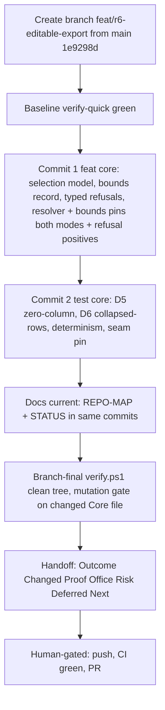

# R6.1 — Export-selection and bounds model: implementation plan

Branch: `feat/r6-editable-export` (phase-wide, owner-approved 2026-11-18) from
`main` @ `1e9298d` (carries the green R6.7 spike and accepted ADR-0066).
Work item: [`docs/work-items/R6.1-export-bounds-model.md`](../docs/work-items/R6.1-export-bounds-model.md)
(Tier B — binding contract). Roadmap row R6.1: *Add export-selection and bounds
model without creating shapes — Core tests for chart-only and table-plus-chart
bounds — None.*

## 1. Objective

Define what **Copy Editable** composes — chart-only versus table-plus-chart — as
**pure Core bounds math with zero shapes created**, pinned by Core tests for both
selection modes. The model is the single contract R6.3's group-bounds check and
Phase 8's PNG crop bounds consume (work-item D3: consumed, never recomputed).

## 2. Verified starting facts (evidence ledger)

| Statement | Status | Evidence |
| --- | --- | --- |
| R6.7 spike green; ADR-0066 accepted 2026-11-18; immediate delete path stands; no staging workbook | fact | [`docs/STATUS.md`](../docs/STATUS.md) top entry; [`docs/adr/0066-copy-after-delete-preserves-the-drawing-format.md`](../docs/adr/0066-copy-after-delete-preserves-the-drawing-format.md) |
| The two selection modes ride the existing profile/panel seam: chart-only = `SceneBuildRequest` with `Profile = EditableExport`, `Panel = null`; table-plus-chart = same profile with `Panel` set | fact | work item D4; [`SceneBuilder.cs`](../src/GanttCreator.Core/Scene/SceneBuilder.cs:365) refuses a live request carrying a panel (`LiveProfileCarriesPanel`); [`SceneCompositionProfile.cs`](../src/GanttCreator.Core/Scene/SceneCompositionProfile.cs:70) `DrawsDataPanel` fails closed |
| `ChartBounds` = union of panel, year, period, plot plus `ChartOuterPaddingPt`, padding inside the bounds; whitespace outside the union is not exported | fact | entity guide §1; [`FrameBandsBuilder.cs`](../src/GanttCreator.Core/Scene/FrameBandsBuilder.cs:167) |
| A renderer translates the chart bounds to a zero origin and **carries the delta**; the delta must be carried into the export bounds | fact | entity guide §1 (binding since R4.3 landed); work item D1 |
| An empty data table is invalid **as an export** while a live empty table renders a calendar-year chart (ADR-0050, R5.18j) — the refusal is export-only by contract | fact | work item D2; [`SceneBuildRequest.AllowEmptyEvents`](../src/GanttCreator.Core/Scene/SceneBuilder.cs:100) |
| Zero visible user columns is a supported state; the measured grid sums to zero width and `PanelCellGrid` accepts it | fact | ADR-0065, R5.22; [`PanelCellGrid.cs`](../src/GanttCreator.Core/Scene/PanelCellGrid.cs) |
| Collapsed outline rows measure zero height and `PanelCellGrid` accepts zero-height rows by design | fact | ADR-0034; work item D6 |
| No export-selection type exists in Core yet | fact | `search_files` over `src/GanttCreator.Core` for `ExportSelection|ChartOnly|TablePlusChart` → 0 results |
| Branch naming standard `type/roadmap-id-short-description`; phase branches chain from the previous phase branch; `main` is protected | fact | [`docs/05-GIT-QUALITY.md`](../docs/05-GIT-QUALITY.md) §Branch and review policy; `.git/config` branch chain (`feat/r4-1-adapter-ports` ← `stage-inspect`, `feat/r5-1-plot-range-modes` ← `feat/r4-1-adapter-ports`) |
| Local `main` @ `1e9298d` carries the R6.7 spike and ADR-0066; current HEAD is `main` | fact | `.git/refs/heads/main`; working tree contains the 2026-11-18 STATUS entries |

## 3. Technical approach

### 3.1 Solution architecture (all inside `GanttCreator.Core`)

New files under `src/GanttCreator.Core/Scene/`:

1. **`ExportSelection.cs`** — `public enum ExportSelection { ChartOnly, TablePlusChart }`.
   Exactly two members; a third mode is a work-item stop condition (entity guide §1
   owns the two-mode contract; amendment first).
2. **`ExportBounds.cs`** — immutable record carrying the computed contract:
   - `RectD Bounds` — the export bounds translated to a **zero origin** (guide §1);
   - `PointD PlacementDelta` — the translation delta **carried** (D1: a crop
     computed from an un-translated `ChartBounds` would export a chart missing
     exactly `ChartOuterPaddingPt` of margin on two sides);
   - `RectD ChartBounds` — the untranslated scene chart bounds, for diagnostics and
     for R6.3's group-bounds tolerance check.
3. **`ExportBoundsRefusal.cs`** — typed refusal enum + actionable message text,
   following the repository's refusal pattern (`SceneBuilderRefusal`,
   `PanelCellGridRefusal`):
   - `EmptyVisibleTable` — table-plus-chart selected with an empty visible table
     (§1: "an empty data table … is not a valid export"). **Do not "fix" this to
     match the live path** (D2) — the live calendar-year fallback is live-only.
   - `InvalidBounds` — non-finite or non-positive extents refused **before** any
     composition (D2).
4. **`ExportBoundsResolver.cs`** (name final in implementation) — the pure
   computation. Input: the export scene inputs (events, grid, theme/metrics,
   title, scale) plus an `ExportSelection`. Behaviour:
   - Builds the export `SceneBuildRequest` through the **existing seam** (D4):
     `Profile = SceneCompositionProfile.EditableExport`; `Panel` left null for
     `ChartOnly`, set for `TablePlusChart`. No second authority is introduced —
     the selection model only chooses whether `Panel` is supplied.
   - Calls `SceneBuilder.TryBuild` (the single scene orchestrator) and reads
     `GanttScene.ChartBounds` — chart-only therefore excludes the panel
     contribution *by construction* (no panel primitives → no panel in the frame
     union), table-plus-chart includes the panel grid bounds.
   - Translates to zero origin and carries the delta (D1).
   - `ChartOnly` with an empty visible table: the chart still composes (the live
     empty-chart rule is a *scene* rule, ADR-0050) — only `TablePlusChart`
     refuses on an empty visible table. This asymmetry is D2 and gets its own
     positive test pair.
   - Zero visible columns (D5): the grid sums to zero width, the panel contributes
     no bounds, and the table-plus-chart bounds **equal** the chart-only bounds —
     degrade, never refuse, never a phantom-width panel.
   - Collapsed rows (D6): zero-height rows shrink the panel bounds to the visible
     parent/top-level rows; every render-visible child shape still composes on its
     parent's lane (R4.7B projection) — the bounds shrink, the Gantt never does.

No changes to `SceneBuilder`, `PanelBuilder`, `FrameBandsBuilder`, or
`PanelCellGrid` are planned. If implementation proves a seam change is required,
that is a stop-and-report condition (it would touch the live path).

### 3.2 Excel integration and data handling strategy

**R6.1 performs zero Excel integration — by contract.** Core has no Office,
Excel-DNA, clipboard, dialog, or UI dependency (AGENTS.md invariant), and the
roadmap row's Office gate is *None*. The Excel-facing strategy is therefore a
**consumption contract** for the rest of Phase 6:

- The export scene is built **only on an explicit click** (architecture "Editable
  export composition" step 1); R6.8 wires the command. Nothing here schedules,
  coalesces, or otherwise triggers a render.
- R6.2 composes the panel as native rectangle/text shapes **on the same
  worksheet** as live owned shapes, using the staging name prefix and distinct
  staging ownership tag the Phase-6 review added as R6.2 D4 — outside this row.
- R6.3 stages the complete scene at a staging origin and its group-bounds check
  **consumes this model's `Bounds`** within tolerance rather than recomputing.
- The data table stays on the visible worksheet; nothing moves to
  `_GanttCreatorConfig` (invariant). The bounds model reads only scene-model
  inputs — it never reads a worksheet.

### 3.3 PowerPoint generation and manipulation design

**R6.1 performs zero PowerPoint manipulation.** The design constraints the model
must satisfy for the PowerPoint consumers:

- The **placement delta carriage (D1)** exists precisely so Phase 7's
  `PasteSpecial(ppPasteShape)` transfer and Phase 8's PNG crop cannot lose
  `ChartOuterPaddingPt` of margin. `ExportBounds.PlacementDelta` is the value
  R7.6/R7.1 and the raster crop consume.
- ADR-0066 (accepted) fixed the route: late-bound COM (no interop package without
  owner approval), `ppPasteShape` with the returned shape range **verified** (the
  spike measured a pasted range of 5 = group + 4 flattened children, so consumers
  must not assume a single-item range), and immediate delete-after-copy which
  preserves the Office drawing clipboard format. All of that is R6.6/R7.x work;
  this row only guarantees the bounds they paste against are correct.

### 3.4 Libraries and APIs

**Zero new packages.** .NET 10 BCL only, plus existing Core types:
[`SceneBuildRequest`](../src/GanttCreator.Core/Scene/SceneBuilder.cs:93),
[`SceneCompositionProfile`](../src/GanttCreator.Core/Scene/SceneCompositionProfile.cs:33),
[`SceneCompositionProfiles.DrawsDataPanel`](../src/GanttCreator.Core/Scene/SceneCompositionProfile.cs:70),
[`PanelCellGrid`](../src/GanttCreator.Core/Scene/PanelCellGrid.cs:121),
[`GanttScene`](../src/GanttCreator.Core/Scene/GanttScene.cs), `RectD`/`PointD`,
`GeometryMath`. No COM, no `Task.Run`, no network, no telemetry — Core stays
offline and deterministic.

## 4. Code changes required

| File | Change |
| --- | --- |
| `src/GanttCreator.Core/Scene/ExportSelection.cs` | New — two-member selection enum with XML docs |
| `src/GanttCreator.Core/Scene/ExportBounds.cs` | New — bounds + delta + untranslated chart bounds record |
| `src/GanttCreator.Core/Scene/ExportBoundsRefusal.cs` | New — typed refusals with actionable messages |
| `src/GanttCreator.Core/Scene/ExportBoundsResolver.cs` | New — pure computation over the profile/panel seam |
| `tests/GanttCreator.Core.Tests/Scene/ExportBoundsResolverTests.cs` | New — the full test catalogue in §6 |
| `docs/REPO-MAP.md` | Add the new Core types to the Core project row |
| `docs/STATUS.md` | One entry per commit, handoff format |

No schema change, no catalogue hash change, no ribbon change, no golden-image
change (no composition output changes — the model only *reads* scene bounds).

## 5. Error handling

- **Refusals, not empties, not exceptions** (D2): every expected failure returns a
  typed `ExportBoundsRefusal`; exceptions are reserved for programmer error
  (`ArgumentNullException.ThrowIfNull` guards, each with a positive test asserting
  `ParamName` — the repository's established pattern).
- Invalid bounds refuse **before** any composition work.
- No catch-and-ignore, no analyzer suppression, no swallowed COM (there is no COM
  here at all).
- Deterministic, culture-invariant message text (no date/number formatting in
  messages beyond invariant doubles).

## 6. Testing and validation approach

All tests in `tests/GanttCreator.Core.Tests` (xUnit; the same harness
`dotnet test tests/GanttCreator.Core.Tests` runs). Every new `if (bad) { error }`
validator ships with a **positive test in the same commit**.

**Bounds pins (both modes):**
1. Chart-only bounds: with and without a title band; padding applied exactly once
   (bounds width/height = union + `ChartOuterPaddingPt` per side, no more).
2. Table-plus-chart bounds: panel grid bounds included in the union; padding once.
3. Zero-origin translation: `Bounds.X == 0 && Bounds.Y == 0`, and
   `PlacementDelta` equals the untranslated `ChartBounds` top-left — the D1
   defect guard (a test that crops from `ChartBounds` without the delta is the
   defect this exists to prevent).
4. Determinism: repeated computation over identical inputs yields identical
   bounds (bit-equal doubles).

**Refusal positives:**
5. Empty visible table + `TablePlusChart` → `EmptyVisibleTable` with the
   actionable message.
6. Empty visible table + `ChartOnly` → succeeds (the D2 asymmetry, pinned so a
   later change cannot "fix" the refusal to match the live path).
7. Invalid bounds (non-finite / non-positive extents) → `InvalidBounds`, refused
   before composition.

**Degradation pins:**
8. D5 — every user column hidden: table-plus-chart bounds **equal** chart-only
   bounds; no refusal, no phantom panel width.
9. D6 — collapsed outline group: panel bounds shrink to visible parent rows in
   **both** modes while child shapes still compose.

**Seam pin:**
10. The selection → request projection: `ChartOnly` leaves `Panel` null,
    `TablePlusChart` sets it, and both carry `Profile = EditableExport` (D4 — no
    second authority).

**Gates:** `dotnet build GanttCreator.slnx /p:Configuration=Release /warnaserror`
(0 warnings), `dotnet test tests/GanttCreator.Core.Tests`,
`pwsh ./scripts/verify-quick.ps1` per commit (exit 0), `git diff --check` (no
output), branch-final `pwsh ./scripts/verify.ps1` on a clean tree — the changed
Core file enters the mutation gate, so guards must be killable (positive tests
above are what kill them). **No Office gate** (row: None). Push + GitHub CI green
before phase exit (W-12 rule) — human-gated.

## 7. Performance and maintainability

- Pure functions over immutable records; O(1) additional work over one scene
  build (which R6.3 would perform anyway). No COM, no I/O, no allocation-heavy
  paths beyond the scene build itself.
- Single authority (D3): R6.3 and Phase 8 consume `ExportBounds`; a second
  computation site is an architecture defect. Consider (implementation-time
  decision) whether an Architecture.Tests guard is warranted now or when the first
  consumer lands in R6.3 — do not add a guard with no producer/consumer pair yet.
- XML docs on all public members (repository policy); comments only where they
  add current, non-obvious value (e.g. the D2 export-only refusal rationale).
- Full `docs/08-TEST-CHECKLIST.md` self-certification scope for this row:
  **sections B, G, I** (per the work item's Definition of Done).

## 8. Task sequencing

- **Commit 1** — `feat(core): add export-selection and bounds model (R6.1)`:
  the four new Core files + tests 1–7 + 10. One reviewable behaviour: the model
  computes both modes' bounds and refuses correctly.
- **Commit 2** — `test(core): pin zero-column and collapsed-row export bounds
  degradation (R6.1)`: tests 8–9 (and determinism if not already in commit 1).
  Split only if commit 1 becomes hard to review; otherwise collapse into one
  commit (one roadmap row is normally one commit).
- Each commit: `verify-quick.ps1` green **before** committing; commit message
  lists certified checklist sections (`Checklist: B, G, I`).
- Stop conditions (work-item + AGENTS.md): a third selection mode appears
  necessary; a seam change in `SceneBuilder`/`PanelBuilder` proves required; any
  invariant conflict. Two failed attempts on one failure → stop and report.

## 9. Risks and rollback

Minimal (pure Core, no consumers until R6.3). Rollback: `git revert`. The one
real defect class this row exists to prevent — cropping from an un-translated
`ChartBounds` and losing `ChartOuterPaddingPt` on two sides — is pinned by test 3.
