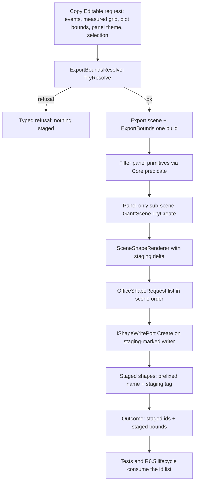

# R6.2 — Editable-export table composition plan

> Work item: [R6.2-table-composition.md](../docs/work-items/R6.2-table-composition.md) (Tier B, binding).
> Depends on: R6.1 (landed), R3.11 panel primitives (landed), R4.1–R4.6 render paths (landed),
> R6.7 spike (landed; ADR-0066 accepted — delete-after-copy stands, no staging workbook).
> Owner decisions confirmed 2026-11-18: both Core additions below are approved.

## Outcome

The selected table/header cells compose as native rectangle/text/line shapes at a
deterministic staging origin on the live worksheet, reproducing exactly the R3.11
panel primitives — pinned by shape-count, bounds, cell-text, style, and z-order
contract tests, D4 staging-identity positives, and a live staged-composition
inspection on the Office host.

## Verified starting facts (evidence ledger)

| # | Statement | Status | Evidence |
| --- | --- | --- | --- |
| 1 | R6.1 landed: `ExportSelection`, `ExportBounds` (`Bounds`, `PlacementDelta`), `ExportBoundsResolver.TryResolve` pins profile `EditableExport`, supplies `Panel` only for table-plus-chart, reads `GanttScene.ChartBounds` | fact | [ExportBoundsResolver.cs](../src/GanttCreator.Core/Scene/ExportBoundsResolver.cs); STATUS 2026-11-18 |
| 2 | The resolver builds the full export scene internally and **discards it**, returning only bounds | fact | `ExportBoundsResolver.TryResolve` body |
| 3 | Panel primitives are emitted by `PanelBuilder` with roles `header-cell:`, `header-text:`, `panel-cell:`, `panel-text:`, `panel-border-v:`, `panel-border-h:`; header/borders owned by `SceneOwnerId.Chart`, cells/text by the per-row owner | fact | [PanelBuilder.cs](../src/GanttCreator.Core/Scene/PanelBuilder.cs) `AddHeader`/`AddBody`/`AddBorders` |
| 4 | On the live profile no panel is carried, so the live sheet never contains panel-named shapes; a live refresh's reconciler deletes owned shapes absent from the live scene | fact | `SceneBuilder` live-panel refusal; R4.7 update-first reconciliation |
| 5 | Live ownership: shape `Name` = primitive id, `AlternativeText` = `GanttCreator.Owned.v1:{16-hex}`; ownership is proved by recomputing the tag **from the live name** (`CarriesOwnershipTagFor`) | fact | [ShapeOwnershipTag.cs](../src/GanttCreator.Office/ShapeOwnershipTag.cs), [ExcelShapeWriter.cs](../src/GanttCreator.Office/ExcelShapeWriter.cs) |
| 6 | `CouldBeOwnedName` is a name-form test (contains `:` or equals `ChartTitle`); `ExcelConfigIntegrityChecker` reports a shape damaged only when its alt text is blank **or** carries the `Owned.v1` prefix without matching the name | fact | `ExcelShapeWriter.CouldBeOwnedName`; checker scan block |
| 7 | A staging tag `GanttCreator.Staging.v1:…` therefore fails every live ownership proof and every checker damage test — no live-scan change is required for the scans to ignore staged shapes | inference (6 + tag design) | to be pinned by positive tests |
| 8 | `SceneShapeRenderer(ChartOriginDelta).Translate(GanttScene)` emits `OfficeShapeRequest`s in scene order; `IShapeWritePort.Create` names and tags the shape; the writer exposes `internal virtual` seams (`ApplyOwnershipStamp`, `AddShape`, `FindShapeByName`, …) for host-free tests | fact | [SceneShapeRenderer.cs](../src/GanttCreator.Office/SceneShapeRenderer.cs), [IShapeWritePort.cs](../src/GanttCreator.Office/IShapeWritePort.cs) |
| 9 | Documented geometry tolerance is `HostOwnedGeometry.GeometryMatchTolerancePt = 0.01` pt | fact | [HostOwnedGeometry.cs](../src/GanttCreator.Core/Scene/HostOwnedGeometry.cs) |
| 10 | Zero visible columns: the model supplies no panel when the grid sums to zero width; bounds equal chart-only (ADR-0065 D4) | fact | STATUS R6.1 entry; `ExportBoundsResolver` |
| 11 | Collapsed groups: `PanelRowProjection` gives children zero measured height, so the panel shows visible parent rows while the Gantt keeps every render-visible child | fact | work item D2; roadmap Phase-6 note rev 10 |
| 12 | No staging code exists anywhere in `src/` today | fact | repo search, 2026-11-18 |

## Design decisions

### D1 — Scene-driven, cell-free (work item D1)

Every composed shape comes from a scene primitive. The composer never reads a
worksheet cell, never writes one, and never adds a sheet. Positive tests assert
zero cell writes and zero sheet additions over the writer's fake-host seam, and
the integration body asserts an unchanged sheet count and unchanged used-range
values.

### D2 — Exact reproduction (work item D2)

Staged shape count = panel primitive count; bounds = primitive bounds translated
by the staging delta within `GeometryMatchTolerancePt` (0.01 pt); texts verbatim
(blank cells emit no text shape, matching `PanelBuilder.AddBody`); styles are the
theme-resolved values already on the primitives (R4.6 — the composer copies,
never re-derives); z-order = the scene's own order (R4.5 one-pass). The collapsed
panel is the composed panel — the composer never re-filters rows; a composition
test pins the collapsed case, and the zero-column case pins D5.

### D3 — Temporary + owned from birth; lifecycle registration (work item D3)

Every staged shape carries the staging name prefix and staging ownership tag from
the moment `Create` returns. The composer returns the staged primitive-id list and
the staging writer's `ListOwned` (in staging mode) enumerates exactly the staged
shapes — that is the collection contract R6.5's lifecycle will adopt.

Two lifecycle rules are R6.2's own, not deferred (external-review amendment):

- **Pre-flight emptiness check.** Before the first create, the composer requires
  the staging collection to be empty and refuses `StagingAlreadyPopulated`
  otherwise. Without it, a second compose against a *changed* scene (a row added
  between attempts) collides on only some names and stages a partial second set
  that nothing owns — orphaned staging shapes from a failed operation.
- **Cleanup-on-failure in the composer.** Any refusal or exception after the
  first successful create deletes the shapes staged so far (per-id `Delete` in a
  `finally`) before surfacing the typed refusal. The architecture's
  "partial temporary export shapes are removed" rule is honoured on R6.2's own
  paths; R6.5 adds the fault-injection matrix and the sweep-on-tag cleanup, not
  the basics.

### D4 — Staging identity is distinct from live ownership (work item D4)

- **Staging tag prefix:** `GanttCreator.Staging.v1:` (fixed here, per the work
  item's "fixed in this row's ADR-level notes at implementation"; recorded in the
  work-item implementation record and in a one-paragraph addition to
  [02-ARCHITECTURE.md](../docs/02-ARCHITECTURE.md) export step 2).
- **Staging name prefix:** `GanttCreatorStaging:` + primitive id. The tag is
  derived from the **full staged name**, preserving the live invariant
  `tag = f(Name)` so ownership proofs recompute from the name exactly as
  `CarriesOwnershipTagFor` does.
- Consequences pinned by positive tests, both directions:
  a live refresh during staging leaves staging shapes untouched; staging cleanup
  leaves live owned shapes untouched; the live writer's `ListOwned` excludes
  staging-tagged shapes and the staging writer's excludes live shapes;
  `ExcelConfigIntegrityChecker` does not report a staging-tagged shape as damaged.

### D5 — Zero visible columns compose no panel (work item D5)

Zero-width grid → the resolver supplies no panel → zero panel primitives → zero
staged shapes, and the composition is the chart alone (R6.3). Not a refusal; a
composition test pins it.

### D6 — One ownership-scheme marker inside `ExcelShapeWriter` (new)

`ExcelShapeWriter` gains an optional constructor parameter selecting the
ownership scheme (default: the live `Owned.v1` scheme, behaviour identical to
today — every existing pin guards this). In staging mode the same create/update/
delete/list machinery stamps and proves the staging prefix pair. Rationale
(ponytail ladder, reuse rung): the alternative — a separate staging writer class
— duplicates ~1 000 lines of battle-tested COM creation/styling code; the other
alternative — create-then-rename/retag — adds two COM round trips per shape and
a transient mis-tagged state. The marker touches only the stamp/proof sites
(`ApplyOwnership`, `CarriesOwnershipTagFor`, `ListOwned`'s tag check, `Create`'s
duplicate check, `Delete`'s authorisation); geometry, style, and text paths are
untouched.

Two caveats recorded at review (external-review amendment): (1) an interface
whose behaviour depends on hidden constructor state is a semantic overload — if
the composer's tests need to fake staging semantics meaningfully, introduce a
narrow `IStagingShapeWritePort` (create/delete/list-staged) implemented by the
same marked writer rather than widening the fake's imitation of the live port;
decide at Slice 4 when the test shape is known. (2) `ListOwned` returning
staged shapes in staging mode is a naming lie — if a staging interface is
introduced, name the member `ListStaged` even if it delegates to the same scan.
(3) Two writer instances share one `Shapes` collection: verify at implementation
that the batch-scoped name index the live writer caches is batch-scoped per
operation and never stale across instances.

### D7 — Staging origin: beside the chart, deterministic (new)

`stagingOrigin = (scene.ChartBounds.Right + StagingMarginPt, scene.ChartBounds.Top)`
with `StagingMarginPt` a named constant (proposed 20 pt; exact value fixed in the
work-item record). The translation delta is
`stagingOrigin − ExportBounds.PlacementDelta`, so the staged panel lands at the
exact coordinates the full R6.3 composition will occupy, and R6.1's bounds model
is the single authority for the translation (D3 of R6.1). Matches R6.3's Office
gate wording "stage beside real content". Rejected alternatives, with the
reasoning recorded so it is not re-litigated: a fixed far-away worksheet point
(not beside content, same collision class, worse for the R6.3 inspection), and
**below the chart** — the table grows downward as rows are added, so a
below-chart origin collides with future body rows and with the chart's own
bottom-anchored shapes; right of the chart is the one direction nothing grows.
The composition itself owns no application-state scope; the command (R6.8) wraps
staging in the ADR-0020 five-setting scope so the user never sees the flash, and
R6.2's integration body suppresses `ScreenUpdating` for the same reason (see
Slice 5).

### D8 — Approved Core additions (owner decision 2026-11-18)

1. `ExportBoundsResolver` exposes the scene it already builds (new outcome
   member or sibling method — one build, one authority; R6.3 consumes it too).
   This is a post-landing amendment to R6.1's surface and is recorded as such in
   the R6.1 work item (the R5.13 amendment precedent).
2. A panel-primitive predicate beside `PanelBuilder` in Core
   (`PanelPrimitiveRoles.IsPanelPrimitive(ScenePrimitive)` or equivalent),
   owning the role-prefix list so Office never restates Core-owned role strings.
   The predicate extracts the role from `PrimitiveId` using the primitive's own
   `OwnerId` length, then matches the prefix set.

### D9 — Sub-scene translation, zero renderer diff (new)

The composer filters the export scene's panel primitives (D8.2 predicate) and
builds a panel-only sub-scene via `GanttScene.TryCreate` with the parent scene's
bounds, then reuses `SceneShapeRenderer` unchanged with the D7 delta. Trade
recorded: `TryCreate` re-validates and re-sorts an already-valid, already-ordered
subset (cheap, idempotent); the alternative — a renderer overload accepting a
bare primitive list — changes a landed public surface to save microseconds.
The re-sort is safe only because `GanttScene.Order` is a **total order on unique
keys** (primitive ids are unique), so applying it to a subset preserves the
parent scene's relative order — this invariant is stated in a comment and pinned
by a test, not left as an accident of the sort's shape.

## Composition flow



## Implementation slices (one concern per commit)

### Slice 1 — Core: resolver exposes the built scene

- `ExportBoundsResolver`: carry `GanttScene? Scene` on the success outcome (or a
  sibling `TryResolveWithScene`); refusal paths unchanged.
- Core tests: the exposed scene equals a direct `SceneBuilder.TryBuild` of the
  same shaped request; all 16 existing `ExportBoundsResolverTests` pins stay
  green unchanged (bounds behaviour untouched).
- Amendment note in the R6.1 work item.

### Slice 2 — Core: panel-primitive predicate

- `PanelPrimitiveRoles` (beside `PanelBuilder`): the six role prefixes; role
  extraction via `OwnerId`; `IsPanelPrimitive(ScenePrimitive)`.
- Core tests (positives required by the validator rule): every primitive
  `PanelBuilder` emits over a fixture grid satisfies the predicate (this is the
  guard against a future new role silently vanishing from the export); chart
  frame/plot/band primitives do not; a malformed or foreign id is refused
  (returns false, never throws — a scan, not a validator).

### Slice 3 — Office: staging tag scheme + writer marker

**Step 0 (before any code in this slice): inventory every live scan path.**
Grep `src/` for every consumer of `ShapeOwnershipTag`, `CouldBeOwnedName`,
`AlternativeText`, and `ListOwned` — the D4 safety argument currently rests on
the scans examined during planning (reconciler, integrity checker, ownership
filter); the inventory turns "no scan we know of touches staging shapes" into
"no scan that exists touches staging shapes", and the D4 positives then pin the
inventory's members.

- `ShapeStagingTag` static class mirroring `ShapeOwnershipTag`:
  `Prefix = "GanttCreator.Staging.v1:"`, `ForPrimitiveId`, `IsStagingTag`,
  `HasStagingPrefix`; same SHA256/16-hex construction, ordinal, invariant culture.
- `ExcelShapeWriter`: optional ownership-scheme marker (default live). Route the
  stamp/proof sites through it; staging names = `GanttCreatorStaging:` + id.
- Office contract tests over the existing fake-host seams:
  - Live default unchanged: existing writer suites green with no edits (the pin).
  - Staging create stamps prefix name + staging tag (one fact).
  - D4 positives (both directions, per D4 above), including the
    `ExcelConfigIntegrityChecker` non-damage fact.
  - Staging `Delete` refuses a live-owned shape and vice versa (positive tests).
  - Name-length guard: a staged name exceeding the host cap surfaces as the
    typed `HostRejected`/refusal, never a silent truncate (verify the cap on the
    host in Slice 5; record the measured value).

### Slice 4 — Office: the panel composition stage

- `EditablePanelStagingComposer` (name final at implementation):
  input = resolver outcome (scene + bounds) + selection; steps per D1/D2/D6/D7/D9;
  output = staged primitive ids, staged bounds, typed refusals surfaced from the
  resolver (empty visible table, panel theme missing, invalid bounds — the R6.1
  refusal positives) plus its own (null scene, staging create refusal).
- Office contract tests (over `FakeShapeWritePort`-style fakes and the writer
  seams):
  - Count pin (fixture with blank cells: rect count = cells, text count =
    non-blank cells, border count = column boundaries + row boundaries + 2).
  - Bounds pin within `GeometryMatchTolerancePt`, translated by the D7 delta.
  - Text verbatim pin; header alignment pin (Description left, others centred).
  - Style pin: fills/strokes/typography are the theme-resolved primitive values.
  - Z-order pin: create order = sub-scene order (backgrounds → texts → borders
    by layer).
  - Zero-cell-write and zero-sheet-add positives, built so they **can fail**: the
    fake host must intercept `Range`/`Cells`/`Rows`/`Sheets.Add` members and fail
    the test when touched — a fake that does not model those members cannot
    detect the write it exists to forbid, and the positive would be theater.
  - D2 collapsed-rows pin; D5 zero-column pin (zero staged shapes, no refusal).
  - Refusal positives: empty visible table (R6.1), panel theme missing, invalid
    bounds, null scene — each asserts nothing was staged.
  - Pre-flight positive: a compose against a non-empty staging collection
    refuses `StagingAlreadyPopulated` and stages nothing (D3's pre-flight rule;
    the naive compose-twice `AlreadyExists` behaviour is rejected because a
    changed scene between attempts would stage a partial second set).
  - Cleanup-on-failure positive: a host refusal injected after the Nth create
    leaves zero staged shapes (D3's finally rule).
  - Request-assembly boundary stated in the composer's XML docs: R6.2's
    production surface is the stage itself; the Office-side assembly of an
    *export* request (the live factory pins `LiveExcel` in code and cannot be
    reused as-is) is R6.3/R6.8's row, and R6.2's tests assemble Core requests
    directly. Nothing in R6.2 may expose the composer through a command.

### Slice 5 — Integration: live staged-composition inspection (Required)

- `OfficeIntegration`-tagged body in
  `tests/GanttCreator.Office.IntegrationTests/`: initialise a workbook, write
  representative rows (including a collapsed group, a blank cell, **and a long
  description that wraps in the live cell**), measure the grid, resolve bounds +
  scene, stage the panel, then inspect on the host:
  shape kinds, prefixed names, staging tags, verbatim texts, bounds all inside
  `[stagingOrigin, stagingOrigin + export size]` (nothing outside the staging
  origin), shared borders present, **z-order monotone among the staged shapes
  (`ZOrderPosition` follows the scene's back-to-front order — the contract test
  pins request order only, so the host assertion is the one that proves the
  paint order)**, **the long description's staged text shape wraps the same way
  the live cell does (a divergence here is an export-fidelity defect to record,
  not a test to loosen)**, sheet count unchanged, used-range values unchanged.
  The body suppresses `ScreenUpdating` around the staging loop (a ~12 000-shape
  paint storm at 1 000 rows is both slow and a dishonest measurement) and
  records the informal duration. Cleanup per-id in `finally`. Record host builds
  in the row.
- Runs under `verify-office.ps1`; the pre-existing D4 leak-ratchet caveat R6.7
  recorded applies (gate exit-0 caveat, not caused by this row); the new body
  adds at most one teardown kill, within the per-teardown ceiling of 1.

### Slice 6 — Docs

- `docs/REPO-MAP.md`: the staging stage's entry points and test locations.
- `docs/STATUS.md` entry; work-item implementation record fixing the D4/D7
  values; the one-paragraph staging-identity note in
  [02-ARCHITECTURE.md](../docs/02-ARCHITECTURE.md) export step 2.

## Verification plan

```powershell
dotnet build GanttCreator.slnx /p:Configuration=Release /warnaserror
dotnet test tests/GanttCreator.Core.Tests          # slices 1-2
dotnet test tests/GanttCreator.Office.ContractTests # slices 3-4
pwsh ./scripts/verify-quick.ps1                     # every commit
pwsh ./scripts/verify-office.ps1                    # Required (Slice 5)
git diff --check
```

- Definition of done per the work item: contract pins + zero-write positives
  green; live inspection recorded with host builds; Release 0 warnings; XML docs
  on every new public member; REPO-MAP/STATUS current; checklist sections
  **E, J** self-certified and named in the commit message.
- Every new `if (bad) { error }` validator ships its positive test in the same
  commit (the refusal positives above are that requirement's inventory).
- Not run / deferred: mutation gate runs at branch final (`verify.ps1`), not per
  slice; the 1 000-row performance budget belongs to the full export (R6.6/R6.8)
  — R6.2 records an informal shape-count/duration observation from the
  integration body instead of claiming a budget it does not own.

## Risks and edge cases

| Risk | Handling |
| --- | --- |
| Primitive-count drift when R3.11 changes | Count pin fails loudly; PanelBuilder and the pin update together (work item's stated main risk) |
| A future `PanelBuilder` role missing from the predicate | Slice 2's "every emitted primitive satisfies the predicate" test fails at the source |
| Marker routing defect misclassifying a staged shape as live-owned | Symmetric D4 positives in both directions; live side additionally guarded by every existing writer pin (default marker) |
| Mid-staging coalesced refresh | Main-thread scheduling means no true interleaving within a command, but the D4 positive test proves the invariant without relying on scheduling |
| Live `ListOwned` pays one alt-text read per staged shape (staging names pass `CouldBeOwnedName`) | Bounded, rare (refresh during staging only); recorded, not optimised — `ponytail:` ceiling note at the scan site |
| Staged shapes overlapping user content right of the chart | Accepted: temporary, deleted in `finally`, command-level state scope (R6.8) hides the flash; R6.3's live gate inspects placement |
| Shape-name length cap on prefixed shared-owner ids | Panel ids are bounded (per-row/Chart owners); guard + host measurement in Slices 3/5; R6.3 owns the shared-owner exposure |
| Partial staging on host refusal | Composer deletes staged-so-far in a `finally` before surfacing the refusal (D3); the fault-injection *matrix* is R6.5's row |
| Staged text shape wraps differently from the live cell on long descriptions | Slice 5 inspects a wrapping case explicitly; a divergence is recorded as an export-fidelity defect, never loosened |
| Two writer instances sharing one `Shapes` collection (stale batch name index) | Verified at implementation (D6 caveat 3); pinned if the index is instance state |

## External-expert critique

An honest reading of this plan from outside the repository:

1. **The marker (D6) is the highest-leverage and highest-risk decision.** It
   concentrates two ownership regimes in one 2 400-line class whose correctness
   the whole live renderer depends on. The mitigation — default-is-live plus
   existing pins plus symmetric new positives — is sound, but a reviewer should
   insist the marker is a pure delegation with no shared mutable state, and that
   the diff shows geometry/style paths untouched. If the marker diff starts
   touching `AddShape`/`ApplyStyle`, stop and reconsider the separate-writer
   alternative despite its duplication.
2. **String-prefix primitive selection is a weak-typing seam.** The plan's answer
   (predicate beside the emitter, plus an emits-coverage test) is the right
   available answer, but the deeper fix — panel primitives carrying a structural
   marker rather than a naming convention — would be a `PanelBuildResult`-level
   change the work item forbids ("invents no parallel model"). Accept the seam;
   the coverage test is the load-bearing guard.
3. **The resolver amendment reopens a landed contract.** Adding a scene member to
   `ExportBoundsOutcome` is small, but R6.1's pins were written against a
   bounds-only surface; the amendment note in the R6.1 work item is mandatory,
   not courtesy. If the R6.1 tests need more than zero edits to stay green, the
   amendment is wrong-shaped and should become a sibling method instead.
4. **"Nothing outside the staging origin" is only as strong as the fixture.** The
   integration body must include the collapsed-group and blank-cell cases, or the
   bounds assertion proves the happy path only. The plan's Slice 5 fixture list
   is the contract; do not trim it when the body is written.
5. **The plan defers lifecycle correctness to R6.5 by design.** That is the
   roadmap's sequencing, not an oversight, but it means R6.2 alone cannot claim
   "partial temporary shapes are removed" for arbitrary failure points — only
   for the refusal paths it pins. The handoff must say so explicitly rather than
   letting the architecture's transactional-failure language read as already
   satisfied.
6. **Performance is asserted, not measured.** A ~1 000-row table stages roughly
   12 000 shapes (cells + texts + borders); the 5-second budget belongs to the
   full export, but if the integration body's informal duration is already
   seconds for a small table, that is a leading indicator worth recording now
   rather than discovering in R6.6.
7. **The user-facing brief mentions PowerPoint generation, charts, and slide
   templating; none of it belongs to R6.2.** The work item's exclusions are
   explicit (no clipboard R6.6, no grouping R6.4, no chart entities R6.3). The
   plan holds that line; the PowerPoint surface is R6.6/R7 territory and is
   listed under Out of scope below so the boundary is stated, not implied.
8. **The first draft of this plan had two real correctness gaps and one
   test-theater risk, found by this critique pass and amended above:** the
   compose-twice pin would have blessed partial second stagings that leave
   orphans (now a pre-flight emptiness refusal); the transactional cleanup was
   over-deferred to R6.5 (now the composer's own `finally`); and the
   zero-cell-write positive was specified against a fake that could not fail
   (now required to intercept the members it forbids). A reviewer applying this
   critique to a future plan should look for the same three shapes: a pinned
   behaviour that is merely tolerable rather than correct, a deferred basic that
   an architecture rule already requires, and a positive test with no failure
   mode.

## Assumptions

- All COM work runs on the Excel main STA thread; no `Task.Run` around COM.
- The coalesced refresh scheduler executes between commands, never inside one;
  regardless, D4 is proven by test, not by this assumption.
- The staging tag is not a workbook schema value (same standing as the owned
  tag) — no schema version or catalogue hash moves.
- ADR-0066 (accepted) stands: immediate delete-after-copy is safe on the
  reference host, so no staging workbook is designed in.
- No new production dependency, no Office permission, no signing change.

## Out of scope (exclusions, from the work item)

- Chart entities, bands, bars, markers, delineators — R6.3 stages the full scene.
- Grouping and child order — R6.4. Clipboard copy and format verification — R6.6.
- Staging lifecycle fault-injection matrix — R6.5. The one-click command — R6.8.
- PowerPoint transfer, slide templating, `ppPasteShape` — R6.6/R7 rows.
- Cell writes or sheet additions — never (the staging rule).
