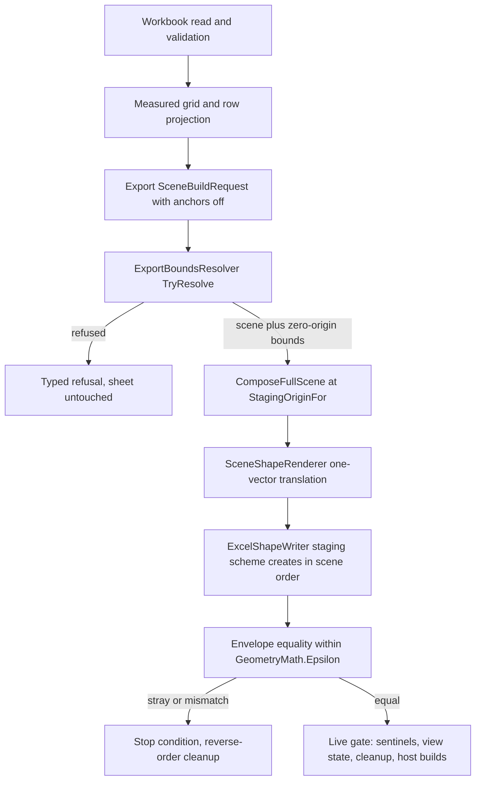

# R6.3 — Full-scene chart staging: technical plan

Reviewed 2026-11-18 against the landed tree. R6.1 (bounds model) and R6.2 (panel
staging composition) both landed 2026-11-18; every premise below was verified against
current source, not assumed from the work-item text.

Sources: [`docs/work-items/R6.3-chart-staging.md`](../docs/work-items/R6.3-chart-staging.md),
[`docs/02-ARCHITECTURE.md`](../docs/02-ARCHITECTURE.md) export process steps 2–3,
entity guide §1 + z-order contract, the R6.2 implementation record, and the code cited
inline.

## 1. Objective and user value

**Outcome (work item).** The complete chart scene composes at the deterministic staging
origin — every scene primitive staged as a temporary shape — with the composed set's
overall bounds equal to the R6.1 export bounds within `GeometryMath.Epsilon`, staged
beside real content with zero cell or view corruption.

**User value.** "Copy editable to PowerPoint" requires the whole chart — data panel and
plot — as one set of native, editable shapes. R6.3 is the step that proves the *entire*
scene can be materialized as temporary shapes on the live worksheet without disturbing
the user's content or view. It is the direct precondition for grouping (R6.4), the
staging lifecycle (R6.5), verified clipboard copy (R6.6), and the one-click command
(R6.8).

## 2. What already exists (verified facts)

| Fact | Evidence |
| --- | --- |
| R6.1's resolver builds the export scene once and carries it: `ExportBoundsResolver.TryResolve(request, panelTheme, selection)` pins `Profile = EditableExport`, supplies `Panel` only for `TablePlusChart` with positive grid width, reads `GanttScene.ChartBounds`, and returns the built scene on `ExportBoundsOutcome.Scene` | [`ExportBoundsResolver.cs`](../src/GanttCreator.Core/Scene/ExportBoundsResolver.cs) |
| The D1 staging offset seam exists and is proven: `SceneShapeRenderer(ChartOriginDelta).Translate(scene)` — R6.2 composed through it; the export scene is already zero-origin (`originTopPt` defaults to zero, `SheetCoordinates` is profile-gated to `LiveExcel`), so staging is exactly one vector at the `OfficeShapeRequest` boundary | [`SceneShapeRenderer.cs`](../src/GanttCreator.Office/SceneShapeRenderer.cs), [`SceneBuilder.cs`](../src/GanttCreator.Core/Scene/SceneBuilder.cs) |
| The staging origin **value** is already fixed: `StagingOriginFor = (ChartBounds.Right + 20pt, ChartBounds.Top)` via `StagingMarginPt = 20`, recorded in R6.2's implementation record ("Values fixed here D4/D7"), with the host judgement explicitly deferred to "the R6.3 live inspection" | [`EditablePanelStagingComposer.cs`](../src/GanttCreator.Office/EditablePanelStagingComposer.cs) |
| Staging identity is distinct and mutually blind: `GanttCreatorStaging:` name prefix + `GanttCreator.Staging.v1:{16 hex}` tag, recomputed-from-name proof, pinned in both directions (15/15) | [`ShapeStagingTag.cs`](../src/GanttCreator.Office/ShapeStagingTag.cs), `ShapeStagingOwnershipTests` |
| Pre-flight and cleanup exist: `StagingAlreadyPopulated` refusal before the first create; reverse-order delete of staged-so-far shapes on a host refusal | [`EditablePanelStagingComposer.cs`](../src/GanttCreator.Office/EditablePanelStagingComposer.cs) |
| Tolerance: `GeometryMath.Epsilon = 1e-6` | [`GeometryMath.cs`](../src/GanttCreator.Core/GeometryMath.cs) |
| Host read-back round-trips within tolerance **for the panel families only** (rect/text/border): R6.2's live body asserted the staged envelope on Excel 16.0.20527.20196 and passed. Full-scene line and diamond read-back against 1e-6 is an *unknown* the R6.3 live gate must settle — it is inferred from the panel evidence, not proven | R6.2 Office-gate evidence row in [`STATUS.md`](../docs/STATUS.md); scope limitation named by the 2026-11-18 external critique |
| D1's "staged shapes never enter the ADR-0052 host-owned resize classes" is a work-item *requirement*, not a verified fact: R6.2's record says the ownership scheme routes only the name/tag sites, so `ExcelShapeWriter.Create`'s geometry and placement paths are untouched by the scheme — whether Create assigns host-owned placement (`xlMoveAndSize`) to staged shapes exactly as it does to live ones is unverified and must be checked at Step 0 | [`ExcelShapeWriter.cs`](../src/GanttCreator.Office/ExcelShapeWriter.cs); R6.2 implementation record |
| **Anchor gating hazard:** `SceneBuilder` gates lane anchoring on `request.AnchorLanesToRows` (not on profile), and the live factory pins `AnchorLanesToRows = true` in code. Re-profiling the live request to `EditableExport` would therefore build an export scene with lanes anchored to worksheet rows — wrong export geometry, and nothing refuses it | [`SceneBuilder.cs`](../src/GanttCreator.Core/Scene/SceneBuilder.cs) (anchor branch), [`ExcelSceneBuildRequestFactory.cs`](../src/GanttCreator.Office/ExcelSceneBuildRequestFactory.cs) |
| The R4.2 state scope covers ScreenUpdating/Events/Alerts/StatusBar/Selection — it does **not** capture scroll or zoom today | [`IApplicationStateScope.cs`](../src/GanttCreator.Office/IApplicationStateScope.cs) |
| Live `PanelTheme` resolution is owed to R6.3: R6.2's live test hand-built the theme and recorded "live theme resolution belongs to R6.3/the export command row" | [`EditablePanelStagingIntegrationTests.cs`](../tests/GanttCreator.Office.IntegrationTests/EditablePanelStagingIntegrationTests.cs) |

## 3. Requirements decomposition

| # | Requirement (work item) | Development task | Layer |
| --- | --- | --- | --- |
| F1 | "Panel from R6.2 + every chart primitive via the R4.x paths, translated to the staging origin" | Full-scene compose path reusing the R6.2 loop (origin, delta, pre-flight, cleanup) over the unfiltered export scene | Office |
| F2 | "Building an export `SceneBuildRequest` from the workbook is R6.3's concern" (R6.2 composer remarks) | Export request assembly: measured grid + projection reuse, `AnchorLanesToRows = false` pinned in code, live `PanelTheme` resolution | Office |
| F3 | D2 — "Bounds equality is the contract… a shape outside the bounds fails the test (positive test with a stray-shape fixture)" | Pure envelope-equality check (union of staged envelopes vs expected bounds within `GeometryMath.Epsilon`, stray reporting) + positive stray test | Core + Office |
| F4 | D3 — "view state (scroll, zoom, selection) is captured and restored around the operation" | Wrap staging in `IApplicationStateScope`; scroll/zoom decision (§6.2) resolved by live measurement | Office |
| F5 | D5 — "a coalesced automatic refresh during staging must be safe… positive test: schedule a refresh during staging; staging shapes survive; the live chart reconciles" | Contract-level refresh-during-staging scenario test over the existing mutual-blindness pins | Office tests |
| F6 | "Staged beside real content with zero cell or view corruption" (Office gate, R4.8 sentinels) | Live `OfficeIntegration` body: real workbook, live chart, sentinel cells + unowned sentinel shape, witness cell, view state, envelope equality, cleanup, host builds | Integration |
| F7 | Completeness — "every scene primitive staged (count match)" | Count pin: staged ids == scene primitive ids, both selection modes | Office tests |
| F8 | Zero cell/sheet writes | Fake-port positive assertions (R6.2 pattern) | Office tests |

## 4. Proposed architecture

**Components (smallest coherent diff per rung of the ladder):**

1. **Core, additive and pure — the envelope check.** A small static helper (beside
   `GeometryMath`, e.g. `StagedEnvelopeCheck`) that takes the per-shape staged envelopes
   and the expected `RectD` and answers equality-within-`Epsilon` plus the list of stray
   shapes. Pure geometry, unit-testable without Office fakes, and reusable by R6.4 whose
   work item already pins "group-bounds equals the R6.3 bounds". No new dependency; Core
   gains no Office knowledge (it consumes `RectD` only).

2. **Office — export request assembly.** A `CreateExportRequest`-shaped member on
   [`ExcelSceneBuildRequestFactory`](../src/GanttCreator.Office/ExcelSceneBuildRequestFactory.cs)
   (or a thin sibling class delegating to the same internals) that reuses the measured
   grid, projection, plot-bounds and time-scale machinery and **pins
   `AnchorLanesToRows = false` in code**, mirroring the way the live factory pins it
   `true` ("fixed here, in code, not by a caller remembering"). `Profile` is left to the
   resolver, which re-pins it anyway. The live `PanelTheme` is resolved from the
   workbook's theme authority — the exact seam is a Step-0 verification item (R6.2's
   test hand-built the theme; the product path must not).

3. **Office — the full-scene composer.** A `ComposeFullScene` member beside
   `Compose` in [`EditablePanelStagingComposer`](../src/GanttCreator.Office/EditablePanelStagingComposer.cs):
   same file, shared `StagingOriginFor`, shared delta computation
   (`origin − PlacementDelta`), shared pre-flight and reverse-order cleanup, same
   refusal enum. Differences from the panel path: no `PanelPrimitiveRoles` filter, no
   sub-scene (the parent scene's order is already total), and the zero-column case is
   *not* an early empty return — the chart primitives still stage. R6.2's panel API and
   its 12 tests stay untouched; whether the command row (R6.8) supersedes the panel-only
   path is R6.8's decision, not this row's refactor.

4. **Optional hardening (recommended):** `ExportBoundsResolver` refuses a request that
   carries `AnchorLanesToRows = true` — a validator with its positive test in the same
   commit, closing the silent-wrong-geometry hole from §2 for every future caller, not
   just this one.

5. **View discipline.** The staging operation runs inside
   `IApplicationStateScope` (`SuppressScreenUpdating`/`SuppressEvents`/
   `SuppressAlerts` + `CaptureSelection`), exactly as the refresh pipeline does. The
   scroll/zoom half of D3 is a measured decision (§6.2).

## 5. Acceptance criteria as verifiable conditions

| Work-item acceptance test | Verifiable condition |
| --- | --- |
| Full-scene staging completeness (count match) | Contract test: `StagedPrimitiveIds` (count and content) equals the export scene's primitive ids, for `ChartOnly` and `TablePlusChart` |
| Bounds-equality pins (both selection modes) | Contract test: union of staged envelopes equals `StagedBounds` (origin + `bounds.Bounds` size) within `GeometryMath.Epsilon`, both modes; live body re-asserts from host read-back |
| Stray-shape positive | Contract test: a shape injected outside the envelope makes the check fail and names the stray — never a padded pass |
| Zero cell/sheet writes | Contract test: fake port records no cell write and no sheet add across the whole operation (R6.2 pattern) |
| D5 refresh during staging | Contract test: with staged shapes present, a reconciliation pass over the live port leaves every staged shape untouched and reconciles the live chart |
| Office host (Required) | Live body: stage beside real content; sentinel cells, unowned sentinel shape, witness cell, sheet count, scroll/zoom/selection all unchanged; envelope equality on host read-back; staged set cleaned up; host builds recorded |
| Release 0 warnings, XML docs, REPO-MAP/STATUS current | `dotnet build /warnaserror`, docs updated in the same change |

## 6. Open decisions and ambiguities (owner input)

1. **D4's wording vs R6.2's record.** The R6.3 work item still calls the staging origin
   "an open decision… the owner confirms the value before R6.2/R6.3 implement it", but
   R6.2's implementation record already fixed the value (`ChartBounds.Right + 20pt`,
   `ChartBounds.Top`) and deferred only the *host judgement* to R6.3's live inspection.
   Plan: reuse `StagingOriginFor` verbatim, close D4's wording in the implementation
   record, and let the live gate judge the 20 pt margin. If the owner rejects the value
   or the placement on the host, the work item's stop condition applies (origin rule
   needs the ADR path).
2. **D3 scroll/zoom capture.** The R4.2 scope has no scroll/zoom members, and D3 names
   them. Two options: **(a) measure first** — the live gate records scroll/zoom
   before/after staging; shape creation with explicit `Left`/`Top` neither selects nor
   scrolls, so if undisturbed, record the measurement and add nothing; **(b)** extend
   `ExcelApplicationStateScope` with a `CaptureViewState` member (ScrollRow,
   ScrollColumn, Zoom) plus positive tests now. Recommendation: **(a)** — smallest diff,
   and the live gate must record the measurement either way; extend the scope only on
   observed disturbance.
3. **Origin inside the working view (stop condition).** Right-of-chart + 20 pt can be
   visible on a wide window. The staged set is temporary (grouped in R6.4, copied in
   R6.6, then deleted), but the live gate must record the owner's judgement; a rejection
   opens the ADR path rather than a quiet constant change.
4. **PanelTheme resolution seam.** R6.2's live test hand-built the theme; the product
   path must resolve it from the workbook's theme authority. The exact API is a Step-0
   verification item (marked unknown, not guessed here).
5. **Export request assembly ownership — R6.3 or R6.8? (external-critique finding).**
   The R6.2 composer remark says request assembly "is R6.3/R6.8's concern" — both
   readings are valid, and the R6.3 work item's own scope line does not name it: its
   acceptance tests are all satisfiable with a hand-assembled resolution, exactly as
   R6.2's live body hand-built its panel scene. Landing the workbook→export-request
   factory in R6.3 is defensible (it is the only way the live gate stages a *real*
   complete scene, and it surfaces the anchor hazard in product code) but it roughly
   doubles the row's diff and pre-empts R6.8's command row. **A material scope decision
   the owner settles at Step 0**, with the trade stated both ways — not a plan
   assumption.
6. **D1 placement classification (external-critique finding).** R6.2's record says the
   ownership scheme routes only the name/tag sites, so `ExcelShapeWriter.Create`'s
   geometry and placement paths are untouched by the scheme — if Create assigns
   host-owned placement (`xlMoveAndSize`) to live bars and lines, it assigns the same to
   staged ones, and a column resize during the staged window would stretch temporary
   shapes, violating D1 and corrupting the envelope R6.6 later copies. Step 0 verifies
   what Create assigns; if staged shapes must be excluded from host-owned placement,
   that is a writer change with its own pins, not a footnote.

## 7. Edge cases

- **Zero visible columns** (ADR-0065 D4): no panel primitives; the full-scene
  composition is the chart alone and the bounds equal the chart-only bounds exactly.
  Unlike the panel path there is no empty early return — the chart still stages.
- **Collapsed rows**: the projection already measured children at zero height; the
  composer never re-filters (R6.2 D2 carries over).
- **Empty table**: chart-only reaches the scene builder's `EmptyEvents` refusal;
  table-plus-chart refuses an empty visible table (R6.1's pinned asymmetry). The
  composer surfaces `ExportRefused` with the underlying reason; positive tests already
  exist in R6.1 and are carried through the composer.
- **Blank cell**: emits no text shape (R6.2 D2).
- **Pre-existing staged shapes**: `StagingAlreadyPopulated` before the first create.
- **Mid-composition host refusal**: reverse-order cleanup, `HostRejected` with the
  port's refusal carried.
- **Mid-staging coalesced refresh**: D5 positive test (structural blindness is already
  pinned; this is the scenario pin).
- **Stray shape**: the bounds check fails and names it; never pad the bounds (stop
  condition).

## 8. Risks and mitigations

| Risk | Mitigation |
| --- | --- |
| Silent lane-anchoring leakage (live request re-profiled to export) | Export factory pins `AnchorLanesToRows = false` in code + contract pin; optional resolver refusal (validator + positive test) |
| Host read-back precision vs 1e-6 tolerance | Proven only for the panel families (rect/text/border); full-scene line, diamond and textbox-dimension read-back is an unknown the live gate settles — a host-precision deviation at coordinate magnitude routes to the owner as a tolerance ruling, never a padded bound or a silent epsilon loosening |
| Full-scene performance (hundreds of creates) | `BeginBatch` + the writer's batch-scoped name index (R5.18) already mitigate; the live gate records duration |
| `verify-office.ps1` wrapper 780 s clock vs a 14 m 20 s suite | Pre-existing, recorded in R6.2/R6.7 — run the new body filtered and record; the wrapper bound is a separate gate-policy evidence row, not R6.3's to change |
| COM-leak ratchet (one new live body ≈ one teardown kill by the uniform pattern) | Record the reading; do not bump the ceiling |
| View-state side effects while staging outside the view (work item's main risk) | Scope discipline + the live gate's before/after view measurements |
| Staged shapes entering ADR-0052 host-owned placement classes (D1) | Step-0 verification of Create's placement behavior; exclusion with pins if needed |
| Sheet protection interplay: R6.2's staging writer took no `IWorksheetProtectionGuard`; on a workbook with the lock toggles armed, host shape creation may be refused | `HostRejected` + cleanup covers it typed; the live gate records default-state behavior; the locked-state matrix belongs to R6.5/R6.8's command row |
| Scroll capture is per-pane, not per-window: frozen/split panes make a naive `ActiveWindow.ScrollRow` capture wrong, and a zoom restore itself re-renders | Step-0 checks whether the Gantt sheet ever freezes panes; if D3 option (b) is chosen, the capture must be pane-aware |
| D5 test redundancy: R6.2 already pinned structural mutual blindness (15/15) | The D5 positive asserts the *scenario* (a reconciliation plan with both families present reconciles live, ignores staged), not `ListOwned` exclusion again; its remarks state the fidelity limit — staging writes no cells, so it cannot itself schedule a refresh |
| COM ownership | No `Task.Run` around COM; STA; proxies held and released through the writer's ownership helper; the scope's best-effort restore contract |

## 9. Test plan (layers per 04-test-strategy)

- **Core unit tests**: envelope check — equality within `Epsilon`, stray reporting,
  degenerate inputs, determinism.
- **Office contract tests** (over the R4.1 fakes): export request pins (no anchors,
  measured-grid reuse, theme resolution); full-scene composer (completeness, bounds both
  modes, z-order = scene order, zero cell writes, zero sheet adds, refusal positives,
  zero-column, cleanup on host refusal, pre-flight); D5 refresh-during-staging positive;
  resolver hardening positive (if adopted).
- **Office integration tests** (tagged `OfficeIntegration`): the live
  stage-beside-content gate.
- **Gates**: `dotnet build GanttCreator.slnx /p:Configuration=Release /warnaserror`;
  `dotnet test tests/GanttCreator.Office.ContractTests`; `pwsh ./scripts/verify-quick.ps1`;
  `pwsh ./scripts/verify-office.ps1` (Required; wrapper caveat recorded);
  `git diff --check`. Checklist sections **E, J, K**.

## 10. Implementation steps

1. **Step 0 — prerequisites and the owner decision gate.** Re-read the R6.3/R6.2
   contracts and entity guide §1; confirm the R6.1/R6.2 landed state (done in this
   review). Verify against current source: the `PanelTheme` live-resolution seam; what
   `ExcelShapeWriter.Create` assigns for placement (D1, §6.6); whether the Gantt sheet
   ever freezes panes (D3, §8). **Owner settles before any code:** the export
   request-assembly ownership (§6.5) and the D3 option (§6.2) — both change the diff
   materially.
2. **Core — envelope check.** Pure helper + tests (equality within `Epsilon`, stray
   positive, degenerate cases). Minimal shape only — union-vs-expected plus stray
   reporting, no options; R6.4 extends it if its group-bounds pin needs more (the
   ceiling is named rather than pre-built).
3. **Office — export request assembly (if the owner rules it R6.3's, §6.5).**
   `AnchorLanesToRows = false` pinned in code, measured-grid/projection reuse, live
   `PanelTheme` resolution; contract pins; optional resolver hardening with its positive
   test. Hygiene: prefer a sibling factory or a method whose own doc contract states the
   export pin, so the live factory's "profile fixed to LiveExcel here, in code" remark
   is not rhetorically contradicted. If the owner rules it R6.8's, R6.3's tests
   hand-assemble the request (R6.2's pattern) and only the resolver hardening lands.
4. **Office — full-scene composer.** `ComposeFullScene` sharing origin/delta/pre-flight/
   cleanup; contract tests: completeness, bounds both modes, z-order, zero cell/sheet
   writes, refusal positives, zero-column, empty-table carry-through.
5. **Office — D5 positive test.** Refresh during staging: staged shapes survive, live
   chart reconciles.
6. **Office — D3 view discipline.** Scope-wrapped staging; live gate measures
   scroll/zoom; extend the scope only on observed disturbance (decision recorded either
   way).
7. **Integration — live gate.** Stage beside real content: sentinels, witness cell,
   sheet count, view state, host envelope equality — including the line/diamond
   families and textbox dimensions the panel evidence does not cover — cleanup with
   zero residue and live shapes untouched, host builds recorded.
8. **Docs and gates.** REPO-MAP, STATUS, work-item implementation record (including the
   D4 origin-value closure); `verify-quick.ps1`; `verify-office.ps1` with the wrapper
   caveat recorded; checklist E, J, K self-certified in the commit message.
