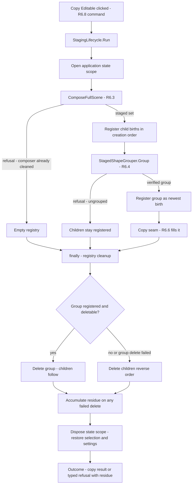

# R6.5 — Staging lifecycle implementation plan

> Plan authored 2026-11-18 against the tree that already carries R6.1–R6.4 and
> ADR-0066; revised the same day after an external critique (findings F1–F10
> folded in). Governing work item:
> [`../docs/work-items/R6.5-staging-lifecycle.md`](../docs/work-items/R6.5-staging-lifecycle.md).

## 1. What the work item demands (restated)

The staging lifecycle guarantees **zero temporary shapes remain after the
operation — success or any injected failure — with state restored**, per the
R6.7-approved cleanup design. ADR-0066 decided that design: the **simple delete
path** (delete staging shapes in `finally` immediately after the copy; no
staging workbook, ever). The four behavioural decisions the implementation must
satisfy:

- **D1 — Birth-registration.** Every temporary shape/group registers with the
  lifecycle at creation; cleanup walks the registry, **never a sheet scan**.
  The registry is keyed on the staging identity (R6.2 D4: name prefix
  `GanttCreatorStaging:` + tag `GanttCreator.Staging.v1:{hash}`), so a
  mid-operation coalesced automatic refresh (R5.11) can never reconcile or
  delete a staged shape — and a fault-injection test must prove a refresh
  firing at each failure point leaves the staged set and the live chart each
  intact.
- **D2 — `finally` cleanup, order-deterministic.** Delete in reverse creation
  order, group first — the host is *expected* to delete the children with the
  group, but that is design intent the live gate probes (the work item defers
  the deletion-order probe to the Tier-A upgrade; R6.4 asserted it without
  measuring it), and the child-fallback path stays until the probe is green.
  Every failure point (create, style, group, copy, delete) leaves zero
  temporary shapes and restored state — with the one reading §6 records for
  an injected delete failure, which cannot yield zero residue by construction.
- **D3 — The ADR design implemented literally.** Delete in `finally` after the
  copy; the staging-workbook fallback is **not built** (ADR-0066 D1). A
  post-operation zero-residue assertion covers the path.
- **D4 — Failure points are injected, not imagined.** Each checklist-K point
  gets a harness injection; the assertion is the observed operation sequence +
  zero residue + restored state.

## 2. Step 0 — prerequisites verified (all satisfied, do not re-litigate)

| Prerequisite | Status | Evidence |
| --- | --- | --- |
| R6.7's ADR approved | **Satisfied** — ADR-0066 Accepted 2026-11-18, owner-approved; recommends the simple delete path from measured evidence | [`../docs/adr/0066-copy-after-delete-preserves-the-drawing-format.md`](../docs/adr/0066-copy-after-delete-preserves-the-drawing-format.md) |
| R6.2 landed (staging identity + composer cleanup) | **Satisfied** 2026-11-18 | [`../src/GanttCreator.Office/EditablePanelStagingComposer.cs`](../src/GanttCreator.Office/EditablePanelStagingComposer.cs), [`../src/GanttCreator.Office/ShapeStagingTag.cs`](../src/GanttCreator.Office/ShapeStagingTag.cs) |
| R6.3 landed (full-scene staging) | **Satisfied** 2026-11-18 | `ComposeFullScene` in the composer; live body `FullSceneStagingIntegrationTests` |
| R6.4 landed (verified group) | **Satisfied** 2026-11-18 | [`../src/GanttCreator.Office/StagedShapeGrouper.cs`](../src/GanttCreator.Office/StagedShapeGrouper.cs); group name `GanttCreatorStaging:export-group` |
| R4.2 state scope landed | **Satisfied** | [`../src/GanttCreator.Office/IApplicationStateScope.cs`](../src/GanttCreator.Office/IApplicationStateScope.cs), [`../src/GanttCreator.Office/ExcelApplicationStateScope.cs`](../src/GanttCreator.Office/ExcelApplicationStateScope.cs) |

## 3. Evidence gathered (facts, not assumptions)

- Architecture export process step 7 and the fallback paragraph:
  [`../docs/02-ARCHITECTURE.md`](../docs/02-ARCHITECTURE.md) — "Delete all
  temporary owned shapes in `finally` and restore selection/view state when
  possible"; the fallback is the short-lived staging workbook **only if** a
  supported build's evidence demands it (ADR-0066 D4 keeps it as the remedy on
  divergent builds, not a code path here).
- The composer already owns a mid-composition refusal cleanup
  (`CleanupStaged`, reverse order, best-effort with the original refusal
  preserved) and pre-flights `StagingAlreadyPopulated`; its remarks hand
  fault injection beyond those paths and the tag sweep to R6.5.
- The grouper restores the staged set (ungroups) before returning any
  verification refusal, and stamps the group with the staging identity so the
  staging writer can delete it (children included) and the composer's
  pre-flight counts it.
- The staging ownership proof is `tag = f(name)` recomputation, so neither
  ownership scan can classify the other family's shapes
  ([`../src/GanttCreator.Office/ShapeStagingTag.cs`](../src/GanttCreator.Office/ShapeStagingTag.cs));
  `ShapeStagingOwnershipTests` already pins mutual blindness in both
  directions.
- The fault-injection harness exists: `FakeShapeWritePort` carries a
  `Refusals` dictionary keyed by method name or call ordinal (the
  "stop on the Nth create" shape), unowned sentinels, and a `Calls` operation
  log; `FakeGroupingPort` lives in `StagedShapeGrouperTests`;
  `RecordingScope` models the state scope in orchestrator tests.
- The live-gate pattern exists: `StagedGroupingIntegrationTests` already runs
  state capture → `ComposeFullScene` → `Group` on the host, so the lifecycle
  body extends a proven harness.
- Checklist K requires injection around **shape create/style/group/copy/delete
  and each application-state change**, asserting per failure: cleanup,
  preserved user content, restored application state, one user-facing error,
  one technical record. Checklist J requires state restore even after failure
  (`try/finally`) and no chained COM expressions. Checklist E requires
  "partial temporary export shapes are removed".
- Known gate caveats that carry forward, recorded rather than papered over:
  the `verify-office.ps1` wrapper's 780 s deadline (the OfficeIntegration suite
  exceeded it in R6.2's evidence run) and the pre-existing per-body COM-leak
  flap (R5.18n D4). The leak gate now judges **per-teardown** kills
  (`$MaxForcedKillsPerTeardown` = 1), so new integration bodies are judged by
  the invariant, not a suite total.

## 4. Design

### 4.1 New type — `StagingLifecycle` (src/GanttCreator.Office/StagingLifecycle.cs)

A static orchestrator in the composer/grouper family (typed outcome records,
no COM of its own — it calls only through the existing ports):

```text
StagingLifecycle.Run(request) → StagingLifecycleOutcome

request members:
  IApplicationStateScope? StateScope      // R4.2 five-setting + selection scope
  IShapeWritePort? StagingPort            // ExcelShapeWriter with ShapeOwnershipScheme.Staging
  IShapeGroupingPort? GroupingPort        // R6.4's port
  ExportBoundsOutcome? Resolution         // R6.1/R6.3's resolution (scene + bounds)
  Func<StagedGroupOutcome, StagingCopyResult>? Copy   // R6.6 seam — see 4.4

outcome members:
  StagedGroupOutcome? Group               // the verified group when reached
  StagingCopyResult? Copy                  // whatever the copy seam reported
  StagingLifecycleRefusal? Refusal        // typed; null on success
  IReadOnlyList<string> Residue           // names a failed cleanup could not delete
  StagingCompositionOutcome? Composition   // the underlying stage outcomes ride, never lost
```

Pipeline inside `Run`, all inside one `try/finally`:

1. Null guards (each a typed refusal with its positive test in the same
   commit): null scope, null staging port, null grouping port, null
   resolution.
2. Open the state scope: `SuppressScreenUpdating`, `SuppressEvents`,
   `SuppressAlerts`, `SetStatusBarText`, `CaptureSelection` — the same
   discipline the refresh orchestrator uses (ADR-0020).
3. `EditablePanelStagingComposer.ComposeFullScene(resolution, stagingPort)`.
   On refusal the composer has already cleaned up (existing behaviour); the
   registry stays empty and the refusal rides the outcome.
4. **Birth-registration (D1):** register each staged child name
   (`ShapeStagingTag.NamePrefix + primitiveId`) into the registry **in creation
   order** — the composer's `StagedPrimitiveIds` list *is* R6.2's D3 birth
   hook, so no port decorator and no second bookkeeping seam are needed.
5. `StagedShapeGrouper.Group(staged, groupingPort)`. On refusal the grouper
   has already ungrouped (children remain registered); on success register
   `ShapeStagingTag.GroupName` as the newest birth.
6. Invoke the copy seam (4.4). Its result or exception rides the outcome.
7. `finally` — **registry cleanup (D2/D3), never a sheet scan:**
   - If a group is registered: delete the group name first — it was created
     after every child, so this is reverse creation order. The work item
     deferred the deletion-order probe to the Tier-A upgrade; the live
     success-path body now measures it (2026-11-18, Excel 16.0: 80 staged
     shapes, the group delete succeeded, all 80 child deletes answered
     `NotFound`, 81 deletes, zero residue — the host removes the children
     with the group).
   - The registered children are then attempted newest-first. `NotFound` is
     the goal state, never residue, so a host that keeps children with the
     group removes each child here and a host that removes them with the
     group answers absent — both paths reach zero residue.
   - A cleanup delete must never mask the operation's own result: each delete
     is best-effort; failures accumulate into `Residue` and produce exactly one
     technical record. **A non-empty residue is a typed refusal
     (`CleanupResidue`), never a reported success** — zero residue is
     absolute, and a residue shape is staging-tagged, so the next operation's
     `StagingAlreadyPopulated` pre-flight refuses rather than colliding.
   - **Post-cleanup verification read (F1).** After the registry-driven
     deletes, the lifecycle performs one ownership-proven staging
     `ListOwned()` read and turns any non-empty result into the same
     `CleanupResidue` refusal. This is a *read*, not the forbidden scan: it
     deletes nothing, and the `tag = f(name)` recompute structurally cannot
     classify an unowned shape — so D1's rule (cleanup *walks the registry*)
     is intact while zero residue is *verified*, not assumed. Without it, a
     partially-failed composer cleanup would leave shapes the lifecycle
     neither knows about nor reports: `CleanupStaged` is deliberately
     catch-and-continue, and the composer returns **empty**
     `StagedPrimitiveIds` on `HostRejected`, so the registry cannot carry
     what its own cleanup failed to delete.
   - Dispose the state scope **after** shape cleanup, so selection and the
     five settings are restored even when the body threw (checklist J). The
     ordering is pinned, not implied: **every delete precedes the selection
     restore** — the 2026-11-14 Table Design tab defect came from exactly
     this dispose ordering, and the matrix's operation-sequence assertion
     names it (F10).
8. Return the outcome: the copy result on success, or the first typed refusal
   with everything underneath still attached.

### 4.2 What cleanup never does

- Never enumerates the sheet's `Shapes` collection to decide what to delete
  (D1 — unowned content is untouchable). The staging-scheme `ListOwned()` has
  exactly two uses, both safe because ownership is recomputed from the name
  and can never classify an unowned shape: the lifecycle's post-cleanup
  **verification read** (which reports residue and deletes nothing) and the
  tests' zero-residue assertion. It is never the *driver* of a delete.
- Never deletes a live owned shape: names in the registry are all
  `GanttCreatorStaging:`-prefixed, and the staging writer's delete refuses a
  name outside its own scheme (pinned by `ShapeStagingOwnershipTests`).
- Never leaves the state scope open on a thrown body — the scope disposal is
  inside the same `finally`.

### 4.3 The mid-operation refresh proof (D1 amendment)

The staging identity already makes the reconciler structurally blind to staged
shapes. The matrix adds the *dynamic* proof: at each failure point, with the
staged set present in the fake host, run a live-scheme reconciliation
(`ShapeReconciler` through the live `ExcelShapeWriter` scheme) and assert the
staged set is untouched and the live chart converges; then the lifecycle's
cleanup runs and the residue is zero. This pins the R5.11 interaction the work
item added on 2026-11-18.

### 4.4 The copy seam (R6.6 boundary, not R6.5 behaviour)

ADR-0066 D1 deletes "immediately after `ShapeRange.Copy`", so the lifecycle
must run cleanup **after** the copy step — but clipboard verification is
R6.6's exclusion. The seam is therefore an injectable
`Func<StagedGroupOutcome, StagingCopyResult>`: R6.5's tests drive it with a
no-op, a throwing delegate, and a refusing delegate; R6.6 replaces it with the
real verified copy; R6.8's command supplies the wiring. No clipboard call and
no format assertion exist in R6.5's production code.

`StagingCopyResult` is the **minimal opaque carrier R6.5 defines** — a sealed
record carrying success and a free-text detail, nothing more (F6). R6.6 owns
the real verification contract (the measured `Excel 2007 Internal Shape`
format and a paste-materialisation assertion, per ADR-0066 D2) and may replace
the carrier; R6.5 must not silently design it.

**Empty composition (F7).** When `ComposeFullScene` stages nothing (a
supported empty composition), the lifecycle returns without invoking the copy
seam — there is no group to copy — and the `finally` runs against an empty
registry. One contract test pins this path.

### 4.5 Files touched

| File | Change |
| --- | --- |
| `src/GanttCreator.Office/StagingLifecycle.cs` | New — the lifecycle, its refusal enum, its outcome record, XML docs |
| `tests/GanttCreator.Office.ContractTests/StagingLifecycleTests.cs` | New — the fault-injection matrix |
| `tests/GanttCreator.Office.ContractTests/FakeShapeWritePort.cs` | Extend only if an injection shape is missing (delete-ordinal refusal keys) |
| `tests/GanttCreator.Office.IntegrationTests/StagingLifecycleIntegrationTests.cs` | New — live forced-failure gate, tagged `OfficeIntegration` |
| `docs/STATUS.md`, `docs/REPO-MAP.md`, `docs/work-items/R6.5-staging-lifecycle.md` | Status rows, map entry, work-item status line |

No Core change, no schema change, no catalogue hash move, no new project
dependency, no ribbon surface (R6.8 owns the command). The lifecycle is an
orchestrator over existing ports — like `GanttRefreshOrchestrator`, it is not
itself a mutating COM adapter, so no new mutating-set registration is
expected; verify against the architecture tests rather than assume.

## 5. Mermaid — the lifecycle in the export pipeline



## 6. Failure-injection matrix (contract tests, D4)

Every row is a positive test in `StagingLifecycleTests` over the R4.1 fakes;
every row asserts **restored state + one technical record + the observed
operation sequence** via the fake's `Calls` log — including the pinned
ordering that **every delete precedes the selection restore** (F10: the
2026-11-14 Table Design tab defect was a dispose-ordering bug) — and
**unowned sentinels survive** on every path. "One user-facing error" in
checklist K has no surface in R6.5 (R6.8 owns the command): each row asserts
the **typed refusal with actionable detail** instead, and the AddIn
translation is recorded as R6.8's, so no message surface is built
prematurely (F8).

| # | Injected point | Mechanism | Specific assertion |
| --- | --- | --- | --- |
| 1 | Mid-composition create refuses (Nth create) | `FakeShapeWritePort.Refusals` keyed by create ordinal | Composer's own reverse-order cleanup ran (existing behaviour); registry empty; the verification read confirms zero residue |
| 1b | Create refuses AND the composer's cleanup delete refuses | `Refusals` keyed on the create ordinal and on `Delete` | The lifecycle's post-cleanup verification read catches the residue the composer could not delete; `CleanupResidue` refusal names it; state restored (F1, F3) |
| 1c | Create **throws** (an exception, not a typed refusal) | a throwing decorator over the fake | The composer's exception path cleans the birth list and rethrows; registry empty; state restored (closes the gap a throwing create exposed) |
| 2 | Group call refuses | `FakeGroupingPort` host refusal | Grouper restored children; lifecycle deletes children reverse order; residue zero |
| 3 | Group verification fails — membership / child order / bounds | `FakeGroupingPort` mismatched readback | Grouper ungrouped; lifecycle deletes children; residue zero |
| 4 | Copy seam throws | throwing delegate | `finally` deletes the group (children with it); residue zero; the exception is not swallowed but reported as the operation's failure |
| 5 | Copy seam refuses | delegate returning a typed copy refusal | Same cleanup; refusal rides the outcome |
| 6 | Cleanup delete refuses | `Refusals` keyed on `Delete` for a staged name | `CleanupResidue` refusal naming the residue; never success; original failure preserved; state still restored — the acceptance-criterion reading below applies |
| 7 | State-scope member fails | scope double that throws on one member | Scope contract is best-effort: cleanup still completes; state restore attempted |
| 8 | Mid-operation coalesced refresh at each failure point | live-scheme reconciliation against the fake holding staged set + live chart | Staged set untouched, live chart converges (D1 amendment); then cleanup, residue zero |
| 9 | Success path | no injection | Group deleted first after the copy returned; each child delete answers `NotFound` (the host removed them with the group); residue zero; state restored; copy result carried |
| 10 | Unowned sentinels | seeded sentinel shapes | Present and untouched on every path above |
| 11 | Null guards — scope / staging port / grouping port / resolution | null arguments | One typed refusal each, nothing created, state untouched |
| 12 | Empty composition — nothing staged | a resolution whose scene stages nothing | Passes through without invoking the copy seam; empty registry; nothing deleted; state restored (F7) |

**Reading of the acceptance criterion (F2).** The work item says "every point
→ zero temporary shapes"; an injected *delete* failure cannot yield zero
residue by construction — the injection itself prevents it. The delete-failure
rows therefore assert the honest outcome: `CleanupResidue` reported, never
success; the next operation refuses `StagingAlreadyPopulated` rather than
colliding; state restored. This interpretation is recorded in the work item's
status line when the row closes, so the acceptance criteria are not left
contradictory.

**Create and style are one point (F5).** Checklist K names create and style
separately; in this codebase `Create` carries the fully resolved style on the
request, so the create-ordinal injection covers both. A distinct style point
does not exist to inject.

## 7. Implementation slices (one concern per commit)

1. **`feat(office): the staging lifecycle`** — `StagingLifecycle` + registry +
   `finally` cleanup + state-scope integration + the copy seam, with contract
   tests for rows 1, 1c, 2, 4, 9, 10, 11, 12 (the behaviour's own proof,
   including a positive test per null-guard validator). Targeted:
   `dotnet test tests/GanttCreator.Office.ContractTests`.
2. **`test(office): the full fault-injection matrix`** — rows 1b, 3, 5, 6, 7,
   8 (the mid-operation refresh proof). Any defect the matrix exposes in
   slice 1 is fixed here in the same commit as the test that found it.
3. **`test(office): the live forced-failure gate`** —
   `StagingLifecycleIntegrationTests` (tagged `OfficeIntegration`): body A
   success path (no-op copy delegate — the clipboard itself is R6.6's row);
   body B forced mid-composition failure through a test-only throwing
   decorator over the real `ExcelShapeWriter` at the Nth create; body C forced
   failure at the group step through a throwing grouping-port decorator.
   **The decorators implement `IShapeWritePort`/`IShapeGroupingPort` and
   faithfully forward every member — `BeginBatch`, `ListOwned`, the reads —
   throwing only at the chosen point, so the behaviour under test is the real
   adapter's (F9).** Body A is also **the D2 deletion-order probe**: it
   deletes only the group and asserts the children went with it, closing the
   work item's "probed at Tier-A upgrade" question with a measured fact
   (F4). Each body asserts on the host: staging `ListOwned` empty, live owned
   chart intact, selection and screen-updating/events/alerts restored, sheet
   count unchanged, witness cells intact. Record the Excel build in the
   STATUS row. Run `verify-office.ps1`; if the wrapper's 780 s deadline
   trips, run the new body directly with a `dotnet test --filter` and record
   both facts.
4. **`docs: close the row`** — STATUS rows per slice (repo convention keeps
   them in the same change), REPO-MAP entry for the lifecycle, the work-item
   status line, and the checklist self-certification (J, K, E) in the final
   commit message.

## 8. Verification and gates

```text
dotnet build GanttCreator.slnx /p:Configuration=Release /warnaserror   # 0 warnings
dotnet test tests/GanttCreator.Office.ContractTests                    # the matrix
pwsh ./scripts/verify-quick.ps1                                        # every commit
pwsh ./scripts/verify.ps1                                              # branch-final, clean tree
pwsh ./scripts/verify-office.ps1                                       # Required; exit-0 caveat recorded in R6.7/R6.2
git diff --check                                                       # no output
```

Any gate not run is reported `Not run` with the reason. The Office gate's
known caveats (wrapper deadline, pre-existing per-body leak flap) are recorded
facts, not reasons to skip it.

## 9. Risks and stop conditions

- **A failure point escaping the matrix** — the main risk the work item names.
  Mitigation: the checklist-K enumeration in §6 and the zero-residue
  assertion running on every path, including the null guards.
- **The verification read misread as the forbidden scan** — §4.2 states the
  distinction: a read that deletes nothing and cannot classify an unowned
  shape. If a reviewer rules it a D1 violation, stop for a decision rather
  than silently removing the verification; removing it reopens F1's blind
  spot (residue the registry cannot know about).
- **A cleanup delete failing on the host** — designed for, not hidden: residue
  is reported as `CleanupResidue`, never claimed as success, and the next
  operation refuses `StagingAlreadyPopulated` rather than colliding. If a live
  body shows a *path* that can leave residue after a successful delete call,
  that is the work item's stop condition — stop and report.
- **Stop conditions (item-specific):** any path could leave the staging
  workbook behind (moot — it is not built, and building it would violate
  ADR-0066 D1); cleanup by scan rather than registry; a conflict between
  this plan and the work item or ADR-0066.
- **General stop conditions** apply per `AGENTS.md`: two failed attempts on
  the same failure; a failing test exposing unrelated behaviour; any
  invariant violation.

## 10. Definition of done

From the work item + checklist sections **J, K, E**: the injection matrix
green — zero residue + restored state at every point whose injection permits
it, and honest `CleanupResidue` reporting where the injection is a failed
delete (the §6 reading, recorded in the work item's status line); unowned
sentinels never cleaned; the live gate recorded with host builds, including
the D2 group-deletion probe; Release build 0 warnings; XML docs on every new
public member; REPO-MAP/STATUS/work-item status current; checklist sections
J, K, E self-certified and named in the final commit message.
