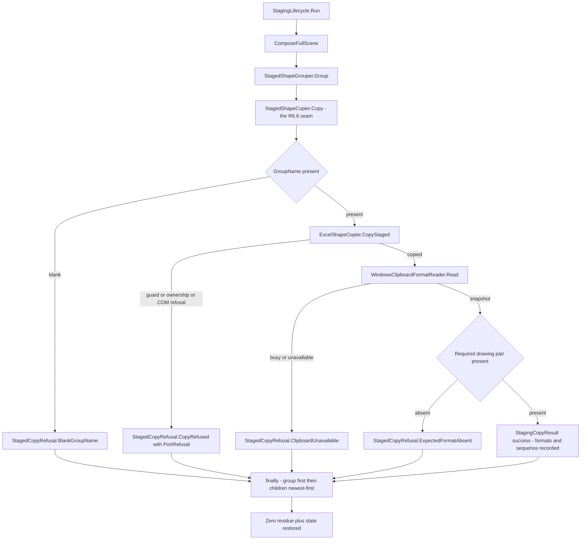

# R6.6 — Clipboard copy implementation plan

> Plan authored 2026-11-18 against the tree that already carries R6.1–R6.5 and
> ADR-0066; **revised the same day after an expert critique (findings A1–A5,
> B1–B6 and the C notes folded in)**. Governing work item:
> [`../docs/work-items/R6.6-clipboard-copy.md`](../docs/work-items/R6.6-clipboard-copy.md).
> Binding decision source for the verification contract:
> [`../docs/adr/0066-copy-after-delete-preserves-the-drawing-format.md`](../docs/adr/0066-copy-after-delete-preserves-the-drawing-format.md).

## 1. What the work item demands (restated)

The staged export group copies via `ShapeRange.Copy`, and success is reported
**only after an expected Office drawing clipboard format is verified present**
— pinned by a Windows clipboard-format contract test over fakes, and proven on
a live host by inspecting the actual formats Office places on the clipboard.
The three behavioural decisions:

- **D1 — Success = verified format, not a non-throwing call.** A silent
  `Copy()` return proves nothing. Positive test: format absent → typed
  failure, no success reported.
- **D2 — Clipboard-unavailable is a distinct typed failure.** A busy or
  unavailable clipboard is a typed refusal with an actionable message — not an
  exception, not a silent pass — and it is injection-tested.
- **D3 — Verification is immediate and bounded.** Format enumeration happens
  right after the copy, before the lifecycle's `finally` cleanup (the
  ADR-0066 D1 ordering); no polling loops, no sleeps, no `Task.Run`.

**One reconciliation, settled by composition rather than rank.** The work
item's own acceptance wording says "inspect the actual Office drawing
clipboard formats against the spike's recorded sets", while ADR-0066 **D2**
says: *"R6.6's clipboard contract therefore asserts that the copy leaves the
measured drawing format **and** that a real consumer paste materialises the
group; a non-throwing `Copy` call or a format-name guess is not evidence."*
These do not conflict, and the source-of-truth order is not the argument —
the ADR ranks **below** the work item and the architecture in that order.
The composition is:

- The work item's *Governing contracts* section incorporates the R6.7 ADR
  ("the R6.7 ADR (copy/delete ordering)"), so the ADR's evidence obligations
  are part of this row's contract.
- The architecture's export process step 5 (a binding product invariant in
  `02-ARCHITECTURE.md`) defines the **production** check: "For clipboard-only
  copy, verify an expected Office drawing clipboard format is present before
  reporting success." A production paste would mutate the user's worksheet,
  which the exclusions forbid ("no clipboard *content* interpretation beyond
  the format verification") and which no read-only verification stage may do.
- ADR-0066 D2 defines the **evidence** this row must produce: the measured
  format **and** a real consumer paste materialisation. That belongs to the
  live gate, which pastes into a test-owned worksheet after the lifecycle has
  cleaned up — exactly the spike's Excel-target arm, now driven through the
  production pipeline.

So: **production stage = format presence; live gate = presence + materialisation.**
Neither side is weakened.

## 2. Step 0 — prerequisites verified (all satisfied, do not re-litigate)

| Prerequisite | Status | Evidence |
| --- | --- | --- |
| R6.4 landed (verified group) | **Satisfied** 2026-11-18 | [`../src/GanttCreator.Office/StagedShapeGrouper.cs`](../src/GanttCreator.Office/StagedShapeGrouper.cs); group name `GanttCreatorStaging:export-group` ([`../src/GanttCreator.Office/ShapeStagingTag.cs`](../src/GanttCreator.Office/ShapeStagingTag.cs)) |
| R6.5 landed (lifecycle + copy seam) | **Satisfied** 2026-11-18 | [`../src/GanttCreator.Office/StagingLifecycle.cs`](../src/GanttCreator.Office/StagingLifecycle.cs); seam `Func<StagedGroupOutcome, StagingCopyResult>? Copy` on `StagingLifecycleRequest` |
| R6.7's ADR approved (ordering) | **Satisfied** — ADR-0066 Accepted, owner-approved 2026-11-18; simple delete path | [`../docs/adr/0066-copy-after-delete-preserves-the-drawing-format.md`](../docs/adr/0066-copy-after-delete-preserves-the-drawing-format.md) |
| Expected drawing format identifiers enumerated from the spike's recorded sets | **Satisfied** — measured on Excel 16.0.20527.20196 x64: the drawing formats are `Excel 2007 Internal Shape` with `Art::GVML ClipFormat` alongside; the full 15-format set is recorded in the ADR and the R6.7 notes | ADR-0066 evidence table; [`../docs/work-items/R6.7-powerpoint-compatibility-spike.md`](../docs/work-items/R6.7-powerpoint-compatibility-spike.md) |
| Clipboard access surface probed | **Settled below (§4.2)** — Win32 P/Invoke, not Forms `Clipboard` | [`../src/GanttCreator.Office/GanttCreator.Office.csproj`](../src/GanttCreator.Office/GanttCreator.Office.csproj) carries no `UseWindowsForms`; the spike's probe already measured with the P/Invoke route; [`ExcelShapeGrouperTests`](../tests/GanttCreator.Office.ContractTests) proves the subclassed-seam pattern works for an adapter |

## 3. Evidence gathered (facts, not assumptions)

- **The measured format set** (identical immediately, after 2 s and after 10 s,
  in every cycle and arm, on the reference host):
  `DataObject, Preferred DropEffect, InShellDragLoop, Excel 2007 Internal
  Shape, Art::GVML ClipFormat, image/svg+xml, PNG, JFIF, GIF, CF_BITMAP,
  CF_ENHMETAFILE, CF_METAFILEPICT, Ole Private Data, CF_DIB, CF_DIBV5`.
  `GetClipboardSequenceNumber` was unchanged across the windows, so deletion
  neither replaced nor withdrew the content. The expected candidate "Office
  Drawing Shape Format" was **not** present — the verification set comes from
  this evidence, never from the old guess.
- **Materialisation on the same host:** Excel paste produced 1 group of 4
  children at 340 × 190 pt in every delete cycle and in the control, and
  ungrouped to 4 editable children. PowerPoint's `ppPasteShape` returned a
  range of 5 (group plus flattened children) — that is R7.1/R7.3's contract
  (ADR-0066 D3), not this row's.
- **The seam the stage must fill:** `StagingLifecycle.Run` invokes
  `request.Copy?.Invoke(group)` after grouping succeeds and before the
  `finally` cleanup — the ordering D3 requires is already guaranteed by the
  lifecycle; a refusal yields `StagingLifecycleRefusal.CopyRefused` with the
  result carried, and a throwing seam propagates after cleanup
  ([`../src/GanttCreator.Office/StagingLifecycle.cs`](../src/GanttCreator.Office/StagingLifecycle.cs)).
  An empty composition never invokes the seam (F7), so the copy stage needs no
  empty case.
- **What the seam receives:** `StagedGroupOutcome(GroupName, ChildOrder,
  Bounds, Refusal, GroupRefusal)` — the verified group's live name is
  `ShapeStagingTag.GroupName`; the stage never re-derives anything
  ([`../src/GanttCreator.Office/StagedShapeGrouper.cs`](../src/GanttCreator.Office/StagedShapeGrouper.cs)).
  `GroupName` is nullable: the lifecycle guarantees a *successful* group,
  not a non-null name at the seam boundary (guard required, §4.3).
- **The Office project has no Windows Forms:** it references only
  `ExcelDna.Interop` and Core
  ([`../src/GanttCreator.Office/GanttCreator.Office.csproj`](../src/GanttCreator.Office/GanttCreator.Office.csproj)).
  `System.Windows.Forms` clipboard access is established in the **AddIn**
  (`AxHost` in the ribbon image loader), not in Office, and adding
  `UseWindowsForms` to Office would be a new framework dependency for
  behaviour the Win32 route already measured. The work item's Step-0 probe is
  therefore settled: **`EnumClipboardFormats` P/Invoke**, the exact surface
  the spike's evidence was recorded with.
- **The probe pattern exists and is proven:** the spike's
  [`ClipboardFormatProbe`](../tests/GanttCreator.Office.IntegrationTests/ClipboardFormatProbe.cs)
  opens/enumerates/closes without writing, resolves names through
  `GetClipboardFormatNameW` (the host's own registered names — this is why
  the evidence says `Excel 2007 Internal Shape`), returns a **typed** failure
  token for a busy clipboard (`clipboard-unavailable:0x…`), and exposes every
  Win32 call as an `internal virtual` seam so contract tests force the busy
  path without owning a real clipboard. Its host-free facts are 14/14 green.
  It stays **test-only**; the production reader is a separate type.
- **Win32 semantics confirmed against Microsoft Learn:** the clipboard must be
  open to enumerate (`EnumClipboardFormats` fails if not open); only one
  opener at a time (the busy path D2 types); end-of-enumeration and failure
  both return zero and are distinguished by `GetLastError`
  (`ERROR_SUCCESS` at the end); `RegisterClipboardFormat` returns the
  existing id for an already-registered name, so presence is a deterministic
  id comparison, not a name-buffer guess.
- **The adapter pattern to follow, and the duplication to avoid:**
  `ExcelShapeGrouper` owns ADR-0008 D4 guard-first protection, target
  resolution, `FindShapeByName`, the alternative-text read, and the
  `ShapeStagingTag.ForStagedName` ownership proof
  ([`../src/GanttCreator.Office/ExcelShapeGrouper.cs`](../src/GanttCreator.Office/ExcelShapeGrouper.cs),
  579 lines). That resolution/ownership half is **shared, not re-implemented**
  (§4.1); only the group call, its read-backs and its refusal mapping are
  grouping-specific. `ExcelShapeGrouperTests` pins the adapter through
  subclassed `internal virtual` seams with no COM.
- **The paste-verification pattern exists:** the spike's
  `PasteIntoExcelAndVerify` — `Worksheet.Paste` at a fixed destination,
  shape-count delta identifies the pasted range, positive bounds asserted, a
  single group's `GroupItems` counted, ungroup → editable children counted,
  pasted shapes deleted. "A non-throwing COM call is never treated as a
  successful materialisation by itself" is written into it
  ([`../tests/GanttCreator.Office.IntegrationTests/CopyAfterDeleteSpikeIntegrationTests.cs`](../tests/GanttCreator.Office.IntegrationTests/CopyAfterDeleteSpikeIntegrationTests.cs)).
- **The live harness pattern exists:** `StagingLifecycleIntegrationTests`
  already drives the production chain end to end (real table, real rows,
  measured grid, export request, bounds resolution, real staging writer,
  real grouper, real state scope) and asserts zero residue plus restored
  view/selection. The R6.6 body extends a proven harness, replicating the
  prepare steps the R6.3/R6.4/R6.5 bodies each already replicate.
- **Checklist obligations:** K requires injection around **clipboard
  acquisition** and shape copy, asserting per failure: cleanup, preserved
  user content, restored state, one user-facing error, **one technical
  record**; J requires proxies in locals, no chained COM expressions, state
  restored in `try/finally`; E requires partial temporary export shapes
  removed.
- **Gate caveats that carry forward, recorded rather than papered over:** the
  `verify-office.ps1` wrapper's 780 s deadline (the OfficeIntegration suite
  exceeded it in R6.2's and R6.5's evidence runs — new bodies are judged green
  in isolation when the wrapper times out, and that is recorded, never
  hidden); the pre-existing per-body COM-leak flap (R5.18n D4) is judged by
  the per-teardown invariant (`$MaxForcedKillsPerTeardown` = 1), not a suite
  total.

## 4. Design

### 4.1 Shared staging-shape access (prerequisite `refactor` commit)

Before the feature lands, extract the target-resolution and ownership-proof
half of `ExcelShapeGrouper` into one internal helper —
`StagingShapeLocator` (`src/GanttCreator.Office/StagingShapeLocator.cs`):

```text
internal sealed class StagingShapeLocator(object? application,
                                          IWorksheetProtectionGuard? guard)
  Excel.Shapes? ResolveShapes(out ShapeWriteRefusal? refusal)
  Excel.Shape? FindShapeByName(Excel.Shapes shapes, string name)
  Excel.Shape? FindOwnedStagingShape(Excel.Shapes shapes, string name,
                                     out ShapeWriteRefusal? refusal)
```

- `FindOwnedStagingShape` is the single ownership authority: find by exact
  name, then compare the alternative text against
  `ShapeStagingTag.ForStagedName(name)` — a mismatch is `NotFound` and the
  shape is never touched. The grouper's `UngroupStaged` and the copier both
  call it; neither restates the rule.
- `ExcelShapeGrouper` delegates to the helper with **no public behaviour
  change**, and R6.4's suites (including `ExcelShapeGrouperTests` and the
  live `StagedGroupingIntegrationTests`) must stay green **with no test
  edits** — that is the proof the extraction is pure.
- The helper is internal; `InternalsVisibleTo` already covers the contract
  test project ([`../src/GanttCreator.Office/GanttCreator.Office.csproj`](../src/GanttCreator.Office/GanttCreator.Office.csproj)).

### 4.2 New port — `IShapeCopyPort` + `ExcelShapeCopier`

A second narrow set-wide port in the R6.4 family
(`src/GanttCreator.Office/IShapeCopyPort.cs`,
`src/GanttCreator.Office/ExcelShapeCopier.cs`):

```text
ShapeWriteOutcome CopyStaged(string groupName)
```

- Guard-first protection query (ADR-0008 D4), then resolve the shapes
  collection of the worksheet carrying `tblGanttData` (never the active
  sheet) through the shared `StagingShapeLocator`.
- Resolve the group with `FindOwnedStagingShape` — missing or unowned is
  `NotFound`; the shape is never touched. The preflight resolution is the same
  correctness requirement the grouper documents: `Shapes.Range` raises for an
  unloadable name, so the copy must start from a proven proxy.
- Copy through the found proxy — `shape.Copy()` — **not**
  `Shapes.Range[groupName]` + `ShapeRange.Copy()`: one shape needs no range,
  and the range adds a COM call and an indexed-property seam for nothing.
- `COMException`/`InvalidOperationException`/`ArgumentException` → typed
  `ShapeWriteRefusal.HostRejected`; the copy never mutates the worksheet —
  the clipboard is its only effect.
- COM ownership per checklist J: every proxy in a local, no chained member
  expressions, no `FinalReleaseComObject` of Excel-owned shared roots; COM
  parameterised members isolated in `internal virtual` seams exactly as the
  grouper does (CS0855).
- Registered in the architecture test's mutating set
  ([`../tests/GanttCreator.Architecture.Tests/ProtectionGuardFirstTests.cs`](../tests/GanttCreator.Architecture.Tests/ProtectionGuardFirstTests.cs))
  per the R6.4 precedent; verify the registry's exact rule against the test
  source during implementation rather than assuming its shape.

Reusing `ShapeWriteRefusal` (not a new port-level enum) keeps one refusal
vocabulary across the staging ports, exactly as `ShapeGroupReadback` carries
`ShapeWriteRefusal?`.

### 4.3 New reader — `IClipboardFormatReader` + `WindowsClipboardFormatReader`

`src/GanttCreator.Office/IClipboardFormatReader.cs` (port + snapshot/result
records) and `src/GanttCreator.Office/WindowsClipboardFormatReader.cs`
(adapter), a production-shaped version of the spike's probe:

```text
ClipboardFormatRead Read()   →   ClipboardFormatRead(Succeeded, Snapshot?, Failure?)
ClipboardFormatSnapshot(uint SequenceNumber, IReadOnlyList<string> FormatNames)
```

- Win32 P/Invoke via `[LibraryImport]` with
  `[DefaultDllImportSearchPaths(DllImportSearchPath.System32)]` — `OpenClipboard`,
  `CloseClipboard`, `EnumClipboardFormats`, `GetClipboardFormatName`,
  `RegisterClipboardFormat`, `GetClipboardSequenceNumber` — **no new package,
  no `UseWindowsForms`**, the same route the spike's evidence was recorded
  with.
- Every Win32 call an `internal virtual` seam (the `OfficeFixture`/probe
  style), so contract tests subclass to force the busy path and the naming
  table without a real clipboard.
- Observe only: open, enumerate, close — never empty, never write. A failed
  `OpenClipboard` returns the typed failure token
  (`clipboard-unavailable:0x…`, the probe's stable diagnostic shape) instead
  of throwing — **D2's distinct failure**, injection-tested.
- Zero-return parity with the measured probe, stated in the type's remarks:
  once the clipboard is open, a zero from `EnumClipboardFormats` is the end of
  the enumeration; the reader does not add a `GetLastError` check the spike
  did not measure. If a future build exposes enumeration failure, that is a
  divergence record for R10.1, not a silent change here.
- Names resolve as the probe resolves them: standard `CF_*` ids directly, and
  registered formats through `GetClipboardFormatNameW` (the host's own
  names), with the candidate table only as fallback and a stable
  `format-0x…` name so an unexpected format is still recorded.
  `RegisterClipboardFormat` is the last-resort mapping only.
- Runs synchronously on the STA/main thread immediately after the COM copy
  call, inside the seam — no `Task.Run`, no polling, no sleeps (D3 and the
  COM discipline). The spike proved this exact sequence on the host.

### 4.4 New stage — `StagedShapeCopier` + `StagedCopyRefusal`

`src/GanttCreator.Office/StagedShapeCopier.cs`, a static stage in the
composer/grouper family (typed outcome, no COM of its own — it calls only
through the ports):

```text
StagedCopyRefusal { NullOutcome, NullPort, NullReader, BlankGroupName,
                    CopyRefused, ClipboardUnavailable, ExpectedFormatAbsent }

StagedShapeCopier.Copy(StagedGroupOutcome?, IShapeCopyPort?,
                       IClipboardFormatReader?) → StagingCopyResult
```

Pipeline, in order:

1. Null guards for the outcome, the port and the reader — each a typed
   refusal with its positive test in the same commit (the AGENTS.md
   validator rule).
2. **Blank-name guard:** `group.GroupName` null or whitespace →
   `BlankGroupName` with its positive test. The lifecycle guarantees a
   successful group, not a non-null name at this boundary.
3. `port.CopyStaged(group.GroupName)` — a port refusal rides as
   `CopyRefused` with the port's `ShapeWriteRefusal` carried in
   `PortRefusal` (see §4.5); the reader is never called (nothing was
   copied, so there is nothing to verify).
4. `reader.Read()` — a busy/unavailable clipboard rides as
   `ClipboardUnavailable` with the reader's diagnostic token **and an
   actionable sentence** (e.g. "The clipboard was busy; another application
   may be holding it. Try again."): a typed refusal with an actionable
   message, never an exception, never a silent pass (D2).
5. Verify the **required drawing formats** are present, ordinal
   case-insensitive, from the snapshot's names:

```text
RequiredDrawingFormatNames = [ "Excel 2007 Internal Shape",
                               "Art::GVML ClipFormat" ]
```

   Both must be present (ADR-0066 D2: "The format a shape copy leaves on
   this build is `Excel 2007 Internal Shape`, with `Art::GVML ClipFormat`
   alongside it"). An absent required format rides as `ExpectedFormatAbsent`
   naming the missing format and the observed set — success is reported only
   after this check passes (D1). **Never widen to "any format"** — the
   constants carry the ADR citation in their XML docs, and the stop condition
   below is the designed remedy for a divergent build.

The stage returns the enriched `StagingCopyResult` (§4.5), so it is directly
assignable to the lifecycle's `Copy` seam. **No lifecycle control-flow
change:** the seam's signature and the `finally` ordering are untouched; the
lifecycle file changes only by the record's additive members. R6.8 closes
over the stage directly (`Copy: group => StagedShapeCopier.Copy(group, port,
reader)`); an optional `CreateSeam` factory is not needed and is not built.

### 4.5 `StagingCopyResult` enrichment (additive, symmetric with the grouper)

`StagingCopyResult` gains two optional members in
[`../src/GanttCreator.Office/StagingLifecycle.cs`](../src/GanttCreator.Office/StagingLifecycle.cs):

```text
StagingCopyResult(bool Succeeded, string? Detail,
                  StagedCopyRefusal? Refusal = null,
                  ShapeWriteRefusal? PortRefusal = null)
```

- `Refusal` is the stage's typed reason (D2's distinct failure is a member,
  not a string).
- `PortRefusal` carries the copy port's own refusal — `NotFound`
  (ownership/missing), `TargetProtected`, `NoActiveWorkbook`,
  `WorksheetMissing`, `HostRejected` — symmetric with
  `StagedGroupOutcome.GroupRefusal`, so R6.8 maps messages on typed members
  instead of parsing free text (the R2.6 discipline).
- The existing `Success`/`Refused(detail)` factories keep their signatures, so
  all 14 existing lifecycle facts stay green untouched.
- The stage's **success detail** names the verified formats and carries the
  clipboard sequence number for diagnostics (truthful, count-free; no
  schedule content). This is the technical record checklist K asks for at
  this layer; R6.8 emits the user-facing error line and its technical record
  at the command boundary — the plan states the boundary rather than leaving
  K's "one technical record" unowned.

### 4.6 Ordering and threading (D3)

The lifecycle already orders everything correctly: the seam runs after
grouping and before the `finally` cleanup, synchronously on the STA/main
thread ([`../src/GanttCreator.Office/StagingLifecycle.cs`](../src/GanttCreator.Office/StagingLifecycle.cs)).
The stage adds no waiting of any kind — one copy call, one clipboard read, one
comparison. The clipboard read happens while the staging shapes still exist
(before cleanup), which is the ADR-0066 ordering; the live gate additionally
proves the formats **survive** cleanup, which is the ADR's measured fact
rather than the stage's concern.

### 4.7 Flow



Every refusal path still reaches the `finally`: zero residue and restored
state hold on every clipboard failure, which the lifecycle matrix extension
proves per failure point.

## 5. Tests

### 5.1 Stage contract tests — `tests/GanttCreator.Office.ContractTests/StagedShapeCopierTests.cs`

New fakes in the file (the `FakeShapeWritePort`/`RecordingGroupingPort`
family): a recording `FakeCopyPort` (scriptable refusal) and a
`FakeClipboardReader` (scriptable snapshot or failure). Every typed refusal
gets its positive test in the same commit (AGENTS.md rule), and assertions
read **typed members**, never detail wording (except the stable format-name
constants):

- **Copy-then-verify sequence pin** — the port's copy is called before the
  reader's read; success is reported only after the verification comparison
  (D1's ordering, asserted from the recorded call sequence).
- **Format-absent positive (D1)** — a snapshot without
  `Excel 2007 Internal Shape`, and one with it but without
  `Art::GVML ClipFormat` → `ExpectedFormatAbsent`, `Succeeded` false, the
  missing format named in the detail; no success reported.
- **Clipboard-unavailable positive (D2)** — the reader returns the busy
  failure → `ClipboardUnavailable` with the diagnostic token and the
  actionable sentence; no exception escapes, no success reported.
- **Copy-refused positive** — the port refuses → `CopyRefused` with
  `PortRefusal` equal to the port's `ShapeWriteRefusal`; the reader was never
  called (nothing was copied).
- **Blank-name positive** — a successful group with a null/whitespace
  `GroupName` → `BlankGroupName`; neither port nor reader is called.
- **Null guards** — null outcome, null port, null reader → the three typed
  null refusals.
- **Required-format constants pinned** — the two measured names, so a future
  edit that widens or renames the set fails a fact before it fails a host.

### 5.2 Reader host-free facts — `tests/GanttCreator.Office.ContractTests/WindowsClipboardFormatReaderTests.cs`

Mirrors the spike's probe facts, over subclassed seams (no real clipboard):

- Busy path: `TryOpenClipboard` false → typed failure token, no throw.
- Enumeration order and the end-of-enumeration termination (zero means end
  once open — the documented parity decision).
- Name resolution: standard `CF_*` ids, the host's registered name via the
  `GetClipboardFormatName` seam, the stable `format-0x…` fallback.
- The close runs in `finally` even when enumeration throws.

### 5.3 Adapter contract tests — `tests/GanttCreator.Office.ContractTests/ExcelShapeCopierTests.cs`

The `ExcelShapeGrouperTests` precedent, over subclassed seams and mocked
PIA objects (no COM). These are the `if (bad) { error }` positives for the
adapter's own branches:

- Missing group → `NotFound`; **ownership mismatch** (a same-named shape
  whose alternative text is not the staging tag for its live name) →
  `NotFound`, and the copy is never attempted.
- Protected target → `TargetProtected` with nothing attempted.
- Null application / no active workbook → `NoActiveWorkbook`.
- `COMException`, `InvalidOperationException` and `ArgumentException` from
  the copy seam → `HostRejected`.
- Preflight-before-copy: the ownership proof runs before the copy seam is
  touched, and the copy receives the resolved proxy.

### 5.4 Lifecycle matrix extension — `tests/GanttCreator.Office.ContractTests/StagingLifecycleTests.cs`

R6.5's matrix extended with the **real** copy stage over the existing fakes
(the acceptance criterion "zero residue on every clipboard failure"):

- Copy port refusal → `CopyRefused`, `PortRefusal` carried, zero residue, state
  restored.
- Format absent → `CopyRefused`, zero residue, state restored.
- Clipboard busy → `CopyRefused`, zero residue, state restored.
- Success path with the real stage → `outcome.Copy.Succeeded`, the typed
  refusal null, zero residue.

The existing throwing-copy fact already proves the exception path; it stays.

### 5.5 Live gate — `tests/GanttCreator.Office.IntegrationTests/ClipboardCopyIntegrationTests.cs`

Tagged `OfficeIntegration`, replicating the prepare steps the R6.3–R6.5
bodies each replicate (real table, real rows, measured grid, export request,
bounds resolution), then running `StagingLifecycle.Run` with the **real**
`ExcelShapeCopier` and **real** `WindowsClipboardFormatReader` filling the
seam:

1. `outcome.Succeeded` and `outcome.Copy.Succeeded` — the production stage's
   own verification passed on the host.
2. Post-cleanup clipboard inspection with the existing
   [`ClipboardFormatProbe`](../tests/GanttCreator.Office.IntegrationTests/ClipboardFormatProbe.cs)
   (independent of the production reader): the required drawing pair is still
   present after the staging shapes are gone — ADR-0066 D1's survival fact,
   now through the production path. The probe's snapshot (sequence number and
   full name list) is **recorded** in the evidence line; stability is the
   spike's measured fact and is not re-asserted here.
3. **Observed-set record, required-pair assert:** the gate hard-asserts the
   required drawing pair (the contract) and **records** the full observed
   format set with the host build for R10.1/R10.5's comparison against the
   spike's 15-format record. A non-required format's variance is recorded,
   not failed; a **required** format's absence fails the gate — that is the
   work item's stop condition firing (the verification set is per-evidence
   and is never widened), and the human updates the ADR from the recorded
   evidence.
4. **Materialisation paste (ADR-0066 D2):** the spike's
   `PasteIntoExcelAndVerify` pattern against the test-owned worksheet —
   paste at a fixed destination, shape-count delta identifies the pasted
   range, positive bounds asserted, the group's child count equals the
   staged set, ungroup → the same count of editable children, then the
   pasted shapes are deleted. A non-throwing paste is never treated as
   materialisation by itself. (If an assertion throws before the delete, the
   pasted shapes die with the fixture's disposable workbook — acceptable, and
   recorded here so it is not mistaken for residue risk.)
5. Zero staging residue, live sentinels untouched, view/selection restored
   (the R6.5 body's assertions), host builds recorded in the output line.

The **live** clipboard-busy path is deliberately not forced here: D2 is
satisfied by the contract-level injection (§5.2/§5.4), and R6.8's matrix
subset owns the live "clipboard unavailable" case.

### 5.6 Architecture registration

`ExcelShapeCopier.CopyStaged` joins the mutating set in
[`../tests/GanttCreator.Architecture.Tests/ProtectionGuardFirstTests.cs`](../tests/GanttCreator.Architecture.Tests/ProtectionGuardFirstTests.cs)
with the guard-first query in place (R6.4 precedent).

## 6. Acceptance-criteria mapping

| Acceptance criterion | Where satisfied |
| --- | --- |
| Copy-then-verify sequence pins | §5.1 sequence fact |
| Format-absent failure positive | §5.1 D1 positives (both formats) |
| Clipboard-unavailable refusal positive | §5.1 D2 positive + §5.2 busy-path facts |
| Zero residue on every clipboard failure (R6.5's matrix extended) | §5.4 three matrix rows |
| Live: copy in Excel; inspect actual formats against the spike's recorded sets; record host builds | §5.5 steps 1–3 + the recorded output line |
| ADR-0066 D2's materialisation assertion | §5.5 step 4 |
| Checklist K's one technical record per failure | §4.5 (stage detail is the layer's record) + R6.8's command record at the boundary, stated in §10 |
| Release 0 warnings; XML docs; REPO-MAP/STATUS current | §8 gates + §7 commit 4 |

## 7. Commit slicing (one concern per commit)

0. `refactor(office)` — extract `StagingShapeLocator` from
   `ExcelShapeGrouper`; R6.4's suites stay green **with no test edits** (the
   proof the extraction is pure).
1. `feat(office)` — the verified copy stage: `IShapeCopyPort` +
   `ExcelShapeCopier`, `IClipboardFormatReader` +
   `WindowsClipboardFormatReader`, `StagedShapeCopier` + `StagedCopyRefusal`
   + the required-format constants, the additive `StagingCopyResult`
   members, and the contract tests (§5.1–§5.4) plus the architecture
   registration (§5.6). One behaviour: copy → verify → typed result, with
   every validator's positive test in the same commit.
2. `test(office)` — the live gate body (§5.5), evidence recorded with host
   builds.
3. `docs` — `docs/REPO-MAP.md` (the Office row gains the copy stage's entry
   points **and** the map's dated per-row paragraph, "R6.6 (18 November
   2026) adds…"), `docs/STATUS.md`, and the work item's implementation
   record + status line.

## 8. Gates and evidence commands

```powershell
dotnet build GanttCreator.slnx /p:Configuration=Release /warnaserror
dotnet test tests/GanttCreator.Office.ContractTests
pwsh ./scripts/verify-quick.ps1      # expect exit 0
pwsh ./scripts/verify-office.ps1     # Required; recorded caveats below
git diff --check                     # expect no output
```

- Coverage: the new Office files are covered by the contract suites
  (§5.1–§5.4, §5.6) that `verify-quick.ps1` runs against the Office
  coverage thresholds; the live gate (§5.5) is evidence, not coverage.
- `verify-office.ps1` is **Required**. Carried caveats, recorded never
  papered over: the wrapper's 780 s deadline exceeded the suite in R6.2/R6.5
  evidence runs — if it times out, the new bodies must be shown green in
  isolation with their duration recorded; the per-teardown kill invariant
  (`$MaxForcedKillsPerTeardown` = 1) judges the leak signal, and a new
  leaking body must be named, never attributed to this row.
- Self-certify against `docs/08-TEST-CHECKLIST.md` sections **E, J, K** (the
  work item's DoD) and list them in the commit message.
- No Core file changes, so the changed-Core mutation gate has nothing new to
  judge; `verify.ps1` remains the branch-final gate and is reported in the
  handoff, not claimed per-commit.

## 9. Stop conditions, risks, rollback

- **Required-format divergence on a supported build** → stop; update
  ADR-0066, never widen the check to "any format" (work-item stop condition;
  the §5.5 step-3 assert makes it visible, and the recorded full set supplies
  the evidence). A flaky-looking divergence is recorded and reported, not
  retried green — the two-attempt rule applies.
- **Verification would need polling/sleeps** → stop (D3). The design has none;
  if the host ever forces a wait to make verification reliable, that is a
  product-contract change requiring a decision.
- **A new dependency would be needed** (a `UseWindowsForms` switch, an
  interop package) → stop under the dependency policy. The design needs none.
- **Clipboard-replacement trade, recorded rather than hidden:** a failed
  verified copy (a succeeded `Copy()` whose format check then fails) leaves
  the user's clipboard holding the staged export; the previous clipboard
  content is not recoverable and is not restored (no snapshot exists, and
  restoring one is out of scope). The shapes are still removed by the
  lifecycle; R6.8's failure message must say the copy is not ready and can be
  retried. This is written into the work item's implementation record.
- **Fail-closed trade on unmeasured builds:** until R10.1/R10.5 extend the
  matrix, a build whose drawing-format names differ from the reference
  evidence refuses the copy (`ExpectedFormatAbsent`, actionable) rather than
  reporting a success or pasting unverified content — the conservative
  direction, recorded as such.
- Main risk: format-set variance across Office builds — the spike already
  measured the reference host and R10.1/R10.5 own the matrix re-runs; the
  verification set is per-evidence and the recorded set surfaces divergence.
  Rollback: `git revert`.

## 10. Deferred / out of scope (named, not forgotten)

- **R6.8** wires the command: the ribbon's Export group, `CopyEditableCommand`
  consuming `StagingCopyResult.Refusal`/`PortRefusal` for message mapping and
  emitting the user-facing error plus the checklist-K technical record, the
  live "clipboard unavailable" matrix row, and the one-click exit
  demonstration. This row leaves the seam filled and nothing clickable.
- **R7.1/R7.3** own the PowerPoint paste path and must expect the five-item
  pasted range (ADR-0066 D3).
- **R10.1/R10.5** re-run the copy-after-delete check on every supported build
  they add; a divergent build reopens ADR-0066 (D4).
- No Core change, no schema change, no catalogue-hash move, no golden-image
  or scene-baseline change: the clipboard contract is host-level, and the
  staging composition it rides is already pinned by R6.2–R6.5.
