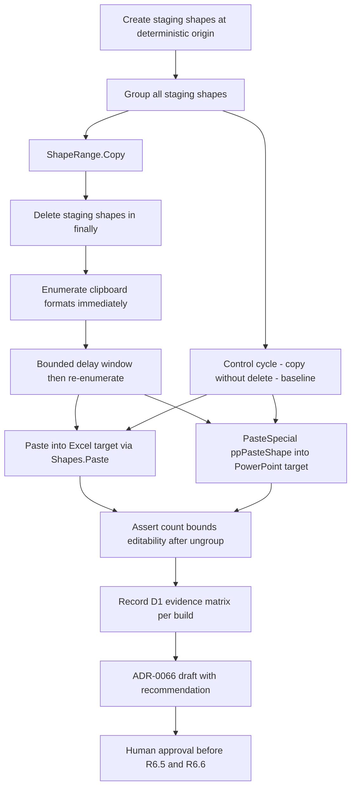

# R6.7 — Copy-after-delete / delayed-rendering compatibility spike: implementation plan

Reviewed source: [`docs/work-items/R6.7-powerpoint-compatibility-spike.md`](../docs/work-items/R6.7-powerpoint-compatibility-spike.md).
Governing contracts: [`docs/02-ARCHITECTURE.md`](../docs/02-ARCHITECTURE.md) "Editable export
composition" (step 7 + fallback paragraph, lines 198–212) and "PowerPoint automation"
(lines 214–226); [`docs/03-ROADMAP.md`](../docs/03-ROADMAP.md) Phase 6 (R6.7 runs first,
revision 4 note); [`docs/04-TEST-STRATEGY.md`](../docs/04-TEST-STRATEGY.md) Office
integration harness (lines 262–292).

Per the always-on agent contract, **no level-of-effort time estimates are given**; task
size is expressed as relative diff scope (S = one file or one focused body, M = a few
files in one layer, L = cross-layer with evidence runs).

---

## 1. Review of the spike work item

### 1.1 Objective

Produce **measured, deterministic evidence** on the reference host for one question:
does deleting staging shapes after [`ShapeRange.Copy`](../docs/02-ARCHITECTURE.md:207)
invalidate a delayed clipboard format? The answer becomes an ADR **before** any Phase-6
composition row (R6.1–R6.6/R6.8) is implemented, because R6.5 (staging lifecycle) and
R6.6 (clipboard copy) design directly against the answer.

### 1.2 Findings and constraints extracted from the work item

| Item | Finding |
| --- | --- |
| Sequencing | R6.7 runs **first** in Phase 6 — "a spike that can produce an ADR never follows the work it validates" (roadmap revision 4 note) |
| Production code | **Not changed.** The spike is a tagged integration-test body outside `src/` |
| Harness | Already landed: `OfficeFixture` + `verify-office.ps1`, following the R2.2/R2.4/R2.6 runner-gate pattern (verified: [`OfficeFixture.cs`](../tests/GanttCreator.Office.IntegrationTests/OfficeFixture.cs) exists, 1,406 lines, with PID tracking, teardown records, forced-kill log) |
| Supported-build matrix | Does not exist (R10.1 owns it). "Every supported build" means **the reference host now**: Excel 16.0.20527.20196, x64, O365HomePremRetail. The ADR records its single-build basis; R10.1/R10.5 re-run the check per build they add |
| Phase-5 exit | **Exited (owner statement, 2026-11-18).** The work item's Step-0 prerequisite is satisfied, the guide's Tier-A upgrade is now due, and ADR approval is a direct owner action once the evidence exists. Note: the work item's Tier-B status line and its Step-0 "verified state" paragraph still describe the pre-exit state; correcting both belongs to the spike's doc commit (T6) |
| PowerPoint route (D5) | Open decision, named 2026-11-18: default is **late-bound COM** (`Type.GetTypeFromProgID("PowerPoint.Application")` + `Activator.CreateInstance`, no new package); a `Microsoft.Office.Interop.PowerPoint` test-only package is a new dependency needing owner approval. No PowerPoint adapter in `src/` — that is R7.1's |
| Approved fallback | A **short-lived staging workbook** retained until the copy is materialised — never a permanent helper worksheet (forbidden) |
| Gate semantics | `verify-office.ps1` now exits 0 on an accepted run; the forced-kill total (40 at 69 bodies, 2026-11-18) is the **D4 metric, reported not gated**; a teardown forcing >1 kill (exit 4) or writing no record (exit 5) still fails |
| Codebase state | Verified by search: **zero** clipboard/`ShapeRange.Copy`/`PasteSpecial` code exists in `src/` — the spike is genuinely first and nothing in production prejudices the answer |

### 1.3 Design decisions the spike itself carries (D1–D5)

- **D1 Measure, then propose** — per build: exact clipboard format set after copy; per-format survival of staging deletion (immediately and after a bounded delay); Excel/PowerPoint paste materialisation with count/bounds; ungroup/edit works. The ADR proposes the simple delete path or the staging-workbook fallback **from this evidence only**.
- **D2 Deterministic assertions** — every claim is a recorded assertion, reproducible per build.
- **D3 Human approval gate** — ADR outcome approved before R6.5/R6.6 start.
- **D4 No orphan Office processes** — the spike runs under the `verify-office.ps1` ownership-sweep discipline.
- **D5 PowerPoint automation route** — recorded in the ADR (default: late-bound COM).

---

## 2. Scope and success criteria

### 2.1 In scope

1. A spike harness in [`tests/GanttCreator.Office.IntegrationTests/`](../tests/GanttCreator.Office.IntegrationTests/) (new test file(s) + a test-only PowerPoint fixture), tagged `[Trait("Category","OfficeIntegration")]` so `verify-quick.ps1`/`verify.ps1` exclude it and `verify-office.ps1` selects it.
2. A test-only clipboard-format enumeration helper (Win32 `OpenClipboard`/`EnumClipboardFormats`/`GetClipboardFormatName` P/Invoke) with host-free unit facts for its pure parts.
3. The D1 evidence matrix, recorded per build.
4. ADR draft (next free number: **ADR-0066**; number fixed when written) with measured outcome and recommendation.
5. [`docs/STATUS.md`](../docs/STATUS.md) entry, the work item's Notes/evidence table, and a [`docs/DECISIONS.md`](../docs/DECISIONS.md) entry once accepted.

### 2.2 Out of scope (exclusions, binding)

- No production composition code (R6.1–R6.6/R6.8 follow the ADR).
- No permanent helper worksheet (forbidden; also a spike stop condition).
- No retry-with-sleeps; bounded message filter/deadline only.
- No PowerPoint adapter in `src/` (R7.1's).
- No new NuGet package unless the owner approves the interop route under the dependency policy (default route avoids it).
- No changes to [`docs/02-ARCHITECTURE.md`](../docs/02-ARCHITECTURE.md) — the contract is amended only by the accepted ADR, not by the spike.

### 2.3 Success criteria (definition of done)

- [ ] D1 evidence matrix recorded on the reference host: host builds (Excel **and** PowerPoint version/bitness/channel), format set after copy, per-format survival immediately and after the bounded delay, Excel paste result, PowerPoint `PasteSpecial` result, ungroup/editability — all as deterministic assertions, green or divergence documented.
- [ ] The spike bodies pass under `pwsh ./scripts/verify-office.ps1` with the per-teardown invariant intact (no teardown >1 forced kill; every teardown writes a record; a new leaking body, if any, named in the per-test attribution and recorded as the D4 gap, never attributed to the spike silently).
- [ ] ADR-0066 drafted with the measured outcome and a recommendation (simple delete path or staging-workbook fallback), its single-build evidence basis stated, and the D5 route recorded.
- [ ] Human decision recorded **before** R6.5/R6.6 design starts (Phase 5 has exited, so approval is a direct owner action once the evidence exists).
- [ ] The work item's Notes carry the evidence table; STATUS updated; **no production code changed** (`git diff --check` clean; `src/` untouched).

---

## 3. Solution architecture and technical design

### 3.1 Where the code lives

Everything is test-harness code. The ponytail ladder applies: reuse `OfficeFixture`
verbatim for the Excel side; add only what no existing helper covers.

```text
tests/GanttCreator.Office.IntegrationTests/
  ClipboardFormatProbe.cs          (test-only Win32 enumeration helper)
  PowerPointFixture.cs             (test-only, late-bound COM, mirrors OfficeFixture)
  CopyAfterDeleteSpikeIntegrationTests.cs   (the D1 matrix bodies)
  ClipboardFormatProbeTests.cs     (host-free facts, no OfficeIntegration trait)
```

`Core` is untouched (no Office/clipboard dependency — invariant). `src/` is untouched.

### 3.2 Spike flow (one body per paste target)



### 3.3 Design decisions for the harness

- **DD1 — Materialisation beats enumeration, with a control arm.** A delayed-render
  format can be *present* on the clipboard but fail to *materialise* after the source
  is deleted. Enumeration alone would answer the wrong question. Each body therefore
  asserts both: the format set (names + registered IDs, via the probe helper) **and**
  the real consumer behaviour (an actual paste into Excel / `PasteSpecial` into
  PowerPoint). The evidence matrix records presence and materialisation as separate
  columns. Every delete cycle is paired with a **no-delete control cycle** (copy,
  leave the staging shapes alive, paste) so divergence is attributable to the deletion
  and not to ambient clipboard flakiness — a failing delete arm beside a green control
  arm is evidence; both arms failing is a harness defect, not an answer.
- **DD2 — The bounded delay is a measurement parameter, not synchronization.** The repo
  forbids `Thread.Sleep` used to force green output; here the delay is the object of
  measurement (delayed rendering). It is implemented as a fixed, recorded window (one
  short window, e.g. 2 s, and one longer window, e.g. 10 s) with the distinction stated
  in the body's doc comment and the evidence record. No retry loop, no
  wait-until-green; the assertion reads whatever the window produced. Mechanism note,
  recorded so the result is read correctly: delayed rendering is serviced when a
  *consumer requests the format*, not when time passes — the delay windows can only
  show spontaneous invalidation (e.g. another app taking the clipboard), while the
  paste assertions are the primary measurement of delete-versus-materialise.
- **DD3 — Deterministic staging geometry.** Fixed shape count (e.g. 3 rectangles + 1
  text box), fixed names (`Spike.Stage.v1` prefix — deliberately distinct from the
  production `GanttCreator.Owned.v1` tag so nothing can confuse the two), fixed origin
  and sizes, invariant culture, bounds compared within a documented point tolerance.
  The probe also records `GetClipboardSequenceNumber` at each observation point — a
  cheap, deterministic signal of whether the clipboard content itself changed after
  the deletion, separate from whether a format still materialises. Repeated a fixed
  number of times (3 delete cycles, each paired with its control) with every cycle
  recorded, so "deterministic" is a measurement, not a hope.
- **DD4 — PowerPoint via late-bound COM, test-only.** Default D5 route:
  `Type.GetTypeFromProgID("PowerPoint.Application")` + `Activator.CreateInstance`,
  no package. `PowerPointFixture` mirrors `OfficeFixture`'s discipline: PID diffing
  before/after launch, close only the test-owned presentation without saving, release
  each proxy once through a local, never kill an instance it did not create, poll
  process exit with a deadline, write into the same forced-kill record convention. The
  PowerPoint build/version is recorded by the fixture into the evidence record (the
  gate already captures pre-existing `POWERPNT.EXE` processes as user-owned).
- **DD5 — Clipboard is a global singleton.** The suite already serializes one
  collection; the body additionally checks `OpenClipboard` success and treats a busy
  clipboard as a distinct typed failure (test-strategy failure list already names
  "clipboard unavailable/busy"), never as a hang.
- **DD6 — COM ownership.** No chained COM property access; every proxy in a local,
  one `Marshal.ReleaseComObject` per acquired proxy, release in reverse order — the
  same rules [`OfficeFixture.cs`](../tests/GanttCreator.Office.IntegrationTests/OfficeFixture.cs:34)
  already documents. PowerPoint members used are the minimum surface
  (`Presentations.Add`, active slide, `Shapes.PasteSpecial`, `ShapeRange` inspection,
  ungroup) and are verified against primary Microsoft documentation **before** being
  relied on (anti-hallucination rule), not from memory.
- **DD7 — Evidence record shape.** One JSON/typed record per cycle per target, written
  beside the existing office-evidence artifacts: host builds, format list, survival
  flags, paste outcome, shape count, bounds delta, editability, cycle index. The ADR
  and the work item's Notes table are generated from these records, never hand-typed
  from a screenshot. Artifact policy: raw records live under the git-ignored
  office-evidence folder; the **summarised evidence table committed** in the work
  item and ADR is the durable evidence, so nothing evidence-shaped is lost to
  `.gitignore`.
- **DD8 — Paste APIs that return a `ShapeRange`, and modal-dialog discipline.** The
  Excel target pastes through `Shapes.Paste`/`Shapes.PasteSpecial` (which return a
  `ShapeRange`), never `Worksheet.Paste` (void — a non-throwing call proves nothing,
  the same invariant the PowerPoint transfer contract already states). Editability is
  asserted deterministically: ungroup, assert the child count equals the staging
  count, assert each child's type/geometry, then clean up. PowerPoint ungroup and
  paste can raise host prompts; the fixture follows the harness rule "detect and fail
  on modal dialogs rather than hanging" — alerts are suppressed through the
  application's own alert setting where the member exists (verified in T0 against
  primary documentation), and any surviving dialog is a distinct typed failure.
- **DD9 — Evidence basis is stated, including its simplification.** The spike stages
  on a fixture-owned workbook; production stages on the user's live worksheet beside
  real content. The clipboard mechanics under test are not expected to differ, but
  the ADR records the simplification as part of its single-build, single-staging-
  surface evidence basis rather than leaving it for R6.5 to discover.

### 3.4 What the ADR will decide (outcome space, fixed in advance)

| Measured outcome | ADR recommendation |
| --- | --- |
| All formats survive deletion; both pastes materialise with expected count/bounds; ungroup editable | Simple delete path (architecture step 7) stands; R6.5/R6.6 build on it |
| Any format is a delayed-render promise that fails to materialise after deletion on the reference build | Staging-workbook fallback (short-lived workbook retained until materialisation); R6.5 lifecycle redesigned around it |
| Ambiguous or flapping across the 3 cycles | **Stop condition**: record the ambiguity; the human decides; never average builds or cycles |

---

## 4. Sequenced development tasks

Ordered; each task is one commit-sized concern with its tests in the same commit.

| # | Task | Size | Commit / gate |
| --- | --- | --- | --- |
| T0 | **Pre-flight.** Phase 5 has exited (owner statement, 2026-11-18) — no exit dependency remains. Capture the reference host's PowerPoint build (currently unrecorded). Confirm D5 default route (late-bound COM, no package) and verify the exact `PasteSpecial`/`ppPasteShape`, `Presentations.Add`, alert-suppression and ungroup member semantics against primary Microsoft documentation before any code relies on them. | S | No commit; recorded facts in the work-item ledger |
| T1 | **Clipboard format probe helper** (`ClipboardFormatProbe.cs`): `OpenClipboard`/`EnumClipboardFormats`/`GetClipboardFormatName`/`CloseClipboard` P/Invoke, owned handle discipline, typed busy-clipboard failure. Host-free facts in `ClipboardFormatProbeTests.cs` (no OfficeIntegration trait, runs in `verify-quick`): known-format name mapping, empty-clipboard case, the busy/typed-failure path (positive test for every new validator, per the always-on rule). | S | `test:` — `verify-quick.ps1` green |
| T2 | **Excel-side spike body** (`CopyAfterDeleteSpikeIntegrationTests.cs`, part A): create → group → `ShapeRange.Copy` → delete in `finally` → enumerate immediately → bounded-delay re-enumerate → paste into a fresh Excel target via `Shapes.Paste` → assert count/bounds/editability after ungroup. Includes the paired no-delete control cycle (DD1). Reuses `OfficeFixture` unchanged. Records the DD2 delay windows and DD3 geometry in the body's doc comment. | M | `test:` — targeted `dotnet test --filter` on the new body, then `verify-quick` |
| T3 | **PowerPointFixture** (test-only, late-bound COM per DD4): launch/adopt policy, PID tracking, test-owned presentation lifecycle, teardown with deadline poll and forced-kill record, never kills a user instance. Contract facts for the record shape where they can be host-free (mirroring the `OfficeFixtureTests` pattern). | M | `test:` — `verify-quick` (host-free parts) + first live run in T5 |
| T4 | **PowerPoint-side spike body** (part B): `PasteSpecial(ppPasteShape)` on the active slide of the test-owned presentation, verify returned `ShapeRange` count and non-zero bounds, ungroup and assert child editability; full D1 matrix record emitted per cycle. | M | `test:` — targeted filter run |
| T5 | **Evidence run.** `pwsh ./scripts/verify-office.ps1` on the reference host: all spike bodies green (or divergence documented), 3 cycles recorded, per-test forced-kill attribution checked, D4 total reported not gated, no orphan `POWERPNT.EXE`/`EXCEL.EXE`. Evidence records archived under the office-evidence folder. | S | No code commit; observed output recorded |
| T6 | **ADR-0066 + docs.** Draft the ADR (Context = the measured question; Decision = recommendation per §3.4; evidence table; single-build basis and DD9 simplification stated; D5 route recorded). Update the R6.7 work item: Notes carry the evidence table, the Tier-B status line is upgraded to Tier A (due since the Phase-5 exit), and the stale Step-0 "verified state" paragraph is corrected to record the exit. Add the STATUS entry; add the `docs/DECISIONS.md` entry **after** acceptance. | S | `docs:` — `verify-quick` (link/status gates) |
| T7 | **Human approval gate (D3).** The owner approves the ADR outcome — a direct action now that Phase 5 has exited; the recorded decision unblocks R6.5/R6.6 design. If the fallback is chosen, a dated amendment to [`docs/02-ARCHITECTURE.md`](../docs/02-ARCHITECTURE.md) "Editable export composition" is prepared as its own `docs:` commit — never bundled with the spike. | S | Owner action; recorded in the work item |

Dependency notes: T2 depends on T1; T4 depends on T3; T5 depends on T2+T4; T6 on T5;
T7 on T6 — no Phase-5 exit dependency remains. T1/T2 and T3 can proceed in parallel.

---

## 5. Risks and mitigations

| # | Risk | Likelihood/impact | Mitigation |
| --- | --- | --- | --- |
| R1 | Delayed-render semantics misread: a format *present* but not *materialisable* after source deletion | Medium / High — it is the exact defect class the spike exists to catch | DD1: paste-based materialisation assertions in both targets, never enumeration alone; matrix records both columns |
| R2 | Clipboard busy/unavailable during the run (global singleton, other apps) | Medium / Medium | Typed distinct failure, serialized collection (already), busy-clipboard named in the test-strategy failure list; a busy run is re-run once as a recorded Office-flake classification, both attempts kept in evidence |
| R3 | PowerPoint absent or busy on the reference host | Low–Medium / High | `PowerPointFixture` treats absent/busy as distinct typed failures with a deadline, never a hang; never kills a user instance; the divergence is documented rather than excused |
| R4 | Late-bound COM member misuse (no compile-time checking) | Medium / Medium | Minimum member surface (DD6); verify members against primary Microsoft documentation in T0 before relying on them; hold every proxy locally |
| R5 | New bodies add to the forced-kill total (D4 metric) | High / Low | Per-teardown invariant is the gate; the total is reported; any new leaking body is named in per-test attribution and recorded as the D4 gap — never suppressed, never attributed to the spike silently |
| R6 | The bounded delay is mistaken for a forbidden sleep | Low / Medium | DD2: fixed recorded measurement windows, stated in the doc comment and evidence record; no retry-until-green logic anywhere |
| R7 | Evidence ambiguous across cycles/builds | Medium / High | Stop condition: record the ambiguity, human decides (D1/D3); never average builds or cycles |
| R8 | Scope creep into production composition code | Medium / High | Binding exclusion; every commit touches only `tests/` and `docs/`; `git status --short` reviewed per commit |
| R9 | Interop-package temptation for easier PowerPoint code | Medium / Medium | D5 default is late-bound COM (no package); a package requires owner approval under the dependency policy — the ADR records which route was used |
| R10 | ADR approved late blocks R6.5/R6.6 | Low / Medium | Phase 5 has exited, so approval is a direct owner action on delivered evidence (T7); the roadmap already sequences R6.7 first so the composition rows cannot start early |
| R11 | New bodies push the suite past `verify-office.ps1`'s 780 s deadline — the gate has a recorded history of failing on its own clock when bodies were added (660 → 780 was raised on a measurement) | Medium / Low | Measure the added runtime in T5; raise the deadline only with a fresh observed measurement and a stated reason, never to make a red run green; keep cycles inside the bodies rather than adding bodies per cycle |

---

## 6. Testing strategy

- **Layer mapping** (per [`docs/04-TEST-STRATEGY.md`](../docs/04-TEST-STRATEGY.md)):
  - Host-free unit facts (T1 helper, T3 record shape) run in every `verify-quick.ps1`.
  - Live spike bodies are `OfficeIntegration`-tagged, run only via
    `pwsh ./scripts/verify-office.ps1` on the reference host (phase-exit cadence).
  - The ADR outcome itself is a human decision (D3) — recorded, not automated.
- **Determinism (D2):** fixed geometry/names/culture; 3 recorded cycles per target;
  bounds within a documented point tolerance; every assertion reproducible per build.
- **Positive tests for every new validator:** the busy-clipboard failure, the
  absent-PowerPoint failure, and the empty-clipboard case each get a `[Fact]` that
  constructs the bad input and asserts the error path fires, in the same commit as the
  validator (always-on repo rule).
- **Ownership (D4):** teardown records for every fixture; per-teardown ≤1 forced kill;
  fail-closed on a missing record; no orphan Office processes after the run.
- **PR evidence block** per the test-strategy format: targeted command + PASS/FAIL,
  full verify, Office integration command or `Not run: reason`, coverage, residual
  risk. Only observed output is reported; Office-hosted claims are never made from
  host-free runs.

## 7. Code quality standards

- C# conventions per [`docs/02-ARCHITECTURE.md`](../docs/02-ARCHITECTURE.md): nullable
  reference types and analyzers on (no suppression), XML doc comments, typed failure
  reasons, no catch-and-ignore, no `Task.Run` around COM, all Office access on the STA
  test thread.
- COM discipline: no chained property access; one local per proxy; one
  `Marshal.ReleaseComObject` per acquisition; release in reverse order; never
  `FinalReleaseComObject` on shared/root proxies.
- Git: one concern per commit, Conventional Commit prefixes (`test:`, `docs:`), green
  `verify-quick.ps1` per commit, `git diff --check` clean, no Office temp files or
  evidence artifacts committed (office-evidence folder is ignored).
- Self-certification against [`docs/08-TEST-CHECKLIST.md`](../docs/08-TEST-CHECKLIST.md)
  sections applicable to harness work (the recent Office-harness entries cite
  `Checklist: G, I, J`), listed in the commit message; no certification claimed for
  non-applicable sections.

## 8. Documentation deliverables

1. **ADR-0066** (number fixed when written): context, the D1 evidence table, the
   recommendation per §3.4, the single-build evidence basis, the D5 route used, and
   the R10.1/R10.5 re-run obligation for every future supported build.
2. **R6.7 work item**: Notes carry the evidence table (host builds, format sets,
   survival, paste results, editability, cycle records); the Tier-B guide status line
   is upgraded to Tier A (due since the Phase-5 exit); the stale Step-0 "verified
   state" paragraph is corrected to record the exit.
3. [`docs/STATUS.md`](../docs/STATUS.md): one entry in the established format
   (outcome, changed, observed commands with output, checklist sections, Office host
   gate state).
4. [`docs/DECISIONS.md`](../docs/DECISIONS.md): entry after human acceptance.
5. **Only if the fallback is chosen**: a dated amendment to
   [`docs/02-ARCHITECTURE.md`](../docs/02-ARCHITECTURE.md) "Editable export
   composition", as its own `docs:` commit.
6. [`docs/REPO-MAP.md`](../docs/REPO-MAP.md): unchanged — the new files land in the
   already-mapped integration-test location and use the already-mapped verification
   command; no boundary, entry point, or command changes.

---

## 8a. External review record (critique pass, 2026-11-18)

The plan was re-reviewed as an external critique by a reviewer experienced in .NET,
Excel and PowerPoint automation. Findings and disposition:

| # | Critique finding | Disposition |
| --- | --- | --- |
| C1 | No control arm — a delete-arm failure alone cannot be attributed to the delete rather than ambient clipboard flakiness | **Accepted** — paired no-delete control cycles added (DD1, T2/T4) |
| C2 | A time delay cannot force delayed rendering; only a consumer request does — delay windows risk being misread as the primary measurement | **Accepted** — DD2 mechanism note added; paste assertions named primary |
| C3 | `GetClipboardSequenceNumber` is a cheap deterministic invalidation signal the probe should capture | **Accepted** — added to DD3 |
| C4 | `Worksheet.Paste` returns void; a non-throwing call proves nothing (the repo's own PowerPoint invariant) | **Accepted** — DD8 pins `Shapes.Paste`/`PasteSpecial` returning a `ShapeRange` |
| C5 | PowerPoint ungroup/paste can raise host prompts; the harness rule "detect and fail on modal dialogs" was not addressed | **Accepted** — DD8 modal-dialog discipline added |
| C6 | The suite deadline history (660 → 780 raised on measurement) means new bodies can fail the gate on its own clock | **Accepted** — R11 added |
| C7 | Raw evidence artifacts are git-ignored; the durable evidence must be the committed summary | **Accepted** — DD7 artifact policy stated |
| C8 | The spike stages on a fixture workbook while production stages on the user's live sheet — the basis should be recorded | **Accepted** — DD9 added |
| C9 | Also test paste after closing the source workbook (closer to the staging-workbook fallback boundary) | **Not adopted** — beyond the work item's fixed scope (copy-after-delete); recorded here as a candidate R6.5/R6.6 design input if the fallback is chosen |
| C10 | Use .NET's `Clipboard` class instead of P/Invoke | **Rejected** — a WPF/WinForms-typed dependency the test project does not carry; P/Invoke is the minimal route |

## 9. Handoff

- **Outcome**: measured copy-after-delete/delayed-rendering evidence on the reference
  host, and an ADR recommendation approved before R6.5/R6.6 design starts.
- **Not run by this plan**: `verify-office.ps1` (needs the live host), the ADR
  approval (direct owner action — Phase 5 has exited).
- **Next**: execute T0–T6 in Code mode; T7 is the owner's approval gate.
