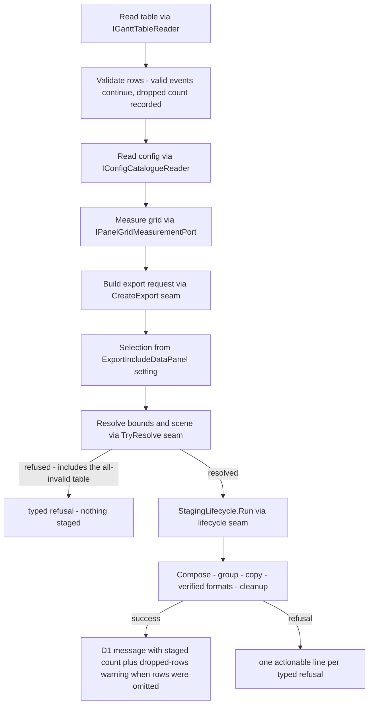

# R6.8 — Copy Editable command implementation plan

> Plan authored 2026-11-19 against the tree that already carries R6.1–R6.6 and
> the accepted ADR-0066 (R6.7's spike, owner-approved 2026-11-18). Governing
> work item:
> [`../docs/work-items/R6.8-copy-editable-command.md`](../docs/work-items/R6.8-copy-editable-command.md).
> This is the **last Phase-6 row** and it **owns the phase-exit evidence
> assembly** (exit demonstration, matrix subset, Phase-7 Tier-B guide
> upgrade).

## 1. What the work item demands (restated)

One **Copy Editable** click runs the whole pipeline — selection → bounds →
composition → staging → grouping → copy → verified formats → cleanup — with
concise success/failure feedback, pinned by command/result/message tests and
a live one-click/paste/edit gate. The three behavioural decisions:

- **D1 — Success message states what was verified.**
  "Copied the editable Gantt (N shapes) to the clipboard" — count-only, and
  truthful only because R6.6 verified the format first; each typed refusal
  maps to one actionable line (no schedule content).
  *(Amended by owner ruling 2026-11-19 — see §4.1's blocking-error ruling:
  when a partial export drops blocking-error rows, the feedback also names
  the dropped count, so the omission is never silent. The count-only
  discipline otherwise stands.)*
- **D2 — One command, one state scope.** The whole pipeline runs inside the
  R4.2 scope; the R6.5 `finally` cleanup is the inner guarantee; unexpected
  exceptions cross the one boundary.
- **D3 — The Office gate is the exit demonstration.** One click → manual
  paste to Excel and PowerPoint → ungroup/edit children → zero residue; then
  the matrix subset (slide sizes 4:3/16:9/custom; clipboard-unavailable;
  PowerPoint absent/busy *as far as a clipboard-only row can*, Phase 7
  completing them); then the Phase-7 Tier-B guide upgrade.

**This row creates the Export ribbon group** (verified 2026-11-18 in the
work item's Step 0: no Export group, no copy/send/PNG control, in the ribbon
XML or `RibbonControlIds`) with **Copy Editable as its only member**. Send to
PowerPoint arrives with R7.6, PNG width/unit and Export PNG with R8.7/R8.8 —
the group's layout leaves room for them without stubbing them.

**Exclusions (binding):** no PowerPoint automation (Phase 7's
`IPowerPointTransfer` — the gate's PowerPoint paste is manual); no PNG
(Phase 8); no new pipeline stages; no second helper worksheet anywhere in the
flow.

**Stop conditions (item-specific):** success reported without R6.6's
verification → stop (invariant); residue after any path → stop (R6.5's
guarantee is absolute).

## 2. Step 0 — prerequisites verified (all satisfied, do not re-litigate)

| Prerequisite | Status | Evidence |
| --- | --- | --- |
| R6.1–R6.6 landed (the pipeline stages) | **Satisfied** 2026-11-18 | [`../docs/STATUS.md`](../docs/STATUS.md) top records; stages listed in §3 below |
| R6.7's ADR approved (copy/delete ordering) | **Satisfied** — ADR-0066 Accepted, owner-approved 2026-11-18; simple delete path, no staging-workbook fallback | [`../docs/adr/0066-copy-after-delete-preserves-the-drawing-format.md`](../docs/adr/0066-copy-after-delete-preserves-the-drawing-format.md) |
| The Export ribbon group does not exist | **Verified** — the tab carries Get started, Data, Outline, Labels, Columns, Style, Chart, Size, Sheet, Diagnostics; no `grpExport`, no copy control | [`../src/GanttCreator.AddIn/RibbonResources/Ribbon.xml`](../src/GanttCreator.AddIn/RibbonResources/Ribbon.xml); [`../src/GanttCreator.AddIn/RibbonControlIds.cs`](../src/GanttCreator.AddIn/RibbonControlIds.cs) |
| Command-boundary and presenter-degradation patterns re-read (R2.2/R2.6/R4.9) | **Satisfied** — the `RefreshSheetCommand` shape: live entry + injectable `Run(service, presenter)`, `Present` degrades, one boundary | [`../src/GanttCreator.AddIn/RefreshSheetCommand.cs`](../src/GanttCreator.AddIn/RefreshSheetCommand.cs); [`../src/GanttCreator.AddIn/CommandBoundary.cs`](../src/GanttCreator.AddIn/CommandBoundary.cs) |
| R5.16b active-sheet gating re-read | **Satisfied** — the `IsEnabled` truth table gates chart commands on `HasActiveWorkbook && SheetInitialised && ActiveSheetIsGanttSheet` | [`../src/GanttCreator.AddIn/RibbonState.cs`](../src/GanttCreator.AddIn/RibbonState.cs) (`IsEnabled` switch) |
| R5.19 glyph system re-read | **Satisfied** — one `$controlGlyphs` map generates `RibbonGlyphCatalog.g.cs` + the PNG pairs; `check-ribbon-glyphs.ps1` gates parity; no `imageMso`, no static picture | [`../scripts/gen-ribbon-glyphs.ps1`](../scripts/gen-ribbon-glyphs.ps1); [`../scripts/check-ribbon-glyphs.ps1`](../scripts/check-ribbon-glyphs.ps1) |

## 3. Evidence gathered (facts, not assumptions)

- **The pipeline stages and their exact seams** (all landed, all
  contract-tested — this row composes them, it does not re-implement them):

  | Stage | Owner | Entry point |
  | --- | --- | --- |
  | Read + validate the table | R2.4/R2.5 | `ExcelGanttTableReader.Read()` → `GanttRowValidator.Validate(rows)` → `GanttValidationOutcome` (`Events` excludes blocking-error rows; `Issues` carries severities) |
  | Read configuration | R2.7 | `ExcelConfigCatalogueReader.Read()` → settings/styles/metrics maps |
  | Measure the panel grid | R4.8A | `ExcelPanelGridMeasurement.Measure(ExcelSceneBuildRequestFactory.MeasuredColumnsFor(settings))` — the single-arg overload reads the host's current row heights, so the export path performs **no writes** |
  | Build the export request | R6.3 | `ExcelSceneBuildRequestFactory.CreateExport(...)` — pins `AnchorLanesToRows = false`, `SceneCompositionProfile.EditableExport`, `AllowEmptyEvents = false` |
  | Selection → bounds + scene | R6.1 | `ExportBoundsResolver.TryResolve(request, panelTheme, selection)` — the scene rides the outcome; `ExportPanelTheme.Resolve()` supplies the panel styles |
  | Composition → staging → grouping → copy → cleanup | R6.5/R6.6 | `StagingLifecycle.Run(request)` with `Copy: group => StagedShapeCopier.Copy(group, ExcelShapeCopier, WindowsClipboardFormatReader)` |

- **The read path precedent exists and is proven live**: the
  `StagingLifecycleIntegrationTests.Prepare` harness runs exactly this
  sequence (read → validate → measure → config → `CreateExport` →
  `TryResolve(TablePlusChart)`) on a real host
  ([`../tests/GanttCreator.Office.IntegrationTests/StagingLifecycleIntegrationTests.cs`](../tests/GanttCreator.Office.IntegrationTests/StagingLifecycleIntegrationTests.cs)),
  and `ClipboardCopyIntegrationTests` drives the full production chain
  through the lifecycle with the real adapters
  ([`../tests/GanttCreator.Office.IntegrationTests/ClipboardCopyIntegrationTests.cs`](../tests/GanttCreator.Office.IntegrationTests/ClipboardCopyIntegrationTests.cs)).
  The command is that sequence's production home.

- **The export selection is a persisted setting, not a new control.**
  `GanttCatalogues` seeds `ExportIncludeDataPanel` with default `"TRUE"`
  ([`../src/GanttCreator.Core/GanttCatalogues.cs`](../src/GanttCreator.Core/GanttCatalogues.cs));
  R6.1's governing contract names "R2.7's inclusion settings" as the feed.
  The architecture's Export group names only four controls (copy editable,
  send to PowerPoint, PNG width/unit, export PNG) — **no selection dropdown
  exists or is owed**. The command reads the setting and maps it to
  `ExportSelection`.

- **The lifecycle owns the inner order and the cleanup.**
  `StagingLifecycle.Run` opens the R4.2 scope members itself
  (`SuppressScreenUpdating/Events/Alerts`, status text, selection capture),
  composes, groups, invokes the copy seam, and in `finally` deletes the
  group then every registered child newest-first, runs the ownership-proven
  residue read, and disposes the scope
  ([`../src/GanttCreator.Office/StagingLifecycle.cs`](../src/GanttCreator.Office/StagingLifecycle.cs)).
  A copy seam refusal yields `CopyRefused` with the result carried; a
  throwing seam propagates **after** cleanup. An empty composition is a clean
  run that never invokes the seam (F7).

- **The verified-copy contract is closed.** `StagedShapeCopier.Copy` reports
  success only when both `Excel 2007 Internal Shape` and
  `Art::GVML ClipFormat` are present (the ADR-0066 measured pair, never
  widened); `ClipboardUnavailable` and `ExpectedFormatAbsent` are distinct
  typed refusals whose `Detail` already carries actionable sentences
  ([`../src/GanttCreator.Office/StagedShapeCopier.cs`](../src/GanttCreator.Office/StagedShapeCopier.cs)).
  `StagingCopyResult` gained `Refusal`/`PortRefusal` additively "so R6.8 maps
  messages on typed members rather than parsing text" — the command must map
  typed members, never parse `Detail`.

- **The message sources already exist.**
  `ExportBoundsRefusalMessages.EmptyVisibleTable` is the one actionable
  bounds message Core owns
  ([`../src/GanttCreator.Core/Scene/ExportBoundsRefusal.cs`](../src/GanttCreator.Core/Scene/ExportBoundsRefusal.cs));
  the request factory's refusals carry their own user-facing `Message`; the
  reader/config/measurement refusals carry typed reasons. The command adds
  only the composition glue: one line per typed refusal.

- **The command pattern to follow.** `RefreshSheetCommand` is the R4.9
  precedent: a live `RunForExcel()` that resolves
  `ExcelDnaUtil.Application`, opens the shared protection window, builds the
  live adapters, runs once, presents; an injectable
  `Run(service, presenter)` for tests; `Present` degrades so a dialog failure
  never escapes into Excel; `CommandBoundary.Instance.WriteTechnicalRecord`
  is the trace sink
  ([`../src/GanttCreator.AddIn/RefreshSheetCommand.cs`](../src/GanttCreator.AddIn/RefreshSheetCommand.cs)).

- **The protection window is required.** ADR-0055: a protected sheet refuses
  shape creation, and staging shapes are created on the Gantt sheet. The
  refresh wraps its pipeline in the process-shared
  `RefreshSheetCommand.OpenProtectionWindow()`; the export command must do
  the same. (The integration harness instead disables chart protection —
  `OfficeFixture.DisableChartProtection` — the established test-route
  equivalent.)

- **The ribbon surfaces to join.**
  - `RibbonControlIds` is the single ID source; the RibbonX contract tests
    assert the shipped XML declares `getEnabled` on exactly the gated set
    ([`../src/GanttCreator.AddIn/RibbonControlIds.cs`](../src/GanttCreator.AddIn/RibbonControlIds.cs)).
  - `RibbonState.IsEnabled` is the truth table; `RibbonState.IsVisible` is
    **fail-closed** for groups — a group absent from the table is hidden, so
    `grpExport` must be named
    ([`../src/GanttCreator.AddIn/RibbonState.cs`](../src/GanttCreator.AddIn/RibbonState.cs)).
  - The callback pattern: public instance method → internal static
    `(control, boundary, command, onCompleted)` → `boundary.Run(...)` →
    `NotifyRibbonStateChanged`
    ([`../src/GanttCreator.AddIn/GanttRibbon.cs`](../src/GanttCreator.AddIn/GanttRibbon.cs)).
  - The glyph pipeline: one `$controlGlyphs` entry generates the catalog row
    and the light/dark 16/32 px PNGs; `GetGlyph` serves them
    ([`../scripts/gen-ribbon-glyphs.ps1`](../scripts/gen-ribbon-glyphs.ps1)).

- **Test-project wiring facts.** The AddIn already grants
  `InternalsVisibleTo("GanttCreator.AddIn.Tests")` (assembly attribute in
  [`../src/GanttCreator.AddIn/DiagnosticsService.cs`](../src/GanttCreator.AddIn/DiagnosticsService.cs)),
  so the command tests reach an internal command.
  `GanttCreator.Office.IntegrationTests` references **only Core and Office**
  ([`../tests/GanttCreator.Office.IntegrationTests/GanttCreator.Office.IntegrationTests.csproj`](../tests/GanttCreator.Office.IntegrationTests/GanttCreator.Office.IntegrationTests.csproj))
  — driving the real command from the live gate needs one added
  ProjectReference plus one `InternalsVisibleTo` (decision D9-3 below).

- **The Office-gate caveat is pre-existing and recorded.** The
  `verify-office.ps1` wrapper stopped at its recorded 780 s deadline on the
  R6.6 tree (suite duration exceeds the script's bound — the R6.2/R6.5
  caveat); the R6.6 body itself was 1/1 in 17 s in isolation. The R6.8
  bodies must be green in isolation (observed) and the wrapper run recorded
  with that caveat, never papered over.

## 4. Design

### 4.1 The command — `src/GanttCreator.AddIn/CopyEditableCommand.cs`

An `internal static class` in the `RefreshSheetCommand` shape: a live entry
plus an injectable run, no retry, one presentation per outcome.

**The pipeline order the command owns** (and the command test pins — the
work item's named risk is "pipeline-stage ordering drift"):



Steps 1–7 create **no shapes** (R6.1's resolver is shape-free), so every
early refusal leaves the workbook untouched — no cleanup is owed before the
lifecycle runs. Steps 8–9 are entirely inside
[`StagingLifecycle.Run`](../src/GanttCreator.Office/StagingLifecycle.cs),
whose own 14 facts pin the inner order; the command never re-sequences them.

**No repairs on copy (D9-6, C4).** Unlike the refresh's preflight, the read
path performs no identity repair and no column-presentation restore: a copy
must not mutate the schedule. A damaged row therefore lands in the
partial-export dropped set and is named in the feedback; the remedy is Fix or
Refresh, and a test pins the drop-and-name behaviour. Engine-column
visibility needs no restorer — engine columns are never in
`MeasuredColumnsFor`.

**D2's one scope, concretely.** The command constructs the
`ExcelApplicationStateScope`, runs the read path inside it, and passes it
into the `StagingLifecycleRequest`; the lifecycle's `finally` disposes it on
every path it runs, and the command's `using` covers the early-refusal paths
(the scope guards double dispose — the exact pattern
`ClipboardCopyIntegrationTests` already uses).

**The seams.** The read-path ports are the existing interfaces
(`IGanttTableReader`, `IConfigCatalogueReader`, `IPanelGridMeasurementPort`).
Three stages are static methods that a host-free test cannot fake, so they
ride **delegate seams** in the command's request record — the same design
R6.5 used for its `Copy` seam, for the same reason:

- `CreateExport` (on the concrete
  [`ExcelSceneBuildRequestFactory`](../src/GanttCreator.Office/ExcelSceneBuildRequestFactory.cs),
  deliberately **not** on `ISceneBuildRequestFactory`, whose contract is the
  live request) — the fake pins that the **export** variant was called, never
  the live `Create`;
- `ExportBoundsResolver.TryResolve` — the fake pins the selection and the
  panel-theme decision without building a real scene;
- `StagingLifecycle.Run` — the fake receives the assembled
  `StagingLifecycleRequest` and pins that the resolution, the scope, the
  staging writer, the grouper and the wired copy delegate are the ones the
  command was given.

The live entry supplies the real statics; the copy delegate is always
`group => StagedShapeCopier.Copy(group, copyPort, clipboardReader)` — the
command wires it, it does not re-implement it.

**The selection rule (command-owned, pure, testable).** Read
`ExportIncludeDataPanel` from the effective settings map: an explicit
case-insensitive `FALSE` → `ExportSelection.ChartOnly`; anything else
(absent, blank, `TRUE`, malformed) → `ExportSelection.TablePlusChart`, the
catalogue default. Fail-open toward the default matches the
`AutoRefreshEnabled` parse precedent (a typo cannot silently change what a
copy covers), and the panel theme is supplied only for `TablePlusChart`.
"Selection" means the export-selection mode, never a worksheet range — the
copy covers the whole Gantt or chart, as R6.1's model and the full-table
invariant define (C11). N is a technical primitive count, formatted
invariant-culture, not a visual-element count (a panel cell is several
primitives). `ExportIncludeLegend` is not consumed by this row: the export
scene has no legend primitive — verify at Step 1 and, if one exists, record
it as a separate row's decision (C10).

**The protection window.** `RunForExcel` wraps the whole run in
`RefreshSheetCommand.OpenProtectionWindow()` (ADR-0055 — staging shape
creation on a protected sheet is refused without it). The window is scoped
to the pipeline only, and `ActivateGanttTab` runs after both the window
close and the scope dispose — both restore the selection with
`Range.Select()`, and a Select inside `tblGanttData` activates Excel's
Table Design tab (ADR-0058); the refresh's ordering is the precedent. The
injectable `Run` does not own the window; the live gate's harness disables
chart protection instead, exactly as the R6.3–R6.6 gates do (C5).

**The typed result.** `CopyEditableOutcome(Succeeded, StagedShapeCount,
DroppedRowCount, Refusal, Message)` + `CopyEditableRefusal` — one member
per typed stage refusal (read refused; config refused; measurement refused;
export request refused; each `ExportBoundsRefusal`; each
`StagingLifecycleRefusal`; the empty-composition edge). The mapping is
total: every member has exactly one actionable line, no schedule content.
Blocking-error rows are **not** a refusal — see the ruling below.

**The blocking-error ruling (owner, 2026-11-19).** The owner's first
preference — *copy the table as-is, errors included* — is **not expressible
through the landed pipeline**: the export scene is built from validated
events, a blocking-error row's chart geometry is undefined by the entity
guide (that is why the validator excludes it), and the exported panel's
cell text rides the same validated event list, so including error rows
would need a Core scene-contract change — a new ADR and work item, not this
row. The owner's stated fallback therefore governs: **partial export** —
the copy proceeds with the valid rows exactly as the live chart's
partial-render rule does, and **the omission is surfaced, never silent**:
the feedback names the dropped count. M = the count of distinct body rows
with at least one severity-Error issue that are absent from the export
event set (a row with two errors counts once); the feedback sentence plus
one technical-log record is the channel — the Warnings panel is
render-scoped and would be overwritten by the next render (C6, C7). The
full-table validation still runs, so the invariant is reconciled: the
partial mode builds the scene from the validated subset and surfaces the
omission, and an all-invalid table refuses through the existing typed
refusals. An errors-included panel reproduction is recorded as an owed
deferral (§9 D9-1), not silently dropped.

**The message mapping (D1).**

| Outcome | Message |
| --- | --- |
| Success, nothing dropped | "Copied the editable Gantt (N shapes) to the clipboard." — N = the staged primitive count from `outcome.Composition.StagedPrimitiveIds`; the group itself is not counted (the user ungroups into the N children) |
| Success, M blocking-error rows dropped (owner ruling 2026-11-19) | the D1 sentence plus "M row(s) with errors were not copied — fix them and copy again." (exact wording pinned by the message test); the same warning also goes to one technical-log record; the Warnings panel is deliberately **not** used — its contract is render-scoped and the next render overwrites it (C6) |
| All rows invalid (empty valid set) | the existing typed refusals refuse the copy before staging — `EmptyVisibleTable` for table-plus-chart (Core's message verbatim), the scene builder's `EmptyEvents` for chart-only; no new refusal reason |
| Read/config/measurement/request refusals | the stage's own actionable message (the factory's `Message`, the reader's typed reason) — one line |
| `EmptyVisibleTable` | [`ExportBoundsRefusalMessages.EmptyVisibleTable`](../src/GanttCreator.Core/Scene/ExportBoundsRefusal.cs) verbatim — Core owns it |
| Other bounds refusals | one line each, classified by the typed member (`SceneBuildRefused` names the carried `SceneRefusal`) |
| `CopyRefused` | mapped from `StagingCopyResult.Refusal`'s typed member — `ClipboardUnavailable` and `ExpectedFormatAbsent` reuse the copier's actionable sentences; never parsed from `Detail` |
| `CleanupResidue` | a failure naming that temporary shapes could not be removed — and the row's stop condition fires: residue is a defect to investigate, never a user-facing success |
| Lifecycle succeeded but the copy seam never ran (empty composition) | a typed refusal ("Nothing could be composed for the copy."), never a zero-shape success — the mapping must be total even on an edge the scene contract makes near-unreachable |

**Presentation channels (decision D9-2).** Success → the status bar via
`RibbonStateService.WriteStatusBar` (non-modal: the user's next action is
pasting into another application; the lifecycle's scope has already
restored the user's own status text by the time the command writes). Failure
→ `CommandErrorDialog.Show` through the `Present` degradation, the R4.9
click-command precedent. **Hidden-status-bar fallback (D9-5, C2):** when
`Application.DisplayStatusBar` is false the status bar cannot deliver the D1
message, so the success message goes through the same presenter as a single
informational dialog — the only channel the user cannot hide; pinned by a
test. A presenter that throws degrades to no dialog.

### 4.2 The ribbon surface

- **`Ribbon.xml`**: a new `grpExport` (label "Export") between `grpSheet`
  and `grpDiagnostics` — the workflow order is authoring → chart → export →
  support. Its only member is `btnCopyEditable` (label "Copy editable",
  `size="large"`, `getImage="GetGlyph"`, `getEnabled="GetEnabled"`,
  `onAction="OnCopyEditableClick"`, keytip `CP` — free in the current table,
  screentip + supertip local text only, no network links). The group's
  comment names the three future members and their rows so the layout
  leaves room without stubbing controls.
- **`RibbonControlIds`**: `CopyEditable = "btnCopyEditable"` and
  `ExportGroup = "grpExport"` constants with the standard doc comments.
- **`RibbonState.IsEnabled`**: `CopyEditable` gated on
  `HasActiveWorkbook && SheetInitialised && ActiveSheetIsGanttSheet` — the
  same R5.16b truth-table row every chart command uses.
- **`RibbonState.IsVisible`**: `grpExport` joins the full-surface group set
  (visible in `NeedsRepair` and `Ready`, hidden in `FirstRun`) — fail-closed
  demands the member exists or the group never shows.
- **`GanttRibbon.OnCopyEditableClick`**: the thin-boundary pattern — public
  instance → internal static `(control, boundary, command, onCompleted)` →
  `boundary.Run(() => ResolveCommandName(control, ...), command, ...)` →
  `NotifyRibbonStateChanged`. The callback holds no pipeline logic.
- **The glyph**: `btnCopyEditable = @{ Glyph = 'copy-editable'; Size = 32 }`
  in [`gen-ribbon-glyphs.ps1`](../scripts/gen-ribbon-glyphs.ps1)'s
  `$controlGlyphs` (Lucide clipboard/copy geometry, the same rasterisation
  route as every other control), then regenerate
  `RibbonGlyphCatalog.g.cs` and the four PNGs. `check-ribbon-glyphs.ps1` and
  the AddIn glyph tests gate the parity.
- **The gated-controls contract** gains the new control so it cannot appear
  or vanish unnoticed (the XML/ID parity test's expected set moves with it).

### 4.3 The live one-click gate

`tests/GanttCreator.Office.IntegrationTests/CopyEditableIntegrationTests.cs`,
tagged `OfficeIntegration`, driving **the production command** end to end
(decision D9-3):

- The project gains a `ProjectReference` to the AddIn and the AddIn assembly
  gains `InternalsVisibleTo("GanttCreator.Office.IntegrationTests")` beside
  the existing attribute. The body calls the command's injectable `Run` with
  the **real adapters** built from `fixture.Excel` — the full production
  pipeline; only `RunForExcel`'s `ExcelDnaUtil.Application` resolution is
  live-host-only and stays out.
- Body 1 (the one-click proof): `Prepare`-style workbook → run the command
  → assert success, the D1 count equals the staged set, the clipboard carries
  the measured pair, zero residue, view/selection restored, sheet count
  unchanged → paste into a test-owned cell → materialisation + ungroup to
  the child count → delete the pasted shapes (the R6.6 body's
  materialisation discipline).
- Body 2 (the matrix failure row, live): hold the clipboard open from the
  test process (the same `OpenClipboard` route
  [`WindowsClipboardFormatReader`](../src/GanttCreator.Office/WindowsClipboardFormatReader.cs)
  measures its failure with) → run the command → assert a **typed refusal,
  never success**, one actionable line, and **zero residue on the failure
  path** (checklist K's failure injection around clipboard acquisition, now
  driven through the command). The expected member is measured, not
  pre-written (C3): holding the clipboard open makes `Shape.Copy` itself
  fail, so the refusal is expected at the copy port (`CopyRefused` with the
  host error) rather than at the reader's post-copy read
  (`ClipboardUnavailable`); the body records which member the host
  produced. The deterministic injection stays in the R6.6 contract tests.
- The **manual human gate** (the exit demonstration, D3): one click in the
  real host → paste into Excel and into PowerPoint on **4:3, 16:9 and
  custom** slide sizes → ungroup and edit individual elements → confirm zero
  staging shapes and no extra worksheets. Recorded with host builds; a
  screenshot supports the evidence, it never substitutes for it.

### 4.4 Phase-exit obligations this row owns

1. **The exit demonstration** (§4.3's manual gate) recorded in the work
   item's Notes with host builds.
2. **The matrix subset**: slide sizes (manual, three sizes);
   clipboard-unavailable (the live injection body + the R6.6 contract
   positives); PowerPoint absent/busy — recorded honestly as *exercised as
   far as a clipboard-only row can* (the command never automates PowerPoint;
   R7.2/R7.5 own the typed cases), with the Phase-7 rows completing them.
   The exit record names the pre-existing `verify-office.ps1` deadline
   blocker and claims isolation evidence only — never a suite-wide green
   (C12).
3. **The Phase-7 Tier-B guide upgrade** (the manifest's just-in-time rule):
   R7.1–R7.7 upgraded to Tier A against the landed code — every guide's
   Step 0 re-verified, names fixed to the real ones, hedges removed, and the
   ADR-0066 measured facts folded in (R7.3 must expect a pasted range of
   group + flattened children, never a single shape; R7.1 records the
   late-bound COM route from R6.7 D5 and the existing
   `PowerPointFixture`/`OfficeFixture` harness). The manifest
   ([`../docs/work-items/IMPLEMENTATION-PLAN.md`](../docs/work-items/IMPLEMENTATION-PLAN.md))
   tiers and the guides' status lines move in the same docs commit — the
   R3.14→Phase-4 precedent (`98e744a`) is the shape of it.
4. `docs/REPO-MAP.md` (the command, the Export group, the new integration
   bodies), `docs/STATUS.md`, and the work item's own status line.

## 5. Implementation steps (each ends green)

> One roadmap row is normally one commit; this row's diff spans product code,
> generated glyph assets, a live gate and two docs obligations, so it splits
> at the concerns. `verify-quick.ps1` runs at every commit; `verify.ps1`
> (branch-final, clean tree) after the last.

### Step 1 — the command and its contract tests (`feat:`)

Files: `src/GanttCreator.AddIn/CopyEditableCommand.cs` (new);
`tests/GanttCreator.AddIn.Tests/CopyEditableCommandTests.cs` (new).

- The command: request record with the read ports + the three delegate seams
  + the scope/writer/grouper/copy/clipboard ports + the technical record;
  the pipeline order of §4.1; the typed outcome and the total message
  mapping; `RunForExcel` (protection window, live adapters, status-bar
  success, dialog failure) and the injectable `Run`.
- Tests (Moq + small fakes, the `RefreshSheetCommandTests` style):
  - **Order pins**: the read → validate → config → measure → export-request
    → selection → resolve → lifecycle sequence, observed at the fakes; the
    export-request seam received the validated events, the settings, the
    measured grid; the resolve seam received the setting-derived selection
    and the panel theme only for table-plus-chart.
  - **Lifecycle request pins**: the fake lifecycle receives the resolved
    resolution, the scope, the staging writer, the grouper, and a copy
    delegate that invokes `StagedShapeCopier` against the supplied ports.
  - **Message pins**: success → the exact D1 sentence with N from the staged
    count; each typed refusal → exactly one line (positive test per
    refusal, the `if (bad) { error }` rule); `EmptyVisibleTable` verbatim
    from Core; `CopyRefused` mapped on the typed member, never parsed.
  - **Selection rule pins**: absent/TRUE/malformed → TablePlusChart;
    explicit FALSE → ChartOnly; ChartOnly passes no panel theme.
  - **Degradation pins**: a throwing presenter never escapes; a throwing
    lifecycle seam propagates as the boundary's report (the lifecycle's own
    cleanup contract already covers the host side).
  - **Partial-export pins (owner ruling 2026-11-19)**: a table with
    blocking-error rows still copies its valid rows; the feedback names the
    dropped count; the warning reaches the Warnings panel; an all-invalid
    table refuses through the existing typed refusals (`EmptyVisibleTable`
    for table-plus-chart, `EmptyEvents` for chart-only) — no new refusal
    reason.
  - **Edge pins**: the empty-composition success maps to the typed refusal,
    never a zero-shape success.
- Gate: `dotnet build GanttCreator.slnx /p:Configuration=Release /warnaserror`
  + `dotnet test tests/GanttCreator.AddIn.Tests` + `verify-quick.ps1`.
- Gate registrations (C9): resolve the new file's classification in
  `ProtectionGuardFirstTests` with the reason stated (the R6.6 precedent:
  a file that constructs the staging writer but never calls a mutating
  member directly is classified once), and run the architecture suite with
  the command tests.

### Step 2 — the Export ribbon group and its pins (`feat:`)

Files: `src/GanttCreator.AddIn/RibbonResources/Ribbon.xml`;
`src/GanttCreator.AddIn/RibbonControlIds.cs`;
`src/GanttCreator.AddIn/RibbonState.cs`; `src/GanttCreator.AddIn/GanttRibbon.cs`;
`scripts/gen-ribbon-glyphs.ps1` (+ regenerated
`src/GanttCreator.AddIn/RibbonGlyphCatalog.g.cs` and the four PNGs under
`Resources/`); the pinned expectations in
`tests/GanttCreator.AddIn.Tests/GanttRibbonTests.cs`,
`RibbonValueContractTests.cs`, `RibbonCallbackSignatureTests.cs`,
`RibbonGlyphAssetsTests.cs`.

- The XML group + control (§4.2), the ID constants, the `IsEnabled` row, the
  `IsVisible` member, the callback, the glyph entry + regeneration.
- Pins: the gated-controls contract gains `btnCopyEditable`; the
  group-visibility contract gains `grpExport`; the callback signature fact;
  the glyph parity facts; the keytip/screentip/supertip presence facts (the
  R5.9 presentation delta rule); the keytip-uniqueness check if the contract
  enforces it; the XML declares no stub for the three future members.
- Gate: build + AddIn tests + `check-ribbon-glyphs.ps1` +
  `check-ribbon-icons.ps1` + `verify-quick.ps1`.

### Step 3 — the live one-click gate (`test:`)

Files:
`tests/GanttCreator.Office.IntegrationTests/CopyEditableIntegrationTests.cs`
(new); the csproj's AddIn `ProjectReference`; the AddIn's added
`InternalsVisibleTo`.

- The first task is a wiring spike (C8): the reference plus one trivial fact
  that constructs the command type and calls a pure helper, so a
  dependency/load failure surfaces before the bodies are written.
- Bodies 1 and 2 of §4.3, reusing only
  `StagingLifecycleIntegrationTests.Prepare`'s **workbook-setup** portion
  (its resolution tail is not reusable — the command re-derives the
  resolution from the live workbook) and the R6.6 materialisation discipline.
- Observed evidence recorded: bodies green in isolation with timings; the
  `verify-office.ps1` wrapper run recorded with the pre-existing deadline
  caveat (never claimed exit 0 unobserved).
- Gate: `dotnet test tests/GanttCreator.Office.IntegrationTests --filter CopyEditable`
  on the reference host; the wrapper run recorded.

### Step 4 — phase-exit assembly and the Phase-7 guide upgrade (`docs:`)

Files: `docs/work-items/R6.8-copy-editable-command.md` (implementation
record + the exit-demonstration notes with host builds);
`docs/work-items/R7.1`–`R7.7` (Tier-B → Tier-A upgrades);
`docs/work-items/IMPLEMENTATION-PLAN.md` (tiers);
`docs/REPO-MAP.md`; `docs/STATUS.md`.

- The manual exit demonstration performed and recorded (D3) — this step
  cannot be certified without the human host pass.
- The matrix-subset record (§4.4 item 2).
- The Phase-7 guide upgrades (§4.4 item 3).
- Gate: `check-md-links.ps1`, `check-status.ps1`,
  `check-cline-skills.ps1` (docs drift), then branch-final
  `verify.ps1` on the clean tree.

## 6. Acceptance tests (the work item's own list, traced)

| Work-item acceptance | This plan's owner |
| --- | --- |
| Command contract: pipeline order via fake ports | Step 1 order pins |
| Each typed refusal → one message | Step 1 message pins (one positive per refusal) |
| Success → the D1 message | Step 1 D1 pin (exact sentence, N from the staged count; the dropped-rows clause when M > 0) |
| Partial export surfaces what it omitted (owner ruling 2026-11-19) | Step 1 partial-export pins (valid rows copied, dropped count named, Warnings panel updated) |
| Presenter degradation | Step 1 degradation pins |
| Ribbon pins | Step 2 gated-controls/group/callback/glyph/keytip facts |
| Office host (Required): the exit demonstration + matrix subset, host builds recorded | Step 3 bodies + Step 4's manual gate record |

Checklist self-certification (definition of done): sections **E, G, I, J, K**
of [`../docs/08-TEST-CHECKLIST.md`](../docs/08-TEST-CHECKLIST.md), listed in
the commit messages; sections that do not apply are not claimed.

## 7. Evidence commands

```powershell
dotnet build GanttCreator.slnx /p:Configuration=Release /warnaserror
dotnet test tests/GanttCreator.Office.ContractTests   # unchanged stages stay green
dotnet test tests/GanttCreator.AddIn.Tests
pwsh ./scripts/verify-quick.ps1      # every commit; expect exit 0
pwsh ./scripts/verify.ps1            # phase exit, clean tree; expect exit 0
pwsh ./scripts/verify-office.ps1     # Required; exit-0 caveat recorded in R6.7 (pre-existing D4 leak ratchet + the R6.2/R6.6 wrapper-deadline record)
git diff --check                     # expect no output
```

## 8. Risks and stop conditions

- **Pipeline-stage ordering drift** (the work item's named risk): the
  command test pins the order; each stage's own contract still governs. If a
  stage contract must change, that is a stop-and-ask, not a silent edit.
- **Residue after any path** → stop (R6.5's guarantee is absolute); the
  command reports it as a failure and the row does not close.
- **Success reported without R6.6's verification** → stop (invariant). The
  command's success path reads the lifecycle's copy result, which is
  truthful only because the copier verified the pair — the command adds no
  second verification and no bypass.
- **The `verify-office.ps1` wrapper deadline** is the pre-existing recorded
  caveat; the new bodies must be green in isolation and the wrapper result
  recorded as observed, never assumed.
- **No new package, no new production dependency** — the AddIn reference for
  the integration test project is test-only wiring (D9-3); if the owner
  refuses it, the fallback in §4.3 keeps the row whole.
- Rollback: `git revert` per commit.

## 9. Open decisions (confirm before Step 1)

- **D9-1 — RESOLVED (owner ruling 2026-11-19).** The owner's first
  preference — *copy the table as-is, errors included* — is **not
  expressible through the landed pipeline**: the export scene is built from
  validated events, a blocking-error row's chart geometry is undefined by
  the entity guide, and the exported panel's cell text rides the same
  validated event list, so including error rows would need a Core
  scene-contract change — a new ADR and work item, not this row. The
  owner's stated fallback therefore governs: **partial export** — the copy
  proceeds with the valid rows exactly as the live chart's partial render
  does, and **the omission is surfaced, never silent** (the feedback names
  the dropped count; the warning reaches the Warnings panel). An
  all-invalid table refuses through the existing typed refusals.
  **Owed deferral, recorded rather than dropped:** an errors-included panel
  reproduction (invalid rows' cell text visible in the exported table) is a
  future Core-contract ADR's call.
- **D9-2 — success channel.** Recommended: status bar (non-modal; the user's
  next action is pasting elsewhere). Alternative: TaskDialog (more visible,
  interrupts the paste flow).
- **D9-3 — live-gate wiring.** Recommended: drive the real command from the
  integration project (one test-only ProjectReference + one
  `InternalsVisibleTo`). Fallback: drive the production chain with real
  adapters exactly as R6.6's gate does, with the command's order pinned by
  the AddIn contract tests alone.

## 10. Expert critique and dispositions (2026-11-19)

> Revision pass per the repository's plan convention (the R6.6 plan folded an
> expert critique into itself the same day). Findings are ordered by
> severity; each carries a disposition: **Fix** (tightens §4/§5 at
> implementation, no design change), **Verify** (measure the real behaviour
> first, then decide), or **Decision** (needs the owner's ruling before
> Step 1).

### High

**C1 — Pipeline-order ownership and the Phase-7 reuse (D9-4).** The plan
puts the read → resolve → lifecycle order in the AddIn command, following
the work item's scope and its "the command test pins the order" risk. But
the R4.8A precedent deliberately moved the refresh's order into an Office
orchestrator because a command that sequences stages is a second copy that
drifts, and R7.6 (Send to PowerPoint) needs the same read → request → resolve
chain with a different terminal action (paste instead of copy), while R8.8
reuses the read path and bounds. Disposition: **Decision (D9-4)** —
recommended: keep the order in the command for this row (one caller, matches
the work item, smallest diff) and record that R7.6's plan either reuses the
command's internals or extracts a shared Office pipeline; do not
pre-extract now.

**C2 — Success feedback is invisible when the status bar is hidden (D9-5).**
ADR-0020 D4 makes status-bar visibility the user's setting, so a user who
hides the status bar gets no feedback from the command's only success
channel — the row's "concise feedback" contract fails silently.
Disposition: **Decision (D9-5)** — recommended options: (a) accept and
document the hidden-status-bar case as a recorded limitation; (b) when
`DisplayStatusBar` is false, route the D1 message through the Warnings panel
instead (subject to C6's verification). A success TaskDialog is the
last-resort fallback but interrupts the paste flow.

**C3 — The clipboard-busy live body's expected typed member is unverified
and probably wrong.** Holding the clipboard open makes `Shape.Copy` itself
fail (a copy must empty the clipboard first), so the refusal comes from the
copy port (`CopyRefused` carrying the host error) or propagates as an
exception — not from the reader's post-copy read, which is the only path
that produces `ClipboardUnavailable`. The plan pre-writes
`ClipboardUnavailable` as the expected member without evidence.
Disposition: **Fix** — the body measures and records which typed member the
host produces; its assertions are "typed refusal, never success; one
actionable line; zero residue". The deterministic injection stays the R6.6
contract tests' job (already green); the matrix row is satisfied by contract
injection **plus** the recorded live refusal.

**C4 — The export read path skips the refresh's preflight repairs (D9-6).**
The refresh runs `ExcelColumnPresentationRestorer` and
`ExcelGanttRowIdentityRepairer` (both writes) before reading; the export
plan's read path does not. Consequence: identity-damaged rows fall into the
partial-export "dropped" set and the message may point at the wrong remedy
(fix rows versus Fix/Refresh). Disposition: **Decision (D9-6)** —
recommended: Copy performs **no** workbook repairs (a copy must not mutate
the schedule); damaged rows surface through the partial-export warning and
the message says so; pin the behaviour with a test that an identity-damaged
row is dropped-and-named rather than repaired. Engine-column visibility
needs no restorer — engine columns are never in `MeasuredColumnsFor`.

**C5 — Protection-window close and scope dispose both restore selection;
the ADR-0058 tab trap is unhandled.** Both `WorksheetProtectionWindow`
close and `ExcelApplicationStateScope` dispose restore the selection with
`Range.Select()`, and a Select inside `tblGanttData` activates Excel's
Table Design tab (ADR-0058). The refresh solved this by scoping the window
to the pipeline and restoring the add-in tab after both, guarded by Ready +
the Gantt sheet being active. Disposition: **Fix** — mirror that ordering
(window around the lifecycle only; `ActivateGanttTab` after; recovery
surface gate) and pin the restored selection/tab in the live gate.

### Medium

**C6 — The Warnings panel is render-scoped, so the export warning does not
outlive the status bar there.** `RibbonStateService.UpdateWarnings` holds
the last chart render's findings and is overwritten by the next render; the
panel's own supertip says "from the last chart render and the current
validation findings". Disposition: **Verify** — check the contract;
recommended: the status-bar sentence plus one technical-log record is the
honest channel, and the panel is used only if its contract admits export
warnings.

**C7 — M's computation and the full-scene invariant are unspecified.**
Define M = the count of distinct body rows with at least one severity-Error
issue that are absent from the export event set (a row with two errors
counts once; a row still counts if its events are excluded). State the
invariant reconciliation: the full-table validation still runs; the
owner-approved partial mode builds the scene from the valid subset and
surfaces the omission; the all-invalid case refuses. Disposition: **Fix**.

**C8 — The live-gate wiring needs a first-step spike, and `Prepare`'s reuse
is imprecise.** The AddIn `ProjectReference` can drag Excel-DNA/WinForms
into the integration host; prove the wiring with a trivial fact (construct
the command type, call a pure helper) before writing the bodies.
`StagingLifecycleIntegrationTests.Prepare` builds a resolution the command
re-derives — only its **workbook-setup** portion is reusable; state that
explicitly. Disposition: **Fix**.

**C9 — Architecture and ribbon gate registrations will trip and must be
scheduled.** `ProtectionGuardFirstTests` classifies files (R6.6's lived
experience: `ExcelShapeCopier` as read-only), and the new command, the new
integration body and the new ribbon id/keytip/glyph each have a pinned
contract. Disposition: **Fix** — resolve the command's classification in
Step 1's gate, and include the keytip-uniqueness check in Step 2 if the
contract enforces it.

### Low

**C10 — `ExportIncludeLegend` is unaddressed.** The catalogue carries it
(default TRUE); confirm the scene has no legend primitive (so it is inert
for this row) or record it as an owed behaviour. Disposition: **Verify**.

**C11 — "selection" and N semantics should be stated.** "Selection" means
the export-selection mode, never a worksheet range — the copy covers the
whole Gantt or chart, as R6.1's model and the full-table invariant define.
N is a technical primitive count, not a visual-element count (a panel cell
is several primitives), formatted invariant-culture. Disposition: **Fix**
(one sentence plus a test pin).

**C12 — Phase-exit claim hygiene.** The `verify-office.ps1` suite-wide gate
cannot be claimed green (the pre-existing 780 s deadline blocker); the exit
record states isolation evidence and names the blocker. Partly in §4.4/§7;
tighten the wording. Disposition: **Fix**.

**Folded 2026-11-19 (owner instruction).** All Fix/Verify items are applied
to §4/§5 above, and the three Decision items adopt their recommendations:
D9-4 keeps the order in the command with the R7.6 reuse decision recorded;
D9-5 adds the hidden-status-bar fallback; D9-6 performs no repairs on copy.
The alternatives remain recorded for review.
