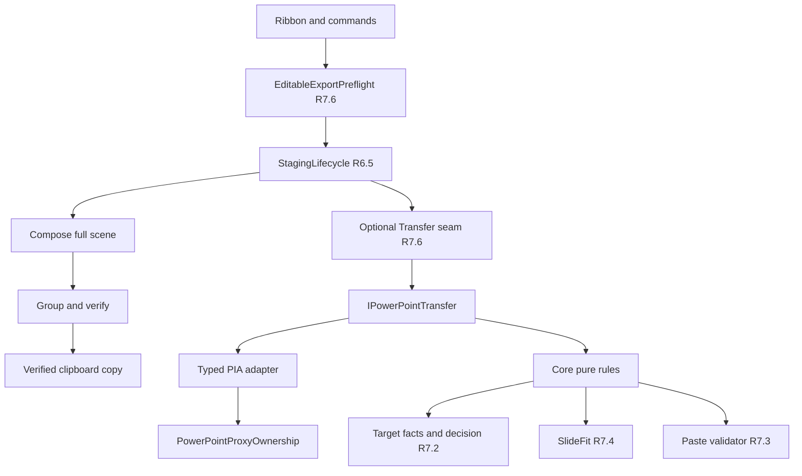
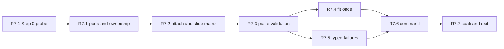

# R7.1 — PowerPoint adapters and ownership: implementation plan

> Architect plan, 2026-11-21 (revision 2). Basis, all read in this session:
> [`docs/work-items/R7.1-powerpoint-adapters.md`](../docs/work-items/R7.1-powerpoint-adapters.md:1),
> [`plans/phase7-powerpoint-transfer-review.md`](phase7-powerpoint-transfer-review.md:1),
> [`docs/02-ARCHITECTURE.md`](../docs/02-ARCHITECTURE.md:214),
> [`docs/03-ROADMAP.md`](../docs/03-ROADMAP.md:399),
> [`docs/04-TEST-STRATEGY.md`](../docs/04-TEST-STRATEGY.md:30),
> [`docs/05-GIT-QUALITY.md`](../docs/05-GIT-QUALITY.md:32),
> [`docs/REPO-MAP.md`](../docs/REPO-MAP.md:1).
>
> Repository state at the time of writing: `HEAD` is `refs/heads/main` at
> `2e61cf9` ("docs: revise Phase 7 plans for typed PowerPoint interop and gate
> corrections", 2026-11-21). This plan creates **no** branch and writes **no**
> production code; the branch step is section 5 and is executed in Code mode.
> No time estimates are given, per the repository's planning rules: work is sized by
> dependency and risk, not duration.

## 1. Executive summary

R7.1 is a greenfield, additive Office-layer row. It fixes one narrow, primitive-typed
PowerPoint transfer surface in `GanttCreator.Office`, implements it against the typed
PowerPoint PIA, and makes COM-proxy ownership explicit, testable and non-destructive. It
does not paste, position, map failures, wire a command or run the soak; those are R7.2 to
R7.7 and each consumes the surface fixed here.

Three facts drive the plan:

1. **The PowerPoint PIA is not already pinned.** `ExcelDna.Interop` 16.0.0 ships only the
   Excel PIA, the VBE interop assembly and `office.dll`; the package's own restored file
   list proves it (section 4.2). A new production dependency is therefore required, which
   is an `AGENTS.md` stop condition and needs owner approval plus ADR 0069 before code.
2. **The only PowerPoint code in the tree is test-only and late-bound.** The R6.7
   fixture uses `dynamic` and `Microsoft.CSharp.RuntimeBinder`, and
   [`DisposeAsync()`](../tests/GanttCreator.Office.IntegrationTests/PowerPointFixture.cs:294)
   calls `Quit()` unconditionally, including on an instance it attached to. R7.1 replaces
   it with a typed, non-destructive fixture.
3. **The row has no Office gate, but it has a manual host probe.** The probe is folded into
   Step 0 as one evidence commit and is what R7.2 to R7.7 consume; it adds no production
   code and no roadmap row.

## 2. Work item review

### 2.1 Outcome

The narrow PowerPoint application/presentation/slide adapter ports and the ownership
rules for their COM proxies exist in `GanttCreator.Office`: every proxy the add-in owns is
tracked and released exactly once in reverse order; nothing it does not own is touched or
terminated; the adapter is statically typed against the PowerPoint PIA; and the port
cannot express save, close or quit.

### 2.2 Acceptance criteria and their proof

| AC | Proof | Gate |
| --- | --- | --- |
| Fake-adapter lifecycle pins: attach/create/dispose sequences | `PowerPointTransferAdapterTests` over fake ports | `dotnet test tests/GanttCreator.Office.ContractTests` |
| Ownership pins: owned released exactly once, reverse order | `PowerPointProxyOwnershipTests` order probe | same |
| Ownership pins: unowned never released or closed | positive test asserting the fake presentation records no close | same |
| Single-detach pin for any owned event connection | adapter test asserts zero un-detached connections; Phase 7 adds none | same |
| AddIn names no interop type | existing [`PortHygieneTests`](../tests/GanttCreator.Architecture.Tests/PortHygieneTests.cs:38) extended to the PowerPoint surface | `dotnet test tests/GanttCreator.Architecture.Tests` |
| Phase-7 Office files contain no `dynamic`, no `Microsoft.CSharp` | Roslyn syntax scan with an in-memory positive control | same |
| No `Activate` on a slide/window/presentation receiver | Roslyn invocation scan with a positive control | same |
| Transfer port has no save/close/quit member | reflection over the port interfaces with a positive control | same |
| No Office gate (row: None) | `Not run`, with the row's stated reason; Step 0 probe is manual evidence | — |

### 2.3 Constraints and governing contracts

- `Core` stays Office-free: pure decision, fit and paste-validation types use primitives,
  `RectD`/`PointD` and records only ([`GanttCreator.Core.csproj`](../src/GanttCreator.Core/GanttCreator.Core.csproj:1)
  has no package references and targets `net10.0`).
- No interop type in a port signature — the CS0433 discipline documented on
  [`IExcelApplicationAdapter`](../src/GanttCreator.Office/IExcelApplicationAdapter.cs:47).
- STA/main thread only; no `Task.Run` around COM, no async wrapper, no sleep.
- Release with `Marshal.ReleaseComObject`, never `FinalReleaseComObject`, exactly once, in
  reverse order — the precedent is
  [`ExcelGanttTableReader.ReleaseAcquired()`](../src/GanttCreator.Office/ExcelGanttTableReader.cs:635).
- Never save, close, quit, overwrite or terminate a user presentation or a pre-existing
  PowerPoint instance.
- No worksheet, schema, catalogue or `_GanttCreatorConfig` change; no PowerPoint state is
  persisted anywhere.
- One work item in progress; one concern per commit; Conventional Commit prefixes
  ([`docs/05-GIT-QUALITY.md`](../docs/05-GIT-QUALITY.md:53)).

### 2.4 Dependencies and inherited evidence

- R6 is complete: verified editable copy, grouping, staging lifecycle and the single
  cleanup authority ([`StagingLifecycle.Run()`](../src/GanttCreator.Office/StagingLifecycle.cs:217)).
- R6.7 measured PowerPoint 16.0.20527.20196: `PasteSpecial(ppPasteShape)` returned a range
  of 5 (the group plus four flattened children) at 340 x 190 pt (ADR-0066).
- R6.8 measured the production scale the later rows must use: 80 staged shapes and 340
  primitives in the reference copy.
- The Office harness and its owned-PID discipline exist; the PowerPoint half of that
  discipline is owed (section 11.4).

### 2.5 Scope boundary

In scope: the package decision and ADR; the Step 0 host probe; the port surface and
records; the typed adapter and ownership tracker; the typed replacement for the R6.7
fixture; the architecture scans; `REPO-MAP`, `STATUS` and the work-item evidence table.

Out of scope, per the guide's exclusions: attach/start policy decisions (R7.2), paste and
its validation (R7.3), positioning (R7.4), failure mapping and retry (R7.5), the command
and ribbon (R7.6), the soak (R7.7), any Excel-side change, and any
`Save`/`SaveAs`/`Close`/`Quit`/`Activate`.

## 3. Decisions, assumptions, ambiguities and open questions

| # | Statement | Status | Effect on this plan |
| --- | --- | --- | --- |
| D1 | Typed PowerPoint PIA, primitive ports, no `dynamic`/`Microsoft.CSharp` | **fact** — owner direction 2026-11-21, work item D1 | Adapter is typed; fixture migrated; scans enforce it |
| D2 | Ownership: tracked, reverse order, exactly once, never force-released, never quit/close a pre-existing host | **fact** — work item D2 and architecture | Ownership tracker is a first-class type with tests |
| D3 | STA only | **fact** — work item D3 and `AGENTS.md` | No async members; XML docs state the requirement |
| D4 | Read the active slide, never activate | **fact** — work item D4 and [`NoSheetActivationTests`](../tests/GanttCreator.Architecture.Tests/NoSheetActivationTests.cs:33) | New PowerPoint-specific scan because the worksheet scan cannot see a `slide` receiver |
| D5 | The transfer surface cannot save | **fact** — work item D5 | Structural reflection test plus scan |
| D6 | The PowerPoint PIA is not supplied by `ExcelDna.Interop` 16.0.0 | **fact** — restored package file list (section 4.2) | New pinned package plus ADR |
| D7 | Adding the PIA may duplicate `Microsoft.Office.Core` types already provided by `office.dll`, including through transitive flow into the AddIn | **unknown — must be measured in Step 0** | Build spike and a measured isolation route before any adapter file |
| D8 | `main` is the correct source branch | **inference, to be proven by command** | `git merge-base --is-ancestor feat/r6-editable-export main` is a hard precondition |
| D9 | The R7.1 exclusion says "no paste" while its scope names paste among the ports | **ambiguity** | Recommended resolution in section 6.3; owner confirms |
| D10 | Pure export types belong under `Core/Export/` (review) although `ExportBounds` and its resolver live in `Core/Scene/` | **ambiguity, non-blocking** | Follow the Tier-A guides; record the chosen folder in `REPO-MAP` |
| D11 | D-R7.2 button contract is not recorded | **open decision, blocks R7.2** | Not needed for R7.1 |
| D12 | D-R7.4 inset policy is not recorded | **open decision, blocks R7.4** | Not needed for R7.1 |
| D13 | "Protected presentation" has no definition | **open decision, blocks R7.2** | Probe records the measurable facts (`ReadOnly`, paste refusal) |
| D14 | The reference host and desktop PowerPoint are available for the probe | **unknown** | Probe is human-run; no CI substitute |
| D15 | The working tree is clean before branching | **unverified — no shell in this mode** | `git status --short` must be empty before `switch -c` |

## 4. Interop inventory and package strategy

### 4.1 What the repository references today

| Project | TFM | Interop asset | Why it is there |
| --- | --- | --- | --- |
| [`GanttCreator.Core`](../src/GanttCreator.Core/GanttCreator.Core.csproj:1) | `net10.0` | none | Pure domain and scene; the boundary the architecture protects |
| [`GanttCreator.Office`](../src/GanttCreator.Office/GanttCreator.Office.csproj:20) | `net10.0-windows` | `ExcelDna.Interop` 16.0.0 | `Excel = Microsoft.Office.Interop.Excel` in every adapter; `Microsoft.Office.Core` in [`ExcelShapeWriter`](../src/GanttCreator.Office/ExcelShapeWriter.cs:6) and [`ExcelShapeGrouper`](../src/GanttCreator.Office/ExcelShapeGrouper.cs:3) |
| [`GanttCreator.AddIn`](../src/GanttCreator.AddIn/GanttCreator.AddIn.csproj:33) | `net10.0-windows` | `ExcelDna.AddIn`, `ExcelDna.Interop` | Host integration and the Excel-DNA types; must stay free of ad-hoc interop types |
| [`GanttCreator.Office.ContractTests`](../tests/GanttCreator.Office.ContractTests/GanttCreator.Office.ContractTests.csproj:13) | `net10.0-windows` | `Moq`, `ExcelDna.Interop` | Moq proxies the Excel PIA interfaces to prove adapter bookkeeping without Excel |
| [`GanttCreator.Office.IntegrationTests`](../tests/GanttCreator.Office.IntegrationTests/GanttCreator.Office.IntegrationTests.csproj:20) | `net10.0-windows` | `ExcelDna.Interop`, `AllowUnsafeBlocks` | Live Excel and the late-bound PowerPoint fixture; references Core, Office and AddIn |

Two consequences follow. The AddIn deliberately carries the Excel PIA while its source
names no interop type, because both `ExcelDna.Integration` and the Excel PIA declare
`Application`; that is the hazard `PortHygieneTests` guards. And the integration test
project is the only place a PowerPoint PIA is needed for tests, because contract tests
should fake the ports and therefore need no PowerPoint type at all.

### 4.2 D-G6 resolution — authoritative evidence

`Directory.Packages.props` describes `ExcelDna.Interop` 16.0.0 as shipping the Office
PIAs ([`Directory.Packages.props`](../Directory.Packages.props:23)). That description is
not sufficient evidence, so the restored package asset file was read. Its complete
package file list is:

```text
lib/net452/Microsoft.Office.Interop.Excel.dll
lib/net452/Microsoft.Vbe.Interop.dll
lib/net452/office.dll
lib/net6.0-windows7.0/Microsoft.Office.Interop.Excel.dll
lib/net6.0-windows7.0/Microsoft.Vbe.Interop.dll
lib/net6.0-windows7.0/office.dll
```

and its compile and runtime asset sets are exactly those three assemblies
([`project.assets.json`](../src/GanttCreator.Office/obj/project.assets.json:5); the file is
generated and untracked, so the same evidence must be re-recorded in the work item as
output of the Step 0 restore, not cited as a repository document).

**Conclusion (fact):** `ExcelDna.Interop` 16.0.0 does not provide
`Microsoft.Office.Interop.PowerPoint`. D-G6 closes as **new pinned package +
ADR 0069**, not as "PIA already pinned". The work item's own stop condition applies: the
dependency is not approved until the owner approves it.

### 4.3 The transitive-flow hazard and the measured routes

`PackageReference` compile and runtime assets flow to referencing projects. Adding the
PowerPoint PIA to `GanttCreator.Office` therefore makes it visible to `GanttCreator.AddIn`,
which already references `ExcelDna.Interop` and its `office.dll`. If the PowerPoint
package also carries a `Microsoft.Office.Core` assembly, the AddIn compilation can fail
with CS0433 without any source change, and the packed XLL can gain two candidates for the
same types.

Step 0 must choose one route from measured evidence, in this order:

| Route | What it does | Cost / risk |
| --- | --- | --- |
| R1 — obvious flow | plain `PackageReference` in Office, integration tests reference it directly | simplest; must prove AddIn compiles and the packed XLL loads |
| R2 — flow control | `PrivateAssets="all"` on the Office reference, explicit reference in the integration test project | keeps the PIA out of AddIn's compile asset graph; verify the XLL still deploys what the Office adapter needs |
| R3 — alias isolation | package or direct reference with an MSBuild `Aliases` and `extern alias` in the adapter | most explicit; costs a little readability and must be justified by R2 failing |
| R4 — direct assembly reference | `<Reference>` with `HintPath` to the installed PIA | last resort; fights central package management and the dependency policy |

**Do not take a route on assumption.** The spike is: add the package, restore, build the
solution in Release with warnings as errors, inspect the AddIn compile graph, pack the
add-in, and load it once. The measured route and its build output go into ADR 0069. If no
route compiles cleanly, the work item's stop condition applies and the human decides.

### 4.4 ADR 0069 contents

Before the first adapter file:

1. the typed PIA route and the exact package pin;
2. the measured isolation route (R1–R4) and why the others failed;
3. the no-`dynamic`/`Microsoft.CSharp` rule for Phase-7 production and test paths;
4. the ownership rules: one tracker, reverse order, `ReleaseComObject` only, no force
   release, no quit/close/save, single detach if an event is ever added;
5. attach-or-start as the documented single-instance behaviour, with `StartedByUs`
   decided by the `POWERPNT` snapshot, and no termination of a pre-existing host;
6. the supported Office build family and the reference build measured by the probe;
7. rollback: `git revert`, because the adapter is additive.

### 4.5 Package and build changes

| File | Change | Condition |
| --- | --- | --- |
| [`Directory.Packages.props`](../Directory.Packages.props:29) | `<PackageVersion Include="Microsoft.Office.Interop.PowerPoint" Version="16.0.0" />` | after owner approval and the spike |
| [`src/GanttCreator.Office/GanttCreator.Office.csproj`](../src/GanttCreator.Office/GanttCreator.Office.csproj:20) | `PackageReference` with the measured route's metadata | same |
| [`tests/GanttCreator.Office.IntegrationTests/GanttCreator.Office.IntegrationTests.csproj`](../tests/GanttCreator.Office.IntegrationTests/GanttCreator.Office.IntegrationTests.csproj:20) | `PackageReference` for the typed fixture | same |
| `src/GanttCreator.Office/packages.lock.json` and the integration test lock file | regenerated by restore and committed | same commit as the package pin |
| `tests/GanttCreator.Office.ContractTests` | **no change** — faked ports need no PowerPoint type, which is itself the proof the port stays primitive | — |

## 5. Branch strategy

### 5.1 The branch

One phase branch, no per-row branches, no additional branches:

```text
feat/r7-powerpoint-transfer
```

This follows the R6 precedent (`feat/r6-editable-export`) and the naming rule
`type/roadmap-id-short-description` ([`docs/05-GIT-QUALITY.md`](../docs/05-GIT-QUALITY.md:32)).
The `r7` segment links the branch to the R7 phase; the first commit body names
`docs/work-items/R7.1-powerpoint-adapters.md`, which is the row-level traceability link.
No pull request is opened by an agent, and nothing is pushed
([`docs/05-GIT-QUALITY.md`](../docs/05-GIT-QUALITY.md:43)).

### 5.2 Preconditions and commands

Architect mode has no shell, so these run in Code mode, in order, stopping on the first
failure:

```powershell
git status --short                                  # must be empty
git switch main
git pull --ff-only origin main
git log --oneline -3                                # expect the Phase-7 docs revision at HEAD
git merge-base --is-ancestor feat/r6-editable-export main
if ($LASTEXITCODE -ne 0) { throw 'R6 is not contained in main; stop and report' }
git branch --list 'feat/r7*'                        # must be empty; never create a second branch
git switch -c feat/r7-powerpoint-transfer
git branch --show-current                           # expect feat/r7-powerpoint-transfer
git status --short                                  # still empty: a branch creation writes no file
```

If `git branch --list 'feat/r7*'` finds an existing branch, stop and report rather than
reuse or rename it. If `git status --short` is non-empty, stop: a branch created over
uncommitted work cannot be certified by `verify.ps1`, which requires a clean tree
([`docs/05-GIT-QUALITY.md`](../docs/05-GIT-QUALITY.md:81)).

### 5.3 Integrity rules for the branch

- One concern per commit; the branch-final gate runs once after the last commit.
- No amend, rebase or force-push.
- `verify.ps1` requires a clean tree; `verify-quick.ps1` runs on the staged index.
- The Phase-7 Office gate is `Not run` for R7.1 because the row's gate is `None`; the Step 0
  probe is manual evidence recorded in the work item.

## 6. Architecture and ownership design

### 6.1 Layering

| Layer | Owns | Must not |
| --- | --- | --- |
| `Core` | target decision table, `SlideFit`, paste validator: pure, total, host-free | name an interop type, read a process, know a PowerPoint build |
| `Office` | typed PIA adapter, fact gathering, raw host operations, proxy ownership | own product policy, activate, save/close/quit, leak PIA types into ports |
| `AddIn` | command, ribbon, message mapping | name interop types, compute geometry, validate rows |



### 6.2 Frozen port surface

One file, records and interfaces, no interop type in any signature:

```text
src/GanttCreator.Office/IPowerPointTransfer.cs
  IPowerPointTransfer          Transfer(PowerPointTransferRequest) -> PowerPointTransferOutcome
  IPowerPointApplicationPort   AttachOrStart(), ReadApplicationFacts(), ReadPresentationFacts()
  IPowerPointSlidePort         ReadActiveSlide(), PasteSpecialShape(), ReadPastedGroupFacts()
  records  PowerPointTransferRequest     WidthPt, HeightPt, InsetPt, ExpectedChildCount
           PowerPointApplicationFacts    StartedByUs, PresentationCount, Build, ProcessId
           PowerPointPresentationFacts   HasPresentation, ReadOnly, ProtectedView, HasWindow,
                                         SlideCount, ActiveViewType, SlideShowActive
           PowerPointSlideFacts          HasActiveSlide, SlideIndex
           PowerPointPasteFacts          ShapeCount, GroupCount, WidthPt, HeightPt, BoundsFinite
           PowerPointPositionOutcome     Left, Top, Scale, Width, Height
           PowerPointTransferOutcome     Succeeded, Refusal, Paste, Position, Detail
           PowerPointTransferRefusal     one member per typed failure, owned by R7.5
```

The surface must satisfy, structurally: no `Save`/`SaveAs`/`Close`/`Quit`/`QuitAll`
member; no `Activate` member; no interop type in any signature; no `void` member that
could hide a silent no-op where a typed outcome is required.

### 6.3 The "paste" ambiguity, resolved

The guide's scope names paste among the port responsibilities, and its exclusions say no
paste until R7.3. The plan resolves this without weakening either rule:

- **R7.1** freezes the surface above and implements `PasteSpecialShape()` as a **raw**
  host call that returns unvalidated facts. It has no caller, no success semantics and no
  refusal mapping.
- **R7.3** adds the pure `PowerPointPasteValidator` and the stage that turns the facts into
  a typed success or refusal. The surface does not change, which is the point of freezing
  it now.
- If the owner reads the exclusion strictly, the alternative is to declare the paste
  member in a later row; that weakens "surface fixed before implementation" and would
  require editing the port in R7.3. The plan recommends the first option and flags it for
  confirmation (D9).

### 6.4 Ownership tracker

```text
src/GanttCreator.Office/PowerPointProxyOwnership.cs
  public class PowerPointProxyOwnership
    public int Count { get; }
    public T Acquire<T>(T proxy) where T : class   // records acquisition order
    public void ReleaseAll()                        // reverse order, exactly once, idempotent
    internal virtual int ReleaseCore(object proxy)  // seam over Marshal.ReleaseComObject
```

Pinned behaviour, one positive test each:

1. release runs in reverse acquisition order, each proxy exactly once;
2. a proxy never acquired is never released;
3. a non-COM value is ignored (contract tests pass plain fakes);
4. `ArgumentException`/`COMException` on release is recorded once and never rethrown;
5. `ReleaseAll` is idempotent; a second call releases nothing;
6. no code path calls `FinalReleaseComObject`.

### 6.5 Adapter lifecycle

```text
src/GanttCreator.Office/PowerPointTransferAdapter.cs
  implements IPowerPointApplicationPort, IPowerPointSlidePort, IPowerPointTransfer, IDisposable
  ctor(PowerPointProxyOwnership ownership, Action<string>? technicalRecord = null)
  AttachOrStart: snapshot POWERPNT -> typed new Application() -> snapshot again
                 -> StartedByUs = no process before and one after
  ReadApplicationFacts / ReadPresentationFacts: each proxy captured in a local,
                 acquired once, never chained
  Dispose: ReleaseAll in a finally; never Quit, never Close, never Save
```

Rules stated in XML docs and pinned by tests: every member is STA/main-thread only; the
adapter never subscribes to an event in Phase 7 (if one is ever added, it owns exactly one
connection and detaches it exactly once); the application RCW is released but PowerPoint is
never terminated; a presentation the add-in did not create is never closed or saved.

### 6.6 Attach versus start and the no-activation rule

`new Application()` is documented to start PowerPoint when it is not running and to return
the running instance otherwise, so one typed call covers attach and start. The adapter
records the process set before and after, sets `StartedByUs` only when the call created a
process, and never uses `Marshal.GetActiveObject` (a .NET Framework-only API) or a
`oleaut32!GetActiveObject` P/Invoke fallback.

The active presentation and slide are **read** through `Application.ActiveWindow` and
`View.Slide`. No `Activate` is called on a slide, window or presentation. A missing
window, a non-document view, an active slide show or a zero-slide presentation is a typed
fact that R7.2 interprets; R7.1 does not decide.

## 7. Excel data path and memory strategy

Phase 7 adds no Excel read, validation, transformation or mapping. It consumes the R6.8
pipeline in this order, and the transfer command (R7.6) must not re-implement any step:

1. **Source** — the visible worksheet's `tblGanttData` and the `_GanttCreatorConfig`
   catalogues. Nothing is sourced from elsewhere and nothing is written to PowerPoint as
   data.
2. **Read** — one bulk `Value2` read of the table body through the existing reader seam
   ([`ExcelGanttTableReader`](../src/GanttCreator.Office/ExcelGanttTableReader.cs:600)),
   converted once to `GanttRowDto`. No per-cell COM read, no second reader.
3. **Configuration before validation** — the R6.8 order (read, configuration, validate
   with `config.Styles`, measure, request, selection, bounds) because a style-keyed
   Delineator loses its label position without the registry.
4. **Validation** — [`GanttRowValidator`](../src/GanttCreator.Core/GanttRowValidator.cs)
   produces the events and the dropped-row count. Phase 7 reports the count; it never
   re-validates.
5. **Transformation** — `SceneBuilder` maps events to primitives; the export request maps
   the measured grid to zero-origin coordinates. Phase 7 consumes `ExportBounds.Bounds`
   only, never `ChartBounds`, and never re-applies `PlacementDelta`.
6. **Memory** — one read, one scene, one staging pass, one delete pass. No second scene
   copy, no retained `Range`/`Shape` proxy after the operation, no PowerPoint proxy held
   beyond one transfer. The architecture budgets still apply: 1,000 events scene under
   250 ms; 1,000-object editable export under 5 s
   ([`docs/02-ARCHITECTURE.md`](../docs/02-ARCHITECTURE.md:325)).

The Excel staging cleanup remains the lifecycle's `finally`; the transfer adds no second
cleanup authority. Any attempt to store PowerPoint state on the VeryHidden sheet is a
product-invariant violation and a **STOP**.

## 8. PowerPoint transfer design

The feature is a paste of a composed shape group, not template-driven deck generation.
This is stated explicitly so the implementation is not over-built:

| Concern | Design |
| --- | --- |
| Template | **No `.pptx` template is read or written.** The presentation's theme is the effective template because `PasteSpecial(ppPasteShape)` inherits it |
| Slide masters and layouts | Never modified. A created presentation uses `ppLayoutBlank` only, and only when R7.2's recorded policy requires creation |
| Native table population | None. The table is a panel of shapes inside the pasted group; that is why the copy is editable but faithful |
| Native chart population | None. The Gantt is a shape composition; no PowerPoint chart object or data sheet is created |
| Styling fidelity | Host paste fidelity plus one group resize; the label-fidelity gate at 4:3, 16:9 and one custom size is the acceptance test |
| Positioning | `SlideFit` in `Core` computes `Left`, `Top`, `Scale`, `Width`, `Height` from `ExportBounds.Bounds`; the Office applier writes it once |
| Output handling | **No file output.** No `Save`, `SaveAs`, `Close`, `Quit`, no staging file, no atomic temp path |
| Presentation creation | R7.2 policy only, announced; a created presentation is not saved |

Resize rule, fixed here because R7.1 freezes the surface: resize the `msoGroup` member
found by `Shape.Type == msoGroup`, never the returned `ShapeRange`, which also lists the
group's flattened children and would double-scale them.

## 9. Libraries and APIs

| Need | Choice | Rationale and compatibility |
| --- | --- | --- |
| PowerPoint automation | `Microsoft.Office.Interop.PowerPoint` 16.0.0, typed PIA | Owner direction; matches the pinned Excel PIA major; no binder; PIA is the documented typed surface for desktop PowerPoint |
| Excel automation | `ExcelDna.Interop` 16.0.0 (already pinned) | Existing Excel PIA and `office.dll`; the reason the transitive hazard must be measured |
| COM release | `System.Runtime.InteropServices.Marshal` | Repository release rule; same as every existing adapter |
| Process snapshots | `System.Diagnostics.Process` | Local, offline; same approach as the Office harness |
| Clipboard readiness | existing `WindowsClipboardFormatReader` | One clipboard authority; no second check |
| Tests | xUnit 2.9.3 and Moq 4.21.0 (already pinned) | Contract tests fake ports; no live host |
| Source scans | `Microsoft.CodeAnalysis.CSharp` 5.12.0 (already pinned) | The existing architecture scans are Roslyn syntax-based; reuse that machinery instead of adding a regex scanner |
| Diagnostics | `Stopwatch` and the rolling log | Elapsed time is diagnostics, never a retry condition |

Rejected: late-bound `dynamic` (owner direction); `Marshal.GetActiveObject` (not a .NET 10
API); `oleaut32!GetActiveObject` P/Invoke (covered by the typed single-instance call);
Open XML SDK (no file generation); any persistence or telemetry (offline invariant).

## 10. File-level change map

### 10.1 R7.1 new files

| File | Content | Proof |
| --- | --- | --- |
| [`src/GanttCreator.Office/IPowerPointTransfer.cs`](../src/GanttCreator.Office/IPowerPointTransfer.cs) | ports, records, refusal enum | reflection surface test |
| [`src/GanttCreator.Office/PowerPointProxyOwnership.cs`](../src/GanttCreator.Office/PowerPointProxyOwnership.cs) | reverse-order tracker with a release seam | `PowerPointProxyOwnershipTests` |
| [`src/GanttCreator.Office/PowerPointTransferAdapter.cs`](../src/GanttCreator.Office/PowerPointTransferAdapter.cs) | typed PIA implementation and dispose | `PowerPointTransferAdapterTests` |
| `docs/adr/0069-typed-powerpoint-pia-and-ownership.md` | package, isolation route, no-`dynamic`, ownership, attach-or-start, no-save | gate G evidence |
| `scripts/probe-powerpoint-host.ps1` | Step 0 probe with a pre/post process snapshot and no unconditional quit | manual evidence table |
| [`tests/GanttCreator.Office.ContractTests/PowerPointProxyOwnershipTests.cs`](../tests/GanttCreator.Office.ContractTests/PowerPointProxyOwnershipTests.cs) | order, exactly once, unowned untouched, throwing release, non-COM value, idempotence | — |
| [`tests/GanttCreator.Office.ContractTests/PowerPointTransferAdapterTests.cs`](../tests/GanttCreator.Office.ContractTests/PowerPointTransferAdapterTests.cs) | attach/dispose sequence, `StartedByUs` arms, no close/save/quit call | — |
| [`tests/GanttCreator.Office.ContractTests/PowerPointFakes.cs`](../tests/GanttCreator.Office.ContractTests/PowerPointFakes.cs) | fake ports and a recording releaser | — |
| [`tests/GanttCreator.Architecture.Tests/PowerPointAdapterHygieneTests.cs`](../tests/GanttCreator.Architecture.Tests/PowerPointAdapterHygieneTests.cs) | no `dynamic`, no `Microsoft.CSharp`, no `Activate`, no save surface, no `Thread.Sleep`/`Task.Run`, each with an in-memory positive control | — |

### 10.2 R7.1 modified files

| File | Change |
| --- | --- |
| [`Directory.Packages.props`](../Directory.Packages.props:29) | PowerPoint PIA version pin, after approval |
| [`src/GanttCreator.Office/GanttCreator.Office.csproj`](../src/GanttCreator.Office/GanttCreator.Office.csproj:20) | `PackageReference` with the measured isolation metadata |
| lock files | regenerated and committed with the package change |
| [`tests/GanttCreator.Office.IntegrationTests/PowerPointFixture.cs`](../tests/GanttCreator.Office.IntegrationTests/PowerPointFixture.cs:57) | typed PIA; no `dynamic`/`RuntimeBinder`; close only a fixture-created presentation; `Quit` only when `StartedByUs`; write the shared owned-PID manifest |
| [`docs/REPO-MAP.md`](../docs/REPO-MAP.md:10) | Office row gains the PowerPoint ports, adapter and ownership tracker; test locations |
| [`docs/STATUS.md`](../docs/STATUS.md:1) | one work-item entry with observed gates and the probe host build |
| [`docs/work-items/R7.1-powerpoint-adapters.md`](../docs/work-items/R7.1-powerpoint-adapters.md:64) | Step 0 evidence table: package result, isolation route, probe facts, host build |
| [`docs/work-items/IMPLEMENTATION-PLAN.md`](../docs/work-items/IMPLEMENTATION-PLAN.md:282) | R7.1 status and the D-G6 wording |
| [`docs/DECISIONS.md`](../docs/DECISIONS.md) | ADR 0069 index row, if that file indexes ADRs |

### 10.3 Later rows and the one landed type they touch

| Row | New code | Modification | Gate |
| --- | --- | --- | --- |
| R7.2 | `Core/Export/PowerPointTargetFacts.cs`, `PowerPointTargetDecision.cs`; Office fact gatherer | adapter reads the full matrix | complete decision-matrix tests; Required live cases |
| R7.3 | `Core/Export/PowerPointPasteExpectation.cs`, `PowerPointPasteValidator.cs`; `PowerPointPasteStage.cs` | raw paste gains validation wiring | validator positives; Required production-scale paste |
| R7.4 | `Core/Export/SlideFit.cs`; `PowerPointSlideFitter.cs` | adapter applies placement once to the group | 4:3, 16:9 and custom fit tests; Required label fidelity |
| R7.5 | failure mapper; `PowerPointStateScope` only if the probe proves a prompt | adapter maps HRESULTs with bounded attempts | mapper positives; Required safe failures |
| R7.6 | [`src/GanttCreator.AddIn/EditableExportPreflight.cs`](../src/GanttCreator.AddIn/EditableExportPreflight.cs), `SendToPowerPointCommand.cs` | [`StagingLifecycleRequest`](../src/GanttCreator.Office/StagingLifecycle.cs:142) gains an optional `Transfer` seam, outcome and refusal; ribbon, control IDs, state, glyph generator | pipeline-order pins; Required ownership |
| R7.7 | `scripts/verify-transfer-soak.ps1` | `TransferSoak` trait; PID manifest; soak counters | 25 real transfers |

The only edit to a landed R6 type is additive and source-compatible:

```csharp
public sealed record StagingLifecycleRequest(
    IApplicationStateScope? StateScope,
    IShapeWritePort? StagingPort,
    IShapeGroupingPort? GroupingPort,
    ExportBoundsOutcome? Resolution,
    Func<StagedGroupOutcome, StagingCopyResult>? Copy = null,
    Action<string>? TechnicalRecord = null,
    Func<StagedGroupOutcome, StagingCopyResult>? Transfer = null);
```

plus `StagingLifecycleRefusal.TransferRefused` appended (never renumbered) and
`StagingLifecycleOutcome.Transfer`. Every existing R6 caller and test compiles unchanged.

## 11. Test and validation strategy

### 11.1 Layers and what each proves

| Layer | Proves | Where it runs |
| --- | --- | --- |
| Core unit | decision table, `SlideFit`, paste validator are pure and total; no host | any `.NET 10` runner, every commit |
| Office contract | port/fake sequences, ownership order and exactly-once, typed refusals, no host | Windows, every commit |
| Architecture | no interop in AddIn, no `dynamic`/`Microsoft.CSharp`, no activate, no save surface, no sleep | build runner, every commit |
| Office integration | live attach, paste, fit, failure cases, soak | dedicated Windows host, phase exit |
| Manual | representative workbook to expected PowerPoint output; label fidelity | reference machine |

### 11.2 Coverage policy for this row

The thresholds are fixed by [`docs/04-TEST-STRATEGY.md`](../docs/04-TEST-STRATEGY.md:52):
Core 95% line / 90% branch plus an 80% changed-code mutation score; Raster 90/85; Office
80/70 plus the contract matrix and live-host tests; AddIn 75/65. The same document's
Office doctrine matters more than the number: the uncovered lines in an Office adapter
are usually the **bodies of its own `internal virtual` seams**, which the contract-test
subclass overrides. A below-target class is classified as decisions or seam bodies before
a test is written; a rubber-stamp fake is worse than the gap it hides.

Applied to R7.1:

- the **decisions** — `StartedByUs` derivation, the refusal mapping, the surface rules —
  are reachable through seams and must be covered by contract tests;
- the **PIA traversal** — `new Application()`, `ActiveWindow`, `View.Slide` — is what the
  live gate exercises and what the Step 0 probe records; it is not to be faked;
- a faked port that discards the facts it was given is prohibited by the same document's
  `FakeRowHeightNormaliser` precedent;
- no threshold is changed for this row; a change requires an ADR or an evidenced approval.

### 11.3 The architecture scans, each with a positive control

| Scan | Rule | Positive control |
| --- | --- | --- |
| `dynamic` | no `dynamic` in the Phase-7 Office files or the migrated fixture | an in-memory snippet with `dynamic` must be flagged |
| `Microsoft.CSharp` | no `using Microsoft.CSharp...`, no binder call | an in-memory snippet must be flagged |
| `Activate` | no invocation on a slide/window/presentation receiver | an in-memory snippet must be flagged |
| Save surface | the port interfaces expose no `Save`/`SaveAs`/`Close`/`Quit`/`QuitAll` | a local test interface with `Save` must be flagged |
| Sleep/`Task.Run` | none in the Phase-7 files | an in-memory snippet must be flagged |

A scan that finds zero files must FAIL, not pass silently — the repository's no-silent-pass
rule ([`docs/04-TEST-STRATEGY.md`](../docs/04-TEST-STRATEGY.md:134)).

### 11.4 Integration harness obligations

From [`docs/04-TEST-STRATEGY.md`](../docs/04-TEST-STRATEGY.md:262): serialize all tests in
one collection; start from synthetic fixtures in a unique temporary directory; record the
Office/PowerPoint version, bitness, locale and run ID; attach or start only as the test
specifies; fail on a modal dialog instead of hanging; poll observable state with a
deadline; close only test-owned workbooks, presentations and processes; collect evidence
on failure; delete temporary files in `finally`.

Required live tests already named by the strategy that Phase 7 must satisfy:

- #8 `PasteSpecial(ppPasteShape)` returns one `msoGroup` plus flattened children with a
  non-empty `ShapeRange` on the active slide;
- #9 the transfer does not save, close or kill user-owned content or application;
- #13 the 25-transfer soak is `TransferSoak` only, runs under the owned-PID manifest and a
  measured deadline, and records process, handle, working-set, shape and residue counters.

R7.1's own harness work is the prerequisite for #9 and #13: the typed fixture must write
the shared owned-PID manifest and must close or quit only a host it started.

### 11.5 Traceability to the R7.1 acceptance criteria

| AC | Test / evidence |
| --- | --- |
| attach/create/dispose sequence | `PowerPointTransferAdapterTests.Attach_then_dispose_releases_in_reverse_order` |
| `StartedByUs` true and false | same file, two arms: no pre-existing process, and a pre-existing process |
| owned released exactly once, reverse order | `PowerPointProxyOwnershipTests.The_proxies_are_released_in_reverse_acquisition_order`, `Each_proxy_is_released_exactly_once` |
| unowned never released or closed | `PowerPointProxyOwnershipTests.A_proxy_never_acquired_is_never_released`; adapter fake asserts no close |
| single detach | adapter test asserts zero subscriptions and would fail if one were added without detach |
| AddIn names no interop | extended `PortHygieneTests` plus its positive control |
| no `dynamic`/`Microsoft.CSharp` | `PowerPointAdapterHygieneTests`, positive control |
| no `Activate` | `PowerPointAdapterHygieneTests`, positive control |
| no save surface | `PowerPointAdapterHygieneTests`, positive control |
| no Office gate | `Not run`; Step 0 probe is the recorded manual evidence |

### 11.6 Representative inputs and expected output

- `tests/fixtures/reference-gantt.json` for the neutral scene.
- The 20-activity workbook used by the R6.8 live gate (80 staged shapes, 340 primitives)
  for production scale.
- Expected PowerPoint result: one editable group, aspect equal to `ExportBounds.Bounds`
  within `HostOwnedGeometry.GeometryMatchTolerancePt` (0.01 pt), legible labels after the
  scale, zero staging residue, the live Excel chart unchanged.
- No golden-image update belongs to this phase; a golden change would be a separate,
  reviewed commit.

### 11.7 Flaky-test policy

A flaky test is a defect. No automatic retries in unit, golden or contract tests; at most
one bounded rerun to classify an Office-hosted failure, with both attempts recorded;
fixes observe state with a deadline instead of increasing sleeps
([`docs/04-TEST-STRATEGY.md`](../docs/04-TEST-STRATEGY.md:334)).

### 11.8 Failure injection

Per [`docs/04-TEST-STRATEGY.md`](../docs/04-TEST-STRATEGY.md:321), inject failures at
PowerPoint start/attach, paste and position, and at every application-state change. Each
injected failure asserts cleanup, preserved user content, restored state, one user-facing
message and one technical record.

## 12. Error handling, logging, validation and recovery

- Expected conditions are typed results, never exceptions: no slide, read-only, no window,
  unsupported view, slide show active, clipboard absent, wrong paste shape, COM busy.
- Unexpected exceptions cross one command boundary, which logs operation ID, HRESULT,
  Office build and stage, and shows one concise message.
- Validators at trust boundaries: null request; non-finite or non-positive `WidthPt` and
  `HeightPt`; negative inset; later, a null/empty/count-mismatched/group-less/multi-group
  or non-finite paste range. **Every new validator ships a positive test constructing the
  bad input in the same commit.**
- Release failures are recorded once and never rethrown; a copy or transfer refusal rides
  the outcome; nothing is caught and ignored.
- Recovery: staging cleanup stays in the lifecycle's `finally`; the PowerPoint side's only
  cleanup is `ReleaseAll()`; the adapter never closes or saves the user's presentation.
- Logs carry stage, HRESULT, build, operation ID and counts only — no schedule content and
  no presentation names.

## 13. Performance, scalability, security, maintainability

- **Performance:** no new Excel reads; the transfer adds one paste and one placement write
  to the existing copy cost. The soak measures process PIDs, `GetProcessHandleCount`,
  `WorkingSet64`, per-slide shape counts and staging residue, because .NET exposes no live
  RCW count.
- **Scalability:** the 25-transfer soak is a separate `TransferSoak` gate with its own
  measured deadline, because the routine Office gate keeps 780 s.
- **Security:** fully offline; no telemetry, file output, credentials or external service;
  the clipboard payload stays process-local and unlogged; no untrusted file is opened.
- **Maintainability:** one adapter, one tracker, one port file, a frozen surface, no
  `dynamic`, no duplicate pre-flight, no second clipboard check, no second cleanup path,
  and a positive control behind every new guard. A deliberate simplification with a known
  ceiling is marked `ponytail:` with its upgrade path.

## 14. Phased, executable tasks

No duration estimates. Each task ends in one commit and a green `verify-quick.ps1`.

### 14.1 R7.1 (this row)

| # | Task | Depends on | Done when |
| --- | --- | --- | --- |
| 1 | Create `feat/r7-powerpoint-transfer` from a clean, updated `main` after proving R6 is contained (section 5.2) | D8, D15 | branch exists locally; no other branch; working tree still clean |
| 2 | Package spike: add the PowerPoint PIA, restore, Release build with warnings as errors, inspect the AddIn compile graph and the packed XLL | 1, owner approval, D7 | one isolation route measured and recorded; if none compiles, STOP |
| 3 | ADR 0069 with the measured route and the ownership and no-save rules | 2 | ADR committed before any adapter file |
| 4 | Version pin, project references, lock files | 3 | `dotnet restore --locked-mode` green; AddIn still compiles |
| 5 | Step 0 probe script, run on the reference host, evidence table recorded in the work item | 4, D14 | attach vs start, process delta, `Presentations.Count`, `ActiveWindow`, `View.Type`, `SlideShowWindow`, `Slides.Count`, `ReadOnly`, production-scale paste range, three resize routes, busy and missing-member HRESULTs, `DisplayAlerts` need |
| 6 | Migrate the fixture to the typed PIA and non-destructive ownership | 4 | no `dynamic`/`Microsoft.CSharp`; `Quit` only when `StartedByUs`; PID manifest written |
| 7 | Port surface and records | 3 | file compiles; reflection surface test green |
| 8 | Ownership tracker and its tests | 7 | all six pinned behaviours green, including positives |
| 9 | Typed adapter: attach-or-start, facts, raw paste, group facts, dispose | 5, 8 | adapter contract tests green; no save/close/quit reachable |
| 10 | Architecture scans with positive controls | 9 | all five scans green, and each fails on its synthetic input |
| 11 | Docs: `REPO-MAP`, `STATUS`, work-item evidence, implementation plan | 10 | `check-status` and `check-md-links` green |
| 12 | Branch-final gate | 11 | `pwsh ./scripts/verify.ps1` **PASS** on a clean tree; Office gate `Not run` with the row's reason |

### 14.2 Phase sequence after R7.1



R7.2 consumes the probe's facts and records D-R7.2 before its live gate. R7.3 re-measures
the paste range at production scale before fixing the expectation. R7.4 probes the three
resize routes and records D-R7.4 before the fit matrix. R7.5 uses only the measured
transient HRESULTs and a bounded attempt count, never a time deadline. R7.6 adds the
optional lifecycle `Transfer` seam and keeps the `EditableExport` profile with a
transfer/copy scene parity pin. R7.7 fixes nothing new in the fixture (it is already fixed
in R7.1) and adds the soak gate and the Phase-8 Tier-A upgrade.

## 15. Gates and evidence commands

```powershell
dotnet build GanttCreator.slnx /p:Configuration=Release /warnaserror
dotnet test tests/GanttCreator.Office.ContractTests
dotnet test tests/GanttCreator.Architecture.Tests
pwsh ./scripts/verify-quick.ps1      # every commit, after staging, expect exit 0
pwsh ./scripts/verify.ps1            # branch-final, clean tree
git diff --check                     # expect no output
```

R7.1's Office gate is **None**; the Step 0 probe is manual evidence. Every gate not run is
reported as `Not run` with its reason. No command may be reported as having run without
observed output.

## 16. Definition of done and handoff

R7.1 is done when: the dependency is ADR'd and pinned through a measured isolation route;
the Step 0 evidence table is recorded with the host build; the typed adapter and ownership
tracker exist and are green; the fixture is typed and non-destructive and writes the PID
manifest; the five architecture scans are green with positive controls; Release builds with
zero warnings; XML docs are present; `REPO-MAP` and `STATUS` are current; `verify.ps1`
passes on a clean tree; and checklist sections **G** (dependencies and quality) and **J**
(state restoration and no side effects) are self-certified in the final commit message.

Handoff format: `Outcome / Changed / Proof / Office / Risk / Deferred / Next`, with every
unrun gate stated as `Not run` and its reason.
