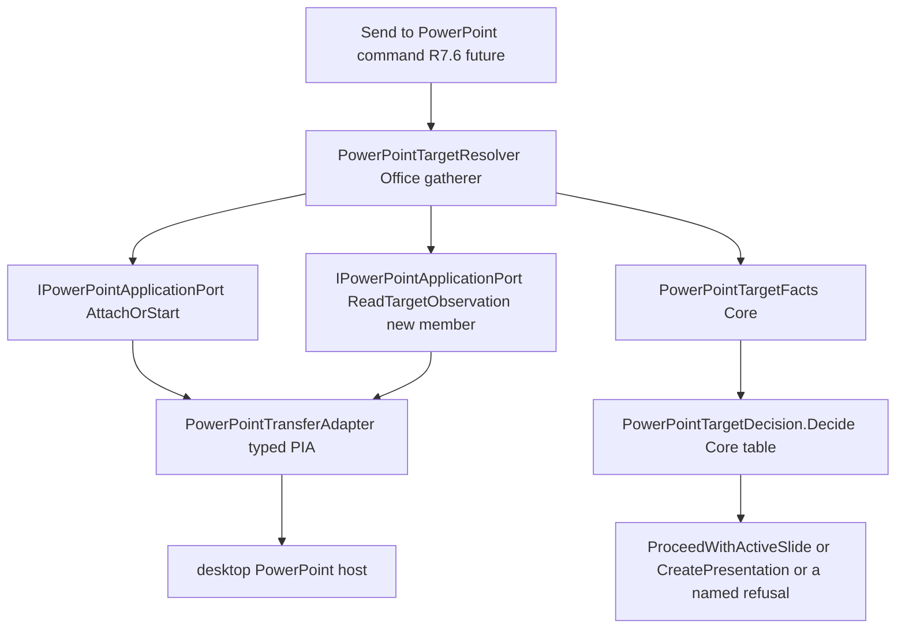

# R7.2 implementation plan — attach/start and active-slide decision matrix

> Architect plan, 2026-11-21. Source of truth: [`docs/work-items/R7.2-attach-slide-cases.md`](../docs/work-items/R7.2-attach-slide-cases.md)
> (Tier A, revised 2026-11-21), the governing architecture section
> ([`docs/02-ARCHITECTURE.md`](../docs/02-ARCHITECTURE.md)), the landed R7.1 surface, and the
> Phase-7 review ([`plans/phase7-powerpoint-transfer-review.md`](phase7-powerpoint-transfer-review.md) §4.2).
>
> **Owner decisions recorded 2026-11-21 (this session):**
>
> 1. **D-R7.2 is confirmed as proposed** — attach to the active **editable** presentation and
>    its active slide; create a new presentation **only when none is open**, announced in the
>    feedback; refuse typed on a read-only/password-protected presentation **or a protected-view
>    document**, an unsupported view, an active slide show, a presentation with no window, or a
>    presentation with no slide. The Step-0 stop-point is discharged; the ruling is recorded in
>    the work item as a dated note before code lands.
> 2. **The richer target read lands as a NEW port member.** The landed
>    [`ReadPresentationFacts()`](../src/GanttCreator.Office/IPowerPointApplicationPort.cs:107)
>    stays untouched; a new `ReadTargetObservation()` member resolves the active presentation
>    through `ActiveWindow.Presentation` and adds the protected-view facts.
>
> **Audit amendments (same day).** An independent audit of this plan raised three blocking
> defects and seven major corrections; all are applied below — B2 the foreground protected-view
> fact and precedence row (§4.2, §4.3, bodies 9 and 12), B1 the two-presentation wrong-deck
> regression body (§4.5 body 10), B3 the protected-view open-route probe with the Mark-of-the-Web
> fallback and `ProtectedViewWindow.Close` cleanup (§5 Phase 0, §9), M1 the observation-count
> precedence (§4.4), M2 the null-view outcome (§4.2 row 9), M3 the attach-arm `StartedByUs`
> assertion (body 2), M4 the outline-view settability probe (§5 Phase 0, body 6), M5 the
> corrected traceability body numbers (§2), M6 the stop-conditions block (§9), and M7 the
> corrected verification wording (§9, §10).

---

## 1. Intent and expected outcome

Attach-vs-start and active-slide resolution become a **closed, typed, complete decision
matrix**: existing/new PowerPoint, every presentation state, every active view state, and
every slide state each map to exactly one typed outcome — `Proceed` with a resolved
presentation and slide, `CreatePresentation` (announced), or a named refusal the R7.6
command will translate to one actionable message. The matrix is Core-pure and host-free;
one Office fact gatherer reads the host through the R7.1 port and calls the table; a live
case-by-case gate pins the real host behaviour with builds recorded.

R7.2 delivers **the decision only**. No paste (R7.3), no positioning (R7.4), no failure
retry policy (R7.5), no command wiring or presentation creation (R7.6), and no activation of
any slide, window or presentation — ever.

## 2. Requirements → acceptance-criteria traceability

| Work-item requirement | Acceptance criterion | Where it is satisfied |
| --- | --- | --- |
| D1 closed typed matrix over 7 axes | Full decision matrix, every case → typed outcome | `PowerPointTargetDecisionTests`, one row per matrix cell |
| D1 positive test per refusal | "positive test per refusal case" | One constructing-facts `[Fact]` per `PowerPointTargetRefusal` member |
| D1 every view case | "including every view type" | `[Theory]` over all 12 documented `PpViewType` values plus an unknown int; live bodies 5, 6, 11 |
| D1 slide-show / no-window / zero-slide / read-only / protected-view cases | named in the automated gate | Matrix rows + live bodies 3, 4, 7, 8, 9, 12 |
| D1 active presentation with many presentations open | the "many" axis resolves the active deck | Core count rows (2/3) + live body 10, the wrong-deck regression |
| D1 foreground protected view beats a background deck | the protected-view axis is the foreground surface | Core row 4 + live body 12 |
| D2 Core-pure table | decision-matrix tests in Core, no Office dependency | `src/GanttCreator.Core/Export/` types; Core test project only |
| D2 Office gatherer calls the table | fact-gatherer contract tests over fakes | `PowerPointTargetResolverTests` over a fake `IPowerPointApplicationPort` |
| R2.2/R2.6 typed-refusal discipline | missing member / throwing `ActiveWindow` is a typed refusal, not an exception | Gatherer refused-read arm (HResult `0x80020006`) + adapter refused-observation shape |
| D3 user-visible policy | start/create announced; attach never alters session state | `StartedByUs` echoed on the decision; the announcement is post-attach and its wording is R7.6's; the decision policy is pinned here |
| D4 never activate | the PowerPoint no-activation scan guards it | [`PowerPointAdapterHygieneTests`](../tests/GanttCreator.Architecture.Tests/PowerPointAdapterHygieneTests.cs:25) scan set extended to the new files |
| D5 no ownership of a pre-existing host | `StartedByUs` measured from the `POWERPNT` snapshot | Landed R7.1 [`PowerPointProcessSnapshot`](../src/GanttCreator.Office/PowerPointProcessSnapshot.cs); live body 1 (start arm, `true`) and body 2 (attach arm, `false`) |
| Office host gate (Required) | existing/new PowerPoint, missing/active slide, sorter/outline view, slide-show, read-only/protected; builds recorded; never close/quit a pre-existing presentation | `PowerPointTargetDecisionIntegrationTests` bodies 1–12 (11 outcome bodies + 1 measurement) on the landed non-destructive fixture |
| Definition of done | checklist **G, J, K**; Release 0 warnings; XML docs; REPO-MAP/STATUS current | Commit messages self-certify; gates observed |

## 3. Findings that shape the design

1. **The landed fact read resolves the wrong presentation in the multi-presentation case.**
   [`PowerPointTransferAdapter.ReadPresentationFacts()`](../src/GanttCreator.Office/PowerPointTransferAdapter.cs:126)
   reads `Presentations[1]`, while the architecture
   ([`docs/02-ARCHITECTURE.md`](../docs/02-ARCHITECTURE.md:224)) resolves the active
   presentation through `Application.ActiveWindow`. With two or more presentations open
   where `Presentations[1]` is not active, the facts describe the wrong deck and the matrix
   would decide against the wrong target. **Owner ruling: close it with a new port member**
   (option B), leaving the landed member untouched — and prove it with live body 10, because
   no host-free test can see the resolution.
2. **The protected-view facts are missing from the port.** A protected-view document is
   *inferred* not to be in `Presentations`; the Phase-0 probe **measures** this rather than
   assuming it. `Application.ProtectedViewWindows` is the documented collection
   ([Microsoft Learn](https://learn.microsoft.com/office/vba/api/powerpoint.application.protectedviewwindows))
   and `Application.ActiveProtectedViewWindow` returns the on-top protected window or
   `Nothing` ([Microsoft Learn](https://learn.microsoft.com/office/vba/api/powerpoint.application.activeprotectedviewwindow)).
   Both exist since PowerPoint 2010, so the pinned 15.0 PIA carries them — verified at
   compile level in Phase 0, never assumed.
3. **View-type facts are unmeasured.** The R7.1 probe created a windowless presentation, so
   `activeViewType` was never recorded. The live gate measures `View.Type` per view state,
   including the work item's open question — whether the reference build reports the
   standard editing view as `ppViewNormal` (9) or `ppViewSlide` (1). Both are allowed, so
   the decision is unaffected; the measurement is recorded as evidence.
4. **`PpViewType` values verified from Microsoft Learn** (not memory):
   slide=1, slideMaster=2, notesPage=3, handoutMaster=4, notesMaster=5, outline=6,
   slideSorter=7, titleMaster=8, normal=9, printPreview=10, thumbnails=11,
   masterThumbnails=12. Allowed set: **{1, 3, 9}**. Every other value — including any
   future/unknown int — refuses `UnsupportedView` by default, which is the robustness
   property of the int-based design.
5. **The "R7.7 fixes the harness first" note is stale.** The non-destructive fixture
   ownership (snapshot pre-existing `POWERPNT`, adopt only what it starts, write the shared
   owned-PID manifest, quit only when `StartedByUs`) already landed with R7.1
   ([`PowerPointFixture`](../tests/GanttCreator.Office.IntegrationTests/PowerPointFixture.cs:47)).
   The R7.2 live gate can run on the current fixture; it needs **extensions** for the new
   cases, not an ownership fix.
6. **The fixture's presentation is windowless by design**
   ([`PowerPointFixture.Initialize()`](../tests/GanttCreator.Office.IntegrationTests/PowerPointFixture.cs:99)),
   which is the no-window case for free; the windowed/view/slide-show/read-only/protected
   cases need new fixture-owned arrangement scopes.
7. **Decision precedence is unpinned in the work item.** The table must define a total,
   deterministic order over the axes; §4.2 defines one and the Core tests pin it.
8. **`SlideShowActive` is measured as `SlideShowWindows.Count > 0`** — "a show is running",
   the conservative reading of "a slide show window is active". The live gate records what
   `ActiveWindow` reports while a show runs.
9. **Foreground protected view is a distinct state the count-only fact cannot express.**
   `ActiveProtectedViewWindow` is "the window on top", so a normal deck can be open behind a
   protected-view window the user is actually looking at. Refusing only when
   `PresentationCount == 0` would paste into the background deck; the matrix must refuse on
   the foreground protected window regardless of background decks. This is also why body 9
   previously contradicted the table: with the default windowless fixture deck open,
   `PresentationCount == 1` and the old precedence yielded `NoWindow`, never `ProtectedView`.

## 4. Solution architecture

### 4.1 Layering

- **Core** owns the one authority for "proceed or refuse" (D2). No interop type, no Office
  dependency; testable without a host.
- **Office** owns only fact gathering: the new port member does the COM traversal through
  the landed [`PowerPointProxyOwnership`](../src/GanttCreator.Office/PowerPointProxyOwnership.cs)
  transient-tracker pattern; the resolver is a pure mapper that calls the table.
- **The AddIn** (R7.6, future) consumes the decision and owns announcements and message
  strings. Nothing in R7.2 re-derives a case.

### 4.2 The Core decision table

New directory `src/GanttCreator.Core/Export/` (the work item's scope names it; the R6 export
types live in `Scene/` and are untouched):

- [`PowerPointTargetFacts`](../docs/work-items/R7.2-attach-slide-cases.md) — the primitive
  input record: `AttachAvailable`, `AttachHResult`, `StartedByUs`, `ReadSucceeded`,
  `ReadHResult`, `PresentationCount`, `ProtectedViewWindowCount`,
  `ActiveProtectedViewWindowPresent`, `ActivePresentationReadOnly`, `ActiveWindowPresent`,
  `ActiveViewType` (int?), `SlideShowActive`, `SlideCount`, `ActiveSlideIndex` (int?).
- `PowerPointTargetRefusal` — the closed refusal enum: `AttachRefused`,
  `FactsUnreadable`, `SlideShowActive`, `ProtectedView`, `ReadOnlyPresentation`, `NoWindow`,
  `UnsupportedView`, `NoSlide`, `NoActiveSlide`.
- `PowerPointTargetDecision` — the outcome record: `Action`
  (`ProceedWithActiveSlide` / `CreatePresentation` / `Refuse`), `Refusal?`, `StartedByUs`
  (echoed so D3's announcement has one source), `ActiveSlideIndex?`, `HResult?`; plus the
  static `Decide(PowerPointTargetFacts)` table and the pasteable-view constant set
  `{ 1, 3, 9 }` documented against `PpViewType` by name (Core never names the interop
  enum — the ints are documented constants pinned by tests). **Invariants:** `HResult` is
  non-null only for `AttachRefused`/`FactsUnreadable`; `ActiveSlideIndex` is non-null only
  for `ProceedWithActiveSlide`; both are pinned by tests.

**Precedence (total order, pinned by tests):**

| # | Condition | Outcome |
| --- | --- | --- |
| 1 | `AttachAvailable == false` | `AttachRefused` (HResult carried) |
| 2 | `ReadSucceeded == false` | `FactsUnreadable` (HResult carried; the `0x80020006` missing-member arm) |
| 3 | `SlideShowActive` | `SlideShowActive` |
| 4 | `ActiveProtectedViewWindowPresent` | `ProtectedView` (the foreground surface is protected, whatever decks are behind it) |
| 5 | `PresentationCount == 0` and `ProtectedViewWindowCount > 0` | `ProtectedView` |
| 6 | `PresentationCount == 0` | `CreatePresentation` (announced; D-R7.2) |
| 7 | `ActivePresentationReadOnly` | `ReadOnlyPresentation` |
| 8 | `ActiveWindowPresent == false` | `NoWindow` |
| 9 | `ActiveViewType` is null **or** not in {1, 3, 9} | `UnsupportedView` (a null view type with a window is a safe refusal, never a dereference) |
| 10 | `SlideCount == 0` | `NoSlide` |
| 11 | `ActiveSlideIndex == null` | `NoActiveSlide` |
| 12 | otherwise | `ProceedWithActiveSlide` |

Row 4 makes the foreground protected window win over any background deck (finding 9);
rows 5/6 make the protected-view refusal win over creation when the user's only open
document surface is protected. A protected-view window that is open but **not** the
foreground surface beside a normal active presentation does not block (rows 7–12 proceed),
which is the documented background case. Impossible fact combinations resolve
deterministically by this order and the tests pin that too.

### 4.3 The port extension (owner option B)

Additive only, in [`IPowerPointApplicationPort.cs`](../src/GanttCreator.Office/IPowerPointApplicationPort.cs:87):

- `PowerPointTargetObservation` — the Office-side observation record (primitive, like the
  landed fact records): `ReadSucceeded`, `HResult`, `PresentationCount`,
  `ProtectedViewWindowCount`, `ActiveProtectedViewWindowPresent`,
  `ActivePresentationReadOnly`, `ActiveWindowPresent`, `ActiveViewType` (int?),
  `SlideShowActive`, `SlideCount`, `ActiveSlideIndex` (int?).
- `ReadTargetObservation()` — one coherent read, implemented in
  [`PowerPointTransferAdapter`](../src/GanttCreator.Office/PowerPointTransferAdapter.cs:37):
  1. `Presentations.Count`, `Application.ProtectedViewWindows.Count`, and a null-safe
     `Application.ActiveProtectedViewWindow` read (the on-top protected window, or
     `Nothing`);
  2. resolve the active presentation through `Application.ActiveWindow.Presentation` when
     a window exists, falling back to `Presentations[1]` when none does (the no-window arm
     keeps its facts);
  3. read the resolved presentation's `ReadOnly`, `Windows.Count`, `Slides.Count`;
  4. read `Application.SlideShowWindows.Count`, the active window's `View.Type` and
     `View.Slide` (the landed typed pattern-match — `View.Slide` is `object` in this PIA);
  5. every proxy — including the `ActiveWindow`/`DocumentWindow` and the
     `ProtectedViewWindow` proxies — through a transient ownership tracker released in
     `finally`; a `COMException` becomes a refused observation with the HResult, never an
     escaping exception; nothing is activated, saved, closed or quit.

The landed `ReadPresentationFacts()` and its tests are untouched. The reflective
no-save/no-Activate port scan in
[`PowerPointAdapterHygieneTests`](../tests/GanttCreator.Architecture.Tests/PowerPointAdapterHygieneTests.cs:37)
covers the new member automatically; the source-scan file list gains the new files.

### 4.4 The Office fact gatherer

`src/GanttCreator.Office/PowerPointTargetResolver.cs` — the work item's "typed fact
gatherer": calls `AttachOrStart()`, then `ReadTargetObservation()`, maps the two records to
`PowerPointTargetFacts`, and returns `PowerPointTargetDecision.Decide(facts)`. It performs
no COM of its own, holds no proxies, and never re-derives a case. **The observation's
`PresentationCount` is authoritative for the table**; the attach-time count is evidence only
(a deck opened between the two calls must not leave the table seeing zero presentations). A
refused attach or a refused observation maps to the `AttachRefused` / `FactsUnreadable`
refusals — typed results, not exceptions (the R2.2/R2.6 discipline). A contract test makes
the two counts disagree (attach 0, observation 1) and asserts `CreatePresentation` does not
fire.

### 4.5 The live gate

Fixture arrangements are **per-case scopes**, not one mutable multi-mode fixture: each body
arranges exactly the decks/windows it owns, releases them through the shared tracker, and
closes them in dispose. Setup helpers (test-only):

| Helper | Case it sets up |
| --- | --- |
| attach-only scope (no presentation created) | new-PowerPoint; protected-view-with-no-presentation |
| windowed presentation + blank slide | existing-PowerPoint; active slide |
| windowed presentation, no `Slides.Add` | zero-slide |
| the existing windowless presentation | no-window |
| `ActiveWindow.ViewType = ppViewSlideSorter` | unsupported view (sorter) |
| `ActiveWindow.ViewType = ppViewOutline` | unsupported view (outline) — subject to the Phase-0 settability probe |
| `SlideShowSettings.Run()` then view exit on the fixture's own deck | slide-show |
| save temp `.pptx`, `Presentations.Open(..., ReadOnly: msoTrue, WithWindow: msoTrue)` | read-only |
| attach-only scope + `ProtectedViewWindows.Open(tempFile)`, closed with `ProtectedViewWindow.Close()` | protected view, no presentations |
| deck A first (inactive, distinct facts), deck B second (windowed, active) | two presentations, active not `Presentations[1]` |
| a normal deck plus `ProtectedViewWindows.Open` on top | foreground protected view over a background deck |

Live bodies (tagged `OfficeIntegration`, in
`tests/GanttCreator.Office.IntegrationTests/PowerPointTargetDecisionIntegrationTests.cs`),
each asserting the typed outcome and recording the host build:

1. new-PowerPoint, zero presentations → `CreatePresentation`, `StartedByUs == true`
   (precondition: no `POWERPNT` running — fail loud naming "close PowerPoint before the
   live gate", never skip silently);
2. existing-PowerPoint, windowed deck with an active slide → `ProceedWithActiveSlide`,
   `StartedByUs == false` (the attach arm);
3. presentation with no slides → `NoSlide`;
4. windowless presentation → `NoWindow`;
5. slide sorter view → `UnsupportedView`;
6. outline view → the body first records what `View.Type` reports; if the host normalises
   the window to `ppViewNormal`, the measured fact is recorded and the Core theory remains
   the covering evidence for value 6 — the case is not faked;
7. running slide show → `SlideShowActive`, recording what `ActiveWindow` reports, exiting
   the show in `finally`;
8. read-only presentation → `ReadOnlyPresentation`;
9. protected-view window, **no presentations open** → `ProtectedView` (attach-only scope,
   then `ProtectedViewWindows.Open`; `ProtectedViewWindow.Close()` in `finally`);
10. **two presentations with the active deck not `Presentations[1]`** → `ProceedWithActiveSlide`
    resolving deck B (the wrong-deck regression proof: deck A first and inactive with
    distinct `SlideCount`, deck B second and active);
11. the normal-view measurement: record which value `View.Type` reports in the standard
    editing view (evidence for the work item's open question; the decision is unaffected);
12. a normal deck open with a protected-view window **on top** → `ProtectedView` (the
    foreground rule), closing both in `finally`.

**Gate precondition:** the mutable-view/show/protected bodies require the established
discipline that no user PowerPoint is running — the same pre-existing-process capture
`verify-office.ps1` already performs — and every mutation is on a fixture-owned deck. A
pre-existing host is never viewed, shown, closed or quitted.

## 5. Implementation sequence

One concern per commit, each green; the implementing session loads skill `00-ponytail`
first and follows the ladder.

| Phase | Commit | Content | Gates |
| --- | --- | --- | --- |
| 0 | `docs:` + probe | Record the D-R7.2 ruling (dated) in the R7.2 work item; compile-probe the PIA members (`ProtectedViewWindows`, `ActiveProtectedViewWindow`, `DocumentWindow.Presentation`); run a disposable `scripts/probe-protected-view-open.ps1` measuring the open route, `PresentationCount`/`ActiveProtectedViewWindow` under protected view, and the MotW (`Zone.Identifier`, `ZoneId=3`) fallback; measure whether `ViewType = ppViewOutline` is settable and what it reads back; record the results | `git diff --check`, `check-status.ps1` |
| 1 | `feat(core):` | `PowerPointTargetFacts` (with `ActiveProtectedViewWindowPresent`) + `PowerPointTargetDecision`/`PowerPointTargetRefusal` + view constants, and the complete matrix tests in the same commit | Core tests, build `-warnaserror`, `verify-quick.ps1` |
| 2 | `feat(office):` | `PowerPointTargetObservation` + `ReadTargetObservation()` on the port, the adapter implementation, adapter contract tests (lifecycle, pre-attach shape, refused-observation shape), hygiene scan set updated | Office contract + architecture tests, `verify-quick.ps1` |
| 3 | `feat(office):` | `PowerPointTargetResolver` + contract tests over a fake port (every mapping arm; the count-disagreement arm; refused attach; refused read with `0x80020006`) | Office contract tests, `verify-quick.ps1` |
| 4 | `test(office):` | Fixture arrangement scopes + the live bodies 1–12 | `verify-office.ps1 -DeadlineSeconds <measured>` (Required), host builds recorded |
| 5 | `docs:` | REPO-MAP (new files, new test locations), STATUS entry in the handoff format, the live evidence table + the protected-view/normal-view measurements in the work item | `git diff --check`, `check-md-links.ps1`, `check-status.ps1` |

Phase 4's deadline: measure the added bodies first, then pass `-DeadlineSeconds` with
headroom (recent full gates ran ~15 m at 1200 s; the default 780 s is not raised —
[`verify-office.ps1`](../scripts/verify-office.ps1:41)).

## 6. Excel and PowerPoint approach specifics

**Excel: nothing.** R7.2 touches no Excel read, write, or validation path. The editable
export pipeline (table read → configuration → validation → measurement → export request →
bounds) is landed from R6.8 and is consumed as-is by the future R7.6 command, which will
extract the shared `EditableExportPreflight`. No worksheet, schema, catalogue, scene, or
golden change — storing PowerPoint state anywhere is a STOP (product invariant).

**PowerPoint: typed PIA only.** [`Microsoft.Office.Interop.PowerPoint`
15.0.4420.1018](../docs/adr/0069-typed-powerpoint-pia-and-ownership.md) with
`EmbedInteropTypes=true`; no `dynamic`, no `Microsoft.CSharp`, no new package. The COM
surface R7.2 adds is a bounded, fixed set of property reads (`Presentations.Count`,
`ProtectedViewWindows.Count`, `ActiveProtectedViewWindow`, `ActiveWindow`,
`ActiveWindow.Presentation`, `View.Type`, `View.Slide`, `ReadOnly`, `Windows.Count`,
`Slides.Count`, `SlideShowWindows.Count`), plus `ProtectedViewWindow.Close()` in the
test fixture only — no collection enumeration beyond `Count`, no per-shape work, no
measurable latency concern; the live gate records timings anyway. Patterns: ports/adapters
with primitive records (the CS0433 discipline), the typed-refusal discipline, the transient
ownership tracker with reverse-order `ReleaseComObject` (never `FinalReleaseComObject`),
STA-only members with no async wrappers. Maintainability: the closed Core table is the
single proceed/refuse authority; the refusal enum is closed; the view constants are
documented ints pinned by tests; R7.6 translates refusals to messages and never re-derives
a case.

## 7. Data flow, error handling, logging, edge cases

- **Flow:** command (R7.6) → resolver → port (`AttachOrStart` → `ReadTargetObservation`) →
  Core facts → `Decide` → typed decision → the command announces a start/create or
  translates the refusal. **The announcement is necessarily post-attach:** the resolver
  cannot announce before it knows whether it started the host; it echoes `StartedByUs` and
  the `CreatePresentation` action, and the command announces immediately afterwards (the
  landed adapter's remarks already say "announced by the caller").
- **Expected states are typed results, never exceptions.** COM failures (including a
  throwing `ActiveWindow`) are caught at the adapter boundary into refused facts carrying
  the HResult; the resolver maps them to `AttachRefused`/`FactsUnreadable`. Unexpected
  exceptions cross the R1.4 command boundary unchanged.
- **Logging:** the adapter's existing `technicalRecord` seam emits one record per refused
  COM call (the new member adds its own tag in the same style). No schedule content; the
  resolver itself is silent — R7.5/R7.6 own the trace lines.
- **Edge cases are the matrix.** `SlideShowActive` means a show is **running**
  (`SlideShowWindows.Count > 0`), documented as such on the record; unknown view ints and a
  null view type refuse by default; foreground protected view refuses over any background
  deck; impossible fact combinations resolve by the pinned precedence; a windowless
  presentation, a zero-slide presentation, a running show, a read-only deck, and a
  protected-view window are all first-class typed cases, not host errors.

## 8. Testing and validation

- **Core** (`tests/GanttCreator.Core.Tests/Export/PowerPointTargetDecisionTests.cs`): one
  row per matrix cell; a positive `[Fact]` per refusal member; the view `[Theory]` over all
  12 documented values plus an unknown int; the count axis (0, 1, 2, 3) with the many case
  resolving to `ProceedWithActiveSlide`; the foreground protected-view rows (no deck +
  protected count → `ProtectedView`; normal deck + foreground protected view →
  `ProtectedView`; normal deck + background protected view → proceeds); the null-view row;
  the decision invariants (`HResult` only on the two unreadable refusals,
  `ActiveSlideIndex` only on `Proceed`); precedence pins (facts matching two refusals
  resolve to the earlier row); determinism (equal facts, equal decision);
  `CreatePresentation` echoes `StartedByUs`.
- **Office contract** (`PowerPointTargetResolverTests` + adapter tests): a fake port per
  mapping arm proving the resolver produces exactly the table's decisions; the
  count-disagreement arm (attach count 0, observation count 1 → not `CreatePresentation`);
  the refused attach and the refused read (`0x80020006`) are typed refusals, not
  exceptions, including the "throwing `ActiveWindow`" shape; the new member's lifecycle
  pins (disposed guard, pre-attach shape) mirror the landed member's; the landed
  `ReadPresentationFacts` tests stay green untouched.
- **Architecture:** the new Office files join the
  [`PowerPointAdapterHygieneTests`](../tests/GanttCreator.Architecture.Tests/PowerPointAdapterHygieneTests.cs:25)
  scan set (no `dynamic`, no `Microsoft.CSharp`, no `Activate`, no sleep/`Task.Run`); the
  reflective port scan already forbids save/close/quit members on any `IPowerPoint*`
  interface.
- **Live (Required):** bodies 1–12 above under `verify-office.ps1`, host builds recorded,
  never closing or quitting a pre-existing presentation (the landed fixture discipline).
- **Mutation:** the changed-Core gate will judge the new table; the per-case positives
  minimise survivors — record equivalent guard-arm mutants rather than chasing them.
- **Checklist self-certification: G, J, K** (build/artifact traceability; COM ownership —
  locals, no chained expressions, `try/finally` release including the window and
  protected-view proxies; failure injection — the refused paths are injected by fakes and
  reproduced live).

## 9. Risks, mitigations, open items

| Risk | Mitigation |
| --- | --- |
| Attach/start flakiness on real hosts (named by the work item) | Deliberate case setup, no retries in R7.2 (R7.5 owns busy-retry), flakes recorded per the flaky-test policy — a pass-only-on-retry becomes a defect |
| The protected-view open route may not force protected view for a local temp file | Phase-0 probe measures `ProtectedViewWindows.Open` on the reference host; the Mark-of-the-Web fallback (`Zone.Identifier`, `ZoneId=3`) is the unsafe-location route; `ProtectedViewWindow.Close()` is the cleanup. If no deterministic route exists on the build, record an owner-visible deviation and mark the live case measured-but-not-exercisable rather than silently substituting a contract test — the Required gate must not be quietly weakened |
| Outline view may be normalised to `ppViewNormal` by the host | The Phase-0 probe measures settability and read-back; body 6 records the measured fact and the Core theory covers value 6; the case is never faked |
| The wrong-deck regression could ship unproven | Body 10 constructs the two-presentation state explicitly (deck A first/inactive, deck B second/active) and asserts B is resolved |
| Mutable view/show/protected bodies must never touch a user host | The gate's established precondition: no user PowerPoint; every mutation is on a fixture-owned deck; a pre-existing host is only observed |
| The new-PowerPoint body's precondition | Fail loud naming "close PowerPoint before the live gate" rather than skipping |
| Gate deadline | Measure, then `-DeadlineSeconds` with headroom; the 780 s default is untouched |
| A case the typed PIA cannot express (stop condition) | `ProtectedViewWindows`/`ActiveProtectedViewWindow` are Learn-verified Office-2010 APIs and compile-checked in Phase 0; `DocumentWindow.Presentation` is a documented standard member proven by the same compile check; `View.Slide`'s `object` typing is already handled by the landed pattern-match |
| Touching the landed R7.1 surface | Option B: the landed member and its tests are untouched; all changes are additive |
| Mutation survivors in the new switch | Per-case positives; record equivalents, never weaken tests |

**Stop conditions (from the work item, carried forward):**

- The button contract is undecided → **discharged** by the D-R7.2 ruling recorded above; it
  is written into the work item in Phase 0.
- A case cannot be detected without mutating user state or activating a slide/window →
  **stop**; the live design mutates only fixture-owned decks and never activates anything.
- A required case has no typed outcome because the typed PIA cannot express it → **stop**;
  record the probe; never fall back to `dynamic`.

**Open items (non-blocking):**

- The exact `View.Type` value the reference build reports in the standard editing view —
  live body 11 records it; both 1 and 9 are allowed.
- What `ActiveWindow` reports while a show runs — body 7 records it.
- Whether a protected-view document appears in `Presentations` — the Phase-0 probe
  settles it, and body 9/12 assert from the measured fact.
- R7.6 consumes the resolver and owns the announcement/message strings; R7.3 re-reads the
  active slide at paste time through the same port. Consider one line in the architecture's
  PowerPoint bullet (or an ADR-0069 note) recording the D-R7.2 ruling so R7.5/R7.6 do not
  rediscover it in a work item.

## 10. Evidence ledger

| Statement | Status | Evidence |
| --- | --- | --- |
| D-R7.2 confirmed: attach active editable + slide; create only when none open; refuse the five named states | fact | owner ruling recorded 2026-11-21 (this session) |
| The richer target read lands as a new port member; the landed read is untouched | fact | owner ruling recorded 2026-11-21 (this session) |
| `PpViewType` values: slide 1, notesPage 3, normal 9; sorter 7, outline 6, thumbnails 11, masters 2/4/5/8/12, printPreview 10 | fact | Microsoft Learn `PpViewType` enumeration, checked 2026-11-21 |
| `Application.ProtectedViewWindows` exists | fact | Microsoft Learn `Application.ProtectedViewWindows` |
| `Application.ActiveProtectedViewWindow` returns the on-top protected window or `Nothing` | fact | Microsoft Learn `Application.ActiveProtectedViewWindow` |
| `ProtectedViewWindow.Close` exists | fact | Microsoft Learn `ProtectedViewWindow.Close` |
| `ProtectedViewWindows.Open` is documented by signature only; that it forces protected view for a local temp file is an inference | inference | Microsoft Learn `ProtectedViewWindows.Open` remarks; Phase-0 probe measures it |
| A protected-view document is not in `Presentations` | inference | Phase-0 probe measures `Presentations.Count` while a protected window is open |
| `DocumentWindow.ViewType` is read/write; outline settability is unmeasured | fact + unknown | Microsoft Learn `DocumentWindow.ViewType`; Phase-0 probe measures outline |
| `DocumentWindow.Presentation` is a documented standard member in the pinned PIA | inference | Phase-0 compile probe is the proof (no Learn citation claimed) |
| The landed adapter reads `Presentations[1]`, not the active window's presentation | fact | [`PowerPointTransferAdapter`](../src/GanttCreator.Office/PowerPointTransferAdapter.cs:126) |
| The fixture ownership fix already landed with R7.1; the "R7.7 first" note is stale | fact | [`PowerPointFixture`](../tests/GanttCreator.Office.IntegrationTests/PowerPointFixture.cs:47) remarks + STATUS 2026-11-21 |
| The probe never recorded a view type (windowless presentation) | fact | [`probe-powerpoint-host.ps1`](../scripts/probe-powerpoint-host.ps1:96) + the R7.1 evidence table |
| `View.Slide` is `object` in the pinned PIA; the typed pattern-match is the safe read | fact | [`PowerPointTransferAdapter`](../src/GanttCreator.Office/PowerPointTransferAdapter.cs:150) |
| The routine office gate deadline is 780 s with a `-DeadlineSeconds` parameter | fact | [`verify-office.ps1`](../scripts/verify-office.ps1:41) |
| What `ActiveWindow` reports during a show or under a foreground protected view; the normal-view value on the reference build | unknown | live bodies 7, 11, 12 measure them |
