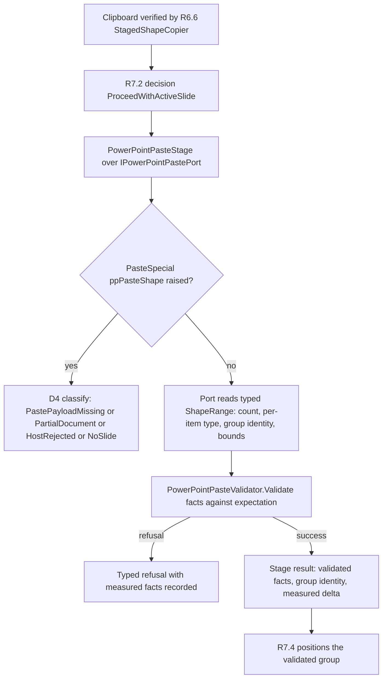

# R7.3 — `PasteSpecial(ppPasteShape)` verify: review and implementation plan

- **Work item:** [`docs/work-items/R7.3-paste-special-verify.md`](../docs/work-items/R7.3-paste-special-verify.md:1) — Tier A (binding contract), revised 2026-11-21.
- **Roadmap row:** [`docs/03-ROADMAP.md`](../docs/03-ROADMAP.md:407) — *Call `PasteSpecial(ppPasteShape)` and validate returned `ShapeRange` — Adapter tests reject null, empty, and zero-bound results — Required: real `ppPasteShape` integration test on each supported Office build.*
- **Plan date:** 2026-11-21. **Phase state:** R7.1 and R7.2 landed 2026-11-21; R7.3 is the next Phase-7 row.

---

## 1. Review and analysis

### 1.1 Objective

Call `Shapes.PasteSpecial(PpPasteDataType.ppPasteShape)` on the resolved slide through the
typed PIA and **validate** the returned typed `ShapeRange`: null, empty, wrong-type,
count-mismatch and zero-bound results are rejected as typed failures — never a non-throwing
COM call mistaken for success — pinned by Core validator tests, Office contract tests over
fakes, and a real `ppPasteShape` integration test at production scale on the reference host
(PowerPoint 16.0.20527.20196 x64).

### 1.2 Dependencies — all landed except one owed measurement

| Dependency | Status | Evidence |
| --- | --- | --- |
| R7.1 typed PIA fact port, adapter, ownership tracker | Landed 2026-11-21 | [`docs/STATUS.md`](../docs/STATUS.md:3) — PIA 15.0.4420.1018 pinned, embed interop types, no `dynamic` |
| R7.2 decision matrix + Office resolver | Landed 2026-11-21 | [`docs/STATUS.md`](../docs/STATUS.md:1) — `PowerPointTargetDecision.Decide` closed table, 12/12 live gate |
| R6.6 verified clipboard copy | Landed 2026-11-18 | [`StagedShapeCopier.Copy`](../src/GanttCreator.Office/StagedShapeCopier.cs:88) — measured drawing pair verified before paste is R7.3's precondition |
| R6.4 verified staged group | Landed 2026-11-18 | [`StagedGroupOutcome`](../src/GanttCreator.Office/StagedShapeGrouper.cs:68) — carries `GroupName`, `ChildOrder`, `Bounds` (the expectation's N and bounds source) |
| ADR-0066 measured paste form | Accepted 2026-11-18 | [`docs/adr/0066-copy-after-delete-preserves-the-drawing-format.md`](../docs/adr/0066-copy-after-delete-preserves-the-drawing-format.md:80) — D3: at N=4 the range is **5 = the group plus 4 flattened children**, 340 × 190 pt; never assume `Count == 1`; cleanup deletes the group, not the range |
| ADR-0069 typed PIA pin | Accepted 2026-11-21 | [`docs/adr/0069-typed-powerpoint-pia-and-ownership.md`](../docs/adr/0069-typed-powerpoint-pia-and-ownership.md:92) — production-scale paste range remains R7.3 live-gate work |
| **Production-scale paste form** | **Owed measurement (Step 0)** | Expected `1 + N`; the reference fixture composition stages ~80 shapes (R6.8 live gate), the 20-activity copy benchmark records 340 primitives |

### 1.3 Governing contracts

- [`docs/02-ARCHITECTURE.md`](../docs/02-ARCHITECTURE.md:209) — export process step 6: call
  `Shapes.PasteSpecial` with `ppPasteShape` and verify the returned `ShapeRange` — one
  `msoGroup` plus its flattened children — its count, and non-zero bounds.
- [`docs/02-ARCHITECTURE.md`](../docs/02-ARCHITECTURE.md:231) — the PowerPoint automation
  bullet: exactly one `msoGroup`, count `1 + staged child count`, finite positive bounds,
  bounds/aspect match within `HostOwnedGeometry.GeometryMatchTolerancePt`; a non-throwing
  call is never success; a missing clipboard payload or partial document is a distinct stage
  failure.
- `AGENTS.md` — "PowerPoint transfer requests `ppPasteShape` and verifies the returned shape
  range. **Never report success based only on a non-throwing COM call.**"
- Microsoft Learn `Shapes.PasteSpecial` (verified this session): returns `ShapeRange`; **an
  error occurs if there is no data on the Clipboard**; **the method fails if the source
  content is not fully downloaded** (partial document); an error occurs if the data type is
  not supported by the clipboard contents. These are D4 stage failures, not
  paste-validation failures.
- [`NoSheetActivationTests`](../tests/GanttCreator.Architecture.Tests/NoSheetActivationTests.cs)
  and [`PowerPointAdapterHygieneTests`](../tests/GanttCreator.Architecture.Tests/PowerPointAdapterHygieneTests.cs:22) —
  the paste target is read from the active slide; nothing is activated; no `dynamic`, no
  `Microsoft.CSharp`, no `Thread.Sleep`, no `Task.Run` around COM.

### 1.4 Scope boundaries

**In scope** (from the work item):

- `src/GanttCreator.Core/Export/` — the pure expectation and validator:
  `PowerPointPasteExpectation`, `PowerPointPasteFacts`, `PowerPointPasteValidator`. No
  Office dependency.
- `src/GanttCreator.Office/` — the typed paste stage over the R7.1 ports: calls
  `PasteSpecial`, reads the typed `ShapeRange`, calls the Core validator.
- `tests/GanttCreator.Core.Tests/` — the rejection matrix and success pin.
- `tests/GanttCreator.Office.ContractTests/` — the stage's host-read mapping over fakes.
- `tests/GanttCreator.Office.IntegrationTests/` — the real `ppPasteShape` integration test
  at production scale (tagged `OfficeIntegration`).
- `docs/REPO-MAP.md`, `docs/STATUS.md`, status line.

**Out of scope** (exclusions, honoured by this plan): no positioning/scaling (R7.4); no
failure retry (R7.5); no command (R7.6); no clipboard-side changes (R6.6 owns
verification-before-paste); no `dynamic`.

### 1.5 Design decisions D1–D5 (binding)

| # | Rule | Plan consequence |
| --- | --- | --- |
| D1 | Validate count, bounds, type and group identity; the group is located by `Shape.Type == msoGroup`, never assumed index 1; each violation is a distinct typed failure with a positive test | The validator consumes primitive facts; the Office port walks the range and reports every item's type so the group is located, not assumed |
| D2 | Success is the validated result; the stage's success output carries the validated facts (group reference, child count, bounds) forward for R7.4 | The stage result carries the group's identity primitives (`Id`, `Name`) plus the validated facts; R7.4 resolves the group by that identity |
| D3 | Non-throwing is not success | A returned range that fails validation is a failure even with no exception |
| D4 | `PasteSpecial` errors are classified before validation: missing clipboard payload, partial document, host refusal are their own typed stage failures | The stage maps the port's refused-paste observation to `PastePayloadMissing` / `PartialDocument` / `HostRejected` (plus `NoSlide` for the vanished-slide read) before the Core validator runs |
| D5 | Tolerance is the repository's: compare bounds and aspect with `HostOwnedGeometry.GeometryMatchTolerancePt` (0.01 pt) and record the measured delta | [`HostOwnedGeometry.GeometryMatchTolerancePt`](../src/GanttCreator.Core/Scene/HostOwnedGeometry.cs:56) is the only tolerance; the measured delta is carried on the validation result |

### 1.6 Key constraints the implementation must respect

- **Typed PIA, no binder** (ADR-0069): `Shapes.PasteSpecial(PpPasteDataType.ppPasteShape)`
  and a typed `ShapeRange`; the measured enum values `ppPasteShape` (11) and `msoGroup` (6)
  are expressed through the PIA enums in Office; Core cannot name interop enums, so the
  `msoGroup` value reaches Core as a documented constant pinned by tests (the
  [`PasteableViewTypes`](../src/GanttCreator.Core/Export/PowerPointTargetDecision.cs:106)
  precedent).
- **Primitive-typed port signatures**: the reflective hygiene scan
  ([`PowerPointAdapterHygieneTests`](../tests/GanttCreator.Architecture.Tests/PowerPointAdapterHygieneTests.cs:141))
  fails any `IPowerPoint*` member whose return type or parameter names an interop type.
- **Forbidden port members** ([`_forbiddenPortMembers`](../tests/GanttCreator.Architecture.Tests/PowerPointAdapterHygieneTests.cs:40)):
  `Save`, `SaveAs`, `Close`, `Quit`, `QuitAll`, `Activate`. `PasteSpecial` is not forbidden —
  a paste member is legal on the port surface.
- **Ownership**: every proxy acquired through
  [`PowerPointProxyOwnership`](../src/GanttCreator.Office/PowerPointProxyOwnership.cs),
  released exactly once in reverse order; transient tracker per call released in `finally`
  (the [`PowerPointTransferAdapter`](../src/GanttCreator.Office/PowerPointTransferAdapter.cs:37)
  pattern).
- **STA only**; no `Task.Run` around COM; no `Thread.Sleep`.
- **Every new `if (bad) { error }` validator ships a positive test in the same commit** —
  the rejection matrix below is exactly that list.
- **Deterministic**: culture-invariant formatting for recorded evidence; no clocks in
  decisions.

---

## 2. Concrete design

### 2.1 Core — `src/GanttCreator.Core/Export/` (pure, no Office)

- **`PowerPointPasteExpectation`** (sealed record): `ExpectedChildCount` (the staged child
  count N, from `StagedGroupOutcome.ChildOrder.Count`), `ExpectedWidthPt`,
  `ExpectedHeightPt` (the staged group envelope, from `StagedGroupOutcome.Bounds`),
  `TolerancePt` (default `HostOwnedGeometry.GeometryMatchTolerancePt`). A non-positive
  count or non-finite/non-positive expected bounds is a caller error refused with its own
  typed member (positive-tested).
- **`PowerPointPasteFacts`** (sealed record): exactly the work item's named members —
  `Count`, `GroupCount`, `GroupShapeType`, `WidthPt`, `HeightPt` — every member a primitive
  or nullable primitive, mirroring
  [`PowerPointTargetFacts`](../src/GanttCreator.Core/Export/PowerPointTargetFacts.cs:44).
  The group identity (`Id`, `Name`) and the group's own child count are **Office-side
  observation members**, not Core facts: the work item puts the "group reference" on the
  stage's success output (D2), and the Core validator validates only the D1 set.
- **`PowerPointPasteRefusal`** (enum): `NullRange`, `EmptyRange`, `CountMismatch`, `NoGroup`,
  `MultipleGroups`, `WrongTypeGroup`, `NonFiniteBounds`, `NonPositiveBounds`,
  `BoundsMismatch`, plus the expectation-construction members. There is deliberately **no
  separate `AspectMismatch`**: if both axes match within `GeometryMatchTolerancePt` the
  aspect cannot mismatch, so a separate arm would be unreachable dead code; the aspect delta
  is **recorded** on the validation result instead (D5's "record the measured delta").
- **`PowerPointPasteValidator`** (static): `Validate(PowerPointPasteFacts?,
  PowerPointPasteExpectation)` → `PowerPointPasteValidation` (`Succeeded`, `Refusal`,
  `ValidatedFacts`, `MeasuredBoundsDeltaPt`, `MeasuredAspectDelta`). The validator checks
  exactly the D1 set — count, group count, group type, per-axis bounds within `TolerancePt`
  — and records the measured deltas without refusing on the aspect. The documented
  `msoGroup` constant (6) is pinned by a Core test against the documented `PpShapeType`
  enumeration. Absent-member conventions follow the landed observation records: a range
  with no `msoGroup` reports `GroupCount` 0 and a `null` `GroupShapeType`, never a sentinel
  that could be mistaken for a type.
- **Success pin (D2)**: the validation result forwards the validated facts — child count,
  bounds, measured deltas — and the **stage result** (Office-side) adds the group identity,
  so R7.4 consumes the result and never re-queries PowerPoint state it can avoid.

### 2.2 Office — `src/GanttCreator.Office/`

- **`IPowerPointPastePort`** (new narrow interface, primitive-typed): one member,
  `PasteSpecialShape()` → `PowerPointPasteObservation` (`PasteSucceeded`, `HResult`,
  `Count`, `GroupCount`, `GroupShapeType`, `GroupChildCount`, `GroupName`, `GroupId`,
  `WidthPt`, `HeightPt`). A separate port keeps
  [`IPowerPointApplicationPort`](../src/GanttCreator.Office/IPowerPointApplicationPort.cs:135)
  a pure fact surface (its own doc says "fact port"); the R7.2 precedent extended it with
  another *read*, and a mutation does not belong there. The reflective hygiene scan covers
  the new `IPowerPoint*` interface automatically. **This inverts the R7.2 same-interface
  precedent deliberately, so it is recorded as a one-line design ruling in the work item
  before implementation starts** (the alternative — a `PasteSpecialShape()` member on
  `IPowerPointApplicationPort` — remains open for the owner to prefer).
- **`PowerPointTransferAdapter` implements `IPowerPointPastePort`**: reads the **current
  active slide** through `ActiveWindow.View.Slide` (read, never activate — the measured
  `ReadOptionalStage` pattern for the 0x80048240 absence cases), calls
  `slide.Shapes.PasteSpecial(PpPasteDataType.ppPasteShape)`, acquires the returned
  `ShapeRange` through the transient ownership tracker, walks the items to locate the
  `msoGroup` (never index 1), reads count/bounds/group identity, releases transients in
  `finally`, and maps any `COMException` to the refused-paste observation with the HRESULT
  recorded. **Slide-targeting semantics, stated not assumed:** the no-activation contract's
  own language is "the paste target is read from the active slide", so the port reads the
  slide active **at paste time**; a user switching slides between the R7.2 decision and the
  paste changes the target, which is accepted and recorded rather than silently pinned to
  the decision's index. If the owner prefers pinning to the decision's `ActiveSlideIndex`,
  that is a one-line ruling at implementation start — the plan does not choose silently.
  **The `COMException` → refused-observation mapping sits behind an internal virtual seam**
  (the [`StagedShapeCopier`](../src/GanttCreator.Office/StagedShapeCopier.cs:68) precedent:
  "internal virtual seams, so contract tests own no clipboard"), so the acceptance line "a
  `PasteSpecial` exception becomes the D4 typed failure" is contract-tested host-free, not
  only live-gated.
- **`PowerPointPasteStage`** (sealed class over the port): classifies D4 failures before
  validation, **named identically to R7.5's recorded taxonomy** ([R7.5
  D1](../docs/work-items/R7.5-transfer-failures.md:79)) so R7.5 consolidates instead of
  renaming: `PastePayloadMissing` (HRESULT measured by the Step 0 probe arm),
  `PartialDocument` (documented member; its HRESULT filter is added only when measured),
  `HostRejected` (default COM-failure bucket carrying the HRESULT), and the vanished-slide
  read maps to the existing `NoSlide` semantics — then calls
  `PowerPointPasteValidator.Validate`. **Residue cleanup on a validation refusal is
  deferred to R7.5**, whose outcome owns "cleanup runs on every path": R7.3's refusals
  report the typed failure and the measured facts, and no user-facing path exists before
  R7.6 lands, so nothing is left on a user's slide by this row. ADR-0066 D3's group-delete
  **mechanic** (delete the group, never the range — deleting the range would also try to
  delete the flattened children the group already covers) is recorded here for R7.5's
  policy to consume; pulling the refusal-path delete forward into R7.3 is an owner option,
  not a silent plan choice.

### 2.3 Stage flow



---

## 3. Implementation steps

> One roadmap row, one commit when the diff stays reviewable; split only along the
> step boundaries below if it does not. Tests land in the same commit as the behaviour
> they pin. No level-of-effort estimates are attached to any step.

### Step 0 — production-scale probe (owed measurement, before the expectation is pinned)

- **Form and disposition**: a kept `OfficeIntegration` body (the
  [`CopyAfterDeleteSpikeIntegrationTests`](../tests/GanttCreator.Office.IntegrationTests/CopyAfterDeleteSpikeIntegrationTests.cs)
  kept-spike precedent — the fixture plumbing already exists), run with Excel and
  PowerPoint closed on the reference host.
- **Scale, pinned:** the production shape count is the **reference fixture composition
  (~80 staged shapes — the R6.8 live gate's own scale)**; the 340-primitive figure is the
  owner's 20-activity workbook benchmark and remains the owner's live check, as it was for
  R6.8.
- Drive the real pipeline on the reference fixture workbook (the
  [`CopyEditableIntegrationTests`](../tests/GanttCreator.Office.IntegrationTests/CopyEditableIntegrationTests.cs:39)
  pattern — initialise, read, validate, measure, export request, bounds,
  `StagingLifecycle.Run` with the real composer/grouper/copier), then paste through
  [`PowerPointFixture.PasteSpecialShape`](../tests/GanttCreator.Office.IntegrationTests/PowerPointFixture.cs:312)
  into a fixture-owned deck.
- **Record before asserting**: the body writes the measured range structure (count, group
  count, per-item types, bounds) to the evidence log before any form assertion, so a
  divergent form produces evidence, not only a red test.
- Add the **empty-clipboard arm** for D4's `PastePayloadMissing` filter — **after
  verifying the probe helper actually exposes a clipboard-empty step**
  ([`ClipboardFormatProbe`](../tests/GanttCreator.Office.IntegrationTests/ClipboardFormatProbe.cs)
  was verified for format enumeration only). If it does not, add the minimal Win32 empty
  step to the test-only probe, or drop the arm and leave the HRESULT filter documented-only
  for R7.5's probe to measure. The plan does not assert an unverified helper capability.
- Record both results in the work item's evidence ledger and `docs/STATUS.md`.
- **Stop condition**: if the production form differs from `1 + N` with one group, record
  evidence and stop for the human decision; do not widen the validator.

### Step 1 — Core validator and rejection matrix

- New files: `src/GanttCreator.Core/Export/PowerPointPasteExpectation.cs`,
  `PowerPointPasteFacts.cs`, `PowerPointPasteValidator.cs` (validator, refusal enum,
  validation result).
- New tests in `tests/GanttCreator.Core.Tests/Export/`: the binding matrix — **null range,
  empty range, count mismatch, zero groups, two groups, non-finite bounds, non-positive
  bounds, wrong-type group**, each a positive test constructing the bad facts; plus the
  bounds/aspect mismatch arms (D5) and the **success pin** that forwards the validated
  facts; plus the `msoGroup` documented-constant pin and the expectation-construction
  refusals.

### Step 2 — Office paste port and adapter implementation

- New file `src/GanttCreator.Office/IPowerPointPastePort.cs` (port + observation record).
- Extend [`PowerPointTransferAdapter`](../src/GanttCreator.Office/PowerPointTransferAdapter.cs:37)
  to implement it: typed `PasteSpecial` call, transient ownership, group located by type,
  `COMException` → refused observation with HRESULT. No `dynamic`, no activation, no
  forbidden member.

### Step 3 — Office paste stage and D4 classification

- New file `src/GanttCreator.Office/PowerPointPasteStage.cs` (stage, stage-refusal enum,
  stage result). Classifies D4 failures with R7.5's recorded names (`PastePayloadMissing`,
  `PartialDocument`, `HostRejected`, `NoSlide` semantics for the vanished slide), calls the
  Core validator, and on success carries the validated facts and the group identity forward
  (D2). A validation refusal reports the typed failure and the measured facts; the
  every-path residue policy is R7.5's (see §2.2).

### Step 4 — Office contract tests over fakes

- New tests in `tests/GanttCreator.Office.ContractTests/`: the stage maps a fake port's
  typed facts to the validator (success and each refusal); a refused paste observation
  becomes the D4 typed failure; **the adapter's `COMException` → refused-observation
  mapping is contract-tested through the internal virtual seam** so the acceptance line
  "a `PasteSpecial` exception becomes the D4 typed failure" holds host-free, not only
  live; the adapter's host-free states (before attach / after dispose) follow
  [`PowerPointTransferAdapterTests`](../tests/GanttCreator.Office.ContractTests/PowerPointTransferAdapterTests.cs:8).

### Step 5 — architecture guard updates

- Add every new Phase-7 file to
  [`_phaseSevenFiles`](../tests/GanttCreator.Architecture.Tests/PowerPointAdapterHygieneTests.cs:25)
  so the no-`dynamic` / no-`Microsoft.CSharp` / no-activation / no-sleep scans cover them.
- Update the [`ProtectionGuardFirstTests`](../tests/GanttCreator.Architecture.Tests/ProtectionGuardFirstTests.cs:438)
  classification comments: the paste port/stage mutate a PowerPoint slide, never the
  workbook, so they stay outside the worksheet guard with an accurate comment.

### Step 6 — live integration test (Required gate)

- New `tests/GanttCreator.Office.IntegrationTests/PowerPointPasteSpecialIntegrationTests.cs`
  (tagged `OfficeIntegration`), following the
  [`PowerPointTargetDecisionIntegrationTests`](../tests/GanttCreator.Office.IntegrationTests/PowerPointTargetDecisionIntegrationTests.cs:24)
  ownership discipline: Excel `OfficeFixture` + reference fixture workbook drive the real
  staging pipeline; `PowerPointFixture` starts the host and owns the deck; the production
  [`PowerPointTargetResolver`](../src/GanttCreator.Office/PowerPointTargetResolver.cs:43)
  resolves a proceed; the production paste stage validates; assertions pin `1 + N`, exactly
  one group, bounds within tolerance; the host build and measured count/bounds are
  recorded. **Test-deck cleanup:** the production stage's pasted group is deleted through
  the stage result's group identity (a small fixture helper), and the fixture closes its
  deck unsaved regardless — the fixture's own `DeletePastedShapes` cannot see a paste it
  did not make.
- The empty-clipboard arm records the D4 `PastePayloadMissing` HRESULT.

### Step 7 — documentation

- `docs/REPO-MAP.md`: the new Core validator, Office port/stage, and the live gate's entry
  points and test locations.
- `docs/STATUS.md`: the R7.3 entry with measured evidence, gates run, and `Not run`
  reasons for anything skipped.
- Work item evidence ledger: the production-scale row moves from *unknown* to *fact* with
  the measured count/bounds and host build.

### Step 8 — gates

```powershell
dotnet build GanttCreator.slnx /p:Configuration=Release /warnaserror
dotnet test tests/GanttCreator.Core.Tests
dotnet test tests/GanttCreator.Office.ContractTests
pwsh ./scripts/verify-quick.ps1      # every commit; expect exit 0
pwsh ./scripts/verify-office.ps1 -DeadlineSeconds 1200   # Required; the measured invocation — the R7.2 gate ran 17 m 34 s, over the 780 s default
git diff --check                     # expect no output
pwsh ./scripts/verify.ps1            # branch-final, clean tree, after the last commit
```

---

## 4. Acceptance test matrix (binding)

| Layer | Test | Pins |
| --- | --- | --- |
| Core | Null range | `NullRange` refusal fires (positive) |
| Core | Empty range | `EmptyRange` refusal fires |
| Core | Count mismatch | `Count != 1 + N` → `CountMismatch` |
| Core | Zero groups | `NoGroup` |
| Core | Two groups | `MultipleGroups` |
| Core | Non-finite bounds | `NonFiniteBounds` |
| Core | Non-positive bounds | `NonPositiveBounds` |
| Core | Wrong-type group | `WrongTypeGroup` |
| Core | Bounds mismatch | Per-axis bounds outside `GeometryMatchTolerancePt` → `BoundsMismatch`; the aspect delta is recorded, not a separate refusal |
| Core | Success pin | Validated facts forwarded (D2) |
| Office contract | Stage mapping | Fake port facts → validator; each D4 failure typed; refused paste observation → D4; the adapter's exception → observation seam contract-tested |
| Office contract | No `dynamic` | Hygiene scan over the new files |
| Office host (Required) | Production-scale transfer | Range is `1 + N` with one group; validation green; host build + measured count/bounds recorded |

## 5. Risks and stop conditions

| Risk | Mitigation / stop rule |
| --- | --- |
| Build-specific paste quirks; scale-dependent range form | The production-scale live gate exists for this. A form different from `1 + N` with one group → **record evidence; the human decides**; never widen the validator to make a build pass |
| Unexpected-but-valid shape form on a supported build | Record evidence; widen only with the human's nod |
| `PasteSpecial` behaves differently from the typed signature | Stop with the probe evidence; **do not return to `dynamic`** |
| Empty-clipboard HRESULT unmeasured | The Step 0 probe arm measures it if the helper supports a clipboard-empty step; until then `PastePayloadMissing` maps from the measured value only, and unmeasured COM failures fall to `HostRejected` carrying the HRESULT |
| Pasted bounds drift beyond 0.01 pt (host paste scaling) | The probe records the measured delta; a drift beyond tolerance is a stop-and-record, not a silent tolerance widen |
| Slide switches between the R7.2 decision and the paste | The port reads the slide active at paste time (the no-activation contract's own language) and the drift is recorded; pinning to the decision's index is an owner ruling, not a silent choice |
| Refusal-name drift against R7.5's taxonomy | R7.3 adopts R7.5 D1's recorded names (`PastePayloadMissing`, `PartialDocument`, `HostRejected`, `NoSlide`) so R7.5 consolidates instead of renaming |
| Residue after a refused paste | Deferred to R7.5's every-path cleanup policy by design; no user-facing path exists before R7.6, and ADR-0066 D3's group-delete mechanic is recorded for R7.5 to consume |

Rollback: `git revert` (single row commit).

## 6. Definition of done

From `AGENTS.md` + `docs/08-TEST-CHECKLIST.md` sections **E, J, K**: the rejection matrix is
green with positives; the production-scale live test is recorded with the host build;
Release build 0 warnings; XML docs on all new public members; REPO-MAP/STATUS current;
self-certified checklist sections listed in the commit message.

## 7. Evidence-ledger seeds

| Statement | Status | Evidence |
| --- | --- | --- |
| `PasteSpecial(ppPasteShape)` returns the group plus its flattened children | fact at N=4; **to be measured at production scale (Step 0)** | ADR-0066; this plan's Step 0 |
| `PasteSpecial` errors with no clipboard data or a partial document | fact | Microsoft Learn `Shapes.PasteSpecial` (verified 2026-11-21) |
| Null, empty and zero-bound results are rejected | fact | roadmap row R7.3 |
| The clipboard format is already verified before paste | fact | R6.6 D1 |
| A typed `ShapeRange` is used; no `dynamic` | fact | owner direction 2026-11-21; ADR-0069 |
| The empty-clipboard HRESULT on the reference host | **owed** — the probe arm is implemented (a minimal Win32 empty step was added to the test-only probe) and asserts `PastePayloadMissing`; the run needs the reference host | `PowerPointPasteSpecialIntegrationTests.An_empty_clipboard_paste_is_classified_PastePayloadMissing` |

---

## 8. Adversarial review outcome (2026-11-21)

**Verdict: approve with conditions.** An independent expert pass over this plan against the
Tier A work item, ADR-0066/ADR-0069, the Phase-7 roadmap and the landed R7.1/R7.2/R6.x code
found the architecture, binding test matrix, tolerance sourcing, hygiene-scan consequences,
dependency reading and step ordering sound. The conditions below were folded into this
revision rather than left as open debt:

- **F1 (medium)** — residue cleanup on a validation refusal was unsanctioned scope: the
  work item's D1–D5 do not carry it and R7.5's outcome owns "cleanup runs on every path".
  Now deferred to R7.5 with ADR-0066 D3's group-delete mechanic recorded for it (§2.2).
- **F2 (medium)** — the stage-refusal names drifted from R7.5 D1's recorded taxonomy.
  Now aligned: `PastePayloadMissing`, `PartialDocument`, `HostRejected`, `NoSlide` (§2.2).
- **F3 (medium)** — "called on the resolved slide" was glossed: the port reads the slide
  active at paste time per the no-activation contract's own language, the drift case is
  recorded, and pinning to the decision's index is an explicit owner ruling (§2.2).
- **F4 (medium)** — the empty-clipboard arm assumed `ClipboardFormatProbe` can empty the
  clipboard; it was verified only for enumeration. The arm is now conditional on verifying
  the helper first (§3 Step 0).
- **F5 (medium)** — the acceptance line "a `PasteSpecial` exception becomes the D4 typed
  failure" was satisfied only live. The adapter's exception mapping now sits behind an
  internal virtual seam so it is contract-tested host-free (§2.2, §3 Step 4).
- **F6 (low-medium)** — the Core facts record carried members beyond the work item's
  named four. Identity and child-count extras moved to the Office observation; the
  unreachable `AspectMismatch` arm was removed and the aspect delta is recorded (§2.1).
- **F7 (low-medium)** — the production scale was unpinned. Now stated: the reference
  fixture composition (~80 shapes, the R6.8 live-gate scale); the 340-primitive owner
  workbook remains the owner's live check (§3 Step 0).
- **F8 (low)** — `verify-office.ps1` now carries the measured `-DeadlineSeconds 1200`
  invocation; the default 780 s would time out a 17-minute suite (§3 Step 8).
- **F9 (low)** — the probe's form, disposition and host preconditions are now stated
  (§3 Step 0).
- **F10 (low)** — the separate `IPowerPointPastePort` inverts the R7.2 same-interface
  precedent; it is now flagged as a one-line design ruling to record before implementation
  (§2.2).

No finding invalidated the plan's structure; none requires replanning. The two owner
rulings the implementation should collect at start are F3's slide-pinning preference and
F10's port-split confirmation — both are one-line decisions already defaulted in this plan.
