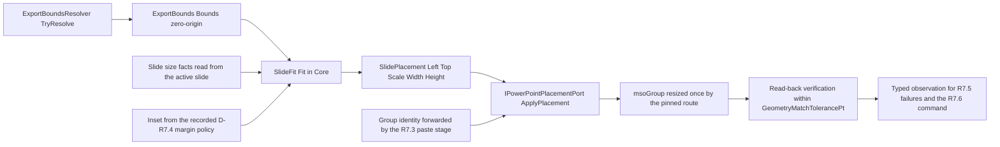

# R7.4 — Slide fit/position of the pasted group: requirements analysis and implementation plan

> Architect-mode plan for work item
> [`R7.4-slide-fit-position.md`](../docs/work-items/R7.4-slide-fit-position.md) (Tier A, revised
> 2026-11-21). Author: planning session 2026-11-21. No production code has been changed by this
> document. Planned files that do not exist yet are named in backticks, never as links.
> **Revision 2 (external audit, 2026-11-21)**: corrected the architecture-scan claim (the four
> source scans are a hardcoded file list, not automatic), rehomed the once-rule to applier
> instance state, added the route-(c) scale-derivation requirement, named the slide-size fact
> member, specified the probe harness and the one-staging/three-cycle live gate, and scoped
> slide-master placeholders and DPI into the contract. The eleven audit findings, their source
> evidence and their corrections are folded into §11 (risk rows R-8..R-10) and §14.

---

## 1. Requirements interpretation

### 1.1 Confirmed requirements

Every row is traceable to the binding work item, the architecture contract, or the roadmap row.

| # | Requirement | Source |
| --- | --- | --- |
| CR-1 | The validated pasted group is positioned and scaled **exactly once**; a second placement call anywhere fails a sequence pin (positive test) | Work item D1; [architecture](../docs/02-ARCHITECTURE.md) "PowerPoint automation" |
| CR-2 | The applied placement fits within the slide's policy margins | Roadmap row R7.4; work item Outcome |
| CR-3 | The export aspect ratio is preserved **by construction**: `Scale = min(fitWidth / groupWidth, fitHeight / groupHeight)`, applied size = `scale × groupSize` on both axes | Work item D2 |
| CR-4 | The aspect source is `ExportBounds.Bounds` (the zero-origin rectangle) — never `ChartBounds`, never the pasted range; `PlacementDelta` is never re-applied (the staging composition already consumed it) | Work item D6, Step 0; [`ExportBounds`](../src/GanttCreator.Core/Scene/ExportBounds.cs) |
| CR-5 | The resize target is the `msoGroup` member only; setting the returned range's width/height is forbidden because the range also lists the group's flattened children | Work item D4; ADR-0066 D3 |
| CR-6 | The fit math is Core-pure and Office-free: `SlideFit.Fit(RectD groupBounds, double slideWidthPt, double slideHeightPt, double insetPt)` returning `SlidePlacement { Left, Top, Scale, Width, Height }`, one rounding via `GeometryMath` | Work item Scope |
| CR-7 | The Office side is a typed applier over the R7.1 port family; statically typed PIA, no `dynamic`, no `Microsoft.CSharp` | Work item Scope/Exclusions; ADR-0069 |
| CR-8 | The geometry matrix is 4:3, 16:9 and custom (including extreme-aspect slides); every case pins position (within the recorded inset), scale and ratio | Work item D3 |
| CR-9 | A non-finite or non-positive slide size, group size, or computed scale is a typed refusal; no degenerate shape is emitted | Work item D3 |
| CR-10 | `SlideFit` repeats the finite/positive `InvalidBounds` guard on its own inputs (the shared post-resolution pre-flight guard belongs to R7.6) | Work item Step 0 |
| CR-11 | Label fidelity is part of the live gate: every label remains inside its shape at 4:3, 16:9 and one custom size; a geometry-only pass is insufficient | Work item D5 |
| CR-12 | Live Office gate (Required): inspect placement, editability and label fidelity on each slide size; record host builds and the chosen resize route | Work item Acceptance tests |
| CR-13 | Exclusions: no paste (R7.3), no failure handling (R7.5), no command (R7.6), no repeated scaling, no user-facing position UI | Work item Exclusions |
| CR-14 | Tolerance is the repository's `HostOwnedGeometry.GeometryMatchTolerancePt` (0.01 pt), never a new one | Work item Governing contracts; [`HostOwnedGeometry`](../src/GanttCreator.Core/Scene/HostOwnedGeometry.cs) |

### 1.2 Assumptions (stated, to be validated in Step 0)

- **A-1** — The pasted group's live bounds equal the staged envelope within
  `GeometryMatchTolerancePt`. R7.3's validator already pins this; the fit therefore consumes the
  resolved `ExportBounds.Bounds` as the authoritative group bounds, and the R7.3-validated
  measured bounds are the cross-check, not a second input.
- **A-2** — `PageSetup.SlideWidth`/`SlideHeight` return the slide dimensions in points as
  `Single` (Microsoft Learn PageSetup; already a fact in the work item's evidence ledger).
- **A-3** — The group identity R7.3 forwards (`GroupName`/`GroupId` on
  `PowerPointPasteStageResult`) is sufficient for the applier to resolve the group shape on the
  active slide without re-walking the pasted range.
- **A-4** — D2's formula carries **no upscale cap**: a group smaller than the fit frame is
  scaled up to fill it (`min(...)` > 1). The binding text is the formula as written; see
  ambiguity M-7 for the confirmation question this raises.
- **A-5** — The staged composition is zero-origin at paste time (the R6.x lifecycle consumed
  `PlacementDelta`), so the pasted group's position is irrelevant to the fit — the placement
  writes absolute `Left`/`Top` derived from the fit frame.

### 1.3 Ambiguities and missing information (explicit call-outs)

- **M-1 — The margin policy is an owed recorded decision (D-R7.4), not an invented number.**
  The architecture says "within slide margins" without values. The proposal on the table: a
  uniform inset derived from the chart's own outer padding
  ([`ChartPaddingPt.Uniform()`](../src/GanttCreator.Core/Scene/ChartPaddingPt.cs), 4 pt at scene
  scale), scaled with the group so the pasted chart keeps the margin it was composed with; the
  alternative is a fixed percentage inset. **The stop-point stands until the human records the
  chosen policy.** Nothing in this plan invents the value.
- **M-2 — The resize route is an owed probe.** The returned range contains the group and its
  flattened children, so resizing the range double-scales the children (inference; the probe
  confirms). Three routes must be probed on the reference host with the representative chart:
  (a) set the group's `Width` and `Height` from one computed scale; (b) set
  `LockAspectRatio = msoTrue` and set `Width`; (c) `ScaleWidth`/`ScaleHeight` with the same
  factor. The probe records which route preserves geometry, text layout and group-child
  fidelity; then one route is pinned. **The route is an input to the applier code, so the probe
  precedes implementation.**
- **M-3 — The once-rule's mechanism is not specified.** The Core acceptance catalogue says
  "a second scale is rejected downstream" without naming the mechanism. Proposed (PD-3 below):
  single-use consumption semantics on the Core `SlidePlacement` plus a typed
  `AlreadyApplied` refusal on the applier, each with a positive test. The implementer should
  reconcile the exact shape against the work item wording; the requirement itself (CR-1) is not
  ambiguous.
- **M-4 — How the applier resolves the group.** R7.3 forwards `GroupName`/`GroupId` as
  primitives. Proposed (PD-4): a new narrow `IPowerPointPlacementPort` whose
  `ApplyPlacement` re-resolves the group on the active slide by identity (read, never
  activate), mirroring the paste stage's locate-by-type walk. The alternative — handing a COM
  proxy across the stage boundary — would put an interop type in a port signature and is
  rejected by the CS0433 discipline.
- **M-5 — Which custom slide size the live gate uses.** D5 names "one custom size" for label
  fidelity without dimensions. Not a stop condition; the chosen dimensions (an extreme aspect
  is the most informative) must be recorded in the gate evidence.
- **M-6 — The label-fidelity assertion needs a measurable definition.** "Every label remains
  inside its shape" must become a concrete live check: walk the group's `GroupItems`, and for
  each text-bearing shape compare its text-frame extents against its shape bounds within the
  repository tolerance. The route probe (M-2) first measures whether PowerPoint scales text with
  the group at all on this host.
- **M-7 — Upscaling confirmation.** D2's formula has no cap at 1.0, so a group smaller than
  the fit frame is enlarged. The binding reading is fill-to-frame; if the owner intends
  shrink-to-fit only, that is a one-line policy ruling to record alongside D-R7.4. Raised here
  so it is decided deliberately, not discovered in a test.

### 1.4 Decisions carried over from prior releases

| # | Carried decision | Origin |
| --- | --- | --- |
| C-1 | Statically typed PowerPoint PIA (`Microsoft.Office.Interop.PowerPoint` 15.0.4420.1018, `EmbedInteropTypes=true` between the Excel-DNA targets); no `dynamic`, no `Microsoft.CSharp` | R7.1; [ADR-0069](../docs/adr/0069-typed-powerpoint-pia-and-ownership.md) |
| C-2 | Read, never activate: the active slide is resolved through `Application.ActiveWindow` / `View.Slide`; the architecture scan forbids an activation call | R7.1 D4 |
| C-3 | COM ownership: every owned proxy tracked, released exactly once in reverse order via `Marshal.ReleaseComObject`; never `FinalReleaseComObject`; never save/close/quit a user's deck | R7.1 D2/D5; [`PowerPointProxyOwnership`](../src/GanttCreator.Office/PowerPointProxyOwnership.cs) |
| C-4 | Non-throwing is not success: a returned range that fails validation is a failure even when no COM call raised | R7.3 D3; `AGENTS.md` |
| C-5 | The pasted range is the group plus its flattened children (`1 + N` form, one `msoGroup`); the group is located by type, never assumed to be index 1 | ADR-0066 D3; R7.3 D1 |
| C-6 | The transfer composes the same `EditableExport` scene as the copy — a drawing-rule difference between the live chart and the transfer is a defect | ADR-0068 D6 |
| C-7 | `ExportBounds.Bounds` is zero-origin; `PlacementDelta` is separate and already consumed by staging | R6.1; entity guide §1 |
| C-8 | D-R7.2 attach policy: attach to the active editable deck and slide; create and announce only when none is open; typed refusals for read-only/protected-view/unsupported view/active show/no window/no slide | R7.2 |
| C-9 | The paste stage forwards the validated facts and the group identity so R7.4 positions the group without re-querying state the stage already read | R7.3 D2; [`PowerPointPasteStage`](../src/GanttCreator.Office/PowerPointPasteStage.cs) |
| C-10 | The post-resolution `InvalidBounds` guard before any staging shape is created belongs to R7.6's shared pre-flight; R7.4 only repeats the guard on its own inputs | R7.4 Step 0 |
| C-11 | One work item in progress; one concern per commit; Conventional Commit prefixes; `verify-quick.ps1` per commit; `verify-office.ps1` Required at row exit | `AGENTS.md`; [git quality](../docs/05-GIT-QUALITY.md) |
| C-12 | Every new `if (bad) { error }` validator ships a positive test in the same commit | `AGENTS.md` |

---

## 2. Solution architecture

### 2.1 Layered design

R7.4 follows the split R7.3 established: a pure, host-free decision in Core, and a thin typed
applier in Office. Nothing lands in the AddIn (the command is R7.6's).

- **Core — `src/GanttCreator.Core/Export/`** (new, planned):
  - `SlideFit` — the pure fit function. Inputs: the group bounds (the resolved
    `ExportBounds.Bounds`), the slide width/height in points, the inset in points. Output:
    `SlidePlacement` or a typed `SlideFitRefusal`. All arithmetic in `double`; one rounding
    through [`GeometryMath.SnapToDisplayPrecision()`](../src/GanttCreator.Core/GeometryMath.cs:38)
    at the boundary where values become COM `Single`s.
  - `SlidePlacement` — the immutable result record `{ Left, Top, Scale, Width, Height }`,
    designed for single-use consumption (PD-3).
  - `SlideFitRefusal` — the typed refusal enum (non-finite/non-positive slide size, group
    bounds, or computed scale).
- **Office — `src/GanttCreator.Office/`** (new, planned):
  - `IPowerPointPlacementPort` — a new narrow port in the `IPowerPoint*` family: primitive
    surface, STA-only, read-never-activate, no save/close/quit member (the reflective
    architecture scan covers it by name prefix).
  - The applier implementation — either `PowerPointTransferAdapter` grows the port (it already
    implements `IPowerPointApplicationPort` and `IPowerPointPastePort`) or a sibling class; the
    probe's pinned resize route is the only code path. It resolves the group by the forwarded
    identity, applies the placement once, reads back the applied geometry, and returns a typed
    observation with measured deltas.
- **Tests** — Core matrix in `tests/GanttCreator.Core.Tests/`, contract pins in
  `tests/GanttCreator.Office.ContractTests/`, the live per-size gate in
  `tests/GanttCreator.Office.IntegrationTests/` (tagged `OfficeIntegration`).

### 2.2 End-to-end data flow

### 2.3 Integration points

| Boundary | Contract | Owner |
| --- | --- | --- |
| `ExportBounds.Bounds` → `SlideFit` | The zero-origin rectangle is the only aspect source; `PlacementDelta` never re-applied | R7.4 consumes R6.1 |
| `PowerPointPasteStageResult.GroupName`/`GroupId` → applier | The validated group identity, forwarded so the group is positioned without re-querying | R7.4 consumes R7.3 D2 |
| Slide size facts → `SlideFit` | `PageSetup.SlideWidth`/`SlideHeight` in points, read from the active slide, never activated | R7.4 (new fact read) |
| Applier → R7.5 | The applier names its failures in R7.5's recorded vocabulary where they overlap; cleanup on every path is R7.5's policy | Hand-off |
| Applier → R7.6 | The command composes target decision → paste → placement; the shared pre-flight `InvalidBounds` guard is R7.6's | Hand-off |
| Excel side | **No new Excel work.** The staged composition, clipboard verification and copy are the landed R6.x pipeline; R7.4 receives its input as the validated pasted group | Out of scope |

---

## 3. Key design decisions (proposed, with rationale)

- **PD-1 — Pure fit in Core, typed applier in Office.** The work item's scope mandates the
  split. Rationale: the fit is O(1) arithmetic; host-free tests make the matrix cheap, the
  mutation gate can score it, and the applier stays a thin, reviewable COM surface — the same
  validator/stage split R7.3 proved.
- **PD-2 — Ratio preserved by construction.** Both applied axes derive from one `Scale`
  computed as `min(fitWidth / groupWidth, fitHeight / groupHeight)`. Width and height are never
  computed independently, so aspect drift is unrepresentable rather than tested-for. The pin
  asserts the applied aspect equals `Bounds.Width / Bounds.Height` within tolerance for every
  slide class.
- **PD-3 — The once-rule's primary home is applier instance state.** The adapter is already
  stateful (it holds the application proxy), so it records the applied placement and refuses a
  second `ApplyPlacement` with a typed `AlreadyApplied` — the Office contract positive the work
  item mandates. A **mutable consumed-flag on the Core `SlidePlacement` record is rejected as
  the primary design**: it conflicts with the repository's immutability conventions, and the
  work item's "a second scale is rejected downstream" is layer-ambiguous (M-3). If the human
  wants a Core-visible once-artifact, the shape to propose is an applied-fact carried on the
  applier's observation rather than mutation of the placement; until that ruling, the Core
  catalogue's row is satisfied by the fit's determinism pin plus the Office positive.
- **PD-4 — The placement port carries two members, both named here so the surface is not
  invented during implementation.** `ReadSlideSize()` returns the active slide's
  `PageSetup.SlideWidth`/`SlideHeight` in points (a fact read, never an activation — the
  existing R7.1 facts records carry no slide dimensions, so this member is required); and
  `ApplyPlacement(...)` re-resolves the `msoGroup` through the forwarded `GroupId` (read, never
  activate), holding the proxy in a local tracked by the transient ownership tracker. No
  interop type crosses the port signature (CS0433 discipline); no COM proxy is handed across
  the stage boundary. The `DeleteShapeById` cleanup precedent in the R7.3 live gate is the
  established Id-resolution mechanism this design follows.
- **PD-5 — One resize route, chosen by the probe, is the only code path — and a relative route
  changes the applier's arithmetic.** Routes (a)/(b) are absolute writes: the placement's
  `Width`/`Height` map directly onto the group's `Width`/`Height`. Route (c)
  (`ScaleWidth`/`ScaleHeight`) is **relative to the group's measured current size**: applying
  the D2 scale (derived from `Bounds`) to a group whose pasted size differs by the validated
  tolerance would land at `actual × scale`, whose aspect is the pasted aspect, not `Bounds`'s.
  If the probe pins route (c), the applier must derive the factor as
  `targetSize / measuredCurrentSize` from the group proxy it already resolves — one extra
  read, no extra port member — keeping `Bounds` the aspect authority for the PD-8 pin. The
  other two probed routes are not implemented "just in case"; a route that exists but is never
  measured is exactly the dead branch this repository deletes. The probe's evidence table is
  recorded in the work item before the applier is written.
- **PD-6 — The inset is a fit parameter; the policy constant lands with the D-R7.4 ruling.**
  The fit takes `insetPt` so the Core matrix can pin containment at stated insets without
  waiting on the policy; the production wiring supplies the recorded policy value. The
  proposal the human decides on: a uniform inset derived from
  [`ChartPaddingPt.Uniform()`](../src/GanttCreator.Core/Scene/ChartPaddingPt.cs:41) scaled with
  the group, versus a fixed percentage.
- **PD-7 — Read-back verification, never a non-throwing success.** After applying, the applier
  reads back `Left`/`Top`/`Width`/`Height` and reports the measured deltas against the
  placement within `GeometryMatchTolerancePt`; a read-back beyond tolerance is a typed
  refusal. This is the `AGENTS.md` rule and the R7.3 precedent applied to the placement.
- **PD-8 — The aspect pin is against `Bounds`, not the pasted range.** The read-back applied
  aspect must equal `ExportBounds.Bounds`'s aspect. The pasted range's bounds are R7.3's
  validated cross-check; using them as the aspect source would let a host paste quirk redefine
  the export aspect.

---

## 4. Technology and libraries

The stack is pinned by prior, ADR-recorded decisions; **R7.4 adds no dependency**, and adding
one would be an `AGENTS.md` stop condition.

| Concern | Pinned approach | Why |
| --- | --- | --- |
| Runtime / language | .NET 10 (`net10.0` Core, `net10.0-windows` Office), C# with nullable, analyzers, warnings-as-errors | Repository baseline |
| Excel read/write | Excel-DNA 1.9.0 hosting + `ExcelDna.Interop` 16.0.0 PIA against the **live workbook** (bulk `Value2` reads, neutral DTOs, typed refusals, guard-first mutating adapters) | The add-in operates on the user's open workbook; a file-format library (ClosedXML / OpenXML SDK) would be a second authority over live state and a new production dependency — both stop conditions. R7.4 adds no Excel-side work anyway |
| PowerPoint manipulation | `Microsoft.Office.Interop.PowerPoint` 15.0.4420.1018, `EmbedInteropTypes=true`, statically typed, no `dynamic` | [ADR-0069](../docs/adr/0069-typed-powerpoint-pia-and-ownership.md); the transfer pastes into the user's running deck — a template/file library cannot drive the live instance or paste `ppPasteShape` clipboard content |
| Unit/contract testing | xUnit 2.9.3 + Moq 4.21.0 over fake ports (no host) | Repository pattern; ports are primitive-typed so fakes need no interop |
| Live testing | `OfficeFixture` / `PowerPointFixture` harness, `OfficeIntegration` trait, `verify-office.ps1` gate | R7.1/R7.3 landed the typed fixture; R7.4 reuses it |
| Mutation gate | dotnet-stryker 5.1.0, 80% changed-code threshold | The new Core file enters the changed-code set automatically |
| Offline invariant | No network API, no telemetry, no cloud fonts/licence checks | `AGENTS.md`; the R9.8 audit guards it later |

---

## 5. Error handling, logging, and validation

- **Typed refusals end to end.** Core: `SlideFitRefusal` for non-finite/non-positive slide
  size, group bounds, or computed scale (CR-9, CR-10). Office: the applier's typed refusals for
  group-missing, already-applied, host-rejected (HRESULT carried), and read-back mismatch
  (PD-7). The Office refusal enum is **named for R7.5's recorded taxonomy** so R7.5
  consolidates instead of renaming — the `PowerPointPasteStageRefusal` precedent. Every refusal
  ships a positive test in the same commit (C-12).
- **COM failures never escape.** The applier catches COM failures at the boundary and reports
  them as typed observations with the HRESULT — the
  [`PowerPointTransferAdapter`](../src/GanttCreator.Office/PowerPointTransferAdapter.cs)
  pattern. R7.5 owns the consolidated failure taxonomy; R7.4 names its failures in that
  vocabulary where they overlap and does not build retry (excluded).
- **Logging.** One technical record per refused COM call through the existing
  `Action<string>?` technical-record seam, redacted by the repository's `Redactor` policy and
  formatted through `CultureInfo.InvariantCulture` — the established record-line pattern.
  Success records the measured placement deltas — the diagnostic the D5 label-fidelity
  investigation will need.
- **Validation order.** The fit validates its own inputs before any arithmetic; the applier
  validates the placement (single-use) and resolves the group before any write; the read-back
  verification is the last gate before success is reported.
- **No catch-and-ignore, no analyzer suppression, no arbitrary sleeps** — the repository's
  standing rules.

---

## 6. Performance, scalability, and memory management

- **The fit is O(1) arithmetic** — no performance surface. The only rounding is the single
  `GeometryMath.SnapToDisplayPrecision` boundary; no per-axis ad-hoc rounding.
- **The applier is a handful of COM property reads/writes on one shape.** Each proxy is held in
  a local; per-call proxies go through the transient tracker released in a `finally` (the
  adapter's existing discipline). No `Task.Run`, no async wrappers, STA only.
- **No repeated host reads.** The placement consumes the R7.3-validated facts and the forwarded
  group identity rather than re-walking the pasted range; the slide-size read is one fact read
  per transfer.
- **Memory.** Proxy release in reverse order through
  [`PowerPointProxyOwnership`](../src/GanttCreator.Office/PowerPointProxyOwnership.cs); no new
  long-lived state beyond the single-use placement record. The 25-transfer soak (R7.7) later
  proves the leak behaviour at scale; R7.4's live gate already asserts zero orphan processes
  per run.
- **Single-precision reality.** PowerPoint stores geometry as `Single`; every host read-back
  comparison uses `GeometryMatchTolerancePt` (0.01 pt) — the repository's tolerance, never
  widened to make a comparison pass.

---

## 7. Security and compliance considerations

- **Offline operation.** No network calls, no telemetry, no online licence checks — the fit and
  the applier are pure local COM automation.
- **Non-destructive by construction.** The port family has no `Save`/`SaveAs`/`Close`/`Quit`
  member (proven structurally by the reflective architecture scan); the placement mutates only
  the pasted group the add-in itself created, in the user's own deck, and the user retains
  ownership of their presentation.
- **No credentials, no customer data in logs.** Technical records flow through the redaction
  seam; the live gate's evidence records host builds and measured geometry, never document
  content.
- **Resource safety.** The ownership tracker prevents the proxy leaks that destabilise a
  user's Office session; the `verify-office.ps1` per-teardown forced-exit ceiling guards the
  harness side.
- **No new dependency, no new Office permission** — the COM automation surface is already
  granted by the add-in's nature; nothing in R7.4 extends it.
- **Slide-master safe areas are not a fit input.** The pasted group is a floating shape, not
  layout content: PowerPoint places shapes freely over layout placeholders, so the D-R7.4
  margin is the chart's own composed margin, not placeholder avoidance. If the owner expects
  placeholder/title-area avoidance, that is a separate ruling to record with D-R7.4 — the work
  item's proposal does not include it (open question 5).
- **DPI independence is a fact to state, not a mechanism to build.** `SlideWidth`, `SlideHeight`
  and shape geometry are points in the COM model regardless of Windows display scaling; the only
  precision concern is the host's `Single` storage, which `GeometryMatchTolerancePt` absorbs.
  No DPI conversion exists in the fit.

---

## 8. Maintainability and testability

- **Ports stay primitive-typed** — no interop type in a signature, so the AddIn compilation
  never names the PowerPoint PIA (CS0433 discipline) and Moq fakes need no interop.
- **XML docs on every public member** (CS1591 + warnings-as-errors), with the STA requirement
  and the once-rule documented on the port.
- **Architecture scans extend by one deliberate edit, not automatically.** Only the
  port-surface scan is automatic: `PowerPointAdapterHygieneTests` reflects over every exported
  `IPowerPoint*` interface in `GanttCreator.Office`, so the new port's no-save/no-Activate
  surface and primitive signatures are enforced the moment it compiles. The four **source**
  scans (no-`dynamic`, no-`Microsoft.CSharp`, no-`Activate`, no-`Sleep`/`Task.Run`) iterate the
  hardcoded `_phaseSevenFiles` array in
  [`PowerPointAdapterHygieneTests.cs`](../tests/GanttCreator.Architecture.Tests/PowerPointAdapterHygieneTests.cs)
  — **every R7.4 source file must be added to that array in the same commit**, or it is
  silently unscanned while every gate stays green. The array's existence check
  (`The_phase_seven_files_exist_and_are_scanned`) then fails loudly if a listed file goes
  missing.
- **The mutation gate scores the new Core file** as part of the changed-code set.
- **REPO-MAP and STATUS update in the same change** (the repository-navigation rule).
- **Traceability**: every acceptance criterion in §10 maps to a named test or gate step, so
  doc/code drift is a detectable defect rather than a review hope.

---

## 9. Phased delivery plan

Sequenced so the two owed human decisions (M-1, M-2) are inputs to the code, not afterthoughts.
No level-of-effort estimates; each phase ends on an observable milestone.

### Phase 0 — Step 0 evidence and the owed decisions (no production code)

- **T-0.1** Verify the landed prerequisites: R7.3's stage forwards `GroupName`/`GroupId`;
  the R7.3 live gate is green on the reference host; `ExportBounds.Bounds`/`PlacementDelta`
  are as Step 0 describes.
- **T-0.2** Write and run the resize-route probe on the reference host with the representative
  chart: routes (a) group `Width`+`Height` from one scale, (b) `LockAspectRatio = msoTrue` +
  `Width`, (c) `ScaleWidth`/`ScaleHeight` with the same factor. Measure geometry, text layout
  and group-child fidelity per route; record the evidence table in the work item. The probe
  also measures whether text scales with the group at all (feeds M-6). **Harness shape:** the
  probe needs the production-scale staged Excel group on the clipboard (the R7.1 host-probe
  script cannot stage it), so it is an `OfficeIntegration`-tagged probe body that reuses the
  R7.3 gate's staging → copy → paste path and then applies each route in turn — the R7.1 probe
  table's own note that the resize routes "need the staged Excel group" is the authority.
- **T-0.3** Present the D-R7.4 margin proposal (uniform inset from
  `ChartPaddingPt.Uniform()` scaled with the group vs. fixed percentage) and the probe's route
  recommendation, plus the M-7 upscaling question, to the human. **Stop until recorded.**
- **Milestone M0**: margin policy and resize route recorded in the work item (evidence ledger
  rows move from *proposal* to *fact*).

### Phase 1 — Core pure fit

- **T-1.1** `SlideFit`, `SlidePlacement`, `SlideFitRefusal` in `src/GanttCreator.Core/Export/`
  (planned files): the D2 formula, the input guards (CR-9/CR-10), the once-rule's Core half per
  PD-3 (a pure, deterministic placement; the second-application refusal is applier-side), one
  `GeometryMath` rounding.
- **T-1.2** Core tests: the 3-slide-class matrix × representative group aspects; ratio pins;
  inset containment; the degenerate fit-frame refusal positive (an inset at or beyond half a
  slide dimension); typed refusal positives (non-finite/zero/negative slide, group, scale);
  determinism pin.
- **Gates**: `dotnet test tests/GanttCreator.Core.Tests`; the changed-code mutation gate.
- **Milestone M1**: Core fit green with positives.

### Phase 2 — Office typed applier

- **T-2.1** `IPowerPointPlacementPort` (planned) — primitive surface, STA, read-never-activate,
  no save members — and the applier implementation over the pinned route with read-back
  verification and typed refusals.
- **T-2.2** Office contract tests over a fake port: the apply-sequence pin (exactly once); the
  second-placement rejection positive; the only-the-group-is-written positive (the fake models
  the range's children as separate shapes and asserts they are untouched); read-back mismatch
  refusal; group-missing; host-rejected with HRESULT.
- **T-2.3** Architecture scans: **edit the hardcoded `_phaseSevenFiles` array in
  [`PowerPointAdapterHygieneTests.cs`](../tests/GanttCreator.Architecture.Tests/PowerPointAdapterHygieneTests.cs)
  to list every R7.4 source file** — the four source scans (no-`dynamic`, no-`Microsoft.CSharp`,
  no-`Activate`, no-`Sleep`/`Task.Run`) cover only the listed files, while the reflective
  port-surface scan picks the new port up automatically; the existing positive controls stay.
- **Gates**: `dotnet test tests/GanttCreator.Office.ContractTests`;
  `dotnet test tests/GanttCreator.Architecture.Tests`; `verify-quick.ps1`.
- **Milestone M2**: applier green host-free.

### Phase 3 — Live Office gate (Required)

- **T-3.1** The live per-size gate (planned `PowerPointSlideFitIntegrationTests`), engineered
  for gate budget: **one** staging → copy pass feeding **three** paste → fit → apply → verify →
  delete cycles at 4:3, 16:9 and one recorded custom size — the clipboard survives the staging
  cleanup (ADR-0066's measured copy-after-delete result), and the slide size is changed on the
  **fixture-owned deck** between cycles (`PageSetup` writes on a deck the fixture created and
  discards; a user deck is never touched). Assert per size: placement within the recorded
  inset; scale and ratio read back within tolerance; label fidelity per the M-6 definition.
  **Editability is checked once, on the final size** (ungroup → N editable children), because
  ungrouping destroys the group the by-Id cleanup deletes — the fixture's own discard of its
  deck owns the loose-children residue. Zero residue and no orphan `POWERPNT`/`EXCEL` processes
  asserted as in the R7.3 gate. **Ratchet note:** the gate adds heavyweight bodies to the
  `OfficeIntegration` suite, whose per-teardown forced-exit signal scales with body count —
  the one-staging design exists partly to keep the added bodies to a minimum, and the
  `verify-office.ps1` deadline (the documented 780 s routine bound) is re-checked after the
  first run.
- **T-3.2** Run `verify-office.ps1` (Required); record host builds, the chosen route, and the
  measured per-size deltas in the work item.
- **Milestone M3**: live gate green with recorded evidence.

### Phase 4 — Documentation and close-out

- **T-4.1** Update `docs/REPO-MAP.md`, `docs/STATUS.md`, and the work item's evidence ledger;
  self-certify checklist sections **B, E, J** in the commit message.
- **T-4.2** `git diff --check`; `verify-quick.ps1` per commit; `verify.ps1` branch-final on the
  clean tree after the last commit of the row.
- **Milestone M4**: the row closes per the definition of done (§12).

**Dependencies**: Phase 0 blocks Phases 1–3 (the route and margin are code inputs; the Core
tests can pin stated insets, but the row cannot close without the recorded policy). Phases
1 → 2 → 3 → 4 are sequential; each ends on a green, observable gate.

---

## 10. Testing and validation strategy

### 10.1 Unit (Core, host-free)

- **The fit matrix**: 4:3 (720 × 540 pt), 16:9 (960 × 540 pt), custom including extreme aspects,
  crossed with representative group aspects: wider than the slide, taller than the slide,
  smaller than the frame (exercises the M-7 upscale reading), near-exact fit, extreme-aspect
  group.
- **Ratio pins**: applied aspect == `Bounds.Width / Bounds.Height` within
  `GeometryMatchTolerancePt` for every case (CR-3, PD-2, PD-8).
- **Inset containment**: the applied rectangle lies within `[inset, slide − inset]` on both
  axes for every case (CR-2).
- **Refusal positives**: NaN/∞/zero/negative slide width or height; NaN/∞/zero/negative group
  bounds; a degenerate computed scale where constructible — each a `[Fact]` building the bad
  input and asserting the typed refusal (CR-9, C-12).
- **Degenerate fit-frame positive**: an inset at or beyond half a slide dimension refuses
  with the computed-scale refusal (CR-9). The once-rule's Core half is the determinism pin
  below plus the Office second-application positive in §10.2 (PD-3); if the human rules M-3
  toward a Core-visible once-artifact, this bullet gains that positive then.
- **Determinism**: identical inputs produce identical placements (pure function).

### 10.2 Contract (Office, host-free over fakes)

- **Apply-sequence pin**: exactly one placement application through the port; the recorded call
  sequence is asserted, not just counted.
- **Second-placement rejection positive** (CR-1).
- **Only-the-group-is-written positive**: the fake port models the pasted range's flattened
  children as distinct shapes; the test asserts no write touched any shape other than the
  resolved `msoGroup` (CR-5, D4).
- **Read-back mismatch → typed refusal** (PD-7); **group-missing**; **host-rejected with the
  HRESULT carried**; **already-applied**.
- **Architecture scans**: no `dynamic`/`Microsoft.CSharp` in the new files; no `Activate` on a
  slide/window/presentation receiver; no save/close/quit member on the new port — each with a
  positive control (CR-7, C-2, C-3).

### 10.3 Live integration (Required, `OfficeIntegration`)

- Production-scale transfer (the R7.3 fixture path) on **each** slide size: 4:3, 16:9, and one
  recorded custom size.
- **Placement**: `Left`/`Top`/`Width`/`Height` read back off the live group and compared with
  the placement within tolerance; the applied aspect pinned against `Bounds` (CR-4, PD-8).
- **Editability**: the group ungroups to the staged child count of editable children (the
  roadmap row's "inspect placement and editability on each slide size").
- **Label fidelity**: every label remains inside its shape at each size (CR-11, D5), per the
  M-6 measurable definition; the probe's text-scaling measurement is recorded beside it.
- **Hygiene**: zero residue (the group deleted through the stage's identity), no orphan
  processes, the user's deck never saved/closed.
- **Evidence recorded**: host build, chosen resize route, measured per-size deltas.

### 10.4 End-to-end fidelity and edge cases

- **Aspect-source fidelity**: the end-to-end aspect equals `ExportBounds.Bounds`'s — the D6
  pin. The composition-level assertion that `Bounds` (not `ChartBounds`) is passed to the fit
  belongs to R7.6's command wiring; R7.4 documents the input contract on the fit and pins the
  aspect at every layer it owns.
- **Edge cases**: group larger than the slide on either axis (scale < 1); group smaller than
  the frame (scale > 1, the M-7 reading); extreme-aspect slides; zero inset (the fit frame
  equals the slide); **a degenerate fit frame — an inset at or beyond half a slide dimension
  makes `fitWidth`/`fitHeight` zero or negative, which the computed-scale refusal catches; the
  test names this case explicitly rather than relying on the transitive catch**;
  `Single`→`double` slide-size conversion with finite checks.
- **Known non-goal**: repeated scaling is refused, not tolerated (CR-1); a host auto-fit that
  fights the single application is a stop condition, not a second write.

---

## 11. Risk assessment, rollback, and recovery

| # | Risk | Likelihood | Impact | Mitigation | Contingency |
| --- | --- | --- | --- | --- | --- |
| R-1 | Host auto-fit/auto-layout after paste fights the single application | Medium | High (distorted placement) | The live per-size gate measures the applied geometry read-back; the probe runs before code | **Stop condition**: record evidence; the once-rule may need an ADR amendment, never a quiet second scaling |
| R-2 | Text does not scale with group geometry; labels overflow | Medium | High (fidelity defect) | The route probe measures text behaviour per route; D5 makes label fidelity a gate, not an afterthought | **Stop condition** if every route overflows: the export contract needs a decision, not a workaround |
| R-3 | The `1 + N` range form differs at production scale (carried R7.3 risk) | Low | High (wrong resize target) | R7.3's live gate asserts the form before R7.4's placement runs | R7.3's stop condition governs; R7.4 never widens the validator |
| R-4 | The D-R7.4 margin decision stalls the row | Medium | Medium (schedule) | One human touchpoint carries the margin proposal, the route recommendation and the M-7 question together | The Core fit is parameterised; only the production wiring and the row's close wait on the ruling |
| R-5 | COM proxy leaks destabilise the host | Low | Medium | The ownership tracker pattern; the `verify-office.ps1` per-teardown forced-exit ceiling | Reverse-order release in `finally`; the R7.7 soak later proves 25-transfer behaviour |
| R-6 | PIA version (15.0.4420.1018) vs. supported Office builds | Low | Medium | ADR-0069 records the measured basis; R10.1 owns the supported-Office matrix | A divergent build is recorded evidence, never silently tolerated |
| R-7 | Single-precision drift hides a real mismatch (or flags a false one) | Low | Low | `GeometryMatchTolerancePt` (0.01 pt) everywhere; measured deltas recorded, never hidden | A tolerance is never widened to make a comparison pass |
| R-8 | A missed `_phaseSevenFiles` edit leaves an R7.4 source file outside every architecture source scan (audit A-1) | Low | High (silent hygiene gap — the class this scan exists to prevent) | T-2.3 makes the array edit a named task; the array's own existence check fails loudly if a listed file goes missing | Manually diff the R7.4 file set against `_phaseSevenFiles` in the Phase 2 review |
| R-9 | A route-(c) pin without the measured-size factor derivation inverts the aspect pin (audit A-2) | Low | High (wrong aspect shipped, pinned against the pasted aspect) | PD-5 mandates `targetSize / measuredCurrentSize` for the relative route; the PD-8 pin reads the applied aspect back and compares it to `Bounds` | The route probe's evidence table records the aspect delta for the pinned route before code lands |
| R-10 | The live gate's added bodies push the `OfficeIntegration` suite against its deadline or the per-teardown forced-exit signal (audit A-6) | Medium | Medium (gate flakiness / red gate) | The one-staging/three-cycle design minimises added bodies; the `verify-office.ps1` deadline is re-checked after the first run | If the deadline is approached, reduce to one custom-size body plus the matrix evidence rather than widening the deadline |

**Rollback**: `git revert` — the work item's stated rollback. The change is additive (new
Core types, a new port and applier, new tests); no schema change, no workbook change, no
dependency change, no existing-behaviour change outside the new placement path.

**Recovery**: a failed placement leaves the pasted group at its paste position — the user's
deck is unharmed and the add-in never saves it; residue cleanup on every path is R7.5's owned
policy. A refused fit or applier call is a typed outcome the R7.6 command will present; nothing
partial is written because the applier validates before its first write and verifies after its
last.

---

## 12. Definition of done (traceable to the acceptance criteria)

From `AGENTS.md` + [test checklist](../docs/08-TEST-CHECKLIST.md) sections **B, E, J**, mapped
one-to-one to the work item's acceptance tests:

1. **Core matrix green with positives** — the 3-slide-class fit matrix, ratio pins, inset
   containment, the degenerate fit-frame positive, and typed refusal positives all green in
   `tests/GanttCreator.Core.Tests` (AC-1).
2. **Office contract pins green with positives** — the apply-sequence (exactly-once) pin, the
   second-placement rejection positive, and the only-the-`msoGroup`-is-written positive green in
   `tests/GanttCreator.Office.ContractTests` (AC-2).
3. **Live per-size gate recorded** — placement, editability and label fidelity inspected on
   4:3, 16:9 and the custom size; host builds and the chosen resize route recorded in the work
   item (AC-3).
4. **Both owed decisions recorded** — the D-R7.4 margin policy and the pinned resize route
   moved from *proposal* to *fact* in the work item's evidence ledger (Step 0 stop-points
   discharged).
5. **Gates observed** — Release build 0 warnings; XML docs complete; `verify-quick.ps1` exit 0;
   `verify-office.ps1` exit 0 (Required); `git diff --check` clean; any gate not run reported
   `Not run` with a reason.
6. **Docs current** — `docs/REPO-MAP.md` and `docs/STATUS.md` updated in the same change;
   checklist sections B, E, J self-certified and listed in the commit message.

---

## 13. Open questions for the plan review

1. **D-R7.4 margin policy** — uniform inset from `ChartPaddingPt.Uniform()` scaled with the
   group, or a fixed percentage inset? (Stop-point; the human records.)
2. **Resize route** — to be pinned by the Phase 0 probe; any prior preference before the probe
   runs?
3. **M-7 upscaling** — is fill-to-frame (D2's formula, no cap) the intended behaviour for a
   group smaller than the fit frame, or should scale cap at 1.0?
4. **M-5 custom size** — which custom slide dimensions should the live gate record (an extreme
   aspect is the most informative for the matrix)?
5. **Safe areas (audit addition)** — the work item's margin proposal does not include
   slide-layout placeholder/title-area avoidance, and the pasted group is a floating shape that
   may overlap placeholders; confirm that scoping, or record the avoidance rule with D-R7.4.

---

## 14. External audit record (revision 2, 2026-11-21)

An independent audit of revision 1 against the authorizing work item, the landed R7.1–R7.3
behaviour, and the named source evidence:
[`PowerPointAdapterHygieneTests.cs`](../tests/GanttCreator.Architecture.Tests/PowerPointAdapterHygieneTests.cs),
[`GeometryMath.cs`](../src/GanttCreator.Core/GeometryMath.cs), the
`ExportBoundsRefusal.InvalidBounds` handling in
[`CopyEditableCommand.cs`](../src/GanttCreator.AddIn/CopyEditableCommand.cs), and the
[`PowerPointTargetDecisionTests`](../tests/GanttCreator.Core.Tests/Export/PowerPointTargetDecisionTests.cs)
and
[`PowerPointPasteSpecialIntegrationTests`](../tests/GanttCreator.Office.IntegrationTests/PowerPointPasteSpecialIntegrationTests.cs)
patterns.

**Verdict: conditionally ready to implement.** Every finding below is corrected in revision 2;
none contradicts the work item. The remaining blockers to Phase 1 are the owed human decisions
(D-R7.4, the resize route, M-7, and the safe-area confirmation), not the plan itself.

### 14.1 Findings and corrections

| # | Severity | Plan site | Finding (source evidence) | Correction applied |
| --- | --- | --- | --- | --- |
| A-1 | High | §8, T-2.3 | "Scans extend automatically" was false for the four source scans: they iterate the hardcoded `_phaseSevenFiles` array (lines 25–42 of the hygiene test), and only the reflective port-surface scan is automatic. An unlisted R7.4 file is silently unscanned with every gate green | §8 rewritten; the array edit is now a named Phase 2 task (T-2.3) |
| A-2 | High | PD-5 | Route (c) (`ScaleWidth`/`ScaleHeight`) is relative: applying the `Bounds`-derived D2 scale to a group whose pasted size differs by the validated tolerance lands at `actual × scale` — the pasted aspect, not `Bounds`'s — inverting the PD-8 pin | PD-5 now requires a `targetSize / measuredCurrentSize` factor when route (c) is pinned |
| A-3 | Medium | PD-3 | A mutable consumed-flag on the Core `SlidePlacement` record conflicts with the repository's immutability conventions; the work item's "rejected downstream" is layer-ambiguous | PD-3 rehomed to applier instance state; the Core-visible variant stays an M-3 ruling question |
| A-4 | Medium | T-0.2 | The probe harness was unspecified; the R7.1 probe table records that the resize routes "need the staged Excel group", which a standalone script cannot stage | T-0.2 now specifies an `OfficeIntegration`-tagged probe reusing the R7.3 staging → copy → paste path |
| A-5 | Medium | PD-4 | The slide-size fact read was acknowledged but no port member was named; the R7.1 facts records carry no slide dimensions | PD-4 names `ReadSlideSize()` beside `ApplyPlacement(...)` |
| A-6 | Medium | T-3.1 | Three full staging cycles was avoidable gate cost with a documented deadline/ratchet history; ungroup-for-editability also destroys the by-Id cleanup target | T-3.1 now specifies one staging + three paste/fit cycles on the fixture-owned deck, editability checked once on the final size, and a deadline/ratchet re-check |
| A-7 | Low | §7, §13 | Slide-master safe areas were unaddressed | §7 scopes placeholders out (floating shape); open question 5 added |
| A-8 | Low | §7 | DPI was unstated | §7 states the points-model fact; `Single` storage is the only precision concern |
| A-9 | Low | §10.1, §10.4 | The degenerate fit frame (inset at or beyond half a slide dimension) was only transitively caught | Named as an explicit positive in §10.1 and §10.4 |
| A-10 | Low | §5 | Record-line culture was unstated | `InvariantCulture` stated (the established pattern) |
| A-11 | Low | §5 | The applier refusal enum's relationship to R7.5 was loose | §5 names the R7.5-taxonomy naming rule (the `PowerPointPasteStageRefusal` precedent) |

### 14.2 Verified correct (no change needed)

- Aspect-source semantics (D6): `ExportBounds.Bounds` zero-origin and `PlacementDelta` never
  re-applied — matches [`ExportBounds`](../src/GanttCreator.Core/Scene/ExportBounds.cs).
- `InvalidBounds` scoping: R7.4's own-input guard versus R7.6's shared pre-flight is correctly
  separated; the existing `TranslateBounds` arm in
  [`CopyEditableCommand.cs`](../src/GanttCreator.AddIn/CopyEditableCommand.cs) is the Copy
  path's translation and is correctly out of scope.
- The only-the-`msoGroup`-written contract test enforces D4 against the measured `1 + N` range
  form (ADR-0066 D3).
- The evidence-before-assertion live-gate pattern matches the R7.3 gate; `DeleteShapeById` is
  the established Id-resolution precedent for PD-4.
- The fit matrix point sizes (720 × 540, 960 × 540) are the correct standard slide sizes.
- Tolerance and rounding discipline match [`GeometryMath`](../src/GanttCreator.Core/GeometryMath.cs)
  and `HostOwnedGeometry.GeometryMatchTolerancePt`; no tolerance is ever widened.
- The no-new-dependency stance is correct per ADR-0069 and the `AGENTS.md` stop conditions.

### 14.3 Residual regression risks

Recorded as R-8..R-10 in the §11 risk table:

- **R-8** — a missed `_phaseSevenFiles` edit leaves an R7.4 file outside every source scan.
- **R-9** — a route-(c) pin without the measured-size factor derivation inverts the aspect pin.
- **R-10** — the live gate's added bodies must be re-checked against the `verify-office.ps1`
  deadline and the per-teardown forced-exit signal after the first run.
