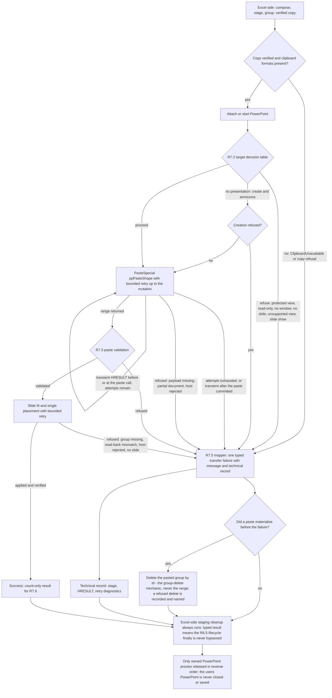

# R7.5 — Transfer failures: implementation plan

> **Work item**: [`R7.5-transfer-failures.md`](../docs/work-items/R7.5-transfer-failures.md) (Tier A, revised 2026-11-21)
> **Depends on**: R7.1–R7.4 (all landed and gated green — `verify-office.ps1` 99/99 on PowerPoint 16.0.20625.20108, 2026-11-22), R6.5 (staging cleanup), R6.6/R6.8 (clipboard precedent)
> **Followed by**: R7.6 (Send to PowerPoint command — consumes this taxonomy), R7.7 (transfer soak)
> **Plan status**: Revised 2026-11-22 after an independent audit — every finding from that audit is incorporated and traced in §K. Awaiting owner review before implementation.

---

## A. Understanding of R7.5

### A.1 Outcome (what must be built)

Every transfer failure mode — protected/read-only presentation, unsupported view, active slide
show, no window, no slide, no presentation, unsupported clipboard/partial document, COM
busy/rejected call, missing member/unsupported build — maps to a **distinct typed failure**;
only the **measured** transient COM rejections retry, with a **bounded attempt count** and an
explicit **diagnostic budget** (never sleeps, never a spin); **cleanup runs on every path** —
the Excel-side staging cleanup (R6.5) *and* the PowerPoint-side pasted-group residue the
landed R7.3 stage contract records for this row. Pinned by typed-mapping, bounded-retry and
cleanup tests plus a live safe-failure reproduction.

### A.2 Why it matters

R7.1–R7.4 built the happy path: attach, decide, paste, validate, fit, place. Every stage
already reports *its own* typed refusals, but four gaps remain before R7.6 can wire the
command:

1. **The refusals are per-stage, not unified.** R7.2's decision table
   ([`PowerPointTargetRefusal`](../src/GanttCreator.Core/Export/PowerPointTargetDecision.cs)),
   R7.3's paste stage
   ([`PowerPointPasteStageRefusal`](../src/GanttCreator.Office/PowerPointPasteStage.cs)) and
   R7.4's placement stage
   ([`PowerPointPlacementRefusal`](../src/GanttCreator.Office/PowerPointPlacementStage.cs))
   each name their own members. The command needs one closed taxonomy with one actionable
   message per failure — the stage enums were deliberately named to overlap so R7.5
   *consolidates* rather than renames.
2. **A busy host is unhandled.** A PowerPoint holding a modal rejects incoming COM calls
   with transient HRESULTs (`RPC_E_CALL_REJECTED` family). Today those surface as generic
   `HostRejected` refusals — or worse, as absence-shaped facts (PD-8) — with no retry and
   no honest "PowerPoint is busy" message.
3. **The failure-to-cleanup guarantee is implicit on both sides.** The adapter's `finally`
   blocks and the R6.5 lifecycle own the Excel side, but nothing *pins* that every failure
   path is a typed result (so the lifecycle's `finally` always runs) with only owned proxies
   released — and the **PowerPoint side has a recorded, unmet obligation**: the landed
   [`PowerPointPasteStage`](../src/GanttCreator.Office/PowerPointPasteStage.cs) remarks
   state *"Residue is R7.5's policy… R7.5's outcome owns cleanup on every path, and
   ADR-0066 D3's group-delete mechanic (delete the group, never the range) is recorded for
   it."* A paste that materialises and then fails validation or placement currently leaves
   its group on the user's slide.
4. **The `NoPresentation` arm has no producer in any row's scope as written.** Per D-R7.2
   an empty host *creates* a presentation (announced), so `NoPresentation` fires only when
   that creation is refused — and no R7.1–R7.4 row added a creation port member (see PD-2
   and §H.1).

### A.3 How success is measured

- **Automated** — `dotnet test tests/GanttCreator.Office.ContractTests`: the mapping matrix
  (a **positive test per failure mode**); retry bounded (filter hits/misses, attempt cap,
  mutation boundary, diagnostics); cleanup-on-every-path pins including the pasted-group
  residue; single-detach pin; a source scan proving no sleep/`Task.Run` primitive in the
  new files.
- **Office host (Required)** — live: reproduce the safe supported failures (protected/
  read-only presentation; unsupported view; no active slide; a busy PowerPoint via a held
  modal; a missing clipboard payload) **without hanging or data loss**, with **zero residue
  on the fixture deck** after each reproduced failure; record host builds; the gate must not
  close or quit a pre-existing presentation.
- **Definition of done** — `AGENTS.md` + [`08-TEST-CHECKLIST`](../docs/08-TEST-CHECKLIST.md)
  sections **J, K**: mapping/retry/cleanup matrices green with positives; live reproductions
  recorded with host builds; Release 0 warnings; XML docs; REPO-MAP/STATUS current.

### A.4 Constraints and prior decisions that bind this plan

| Constraint | Source |
| --- | --- |
| Typed PIA only — no `dynamic`, no `Microsoft.CSharp` | ADR-0069; R7.1 D1 |
| The transient set is **measured on the reference host, not guessed**; the filter uses only observed HRESULTs | R7.5 Step 0 |
| `DISP_E_MEMBERNOTFOUND` (`0x80020006`, measured R7.1) is `UnsupportedBuild`, never a transient retry | R7.5 Step 0 |
| The "deadline" is a **diagnostic budget**: bounded attempt count + `Stopwatch` for diagnostics only; no polling loop, no `Thread.Sleep`, no `Task.Run` around COM | R7.5 Step 0; architecture "PowerPoint automation" |
| Cleanup on every path: Excel-side staging cleanup (R6.5) still runs; the pasted-group residue is deleted by the group-delete mechanic (ADR-0066 D3, recorded for R7.5 by the landed paste stage); only owned PowerPoint proxies released; the user's PowerPoint is never closed or saved | R7.5 D3; [`PowerPointPasteStage`](../src/GanttCreator.Office/PowerPointPasteStage.cs) remarks; architecture "Error handling" ("partial temporary export shapes are removed") |
| `FinalReleaseComObject` forbidden; `Marshal.ReleaseComObject`, reverse order, exactly once; never `Quit`/`Close` a pre-existing host | R7.5 D4; R7.1 D2 |
| `IApplicationStateScope` is Excel-shaped and is **not reused**; a `PowerPointStateScope` exists only if the probe shows `DisplayAlerts` must change — and the R7.1 probe consequence ("must still save and restore a host that reports `ppAlertsAll`") is reconciled by PD-5, not ignored | R7.5 D5; R7.1 Step 0 probe consequences |
| Failure paths never activate a slide/window to recover | [`NoSheetActivationTests`](../tests/GanttCreator.Architecture.Tests/NoSheetActivationTests.cs) |
| Expected situations are typed results, never exceptions across the boundary | Architecture "Error handling" |
| Every new `if (bad) { error }` validator ships a positive test in the same commit | `AGENTS.md` |
| No new failure UI — the command translates typed failures to one actionable message (R7.6) | R7.5 exclusions |
| The transfer stage itself is R7.1–R7.5's (R7.6's Office scope is only the lifecycle seam) | R7.6 scope line — the basis of PD-2's escalation |

### A.5 What already exists (verified in source and REPO-MAP, not assumed)

- [`PowerPointTransferAdapter`](../src/GanttCreator.Office/PowerPointTransferAdapter.cs) —
  the typed PIA implementation of all three ports; every COM call wrapped in
  `ReadStage`/`ReadOptionalStage` catching `COMException` with the HRESULT recorded; a
  transient proxy tracker released in `finally`; the root application proxy released once at
  `Dispose`. **Mutation boundary fact:** `PasteSpecialShape` mutates the host at
  `shapes.PasteSpecial(...)` and then *reads* the result (`ReadPastedRange`); `ApplyPlacement`
  mutates via four absolute writes; the fact reads mutate nothing.
- [`PowerPointTargetDecision`](../src/GanttCreator.Core/Export/PowerPointTargetDecision.cs)
  — the closed Core decision table (R7.2). Its switch is total and was re-verified arm by
  arm: `AttachRefused`, `FactsUnreadable`, `SlideShowActive`, `ProtectedView` (two arms: the
  on-top protected window, and zero presentations with protected windows open),
  `CreatePresentation` (zero presentations, no protected windows), `ReadOnlyPresentation`,
  `NoWindow`, `UnsupportedView` (two arms: a null view type, and a view outside
  `{1, 3, 9}`), `NoSlide`, `NoActiveSlide`, `ProceedWithActiveSlide`. All nine refusal arms
  are consumed by §C; the two non-refusal arms are handled explicitly.
- [`PowerPointPasteStage`](../src/GanttCreator.Office/PowerPointPasteStage.cs) +
  `PowerPointPasteFailureClassifier` — classifies refused pastes into
  `PastePayloadMissing` (candidate `0x80048240`), `PartialDocument` (filterless until
  measured), `HostRejected`, `NoSlide`; validation refusals carried separately. Its remarks
  record the **binding residue obligation** quoted in A.2.3.
- [`PowerPointPlacementStage`](../src/GanttCreator.Office/PowerPointPlacementStage.cs) —
  `AlreadyApplied`, `GroupMissing`, `HostRejected`, `ReadBackMismatch`, `NoSlide`,
  `SlideSizeUnavailable`.
- [`PowerPointProxyOwnership`](../src/GanttCreator.Office/PowerPointProxyOwnership.cs) —
  reverse-order, exactly-once `ReleaseComObject` tracker; a refused release is recorded and
  does not fail the operation (the answer already exists — see PD-6).
- The R6.6 clipboard chain: [`ExcelShapeCopier`](../src/GanttCreator.Office/ExcelShapeCopier.cs)
  is the `IShapeCopyPort` implementation whose host refusal travels on
  `StagingCopyResult.PortRefusal`, and [`StagedShapeCopier`](../src/GanttCreator.Office/StagedShapeCopier.cs)
  owns `StagedCopyRefusal` with **`ClipboardUnavailable = 5`** — the member the taxonomy
  consumes, carrying the reader's `clipboard-unavailable:0x…` token and an actionable
  sentence.
- [`IPowerPointApplicationPort`](../src/GanttCreator.Office/IPowerPointApplicationPort.cs)
  — three members: `AttachOrStart`, `ReadPresentationFacts`, `ReadTargetObservation`. **No
  creation member exists** (PD-2). The full per-member coverage decision is §B.5.
- Live harness: [`PowerPointFixture`](../tests/GanttCreator.Office.IntegrationTests/PowerPointFixture.cs)
  (typed, quits only a host it started, owned-PID manifest) and the R7.2/R7.3/R7.4
  integration suites. [`REPO-MAP`](../docs/REPO-MAP.md) carries the R7.1–R7.4 entry-point
  paragraphs and records that `PowerPointPasteSpecialIntegrationTests`' **empty-clipboard arm
  measures the D4 filter from evidence** — that arm is preserved (Phase 0.4 checks its
  recorded evidence rather than replacing it). `verify-office.ps1` last recorded **99/99**
  on PowerPoint 16.0.20625.20108 (2026-11-22).

---

## B. Solution architecture

### B.1 Technology and library selection (already decided — restated with justification)

- **PowerPoint interop**: the pinned `Microsoft.Office.Interop.PowerPoint` 15.0.4420.1018
  PIA with `EmbedInteropTypes=true` (ADR-0069). No new dependency, no `dynamic`, no
  late binding. R7.5 adds **no package and no Excel-side change** — the failure handling is
  Office-layer over the existing typed surface, plus two additive port members justified in
  §I by landed contracts.
- **Excel handling**: untouched. The Excel side of the transfer pipeline (compose → stage →
  group → verified copy → cleanup) is R6.x, landed and gated; R7.5 only guarantees that its
  failure *results* never bypass the R6.5 lifecycle cleanup.
- **Retry mechanism**: a pure in-memory policy type + a per-operation retry loop inside the
  adapter with an explicit **mutation boundary** (PD-3). No timer, no wall-clock condition, no
  threading — the STA rule forbids all three, and the work item's Step 0 records that a
  deadline without sleeps is a spin, so the implementable rule is a **bounded attempt
  count**.

### B.2 New components (all in `src/GanttCreator.Office/`, per the work-item scope plus the two additive members justified in §I)

| Component | Responsibility |
| --- | --- |
| `PowerPointTransferFailureKind` + `PowerPointTransferFailure` | The D1 closed taxonomy enum and its record: kind, `HResult`, an **actionable user message**, and a **technical log record** (stage + HRESULT + retry diagnostics). None is an exception across the boundary; none is silent. |
| `PowerPointTransferFailureMapper` | One static total function per source stage, mapping each stage refusal into the taxonomy (§C). The HRESULT classifier keys on **membership in the measured set** (PD-7): `0x80020006` → `UnsupportedBuild`; a measured transient HRESULT → `HostBusy`; anything else → `HostRejected`. The mapper only **refines** a stage's `HostRejected` catch-all — it never overrides a specific stage classification (e.g. never reclassifies `PastePayloadMissing`). |
| `PowerPointTransientRetryPolicy` | The measured frozen HRESULT set, the explicit attempt cap (three, confirmed by the probe), `IsTransient(hresult)`, and a diagnostics builder naming the filter, the attempts and the elapsed budget. Injectable into the adapter; the default is the measured policy. |
| Adapter retry loop with a mutation boundary | Inside [`PowerPointTransferAdapter`](../src/GanttCreator.Office/PowerPointTransferAdapter.cs): each transfer-driving port operation re-invokes itself when its COM failure carries a transient HRESULT, attempts remain, **and the failure provably preceded the operation's mutation** (PD-3). Exhaustion — or a post-mutation transient — returns the refused observation with the transient HRESULT plus the retry diagnostics. |
| `DeletePastedGroup` port member + adapter implementation | The ADR-0066 D3 group-delete mechanic the landed paste stage records for R7.5: delete the located `msoGroup` by id, **never the returned range** (which also lists the flattened children). Primitive-typed, group-id addressed, STA-only, ownership-tracked. |
| Paste-residue cleanup helper | A small Office-layer helper over the delete member: on any transfer failure after a paste materialised (validation refusal, placement refusal, post-paste transient), delete the pasted group before the failure is reported; a refused delete is recorded and **named in the technical record** (residue reported, never silently accepted — the `StagingLifecycle` residue precedent). R7.6's transfer seam invokes it; R7.5 owns the policy and the mechanism. |
| Creation port member *(pending §H.1)* | `CreatePresentation()`-style additive member producing the refused-creation observation that maps to `NoPresentation` (PD-2). Recommended for R7.5; the owner decision is recorded before implementation. |

### B.3 Separation of concerns

- **Core stays untouched.** The taxonomy consumes Office-layer stage outcomes (records and
  enums Core cannot reference), so it lives in Office — the work-item scope says so
  explicitly, and it mirrors why R7.2's *decision* is Core (pure primitive facts) while this
  *consolidation* is Office (typed stage results).
- **The stages stay single-shot.** The retry lives in the adapter (the COM boundary), so the
  stages' contracts — including R7.4's once-rule — are unchanged. A port-level retry happens
  *within* one stage application.
- **The mapper owns naming; R7.6 owns presentation.** The failure record carries its
  actionable message (D1 literal). This is a deliberate, cited resolution of the tension
  with the R7.2 remark ("the message text belongs to the command, never to this table" — a
  *Core* rule) and R7.5's own exclusion ("the command translates typed failures to one
  actionable message — R7.6"): the precedent is R6.6's
  [`StagedShapeCopier`](../src/GanttCreator.Office/StagedShapeCopier.cs), whose Office-layer
  refusal `Detail` already carries an actionable sentence ("Close the application holding
  the clipboard and try again."). Office carrying message *data* is established; Core
  carrying it is not; the *dialog* remains R7.6's.
- **The policy owns measurement.** The HRESULT filter is data (a frozen set built from the
  Step-0 probe), not scattered `if` chains, so a future build's measurement is a one-line
  change with its evidence commit.
- **Record discipline.** The stages already write one technical record per refusal
  (mechanism detail). The mapper's transfer-level record is the **single failure record the
  command reports** — one per failure, satisfying checklist K's "one technical record" —
  with the stage record retained as mechanism detail beneath it.

### B.4 Design decisions (proposed, each pinned by a test)

- **PD-1 — The taxonomy is closed.** D1's member list is the contract; stage members that
  do not share a name map into it (§C) rather than extending it. The unnamed "construction
  members" are proposed as `InvalidTransferRequest` (null/argument guards) and
  `TransferSequenceViolated` (disposed adapter, already-applied placement, a slide-size read
  before attach) — naming is an implementation detail the mapping-matrix tests pin.
- **PD-2 — `NoPresentation` is the creation-refused arm, and its producer's ownership is
  escalated, not assumed.** Per D-R7.2, an empty host *creates* a presentation (announced),
  so `NoPresentation` fires only when that creation is refused. No R7.1–R7.4 row added a
  creation port member, and R7.6's scope line says "the transfer stage itself is
  R7.1–R7.5's" while its Office scope is only the lifecycle seam — so the producer belongs
  to a transfer-stage row, and R7.5 is the last one. **Recommendation:** R7.5 adds the
  creation member additively (the R7.2 `ReadTargetObservation` precedent) with its
  refused-creation → `NoPresentation` mapping and HRESULT classification. The owner records
  the decision before implementation (§H.1); the plan does not silently attribute the member
  to R7.6 against that row's written scope.
- **PD-3 — The retry unit is the whole port operation, split by a mutation boundary.** A
  busy host rejects *every* call, so retrying one property read and continuing the walk
  would fail on the next read; the only coherent retry unit is the operation. But the
  operations are not equivalent:
  - **Pure reads** (`ReadTargetObservation`, `ReadSlideSize`): fully retryable — nothing
    mutated.
  - **`PasteSpecialShape`**: retryable **only up to and including the `PasteSpecial` call**.
    A rejected call (`RPC_E_CALL_REJECTED`/`REJECTED`/`RETRYLATER`) never executed, so a
    transient from `PasteSpecial` itself is safe to retry. A transient from a **post-paste
    read** (`ReadPastedRange`) means the paste committed — re-invoking would paste a
    **second** group and orphan the first. A post-paste transient is therefore
    single-attempt: it maps to `HostBusy`/`HostRejected` and triggers the paste-residue
    cleanup.
  - **`ApplyPlacement`**: fully retryable — route (a) writes four absolute members, so a
    retry re-applies all four idempotently. The stage-level once-rule is untouched (one
    stage application; port retries happen inside it).
  The Step-0 probe confirms which operations actually produce transient rejections; the
  wrapped set and the boundary come from that measurement.
- **PD-4 — Retrying a partially-applied placement is safe** (the idempotence half of PD-3's
  third arm), pinned by a contract test.
- **PD-5 — No `PowerPointStateScope` unless the probe shows an operation *needs*
  `DisplayAlerts` suppressed — and the R7.1 consequence is reconciled.** The R7.1 probe
  measured the reference host's default as `ppAlertsNone` (1), and its recorded consequence
  says R7.5's handling "must still save and restore a host that reports `ppAlertsAll`". The
  reconciliation: that consequence describes the shape *if* the handling exists; D5 makes
  the handling conditional on need. The Phase-0 probe therefore does not merely "confirm no
  code writes it" — it **drives the transfer operations (including the PD-2 creation, once
  its ownership is resolved) on a fixture host set to `DisplayAlerts = ppAlertsAll` and
  observes whether any alert appears**. A measured "no alert" discharges D5's "only if"
  branch with evidence; a measured alert requires the scope, which then restores exactly
  what it changed and owns at most one event connection, detached exactly once in `Dispose`.
- **PD-6 — `OwnershipFailed` is defined honestly.** Every release in the current adapter
  happens in a `finally` after the answer is computed (transient trackers) or at `Dispose`
  (root), and [`PowerPointProxyOwnership.ReleaseAll`](../src/GanttCreator.Office/PowerPointProxyOwnership.cs)
  records refused releases without failing the completed operation — so there is **no
  "release-before-answer" path** in the current shape. The member's producer is therefore
  the **Dispose-time root-release refusal**, surfaced as a named technical record
  (`OwnershipFailed` + HRESULT, report-only — the operation already completed and a late
  release refusal must not fabricate a second error). The mapper arm is implemented and
  positively tested now; if a future row adds a path where a release failure must fail the
  operation, that row becomes the second producer. The plan does not claim a producer that
  does not exist.
- **PD-7 — `HostBusy` is keyed on HRESULT membership, not on exhaustion.** Any observation
  whose HRESULT is in the measured transient set maps to `HostBusy` — whether it exhausted
  the attempts or arose on a single-attempt arm (PD-3's post-paste arm, or an operation
  outside the probe-confirmed wrapped set). Exhaustion changes only the diagnostics
  (attempts, elapsed), never the classification; the user-facing meaning "PowerPoint was
  busy" must not degrade to "PowerPoint refused" because of where the HRESULT surfaced.
- **PD-8 — The optional reads must let transient rejections escape.** Today
  `ReadOptionalStage` treats *every* `COMException` as absence, so a busy host would produce
  absence-shaped facts (a wrong `NoWindow`/`NoSlide` refusal instead of `HostBusy`). The
  helper gains policy awareness: a **transient** HRESULT rethrows to the operation level so
  the retry fires; the measured absence code (`0x80048240`) and all others keep the current
  absence behaviour. This is the one behavioural refinement to existing read code, and it is
  pinned by a contract test in both directions.
- **PD-9 — `Stopwatch` is diagnostics, never a loop condition.** The elapsed value appears
  only in the exhaustion record (`filter=… attempts=… elapsed=…`), satisfying D2's "useful
  timeout diagnostics" without a wall-clock loop.
- **PD-10 — The pasted-group residue cleanup is R7.5's, per the landed contract.** The
  [`PowerPointPasteStage`](../src/GanttCreator.Office/PowerPointPasteStage.cs) remarks
  record it ("R7.5's outcome owns cleanup on every path, and ADR-0066 D3's group-delete
  mechanic is recorded for it"), the architecture's "Error handling" independently requires
  "partial temporary export shapes are removed", and checklist K's "preserved user content"
  is exactly this on the PowerPoint side. The design: the additive `DeletePastedGroup` port
  member (group-delete mechanic — delete the located `msoGroup` by id, never the range) plus
  the cleanup helper in §B.2, invoked on every failure path after a paste materialised. The
  member is compatible with the R7.1 no-save/close/quit structural scan (that scan forbids
  `Save`/`SaveAs`/`Close`/`Quit`/`Activate`, not slide-shape deletion of the add-in's own
  residue) — stated so the scan is not misread.

### B.5 Application-port coverage (every member, explicitly)

| Port member | Transfer-driven? | Retry-wrapped? | Mapper-consumed? |
| --- | --- | --- | --- |
| `AttachOrStart` | yes (first transfer step) | probe-decided (a moniker bind may not call into the host; measure, do not guess) | via the R7.2 decision (`AttachRefused`) |
| `ReadPresentationFacts` | **no** — the R7.2 resolver drives `ReadTargetObservation`; this R7.1-era member is not on the transfer path | not wrapped (not transfer-driven) | not consumed by the transfer mapper |
| `ReadTargetObservation` | yes | fully (pure read) | via the R7.2 decision |
| `PasteSpecialShape` (paste port) | yes | up to and including the `PasteSpecial` call (PD-3) | via the R7.3 stage result |
| `ReadSlideSize` (placement port) | yes | fully (pure read) | via the R7.4 stage result |
| `ApplyPlacement` (placement port) | yes | fully (idempotent writes, PD-3/PD-4) | via the R7.4 stage result |
| `DeletePastedGroup` *(new, PD-10)* | yes (failure paths after a paste) | not wrapped — a cleanup must be attempted once and its refusal recorded, never retried into further mutation | not a failure source; its refusal is recorded and named |
| `CreatePresentation` *(new, pending §H.1)* | yes (the D-R7.2 create branch) | probe-decided with the same mutation-boundary discipline as the paste (a rejected creation call never executed; a post-creation read failure is single-attempt) | the refused creation → `NoPresentation` |

---

## C. The failure taxonomy and complete mapping table

D1's closed taxonomy (plus the construction members):

`NoPresentation`, `PresentationReadOnly`, `PresentationProtectedView`, `NoWindow`, `NoSlide`,
`UnsupportedView`, `SlideShowActive`, `ClipboardUnavailable`, `PastePayloadMissing`,
`PartialDocument`, `PasteValidationFailed`, `HostBusy`, `HostRejected`, `UnsupportedBuild`,
`OwnershipFailed`, `InvalidTransferRequest`, `TransferSequenceViolated`.

Every arm of the Core decision table's total switch is consumed — the nine refusals, plus
the two non-refusal arms handled explicitly:

| Source | Source member (arm) | Taxonomy member | HRESULT | Technical record discriminator |
| --- | --- | --- | --- | --- |
| R7.2 decision | `AttachRefused` | `UnsupportedBuild` if `0x80020006`, else `HostRejected` | carried | stage=attach — the classifier applies uniformly to any carried HRESULT |
| R7.2 decision | `FactsUnreadable` | `UnsupportedBuild` if `0x80020006`, else `HostRejected` | carried | stage=target-read |
| R7.2 decision | `SlideShowActive` | `SlideShowActive` | — | — |
| R7.2 decision | `ProtectedView` (on-top protected window) | `PresentationProtectedView` | — | — |
| R7.2 decision | `ProtectedView` (zero presentations, protected windows open) | `PresentationProtectedView` | — | the two-armed D-R7.2 rule |
| R7.2 decision | `CreatePresentation` (zero presentations, no protected windows) | *(not a failure — announced creation)* | — | a refused creation maps to `NoPresentation` (PD-2) |
| R7.2 decision | `ReadOnlyPresentation` | `PresentationReadOnly` | — | — |
| R7.2 decision | `NoWindow` | `NoWindow` | — | — |
| R7.2 decision | `UnsupportedView` (null view type) | `UnsupportedView` | — | view absent |
| R7.2 decision | `UnsupportedView` (view outside `{1, 3, 9}`) | `UnsupportedView` | — | view value |
| R7.2 decision | `NoSlide` | `NoSlide` | — | — |
| R7.2 decision | `NoActiveSlide` | `NoSlide` | — | — |
| R7.2 decision | `ProceedWithActiveSlide` | *(not a failure)* | — | the transfer continues |
| R6.6 copy | `StagedCopyRefusal.ClipboardUnavailable` (=`5`, owned by [`StagedShapeCopier`](../src/GanttCreator.Office/StagedShapeCopier.cs); the port-side host refusal travels from [`ExcelShapeCopier`](../src/GanttCreator.Office/ExcelShapeCopier.cs) on `StagingCopyResult.PortRefusal`) | `ClipboardUnavailable` | reader token carried | the `clipboard-unavailable:0x…` token |
| R6.6 copy | other copy refusals (`NullStaged`, `NullReader`, `CopyRefused`, format-missing) | *(not transfer failures — pre-transfer Excel-side refusals; R7.6's command maps them through the existing R6.8 translation)* | — | out of R7.5 scope |
| R7.3 paste | `PastePayloadMissing` | `PastePayloadMissing` | carried | measured clipboard-empty code |
| R7.3 paste | `PartialDocument` | `PartialDocument` | carried | filterless until measured |
| R7.3 paste | `HostRejected` | refined by the HRESULT classifier: `UnsupportedBuild` if `0x80020006`; `HostBusy` if in the measured transient set (PD-7); else `HostRejected` | carried | retry diagnostics when transient |
| R7.3 paste | `NoSlide` | `NoSlide` | — | the slide vanished between decision and paste |
| R7.3 validation | any validator refusal | `PasteValidationFailed` | — | the validator's refusal + measured deltas; **the pasted group is residue → PD-10 cleanup** |
| R7.4 placement | `AlreadyApplied` | `TransferSequenceViolated` | — | once-rule |
| R7.4 placement | `GroupMissing` | `HostRejected` | — | group id (PD-11) |
| R7.4 placement | `HostRejected` | refined by the HRESULT classifier (as the paste row) | carried | — |
| R7.4 placement | `ReadBackMismatch` | `HostRejected` | — | max delta (PD-11); **the pasted group is residue → PD-10 cleanup** |
| R7.4 placement | `NoSlide` | `NoSlide` | — | — |
| R7.4 placement | `SlideSizeUnavailable`, HRESULT carried | `UnsupportedBuild` if `0x80020006`, else `HostRejected` | carried | stage=slide-size (PD-11) |
| R7.4 placement | `SlideSizeUnavailable`, HRESULT null (not attached) | `TransferSequenceViolated` | — | the transfer must attach before placing |
| R7.4 fit | any `SlideFitRefusal` | `InvalidTransferRequest` | — | degenerate bounds reach the stage only as a caller defect — R7.6's pre-flight refuses `InvalidBounds` first |
| Creation *(pending §H.1)* | refused creation observation | `NoPresentation` | carried | stage=create |
| Ownership | Dispose-time root-release refusal | `OwnershipFailed` | carried | PD-6, report-only |
| Construction | null arguments | `InvalidTransferRequest` | — | guard name |
| Construction | disposed adapter, already-applied placement | `TransferSequenceViolated` | — | guard name |

- **PD-11 — `GroupMissing`, `ReadBackMismatch` and `SlideSizeUnavailable` map to
  `HostRejected` with discriminating technical records** (the record names the group id /
  the max delta / the stage). D1's list is closed and has no closer member; the technical
  record keeps the cases distinguishable in the log. If the owner prefers distinct members,
  that is a taxonomy amendment decision — flagged in §H, not taken silently.
- Every row is one positive test in the mapping matrix; every taxonomy member is reachable
  by at least one row (a dead member is a defect in this repository's terms). The mapper
  never overrides a specific stage classification — it only refines the `HostRejected`
  catch-all (§B.2).

---

## D. End-to-end workflow

The transfer pipeline with R7.5's failure handling in place. Excel-side stages are
landed R6.x; PowerPoint-side stages are landed R7.1–R7.4; **R7.5 adds the failure
consolidation, the mutation-bounded retry, the pasted-group residue cleanup, and the
cleanup guarantee.**



Failure-path discipline at every step:

1. **A typed result, never an exception** — so the R6.5 lifecycle's `finally` cleanup (group
   delete, newest-first child deletes, state-scope restore) runs on every path. This is the
   structural form of D3, and R7.5 pins it rather than assuming it.
2. **PowerPoint-side residue is cleaned** (PD-10) — any failure after a paste materialised
   deletes the pasted group before reporting; a refused delete is recorded and named, never
   silently accepted. The user's pre-existing deck content is untouched (checklist K,
   "preserved user content").
3. **One technical record per refusal at the transfer level** (§B.3's discipline) — stage,
   HRESULT where available, and for transient failures the filter/attempts/elapsed budget
   (PD-9). The AddIn wires the redacting rolling log, as the existing stages already do.
4. **One actionable message per failure** — carried on the record for R7.6 to present; no
   message boxes below the command boundary.
5. **Ownership unchanged** — transient trackers release in `finally`; the root proxy
   releases once at `Dispose`; no `Quit`/`Close`/`Save`/`Activate` anywhere on a failure
   path.

---

## E. Implementation sequence

Phases are ordered by dependency; each ends at a validation checkpoint and is one or more
commits (one concern per commit, Conventional Commit prefixes).

### Phase 0 — Step 0 evidence and the ownership decision (no production code)

- **0.1** Re-read the R6.5 cleanup contract and the R6.8 measured busy-clipboard precedent
  (done during this plan's analysis and audit; recorded in the work item's Step-0 section).
- **0.2** **The creation-member ownership decision (PD-2, §H.1)** — recorded by the owner
  before any production code: R7.5 adds the creation port member additively (recommended),
  or the owner explicitly re-assigns it with a scope amendment. This is the `AGENTS.md`
  missing/contradictory-acceptance stop condition applied honestly: the `NoPresentation`
  arm's producer exists in no row's scope as written.
- **0.3** **The transient-set probe** on the reference host: hold a modal in the
  fixture-owned PowerPoint, drive the adapter's operations through the typed PIA, and
  record the `COMException.HResult` values its own calls produce. Confirm or deny the
  candidates `0x80010001` (`RPC_E_CALL_REJECTED`), `0x8001010A`
  (`RPC_E_SERVERCALL_RETRYLATER`), `0x8001010B` (`RPC_E_SERVERCALL_REJECTED`). Record which
  operations produce them (PD-3's wrapped set and mutation boundary), confirm the attempt
  cap starting point (three), and record whether a **post-paste** read can transiently fail
  (the PD-3 boundary's live evidence). The probe is disposable evidence (a script or a
  tagged probe test, the `probe-powerpoint-host.ps1` precedent); the modal-hold mechanism is
  a probe-design question with the work item's own stop condition — if the busy state cannot
  be reproduced safely, record it and the human decides supported-tested versus
  documented-only.
- **0.4** **The `DisplayAlerts` decision (D5, PD-5):** drive the transfer operations
  (including the creation, per 0.2) on a fixture host set to `DisplayAlerts = ppAlertsAll`
  and observe whether any alert appears. A measured "no alert" discharges the "only if"
  branch with evidence and reconciles the R7.1 recorded consequence; a measured alert
  requires the scope. Do not merely confirm that no code writes the property.
- **0.5** **The empty-clipboard HRESULT (owed from R7.3):** first check the recorded gate
  evidence — [`REPO-MAP`](../docs/REPO-MAP.md) documents that
  `PowerPointPasteSpecialIntegrationTests`' empty-clipboard arm "measures the D4 filter
  from evidence", and the R7.4 gate ran **99/99** on 2026-11-22, so the arm's recorded
  result may already confirm the `0x80048240` candidate. If confirmed, update the stale
  R7.3 ledger row from the recorded evidence; if the arm did not run or its record is
  inconclusive, measure it in Phase 4's live gate. A divergent measured code is R7.3's
  recorded stop condition, not a silent classifier edit.
- **Checkpoint:** the probe table and the 0.2 decision recorded in the work item; zero
  production diff; `git diff --check` clean.

### Phase 1 — The taxonomy and the mapper (host-free)

- `PowerPointTransferFailureKind`, `PowerPointTransferFailure`,
  `PowerPointTransferFailureMapper` with the §C table: all nine decision-table refusal arms
  plus the two non-refusal arms handled explicitly; the HRESULT classifier keyed on
  membership (PD-7); the `NoPresentation` creation-refused arm (per the 0.2 decision); the
  honest `OwnershipFailed` producer (PD-6); the null-HResult `SlideSizeUnavailable` arm
  (`TransferSequenceViolated`).
- Contract tests: the **full mapping matrix** — one positive test per failure mode, every
  taxonomy member reachable, the construction members' positives, the HRESULT classifier's
  arms, the never-override rule (a `PastePayloadMissing` input stays `PastePayloadMissing`),
  and the non-throwing contract (a mapper input never throws across the boundary).
- **Checkpoint:** `dotnet test tests/GanttCreator.Office.ContractTests` green; every
  existing PowerPoint suite unchanged-green (the mapper is additive).

### Phase 2 — The bounded retry with the mutation boundary (host-free)

- `PowerPointTransientRetryPolicy` (the Phase-0 measured frozen set, `MaxAttempts = 3`,
  `IsTransient`, the diagnostics builder) and the adapter's per-operation retry loop with
  the PD-3 boundary, including the `ReadOptionalStage` transient-escape refinement (PD-8).
- Contract tests:
  - pure reads: transient-then-succeed (a mock refusing N times with a measured transient
    HRESULT then succeeding);
  - **the D2 positive: a non-transient failure never retries**;
  - **the paste boundary (PD-3):** a mock whose `PasteSpecial` throws transient twice then
    succeeds → three attempts, exactly one paste; a mock whose `PasteSpecial` succeeds and
    whose `range.Count` throws transient → **exactly one paste**, a refused observation
    carrying the transient HRESULT, and the residue cleanup invoked;
  - cap exhaustion → refused observation carrying the transient HRESULT plus the
    filter/attempts/elapsed record;
  - the placement retry re-applies idempotently without violating the once-rule (PD-4);
  - the optional-read refinement in both directions (transient escapes; measured absence
    stays absence).
- The **source scan**: an architecture test proving no `Thread.Sleep`, no `Task.Run`, no
  spin primitive in the new files — with a positive control (the
  `NoSheetActivationTests`/`PowerPointAdapterHygieneTests` pattern).
- **Checkpoint:** contract + architecture suites green; the existing adapter tests
  unchanged-green (single-attempt behaviour is the non-transient default).

### Phase 3 — Cleanup, residue, and ownership pins (host-free)

- The additive `DeletePastedGroup` port member and its adapter implementation (the
  group-delete mechanic: locate the `msoGroup` by id, delete the group, never the range;
  ownership-tracked; a refused delete is a typed record, not a throw).
- The paste-residue cleanup helper (§B.2): invoked on every failure path after a paste
  materialised — validation refusal, placement refusal, post-paste transient. Contract
  tests: each post-paste failure path attempts the delete exactly once; a refused delete is
  recorded and named (residue reported, never silently accepted); success paths never
  delete; the delete is **not** retried (a cleanup must not mutate further).
- Cleanup-on-every-path pins: inject a failure at each stage (target, paste, validation,
  placement) and assert the typed result shape, the released transient trackers, and the
  unified failure carried — the structural guarantee that the R6.5 lifecycle `finally` is
  never bypassed.
- The single-detach pin: a structural assertion that the adapter owns no PowerPoint event
  connection (or, if the Phase-0 probe forced one, the detach-exactly-once test in
  `Dispose`).
- Extend the R7.1 architecture scans to the new files: no `FinalReleaseComObject`, no
  `Quit`/`Close`/`Save`, no `dynamic` — each already has positive controls; the new files
  join the scanned set, and the scan's allowlist is reconciled with the two new mutating
  members (`DeletePastedGroup` deletes the add-in's own residue; the creation member adds a
  fixture-announced deck — neither is a `Save`/`Close`/`Quit`/`Activate`).
- **Checkpoint:** contract + architecture suites green; checklist J self-certified.

### Phase 4 — The live safe-failure gate (Required)

- `PowerPointTransferFailureIntegrationTests` (tagged `OfficeIntegration`), fixture-owned
  host only, never closing or quitting a pre-existing presentation, and **asserting zero
  residue on the fixture deck after every reproduced failure** (the shape count returns to
  baseline — the PD-10 live proof):
  1. protected/read-only presentation → `PresentationProtectedView` /
     `PresentationReadOnly` — the protected-view body follows the R7.2 recorded deviation
     (`ProtectedViewWindows.Open` refused `0x80004005` on the reference host; the live body
     records the deviation rather than promising a clean reproduction);
  2. unsupported view (sorter/outline, the R7.2 probe's settable states) →
     `UnsupportedView`;
  3. no active slide → `NoSlide`;
  4. **a busy PowerPoint via a held modal** → the measured transient HRESULTs observed, the
     bounded retry exhausts, `HostBusy` reported with diagnostics, **no hang** (the bounded
     attempts complete well inside the gate's deadline), and the post-paste arm (if the
     probe showed it) cleans its residue;
  5. a missing clipboard payload → `PastePayloadMissing` (preserving the existing
     empty-clipboard arm in `PowerPointPasteSpecialIntegrationTests` — Phase 0.5's evidence
     check first; measure here only if that evidence is inconclusive).
- Record host builds in the work item; run `pwsh ./scripts/verify-office.ps1` (Required,
  expect exit 0).
- **Checkpoint:** the live gate green with the five reproductions and the residue
  assertions recorded.

### Phase 5 — Branch-final

- `pwsh ./scripts/verify-quick.ps1` per commit (accepts staged changes);
  `pwsh ./scripts/verify.ps1` on the clean tree after the last commit (naming the nearer
  `-MutationSince` base if the branch exceeds the gate's 30-file guard, the documented
  R7.4 precedent).
- Update [`REPO-MAP`](../docs/REPO-MAP.md): the R7.5 entry-point paragraph joins the
  existing R7.1–R7.4 paragraphs (the failure mapper, the retry policy, the delete member,
  the creation member per 0.2, and the new test locations) — reconciled against those
  paragraphs so the map's per-row structure is preserved; update `docs/STATUS.md`;
  self-certify checklist sections **J, K** in the commit message.
- **Checkpoint:** all gates green or reported `Not run` with reasons; handoff in the
  `Outcome / Changed / Proof / Office / Risk / Deferred / Next` format.

---

## F. Testing strategy

### F.1 Host-free contract tests (every commit)

| Suite | Coverage |
| --- | --- |
| Mapping matrix | One positive test per failure mode — all nine decision-table arms plus the two non-refusal arms, the paste/placement/copy members; every taxonomy member reachable; the HRESULT classifier's arms; the never-override rule; the construction members; the non-throwing contract. |
| Retry bounded | Filter hit (transient-then-succeed); **filter miss (a non-transient failure never retries — the D2 positive)**; the paste mutation boundary in both arms (pre/at-paste retry; post-paste single-attempt + cleanup); attempt cap; exhaustion diagnostics (filter, attempts, elapsed); placement idempotence (PD-4); optional-read transient escape (PD-8) both directions. |
| Cleanup and residue | Failure injected at each stage → typed result, trackers released, unified failure carried, the R6.5 `finally` never bypassed; **every post-paste failure path deletes the group exactly once; a refused delete is recorded and named; success paths never delete; the delete is never retried**. |
| Source scans | No sleep/`Task.Run`/spin in the new files; no `FinalReleaseComObject`; no `dynamic`; the no-save/close/quit surface reconciled with the two new mutating members — each with a positive control. |

### F.2 Checklist J and K, discharged explicitly

- **J (COM ownership):** proxies captured and released in reverse order (the existing
  tracker discipline, pinned); no chained COM expressions (the adapter's local-per-read
  pattern, pinned); **"application state is saved and restored even after failure" is
  discharged by the no-state-change design** — PD-5's measured "no operation needs
  `DisplayAlerts` suppressed" means there is nothing to restore, and the probe evidence is
  the proof; if the probe forces the scope, the scope's own save/restore tests discharge it.
- **K (failure injection):** controllable failure points around each external dependency
  (the adapter's per-operation seams, the stages' existing seams); for every injected
  failure: **cleanup** (Excel-side lifecycle `finally` + the PD-10 residue delete),
  **preserved user content** (the fixture deck's pre-existing shapes untouched; the
  add-in's own residue removed), **restored application state** (PD-5), **one user-facing
  error** (the actionable message on the failure record — the dialog is R7.6's, so the
  record-level message is the R7.5 evidence), **one technical record** (§B.3's
  transfer-level discipline).

### F.3 Live Office integration (Required gate)

The five safe reproductions (Phase 4), each asserting: the typed failure (never an
exception), the technical record, **zero residue on the fixture deck**, and no close/quit of
anything the fixture did not start. The busy-host body is the anti-hang proof: the bounded
attempts must complete inside the gate's deadline, and the `verify-office.ps1` watchdog plus
the harness's ownership discipline backstop it.

### F.4 End-to-end and downstream

- R7.5's end-to-end evidence is the live gate: the failure paths are exercised through the
  production adapter and stages, not fakes.
- **Data accuracy and formatting fidelity are not R7.5's subject** — R7.3 owns paste
  validation and R7.4 owns placement fidelity, both gated. R7.5's fidelity is *failure*
  fidelity: every mode distinct, actionable, non-silent, with cleanup and an honest
  technical record.
- R7.6 consumes the taxonomy (its command tests will pin one message per member) and
  invokes the residue cleanup from its transfer seam; R7.7's 25-transfer soak exercises
  these paths under repetition — both are the downstream verification that the taxonomy is
  complete enough to build on.

### F.5 Edge cases and failure modes explicitly covered

- A busy host rejecting *every* call (the operation-level retry is the only coherent unit).
- **A transient rejection after the paste committed** (PD-3's post-paste arm — the
  double-paste trap; single-attempt + residue cleanup).
- A transient rejection mid-walk after optional reads (PD-8 — the absence-conflation trap).
- A partially-applied placement retried idempotently (PD-4).
- An unrecognised COM failure (fail-safe `HostRejected`, never a widened filter).
- A missing member on an older build (`UnsupportedBuild`, never a retry — the R7.1
  measurement).
- A refused proxy release at Dispose (`OwnershipFailed`, report-only — PD-6).
- A refused residue delete (recorded and named, never retried — PD-10).
- A slide-size read before attach (null HRESULT → `TransferSequenceViolated`).
- The empty clipboard (measured code, preserving the existing live arm — Phase 0.5).

---

## G. Risks and mitigations

| # | Risk | Mitigation |
| --- | --- | --- |
| 1 | **Hanging on a busy host** (the work item's main risk) | The bounded attempt count is structural (no wall-clock condition exists to get wrong); the live busy-host body proves completion; the `verify-office.ps1` watchdog and the harness ownership discipline backstop the gate itself. |
| 2 | **The retry creating the residue it must clean** (the M1/M2 compounding risk) | PD-3's mutation boundary makes a post-paste transient single-attempt, so the retry cannot double-paste; PD-10's cleanup removes the one pasted group; both are contract-tested together (Phase 2's paste-boundary tests assert the cleanup is invoked). |
| 3 | The busy-host reproduction (held modal) is unsafe or flaky on the reference host | The work item's own stop condition: record it; the human decides supported-tested versus documented-only. The taxonomy, retry and cleanup still land with contract evidence; the probe is time-boxed so Phase 0 cannot stall the row. |
| 4 | The transient set is build-specific | The filter uses **only measured values**; an unknown HRESULT maps to `HostRejected` (no retry — fail-safe, never a widened filter). A new build's measurement is a one-line policy change with its evidence commit. |
| 5 | The empty-clipboard HRESULT diverges from the `0x80048240` candidate | R7.3's recorded stop condition: record the measured code and stop; the classifier updates only from evidence. Phase 0.5 checks the existing gate evidence first. |
| 6 | The optional-read absence conflation (PD-8) ships unfixed | It is the one named behavioural refinement to read code, pinned by contract tests in both directions; without it the busy host produces wrong refusals that the live gate would expose. |
| 7 | Retry interacts with the placement once-rule | PD-3/PD-4: the retry is port-level, inside one stage application; pinned by test. |
| 8 | The creation member (pending §H.1) is the most plausible `DisplayAlerts` alert source | Phase 0.4 drives the creation on a `ppAlertsAll` host before the D5 branch is discharged; the two decisions are resolved together. |
| 9 | `PartialDocument` has no measured filter | It stays unreachable by design; unmeasured COM failures map to `HostRejected`. Documented-only until a build exhibits it — never a guessed filter. |

---

## H. Assumptions and open questions

### Assumptions (verified or stated as such)

- R7.1–R7.4 are landed and gated green (verified in `docs/STATUS.md` and
  [`REPO-MAP`](../docs/REPO-MAP.md), 2026-11-21/22; `verify-office.ps1` 99/99).
- The reference host (PowerPoint 16.0.20625.20108 x64) is the measurement target; the
  transient candidates in the work item are candidates, not facts, until the probe runs.
- The taxonomy's "construction members" are unnamed in D1; PD-1 proposes names and the
  mapping matrix pins them.
- The R6.6 clipboard chain is two files: the port-side host refusal
  ([`ExcelShapeCopier`](../src/GanttCreator.Office/ExcelShapeCopier.cs), carried on
  `StagingCopyResult.PortRefusal`) and the stage-side typed member
  ([`StagedCopyRefusal.ClipboardUnavailable`](../src/GanttCreator.Office/StagedShapeCopier.cs));
  the mapper consumes the stage-side member and carries the reader's token.

### Open questions for the owner

1. **The creation-member ownership (PD-2, Phase 0.2 — blocks production code).** No row's
   scope names the creation port member, R7.6's scope line assigns the transfer stage to
   R7.1–R7.5, and the `NoPresentation` arm needs its producer. **Recommended:** R7.5 adds
   it additively with the refused-creation mapping. Alternative: an explicit scope
   amendment assigning it elsewhere. The plan does not proceed on either without the
   recorded decision.
2. **Construction-member names** — `InvalidTransferRequest` / `TransferSequenceViolated`
   (PD-1) acceptable, or preferred wording?
3. **PD-11's fold** — `GroupMissing` / `ReadBackMismatch` / `SlideSizeUnavailable` into
   `HostRejected` with discriminating technical records, or distinct taxonomy members (a
   D1 amendment)? The plan maps into the closed list; the owner may widen it.
4. **The busy-host reproduction mechanism** — resolved by the Phase-0 probe; if no safe
   mechanism exists on the reference host, the stop condition applies and the owner chooses
   supported-tested versus documented-only.

---

## I. Scope alignment

### In scope (from the work item, plus two additive members justified by landed contracts)

- `src/GanttCreator.Office/` — the failure mapper (typed outcomes per mode) and the bounded
  retry (filter + attempt cap + useful timeout diagnostics, with the PD-3 mutation
  boundary).
- `src/GanttCreator.Office/` — a `PowerPointStateScope` **only if** the probe shows an
  operation needs `DisplayAlerts` suppressed (PD-5 expects not, with measured evidence).
- `src/GanttCreator.Office/` — **the additive `DeletePastedGroup` port member and the
  paste-residue cleanup helper (PD-10).** This extends the work item's literal scope bullets
  but is *required by a landed contract*: the [`PowerPointPasteStage`](../src/GanttCreator.Office/PowerPointPasteStage.cs)
  remarks record the residue cleanup as R7.5's obligation with the group-delete mechanic,
  the architecture's "Error handling" section demands "partial temporary export shapes are
  removed", and checklist K's "preserved user content" is this on the PowerPoint side.
  Flagged for the owner with the plan rather than slipped in.
- `src/GanttCreator.Office/` — **the creation port member (PD-2), pending the §H.1
  decision.** Same justification class: the taxonomy's `NoPresentation` arm requires a
  producer and no other row's scope names it.
- `tests/GanttCreator.Office.ContractTests/` — mapping/retry/cleanup/residue tests with
  injected failures.
- `tests/GanttCreator.Office.IntegrationTests/` — live safe-failure reproductions (tagged
  `OfficeIntegration`), preserving the existing empty-clipboard arm.
- `docs/REPO-MAP.md` (the R7.5 entry-point paragraph, reconciled with the R7.1–R7.4
  paragraphs), `docs/STATUS.md`, the work-item evidence table, the status line.

### Out of scope (explicit)

- **No new failure UI** — the command translates typed failures to one actionable message;
  that command is R7.6.
- **No Excel-side changes** — the R6.5 cleanup contract is consumed and pinned, not
  modified; the R6.6 clipboard failure is mapped, not re-implemented.
- **No retry of non-transient failures** — positively tested (D2).
- **No retry of the residue delete** — a cleanup must not mutate further (PD-10).
- **No polling loops, no sleeps, no `dynamic`** — source-scanned with positive controls.
- **No new production dependency** — the PIA is pinned (ADR-0069); no package, no signing,
  no external service.
- **No PNG work** (Phase 8), **no command wiring** (R7.6), **no soak** (R7.7), **no
  save/close/terminate surface of any kind** (forbidden without a separate explicit
  command, which this release does not have; the two new mutating members delete the
  add-in's own residue and create a fixture-announced deck — neither is a save/close/quit).
- **No taxonomy extension beyond D1's recorded list** — PD-11 maps into it; widening is an
  owner decision (§H.3).

---

## J. Evidence commands and definition of done

```powershell
dotnet build GanttCreator.slnx /p:Configuration=Release /warnaserror
dotnet test tests/GanttCreator.Office.ContractTests
dotnet test tests/GanttCreator.Architecture.Tests
pwsh ./scripts/verify-quick.ps1      # every commit, expect exit 0
pwsh ./scripts/verify-office.ps1     # Required, expect exit 0
pwsh ./scripts/verify.ps1             # branch-final, clean tree
git diff --check                     # expect no output
```

**Definition of done** (work item + `AGENTS.md` + checklist **J, K**): the mapping/retry/
cleanup matrices are green with positives (including the paste mutation boundary and the
residue cleanup); the live safe-failure reproductions are recorded with host builds
(including the busy-host body, the zero-residue assertions, and the discharged
empty-clipboard measurement); Release 0 warnings; XML docs on every public member;
REPO-MAP/STATUS current; every gate either green or reported `Not run` with its reason.

---

## K. Audit remediation traceability

This plan was revised on 2026-11-22 after an independent audit; every finding is
incorporated and traced here so the revision is reviewable claim by claim.

| Audit finding | Resolution in this plan |
| --- | --- |
| **M1** — the retry ignored the paste's mutation boundary (a post-paste transient retried would double-paste) | PD-3's per-operation boundary; Phase 2's paste-boundary contract tests (both arms); §D's diagram; risk 2 |
| **M2** — the PowerPoint-side pasted-group residue cleanup was omitted despite the landed R7.3 stage contract | A.2.3 quotes the binding remark; PD-10; §B.2's delete member + cleanup helper; §D's workflow; Phase 3; Phase 4's zero-residue assertions; §I's scope justification; checklist K mapping in F.2 |
| **M3** — the creation member was mis-attributed to R7.6 against that row's written scope | PD-2 rewritten as an owner escalation with a recommendation; Phase 0.2 blocks production code on the decision; §H.1; §B.5's coverage row; §I's scope justification |
| **Mo-1** — `OwnershipFailed`'s producer did not exist | PD-6 rewritten: the Dispose-time root-release refusal, report-only; the mapper arm is implemented and positively tested; no fictional path claimed |
| **Mo-2** — PD-5 did not reconcile the R7.1 consequence; the probe asked the wrong question | A.4 cites the consequence; PD-5 reconciles it; Phase 0.4 drives the operations (including the creation) on a `ppAlertsAll` host |
| **Mo-3** — `HostBusy` keyed on exhaustion, misclassifying single-attempt transients | PD-7: keyed on HRESULT membership; §C's classifier row; exhaustion changes only diagnostics |
| **Mo-4** — the full application-port surface was not enumerated | §B.5: every member with transfer-driven / retry-wrapped / mapper-consumed columns, including `ReadPresentationFacts` (not transfer-driven — stated) and `AttachOrStart` (probe-decided) |
| **Mi-1** — `AttachRefused` lacked the `0x80020006` conditional; `SlideSizeUnavailable` lacked a null-HResult arm | §C: both rows now conditional; the null-HResult slide-size arm maps to `TransferSequenceViolated` |
| **Mi-2** — the message-on-record design was not reconciled with the R7.2 remark pattern | §B.3 cites the R7.2 Core rule, R7.5's exclusion, and the R6.6 `StagedShapeCopier` `Detail` precedent as the resolution |
| **Mi-3** — the empty-clipboard measurement may already be discharged by the R7.4 99/99 gate | A.5 and Phase 0.5: check the recorded gate evidence first (REPO-MAP documents the arm); update the stale R7.3 ledger row; measure only if inconclusive; the arm is preserved, not replaced |
| **Mi-4** — the protected-view live body must follow the R7.2 recorded deviation | Phase 4 item 1 cites the `0x80004005` deviation record |
| **Mi-5** — double-record discipline unspecified | §B.3: the transfer-level record is the single failure record the command reports; the stage record is mechanism detail |
| **Mi-6** — checklist J/K mapping gaps | F.2 discharges J's application-state item via the no-state-change design and K's four assertions explicitly |
| **Mi-7** — the mapper/stage classifier relationship unspecified | §B.2 and §C: the mapper only refines the `HostRejected` catch-all, never overrides a specific stage classification; pinned by the never-override test |
| **Decision-table coverage** — all nine refusal arms plus `CreatePresentation` and `Proceed` verified in source | A.5 re-verified the total switch arm by arm; §C consumes every arm including `ProtectedView`'s two arms and `UnsupportedView`'s two arms |
| **Clipboard mapping** — aligned with the R6.6 member's actual location | A.5 and §H state the two-file chain: [`ExcelShapeCopier`](../src/GanttCreator.Office/ExcelShapeCopier.cs) (port refusal on `PortRefusal`) → [`StagedCopyRefusal.ClipboardUnavailable`](../src/GanttCreator.Office/StagedShapeCopier.cs) (the consumed member) |
| **REPO-MAP reconciliation** | A.5 cites the R7.1–R7.4 entry-point paragraphs and the empty-clipboard arm note; Phase 5 adds the R7.5 paragraph reconciled against them |
