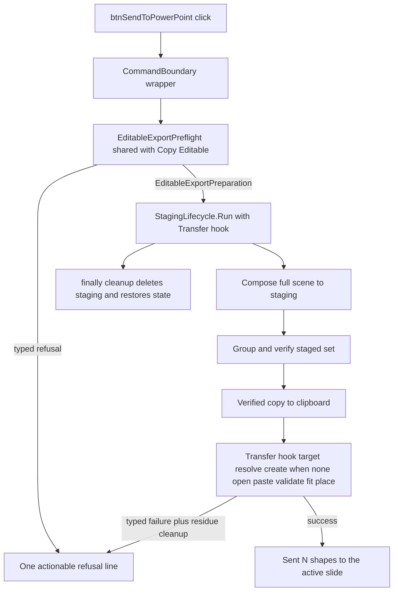

# R7.6 — Send to PowerPoint: review synthesis and implementation plan

> Plan authored 2026-11-22 (architect mode) ·
> Work item: [`docs/work-items/R7.6-send-to-powerpoint.md`](../docs/work-items/R7.6-send-to-powerpoint.md)
> (Tier A — binding contract, revised 2026-11-21) ·
> Prerequisites verified this session: **R7.1–R7.5 all landed**
> ([`docs/STATUS.md`](../docs/STATUS.md), 2026-11-22 entries) and **D-R7.2 resolved 2026-11-21**
> ([`docs/work-items/R7.2-attach-slide-cases.md`](../docs/work-items/R7.2-attach-slide-cases.md) —
> "attach to the active editable presentation and its active slide; create a new presentation
> only when no presentation is open, announced in the feedback"). The work item's stop condition
> "The R7.2 button contract is undecided → stop" is therefore **cleared**.

Sources reviewed for this plan: the R7.6 work item; the R7.2 work item (D-R7.2 ruling);
[`AGENTS.md`](../AGENTS.md); [`docs/REPO-MAP.md`](../docs/REPO-MAP.md) (R7.1–R7.5 entry
points); [`docs/STATUS.md`](../docs/STATUS.md); the live source of
[`CopyEditableCommand.cs`](../src/GanttCreator.AddIn/CopyEditableCommand.cs),
[`StagingLifecycle.cs`](../src/GanttCreator.Office/StagingLifecycle.cs),
[`RibbonState.cs`](../src/GanttCreator.AddIn/RibbonState.cs),
[`RibbonControlIds.cs`](../src/GanttCreator.AddIn/RibbonControlIds.cs),
[`Ribbon.xml`](../src/GanttCreator.AddIn/RibbonResources/Ribbon.xml),
[`PowerPointTransferFailure.cs`](../src/GanttCreator.Office/PowerPointTransferFailure.cs),
[`PowerPointTransferFailureMapper.cs`](../src/GanttCreator.Office/PowerPointTransferFailureMapper.cs),
[`PowerPointTargetResolver.cs`](../src/GanttCreator.Office/PowerPointTargetResolver.cs),
[`PowerPointPasteStage.cs`](../src/GanttCreator.Office/PowerPointPasteStage.cs),
[`PowerPointPlacementStage.cs`](../src/GanttCreator.Office/PowerPointPlacementStage.cs),
[`PowerPointPasteResidueCleanup.cs`](../src/GanttCreator.Office/PowerPointPasteResidueCleanup.cs),
[`PowerPointTransferAdapter.cs`](../src/GanttCreator.Office/PowerPointTransferAdapter.cs),
[`ExcelSceneBuildRequestFactory.cs`](../src/GanttCreator.Office/ExcelSceneBuildRequestFactory.cs)
(the `EditableExportRequest` doorway),
[`ExportBoundsResolver.cs`](../src/GanttCreator.Core/Scene/ExportBoundsResolver.cs),
[`ExportBounds.cs`](../src/GanttCreator.Core/Scene/ExportBounds.cs),
[`StagedShapeGrouper.cs`](../src/GanttCreator.Office/StagedShapeGrouper.cs), and the live-gate
precedent [`PowerPointTransferFailureIntegrationTests.cs`](../tests/GanttCreator.Office.IntegrationTests/PowerPointTransferFailureIntegrationTests.cs).

---

## A. Synthesis

### A.1 Business intent

The Export ribbon group's second command, **Send to PowerPoint**, runs the whole editable-export
pipeline — the R6 composition/staging/grouping/verified-copy chain — and then transfers the
verified clipboard group into the user's live PowerPoint session: attach or start the host,
resolve the active editable deck and slide per D-R7.2, paste as shapes, validate the pasted
range, fit and place it once on the slide. The non-negotiable business promise is **ownership**:
the user's presentation is never saved, never closed, never overwritten, and an existing
PowerPoint instance is never terminated. A failed transfer must never cost user data — Excel
staging is cleaned, PowerPoint is left as it was found, and the user's unsaved session survives
intact. Success is a concise count-only sentence; every failure is one typed, actionable line.

### A.2 Technical expectations (from the binding work item)

1. **One command, the full pipeline (D1).** Composition → staging → grouping → verified copy →
   transfer (attach/start → paste → validate → position) → cleanup, with the transfer running
   *inside* the staging lifecycle, after the verified copy and before the `finally` cleanup, so
   the clipboard is live while the staged shapes exist and the lifecycle's `finally` remains the
   one Excel cleanup authority.
2. **One pre-flight authority (D4).** Extract `EditableExportPreflight` from
   [`CopyEditableCommand.Run`](../src/GanttCreator.AddIn/CopyEditableCommand.cs) (~200 lines of
   read → configuration → validate → measure → export request → selection → bounds); both
   commands consume it. A second copy of that chain anywhere is a defect. The 33 existing
   `CopyEditableCommandTests` facts stay green; a new parity fact pins that both commands
   produce the same resolution.
3. **Post-resolution bounds guard.** Before any staging shape is created, reject a resolved
   `ExportBoundsOutcome` whose `Bounds.Width` or `Bounds.Height` is not finite and strictly
   positive, with the existing `ExportBoundsRefusal.InvalidBounds` (the resolver already refuses
   a non-positive `request.PlotBounds`; the resolved `ChartBounds` was not checked). The
   transfer consumes `ExportBounds.Bounds` (zero-origin) and never re-applies
   `PlacementDelta`.
4. **Additive lifecycle transfer seam (option B).** `StagingLifecycleRequest` gains the optional
   hook `Func<StagedGroupOutcome, StagingCopyResult, StagingTransferResult>? Transfer = null`;
   `StagingLifecycleOutcome` gains a `Transfer` result member and
   `StagingLifecycleRefusal` gains `TransferRefused`. It runs only after a successful verified
   copy and before the `finally`; every existing R6 caller is source-compatible. The seam must
   not create a second cleanup authority (stop condition) — it belongs inside the existing
   `finally` envelope.
5. **The transfer composes the copy's scene (D5).** `EditableExportRequest.Create` pins
   `SceneCompositionProfile.EditableExport`; the transfer adds a parity pin that its scene bounds
   equal the copy's. `SceneCompositionProfile.PowerPoint` stays unused until a
   renderer-specific difference exists. No silent profile switch (ADR-0068).
6. **Ownership is structural (D2).** The transfer port has no `Save`/`SaveAs`/`Close`/`Quit`
   member (R7.1's test already pins this); command tests assert only the expected port members
   were called; an architecture scan asserts no `FinalReleaseComObject`, `Quit` or `Close`
   appears in the new source. Only owned proxies are released, in reverse order, exactly once.
7. **A failed transfer never costs user data (D3).** Excel staging is cleaned by the R6.5
   lifecycle; PowerPoint is untouched on failure (R7.5's
   [`PowerPointPasteResidueCleanup`](../src/GanttCreator.Office/PowerPointPasteResidueCleanup.cs)
   deletes a pasted group by id when a later stage failed); the R4.2 application-state scope
   wraps the whole command and is disposed even on a pre-flight refusal.
8. **Corrected ribbon gate (D6).** `RibbonState.IsVisible(ExportGroup)` →
   `Mode == RibbonMode.Ready`; `IsEnabled(CopyEditable)` and `SendToPowerPoint` →
   `Mode == RibbonMode.Ready && ActiveSheetIsGanttSheet`. `SheetInitialised` alone is not
   sufficient — it is true in a `NeedsRepair` workbook whose configuration is missing, where the
   command would refuse at the configuration read.
9. **Message discipline.** Success is count-only ("Sent N shapes to the active slide", plus the
   dropped-rows clause and the announced-creation clause when they apply); each typed failure →
   exactly one actionable message, and for transfer failures the command presents **exactly**
   the `PowerPointTransferFailure.Message` text (R7.5's contract: "R7.6 presents exactly this
   text; the failure never shows a dialog itself").
10. **Exclusions (hard).** No transfer-stage changes (R7.1–R7.5 own them); no PNG (Phase 8); no
    save/close/terminate surface of any kind; no `dynamic`; no profile switch; no new
    production dependency.

### A.3 Explicit success measures

- `dotnet test tests/GanttCreator.AddIn.Tests` green: the pipeline-order pin; the shared
  pre-flight parity pin; the ownership matrix (D2 positives); typed refusals → one message
  each; presenter degradation; ribbon pins for FirstRun, NeedsRepair (table readable, config
  missing), Ready on the Gantt sheet, Ready on another sheet; the Export group's `getVisible`
  and both buttons' `getEnabled`.
- `dotnet test tests/GanttCreator.Office.ContractTests` green: the lifecycle transfer seam runs
  after a successful copy and before cleanup; a transfer refusal still cleans up; a copy
  refusal never invokes the transfer.
- **Office host gate (Required)**: live run against an existing user-owned PowerPoint with
  unsaved changes — the transfer lands, nothing saves/closes/terminates, the user's session
  survives intact, host builds recorded.
- `pwsh ./scripts/verify-quick.ps1` exit 0 on every commit; `pwsh ./scripts/verify.ps1` exit 0
  on the clean branch-final tree (mutation gate ≥ 80 % on changed code);
  `git diff --check` no output.
- Definition of done: checklist sections **E, G, I, J, K** self-certified with positives;
  Release 0 warnings; XML docs; REPO-MAP/STATUS current.

---

## B. End-to-end solution architecture

### B.1 Pipeline flow



The transfer hook runs inside the lifecycle's `try`, so the clipboard payload is live and the
staged shapes still exist while PowerPoint is driven; the `finally` then deletes the Excel
staging and restores the five application settings and the selection, whatever the transfer
result.

### B.2 Component responsibilities and the exact seams

| Layer | Component (existing unless marked new) | Responsibility in R7.6 |
| --- | --- | --- |
| AddIn | `EditableExportPreflight` **(new)** | The one read → config → validate → measure → request → selection → bounds → **bounds-guard** authority. Returns `EditableExportPreparation` (validated events, dropped-row count, measured grid, resolved `ExportBoundsOutcome` with scene, the placement inset) or a typed refusal with its one actionable line. |
| AddIn | `SendToPowerPointCommand` **(new)** | Owns the pipeline order (D1). Consumes the pre-flight, assembles `StagingLifecycleRequest` with the `Transfer` hook, maps lifecycle/transfer refusals to one message each, presents count-only success. `RunForExcel` mirrors `CopyEditableCommand.RunForExcel`: protection window (ADR-0055) + `ExcelApplicationStateScope` in a `using` covering pre-flight refusals + `ActivateGanttTab` restore (ADR-0058). |
| AddIn | `RibbonControlIds.SendToPowerPoint` **(new)** + corrected `RibbonState` | The button id `btnSendToPowerPoint`; the corrected truth table (D6). |
| AddIn | `GanttRibbon.OnSendToPowerPointClick` **(new)** + `Ribbon.xml` second `grpExport` button | The boundary-wrapped click, the `getVisible`/`getEnabled`/`onAction` declarations, keytip, screentip/supertip, and the glyph entry through the R5.19 generation pipeline (never hand-edit `RibbonGlyphCatalog.g.cs`). |
| Office | `StagingLifecycle` (additive) | The optional `Transfer` hook, `StagingTransferResult`, `StagingLifecycleOutcome.Transfer`, `StagingLifecycleRefusal.TransferRefused`. Invoked only after a successful verified copy; a copy refusal never invokes it; a transfer refusal still reaches the unchanged `finally`. |
| Office | R7.1–R7.5 stages (unchanged) | `PowerPointTargetResolver` → `PowerPointTargetDecision`; `PowerPointTransferAdapter` (typed PIA, retry-wired, `CreatePresentationWithBlankSlide`, `PasteSpecialShape`, `ReadSlideSize`, `ApplyPlacement`, `DeletePastedGroup`); `PowerPointPasteStage`; `PowerPointPlacementStage`; `PowerPointTransferFailureMapper`; `PowerPointPasteResidueCleanup`; `PowerPointRetryLoop`/`PowerPointTransientRetryPolicy`. |
| Core | unchanged | `PowerPointTargetDecision`, `PowerPointPasteValidator`, `SlideFit`, `SlidePlacement` (the once-rule latch), `ExportBoundsResolver`, `EditableExportRequest` doorway. No Core change is in this work item's scope. |

**The transfer hook's internal chain** (built by the command as a closure over the preparation
and the three PowerPoint ports; every step is a landed production stage):

1. `PowerPointTargetResolver.Resolve()` → `PowerPointTargetDecision`.
2. `Refuse` arm → `PowerPointTransferFailureMapper.MapTargetDecision` → typed failure; nothing
   materialised, no residue.
3. `CreatePresentation` arm → `IPowerPointApplicationPort.CreatePresentationWithBlankSlide()`
   → `MapCreation` → failure, or remember **created = true** for the announced-creation clause
   (D-R7.2: creation is announced in the feedback, never silent).
4. `PowerPointPasteStage.Paste(expectation)` where the expectation is built from the hook's
   `StagedGroupOutcome`: `ExpectedChildCount = group.ChildOrder.Count` and the verified staged
   envelope `group.Bounds`. A stage refusal or a failed validation → `MapPasteStage`; when a
   group materialised but validation failed, `PowerPointPasteResidueCleanup.Cleanup(groupId,
   pastePort, trace)` deletes it by id (ADR-0066 D3: never the returned range).
5. `PowerPointPlacementStage.Place(paste.GroupId.Value, preparation.Bounds.Bounds, insetPt)`
   — the fit consumes `ExportBounds.Bounds` (zero-origin) and never re-applies
   `PlacementDelta`; the inset is the themed `ChartOuterPaddingPt` metric resolved through
   `ChartPaddingPt.Uniform` (D-R7.4: scene-space, scaled with the group), carried on the
   preparation so the hook never re-derives it. A refusal → `MapPlacementStage` → residue
   cleanup of the pasted group → typed failure.
6. Success → `StagingTransferResult(success, validated count, placed bounds)`.

### B.3 Library and pattern stack — and why it is fixed

The user-facing brief asks for "recommended .NET/C# patterns and libraries for robust Excel
reading/writing and template-driven PowerPoint creation". The senior-developer answer for
**this repository** is that the stack is already decided by binding contract, and it is the
correct stack for the product boundary — changing it is a stop condition, not an option:

- **Excel reading/writing**: Excel-DNA 1.9 hosting on `.NET 10` `net10.0-windows` x64, with all
  Excel access through the Office project's typed ports — bulk `Value2` table reads
  (`ExcelGanttTableReader`), measured grid reads (`ExcelPanelGridMeasurement`), and the
  template-reusing, `ShapeRange`-grouped shape writer (`ExcelShapeWriter`). **No ClosedXML /
  EPPlus / OpenXML SDK**: the add-in reads and mutates the *live* workbook in the user's
  session; file-format libraries cannot see live session state, and a new production
  dependency is an explicit `AGENTS.md` stop condition.
- **PowerPoint**: the statically typed PIA `Microsoft.Office.Interop.PowerPoint`
  15.0.4420.1018 pinned by [ADR-0069](../docs/adr/0069-typed-powerpoint-pia-and-ownership.md)
  (embed interop types between the Excel-DNA targets — the measured CS1762 build route), driven
  only through `PowerPointTransferAdapter`. **No OpenXML SDK / template-driven deck generator**:
  the contract is a *live, editable-shape transfer into the user's open presentation*, verified
  by read-back; template-driven file generation would require exactly the save/close surface
  this release forbids. "Template-driven PowerPoint creation" in this product means: the staged
  Excel composition *is* the template, and the paste materialises it as one editable
  `msoGroup` whose children ungroup to N editable shapes.
- **Patterns (all already the repository's binding conventions)**: ports/adapters with a pure
  Core (no Office/Excel-DNA/clipboard/dialog dependency); delegate seams for static methods so
  command tests pin pipeline order host-free; typed refusal enums instead of exceptions for
  every expected host state; one COM ownership helper (`PowerPointProxyOwnership`,
  reverse-order, exactly-once release); immutable records, `DateOnly`, invariant culture, one
  geometry rounding policy; the five-setting `ExcelApplicationStateScope` save/restore
  (ADR-0020); count-only success and one-message-per-refusal; **every new
  `if (bad) { error }` validator ships a positive test in the same commit**.

### B.4 Data mapping and transformation

No new mapping logic is authored: the transfer consumes exactly what the landed stages
produce. The one mapping decision this row owns is the **parity pin (D5)** — the transfer's
scene comes from the same `EditableExportRequest.Create` doorway and the same
`ExportBoundsResolver.TryResolve` resolution as Copy Editable, so the pasted group's aspect is
the copy's aspect (`aspectDelta` 0 was measured live in the R7.4 gate). The hook maps
`StagedGroupOutcome` → `PowerPointPasteExpectation` (child count + verified envelope) and
`EditableExportPreparation` → placement inputs (`ExportBounds.Bounds` + themed inset). The
command maps `StagingLifecycleRefusal` + `PowerPointTransferFailure` → one message each, and
`StagingTransferResult` → the count-only success sentence.

### B.5 Exception handling and failure taxonomy

Expected host states are typed results, never exceptions — the R7.5 closed taxonomy
(`PowerPointTransferFailureKind`, 17 members) is the single projection
(`PowerPointTransferFailureMapper`) from every stage outcome, each carrying one actionable
message and one redaction-ready technical record with the COM HRESULT where available. The
bounded retry (`PowerPointRetryLoop`, attempt cap 3, evidence-filtered transient set) is wired
inside the adapter with the D2 mutation boundary: pure reads and the idempotent placement
retry; a paste stops retrying at the call that would execute `PasteSpecial`. Presenter
failures degrade to no dialog and never escape into Excel (the contained `Present` pattern).
No catch-and-ignore anywhere; a throwing hook propagates after the lifecycle's `finally` has
cleaned up.

### B.6 Logging and diagnostics

One technical record per failure, written through `CommandBoundary.WriteTechnicalRecord` to
the redacting rolling log: the mapper's `TechnicalRecord` for transfer failures (stage +
member + HRESULT), the existing `gantt.copy rows-dropped=` record for the partial export, and
the lifecycle's stage-duration trace extended to the transfer stage. Success stays
record-free. No schedule content in any record.

### B.7 Performance and memory

The R6 pipeline is already measured and optimised (lifecycle 39.4 s → 2.52 s: indexed name
lookups, template-reusing duplicates, content-only text, group-delete cleanup skip). R7.6 adds
no new hot path: the transfer is O(1) host calls (attach, one paste, one slide-size read, one
placement write + read-back, bounded retries). COM discipline: STA/main thread only, no
`Task.Run`, no `Thread.Sleep`, no chained proxy expressions; every proxy held locally and
released exactly once through the ownership helper. No new caches or allocations of note; the
preparation record is immutable and short-lived. The one new measurable is the cold-start arm
(starting PowerPoint can take seconds) — covered by the lifecycle's existing status-bar text,
and measured by the live gate.

### B.8 Testability and maintainability

Host-free command tests drive fake ports plus the delegate seams (the established
`CopyEditableCommandTests` pattern) and pin the pipeline order — the work item's named main
risk. Contract tests pin the lifecycle seam ordering with a fake copy seam and a fake transfer
hook. Architecture scans extend the `PowerPoint|ProtectionGuard` family to the new source.
The live gate composes the same production stages over a production adapter, exactly as the
R7.4/R7.5 gates did. One structural note: the live gate (Office.IntegrationTests) cannot
reference the AddIn command, so the gate builds its own hook from the same production pieces
the command's hook uses — the command test pins the order host-free, the gate pins the same
order live, and both are reviewed in the same PR (drift risk recorded in §E).

---

## C. Phased work breakdown

Sequencing follows the work item's Step 0 (pre-work first, template command intact) and the
minimal-diff ladder: each phase is independently green, one concern per commit, tests in the
same commit as behaviour. Effort is expressed as relative diff size, never time.

### Phase 0 — Step 0 close-out and the shared pre-flight (AddIn, host-free)

Dependencies: none (prerequisites verified in this plan).

Steps:
1. Extract `EditableExportPreflight` from
   [`CopyEditableCommand.Run`](../src/GanttCreator.AddIn/CopyEditableCommand.cs) steps 1–6
   (read → configuration → validate → measurement → export request → selection → bounds),
   including the dropped-row counting and the `TranslateRead`/`TranslateConfig`/
   `TranslateMeasurement`/`TranslateBounds` message mappings, so the pre-flight returns either
   `EditableExportPreparation` (events, dropped-row count, measured grid, resolved
   `ExportBoundsOutcome` with scene, placement inset) or the typed refusal with its one
   actionable line. `CopyEditableCommand` consumes it and deletes its duplicated chain.
2. Add the post-resolution bounds guard inside the pre-flight: after a successful resolution,
   reject `Bounds.Width`/`Bounds.Height` that are not finite and strictly positive with
   `ExportBoundsRefusal.InvalidBounds` (message already exists and is already translated:
   "The chart has no area to copy. Adjust the chart dates, then copy again."). Note the
   reachable bad input: `RectD` refuses non-finite/negative extents at construction, so the
   realistic arm is a **zero extent** — the positive test constructs exactly that.
3. Parity fact: both commands, given the same fakes, produce the same resolution (D4/D5).

Validation: `dotnet test tests/GanttCreator.AddIn.Tests` — the 33 existing
`CopyEditableCommandTests` facts stay green (behaviour-preserving extraction), plus the new
guard positives (one per command) and the parity fact. `verify-quick.ps1`.

Commits (one concern each):
- `refactor: extract the shared editable-export pre-flight from Copy Editable` (mechanical
  move; no behaviour change; 33 facts green).
- `feat: refuse a resolved export with no area before any staging shape is created` (the guard
  + its positive tests, same commit per the validator rule).

Relative diff: the extraction moves ~200 lines once; the guard is ~15 lines + tests.

### Phase 1 — The additive lifecycle transfer seam (Office, host-free)

Dependencies: Phase 0 is independent; this phase can proceed in parallel but lands after Phase
0's commits to keep one work item in flight at a time.

Steps:
1. `StagingTransferResult` (new record): success flag, the validated count and placed bounds,
   and the typed refusal (`PowerPointTransferFailure?` — R7.5's taxonomy is the vocabulary).
2. `StagingLifecycleRequest.Transfer` optional hook
   (`Func<StagedGroupOutcome, StagingCopyResult, StagingTransferResult>?`, default `null`);
   `StagingLifecycleOutcome.Transfer` (additive, default `null`);
   `StagingLifecycleRefusal.TransferRefused`.
3. `StagingLifecycle.Run` invokes the hook only when the copy seam ran and succeeded, before
   the `finally`; a copy refusal never invokes it; a transfer refusal sets `TransferRefused`
   and the unchanged `finally` still cleans up and restores state. The hook must not delete
   Excel staging — the `finally` stays the one Excel cleanup authority (stop condition if that
   cannot hold). PowerPoint residue is the hook's own concern via R7.5's cleanup helper, not
   the lifecycle's.
4. Extend the stage-duration trace to the transfer stage (pinned by the ordering tests).

Validation: `dotnet test tests/GanttCreator.Office.ContractTests` — ordering pin (compose →
group → copy → transfer → cleanup, recorded through fake seams), transfer-refusal-still-cleans-up
pin, copy-refusal-never-transfers pin, and every existing lifecycle fact green (source
compatibility of the optional member).

Commit: `feat: add the additive staging-lifecycle transfer seam`.

Relative diff: ~120 lines in `StagingLifecycle.cs` + the new record + contract tests.

### Phase 2 — The corrected ribbon gate (AddIn, host-free)

Dependencies: none technically, but lands as its own commit before the button exists.

Steps:
1. `RibbonState.IsVisible(ExportGroup)` → `Mode == RibbonMode.Ready` (split `ExportGroup` out
   of the `Mode != FirstRun` or-chain into its own arm; every other group's rule is unchanged).
2. `RibbonState.IsEnabled(CopyEditable)` → `Mode == RibbonMode.Ready &&
   ActiveSheetIsGanttSheet` (equivalently `HasActiveWorkbook && SheetInitialised &&
   ConfigurationPresent && ActiveSheetIsGanttSheet`).
3. Ribbon pins: FirstRun (group hidden), NeedsRepair with a readable table and missing
   configuration (group hidden, button disabled — the defect this correction removes), Ready on
   the Gantt sheet (group visible, button enabled), Ready on another sheet (group visible,
   button disabled).

Deliberate sequencing note: `RibbonControlIds.SendToPowerPoint` and the `Ribbon.xml` button do
**not** land in this phase — the RibbonX contract test asserts the shipped XML declares
`getEnabled` on exactly the `RibbonControlIds` controls, so the const and the XML must land
together with the command that owns the `onAction` (Phase 3).

Validation: `dotnet test tests/GanttCreator.AddIn.Tests` (the four state pins ×
`getVisible`/`getEnabled`); the RibbonX contract test stays green because no new control was
declared yet.

Commit: `fix: gate the Export group and Copy Editable on RibbonMode.Ready`.

Relative diff: ~10 lines of truth table + pins.

### Phase 3 — SendToPowerPointCommand and the button (AddIn, host-free)

Dependencies: Phases 0, 1 and 2 (the command consumes the pre-flight, the seam, and the
corrected gate).

Steps:
1. `SendToPowerPointRefusal` enum + `SendToPowerPointOutcome` record, mirroring the
   `CopyEditable` shape with the transfer arms (`TransferRefused`, plus the construction
   members for the three PowerPoint ports).
2. `SendToPowerPointRequest`: the copy-side dependencies (as `CopyEditableRequest`) plus the
   three PowerPoint ports (`IPowerPointApplicationPort`, `IPowerPointPastePort`,
   `IPowerPointPlacementPort`) and the delegate seams for the pre-flight and lifecycle statics.
3. The transfer hook builder (§B.2 chain): target resolve → announced create-when-none-open →
   paste with the expectation from the group outcome → placement from the preparation's
   `ExportBounds.Bounds` and themed inset → failure mapping → residue cleanup on every
   post-paste failure path.
4. `Run` / `RunForExcel`: the same boundary, protection-window and state-scope shape as
   `CopyEditableCommand`; success presents the count-only sentence with the dropped-rows clause
   and, when a presentation was created, the announced-creation clause; transfer failures
   present exactly the mapper's message; the failure's technical record goes to the trace sink.
5. Ribbon surface: `RibbonControlIds.SendToPowerPoint` (`btnSendToPowerPoint`), the
   `Ribbon.xml` second `grpExport` button (label "Send to PowerPoint", `size="large"`,
   keytip, screentip/supertip naming the non-destructive contract, `getVisible="GetVisible"`,
   `getEnabled="GetEnabled"`, `onAction="OnSendToPowerPointClick"`), the glyph entry through
   the R5.19 generation pipeline (`scripts/gen-ribbon-glyphs.ps1`; never hand-edit
   `RibbonGlyphCatalog.g.cs`), and `GanttRibbon.OnSendToPowerPointClick` following the
   `OnCopyEditableClick` boundary pattern.
6. Command tests: the pipeline-order pin through fake ports and delegate seams; the ownership
   matrix (D2 positives — only the expected port members were called, the create arm calls
   exactly `AttachOrStart`/`ReadTargetObservation`/`CreatePresentationWithBlankSlide`/
   `PasteSpecialShape`/`ReadSlideSize`/`ApplyPlacement` and nothing else); typed refusals → one
   message each (asserting the mapper's exact text is presented); presenter degradation; the
   D5 parity pin (the transfer's resolved scene bounds equal the copy's); the announced-creation
   and dropped-rows message pins; the residue-cleanup-on-placement-failure pin.
7. Architecture scans: extend the `PowerPoint|ProtectionGuard` family to assert no
   `FinalReleaseComObject`, `Quit`, `Close`, `Save`, `dynamic` or `Task.Run` appears in the new
   command source (positive controls included, as `PowerPointAdapterHygieneTests` does).

Validation: `dotnet test tests/GanttCreator.AddIn.Tests`;
`dotnet test tests/GanttCreator.Architecture.Tests`; `dotnet build GanttCreator.slnx
/p:Configuration=Release /warnaserror`; `verify-quick.ps1`.

Commit: `feat: wire the Send to PowerPoint command end to end`.

Relative diff: the largest new file, comparable to `CopyEditableCommand.cs` (~800 lines
including XML docs) plus the ribbon surface and the test suite.

### Phase 4 — The live ownership gate (Required)

Dependencies: Phase 3.

Steps:
1. `SendToPowerPointIntegrationTests` (OfficeIntegration trait) in
   `tests/GanttCreator.Office.IntegrationTests/`, composing the production chain the command
   composes: a real staging → verified-copy lifecycle with the transfer hook over a production
   `PowerPointTransferAdapter`, against a fixture-owned deck.
2. **Body 1 (the work item's Required case)**: a pre-existing deck carrying unsaved changes —
   run the transfer, assert the group landed on the active slide (fitted box, correct child
   count after ungroup), assert the deck is still open with its unsaved mutation intact, no
   file appeared on disk, the host process survives the adapter dispose, then delete the
   pasted group (by id) to leave the deck as found.
3. **Body 2 (recommended addition)**: the no-deck cold-start arm — with no presentation open
   (the gate host's normal state), the `CreatePresentation` arm creates and announces, the
   paste lands on the new deck's slide, and the fixture quits only the host it started. This is
   the only arm that exercises `CreatePresentationWithBlankSlide` live, and it measures the
   cold-start clipboard-survival unknown (§E risk 4).
4. Record host builds in the test output, as the R7.4/R7.5 gates do.

Validation: the gate green on the reference host (PowerPoint 16.0.20625.20108 x64 class);
`pwsh ./scripts/verify-office.ps1` full suite exit 0 (currently 99/99 at ~20 min against the
1800 s deadline — two more bodies fit, watch the budget).

Commit: `test: add the live Send to PowerPoint ownership gate`.

### Phase 5 — Branch-final gates and documentation

Dependencies: all phases.

Steps:
1. `pwsh ./scripts/verify.ps1` on the clean tree (includes the mutation gate ≥ 80 % on the
   changed set — the new validators must be killable, which the positive tests ensure).
2. `git diff --check` (no output); `git status --short` clean.
3. Update `docs/REPO-MAP.md` (an R7.6 entry-points paragraph naming the command, the pre-flight,
   the seam and the gate) and `docs/STATUS.md` (the row's completion entry with observed gate
   output). Self-certify checklist sections **E, G, I, J, K** in the commit messages.

Commit: `docs: record R7.6 entry points and status`.

---

## D. Testing approach

### D.1 Unit and contract layers (host-free, every commit)

| Layer | Suite | What R7.6 adds |
| --- | --- | --- |
| AddIn unit | `tests/GanttCreator.AddIn.Tests` | Pre-flight extraction parity fact; bounds-guard positives (one per command, zero-extent resolution); the four ribbon state pins × `getVisible`/`getEnabled`; the command's pipeline-order pin; the ownership matrix positives; typed-refusal → one-message pins (presenting the mapper's exact text); presenter degradation; D5 parity pin; announced-creation and dropped-rows message pins. |
| Office contract | `tests/GanttCreator.Office.ContractTests` | Lifecycle seam ordering pin (transfer after a successful copy, before cleanup); transfer-refusal-still-cleans-up; copy-refusal-never-transfers; the trace extension; source-compat of the optional member. |
| Architecture | `tests/GanttCreator.Architecture.Tests` | Scans over the new source: no `Save`/`Close`/`Quit`/`FinalReleaseComObject`/`dynamic`/`Task.Run`; positive controls. |
| Core unit | `tests/GanttCreator.Core.Tests` | Unchanged — no Core file is in this row's scope. |

The validator rule is binding: the bounds guard and every new null/sequence check in the seam
and command ship with a `[Fact]` that constructs the bad input and asserts the error path fires,
in the same commit.

### D.2 Live Office gate (Required)

§C Phase 4. The gate is non-destructive by fixture discipline: it mutates only fixture-owned
decks, observes a pre-existing deck without viewing/showing/closing/quitting it, and quits only
a host it started. "Nothing saves/closes/terminates" is proven three ways: structurally (the
port has no such member — R7.1's test), by scan (no such call in source), and live (the
session-survives assertions above).

### D.3 Acceptance validation and evidence commands

Per the work item, observed output required for each:

```powershell
dotnet build GanttCreator.slnx /p:Configuration=Release /warnaserror
dotnet test tests/GanttCreator.AddIn.Tests
dotnet test tests/GanttCreator.Office.ContractTests
pwsh ./scripts/verify-quick.ps1      # every commit, expect exit 0
pwsh ./scripts/verify-office.ps1     # Required, expect exit 0
pwsh ./scripts/verify.ps1             # branch-final, clean tree
git diff --check                     # expect no output
```

Any gate not run is reported `Not run` with the reason; no command is claimed without observed
output.

---

## E. Risks, assumptions, mitigations

| # | Risk / unknown | Mitigation |
| --- | --- | --- |
| 1 | **Composite-pipeline ordering drift** (the work item's named main risk): the command's stage order and the lifecycle's seam order diverging from the contract. | The command's order pin through fake ports and delegate seams; the lifecycle seam's ordering pin; each stage's own contract guard. Both pins land with the code they pin. |
| 2 | **Pre-flight extraction regression**: the ~200-line move subtly changes Copy Editable behaviour. | The 33 existing facts are the acceptance bar and must stay green unchanged; the parity fact pins both commands to the same resolution; the extraction commit is mechanical only (the guard is a separate commit). |
| 3 | **Gate/command hook mirror drift**: the live gate cannot reference the AddIn, so it rebuilds the hook the command builds. | Both are pinned to the same stage sequence (command test host-free, gate live); both reviewed in the same PR; the hook construction stays small and declarative. If the owner prefers single-authority composition, an Office-level hook builder is the alternative — recorded as open question 5. |
| 4 | **Cold-start clipboard survival (genuine unknown)**: does the verified clipboard payload survive `new Application()` starting a cold PowerPoint? The R7.4/R7.5 gates pasted only against an attached host. | Safe failure is already structural: if the payload is gone, the paste stage refuses `PastePayloadMissing` (documented candidate `0x80048240`) and the user's data is untouched. The Phase 4 cold-start arm measures it live. If it fails, record it and stop for an owner decision — a re-copy-after-start would be a second lifecycle pass, out of this row's scope. |
| 5 | **Second cleanup authority**: the transfer seam tempting a second Excel cleanup path. | The hook must not delete Excel staging; the unchanged `finally` is the only Excel cleanup; PowerPoint residue is the hook's own via R7.5's helper. The work item's stop condition applies if this cannot hold. |
| 6 | **Ribbon behaviour change**: Copy Editable becomes disabled in a `NeedsRepair` workbook where it was previously enabled. | Owner-directed by the work item (Step 0, D6); pinned by the NeedsRepair fact; the button was enabled for a command that would refuse at the configuration read, so the correction removes a broken affordance. |
| 7 | **AddIn line coverage below the 75 % target** (74.27 % at R7.4 close, enforcement deferred). | The new command suite raises coverage; no threshold loosening (forbidden). |
| 8 | **Live gate budget**: `verify-office.ps1` is ~20 min at 99 tests against a 1800 s deadline. | Two gate bodies add ~1–2 min; the deadline has headroom; watch the per-run total and record it. |
| 9 | **R7.4 D5 residue (4:3 label overflow)** — composition-side, owner decision still open. | Explicitly out of R7.6 scope; the R7.6 gate asserts the placement-side rule only (no child that fits at composition stops fitting after placement), exactly as the R7.4 gate did. Not a blocker. |

**Assumptions** (verified this session unless noted):
- R7.1–R7.5 are landed and green as recorded in `docs/STATUS.md` (2026-11-22).
- D-R7.2 as recorded in the R7.2 work item governs the button (attach active editable deck;
  create only when none is open, announced; typed refusals otherwise).
- The RibbonX contract test requires `RibbonControlIds` and `Ribbon.xml` to land together
  (verified from the `RibbonControlIds` remarks), which fixes the Phase 2/3 sequencing.
- `RectD` refuses non-finite/negative extents at construction (R7.4 notes), so the bounds
  guard's reachable bad input is a zero extent; the positive test constructs that.
- The reference host class for the live gate is PowerPoint 16.0.20625.20108 x64 with Excel
  closed, per the R7.4/R7.5 gate records.

---

## F. Open questions requiring owner ruling before or during development

None block the start — the work item is Tier A and D-R7.2 is resolved. These are
confirm-or-override items, each with a proposed default that implementation pins:

1. **Announced-creation sentence.** Proposed success text when a presentation was created:
   "Sent N shapes to the active slide. PowerPoint was not open, so a new presentation was
   created." (D-R7.2 requires the announcement; the exact wording is a product decision.)
2. **Cold-start arm in the Required gate.** Recommendation: include Body 2 (§C Phase 4) as
   Required, because it is the only live exercise of `CreatePresentationWithBlankSlide` and the
   only measurement of the clipboard-survival unknown. Alternative: attach-only Required, with
   the create arm host-free-pinned and recorded as documented-only.
3. **Keytip for the new button.** Proposed `SP` (`CP` is taken by Copy editable).
4. **Commit ladder granularity.** Six commits proposed (§C); the owner may prefer fewer, larger
   commits — the repo default is one concern per commit.
5. **Hook composition authority.** Default per the work item: the command builds the hook and
   the live gate mirrors it (risk 3). Alternative: an Office-level named hook builder both
   consume — slightly larger diff, single authority. The work item's scope table supports the
   default; the alternative would be a recorded scope addition.

---

## G. Evidence ledger seeds

| Statement | Status | Evidence |
| --- | --- | --- |
| R7.1–R7.5 are landed and green | fact | `docs/STATUS.md` entries 2026-11-21/22; `docs/REPO-MAP.md` R7.1–R7.5 entry points |
| D-R7.2 is resolved (attach active editable deck; create only when none open, announced) | fact | `docs/work-items/R7.2-attach-slide-cases.md` §D-R7.2, resolved 2026-11-21 |
| `CopyEditableCommand.Run` owns the ~200-line pre-flight in line with the work item's estimate | fact | `src/GanttCreator.AddIn/CopyEditableCommand.cs` steps 1–6 |
| The lifecycle has no copy-to-cleanup hook today | fact | `StagingLifecycle.Run` copy seam then `finally` |
| `SheetInitialised` is true in a NeedsRepair workbook with a missing configuration, and Copy Editable is currently enabled there | fact | `RibbonStateService.ResolveMode`; `RibbonState.IsEnabled` |
| `ExportBoundsRefusal.InvalidBounds` and its user message already exist | fact | `CopyEditableCommand.TranslateBounds`; `ExportBoundsResolver` |
| The transfer consumes `ExportBounds.Bounds` and never re-applies `PlacementDelta` | fact | `ExportBounds.cs`; R7.4 gate record (`aspectDelta` 0) |
| The paste expectation is buildable from `StagedGroupOutcome` (child count + verified envelope) | fact | `StagedGroupOutcome.ChildOrder`/`Bounds`; `PowerPointPasteExpectation` |
| The placement inset is the themed `ChartOuterPaddingPt` metric, scene-space, scaled with the group | fact | D-R7.4 recorded 2026-11-22; `SlideFit` remarks |
| R7.6 presents exactly the mapper's failure message | fact | `PowerPointTransferFailure.Message` doc comment |
| The RibbonX contract test forces const+XML to land together | fact | `RibbonControlIds` remarks |
| The clipboard payload survives a cold PowerPoint start | **unknown** | No live measurement exists; Phase 4 Body 2 measures it; safe failure is `PastePayloadMissing` |
| The live gate can drive the command's chain only by mirroring its hook | inference | Office.IntegrationTests references Office, not AddIn; R7.4 gate precedent built its own cycles |
| The announced-creation sentence wording above | proposal | §F.1, pinned by a command test once ruled |
