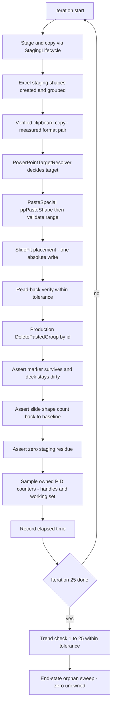
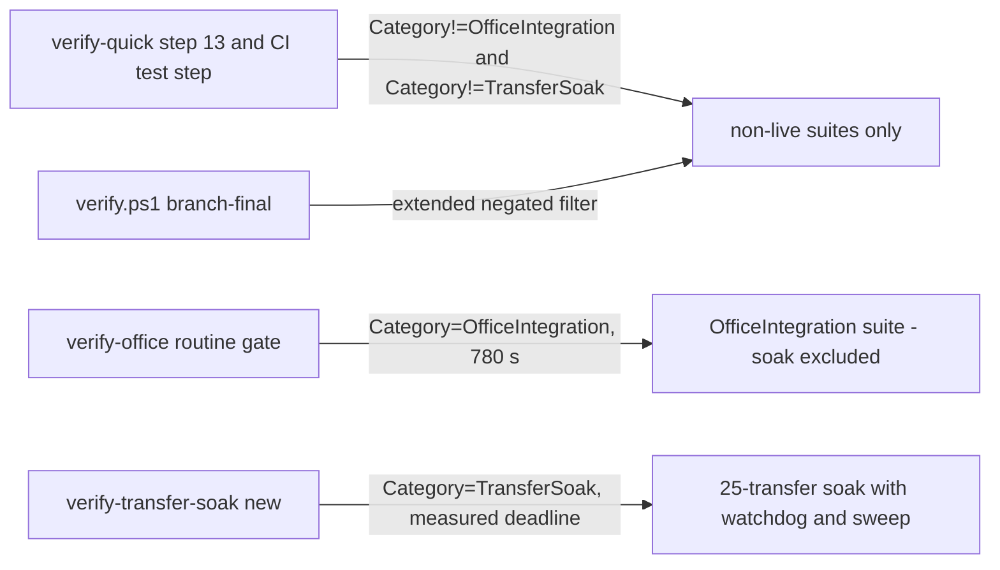

# R7.7 — Transfer soak: review synthesis and implementation plan

> Plan authored 2026-11-22 (architect mode) · revised the same day after the independent
> adversarial review ([`R7.7-transfer-soak-plan-review.md`](R7.7-transfer-soak-plan-review.md)):
> the soak gains a zero-`POWERPNT` pre-condition, the manifest assertions gain an arming
> contract, the filter-extension commit names the `ci-parity` pins, the handle count
> carries the gated trend, and the arm mix offers a trim ·
> Work item: [`docs/work-items/R7.7-transfer-soak.md`](../docs/work-items/R7.7-transfer-soak.md)
> (Tier A — binding contract, revised 2026-11-21) ·
> Prerequisites verified this session: **R7.1–R7.6 all landed**
> ([`docs/STATUS.md`](../docs/STATUS.md), 2026-11-22 entries — R7.6 wired the command end to
> end; R7.5 landed the failure taxonomy, bounded retry and residue cleanup; R7.4 closed with
> the live per-size gate; R7.3, R7.2, R7.1 landed before that). R7.7 is the **last Phase-7
> row and owns the phase-exit evidence assembly**.

Sources reviewed for this plan: the R7.7 work item (all sections); the R7.6 work item and
its landed gate; [`docs/03-ROADMAP.md`](../docs/03-ROADMAP.md) Phase-7 rows, notes and the
cross-phase compatibility matrix; [`docs/04-TEST-STRATEGY.md`](../docs/04-TEST-STRATEGY.md)
(the `TransferSoak` category rule and the flaky-test policy);
[`docs/02-ARCHITECTURE.md`](../docs/02-ARCHITECTURE.md) (COM ownership, the soak-gate rule);
[`docs/08-TEST-CHECKLIST.md`](../docs/08-TEST-CHECKLIST.md) sections J and K;
[`docs/KNOWN-LIMITATIONS.md`](../docs/KNOWN-LIMITATIONS.md) L12–L14;
[`docs/work-items/IMPLEMENTATION-PLAN.md`](../docs/work-items/IMPLEMENTATION-PLAN.md) (tier
manifest and the just-in-time upgrade rule); the live source of
[`PowerPointFixture.cs`](../tests/GanttCreator.Office.IntegrationTests/PowerPointFixture.cs),
[`OfficeFixture.cs`](../tests/GanttCreator.Office.IntegrationTests/OfficeFixture.cs),
[`OfficeFixtureTests.cs`](../tests/GanttCreator.Office.IntegrationTests/OfficeFixtureTests.cs),
[`SendToPowerPointIntegrationTests.cs`](../tests/GanttCreator.Office.IntegrationTests/SendToPowerPointIntegrationTests.cs),
[`PowerPointSlideFitIntegrationTests.cs`](../tests/GanttCreator.Office.IntegrationTests/PowerPointSlideFitIntegrationTests.cs),
[`PowerPointTransferFailureIntegrationTests.cs`](../tests/GanttCreator.Office.IntegrationTests/PowerPointTransferFailureIntegrationTests.cs),
[`PowerPointTargetDecisionIntegrationTests.cs`](../tests/GanttCreator.Office.IntegrationTests/PowerPointTargetDecisionIntegrationTests.cs),
[`verify-office.ps1`](../scripts/verify-office.ps1),
[`test-non-office.ps1`](../scripts/test-non-office.ps1),
[`verify.ps1`](../scripts/verify.ps1),
[`verify-quick.ps1`](../scripts/verify-quick.ps1),
[`ci.yml`](../.github/workflows/ci.yml) and
[`tests/Directory.Build.props`](../tests/Directory.Build.props).

---

## A. Synthesis

### A.1 Business intent

Phase 7 promised: *one click places an editable shape group on the intended slide without
saving or closing user work*. R7.1–R7.6 delivered that behaviour and proved each stage once.
R7.7 delivers the **proof of stability**: repeat the real transfer 25 times and show that
nothing degrades — no orphaned Office processes, no leaked handles, stable timings, and a
clean sheet, slide and clipboard after **every** transfer, not just the last. The business
promise being evidenced is trust: a user who clicks Send to PowerPoint twenty-five times in
a row keeps an Excel instance, a PowerPoint instance and an unsaved deck that are exactly as
healthy as after the first click.

Because R7.7 is the last Phase-7 row, it also **owns the phase exit**: the demonstration
record (one click → verified editable group on the active slide, aspect preserved, user
PowerPoint never saved/closed/terminated), the Phase 6/7 compatibility-matrix subset
(slide sizes 4:3/16:9/custom; failure rows clipboard-unavailable and
PowerPoint-absent/busy), and the **just-in-time Phase-8 guide upgrade** (R8.1–R8.8, R8.2a
from Tier B to Tier A against the landed code, per the manifest's upgrade rule).

### A.2 Technical expectations (from the binding work item)

1. **Counters, not impressions (D1).** The harness records exact values per iteration:
   Excel/PowerPoint PIDs alive at end vs the owned set (zero unowned orphans);
   `GetProcessHandleCount` and `WorkingSet64` per owned PowerPoint process (sampled per
   iteration); shapes per slide (cumulative only where intended); staging residue (zero
   every iteration); timings (median + max). The handle/memory trend must be flat within a
   **recorded tolerance** across iterations 1→25. There is no public .NET live-RCW counter —
   the plan must not claim one; handle count and working set are the measurable proxies.
2. **Cleanup asserted every iteration (D2).** Zero staging residue after each of the 25
   transfers; a residue at any iteration fails the run loudly.
3. **Exit evidence (D3).** Demonstration run recorded with host builds; matrix subset
   completed; Phase-8 guides upgraded to Tier A with refresh dates; manifest tiers updated.
4. **The soak is its own category (D4).** `TransferSoak` tests are excluded from the routine
   `OfficeIntegration` run; the dedicated script runs them with the same fixture, manifest
   and watchdog. A soak body that also carries `OfficeIntegration` is a defect. The routine
   780 s deadline is **not** raised, and the soak is **not** added to `verify.ps1`.
5. **The fixture is non-destructive (D5).** It touches only what it created; a pre-existing
   PowerPoint is observed, never closed, saved or terminated.
6. **Step 0 prerequisites.** R7.1–R7.6 landed; the L13 fixture-to-shell PID handoff exists
   (`OfficeFixture` records owned PIDs; `verify-office.ps1` sweeps them); the typed fixture
   and the owned-PID manifest write are in place; the gate is split with a **measured**
   deadline; the reference host (Windows build, Excel build, PowerPoint build, bitness) and
   the timing distribution are recorded with the result.
7. **Exclusions (hard).** No new transfer behaviour; no performance tuning without measured
   bottlenecks; no CI-hosted soak (reference-machine evidence only); no `dynamic`; no
   `Thread.Sleep`; no `FinalReleaseComObject`; no new production dependency.

**Step-0 status correction (verified this session, load-bearing for scope).** The work
item's Step-0 bullet "Fix the fixture before the soak runs" describes the R6.7-era
late-bound fixture (`Activator.CreateInstance`, `DisposeAsync` quitting an attached
instance, no manifest write). That fixture **no longer exists**: R7.1 landed the typed
replacement. Verified in live source —
[`PowerPointFixture.Initialize`](../tests/GanttCreator.Office.IntegrationTests/PowerPointFixture.cs:133)
uses `new PowerPoint.Application()` through the typed PIA;
[`AdoptOwnedProcesses`](../tests/GanttCreator.Office.IntegrationTests/PowerPointFixture.cs:934)
snapshots pre-existing `POWERPNT` PIDs and adopts only the processes its own call created;
[`OfficeFixture.RecordOwnedProcessId`](../tests/GanttCreator.Office.IntegrationTests/OfficeFixture.cs:1312)
is called for every adopted PID
([`PowerPointFixture.cs`](../tests/GanttCreator.Office.IntegrationTests/PowerPointFixture.cs:943)),
so the fixture **does** write the shared owned-PID manifest; and
`DisposeAsync` quits only when `StartedByUs` and closes only the test-owned presentation.
Two of the work item's evidence-ledger seeds ("`PowerPointFixture` does not write the
owned-PID manifest", "`PowerPointFixture` currently quits an attached instance") are
therefore **stale — superseded by R7.1's landing** and must be recorded as such, not
re-litigated. R7.7 *verifies* these properties (the soak's own assertions and the
manifest-content check are the verification) rather than re-implementing them. The
remaining R7.7 work is: the soak harness, the gate split, the measured run, the
exit-evidence assembly, the Phase-8 guide upgrade, and the docs updates.

**Gate-split discovery (verified this session, load-bearing for D4).** The work item names
two routine surfaces: `verify-office.ps1` (positive filter `Category=OfficeIntegration`,
780 s) and `verify.ps1` ("do not add the soak"). But the every-commit non-office run uses a
**negated** filter — [`test-non-office.ps1`](../scripts/test-non-office.ps1:36) runs
`--filter 'Category!=OfficeIntegration'` across the whole solution, and it is the shared
entry point for `verify-quick.ps1` step 13 **and** the GitHub CI "Test (OfficeIntegration
excluded)" step ([`ci.yml`](../.github/workflows/ci.yml:151));
[`verify.ps1`](../scripts/verify.ps1:187) carries the same negated filter inline for its
coverage run. A test tagged `TransferSoak` **only** does not match
`Category=OfficeIntegration`, so it stays out of the routine office gate — but it **does**
match `Category!=OfficeIntegration`, so without a filter extension the 25-transfer live soak
would run on **every commit**, in the branch-final gate, and in CI. Honouring "do not add
the soak to `verify.ps1`" therefore *requires* extending both negated filters to
`Category!=OfficeIntegration&Category!=TransferSoak`. This is in scope under D4 ("the soak
is excluded from the routine run") even though the work item text does not spell it out;
the plan makes it an explicit, separately committed task with Pester pins — including the
existing pins in [`ci-parity.Tests.ps1`](../scripts/ci-parity.Tests.ps1), which assert the
exact current filter strings on both surfaces and must be updated in the same commit or the
Pester gate itself goes red.

### A.3 Explicit success measures

- **Soak (Required, live)** — 25 real transfers on the reference machine(s), run only from
  a proven zero-`POWERPNT` start: the D1 counter record + zero residue per iteration; no
  orphan processes; the manifest — armed by the gate script — contains every PowerPoint PID
  the fixture started; logs clean; host builds recorded (Windows, Excel, PowerPoint,
  bitness) with the timing distribution (median + max).
- **Automated** — all Phase 6/7 suites green; `pwsh ./scripts/verify.ps1` green (phase
  exit); the routine `verify-office.ps1` remains green **and within 780 s** (its recorded
  test count unchanged — the structural proof the soak did not enter it); the soak script
  runs separately and records its own measured deadline.
- **Category split proven** — `verify-quick.ps1` green with the soak present (the extended
  negated filter excludes it); the soak body carries `TransferSoak` and no other Category
  trait; a Pester pin asserts the filter strings on all three surfaces.
- **Exit evidence assembled** — demonstration record with host builds; matrix subset table
  (slide sizes, clipboard unavailable, PowerPoint absent/busy) with each row's evidence or
  recorded owner ruling; Phase-8 guides (R8.1–R8.8, R8.2a) upgraded to Tier A with refresh
  dates; [`docs/work-items/IMPLEMENTATION-PLAN.md`](../docs/work-items/IMPLEMENTATION-PLAN.md)
  tier counts updated (50 Tier A / 55 Tier B → **59 Tier A / 46 Tier B**).
- **Docs current** — [`docs/REPO-MAP.md`](../docs/REPO-MAP.md) verification commands name
  the soak gate; [`docs/STATUS.md`](../docs/STATUS.md) entry + status line.
- Definition of done: checklist sections **J, K, G, I** self-certified with positives;
  `git diff --check` clean.

---

## B. End-to-end solution architecture

### B.1 Solution flow

R7.7 adds **no production code**. The soak drives the landed production chain end to end
and measures it; the only new artefacts are test-harness code, one gate script, and
documentation. The measurement flow per iteration:



The gate topology after the split (the three filter surfaces and the dedicated gate):



### B.2 Component responsibilities and the exact seams

| Component | Status | Responsibility in R7.7 |
| --- | --- | --- |
| [`PowerPointFixture`](../tests/GanttCreator.Office.IntegrationTests/PowerPointFixture.cs:94) | landed (R7.1) | Owns the PowerPoint host: snapshot → adopt → manifest → typed PIA calls → quit only what it started. The soak consumes it unchanged; `SetSlideSize`/`ReadSlideSize` (line 648), `AddUnsavedMarker`, `PrimaryPresentationHasUnsavedChanges`, `PrimarySlideHasText`, `InitializeWithoutPresentation`, `UngroupShapeById`, `DeletePastedShapes`, `SavePrimaryPresentationToTemp` are the arrangement surface. |
| [`OfficeFixture`](../tests/GanttCreator.Office.IntegrationTests/OfficeFixture.cs) | landed | Owns the Excel host and the owned-PID manifest (`RecordOwnedProcessId`, line 1312) and the forced-kill log. The soak uses one fixture for the whole run and samples its owned Excel PID per iteration. |
| `PowerPointTransferSoakIntegrationTests` (new, test-only) | **this row** | One `[Fact]` body tagged `[Trait("Category", "TransferSoak")]` **only**: a wait-for-zero-`POWERPNT` pre-condition (the R7.2 gate's `WaitForNoPowerPointAsync` pattern), then 25 sequential iterations over the production chain, per-iteration assertions and counter records. |
| `SoakCounters` sampler + trend evaluator (new, test-only) | **this row** | Pure, host-free-testable: samples `Process.HandleCount`/`WorkingSet64` per identity-checked owned PID; the trend evaluation is a pure function with non-live `[Fact]` positives (flat series passes, leaking series fails). |
| [`scripts/verify-transfer-soak.ps1`](../scripts/verify-office.ps1) (new) | **this row** | Mirrors `verify-office.ps1`: manifest env var, preflight sweep, before-snapshot, build, watchdog run with `--filter Category=TransferSoak`, trx archive, post-run sweep, forced-exit histogram, exit codes 124/3/4/5. |
| `scripts/verify-transfer-soak.Tests.ps1` (new, Pester) | **this row** | Static pins: the filter string, the measured-deadline parameter and its recorded measurement, the exit-code paths — the sibling-script pattern every gate script already follows. |
| [`test-non-office.ps1`](../scripts/test-non-office.ps1:36) + [`verify.ps1`](../scripts/verify.ps1:187) | **this row** (one-line filter extension each) | The negated filters gain `&Category!=TransferSoak` so the soak stays out of the every-commit gate, the branch-final gate and CI. |
| Phase-8 guides R8.1–R8.8, R8.2a + [`IMPLEMENTATION-PLAN.md`](../docs/work-items/IMPLEMENTATION-PLAN.md) | **this row** (docs) | Tier B → Tier A upgrade against landed code; manifest tier counts and slugs verified. |

**Seam discipline.** The soak body composes only landed production stages — the same
composition [`SendToPowerPointIntegrationTests.StageAndCopy`](../tests/GanttCreator.Office.IntegrationTests/SendToPowerPointIntegrationTests.cs:127)
and [`PasteAndPlace`](../tests/GanttCreator.Office.IntegrationTests/SendToPowerPointIntegrationTests.cs:165)
already drive (`StagingLifecycle.Run` → `PowerPointTargetResolver` → `PowerPointPasteStage`
→ `PowerPointPlacementStage` → `DeletePastedGroup`). No production file opens for edit. The
counter sampler is test-only and reads processes, never COM objects, so it adds no proxy the
ownership tracker must know about.

### B.3 Library and pattern stack — and why it is fixed

R7.7 adds **no new package** (a hard exclusion; a new production dependency is a stop
condition). The stack is inherited and each choice is already pinned by an ADR or a landed
row:

| Concern | Choice | Why it is the right tool here |
| --- | --- | --- |
| Excel automation | Excel-DNA 1.9 + `ExcelDna.Interop` (landed) | The add-in's host; the soak drives the same Excel interop the production writer uses. No file-format reader (OpenXML/ClosedXML) is involved — the soak measures the live COM path, which is the product's actual path. |
| PowerPoint automation | Typed PIA `Microsoft.Office.Interop.PowerPoint` 15.0.4420.1018, interop types embedded (ADR-0069) | The R7.1 package check disproved a 16.x PIA on NuGet; the typed PIA with no `dynamic`/`Microsoft.CSharp` is a Phase-7 revision decision. The soak reuses it; no version change. |
| Process counters | `System.Diagnostics.Process` (`HandleCount`, `WorkingSet64`, `StartTime`, `Id`) | `Process.HandleCount` is the .NET wrapper over `GetProcessHandleCount` — the D1 counter without a new P/Invoke, **verified against the installed `net10.0-windows` SDK metadata in Phase 0.4** with a direct `GetProcessHandleCount` P/Invoke as the recorded fallback. `StartTime` ticks are the same identity proof the manifest and the sweep already use, so the sampler's ownership check is the established pattern, not a new one. |
| Test framework | xUnit with `[Trait]` categories + VSTest `--filter` | The category split is implemented with the mechanism the three gates already use; xUnit/VSTest filter semantics (a `TransferSoak`-only body is excluded by `Category=OfficeIntegration` and must be excluded by the extended negated filters) are a recorded work-item fact. |
| Gate scripts | PowerShell 7 + external watchdog (`Start-Process` + `Stopwatch` poll + `taskkill /PID /T /F`) | The L12 lesson (the in-process blame collector aborted the host) fixed the watchdog shape; the soak script inherits it verbatim rather than inventing a second deadline mechanism. |
| Script tests | Pester sibling `.Tests.ps1` | Every gate script in `scripts/` carries one; the soak gate is not special. |
| Synchronization | Poll a named observable condition with a deadline | The flaky-test policy forbids `Thread.Sleep`; the fixture's `EnsureOwnedProcessesExitedAsync` (100 ms poll, 10 s deadline) is the sanctioned pattern the soak reuses for process-exit waits. |

**Security and safety considerations.** The sweep's safety-critical property is inherited
and unchanged: a process is killed only when the manifest records **both** its PID and its
start time and the live start time still matches
([`Test-ManifestProcessIdentity`](../scripts/verify-office.ps1:221)) — a recycled PID or a
user-owned Office process is never touched, with Windows parentage only as the fallback.
Evidence artefacts (trx, manifest, forced-kill log, soak report) live under the ignored
`scripts/_artifacts/office-evidence/` tree and are never committed. Core operation stays
offline — the soak adds no telemetry, network call or credential. The one new
safety-relevant behaviour is the soak body itself mutating a fixture-owned deck 25 times;
D5's non-destructive fixture model is what makes that safe, and the body asserts the
simulated user state (unsaved marker, file mtime) survives every iteration.

### B.4 Data mapping — the counter record

Per iteration `i` (1…25), the body records one invariant-culture line to `ITestOutputHelper`
(the trx archives it):

```text
soak iter=<i> arm=<attach|fresh-create> slide=<4:3|16:9|custom|default>
  stageMs=<…> pasteMs=<…> placeMs=<…> deleteMs=<…> totalMs=<…>
  slideShapes=<before>→<after> residue=<0> markerAlive=<true> deckDirty=<true>
  excelPid=<…> pptPid=<…> handles=<…> workingSetMb=<…>
```

End-of-run summary line: `soak summary iterations=25 medianMs=<…> maxMs=<…>
handlesDelta=<max−min over attach arm> workingSetDeltaMb=<…> orphans=0
manifestPids=<n recorded> hostExcel=<build> hostPowerPoint=<build> bitness=<x64>`.

- **PIDs**: the owned set is the union of the fixtures' adopted PIDs (Excel from
  `OfficeFixture`, PowerPoint from `PowerPointFixture`); the end-state check enumerates
  live `EXCEL`/`POWERPNT` PIDs, subtracts the pre-run snapshot, and asserts the remainder
  is empty — the in-body form of the script's stray sweep. The **manifest-content**
  assertion (every started PowerPoint PID recorded) is conditional on
  `GANTTCREATOR_OWNED_PIDS_PATH` being set: the body records `manifestArmed=true|false`,
  asserts the content only when armed, and the script fails closed when a run reports
  unarmed — the exit-5 discipline, because an unmeasured manifest is not an empty one.
- **Handles/working set**: sampled per iteration per owned PID, identity-checked by start
  ticks. The **gated trend** is the handle count on the attach arm's long-lived host (15
  consecutive transfers on one process — the controlled series); `WorkingSet64` is recorded
  with a coarse measured tolerance and a robust statistic (first-third vs last-third
  medians, not max−min, which a single OS trim would trip), and a working-set failure
  routes to profiling rather than an automatic red. The fresh arm's short-lived hosts
  contribute lifecycle-churn evidence (start/quit cycles with no orphan), not trend
  points.
- **Shapes per slide**: the attach arm asserts the slide's shape count returns to its
  pre-transfer baseline after the production delete (cumulative only where intended — the
  fresh arm's created deck is deleted with the host, so its count is asserted at
  paste-verify time only).
- **Timings**: `Stopwatch` per phase and per iteration; median + max reported. Elapsed
  time is diagnostics (the R7.5 rule) — never a loop condition, never a sleep.

### B.5 Exception handling and failure taxonomy

- A refused stage (paste, placement, delete, copy) fails the run **loudly** with the typed
  refusal in the assertion message — the soak never retries a refused transfer (retry is
  R7.5's production concern, already proven host-free; the soak measures the real path,
  not the retry loop).
- The body's `finally` disposes both fixtures and deletes the temp deck file — the
  R7.6 gate's `finally` shape, so a mid-soak failure still tears down cleanly and the
  script's sweep catches anything the fixtures could not.
- The script's exit codes mirror [`verify-office.ps1`](../scripts/verify-office.ps1):
  the test process's own exit code on failure; **124** on watchdog timeout (after the
  owned-tree kill and the manifest sweep); **3** when the post-run sweep had to kill a
  stray (a genuine orphan — the soak's single most important red signal); **4** when a
  teardown forced more than `MaxForcedExitsPerTeardown` exits; **5** when no teardown
  record was written at all (fail closed — an unmeasured signal is not a zero signal).
- **The R5.18n shutdown race is not an orphan.** The known Excel behaviour (Quit returns,
  the process survives, the fixture kills its own owned process) is recorded in the
  forced-kill log and gated by the per-teardown ceiling of 1; it is a *recorded teardown*,
  not a stray. The soak's "zero orphans" verdict is the end-state sweep (exit 3) plus the
  in-body live-PID subtraction — the two measurements that the race cannot falsify. The
  plan states this distinction in the harness remarks so a future reader does not
  misread a kill record as a leak.
- Two-attempt rule: any failure in the measured run is classified (harness defect vs
  product leak vs host noise) before a second run; a leak trend routes back to the owning
  row per the work item's stop conditions.
- **Mid-run host death** (a crash or a kill of an owned process between iterations) fails
  loudly at the next identity check or COM call, with the typed record in the assertion
  message; it is never retried in place — the two-attempt rule and the owning-row routing
  decide what happens next.
- **Manifest arming**: `OfficeFixture.RecordOwnedProcessId` is a no-op unless
  `GANTTCREATOR_OWNED_PIDS_PATH` is set, so a raw `dotnet test --filter` run has no
  manifest. The measured run (Phase 2.4) sets both env vars by hand; the authoritative
  manifest check is the script run, which arms them and fails closed on an unarmed run.

### B.6 Logging and diagnostics

- Per-iteration records go to `ITestOutputHelper` → `soak.trx` → timestamped archive under
  `scripts/_artifacts/office-evidence/` (the `Save-Trx` pattern).
- The script writes a `verify-transfer-soak.txt` report (the `Log` pattern) and prints the
  forced-exit histogram with per-test attribution, exactly as the routine gate does.
- The production trace lines are unchanged — the soak adds **no production logging**
  (test-only row). The STATUS entry carries the summary record: host builds, timing
  distribution, counter deltas, tolerance, arm mix.
- `docs/STATUS.md` accuracy is gated by `check-status.ps1`; the REPO-MAP verification
  command list gains the soak gate.

### B.7 Performance and memory

- The soak **measures, never tunes** (the architecture rule and the work item exclusion:
  no performance tuning without measured bottlenecks). A leak finding routes back to the
  owning row with the evidence; R7.7 does not fix what it finds.
- The measured deadline procedure follows the 780 s precedent: run the 25-transfer body
  once via the category filter, record the wall time, then set the script's
  `DeadlineSeconds` with explicit headroom and a comment carrying the measurement — never
  raised later to make a red run green.
- The handle/working-set tolerance is set the same way: measured on the first run, pinned
  as a named constant with the measurement in its remark, asserted on every later run.
- Host variance is handled by recording the reference host with the result (Windows build,
  Excel build, PowerPoint build, bitness) and by comparing only within one run's series
  (max−min across iterations 1→25 of the attach arm), never against an absolute number
  from another machine.

### B.8 Testability and maintainability

- The trend evaluator and the counter record are pure types with non-live `[Fact]`
  positives (no Category trait — they run in the quick gate like the existing 29 non-live
  Office tests): a flat series passes, a monotonically growing series fails, a
  mid-series spike outside tolerance fails. Every new `if (bad) { error }` validator ships
  its positive test in the same commit.
- The soak body is one `[Fact]`, not 25: the trend across iterations 1→25 is a single
  measurement, and per-method teardown would destroy the long-lived-host series the trend
  needs. The R7.4 gate precedent (one body, multiple in-body cycles) is the shape.
- The Pester sibling pins the filter strings on all three surfaces so the category split
  cannot drift silently; the W14 ci-parity tripwire already guards local/CI parity through
  the shared script entry point.

---

## C. Phased work breakdown

Sequenced by dependency; each phase is one or more commits, each commit one concern, each
commit gated by `verify-quick.ps1` (staged) and the phase's named validation. Effort is
expressed the repository's way — dependency-ordered, commit-sized concerns with validation
checkpoints, not time estimates.

### Phase 0 — Step-0 audit and stale-fact recording (no code)

- **0.1** Record the Step-0 verification in the work item's evidence ledger: R7.1–R7.6
  landed; L13 handoff exists; the typed fixture and manifest write are **already landed**
  (supersede the two stale seeds with the live-source citations from §A.2).
- **0.2** Audit the Phase-6 exit record for the **clipboard-unavailable** matrix row: was a
  live reproduction recorded at the Phase-6 exit, or only the host-free
  `WindowsClipboardFormatReaderTests` contract facts? Record the finding; it decides
  whether Phase 4 adds a live body.
- **0.3** Confirm the reference host is available and record its builds (Windows, Excel,
  PowerPoint, bitness) — the soak is reference-machine evidence, never CI.
- **0.4** Verify `System.Diagnostics.Process.HandleCount` exists on `net10.0-windows`
  against the installed SDK metadata (the repo's verify-before-relying rule); if it is
  unavailable, the sampler falls back to a direct `GetProcessHandleCount` P/Invoke in the
  test project — decided here, not mid-Phase-2.
- Validation: the ledger rows exist in the work item; no code changed.

### Phase 1 — Gate-policy split (the filter extension, no soak exists yet)

- **1.1** Extend [`test-non-office.ps1`](../scripts/test-non-office.ps1:36) to
  `--filter 'Category!=OfficeIntegration&Category!=TransferSoak'` and update its header
  comment (the "every test is tagged" sentence is already imprecise — the 29 non-live tests
  prove it; correct it while touching the line).
- **1.2** Extend the inline filter in [`verify.ps1`](../scripts/verify.ps1:187) the same
  way.
- **1.3** Update the existing pins in
  [`ci-parity.Tests.ps1`](../scripts/ci-parity.Tests.ps1) — they assert the exact current
  filter strings on both surfaces — and extend them to the new strings, so a future edit
  that re-admits `TransferSoak` to a routine gate fails a test, not a 20-minute CI run.
- Validation: `pwsh -NoProfile -File scripts/test-scripts.ps1` (or the targeted Pester
  files) green; `verify-quick.ps1` green — behaviour unchanged because no `TransferSoak`
  test exists yet; CI parity preserved (CI delegates to the script).
- Commit: `test: exclude the TransferSoak category from the routine non-office gates`.

### Phase 2 — The soak harness (test-only)

- **2.1** Add `SoakCounters` (the per-PID sample record) and the sampler: enumerate owned
  PIDs with start-tick identity checks, read `Process.HandleCount` and `WorkingSet64`,
  return the record. Test-only; no COM.
- **2.2** Add the pure trend evaluator (flat-within-tolerance over a series) with its
  non-live `[Fact]` positives: flat passes; a growing series fails; a spike fails. Same
  commit as the validator (the repo rule).
- **2.3** Add `PowerPointTransferSoakIntegrationTests` — one `[Fact]` tagged
  `[Trait("Category", "TransferSoak")]` **only**:
  - **Pre-condition**: wait for zero `POWERPNT` processes (the R7.2 gate's
    `WaitForNoPowerPointAsync` pattern — poll with a deadline, fail with a clear message
    naming the blocker). With a user PowerPoint running, the fixture's
    `new PowerPoint.Application()` attaches to it, `_startedByUs` stays false, and the
    resolver's active deck can be the user's — the soak must refuse to start rather than
    paste into a user session.
  - **Arm A — attach (iterations 1–15)**: one `OfficeFixture` + one `PowerPointFixture`
    for the arm; deck saved to a temp file + `AddUnsavedMarker` (the R7.6 body-1
    arrangement — the strongest *safe* simulation of a user's unsaved session; a real
    user-owned PowerPoint is never mutated by an automated gate — the work item's
    "existing user PowerPoint" is therefore read as this sanctioned simulation, the same
    reading the R7.6 owner accepted for identical wording; a real user session remains
    the owner's exploratory check, not an automated gate). Slide sizes cycle
    4:3 (720×540) → 16:9 (960×540) → custom (1200×400) — five full cycles, the R7.4
    gate's measured sizes. Per iteration: `StageAndCopy` → resolve → paste → place →
    read-back verify → `DeletePastedGroup` → assert marker alive, deck dirty, file mtime
    unchanged, slide shape count back to baseline, **staging residue zero** (D2), counters
    sampled, timings recorded.
  - **Arm B — fresh create (iterations 16–25)**: per iteration, dispose the previous
    `PowerPointFixture`, wait for the zero-`POWERPNT` poll to confirm the host is gone
    (so the next start can never attach to a dying instance), then
    `InitializeWithoutPresentation` on a fresh host, resolve (`CreatePresentation` arm),
    `CreatePresentationWithBlankSlide`, paste → place → verify, ungroup-count
    editability check (the R7.6 body-2 arrangement), dispose. Ten host start/quit
    cycles — the lifecycle churn where orphans surface; every PID manifest-recorded by
    the fixture.
  - **End state**: live `EXCEL`/`POWERPNT` enumeration minus the pre-run snapshot is
    empty (zero unowned orphans); the manifest — **when armed** (the body records
    `manifestArmed`; the script's run is the authoritative armed check) — contains every
    PowerPoint PID the fixture started; the attach-arm handle trend is within tolerance;
    timings summarised median + max.
  - Remarks document: the race-vs-orphan distinction (§B.5), the arm-mix rationale, and
    that the 4:3 label-overflow residue is the R7.4 open owner decision — the soak asserts
    the placement-side rule only and records the residue counts without re-litigating
    them.
- **2.4** First **measured run** on the reference host via
  `dotnet test tests/GanttCreator.Office.IntegrationTests --filter "Category=TransferSoak"`
  (the work item's sanctioned pre-script route), with `GANTTCREATOR_OWNED_PIDS_PATH` and
  `GANTTCREATOR_FORCED_KILLS_PATH` set by hand to evidence-folder paths — a raw
  `dotnet test` run does not arm them, and `OfficeFixture.RecordOwnedProcessId` is a
  no-op without the env var, so the manifest assertions would otherwise have no runnable
  path. Record: wall time, per-phase timings, handle/working-set series, the tolerance
  the series justifies, host builds.
- Validation: the measured run green; `verify-quick.ps1` green **with the soak present**
  (the structural proof of Phase 1's filter); the harness commit also lands the trait-set
  static pin (the soak file contains `[Trait("Category", "TransferSoak")]` and does not
  contain `OfficeIntegration` — the mechanical guard against the D4 double-tag defect);
  the routine gate's unchanged composition is proven at phase exit (7.2) rather than
  re-run mid-phase — the cheap mid-phase proof is
  `dotnet test --list-tests --filter "Category=OfficeIntegration"` naming no soak body.
- Commit: `test: add the 25-transfer TransferSoak harness with per-iteration counters`.

### Phase 3 — The dedicated gate script

- **3.1** Add `scripts/verify-transfer-soak.ps1` mirroring
  [`verify-office.ps1`](../scripts/verify-office.ps1): Office build recording; **both**
  harness env vars armed (`GANTTCREATOR_OWNED_PIDS_PATH` and
  `GANTTCREATOR_FORCED_KILLS_PATH`) → `scripts/_artifacts/office-evidence/`; preflight
  sweep of the previous run's manifest; before-snapshot; `dotnet build -warnaserror`;
  watchdog run with `--filter Category=TransferSoak` and the **measured**
  `DeadlineSeconds` (Phase 2's wall time + headroom, the measurement in the comment); trx
  archive (`soak.trx`); post-run sweep; forced-exit histogram with the per-teardown
  ceiling — noting the histogram counts `OfficeFixture` teardowns only (one record for
  the soak's single Excel fixture; `PowerPointFixture` kills are the sweep's territory);
  a fail-closed check that the run reported `manifestArmed=true`; exit codes 124/3/4/5;
  PASS line.
- **3.2** Add `scripts/verify-transfer-soak.Tests.ps1` (Pester): static pins for the
  filter string, the deadline parameter and its measurement comment, and the exit-code
  paths; harness cases where cheap, following the
  [`verify-office.Tests.ps1`](../scripts/verify-office.Tests.ps1) pattern.
- **3.3** Run the script once end to end on the reference host; record the PASS with the
  deadline actually observed.
- Validation: Pester green; PSScriptAnalyzer clean (the `pssa-gate` step); the script's
  own run green within its measured deadline.
- Commit: `build: add verify-transfer-soak.ps1 with the measured soak deadline`.

### Phase 4 — Matrix-subset completion (conditional, owner-gated)

- **4.1** If the Phase-0 audit (0.2) found the **clipboard-unavailable** row unexercised
  live **and** the owner rules it supported-tested: add one `OfficeIntegration`-tagged
  live body arranging the failure safely (a test-owned `OpenClipboard` handle held across
  the copy attempt, released in `finally`), asserting the typed `clipboard-unavailable`
  refusal and the unchanged sheet. Own commit.
- **4.2** The **PowerPoint-busy** row: R7.5 recorded that no safe modal-hold mechanism
  exists for the reference host and left the supported-tested vs documented-only ruling to
  the owner. The exit evidence records whichever the owner rules; no body is written
  without that ruling (the work item's own stop condition).
- Validation: the new body (if any) green in the routine office gate; the ruling recorded.
- Commit (if 4.1): `test: reproduce the clipboard-unavailable refusal live`.

### Phase 5 — Phase-8 Tier-A guide upgrade (docs only)

- **5.1** Upgrade the nine Phase-8 guides — R8.1, R8.2, R8.2a, R8.3, R8.4, R8.5, R8.6,
  R8.7, R8.8 — from Tier B to Tier A against the landed code, per the manifest's
  just-in-time rule: exact files, tests, commands; prerequisites re-verified; a refresh date
  in each header. Verify each manifest slug against the actual filename (the "corrected
  slugs" obligation — the Phase-7 batch already retitled its own section for exactly this
  class of drift).
- **5.2** Update [`docs/work-items/IMPLEMENTATION-PLAN.md`](../docs/work-items/IMPLEMENTATION-PLAN.md):
  the Phase-8 section rows gain their Tier-A status and dates; the header tier counts move
  from 50 Tier A / 55 Tier B to **59 / 46**.
- Validation: `check-md-links.ps1` green; `check-cline-skills.ps1` green (no skill drift —
  the guides are work items, not `docs/0N-*.md`); `check-status.ps1` green.
- Commit: `docs: upgrade the Phase-8 guides to Tier A at the Phase-7 exit`.

### Phase 6 — Exit-evidence assembly and docs close-out

- **6.1** Assemble the exit-evidence record in [`docs/STATUS.md`](../docs/STATUS.md):
  the demonstration (the recorded R7.6 live gate + the soak run, host builds, the
  one-click chain named); the matrix-subset table — slide sizes → R7.4 gate record;
  PowerPoint absent → R7.2 gate record; PowerPoint busy → the owner ruling; clipboard
  unavailable → the Phase-0 audit outcome (live body or documented ruling); the soak's D1
  counter record with the tolerance and the reference host.
- **6.2** Update [`docs/REPO-MAP.md`](../docs/REPO-MAP.md): the verification-commands
  section names `verify-transfer-soak.ps1` beside the routine office gate, with its
  reference-machine-only scope.
- **6.3** Status line + the work item's evidence ledger closed out (the stale seeds marked
  superseded; the soak facts added).
- **6.4** Add the routing note to
  [`.github/prompts/office-integration-test.prompt.md`](../.github/prompts/office-integration-test.prompt.md):
  soak bodies are `TransferSoak`-only and run under the dedicated gate — the prompt
  currently routes every new Office test to `OfficeIntegration`, which is exactly the
  double-tag hazard D4 forbids.
- Validation: `check-status.ps1`, `check-md-links.ps1` green.
- Commit: `docs: record the Phase-7 exit evidence and close R7.7`.

### Phase 7 — Phase-exit gates (branch-final)

- **7.1** `pwsh ./scripts/verify-quick.ps1` — every commit along the way.
- **7.2** `pwsh ./scripts/verify-office.ps1` — the routine gate green **and within 780 s**,
  its test count unchanged (the structural proof the soak never entered it).
- **7.3** `pwsh ./scripts/verify-transfer-soak.ps1` — green within its measured deadline,
  evidence archived.
- **7.4** `pwsh ./scripts/verify.ps1` on the clean tree after the last commit — the
  phase-exit gate (mutation step judges changed production code; this row is test/docs
  only, so the changed-set is expected to be empty or trivial — record what the gate
  actually judged).
- **7.5** `git diff --check` — no output; `git status --short` clean.
- Checklist self-certification: sections **J, K, G, I**, listed in the final commit
  message.

---

## D. Testing approach

### D.1 Host-free layers (every commit)

- The trend evaluator's `[Fact]` positives (flat/growing/spike) run in the quick gate —
  they carry no Category trait, like the existing 29 non-live Office tests.
- The Pester sibling pins the script's filter, deadline and exit codes.
- `verify-quick.ps1` with the soak present is itself a test: the extended negated filter
  must keep a live 25-transfer body out of the every-commit gate.

### D.2 The live soak gate (Required, reference machine)

- One body, 25 iterations, both arms, per-iteration assertions (residue, marker, shapes,
  counters) and the end-state orphan check — run only through
  `scripts/verify-transfer-soak.ps1` (or the raw category filter before the script lands).
- The routine `verify-office.ps1` run before phase exit doubles as the exclusion proof:
  its count and deadline are unchanged.
- Flaky-test policy: no sleeps; process-exit waits poll a named condition with a deadline
  (the fixture's existing pattern); a flake is classified under the two-attempt rule and
  recorded — a soak that passes only on retry is a defect.

### D.3 Acceptance validation and evidence commands

```powershell
dotnet build GanttCreator.slnx /p:Configuration=Release /warnaserror
pwsh ./scripts/verify-quick.ps1                 # expect exit 0, soak excluded
pwsh ./scripts/verify-office.ps1                # routine gate, expect exit 0 within 780 s
dotnet test tests/GanttCreator.Office.IntegrationTests --filter "Category=TransferSoak"
pwsh ./scripts/verify-transfer-soak.ps1         # replaces the raw filter as the phase-exit soak gate
pwsh ./scripts/verify.ps1                       # phase exit — expect exit 0
git diff --check                                # expect no output
```

---

## E. Risks, assumptions, mitigations

| # | Risk | Mitigation |
| --- | --- | --- |
| R1 | **Soak noise** — host-side interference (updates, dialogs, background load) skews timings and counters. | Named by the work item. Dedicated harness with watchdog and ownership sweep; reference machine only (never CI); tolerance measured on the same host; within-run comparison only (max−min across the series, never cross-machine absolutes). |
| R2 | **The Excel shutdown race misread as a leak.** R5.18n D4 measured Quit-returned-then-survived as a host race, not a proxy leak. | The harness remarks state the distinction (§B.5); the per-teardown ceiling (1) and the forced-kill log carry the race; the orphan verdict is the end-state sweep + in-body PID subtraction, which the race cannot falsify. |
| R3 | **Handle/working-set noise** — PowerPoint's counters fluctuate with UI state; a naive tolerance fails every run or hides a real leak. | The **gate** is the handle-count trend (deterministic-leaning, monotonic on real leaks); `WorkingSet64` is recorded with a coarse measured tolerance and a first-third-vs-last-third median comparison that a single OS trim cannot trip; a genuine monotonic trend still trips the evaluator (the positive tests pin both directions); a working-set failure routes to profiling, not an automatic red. |
| R4 | **Deadline under-measurement** — the soak exceeds its gate clock on a slow day, failing the gate on its own deadline. | The 780 s precedent's procedure: measure, set with explicit headroom, record the measurement in the parameter comment; never raise to make a red run green. |
| R5 | **Category-split drift** — a future edit re-admits the soak to a routine gate (the D4 defect class). | Pester pins on all three filter surfaces; the W14 ci-parity tripwire; the routine gate's unchanged test count is checked at phase exit. |
| R6 | **The 4:3 label-overflow residue** (the open R7.4 owner decision) fails the soak's editability assertions. | The soak asserts the placement-side rule only (the R7.4 gate's own precedent) and records the residue counts; the composition-side decision stays with its owner, named in the harness remarks. |
| R7 | **The busy-host matrix row cannot be closed** — no safe modal-hold mechanism exists (R7.5's recorded stop). | Owner ruling is a Phase-4 gate: supported-tested (needs a safe mechanism first) or documented-only; the exit evidence records the ruling either way and cannot silently skip the row. |
| R8 | **A leak trend appears** — the soak finds a real handle/memory trend. | The work item's stop condition: stop, profile, route the finding back to the owning row (two-attempt rule); R7.7 records, it does not tune. |
| R9 | **Fresh-arm teardowns hit the shutdown race** and inflate the forced-exit histogram. | The per-teardown ceiling (1) is the suite-size-independent verdict; the histogram is reported with attribution; the race's recorded status (R5.18n D4 closed as a host race) is cited in the remarks. |
| R10 | **Rollback.** The harness is additive and test/docs-only: `git revert` per commit; no production behaviour exists to unwind. |
| R11 | **A user PowerPoint is open on the reference machine** — the fixture attaches (`_startedByUs=false`) and the resolver can target the user's active deck. | The body's wait-for-zero-`POWERPNT` pre-condition refuses to start and names the blocker; the script header documents the close-user-Office discipline; the before-snapshot keeps the sweep from ever touching the user's process. |
| R12 | **The manifest is not armed** (raw filter run, or the script's env-var step regressed) — the PID-record assertion silently degrades. | The body records `manifestArmed` and asserts content only when armed; the script fails closed on an unarmed run (the exit-5 discipline); the Pester sibling pins the env-var lines. |

Assumptions verified this session: R7.1–R7.6 landed; the typed fixture and manifest write
landed; the L13 handoff closed; `SetSlideSize`/`ReadSlideSize` exist for the size mix; the
R7.6 gate's `StageAndCopy`/`PasteAndPlace` composition is the production chain; the
negated-filter surfaces are exactly three (`test-non-office.ps1`, `verify.ps1` step 12, CI
via the shared script).

---

## F. Open questions requiring owner ruling before or during development

1. **The PowerPoint-busy matrix row** (carried from R7.5): supported-tested — which needs a
   safe busy-host arrangement established first — or documented-only? The exit evidence
   cannot record this row without the ruling.
2. **The clipboard-unavailable row**, pending the Phase-0 audit: if the Phase-6 exit left
   it contract-only, is a live hold-clipboard reproduction wanted (Phase 4.1), or is the
   typed-refusal contract plus a documented ruling sufficient?
3. **The arm mix**: the plan proposes 15 attach + 10 fresh-create (both arms on
   fixture-owned hosts, the R7.6 gate's sanctioned arrangements; each fresh iteration
   begins from a proven zero-host state). The work item says only "mixed"; confirm or
   trim the split — five fresh iterations carry the same lifecycle-churn evidence at half
   the wall time.
4. **The demonstration record**: does the phase-exit demonstration require a fresh
   owner-driven one-click run on a real user session, or do the recorded R7.6 live gate
   plus the soak run (both with host builds) satisfy the exit demonstration?
5. **(Carried, not R7.7's to decide)** the R7.4 4:3 composition residue — the soak records
   it per iteration; the fix-or-accept ruling stays with R7.4's owner decision.

---

## G. Evidence ledger seeds

| Statement | Status | Evidence |
| --- | --- | --- |
| The soak is 25 transfers with process/proxy/cleanup inspection | fact | roadmap row R7.7 |
| R7.1–R7.6 are landed; R7.7 is the last Phase-7 row | fact | `docs/STATUS.md` 2026-11-22 entries |
| The typed `PowerPointFixture` and its manifest write are already landed | fact | `PowerPointFixture.cs` (typed PIA, `AdoptOwnedProcesses`, `OfficeFixture.RecordOwnedProcessId` call) — supersedes the work item's two stale seeds |
| The routine office gate selects `Category=OfficeIntegration` and is bounded at 780 s | fact | `verify-office.ps1` |
| The every-commit non-office run uses a negated filter shared by verify-quick, verify.ps1 and CI | fact | `test-non-office.ps1`, `verify.ps1` step 12, `ci.yml` |
| A `TransferSoak`-only body matches `Category!=OfficeIntegration` and would enter the routine non-office gates without a filter extension | fact | VSTest filter semantics + the three filter surfaces |
| A `TransferSoak`-only test is excluded from the routine office filter | fact | xUnit/VSTest filter semantics |
| There is no public live-RCW counter in .NET | fact | .NET API surface; the work item's own D1 |
| `Process.HandleCount` wraps `GetProcessHandleCount` on Windows | fact | .NET API surface |
| Orphan detection reuses the harness's PID-ownership handoff | fact | KNOWN-LIMITATIONS L13 (closed) |
| The Excel shutdown race is a recorded host race, not a proxy leak | fact | R5.18n D4 close-out in `docs/STATUS.md` |
| The busy-host live measurement is deferred pending an owner ruling | fact | `PowerPointTransferFailureIntegrationTests` remarks + the R7.5 work item record |
| The Phase-8 guides are Tier B and upgrade at the Phase-7 exit | fact | `IMPLEMENTATION-PLAN.md` manifest (50 Tier A / 55 Tier B; just-in-time rule) |
| The Phase 6/7 matrix subset is slide sizes + clipboard-unavailable + PowerPoint-absent/busy | fact | `docs/03-ROADMAP.md` cross-phase matrix, phase-exit subsets |

---

## H. Traceability — acceptance criterion to task to evidence

| Work-item criterion | Plan task | Evidence that closes it |
| --- | --- | --- |
| Soak (Required, live): 25 real transfers, D1 counter record, zero residue per iteration | 2.1–2.3, 2.4 | The measured run's per-iteration records in the archived trx; the STATUS summary line |
| No orphan processes; manifest contains every started PowerPoint PID | 2.3 (end-state assertions), 3.1 (post-run sweep, exit 3) | The script's PASS with zero strays; the in-body PID subtraction; the manifest content check |
| Logs clean | 2.3 (per-iteration records), 3.1 (histogram) | The archived soak report + trx; the forced-exit histogram within the per-teardown ceiling |
| Host builds recorded with the timing distribution | 0.3, 2.4, 6.1 | The STATUS entry's reference-host record (Windows, Excel, PowerPoint, bitness, median + max) |
| D1 counters, not impressions; flat trend within recorded tolerance; no RCW-counter claim | 2.1, 2.2, B.4 | The counter record schema; the trend evaluator's positive tests; the measured tolerance remark |
| D2 cleanup asserted every iteration | 2.3 (per-iteration residue assertion) | The per-iteration `residue=0` records; any non-zero fails the run loudly |
| D3 exit evidence: demonstration + matrix subset + Phase-8 Tier-A upgrade + manifest tiers | 6.1, 5.1, 5.2 | The STATUS exit-evidence record; the nine upgraded guides with refresh dates; the manifest at 59/46 |
| D4 the soak is its own category; excluded from routine gates; 780 s untouched; not in verify.ps1 | 1.1–1.3, 2.3 (trait), 3.1 | The extended filters + Pester pins; the soak body's single trait; the routine gate's unchanged count and deadline at phase exit |
| D5 the fixture is non-destructive | 0.1 (verification), 2.3 (marker/mtime assertions) | The superseded-seed record; the attach arm's per-iteration marker-alive, deck-dirty, mtime-unchanged assertions |
| Automated: all Phase 6/7 suites green; verify.ps1 green | 7.1–7.4 | The gate outputs recorded in the STATUS entry |
| Routine verify-office.ps1 green within 780 s | 7.2 | The routine gate's PASS record with its count and duration |
| The soak script runs separately with its own measured deadline | 2.4, 3.1, 3.3, 7.3 | The script's PASS within the measured deadline; the measurement comment in the parameter |
| Exclusions: no new transfer behaviour, no unmeasured tuning, no CI soak, no dynamic, no Thread.Sleep, no FinalReleaseComObject | Whole plan (test/docs-only diff) | The final diff: no `src/` change; the commit list; the harness's poll-with-deadline pattern |
| Definition of done: checklist J, K, G, I; REPO-MAP/STATUS current | 6.1–6.3, 7.5 | The certified sections named in the final commit message; `check-status.ps1` green |
