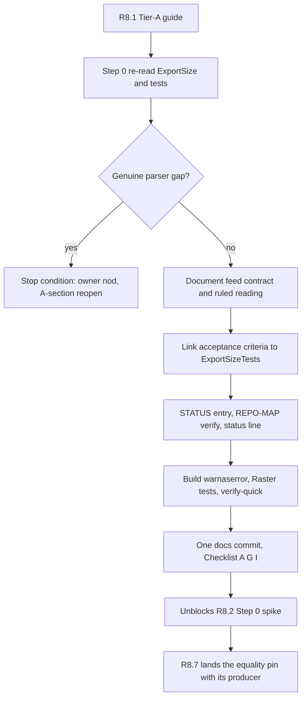

# R8.1 — width-parsing residual: implementation plan

> **Authored**: 2026-11-22, architect mode, against the landed tree at the
> Phase-7 exit (all nine Phase-8 guides upgraded to Tier A, review findings
> F1–F12 folded, per the [`../docs/STATUS.md`](../docs/STATUS.md) top entry).
>
> **Reviewed**: 2026-11-22, independent pass
> ([`R8.1-width-parsing-residual-plan-review.md`](R8.1-width-parsing-residual-plan-review.md));
> findings F1–F6 folded into this revision.
>
> **Owner ruling recorded this session (2026-11-22)**: the **implementation is
> normative** for the height-rounding composition —
> [`ExportSize.ToPixels`](../src/GanttCreator.Raster/ExportSize.cs) computes the
> pixel height from the **unrounded** width and rounds each dimension exactly
> once at the final boundary (consistent with
> [`../docs/08-TEST-CHECKLIST.md`](../docs/08-TEST-CHECKLIST.md) section A's
> single-rounding-boundary rule). R8.1 records that reading in the feed
> contract; **no parser change**.
>
> **Sources reviewed**: the
> [`R8.1`](../docs/work-items/R8.1-width-parsing-residual.md) and
> [`R8.7`](../docs/work-items/R8.7-width-controls-preview.md) work items, the
> dependency faces of
> [`R8.2`](../docs/work-items/R8.2-skia-primitive-renderer.md) and
> [`R8.8`](../docs/work-items/R8.8-export-png-command.md),
> [`../docs/02-ARCHITECTURE.md`](../docs/02-ARCHITECTURE.md) "PNG renderer",
> [`../docs/04-TEST-STRATEGY.md`](../docs/04-TEST-STRATEGY.md) "Exact metadata
> and dimensions", [`../docs/03-ROADMAP.md`](../docs/03-ROADMAP.md) Phase 8
> (rows + revision-4/10/12 notes),
> [`../docs/08-TEST-CHECKLIST.md`](../docs/08-TEST-CHECKLIST.md) sections
> A/G/I, [`phase8-png-export-review.md`](phase8-png-export-review.md) §3 R8.1,
> [`phase8-plan-critical-review.md`](phase8-plan-critical-review.md) §3.2/§3.4,
> [`../docs/REPO-MAP.md`](../docs/REPO-MAP.md),
> [`../src/GanttCreator.Raster/ExportSize.cs`](../src/GanttCreator.Raster/ExportSize.cs),
> and
> [`../tests/GanttCreator.Raster.Tests/ExportSizeTests.cs`](../tests/GanttCreator.Raster.Tests/ExportSizeTests.cs).

---

## 1. Problem restatement

R8.1 is a **verification/residual row**, not a build row. The roadmap's
original deliverable — width/unit parsing, aspect calculation, rounding, and
safety limits — **landed early**: `ExportSize` was added as the R0.5 sample and
later hardened with `MaxTotalPixels`, with
[`ExportSizeTests.cs`](../tests/GanttCreator.Raster.Tests/ExportSizeTests.cs)
as its suite. The row therefore verifies only the residual:

1. **Step-0 verification** — re-read the landed parser and its tests against
   the architecture's three unit formulas and safety limits; enumerate residual
   gaps (expected: none in the parser itself).
2. **The preview-value feed contract** — document, in the R8.1 work item, the
   exact type/shape `ExportSize` expects from the R8.7 ribbon preview, so R8.7
   builds delegated math and never a second formula.
3. **Acceptance-criteria links** — make the row's acceptance criteria reference
   the existing `ExportSizeTests` suite explicitly (work item + roadmap row).
4. **No duplicate parser** — prove by grep that `ExportSize` remains the single
   width-parsing boundary, and introduce none.

The preview-feed **equality pin** (preview output == `ExportSize` output per
input) **lands with R8.7**, where the preview producer exists; a pin without its
producer cannot exist. This sequencing was set by the independent review
([`phase8-plan-critical-review.md`](phase8-plan-critical-review.md) §3.2) and
folded into the Tier-A guide on 2026-11-22.

## 2. Business value

- **Phase 8 starts from a verified size boundary.** Every later PNG row
  (renderer R8.2–R8.4, metadata R8.5, writer R8.6, controls R8.7, command
  R8.8) consumes `ExportSize`; verifying it first means a defect found here is
  closed before it propagates into four downstream rows.
- **One parser, forever.** The documented feed contract is what lets R8.7's
  preview show *the same numbers the file will get* without duplicating math.
  The alternative — a UI-side formula — is the classic preview/export
  divergence defect, and R8.7's own risk section names it as the row's main
  risk. R8.1 is the structural prevention.
- **The row unblocks R8.2 Step 0** (the SkiaSharp pin + native-asset spike,
  the phase's only go/no-go engineering unknown). The review §3.4 endorses
  R8.1-first precisely because it is valid under every possible spike outcome
  and costs one small commit.
- **Traceability hygiene.** Checklist section I requires acceptance criteria
  that name tests to link to real tests; this row closes the gap between the
  roadmap's gate cell and the landed suite.

## 3. Measurable definition of done

From the work item's DoD plus [`AGENTS.md`](../AGENTS.md):

| # | Criterion | Measurable evidence |
| --- | --- | --- |
| DoD-1 | Existing suite green, unchanged | `dotnet test tests/GanttCreator.Raster.Tests` observed green; 25 `[Fact]`/`[Theory]` methods, 41 executed cases, zero edits |
| DoD-2 | Preview-feed contract documented | The R8.1 work item carries a feed-contract section naming `ParseWidth`/`ToPixels` signatures, constants, error contracts, and the ruled rounding reading |
| DoD-3 | Acceptance links recorded | Work-item acceptance section + roadmap R8.1 gate cell reference `ExportSizeTests.cs` by path; links resolve under `check-md-links.ps1` |
| DoD-4 | No duplicate parser | Grep evidence recorded in the STATUS entry; `ExportSize` remains the only width parser in `src/` |
| DoD-5 | Release 0 warnings | `dotnet build GanttCreator.slnx /p:Configuration=Release /warnaserror` observed exit 0 |
| DoD-6 | XML docs present | `ExportSize` members already documented; verified, not edited |
| DoD-7 | REPO-MAP/STATUS current | `check-status.ps1` green; REPO-MAP Raster row verified accurate (expected: no edit) |
| DoD-8 | Gates | `verify-quick.ps1` exit 0; `git diff --check` no output; pre-commit hook green |
| DoD-9 | Certification | Commit message carries `Checklist: A, G, I` |
| DoD-10 | No Office gate owed | Row gate is None; nothing to run, stated as such |

## 4. Verified baseline (evidence ledger)

Facts verified against source this session:

| Statement | Status | Evidence |
| --- | --- | --- |
| `ExportSize` implements parsing/aspect/rounding/safety with tests | fact | [`ExportSize.cs`](../src/GanttCreator.Raster/ExportSize.cs) + [`ExportSizeTests.cs`](../tests/GanttCreator.Raster.Tests/ExportSizeTests.cs) |
| The three unit formulas match the code exactly (`cm / 2.54 * 300`, `in * 300`, `px` verbatim) | fact | [`../docs/02-ARCHITECTURE.md`](../docs/02-ARCHITECTURE.md) "PNG renderer" vs `ToPixels` unit switch |
| Height is calculated from the **unrounded** width, each dimension rounded once at the final boundary; `Math.Round` default (`MidpointRounding.ToEven`) | fact + owner ruling 2026-11-22 | `ToPixels` body; ruling recorded in this plan's header; consistent with checklist A's single-boundary rule |
| Safety limits: per-axis `MaxPixelDimension` 65,535; total `MaxTotalPixels` 100,000,000; sub-pixel and zero rejection before allocation | fact | `ExportSize` constants + guards; pinned by `ToPixels_max_dimension_is_accepted`, `ToPixels_total_budget_*`, `ToPixels_subpixel_*` |
| Suite = 25 methods (4 `[Theory]` + 21 `[Fact]`), 41 executed cases; matches the recorded "Raster 41" gate count | fact | counted from `ExportSizeTests.cs`; [`../docs/STATUS.md`](../docs/STATUS.md) gate lines |
| `ExportSize` is the only width parser in `src/` | fact | grep `ParseWidth|CmPerInch|2.54|WidthRequest|PixelDimensions` over `src/*.cs`: only `ExportSize.cs` (the `PlotMargins.cs` hits are the Windows margin presets, a different domain) |
| The equality pin lands with R8.7, where the producer exists | fact | R8.1 guide revision 2026-11-22; review §3.2; R8.7 D1/D2 |
| R8.7 already cites the feed: "R8.1 (ExportSize feed)", "R8.1 D2" | fact | [`R8.7`](../docs/work-items/R8.7-width-controls-preview.md) header, governing contracts, D1 |
| REPO-MAP Raster row is accurate ("ExportSize: width parsing and pixel dimensions, not PNG encoding"; depends on Core only) | fact | [`../docs/REPO-MAP.md`](../docs/REPO-MAP.md) |
| Raster project has exactly one test file | fact | `tests/GanttCreator.Raster.Tests/` listing |
| The architecture text's literal composition (height from the *rounded* width) was not addressed by the Phase-8 plan or review | fact | review §3.2 verified only the unit conversions; the ruling in this plan's header closes it |

No open unknowns remain for this row. The one forwarded item (not this row's)
is the midpoint-rounding note for R8.7's live gate — see §10 R2.

## 5. Scope, exclusions, and boundaries

**In scope (expected diff: documentation only):**

- [`../docs/work-items/R8.1-width-parsing-residual.md`](../docs/work-items/R8.1-width-parsing-residual.md)
  — the feed-contract section, the Step-0 verification outcome, the
  acceptance-criteria links, and the guide-status line recording the landing.
- [`../docs/03-ROADMAP.md`](../docs/03-ROADMAP.md) — the R8.1 row's
  automated-gate cell gains an explicit reference to the existing suite
  (link-only edit; the revision-4 note already authorizes it; no outcome
  wording changes).
- [`../docs/STATUS.md`](../docs/STATUS.md) — one top entry recording the
  verification evidence and the gates run.
- [`../docs/work-items/IMPLEMENTATION-PLAN.md`](../docs/work-items/IMPLEMENTATION-PLAN.md)
  — the manifest's R8.1 row moves to `Landed` with the commit hash, per the
  manifest's own status convention (one row per guide record; `Landed` =
  committed with its required evidence closed).
- [`../docs/REPO-MAP.md`](../docs/REPO-MAP.md) — verify the Raster row;
  edit only if inaccurate (expected: no edit).
- [`../src/GanttCreator.Raster/ExportSize.cs`](../src/GanttCreator.Raster/ExportSize.cs)
  — **only if Step 0 finds a genuine residual gap** (none expected; the one
  candidate was closed by the owner ruling). No rewrites.

**Exclusions (restated from the work item):**

- No second parser (the one-boundary discipline).
- No UI/controls (R8.7); no encoding (R8.5/R8.6); no rendering (R8.2–R8.4);
  no Core changes; no scene changes.
- No new tests in this row — the equality pin's producer does not exist until
  R8.7; a pin without its producer cannot exist.
- No `02-ARCHITECTURE.md` edit — the ruling is recorded in the R8.1 work
  item's feed contract, not by rewriting the governing contract's shorthand
  formula.
- No Office gate (row: None). No schema, catalogue, defined-name, or
  workbook change. No ADR (no irreversible design decision; the ruling is a
  reading of existing behaviour, recorded in the work item + STATUS).
- No REPO-MAP **AddIn** dependency-row edit: the known drift (the map claims
  a Raster reference the AddIn csproj does not carry) is assigned to R8.8's
  commit by the Phase-8 plan's finding I; R8.1 verifies only the Raster row.

## 6. Technical approach

### 6.1 System architecture and component responsibilities

`ExportSize` lives in the **Raster** project, whose reference graph is
**Core only** ([`../docs/REPO-MAP.md`](../docs/REPO-MAP.md)); it is the
size boundary of the Phase-8 pipeline and touches no Office object:

```text
scene (Core, immutable)
  → ExportBounds crop bounds (Core, R6.1 — already landed)
  → ExportSize.ParseWidth / ToPixels  ← this row verifies and documents
  → R8.2 SkiaSharp renderer → R8.5 pHYs metadata → R8.6 atomic write
  → R8.7 ribbon width/unit controls + preview (the feed's consumer)
  → R8.8 Export PNG command (phase exit)
```

Responsibilities after this row:

- **`ExportSize` (Raster)** — the single width-parsing and pixel-dimension
  authority: string → `WidthRequest` → `PixelDimensions`, with the safety
  limits. Unchanged by this row.
- **R8.7 preview (AddIn, future)** — delegated math only: build a
  `WidthRequest` from its controls, call `ToPixels` with the recorded export
  aspect (R8.7 D4), display the returned `PixelDimensions`. The equality pin
  in R8.7's AddIn suite asserts preview == parser output per input.
- **R8.8 command (AddIn, future)** — the same two calls on the save path, so
  preview and file can never diverge.

### 6.2 Class and interface design — nothing new

The ponytail ladder stops at rung 2 (it already exists — reuse it). The
contract surface is the existing, tested, XML-documented set; the plan adds
**no class, no interface, no abstraction**:

- `ExportUnit` — closed enum: `Centimetres`, `Inches`, `Pixels`.
- `WidthRequest(ExportUnit Unit, double Value)` — readonly record struct.
- `PixelDimensions(int PixelWidth, int PixelHeight)` — readonly record struct.
- `ExportSize` — static class; constants `Dpi = 300.0`, `CmPerInch = 2.54`,
  `MaxPixelDimension = 65_535`, `MaxTotalPixels = 100_000_000L`; members
  `ParseWidth(string)` and `ToPixels(WidthRequest, double, double)`.

No interface extraction is warranted: the type has exactly two consumers on
the horizon (R8.7 preview, R8.8 command), both in the AddIn, which today
references **no** Raster project — the csproj says so explicitly — and gains
its first Raster reference during Phase 8 (the REPO-MAP AddIn-row
correction is assigned to R8.8's commit by the Phase-8 plan's finding I).
An `IExportSize` seam would be an abstraction nobody asked for, and the
reference's landing row is R8.7/R8.8's design question, not this row's.

### 6.3 Excel workbook/worksheet/range/formula/formatting strategy — explicit N/A

This row touches **no Excel object**: no workbook, worksheet, range, formula,
name, table, or formatting. `ExportSize` is pure arithmetic in a Core-only
project; the scene dimensions in points arrive from the export composition
(R8.7 D4's host-free aspect record; R8.8's pipeline), never from a worksheet
read in this row. This N/A is stated deliberately so the plan is complete:
the row's Excel surface is empty by design, and the VeryHidden
`_GanttCreatorConfig` contract is untouched.

### 6.4 Data flow and state management

Stateless and pure end to end:

```text
user string ("10cm" | "4in" | "800px")
  --ParseWidth--> WidthRequest(Unit, Value)        // culture-invariant
  + sceneWidthPt, sceneHeightPt                    // from the export aspect
  --ToPixels--> PixelDimensions(PixelWidth, PixelHeight)
```

No caching, no mutation, no ordering hazard. The only stateful element in the
future pipeline — the workbook-scoped export-aspect cache, cleared on workbook
switch, disabled-until-rendered — is **R8.7 D5's** contract, not this row's;
the feed contract names its input shape so R8.7 can build it.

### 6.5 Validation and error handling (existing contracts, unchanged)

- `ParseWidth`: `ArgumentNullException` for null; `FormatException` for
  empty value, unknown unit, unparseable value, non-positive value, and
  non-finite values (`NaN`, `±Infinity`, `1e999`) — each rejection pinned by
  an existing test.
- `ToPixels`: `ArgumentOutOfRangeException` for non-finite/non-positive
  request or scene dimensions, per-axis overflow past 65,535 px, total-pixel
  overflow past 100 M, and sub-pixel requests that would round to a zero
  dimension — messages name the limit (actionable, per the architecture's
  error-handling rules). Safety rejection happens **before allocation**,
  which the test strategy's "Exact metadata and dimensions" section requires.
- This row adds **no new validator**, so the every-new-validator-ships-a-
  positive-test rule is not triggered. The existing guards already carry
  their positives (checklist A names `ExportSize.ParseValue`/`ToPixels`
  contracts explicitly).

### 6.6 Logging and telemetry — none, by invariant

Core operation is offline: no telemetry, no network, no hidden fallback —
ever. `ExportSize` is pure and logs nothing; this row adds no logging. The
row's evidence lives in `docs/STATUS.md` and the work item, per the
repository's memra-unavailable mapping (record facts in STATUS).

### 6.7 Security

- Culture-invariant parsing (`CultureInfo.InvariantCulture`,
  `NumberStyles.Float`) prevents locale-confusion misinterpretation of user
  input — pinned by `ParseWidth_is_culture_invariant` under `de-DE`.
- No PII, no file/network I/O, no evaluation of user input (the string is
  `TryParse`d, never interpreted), no injection surface.
- The safety limits are also a resource-security boundary: absurd input fails
  with an actionable message instead of an ~8 GB allocation at encode time.

### 6.8 Backward compatibility

Docs-only commit. No public API, schema, catalogue, defined-name, workbook,
or behaviour change; the 41-case suite runs unchanged; golden scene and
architecture boundary tests untouched; Raster's Core-only graph unchanged.
R8.2's stated prerequisite ("`ExportSize` landed") remains true after the row.

### 6.9 Performance

O(1) arithmetic on a path that runs once per preview keystroke (R8.7) and
once per export (R8.8). Nothing to tune; no profiling obligation. The
architecture's PNG performance budget (5,000-px render under 3 s / 500 MB)
belongs to R8.2+, not this row.

### 6.10 Maintainability

The deliverable *is* maintainability: a written feed contract that (a) gives
R8.7's equality pin a named target, (b) prevents a second formula from
ever appearing in the UI layer, and (c) records the rounding reading so the
next reader does not re-derive or re-litigate it. One parser, one rounding
boundary, one safety budget — all now documented at the boundary itself.

## 7. The preview-value feed contract (the deliverable's content)

The section to add to the R8.1 work item (consumed by R8.7; cited by its
D1/D2):

- **Producer members**: `ExportSize.ParseWidth(string input)` →
  `WidthRequest`; `ExportSize.ToPixels(WidthRequest request, double
  sceneWidthPt, double sceneHeightPt)` → `PixelDimensions`.
- **Input grammar**: `"<value><unit>"` with unit `cm` | `in` | `px`,
  case-insensitive; whitespace around the whole input **and between the
  value and the unit** is tolerated (the unit suffix is stripped and the
  value substring is trimmed independently — pinned by the `"  15 cm  "`
  case in `ParseWidth_accepts_valid_formats`); the value is parsed with
  `CultureInfo.InvariantCulture` and `NumberStyles.Float` (decimal point
  and exponent notation accepted); zero, negative, empty, unknown-unit, and
  non-finite values rejected with `FormatException`.
- **Scene-dimension inputs**: the export composition's width/height **in
  points** — finite and strictly positive; their source is R8.7 D4's recorded
  export aspect (host-free, from the refresh outcome) or R8.8's pipeline.
  `ExportSize` never reads a worksheet.
- **Constants**: `Dpi = 300`, `CmPerInch = 2.54`,
  `MaxPixelDimension = 65_535` (per axis), `MaxTotalPixels = 100_000_000`
  (combined allocation budget; square boundary 10,000).
- **Rounding reading (owner ruling 2026-11-22)**: the pixel height is
  computed from the **unrounded** pixel width and each dimension is rounded
  exactly once at the final boundary via `Math.Round`'s default
  (`MidpointRounding.ToEven`). The architecture's two-line formula is a
  summary; the implementation is normative. Checklist A's
  single-rounding-boundary rule is satisfied by construction.
- **Error contracts**: `FormatException` (parse side),
  `ArgumentOutOfRangeException` (conversion side; messages name the limit
  they enforced).
- **Consumer obligations (R8.7)**: the preview is delegated math — build the
  `WidthRequest`, call `ToPixels`, display the result; the equality pin in
  R8.7's AddIn suite asserts preview == parser output over a table of
  inputs; the live Office check's *independent* calculation must replicate
  `MidpointRounding.ToEven` or avoid exact-midpoint inputs (Excel's `ROUND`
  is half-away-from-zero and would disagree by 1 px at midpoints).

## 8. Phased execution plan

One concern, one commit. Phases 2–4 land together; phases are verification
gates, not separate commits. Effort is relative (S = one small, reviewable
diff slice), never a time estimate.

| Phase | Work | Depends on | Effort | Validation milestone |
| --- | --- | --- | --- | --- |
| P0 — Session opening | Restate outcome, files/layers, exclusions, acceptance tests, verified facts, unknowns, first safe action (06-llm-protocol format); confirm the owner ruling is carried in the plan | — | S | Opening statement matches this plan's §1/§5 |
| P1 — Step-0 verification | Re-read `ExportSize.cs` + `ExportSizeTests.cs` at execution time; cross-check the three unit formulas, the ruled rounding reading, and the safety limits against `02-ARCHITECTURE.md`; re-run the duplicate-parser grep over `src/` with the review's broad token set (unit-suffix `EndsWith`, `ExportUnit`, both limit constants, `Dpi`); audit the test count (25 methods / 41 cases) | P0 | S | Residual-gap enumeration recorded: expected **none**; any genuine parser gap → the work item's stop condition (owner nod; A-section reopen) |
| P2 — Feed-contract documentation | Add §7's contract section to the R8.1 work item; record the Step-0 outcome and the ruled reading; update the guide-status line | P1 clean | S | Contract section present; R8.7's D1/D2 cross-references still consistent (no R8.7 edit needed) |
| P3 — Acceptance-criteria links | Work-item acceptance section links `ExportSizeTests.cs` by path + count; roadmap R8.1 gate cell references the existing suite (link-only) | P2 | S | Checklist I audit: links resolve, stated count matches committed code |
| P4 — STATUS + REPO-MAP + manifest | One STATUS top entry with observed evidence (grep, formula cross-check, count audit, gates); verify REPO-MAP Raster row (expected no edit; the AddIn-row drift stays with R8.8 per finding I); move the IMPLEMENTATION-PLAN manifest's R8.1 row to `Landed` with the commit hash | P3 | S | `check-status.ps1` green; REPO-MAP Raster row verified; manifest row updated |
| P5 — Gates, commit, handoff | `dotnet build ... /warnaserror`; `dotnet test tests/GanttCreator.Raster.Tests`; `pwsh ./scripts/verify-quick.ps1`; `git diff --check`; pre-commit hook; self-certify A/G/I; one `docs:` commit with `Checklist: A, G, I`; handoff in the 06-llm-protocol format | P4 | S | All gates observed exit 0; clean tree after commit |



Downstream position: R8.1 → R8.2 (Step-0 spike may begin immediately after
R8.1 lands) → R8.2a → R8.3 → R8.4 → R8.5 → R8.6 → R8.7 (equality pin) →
R8.8 (phase exit). The row is valid under every possible spike outcome, so
nothing is wasted if the spike forces a technology ADR.

## 9. Traceability matrix

| Requirement / acceptance criterion (source) | Implementation task | Verification method |
| --- | --- | --- |
| Outcome: "the R8.7 preview value feeds `ExportSize` correctly" (R8.1 guide) | P2 feed-contract section (§7) | Contract names `ParseWidth`/`ToPixels` + constants + error contracts; R8.7 D1/D2 cite it; the equality pin itself is traced to R8.7's AddIn suite (a pin without its producer cannot exist) |
| Outcome: "acceptance criteria link to the existing `ExportSizeTests`" (R8.1 guide) | P3 links in work item + roadmap gate cell | `check-md-links.ps1` green; checklist I audit — stated count 25 methods / 41 cases matches committed code |
| Outcome: "no duplicate parser is introduced anywhere" (R8.1 guide) | P1 grep; P2–P4 add none | Grep evidence recorded in STATUS; `ExportSize` remains the only width parser in `src/` |
| Step 0: "architecture formulas re-read; any divergence is a defect to fix here" (R8.1 guide) | P1 formula cross-check incl. the ruled composition reading | Cross-check outcome recorded in the work item; the one candidate divergence is closed by the owner ruling (no code change) |
| Acceptance: "existing suite green (unchanged)" (R8.1 guide) | P5 | `dotnet test tests/GanttCreator.Raster.Tests` observed green, zero test edits |
| Acceptance: "No Office gate (row: None)" (R8.1 guide) | — | Stated `Not run — row gate is None` in the handoff |
| DoD: "Release 0 warnings; XML docs" (R8.1 guide) | P5 | Build `/warnaserror` observed; XML docs verified present on all public members |
| DoD: "REPO-MAP/STATUS current" (R8.1 guide) | P4 | `check-status.ps1` + pre-commit hook green |
| Checklist A (culture, non-finite, overflow) | inherited, no new code | Existing tests: `ParseWidth_is_culture_invariant`, `ParseWidth_rejects_non_finite_values`, `ToPixels_*_throws` family, sub-pixel and budget boundaries |
| Checklist G (build pipeline/artifacts) | no artifact change | No test reads `bin/`/`publish/`; `tasks.json` untouched; verify-quick step set unchanged |
| Checklist I (work-item traceability) | P3 | Links + counts audited above |
| Evidence commands (R8.1 guide) | P5 | Each command's observed output recorded in STATUS; nothing claimed without observation |

## 10. Risk assessment and mitigations

| # | Risk | Likelihood | Impact | Mitigation |
| --- | --- | --- | --- | --- |
| R1 | Rounding-composition ambiguity re-litigated at execution time (architecture text reads height-from-rounded-width) | closed | — | Owner ruling 2026-11-22 recorded in this plan's header and in the feed contract: implementation normative, no code change. The architecture doc is **not** edited (out of scope by ruling); the work item records the reading |
| R2 | `MidpointRounding.ToEven` vs Excel's half-away-from-zero `ROUND` makes R8.7's live independent check disagree by 1 px on exact-midpoint inputs | low (forwarded) | medium (R8.7 live gate only) | Feed contract names the rounding mode; R8.7's live gate either replicates to-even or picks non-midpoint verification values. Not this row's defect; recorded so R8.7 does not discover it mid-gate |
| R3 | Docs-only row perceived as a no-op and "improved" opportunistically (e.g. switching to `AwayFromZero`, refactoring guards, extracting an interface) | medium | high (would reopen A-section coverage and the R0.5 hardening decisions) | Work-item D1 (verify, don't rebuild) + stop conditions + ponytail ladder; the plan's §6.2 forbids new abstractions; any `ExportSize.cs` edit triggers the stop condition |
| R4 | Roadmap gate-cell edit drifts into a scope change | low | medium | Link-only edit; outcome wording unchanged; revision-4 note already authorizes the link; scope-change protocol not triggered |
| R5 | Stale cross-references after the edit (R8.2 "Depends on: R8.1"; R8.7 "R8.1 D2") | low | low | Both references remain true (ExportSize landed; D2 unchanged); `check-md-links.ps1` + review of the touched files' references |
| R6 | Verification evidence too thin to prove the row ran (a "verified" claim without observation) | medium | medium (protocol violation) | STATUS entry records each grep, cross-check, count audit, and gate with observed output; nothing claimed unobserved |
| R7 | Phase-level open conflict — routine `verify-office.ps1` 780 s deadline vs measured ~19 m 30 s suite (R7.7 close-out) | n/a this row | none here | R8.1's Office gate is None; the conflict is recorded for the R8.6/R8.7/R8.8 Required gates, not this row |

## 11. Assumption log

| # | Assumption | Basis | Falsification check (Step 0) |
| --- | --- | --- | --- |
| A1 | `ExportSize.cs` / `ExportSizeTests.cs` as read 2026-11-22 are the landed state | this session's reads | Re-read at execution; `git status` clean before starting |
| A2 | The reviewed plan's "formulas match exactly" covered the unit conversions; the composition order was unverified by the review — now closed by ruling | review §3.2 wording vs `ToPixels` body | The ruling is recorded; Step 0 confirms the code still matches the ruled reading |
| A3 | No other width parser exists in `src/` | grep this session | Re-run the grep at Step 0 and record the hit set |
| A4 | The commit is documentation-only; Conventional Commit prefix `docs:` | scope §5; no code change expected | If Step 0 finds a genuine gap, the prefix and plan change via the stop condition |
| A5 | `verify-quick.ps1` is the every-commit gate; branch-final `verify.ps1` is not owed by this row | work-item evidence commands list verify-quick only | — |
| A6 | 25 methods / 41 cases is the committed suite count | counted from the single test file; matches the recorded "Raster 41" | `dotnet test` observed count at P5 |
| A7 | No ADR is required | the ruling interprets existing behaviour; no irreversible decision, no new dependency | If the owner later wants the architecture text itself clarified, that is a separate docs change with its own trace |

## 12. Testing and verification plan

**Unit (automated, existing — the row's regression inheritance):**

- `dotnet test tests/GanttCreator.Raster.Tests` — 25 methods / 41 cases, green
  and **unchanged**. Coverage the row inherits and cites:
  - culture roundtrip under `de-DE` (`ParseWidth_is_culture_invariant`);
  - non-finite and overflow (`NaN`, `±Infinity`, `1e999` — parse side
    `FormatException`; conversion side `ArgumentOutOfRangeException`);
  - zero/negative rejection on both sides;
  - unit conversions (`10cm→1181`, `4in→1200`, `800px→800`) and aspect
    preservation (`720×360 pt → 2:1`);
  - per-axis boundary (65,535 accepted; +1 rejected), total-budget boundary
    (10,000² accepted; 10,001² rejected), sub-pixel rounding-to-zero
    rejection (width and height arms).

**New tests in this row: none — justified.** The equality pin's producer (the
R8.7 preview) does not exist; a pin without its producer cannot exist. No
new validator ships, so the positive-test rule is not triggered. This is the
review-endorsed sequencing, not a coverage gap.

**Integration / Office: none.** Row gate is None. `verify-office.ps1` is
`Not run — row gate is None` in the handoff.

**Excel-specific edge cases: N/A directly** (no Excel object touched — §6.3).
The one Excel-adjacent edge (to-even vs Excel `ROUND` at midpoints) is
forwarded to R8.7's live-gate design via the feed contract (§7, R2).

**Regression protection:**

- `pwsh ./scripts/verify-quick.ps1` — full every-commit suite (Core, Office
  contract, AddIn, Architecture, Raster, non-live Office), exit 0.
- Architecture boundary tests unchanged — Raster keeps its Core-only graph;
  no package or project-reference change.
- Golden scene and all other suites untouched; `git diff --check` clean.
- Observed and deliberately untouched: the pre-existing
  `#pragma warning disable IDE0046` in `ExportSize.cs` (any edit is a code
  change → the row's stop condition); the row's own diff carries no
  suppression, so the review checklist's no-suppressed-warning item is
  satisfied by the diff itself.

**Deployment readiness:** no packaging change in this row. The row's
deployment contribution is unblocking R8.2 Step 0 (the packed-XLL
native-asset spike with its defined pass/fail criteria), which feeds R10.2
packaging and R10.7 SBOM/third-party notices. Nothing here alters the
shipped XLL.

## 13. Handoff contract for the implementing mode

- **Outcome**: R8.1 residual verified; feed contract documented; acceptance
  links recorded; no duplicate parser; existing suite green.
- **Changed**: `docs/work-items/R8.1-width-parsing-residual.md`,
  `docs/03-ROADMAP.md` (R8.1 gate cell, link-only), `docs/STATUS.md`,
  `docs/work-items/IMPLEMENTATION-PLAN.md` (manifest row → `Landed`);
  `docs/REPO-MAP.md` only if verification finds drift in the Raster row
  (expected: no edit; the AddIn-row drift is R8.8's, per finding I). The
  plan and its review ride the same docs commit (repo precedent: the
  Phase-8 plan and its critical review are both tracked). No `src/` or
  `tests/` change expected.
- **Proof**: observed outputs of `dotnet build GanttCreator.slnx
  /p:Configuration=Release /warnaserror`, `dotnet test
  tests/GanttCreator.Raster.Tests`, `pwsh ./scripts/verify-quick.ps1`,
  `git diff --check`, and the duplicate-parser grep — each recorded in the
  STATUS entry.
- **Office**: Not run — row gate is None.
- **Risk**: R1 closed by ruling; R2 forwarded to R8.7; R3 guarded by the stop
  conditions.
- **Deferred**: the equality pin (R8.7, with its producer); any architecture
  -text clarification (separate owner-directed change); the 780 s
  deadline-policy conflict (owner decision, recorded at R7.7).
- **Next**: R8.2 Step 0 — the SkiaSharp pin + native-asset spike with its
  defined pass/fail criteria (packed XLL loads in Excel; managed
  `GanttCreator.Raster.dll`/`SkiaSharp.dll` resolve from the pack; native
  `libSkiaSharp` loads by the chosen route; one in-host smoke render).
- **Commit**: one `docs:` commit, message body carrying the verification
  summary and `Checklist: A, G, I`.
- **Stop conditions (restated)**: a residual gap requires parser changes →
  stop (owner nod; A-section reopen); the preview needs math `ExportSize`
  cannot express → stop (extend the Raster contract deliberately, never
  duplicate). With the ruling, both are expected unreachable.
