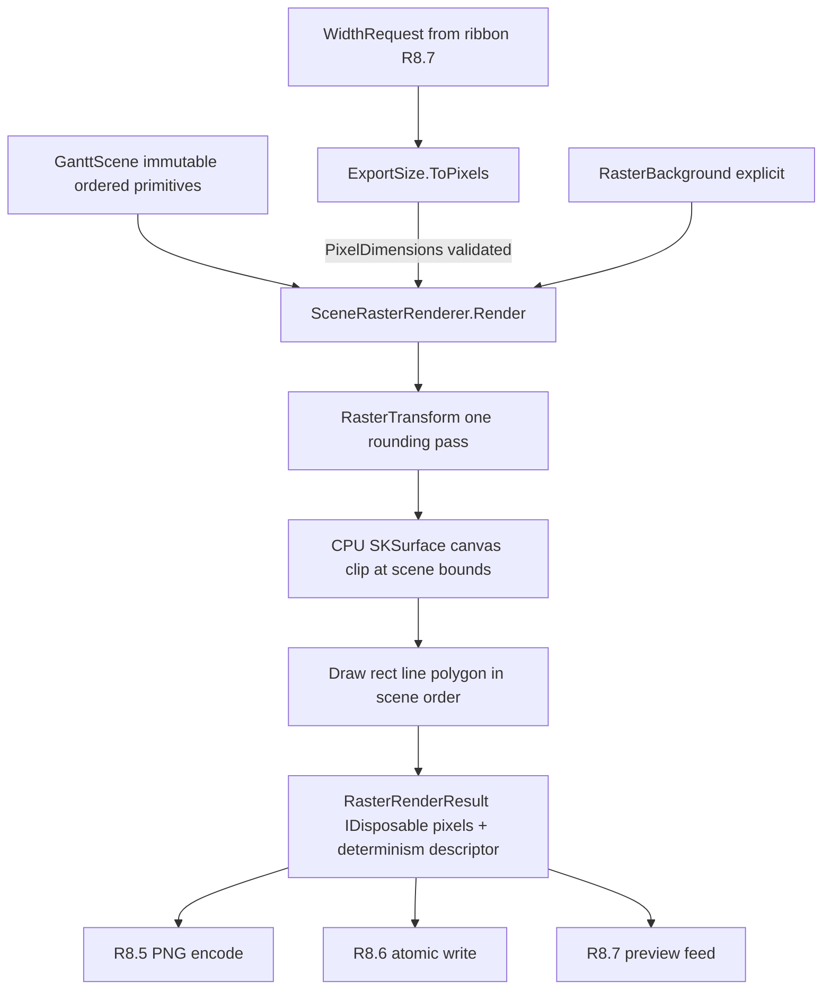

# R8.2 — Skia primitive renderer: analysis and implementation plan

> **Plan status**: authored 2026-11-23 (architect mode) for work item
> [`R8.2`](../docs/work-items/R8.2-skia-primitive-renderer.md) (Tier A, binding,
> revised 2026-11-22; Step 0 probed 2026-11-23). Governing sources read in full:
> the work item and its companion
> [`R8.2a`](../docs/work-items/R8.2a-font-pinning-adr.md),
> [`02-ARCHITECTURE`](../docs/02-ARCHITECTURE.md) (scene-first, rounding, PNG
> renderer), [`04-TEST-STRATEGY`](../docs/04-TEST-STRATEGY.md) (raster tests,
> golden images), [`08-TEST-CHECKLIST`](../docs/08-TEST-CHECKLIST.md) (B, E, G),
> [`05-GIT-QUALITY`](../docs/05-GIT-QUALITY.md) (dependency policy),
> [`STATUS`](../docs/STATUS.md) (R8.1 landed; R8.2 Step 0 probed),
> [`phase8-png-export-review`](phase8-png-export-review.md) and its
> [`critical review`](phase8-plan-critical-review.md), plus the live source of
> every type the renderer consumes.
> **Reviewed 2026-11-23** (external-expert pass against the work item, the
> architecture/test/checklist contracts, and the approved delivery plan);
> findings folded in below. **Owner rulings recorded the same day**: the golden
> category-1 baseline lands with R8.2, and ADR-0071 is authored with R8.2's
> implementation (§13).

---

## 1. Problem statement

**What must be built.** A SkiaSharp-based raster renderer inside
[`src/GanttCreator.Raster/`](../src/GanttCreator.Raster/) that draws the
immutable Gantt scene's rectangles, lines, and polygons with clipping, in the
scene's own z-order, onto a CPU raster surface whose pixel dimensions come from
the landed [`ExportSize`](../src/GanttCreator.Raster/ExportSize.cs:41)
arithmetic. The renderer consumes the scene; it never re-derives dates, lanes,
colours, widths, or order. It is pinned by exact-pixel region tests, a z-order
draw-sequence pin, a clipping pin, a byte-identical re-render determinism pin,
and a no-recalculation positive test, all in
[`tests/GanttCreator.Raster.Tests/`](../tests/GanttCreator.Raster.Tests/).

**Why.** Phase 8 adds the clipboard-independent 300-DPI PNG export channel.
The live channel (Excel shapes) and the editable channel (PowerPoint
`ppPasteShape`) already exist; the raster channel needs a renderer that shares
the one scene authority so the PNG is the same chart the user sees. R8.2 is the
primitive-drawing core of that channel; text (R8.3), encoding (R8.5), file
writing (R8.6), preview UI (R8.7), and the command surface (R8.8) are later rows
that consume this renderer's output.

**What success looks like** (from the work item's
[acceptance tests](../docs/work-items/R8.2-skia-primitive-renderer.md:159)):

- `dotnet test tests/GanttCreator.Raster.Tests` is green with the new pins:
  exact-pixel region pins for rect/line/polygon at known coordinates; a z-order
  draw-order pin; a clipping pin; determinism (two renders of the same scene +
  width are byte-identical, with metadata naming the CPU raster surface and the
  pinned antialias settings); and the no-recalculation positive.
- The SkiaSharp pin (4.157.0 + native assets) is committed in
  [`Directory.Packages.props`](../Directory.Packages.props:1) with the
  probed-version evidence row, and the renderer-dependency ADR (recommended
  **ADR-0071**) is accepted with a
  [`DECISIONS.md`](../docs/DECISIONS.md) row.
- Raster keeps its Core-only project reference graph; the architecture suite
  stays green (SkiaSharp is a package reference, not a project reference, and
  [`CoreBoundaryTests`](../tests/GanttCreator.Architecture.Tests/) already
  forbids SkiaSharp in Core).
- Release build with 0 warnings; XML docs on the new public surface;
  [`REPO-MAP`](../docs/REPO-MAP.md) Raster row and [`STATUS`](../docs/STATUS.md)
  current; checklist sections B, E, G self-certified in the commit message.
- No Office gate (roadmap row: None) — stated as `Not run` with that reason.

**What is explicitly excluded** (work item
[Exclusions](../docs/work-items/R8.2-skia-primitive-renderer.md:129)):

- No text rendering (R8.3, after the R8.2a font ADR-0070 decision).
- No PNG encoding or `pHYs` metadata (R8.5).
- No file writing or save dialog (R8.6, R8.8).
- No ribbon/UI surface or preview feed (R8.7, R8.8).
- No Core production changes and no Core dependency changes.
- No hatch or dash conversion (R8.3 per the delivery plan; see decision I3).
- No AddIn→Raster project reference (nothing in the AddIn consumes the
  renderer until R8.8; the Step-0 packing proof used a temporary reference that
  is not shipped here).

---

## 2. Verified context (evidence base)

| Statement | Status | Evidence |
| --- | --- | --- |
| R8.1 landed; `ExportSize` is the sole width parser, safety-limited (per-axis 65,535; total 100M pixels) | fact | [`ExportSize.cs`](../src/GanttCreator.Raster/ExportSize.cs:55), [`STATUS`](../docs/STATUS.md:2) |
| Raster mapping is `pixels = round(points / 72 * dpi * scale)`, edge rounding chosen once | fact | [architecture §Coordinate and rounding policy](../docs/02-ARCHITECTURE.md:167) |
| The PNG renderer consumes the same scene plus export width and theme background; background transparency/colour is explicit | fact | [architecture §PNG renderer](../docs/02-ARCHITECTURE.md:258) |
| Renderers consume, never recalculate; z-order matches the guide's layer table | fact | [checklist E](../docs/08-TEST-CHECKLIST.md:96) |
| Scene primitives are immutable and deterministically ordered: `ZLayer → ActivitySubtypePriority → LaneOrder → StackIndex → SortOrder → PrimitiveId` | fact | [`GanttScene.Order`](../src/GanttCreator.Core/Scene/GanttScene.cs:166) |
| `SceneRect`/`SceneLine`/`ScenePolygon` carry `RectD`/`PointD` pairs/ordered points plus a validated [`SceneStyle`](../src/GanttCreator.Core/Scene/SceneStyle.cs:4) | fact | [`SceneRect.cs`](../src/GanttCreator.Core/Scene/SceneRect.cs:4), [`SceneLine.cs`](../src/GanttCreator.Core/Scene/SceneLine.cs:4), [`ScenePolygon.cs`](../src/GanttCreator.Core/Scene/ScenePolygon.cs:4) |
| `SceneStyle` carries fill/stroke colour, outline width, hatch, dash, and (R8.3's) typography members | fact | [`SceneStyle.cs`](../src/GanttCreator.Core/Scene/SceneStyle.cs:24) |
| SkiaSharp 4.157.0 pin probed: MIT, `net10.0` asset, native `libSkiaSharp.dll` in `runtimes/win-*` folders; `SKPath.MoveTo/LineTo/Close` are obsolete — use `SKPathBuilder` | fact (Step 0, 2026-11-23) | [work item Step 0 probed outcome](../docs/work-items/R8.2-skia-primitive-renderer.md:67), [`STATUS`](../docs/STATUS.md:1) |
| Packed-native FAILS in-host (`TypeInitializationException → SkiaApi`); beside-the-XLL PASSES (marker `OK:4.157.0.0`); managed packing packs `GANTTCREATOR.RASTER` + `SKIASHARP` + `NATIVE_LIBRARY_LZMA LIBSKIASHARP.DLL` | fact (Step 0) | [work item D5](../docs/work-items/R8.2-skia-primitive-renderer.md:86) |
| The dependency materially shapes output fidelity → the policy requires an ADR; recommend 0071 (R8.2a's font ADR is 0070; latest accepted is ADR-0069) | fact | [work item](../docs/work-items/R8.2-skia-primitive-renderer.md:107), [dependency policy](../docs/05-GIT-QUALITY.md:328) |
| Golden category 1 (primitives/z-order) lands with R8.2; categories 2–3 with R8.3; 4–6 with R8.4 | fact | [delivery plan](phase8-png-export-review.md:286) |
| Exact-pixel region tests for hard geometry; tolerance only for text antialiasing; never regenerate baselines automatically in CI | fact | [test strategy §Golden images](../docs/04-TEST-STRATEGY.md:241) |
| Phase 8 renders synchronously on Excel's command thread; cancellation/deadline is R9.1's row | fact | [critical review F7](phase8-plan-critical-review.md:160) |
| Raster project graph is Core-only today; the csproj comment pins "no Excel interop" | fact | [`GanttCreator.Raster.csproj`](../src/GanttCreator.Raster/GanttCreator.Raster.csproj:12) |
| The committed reference scene resolves `HatchPattern = None` (field unexercised) | fact | [delivery plan §R8.3](phase8-png-export-review.md:255) |

---

## 3. Technology approach evaluation

### 3.1 The Excel automation stack is settled — R8.2 changes none of it

R8.2 produces **no Excel automation at all**: it is the raster half of the PNG
export channel, host-free by design (acceptance row: "No Office gate"). The
add-in's Excel automation stack is already decided by accepted ADRs and the
product invariants, and re-litigating it inside R8.2 would violate the
source-of-truth order and the one-work-item rule. For completeness, the
comparison against R8.2's actual job:

| Approach | Verdict for this product | Grounds |
| --- | --- | --- |
| **COM Interop (typed PIAs) + Excel-DNA 1.9 host** | **Retained** — the live channel and the editable-export channel already run on it; R8.2 adds nothing to it and touches no COM type | [ADR-0004](../docs/adr/0004-exceldna-package-versions.md), [ADR-0069](../docs/adr/0069-typed-powerpoint-pia-and-ownership.md), [architecture §Live Excel renderer](../docs/02-ARCHITECTURE.md:178) |
| **VSTO** | Rejected at the product level before R8.2; unchanged | ["The deployed add-in is Excel-DNA, not VSTO"](../docs/01-ENVIRONMENT.md:56); VSTO cannot produce PNG bytes either, and its deployment (registry + separate installer + Office version coupling) is strictly heavier than an XLL |
| **Open XML SDK** | Not applicable: it writes workbook file structure without a host; it has **no rasterization capability** and no live-host integration. The product's live table/shape model requires the running Excel object model | [architecture §Scene-first rendering](../docs/02-ARCHITECTURE.md:151); the SDK appears nowhere in the repo and no work item proposes it |
| **Third-party raster library inside the add-in** | **This is R8.2's actual choice** — evaluated in §3.2 | Step-0 probe, [work item](../docs/work-items/R8.2-skia-primitive-renderer.md:97) |

### 3.2 The operative choice: the rasterization library

Step 0 (2026-11-23) probed the candidates against exactly the criteria that
matter for a deterministic, offline, in-add-in renderer:

| Criterion | SkiaSharp 4.157.0 | System.Drawing.Common 11.0.0 | SixLabors.ImageSharp 4.1.3 + Drawing 3.1.3 | Direct2D / WIC | WPF `RenderTargetBitmap` |
| --- | --- | --- | --- | --- | --- |
| Determinism (pinned AA — the golden-image policy's hard requirement) | **Strong**: CPU raster surface, AA settings pinnable in code | Weak: GDI+ AA/ClearType and DPI behaviour depend on host settings | Strong (pure managed) | Strong but raw | Medium (dispatcher-dependent rasterization) |
| Performance / scalability | CPU raster, O(primitives) walk, integrated PNG encode | GDI+ adequate | Adequate; Drawing lags the core version | Fastest in theory | Slow for large surfaces |
| Reliability in-host | **Probed**: in-host smoke render PASS with beside-the-XLL native | GDI+ in a service/host context is deprecated territory | Pure managed (no native load risk) | Raw COM interop — the highest-risk layer this repo already polices | Needs a WPF dispatcher inside the Excel STA add-in |
| Deployment complexity | Native `libSkiaSharp.dll` beside the XLL (probed route D5); R10.2 copies it | Native GDI+ present on Windows | Single managed assembly set | OS components, no package | Requires WPF assembly surface in the add-in |
| Licensing | **MIT** (both packages) | MIT | Six Labors split licence — file-based, commercial-use risk | OS components | OS components |
| Maintainability | `net10.0` asset; HarfBuzz route for R8.3 text; active | Windows-only, legacy | Drawing package lags core | Hand-rolled interop to maintain | Dispatcher lifetime to own |
| Security | Offline, no network, no telemetry surface | Same | Same | Raw COM attack surface | Same |

**Conclusion (recorded, not re-derived):** SkiaSharp 4.157.0 +
`SkiaSharp.NativeAssets.Win32` 4.157.0 is the best fit, exactly as the probed
Step-0 outcome records. The one deployment consequence — the native binary ships
**beside the packed XLL** because SkiaSharp's default loader does not resolve
the packed `NATIVE_LIBRARY_LZMA` resource — is already probed, passes in-host,
and is D5. The stop condition ("native assets cannot ship in the add-in
payload") is **not** triggered.

---

## 4. Solution architecture

### 4.1 Components and responsibilities

| Component | Project | Responsibility |
| --- | --- | --- |
| [`ExportSize`](../src/GanttCreator.Raster/ExportSize.cs:41) (landed, unchanged) | Raster | Width parsing and the single pixel-dimension authority: [`ToPixels`](../src/GanttCreator.Raster/ExportSize.cs:109) turns a `WidthRequest` + scene dimensions into validated `PixelDimensions` (per-axis 65,535; total 100M pixels; sub-pixel/zero rejection before allocation) |
| `RasterTransform` (new, internal) | Raster | The one points→pixels mapping: per-axis scale factors derived from the **passed** `PixelDimensions` and the scene bounds, one documented rounding mode, applied exactly once per coordinate. Boundary tests pin the `.5` cases and the canvas-fill property |
| `SceneRasterRenderer` (new) | Raster | The walk: creates a CPU `SKSurface`, applies the canvas clip at the mapped scene bounds, fills the explicit background, then draws `SceneRect`/`SceneLine`/`ScenePolygon` in [`GanttScene.Primitives`](../src/GanttCreator.Core/Scene/GanttScene.cs:36) order. Skips `SceneText`/`SceneGroup` (I2). Owns every `SK*` object's disposal |
| `RasterRenderResult` (new) | Raster | `IDisposable` output carrier: pixel data, dimensions, and the D4 determinism descriptor (CPU raster surface, pinned antialias settings, SkiaSharp version). R8.5 encodes it; R8.6 writes it; R8.7 previews it |
| `RasterBackground` (new, small) | Raster | The explicit background choice (transparent, or a theme colour) — the architecture's "background transparency/colour is explicit" rule, no default magic |
| `SceneRasterRendererTests` (+ `RasterTransform` facts inside it) | Raster.Tests | Every acceptance pin in §7 |

Nothing else changes. Core is untouched; Office and AddIn are untouched; the
AddIn→Raster project reference lands at R8.8 when a command first consumes the
renderer.

### 4.2 Data flow



R8.2 delivers the path from A/E through I only; J/K/L are named consumers so
the output shape is designed once against them.

### 4.3 Public surface (minimal, XML-documented)

```csharp
namespace GanttCreator.Raster;

public sealed record RasterBackground // transparent | ColourHex
{
    public static RasterBackground Transparent { get; }
    public static RasterBackground Colour(ColourHex colour);
}

public sealed class SceneRasterRenderer
{
    public RasterRenderResult Render(
        GanttScene scene,
        PixelDimensions dimensions,
        RasterBackground background);
}

public sealed class RasterRenderResult : IDisposable
{
    public int PixelWidth { get; }
    public int PixelHeight { get; }
    public ReadOnlySpan<byte> Pixels { get; }   // BGRA rows, top-down
    public RasterDeterminism Determinism { get; } // CPU surface + AA + SkiaSharp version
}
```

Exact member shapes are fixed at implementation time against the probed
SkiaSharp 4.157.0 API surface (do not code from memory — the Step-0 rule); the
contract above is the plan's commitment: scene + dimensions + background in,
disposable pinned-determinism pixels out.

### 4.4 Domain inputs consumed (verified from source)

- [`SceneRect.Bounds`](../src/GanttCreator.Core/Scene/SceneRect.cs:35) (`RectD`, points) + `Style`
- [`SceneLine.From/To`](../src/GanttCreator.Core/Scene/SceneLine.cs:38) (`PointD`) + `Style`
- [`ScenePolygon.Points`](../src/GanttCreator.Core/Scene/ScenePolygon.cs:45) (ordered, ≥3, finite) + `Style`
- `SceneStyle` members mapped in R8.2: `FillColour`, `StrokeColour`,
  `OutlineWidthPt`. Members **not** mapped here: `HatchPattern`,
  `StrokeDash`, and all typography (I3, R8.3's obligations)
- [`GanttScene.ChartBounds`](../src/GanttCreator.Core/Scene/GanttScene.cs:30) — the canvas clip source (D3)
- [`ZLayer`](../src/GanttCreator.Core/Scene/ZLayer.cs:4) — read only through the
  pre-ordered `Primitives` list; the renderer never re-sorts (D2)

---

## 5. Design decisions

Work-item decisions (binding, restated for traceability):

- **D1 — Consume, never recalculate.** Geometry converts through the single
  raster mapping; no date, lane, colour, or order re-derivation. Contract-tested
  the [R4.3 D4](../docs/work-items/R4.3-shape-render-conversion.md:135) way.
- **D2 — Z-order is the scene's.** Draw in `Primitives` order, back-to-front; no
  renderer-side sorting; a contract test pins the draw sequence.
- **D3 — Clipping per the scene.** The canvas clip is the mapped scene bounds;
  no renderer-side clip policy. The scene already clipped its primitives.
- **D4 — Deterministic re-render.** Two renders of the same scene + width are
  byte-identical; the determinism metadata names the CPU raster surface (no GPU)
  and the pinned antialias settings.
- **D5 — Native assets beside the XLL.** R10.2 copies `libSkiaSharp.dll`;
  R10.7's SBOM/third-party-notices freeze records the MIT licence.

Implementation decisions (this plan; each ships with its pin):

- **I1 — One mapping, per-axis, rounding once, reconciled against the
  architecture formula.** `RasterTransform` derives
  `pixelsPerPointX = dimensions.PixelWidth / scene.ChartBounds.Width` and the
  Y analogue from the **passed** `PixelDimensions` — consuming R8.1's
  already-rounded dimensions as the authority rather than recomputing height
  (D1). This is a deliberate reading of the architecture's
  `pixels = round(points / 72 * dpi * scale)`
  ([§Coordinate and rounding policy](../docs/02-ARCHITECTURE.md:174)) anchored
  to the normative R8.1 owner ruling (each dimension rounds once at the final
  boundary, [`STATUS`](../docs/STATUS.md:2)): a single shared scale would map
  the scene's height to a value that can differ by 1 px from the
  `PixelDimensions` ExportSize already validated, so the per-axis factors are
  the only reading that fills the canvas exactly. The reading is recorded in
  the type's remarks **and** as a dated note in the R8.2 STATUS entry so the
  architecture formula and the implementation are never read as conflicting
  (the repo's stop-and-report rule for source conflicts). The midpoint rounding
  mode is verified at P2 against the mode `ExportSize` itself uses for
  dimension rounding and then pinned; boundary tests cover the `.5` cases, the
  canvas-fill property, and the R8.1 divergence fixture (10 cm on a 2:1 scene)
  so the ≤1 px per-axis difference is pinned, not discovered.
- **I2 — `SceneText` and `SceneGroup` are skipped, not errors.** The committed
  scenes contain text primitives; a renderer that refused them could not run
  until R8.3. The skip is documented on the walk and pinned: a scene containing
  text renders every non-text primitive and leaves the text region untouched.
  `SceneGroup` is a logical identity carrier with no geometry — skipped the same
  way.
- **I3 — Hatch and dash are R8.3's mapping obligations.** R8.2 draws fills and
  solid strokes with the resolved colour and width only. R8.2's tests use styles
  with `HatchPattern = None` and `StrokeDash = Solid` — the same honest-coverage
  rule the critical review applied to R8.3's hatch tests. A non-solid style
  reaching R8.2's renderer is out of contract, not silently approximated.
- **I4 — Pinned Skia settings.** `SKSurface.Create` (CPU raster, no GPU),
  `SKPaint.IsAntialias = true` pinned, `SKCanvas.DrawLine` for lines (the
  direct call — no path allocation), `SKPathBuilder` for polygon paths (the
  probed 4.157.0 API — `SKPath.MoveTo/LineTo/Close` are obsolete). The canvas
  clip is set once from the mapped scene bounds before the walk; no
  save/restore dance, no per-primitive clip. No time, random, culture, or
  environment inputs anywhere in the walk.
- **I5 — Deterministic disposal, no-copy result.** Every `SK*` object is
  created in a `using` scope; `RasterRenderResult` is the single owner of the
  pixel buffer and the only type the caller must dispose. The result wraps the
  surface's buffer **without a copy** — a 100M-pixel frame must not be
  duplicated in managed memory — and the pixel layout is part of the result
  contract, pinned by tests against the probed surface info. No finalizer
  reliance, no leaked native memory (the R7.x ownership discipline applied to
  Skia handles instead of COM proxies).
- **I6 — No AddIn→Raster reference in this row.** The Step-0 managed-packing
  proof used a temporary reference; R8.2 ships none. The reference lands with
  R8.8's command. [`REPO-MAP`](../docs/REPO-MAP.md) gains the renderer in the
  Raster responsibility row only.
- **I7 — Pixel pins assert interior/core regions exactly.** Antialiased edges
  are covered by the determinism pin (byte-identity under pinned settings), not
  by per-pixel colour equality; geometry never gets a loose tolerance (the
  work-item stop condition).
- **I8 — The style→draw-operation mapping is fixed before the walk is coded.**
  Per primitive kind: a `SceneRect`/`ScenePolygon` with `FillColour` draws
  filled; one with `StrokeColour` draws its outline/edge stroked at
  `OutlineWidthPt`; both members draw fill then stroke in that order; neither
  member paints nothing (documented skip, pinned). A `SceneLine` draws stroked
  at `OutlineWidthPt`. The null-width rule for a stroked primitive
  (`OutlineWidthPt = null`) is **verified at P2 against the Office renderer's
  behaviour and the entity guide's stroke tokens before the raster mapping is
  fixed** — the renderer consumes a resolved width and never invents one.
  Stroke cap/join are pinned to the probed Skia defaults unless the entity
  guide names otherwise, and the mapping table lands as a documented decision
  with one pin per row. Checklist E's revision-8 rule rides here
  ([§E](../docs/08-TEST-CHECKLIST.md:112)): a filled scene rect renders
  **filled** — an outline-only result is a defect, and the renderer has no
  entity-type branch through which to make one.

---

## 6. Development sequence

Ordered so every commit is green and proves one behaviour. Conventional Commit
prefixes; tests land in the same commit as the behaviour they pin; every new
validator ships its positive test in the same diff (the repo rule).

### P0 — Prerequisites (already satisfied; restate, do not rebuild)

R8.1 landed ([`ExportSize`](../src/GanttCreator.Raster/ExportSize.cs:41));
Phase-3 scene + `SceneValidator` landed; Raster's Core-only graph re-read;
Step-0 spike probed with pass/fail criteria including the in-host smoke render.
Nothing to code.

### P1 — Dependency pin + ADR (one commit: `build:` + `docs:` may split)

1. Add `SkiaSharp` 4.157.0 and `SkiaSharp.NativeAssets.Win32` 4.157.0 to
   [`Directory.Packages.props`](../Directory.Packages.props:1) (central pin,
   commented with the MIT licence, the probed evidence row, and the
   beside-the-XLL consequence for R10.2/R10.7).
2. Add the versionless `PackageReference` entries to
   [`GanttCreator.Raster.csproj`](../src/GanttCreator.Raster/GanttCreator.Raster.csproj:1);
   `packages.lock.json` updates in the same commit.
3. Author `docs/adr/0071-skia-raster-renderer-dependency.md`: chosen version +
   probed API facts (`SKPathBuilder`), the D5 beside-the-XLL route with the
   in-host evidence, MIT licence, the R10.2 packaging obligation and R10.7
   SBOM/third-party-notice obligation, and the alternatives table from §3.2.
   Add the [`DECISIONS.md`](../docs/DECISIONS.md) row.
4. Gates: Release build 0 warnings; architecture suite green (Core still has no
   SkiaSharp — the boundary suite already enumerates it as forbidden).

### P2 — Mapping + renderer walk (TDD: the pins come first)

1. Write the failing `RasterTransform` boundary facts (`.5` rounding cases,
   canvas-fill property, non-finite/zero-extent refusals with **positive
   tests** for each refusal arm).
2. Implement `RasterTransform` (internal, pure arithmetic).
3. Write the failing walk pins: rect/line/polygon exact-pixel region facts over
   a small synthetic scene; the text-skip fact (I2); the background fact
   (transparent leaves alpha 0; explicit colour fills).
4. Implement `SceneRasterRenderer` + `RasterBackground` + `RasterRenderResult`
   per §4.3, decisions I2–I5.

### P3 — The contract pins (acceptance tests, one commit: `test:` riding the renderer or a sibling `feat:`)

1. **Z-order draw-sequence pin** — three overlapping primitives; the overlap
   pixels equal the last primitive in `Primitives` order (pixel truth, not mock
   call recording).
2. **Clipping pin** — a primitive partially outside `ChartBounds` paints only
   the inside; one wholly outside paints nothing (committing the spike's
   proven behaviour).
3. **Determinism pin** — two renders byte-identical; the descriptor records the
   CPU surface, the pinned AA settings, and the SkiaSharp version.
4. **No-recalculation positive** — a scene whose rect bounds are deliberately
   inconsistent with any date-derived recomputation renders exactly the scene's
   bounds through the single mapping; structurally backed by the architecture
   test (Raster references Core only — the renderer *cannot* reach Excel).

### P4 — Golden category-1 baseline (separate commit, human approval)

Per the delivery plan, category 1 (primitives/z-order) lands with R8.2 (owner
ruling 2026-11-23). The fixture is a small dedicated primitives/z-order scene
committed as **JSON through the existing
[`SceneSnapshot`](../src/GanttCreator.Core/Scene/SceneSnapshot.cs) route** —
the same format R8.4's baselines consume, so no second fixture format exists —
plus a human-approved reference image, an exact-pixel region test, and pinned
metadata (renderer version, OS, culture, DPI, antialias; the font fields are
recorded **not applicable** for a text-free baseline — full font pinning
arrives with R8.2a/R8.3). Never regenerated in CI; a baseline update is its own
commit stating why.

### P5 — Docs and gates (one commit: `docs:`)

1. [`REPO-MAP`](../docs/REPO-MAP.md) Raster row gains the renderer; the
   dependency table is unchanged (Raster: Core; the SkiaSharp packages are
   package references, not project references).
2. [`STATUS`](../docs/STATUS.md) entry + the work item's status line.
3. Evidence commands, observed and recorded:

```powershell
dotnet build GanttCreator.slnx /p:Configuration=Release /warnaserror
dotnet test tests/GanttCreator.Raster.Tests
dotnet test tests/GanttCreator.Architecture.Tests
pwsh -NoProfile -File scripts/verify-quick.ps1   # expect exit 0
git diff --check                                  # expect no output
```

4. `verify.ps1` on the clean tree at branch close (per the repo gate policy);
   `verify-office.ps1` **Not run** — the row's gate is None.
5. Self-certify checklist sections **B, E, G** and list them in the commit
   message.

---

## 7. Test plan mapped to acceptance criteria

| Acceptance criterion (work item) | Test | Harness |
| --- | --- | --- |
| Primitive pixel pins — rect/line/polygon at known coordinates, exact-pixel region assertions | `Renders_a_rectangle_at_known_coordinates_with_exact_interior_pixels`, `..._line_...`, `..._polygon_...` | `tests/GanttCreator.Raster.Tests` |
| Z-order draw-order pin | `Later_scene_primitives_paint_over_earlier_ones_at_overlap_pixels` — insertion order deliberately shuffled relative to layer order, proving the renderer consumes the ordered list | same |
| Clipping pin | `A_primitive_outside_the_scene_bounds_paints_nothing` + the partial-overlap arm | same |
| Determinism (re-render equality) | `Two_renders_of_the_same_scene_and_width_are_byte_identical` + the descriptor fact | same |
| No-recalculation positive | `The_renderer_draws_the_scene_bounds_verbatim_and_never_recomputes_geometry` | same + `GanttCreator.Architecture.Tests` (project-graph fact) |
| Background explicitness (architecture rule) | `A_transparent_background_leaves_alpha_zero` / `An_explicit_colour_fills_the_canvas` | same |
| Text/group skip (I2) | `A_scene_with_text_primitives_renders_only_the_non_text_primitives` | same |
| Mapping boundary (I1) | `Half_pixel_coordinates_round_once_by_the_documented_mode` + canvas-fill + refusal positives | same |
| Golden category 1 | fixture + human-approved baseline + exact-pixel region test | same, baseline in `tests/golden/` |
| Raster keeps Core-only references | existing architecture suite, unchanged | `tests/GanttCreator.Architecture.Tests` |
| Checklist E revision 8 — a filled scene rect renders filled, no entity-type branch | `A_filled_scene_rect_renders_filled_whatever_its_entity_type` | `tests/GanttCreator.Raster.Tests` |

Every new `if (bad) { error }` validator (transform refusals, null-scene guard)
ships its positive `[Fact]` in the same commit — the repo's repeated-defect
rule. The Raster project's line/branch coverage thresholds (90/85 per the
delivery plan) are enforced by the existing `verify.ps1` coverage step; the new
renderer code meets them by the pin density above, never by threshold
loosening.

---

## 8. Clean architecture and separation of concerns

- **Ports/adapters boundary held by construction.** The renderer lives in
  Raster, whose project graph is Core-only
  ([`GanttCreator.Raster.csproj`](../src/GanttCreator.Raster/GanttCreator.Raster.csproj:19));
  SkiaSharp enters as a *package* reference, so the architecture suite's
  dependency-direction facts keep passing and Core stays free of Office,
  Excel-DNA, and SkiaSharp (already enumerated as forbidden Core references).
- **One scene authority.** The renderer is the third consumer of the same
  immutable scene (after the live Excel renderer and the editable-export
  composer). All positioning, style resolution, and ordering happened in Core
  before the renderer is called; the renderer is a pure translation layer —
  the same position [`SceneShapeRenderer`](../docs/REPO-MAP.md) holds on the
  Office side.
- **Single size authority.** Pixel dimensions come only from
  [`ExportSize.ToPixels`](../src/GanttCreator.Raster/ExportSize.cs:109); the
  renderer consumes them and never recomputes height (D1).
- **No opportunistic refactors.** Neighbouring files (`ExportSize`, Core scene
  types, Office adapters) are read-only for this row; the smallest coherent
  diff that proves the behaviour wins (the ponytail ladder — reuse the landed
  `PixelDimensions`, `ColourHex`, `RectD`, `PointD` rather than inventing
  parallel types).
- **Determinism as an architectural property.** Culture-invariant, no clocks,
  no randomness, pinned AA, pinned package version — the same discipline the
  scene model already enforces, extended to pixels.

---

## 9. Security, validation, and resource management

- **Input validation at the trust boundary.** The renderer validates its own
  inputs before any allocation: non-null scene, finite/positive scene bounds,
  positive `PixelDimensions` (already guaranteed by `ExportSize`'s
  pre-allocation rejection, re-asserted cheaply), a well-formed
  `RasterBackground`. Each refusal is typed and carries a positive test.
- **Allocation safety.** The 100M-pixel budget
  ([`MaxTotalPixels`](../src/GanttCreator.Raster/ExportSize.cs:67)) caps the
  frame at ~400 MB before the renderer is ever called; the renderer adds no
  unbounded buffers (one surface, one paint per draw, one path per polygon).
- **Exception management.** No catch-and-ignore anywhere; a Skia failure
  propagates as a typed, actionable error after the `using` scopes have
  released every handle. No analyzer suppression, no swallowed HRESULTs.
- **Resource disposal.** R8.2 owns **no COM objects** — the COM ownership
  discipline (reverse-order, exactly-once release) applies to the Office/AddIn
  layers and is untouched here. The equivalent discipline for this row is Skia
  handle ownership: every `SK*` instance is `using`-scoped, and
  `RasterRenderResult` is the single disposable the caller owns (I5).
- **Sensitive data.** The renderer holds schedule pixels in memory only; R8.2
  writes no files (R8.6's row) and logs no user schedule content (the
  repository's logging rule). Operation is offline: SkiaSharp's CPU raster
  makes no network call, and the add-in has no telemetry surface.
- **Supply chain.** The pin is probed against nuget.org metadata (MIT licence
  expression verified), recorded in the lockfile, and carried into R10.7's SBOM
  freeze; `scripts/scan-vulnerable-packages.ps1` keeps running in the gates.

---

## 10. Performance and memory

- **O(primitives) single pass.** The walk is one forward iteration over the
  pre-ordered list; no per-primitive re-sorting, no per-primitive geometry
  recomputation. The scene is already built — the renderer never reads the
  worksheet (large-workbook cost is the scene build's, already measured by the
  R4.10 work, not this row's).
- **Frame budget.** Typical exports are ~3–10M pixels; the legal worst case is
  100M pixels (~400 MB frame). Phase 8 renders **synchronously on Excel's
  command thread by design** (critical review F7); cancellation/deadline and
  host-responsiveness yielding are R9.1's row. This plan records that
  behaviour rather than inventing an async layer the roadmap does not ask for —
  and `Task.Run` around the host thread is forbidden by the architecture rules
  regardless.
- **Memory management.** One `SKSurface` allocated per render, disposed with the
  result; paints and paths are `using`-scoped per primitive so peak native
  memory is the frame plus one primitive's worth of path data. No caching
  across renders (determinism first; a paint-bucket cache is a measured
  optimisation only if a later profile demands it — ponytail: not now).
- **Concurrency.** The renderer is stateless and immutable-by-construction, so
  it is safe if ever called concurrently — but Phase 8 calls it once,
  synchronously, from the STA command thread. No parallelism is added.

---

## 11. Risks, assumptions, dependencies

| # | Risk / assumption | Severity | Mitigation / owner |
| --- | --- | --- | --- |
| R1 | Native-asset packaging (D5) — the phase's named main risk | High, **already de-risked** | Step 0 probed: packed-native FAILS, beside-the-XLL PASSES in-host. ADR-0071 records the route; R10.2 copies the binary; R10.7 records the MIT notice. Residual: R10.2 must not drop the copy step — tracked by that row's gate |
| R2 | Determinism drift across machines or Skia versions | Medium | CPU surface + pinned AA in the D4 descriptor; exact version pinned centrally; golden baselines are reference-machine artefacts per the test strategy. **Scope of the R8.2 claim:** the byte-identity pin proves same-machine determinism; cross-machine equality is neither claimed nor tested here — the first cross-machine evidence is R8.4's representative baselines on the reference machine, and Skia's runtime CPU-feature dispatch stays a recorded open variable until then |
| R3 | Obsolete `SKPath` API misuse (coding from memory) | Medium | Probed: use `SKPathBuilder` in 4.157.0; the ADR records the probe; any further API is verified against installed metadata, never memory |
| R4 | Pixel-boundary rounding ambiguity (`.5` cases, per-axis scale difference) | Medium | I1: one documented mode, boundary tests, canvas-fill pin; the work-item stop condition forbids geometry tolerance — a pin that needs it stops the row |
| R5 | ADR-0071 numbering collides (another ADR lands first) | Low | Re-number at authoring time; the work item's recommendation (0071) assumes R8.2a takes 0070 |
| R6 | Scope creep into text/hatch/encode | Low | Exclusions are contract (§1); I2/I3 pins make the boundary testable; the review's F10 already forced the test enumeration |
| A1 | Assumption: SkiaSharp 4.157.0 remains the chosen pin (probed 2026-11-23, no committed pin yet) | — | P1 commits it; a later version is a dependency-policy bump with its own evidence row |
| A2 | Assumption: the committed reference scene carries no non-solid dash (hatch verified unexercised; dash per the delivery plan) | — | R8.2's tests construct their own scenes, so coverage does not depend on it; R8.3's pattern tests synthesize both |
| D1 | Dependency: R8.1 `ExportSize` (landed) | — | consumed as-is |
| D2 | Dependency: Phase-3 scene model + `SceneValidator` (landed) | — | consumed as-is |
| D3 | Dependency: R8.2a font ADR-0070 | — | **not** a blocker: R8.2 renders no text; R8.3 is the consumer |

Rollback: `git revert` — the renderer is additive; nothing consumes it until
R8.4/R8.8.

---

## 12. Completion criteria (definition of done)

From the work item's DoD plus this plan's gates — readiness for code review,
testing, and release:

1. All §7 pins green under `dotnet test tests/GanttCreator.Raster.Tests`;
   architecture suite green; Release build 0 warnings; XML docs present.
2. The SkiaSharp pin committed with the probed-version evidence row; ADR-0071
   accepted and indexed in [`DECISIONS.md`](../docs/DECISIONS.md).
3. Raster's project graph still Core-only; no Core, Office, or AddIn production
   change in the diff.
4. Golden category-1 baseline human-approved in its own commit (owner ruling
   2026-11-23: it stays in this row — §13).
5. `verify-quick.ps1` PASS observed; `git diff --check` clean; `verify.ps1` at
   branch close; `verify-office.ps1` recorded `Not run` (row gate: None).
6. [`REPO-MAP`](../docs/REPO-MAP.md) Raster row and [`STATUS`](../docs/STATUS.md)
   current; checklist sections **B, E, G** self-certified and listed in the
   commit message.
7. Handoff in the `Outcome / Changed / Proof / Office / Risk / Deferred / Next`
   format; every gate not run stated as `Not run` with its reason.

---

## 13. Owner decisions — ruled 2026-11-23

1. **Golden category-1 timing — lands with R8.2.** The approved delivery plan
   already distributes category 1 to R8.2
   ([line 286](phase8-png-export-review.md:286)), the roadmap row itself names
   "Primitive pixel/golden tests", and landing the baseline machinery early on
   a text-free fixture de-risks R8.4: the pipeline — fixture, human approval,
   metadata — is exercised before the font ADR is needed. Ruled: keep P4 in
   this row.
2. **ADR-0071 — authored with R8.2's implementation.** The dependency policy
   requires an ADR for a fidelity-shaping dependency
   ([§Dependency policy](../docs/05-GIT-QUALITY.md:328)), and the roadmap
   sanction approved the *technology*, not the *record*: the version pin, the
   probed `SKPathBuilder` API facts, the D5 beside-the-XLL route with its
   in-host evidence, the MIT licence, and the R10.2/R10.7 obligations live only
   in the ADR. Ruled: author it in P1.

---

## 14. Evidence-ledger seeds

| Statement | Status | Evidence |
| --- | --- | --- |
| The renderer consumes the scene + export width + theme background | fact | [architecture §PNG renderer](../docs/02-ARCHITECTURE.md:258) |
| Raster mapping `round(points/72 × dpi × scale)`, edge rounding once | fact | [architecture §Coordinate and rounding policy](../docs/02-ARCHITECTURE.md:174) |
| Exact-pixel region tests for hard geometry; tolerance only for text AA | fact | [test strategy §Golden images](../docs/04-TEST-STRATEGY.md:252) |
| SkiaSharp native assets ship beside the XLL; packed-native extraction throws in-host | fact (Step 0, 2026-11-23) | [work item D5](../docs/work-items/R8.2-skia-primitive-renderer.md:86), [`STATUS`](../docs/STATUS.md:1) |
| `SKPath.MoveTo/LineTo/Close` obsolete in 4.157.0 — use `SKPathBuilder` | fact (API probe) | [work item Step 0](../docs/work-items/R8.2-skia-primitive-renderer.md:74) |
| Golden category 1 lands with R8.2 | fact | [delivery plan](phase8-png-export-review.md:286) |
| Phase 8 renders synchronously; R9.1 owns cancellation | fact | [critical review F7](phase8-plan-critical-review.md:160) |
| The committed reference scene resolves `HatchPattern = None` | fact | [delivery plan §R8.3](phase8-png-export-review.md:255) |
| Per-axis ≤1 px scale difference from R8.1's single-rounding-boundary ruling | fact (owner ruling 2026-11-22) | [`STATUS`](../docs/STATUS.md:2) |
| Non-solid dash is absent from the committed reference scene | inference (verify at P3) | delivery plan's R8.3 note; R8.2 tests are self-constructed regardless |
