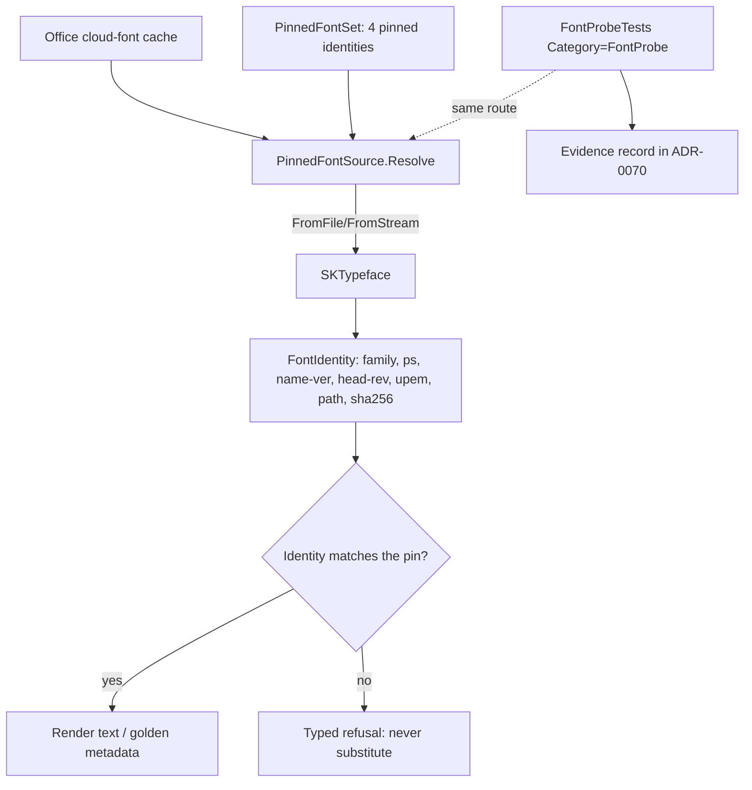

# R8.2a — Pinned-font provisioning ADR: analysis and implementation plan

> **Plan status**: authored 2026-11-23 (architect mode) for work item
> [`R8.2a`](../docs/work-items/R8.2a-font-pinning-adr.md) (Tier A, binding;
> revised 2026-11-22 by [`plans/phase8-plan-critical-review.md`](phase8-plan-critical-review.md)).
> Governing sources read in full: the R8.2a work item, its predecessor
> [`R8.2`](../docs/work-items/R8.2-skia-primitive-renderer.md) and successor
> [`R8.3`](../docs/work-items/R8.3-text-hatch-rendering.md) /
> [`R8.4`](../docs/work-items/R8.4-representative-render.md), the ADR index
> [`docs/DECISIONS.md`](../docs/DECISIONS.md) and
> [`ADR-0071`](../docs/adr/0071-skia-raster-renderer-dependency.md), the
> typography contract in
> [`docs/07-GANTT-ENTITY-GUIDE.md`](../docs/07-GANTT-ENTITY-GUIDE.md),
> the golden-image policy in
> [`docs/04-TEST-STRATEGY.md`](../docs/04-TEST-STRATEGY.md), the text-metrics
> pinning rule in [`docs/02-ARCHITECTURE.md`](../docs/02-ARCHITECTURE.md), the
> dependency policy in [`docs/05-GIT-QUALITY.md`](../docs/05-GIT-QUALITY.md),
> the manifest decision register in
> [`docs/work-items/IMPLEMENTATION-PLAN.md`](../docs/work-items/IMPLEMENTATION-PLAN.md),
> and the live source of the font seam:
> [`AptosTextMetrics.cs`](../src/GanttCreator.Core/Scene/AptosTextMetrics.cs),
> [`FontAdvanceTable.cs`](../src/GanttCreator.Core/Scene/FontAdvanceTable.cs)
> and [`gen-font-advances.py`](../scripts/gen-font-advances.py).
>
> **Step-0 evidence probed 2026-11-23** with a disposable `dotnet run` spike
> against the pinned `SkiaSharp` 4.157.0 package on the reference machine. The
> spike's results are recorded in §2 and are the basis of the central finding in
> §3.2: the guide's Tier-A wording ("resolves through SkiaSharp's font manager")
> does not hold for Office cloud fonts, and the viable SkiaSharp route is the
> explicit typeface-from-file/stream loader.
>
> **Owner rulings required before implementation** are listed in §13. The work
> item explicitly makes D-G4 a human choice; this plan recommends an option and
> states exactly what must be ratified.

---

## 1. Problem statement

### 1.1 What must be decided and recorded

R8.2a is a **decision-and-evidence** row, not a rendering row. It must land four
artefacts:

1. **ADR-0070** — pinned-font provisioning for raster text and golden images:
   installed vs bundled vs fallback, with licence evidence from primary sources
   ([`R8.2a` §Scope](../docs/work-items/R8.2a-font-pinning-adr.md:64)).
2. **A font-presence probe** that reports the exact resolved font on the
   reference machine — family, version, and file path — committed as evidence
   ([`R8.2a` D2](../docs/work-items/R8.2a-font-pinning-adr.md:95)).
3. **The golden-image missing-font policy** — a clear error or an approved
   fallback, **never a silent substitution**; referenced by R8.3 and R8.4
   ([`R8.2a` D1](../docs/work-items/R8.2a-font-pinning-adr.md:91)).
4. **Register and consumer updates** — the `D-G4` manifest row closed, the
   `DECISIONS.md` index row added, and the R8.3/R8.4 prerequisite lines naming
   ADR-0070.

### 1.2 Why it blocks the rest of Phase 8

R8.2 landed the primitive renderer and skips text
([`SceneRasterRenderer.cs`](../src/GanttCreator.Raster/SceneRasterRenderer.cs:82)).
R8.3 is the text/hatch renderer, and its outcome is a **pinned-font golden**
([`R8.3` outcome](../docs/work-items/R8.3-text-hatch-rendering.md:13)). R8.4's
representative baselines record "font family/version (per R8.2a)" as part of
their pinned metadata
([`R8.4` D3](../docs/work-items/R8.4-representative-render.md:106)). Without the
decision, R8.3 cannot choose a face, and R8.4 cannot record a truthful metadata
pin.

### 1.3 The existing font authority that the decision must reconcile with

The scene already measures label text with a committed advance table generated
from the real font binaries:

- [`AptosTextMetrics`](../src/GanttCreator.Core/Scene/AptosTextMetrics.cs:38)
  is the injected `ITextMetrics` implementation; it sums the real `hmtx`
  advances and applies a 3 % measurement margin
  ([`WidthPaddingRatio`](../src/GanttCreator.Core/Scene/AptosTextMetrics.cs:64)).
- [`FontAdvanceTable`](../src/GanttCreator.Core/Scene/FontAdvanceTable.cs:29)
  carries the advances for **Aptos** and **Aptos Narrow**, Regular and Bold,
  with `UnitsPerEm = 2048`
  ([`FontAdvanceTable.cs`](../src/GanttCreator.Core/Scene/FontAdvanceTable.cs:32)).
- [`gen-font-advances.py`](../scripts/gen-font-advances.py:34) generated that
  table from four Office **cloud-font** files, exactly these names:
  `Aptos/30153066857.ttf` (Regular), `Aptos/31531277363.ttf` (Bold),
  `Aptos Narrow/27970306811.ttf` (Regular), `Aptos Narrow/24328775610.ttf`
  (Bold).

The consequence is a hard design constraint the ADR must state: **the raster
renderer must draw the same four faces the measurement table was generated
from**, or the measured label box and the drawn glyphs can disagree in exactly
the direction that clips text. "Font version" is therefore **per face**, not per
family — the spike shows Regular at 2.01 and Bold at 2.00 in the same family.

### 1.4 Success criteria (from the work item)

- ADR-0070 approved and indexed, recording the chosen option with licence
  evidence, the probe output on the reference machine, and the golden-image
  policy text, with human approval recorded
  ([`R8.2a` acceptance](../docs/work-items/R8.2a-font-pinning-adr.md:99)).
- `D-G4` closed in the manifest register; `REPO-MAP`/`STATUS` current.
- **No Office gate** (roadmap row: None).

### 1.5 Explicit exclusions

- No rendering change (R8.3 owns text drawing and consumes this decision).
- No bundling implementation in this row; the ADR decides, and any implementation
  lands with R8.3/R8.4 as directed.
- No "close enough" substitution.
- No new production dependency (SkiaSharp is already pinned by ADR-0071).
- No Core schema, catalogue, or project-boundary change.

---

## 2. Verified context (evidence base)

| Statement | Status | Evidence |
| --- | --- | --- |
| The text-metrics implementation, font, and version are pinned for tests | fact | [architecture §Coordinate and rounding policy](../docs/02-ARCHITECTURE.md:175) |
| Typography token default is `Aptos`; the reference machine records the exact installed version | fact | [entity guide typography tokens](../docs/07-GANTT-ENTITY-GUIDE.md:272) |
| Missing fonts produce a clear error or approved fallback, never an unreported substitution | fact | [entity guide §22 note](../docs/07-GANTT-ENTITY-GUIDE.md:280) |
| Golden images pin renderer, OS, culture, DPI, **font family and font version**, antialias; baseline updates are human-approved and never auto-regenerated in CI | fact | [test strategy §Golden images](../docs/04-TEST-STRATEGY.md:241) |
| A production package addition that shapes output fidelity requires an ADR; an agent may not add it without task scope or human approval | fact | [dependency policy](../docs/05-GIT-QUALITY.md:319) |
| `D-G4` is open and licence-sensitive; human choice required | fact | [manifest register](../docs/work-items/IMPLEMENTATION-PLAN.md:343) |
| The ADR is numbered **0070** (0071 is the landed SkiaSharp dependency ADR) | fact | [work item header](../docs/work-items/R8.2a-font-pinning-adr.md:6), [DECISIONS tail](../docs/DECISIONS.md:70) |
| SkiaSharp 4.157.0 is restored locally and exposes `SKFontManager.Default`, `GetFontFamilies()`, `MatchFamily(string)`, `SKTypeface.FromFamilyName/FromFile/FromStream`, `TryGetTableData(uint, out byte[])`, `FamilyName`, `PostScriptName`, `UnitsPerEm`, `GlyphCount` | fact (installed package XML docs) | `%USERPROFILE%\.nuget\packages\skiasharp\4.157.0\lib\net10.0\SkiaSharp.xml` |
| `SKTypeface` has **no version property**; the version must be read from the OpenType `name` table (name ID 5) or `head.fontRevision` | fact (installed package XML docs) | same |
| The committed advance table was generated from four cloud-font files whose names are `30153066857.ttf`, `31531277363.ttf`, `27970306811.ttf`, `24328775610.ttf` | fact | [`gen-font-advances.py`](../scripts/gen-font-advances.py:34) |
| Office cloud fonts live under `%LOCALAPPDATA%\Microsoft\FontCache\4\CloudFonts\<Family>` and are **not** registered with the OS font system | fact | [`gen-font-advances.py`](../scripts/gen-font-advances.py:13-17), registry probe (0 matches in HKCU and HKLM) |
| The reference machine has `Aptos`, `Aptos Display`, and `Aptos Narrow` in the cloud-font cache | fact (2026-11-23) | directory listing of `%LOCALAPPDATA%\Microsoft\FontCache\4\CloudFonts` |
| `SKFontManager.Default.GetFontFamilies()` returns **208 families with no Aptos/Aptos Narrow/Aptos Display** | fact (spike, 2026-11-23) | disposable `dotnet run` spike, SkiaSharp 4.157.0 |
| `SKFontManager.Default.MatchFamily("Aptos")` returns **null**; `SKTypeface.FromFamilyName("Aptos")` returns **Segoe UI** (silent substitution) | fact (spike, 2026-11-23) | same |
| `SKTypeface.FromFile`/`FromStream` load the cloud-font files and report the exact identities below | fact (spike, 2026-11-23) | same |
| The four file identities: Aptos Regular `Aptos`/`Aptos`/`Version 2.01;O365`/headRev 2.0100/2048 upem/1287 glyphs; Aptos Bold `Aptos`/`Aptos-Bold`/`Version 2.00;O365`/2.0000/2048/1287; Aptos Narrow Regular `Aptos Narrow`/`Aptos-Narrow`/`Version 2.01;O365`/2.0100/2048/1286; Aptos Narrow Bold `Aptos Narrow`/`AptosNarrow-2bc0000-560000`/`Version 2.00;O365`/2.0000/2048/1286 | fact (spike, 2026-11-23) | same |
| The font-dependent tests run today on GitHub-hosted `windows-latest` in CI, which has no Office/cloud fonts | fact | [`.github/workflows/ci.yml`](../.github/workflows/ci.yml:29), [test strategy Office harness](../docs/04-TEST-STRATEGY.md:262) |
| xUnit is 2.9.3 (v2), so a C# fact cannot skip dynamically on a missing font; the repository's dynamic-skip pattern is Pester's `Set-ItResult -Skipped` | fact | [`Directory.Packages.props`](../Directory.Packages.props:60), R7.7 skip precedent in [`STATUS`](../docs/STATUS.md:6) |
| The independent review already treats the baselines as "reference-machine artefacts under the font ADR's Option B" | fact (review position, not an owner ruling) | [`phase8-plan-critical-review.md`](phase8-plan-critical-review.md:190) |

---

## 3. Scope clarification and option evaluation

### 3.1 What R8.2a is — and is not

R8.2a **decides and records**. It lands the ADR, the probe evidence, the golden
policy, and the register/consumer updates. It does **not** add a production font
resolver, change the renderer, or bundle a font. The resolver and its tests are
R8.3's implementation of the ADR; this plan defines the contract R8.3 will
implement so the decision is actionable rather than prose.

### 3.2 The central finding: the Tier-A "font-manager route" premise is falsified

The revised guide says the probe "resolves through the renderer's own
font-manager route (SkiaSharp's font manager), so it reports the font the
renderer will actually resolve — not a parallel enumeration that could disagree
with it"
([`R8.2a` header](../docs/work-items/R8.2a-font-pinning-adr.md:6)). The Step-0
spike tested exactly that route on the reference machine:

```text
SKFontManager.Default.GetFontFamilies()  -> 208 families; Aptos absent
SKFontManager.Default.MatchFamily("Aptos") -> null
SKTypeface.FromFamilyName("Aptos")         -> Segoe UI (silent fallback)
SKTypeface.FromFile(<cloud-font path>)     -> Aptos / Aptos / Version 2.01;O365
```

The Office cloud fonts are not in the OS font registry and are not enumerated by
DirectWrite/Skia's system font manager (the generator already documented the
same fact for `System.Drawing`
([`gen-font-advances.py`](../scripts/gen-font-advances.py:13-17))). Two
conclusions follow:

1. **A renderer that resolves through `SKFontManager`/`FromFamilyName` would
   silently draw Segoe UI.** That is precisely the D1 forbidden outcome, and it
   would produce a PNG whose text neither matches Excel nor the measured label
   boxes.
2. **The only SkiaSharp route that yields the pinned face is the explicit
   typeface loader** — `SKTypeface.FromFile` / `FromStream` /
   `SKFontManager.CreateTypeface(Stream)` — with a fail-closed identity check
   against the expected family, PostScript name, and version.

This is a **contract conflict** with the guide's parenthetical wording. Per the
repository rule ("when sources conflict, stop and report"), it is not silently
resolved: §13 asks the owner to ratify the file-route reading. The probe still
satisfies the *intent* of the guide ("reports the font the renderer will
actually resolve") because the probe and the renderer use the same SkiaSharp
loader and the same identity check.

### 3.3 Options A/B/C against the evidence

| Criterion | A — bundle a redistributable font | B — require the Office-installed Aptos, resolved by the explicit file route | C — approved open fallback |
| --- | --- | --- | --- |
| Fidelity to the live Excel chart and to `FontAdvanceTable` | Only if the bundled font is Aptos (proprietary, licence-dependent) | **Exact** — same four files the advance table was generated from | Diverges: no known open font is Aptos-metric-compatible; measured boxes and drawn glyphs can disagree |
| Determinism across machines | Strong, if bundling is permitted | Strong on any machine with the Office cloud-font cache; fail-closed elsewhere | Strong once the fallback is pinned, but fidelity is lost |
| Licence | **Requires explicit Microsoft redistribution permission**; absent that, the `AGENTS.md` proprietary-fonts stop condition applies | No redistribution; the font is used in place under the Office licence that installed it | OFL/Apache-style licences are bundlable; the licence question is easy but the fidelity cost is real |
| Deployment | Adds font files to the payload; SBOM/notices (R10.7) | No payload change; the renderer locates the user's own Office cache | Adds font files to the payload |
| Failure mode | Missing bundled face is a packaging defect | Missing face is a typed error (or a documented test skip on a non-reference host) | Approved fallback renders, but the PNG differs from Excel |
| Recommendation | **Reject unless primary-source licence evidence explicitly permits redistribution** | **Recommended** — the only route that preserves the measured/drawn identity without redistribution | **Last resort** only if B cannot be made deterministic |

**Why B is technically sound despite the failed system-manager route:** the
renderer does not need the OS to know the font; it needs the exact face bytes.
Those bytes are already on every machine where Excel renders the live chart with
Aptos, in the Office cloud-font cache. Loading them through SkiaSharp and
validating the identity is deterministic, host-free, and offline. The "installed"
in Option B therefore means "installed by Office", not "registered with
Windows" — a distinction the ADR must state explicitly.

**Licence research (primary sources only; do not assert from memory):**

1. Microsoft's font redistribution/embedding terms for fonts delivered with
   Microsoft 365 / Office (Aptos is an Office-delivered font).
2. The Microsoft 365 / Office licence terms covering cloud fonts.
3. Whether any open font is Aptos-metric-compatible (candidates to measure:
   Carlito, Liberation Sans, Noto Sans — none is assumed compatible).
4. If bundling is prohibited (the expected outcome), record that finding and
   cite it in the ADR; the `AGENTS.md` stop condition then forbids Option A.

The ADR must not recommend what the licences forbid. If the licence facts are
unavailable or conflicting, the row stops and the human decides
([`R8.2a` stop conditions](../docs/work-items/R8.2a-font-pinning-adr.md:113)).

### 3.4 Comparative evaluation of Excel automation approaches

R8.2a needs **no Excel automation**. The probe is host-free (Raster/SkiaSharp
only), and the roadmap gate is None. For completeness, the routes to obtain the
font were compared:

| Approach | Can it yield the exact face bytes + version? | Verdict |
| --- | --- | --- |
| Excel COM (`Application.FontNames`, `Range.Font.Name`) | No — names only, no file bytes, no version; requires a live host on the STA thread | Rejected: cannot feed SkiaSharp and couples the probe to Excel |
| VSTO | No — same host model, heavier deployment, still no font-file access | Rejected: no capability gained |
| Open XML SDK | No — reads workbook package parts, not installed fonts; no rasterization | Rejected: not applicable |
| `System.Drawing.Text.PrivateFontCollection` | Loads a TTF and exposes families, but not the version, and adds GDI+ (a determinism and dependency regression) | Rejected: not the renderer's route |
| **Direct file read + SkiaSharp `SKTypeface.FromFile/FromStream`** | **Yes** — exact family, PostScript name, `name`-table version, `head` revision, `unitsPerEm` | **Chosen**: the renderer's own loader, host-free, offline |

This is the honest answer to "Excel automation approaches": the font is an
Office-delivered artefact, but the decision and probe are deliberately outside
Excel automation. Using COM here would add a host dependency and still not
produce the version string.

### 3.5 In scope vs out of scope (tightened)

**In scope**

- `docs/adr/0070-font-pinning.md` (new) + the `docs/DECISIONS.md` index row.
- The font-presence probe (harness fixed in §4.5; location ratified in §13),
  its output recorded in the ADR, and its self-check/positive tests.
- The golden-image missing-font policy text in the ADR (referenced by R8.3/R8.4).
- `docs/work-items/IMPLEMENTATION-PLAN.md` D-G4 row closed.
- R8.3 and R8.4 Step-0 prerequisite lines updated to name ADR-0070.
- `docs/REPO-MAP.md`, `docs/STATUS.md`, and the work item status line.

**Out of scope**

- Production font resolution, text drawing, hatch/dash/typography mapping
  (R8.3).
- Bundling or vendoring any font file.
- Golden baselines themselves (R8.3 category 2–3; R8.4 categories 4–6).
- PNG encoding/metadata (R8.5), file writing (R8.6), UI (R8.7/R8.8).
- Any change to `AptosTextMetrics`, `FontAdvanceTable`, or the catalogue tokens.
- Any new NuGet dependency.

---

## 4. Proposed end-to-end solution architecture

### 4.1 Artefacts and their owners

| Artefact | Path (proposed) | Owner | Notes |
| --- | --- | --- | --- |
| ADR-0070 | `docs/adr/0070-font-pinning.md` | R8.2a | Status Accepted; four records required by the work item |
| ADR index row | `docs/DECISIONS.md` (between ADR-0069 and ADR-0071) | R8.2a | One table row |
| Font probe + self-check | `tests/GanttCreator.Raster.Tests/FontProbeTests.cs` (`Category=FontProbe`) | R8.2a | Uses the Raster test project's deps.json so the SkiaSharp native resolves |
| Probe evidence record | quoted in ADR-0070 §Probe evidence (committed with the ADR) | R8.2a | No separate generated file; the ADR is the durable record |
| Golden-image policy | ADR-0070 §Golden-image policy | R8.2a | Referenced by R8.3 D2/R8.3 acceptance and R8.4 D3 |
| Manifest register | `docs/work-items/IMPLEMENTATION-PLAN.md` D-G4 row | R8.2a | Close with the ADR number and date |
| Consumer prerequisites | R8.3/R8.4 Step 0 | R8.2a | Add "ADR-0070 approved" to each |
| Navigation/status | `docs/REPO-MAP.md`, `docs/STATUS.md`, R8.2a status line | R8.2a | |

### 4.2 Domain model (the contract R8.3 implements)

R8.2a records the model in ADR-0070; the types land with R8.3 so this row adds
no production code. The model is deliberately small and value-based:

```text
FontFaceId            (Regular | Bold)
PinnedFontFace        Family, PostScriptName, FaceId, NameTableVersion,
                      HeadRevision, UnitsPerEm, FileName, Sha256
  AptosRegular         Aptos / Aptos / Regular / "Version 2.01;O365" / 2.0100 / 2048 / 30153066857.ttf
  AptosBold            Aptos / Aptos-Bold / Bold / "Version 2.00;O365" / 2.0000 / 2048 / 31531277363.ttf
  AptosNarrowRegular   Aptos Narrow / Aptos-Narrow / Regular / "Version 2.01;O365" / 2.0100 / 2048 / 27970306811.ttf
  AptosNarrowBold      Aptos Narrow / AptosNarrow-2bc0000-560000 / Bold / "Version 2.00;O365" / 2.0000 / 2048 / 24328775610.ttf
PinnedFontSet         the four faces (the exact set FontAdvanceTable was generated from)
FontIdentity          the observed identity of a loaded typeface (the probe's record)
FontResolutionOutcome Succeeded(FontIdentity) | Refused(FontResolutionRefusal)
FontResolutionRefusal FontFileMissing | FamilyMismatch | PostScriptMismatch |
                      VersionMismatch | UnitsPerEmMismatch | ParseFailure
```

Design notes:

- **Per-face version, not per-family.** The spike shows Regular 2.01 and Bold
  2.00. A single family version would be a false pin.
- **PostScript name is the discriminator.** `FamilyName` alone cannot distinguish
  Regular from Bold in the same family, and the Bold Narrow PostScript name is
  unusual (`AptosNarrow-2bc0000-560000`), so the pin records the observed value
  exactly rather than synthesising one.
- **`Sha256` is optional for the runtime check but required in the ADR/golden
  metadata.** Hashing four small files once is cheap and makes "same version"
  unambiguous across Office updates; the runtime check can use the cheaper
  family/PostScript/version triple and the golden harness can assert the hash.
- **`UnitsPerEm = 2048` is a cross-check against the measurement authority.**
  The advance table's shared denominator is 2048
  ([`FontAdvanceTable.cs`](../src/GanttCreator.Core/Scene/FontAdvanceTable.cs:32));
  a loaded face with a different upem cannot be the face the table was generated
  from.

### 4.3 Service decomposition and seams (R8.3)

| Component | Project | Responsibility | Why this seam |
| --- | --- | --- | --- |
| `PinnedFontSet` (static data) | Raster | The four pinned identities; the single source of the pin | One authority, mirroring the Core advance table's single authority |
| `IPinnedFontSource` | Raster | `TryResolve(FontFaceId, out FontResolutionOutcome)` — locate and load a face | Lets R8.3's renderer and the R8.2a probe use the same route and the same validation |
| `PinnedFontSource` | Raster | Resolves the cloud-font path, loads via `SKTypeface.FromFile/FromStream`, validates the identity, returns the typed outcome | Host-free; no Office dependency |
| `PinnedFontCache` (optional, R8.3) | Raster | Resolves each face once per process and caches the immutable `SKTypeface` | Work item D2 ("resolved once per process"); avoids per-label file I/O |
| `RasterDeterminism` (extension, R8.3) | Raster | Adds the resolved font identity record to the determinism descriptor | The golden metadata must name the font version, not just the SkiaSharp version |
| Probe fact | Raster.Tests | Runs `PinnedFontSource` over the four faces and asserts the exact identities; prints the evidence record | The probe is the executable form of the decision |

`PinnedFontSource` must be the **only** font-resolution route in Raster. R8.3's
renderer consumes it; no `SKTypeface.FromFamilyName` call is permitted in the
text path (the spike proves that route silently substitutes).

### 4.4 API contracts (to land with R8.3; recorded now)

```csharp
namespace GanttCreator.Raster;

public enum FontFaceId { Regular, Bold }

public sealed record PinnedFontFace(
    string Family,
    string PostScriptName,
    FontFaceId Face,
    string NameTableVersion,
    double HeadRevision,
    int UnitsPerEm,
    string FileName,
    string Sha256);

public sealed record FontIdentity(
    string Family,
    string PostScriptName,
    string NameTableVersion,
    double HeadRevision,
    int UnitsPerEm,
    string FilePath,
    string Sha256);

public enum FontResolutionRefusal
{
    FontFileMissing,
    FamilyMismatch,
    PostScriptMismatch,
    VersionMismatch,
    UnitsPerEmMismatch,
    ParseFailure,
}

public readonly record struct FontResolutionOutcome
{
    public bool Succeeded { get; }
    public FontIdentity? Identity { get; }
    public FontResolutionRefusal? Refusal { get; }
}

public interface IPinnedFontSource
{
    FontResolutionOutcome Resolve(FontFaceId face, bool narrow);
}
```

Exact member shapes are fixed at R8.3 implementation against the installed
SkiaSharp 4.157.0 API (the Step-0 rule: do not code from memory). R8.2a's
commitment is the **behaviour**: a face resolves to an identity or a typed
refusal, and the refusal list is closed.

### 4.5 Probe design (the R8.2a deliverable)

The probe is an xUnit fact in `tests/GanttCreator.Raster.Tests`, carrying
`[Trait("Category", "FontProbe")]`, because:

- the Raster test project's `deps.json` resolves the SkiaSharp native correctly
  (the disposable spike proved `dotnet run` works; a hand-loaded PowerShell
  `Add-Type` failed the native `SkiaApi` initializer, so a pwsh probe is not the
  robust route);
- xUnit 2.9.3 has no dynamic skip, so the probe is **excluded from the routine
  gates** and invoked explicitly on the reference machine (the `TransferSoak` /
  `OfficeIntegration` trait precedent);
- it reuses the mandated harness and adds no project.

**Probe algorithm (exact API route):**

1. Locate `%LOCALAPPDATA%\Microsoft\FontCache\4\CloudFonts` (the generator's
   documented location).
2. For each of the four pinned faces, open the expected file and load it with
   `SKTypeface.FromFile(path)` (fallback: `SKTypeface.FromStream(File.OpenRead(path))`).
3. Read `FamilyName`, `PostScriptName`, `UnitsPerEm`, `GlyphCount`.
4. Read the OpenType `name` table via
   `TryGetTableData(Tag("name"), out byte[])`, parse name ID 5 (platform 3
   UTF-16BE / platform 1 Latin-1), and read `head.fontRevision` via
   `TryGetTableData(Tag("head"), out byte[])` at offset 4 (Fixed 16.16). Tags:
   `name` = `0x6E616D65`, `head` = `0x68656164`.
5. Compare the observed identity with the pinned identity; assert equality and
   print the record through `ITestOutputHelper`.
6. **Positive fail-closed check:** construct the wrong-face case (assert that
   `SKTypeface.FromFamilyName("Aptos")` reports `Segoe UI`, or resolve a
   temporary mismatched face) and assert the identity check rejects it. This is
   the positive test for the D1 validator, required in the same commit as the
   validator by the repository rule.
7. Skip/refuse honestly on a host without the pinned faces: the fact's failure
   message names the missing file and the expected family; because it is
   excluded from routine gates, the reference-machine run is the gate and the
   ADR records the observed environment.

**Evidence record shape** (quoted in ADR-0070):

```text
R8.2a font probe — 2026-11-23 — SkiaSharp 4.157.0 — Windows 11 25H2
Aptos Regular       file=30153066857.ttf family=Aptos       ps=Aptos                          name="Version 2.01;O365" head=2.0100 upem=2048 glyphs=1287 sha256=<...>
Aptos Bold          file=31531277363.ttf family=Aptos       ps=Aptos-Bold                     name="Version 2.00;O365" head=2.0000 upem=2048 glyphs=1287 sha256=<...>
Aptos Narrow Reg.   file=27970306811.ttf family=Aptos Narrow ps=Aptos-Narrow                   name="Version 2.01;O365" head=2.0100 upem=2048 glyphs=1286 sha256=<...>
Aptos Narrow Bold   file=24328775610.ttf family=Aptos Narrow ps=AptosNarrow-2bc0000-560000     name="Version 2.00;O365" head=2.0000 upem=2048 glyphs=1286 sha256=<...>
Negative control    FromFamilyName("Aptos") -> family=Segoe UI (rejected, never substituted)
```

The SHA-256 values are computed by the probe run, not asserted from memory.

### 4.6 Asynchronous workflow design

**Not applicable, deliberately.** R8.2a performs no Excel/PowerPoint COM call,
no network I/O, and no long-running operation. The probe is a synchronous,
one-shot test-host operation over four small local files. There is no
`Task.Run`, no `Thread.Sleep`, and no async layer to design. R8.3 will resolve
the four faces once per process and cache them; the render remains synchronous
on the command thread by design (critical review F7). This section exists to
state the exclusion rather than leave it ambiguous.

### 4.7 Data flow



The probe and the renderer share `PinnedFontSource`; a probe that disagrees with
the renderer is structurally impossible.

---

## 5. Design decisions

Work-item decisions (binding, restated for traceability):

- **D1 — Never silent substitution.** A missing/mismatched pinned face produces a
  clear error or the approved fallback path; R8.3 and R8.4 test the chosen
  behaviour.
- **D2 — The probe is evidence.** The exact resolved-font record (family,
  version, file path) is committed for the ADR and the golden metadata.

Plan decisions (each ships with its check):

- **P1 — Per-face identity, not per-family.** The pin records four faces with
  family, PostScript name, `name`-table version, `head` revision, upem, file
  name, and hash. The spike proves the family's Regular and Bold differ in
  version (2.01 vs 2.00); a single family version is a false pin.
- **P2 — The resolution route is the explicit SkiaSharp typeface loader.** The
  renderer and probe use `SKTypeface.FromFile`/`FromStream` (or
  `SKFontManager.CreateTypeface(Stream)`) on the Office cloud-font file, then
  validate the identity. `SKFontManager.MatchFamily` and
  `SKTypeface.FromFamilyName` are **forbidden in the text path**: the spike shows
  they return null or Segoe UI for the pinned family. This is the §13 ruling
  that deviates from the guide's parenthetical wording.
- **P3 — Fail closed before any pixel.** Validation happens before the first
  text draw. A refusal is typed, names the expected and observed identity, and
  aborts the render; no partial PNG with substituted text is produced.
- **P4 — The pin is anchored to the measurement authority.** The probe asserts
  `UnitsPerEm = 2048` and the file names in
  [`gen-font-advances.py`](../scripts/gen-font-advances.py:34). The ADR states
  that the four faces are exactly the set `FontAdvanceTable` was generated from;
  changing a face is a measurement change, not just a font change.
- **P5 — Golden metadata is per face and includes a hash.** Baselines record the
  four identities (family, PostScript, name version, head revision, upem, file
  hash) beside renderer/OS/culture/DPI/antialias. The harness asserts the live
  run's identity equals the baseline's. A future Office font update therefore
  fails loudly at the metadata gate rather than silently shifting pixels.
- **P6 — Missing font on a non-reference host: skip the font-dependent test with
  a stated reason; never substitute.** The production renderer errors. The test
  harness treats an absent pinned face as an environment fact and skips, exactly
  as the Office/soak gates skip on a host without Office. The hosted
  `windows-latest` CI runner has no Office/cloud fonts, so it cannot execute
  font-dependent goldens; this is recorded as a known limitation, not a green
  claim. The reference-machine run is the gate.
- **P7 — No bundling unless the licence explicitly permits it.** The default
  recommendation is Option B (use the Office-installed font in place). Option A
  requires primary-source redistribution permission; absent it, the
  proprietary-fonts stop condition forbids bundling. Option C is a last resort
  because no open font is known to be Aptos-metric-compatible.
- **P8 — No new dependency.** SkiaSharp 4.157.0 (ADR-0071) is the only library;
  the probe uses the same version. No `System.Drawing`, no Pester if the probe is
  a dotnet test, no new project.

---

## 6. Development sequence

Every phase ends green; tests land with the behaviour they pin; every new
validator ships its positive test in the same commit (the repository rule).
Effort estimates are active engineering time, excluding review/wait.

### P0 — Prerequisites (0.5 h; mostly already true)

- R8.2 landed (yes, 2026-11-23); SkiaSharp 4.157.0 pinned (yes,
  [`Directory.Packages.props`](../Directory.Packages.props:60)).
- Reference-machine font presence verified (this plan's spike).
- Re-read the four generated file names and confirm they match the cloud-font
  cache (yes, observed).
- **Deliverable:** a short Step-0 note in the work item/plan restating the
  verified facts; no code.

### P1 — Licence research (2–4 h; the variance is source availability)

- Gather primary-source evidence for Microsoft 365/Office cloud-font use and
  redistribution; record exact citations in the ADR.
- Assess open fallback candidates only if B is rejected; measure metric
  compatibility rather than assuming it.
- **Deliverable:** the ADR's licence section (draft) plus a one-paragraph
  recommendation. **Stop** if the facts are unavailable or conflicting.

### P2 — Probe + evidence (3–5 h)

1. Write the failing `FontProbeTests` fact (`Category=FontProbe`) with the four
   identity assertions and the negative control (D1 validator).
2. Implement the probe's OpenType `name`/`head` parsing (small, testable) and
   the pinned identity comparison.
3. Add `Category!=FontProbe` to the routine filters
   ([`scripts/test-non-office.ps1`](../scripts/test-non-office.ps1),
   [`scripts/verify.ps1`](../scripts/verify.ps1)) and pin it in
   [`scripts/ci-parity.Tests.ps1`](../scripts/ci-parity.Tests.ps1), so the
   probe never enters the every-commit/branch-final/CI suites.
4. Run the probe on the reference machine with
   `dotnet test tests/GanttCreator.Raster.Tests --filter Category=FontProbe`
   and capture the record.
- **Deliverable:** probe fact + parser + gate-filter change + observed record.

### P3 — ADR-0070 (3–4 h)

- Author `docs/adr/0070-font-pinning.md`: Context, Decision (option + resolution
  route + per-face pin), Consequences, Alternatives, Licence evidence, Probe
  evidence, Golden-image policy.
- Add the `DECISIONS.md` row between ADR-0069 and ADR-0071.
- Close `D-G4` in the manifest register with the ADR number and date.
- **Deliverable:** the approved ADR + index + register.

### P4 — Consumer prerequisites, navigation, gates (1–2 h)

- Add "ADR-0070 approved" to R8.3 and R8.4 Step 0.
- Update `docs/REPO-MAP.md` only if the probe introduces a mapped test location
  or command (it adds a trait, so the Raster row's test note may gain one line).
- Update `docs/STATUS.md` and the R8.2a work item status line.
- Run the gates in §7.4; self-certify checklist **G, I** (docs/evidence row; no
  production code) and state that **E** is not applicable (no renderer change)
  and the Office gate is `Not run` (row: None).

**Total estimate:** 9.5–15.5 h (≈1.5–2 dev days), dominated by licence research
and the ADR.

---

## 7. Test-driven development strategy

### 7.1 Unit / contract (Raster.Tests, `Category=FontProbe`)

| Acceptance criterion | Test | Assertion |
| --- | --- | --- |
| Probe reports the exact resolved font | `The_reference_machine_resolves_the_four_pinned_faces` | Each face's `FamilyName`, `PostScriptName`, `name`-table version, `head` revision, upem (2048), and file name equal the pin; the record is printed |
| Never silent substitution (D1) | `A_family_name_lookup_that_returns_the_fallback_is_refused` | `FromFamilyName("Aptos")` → Segoe UI, and the identity check returns `FamilyMismatch`/`PostScriptMismatch` rather than success |
| Missing face is a clear error | `A_missing_pinned_face_is_refused_with_a_typed_reason` | A resolver pointed at a temp directory with no font returns `FontFileMissing`; the message names the expected file |
| Version mismatch is detected | `A_face_with_a_different_version_is_refused` | A synthetic/mismatched identity yields `VersionMismatch` (positive test for the validator) |
| Pin is anchored to the measurement authority | `The_pinned_faces_share_the_advance_table_units_per_em` | All four faces report upem 2048; the ADR states the file-map equivalence |

The parser is exercised on the real fonts and on synthetic byte arrays for the
refusal arms; every refusal arm is positive (construct the bad input, assert the
typed refusal), per the repository's repeated-defect rule.

### 7.2 Integration / environment

- **Reference-machine evidence run:** the explicit `FontProbe` invocation is the
  gate. Its output is quoted in ADR-0070.
- **Non-reference host:** the routine gates exclude `Category=FontProbe`, so the
  hosted `windows-latest` CI run stays green without claiming font coverage. The
  ADR records this as a known limitation and names the reference-machine run as
  the evidence. This mirrors the Office/soak skip precedent.
- **No end-to-end Office test:** the roadmap row's gate is None; the probe is
  host-free by design.

### 7.3 Documentation traceability

- Every acceptance criterion in
  [`R8.2a` §Acceptance](../docs/work-items/R8.2a-font-pinning-adr.md:99) maps to
  an ADR section: option + licence evidence; probe record; golden policy; human
  approval.
- Checklist **I** (work-item traceability): the ADR and register name the exact
  probe command and the four identities; no test count is invented.

### 7.4 Gates

```powershell
dotnet test tests/GanttCreator.Raster.Tests --filter Category=FontProbe   # reference-machine evidence
pwsh -NoProfile -File scripts/verify-quick.ps1                            # every commit
pwsh -NoProfile -File scripts/verify.ps1                                  # branch final, clean tree
pwsh -NoProfile -File scripts/check-md-links.ps1                         # doc links
pwsh -NoProfile -File scripts/check-status.ps1                           # STATUS accuracy
git diff --check                                                         # no output
```

`verify-office.ps1` is **Not run** — the row's gate is None. Any gate not run is
reported as `Not run` with the reason.

---

## 8. Clean architecture and maintainability

- **Core stays dependency-free.** The probe lives in the Raster test project and
  uses SkiaSharp; no Core/Office/AddIn production change. `AptosTextMetrics` and
  `FontAdvanceTable` remain the measurement authority and are not edited.
- **One font authority.** `PinnedFontSet` is the single pin; `PinnedFontSource`
  is the single resolver; the probe and the renderer share both. No parallel
  enumeration can disagree with the renderer (the guide's stated intent).
- **The smallest coherent diff.** R8.2a adds documentation, one probe fact (plus
  its parser/refusal checks), and a small gate-filter change. It does not add a
  project, a package, or a resolver type that R8.3 will own anyway.
- **Determinism as a property.** Per-face identity + hash + `unitsPerEm` + the
  pinned SkiaSharp version make a raster render reproducible and auditable. No
  clocks, culture, random, network, or host font-manager state participates.
- **Licence hygiene.** No font file is copied into the repository or the
  payload. The ADR cites primary sources; R10.7's SBOM records only the
  SkiaSharp MIT notice (already owed by ADR-0071).

---

## 9. Security, validation, and observability

- **Trust boundary.** The font files are read from the user's own Office cache;
  the probe validates the resolved identity before use, so a replaced or
  substituted file is refused rather than measured/drawn.
- **Offline only.** No network, telemetry, cloud API, or licence check. The font
  cache is local.
- **No untrusted parsing beyond the local cache.** The OpenType parser reads only
  the `name` and `head` tables of the four pinned files; table bounds are
  checked before slicing (the spike's parser does this and returns a typed
  `ParseFailure` rather than throwing across the boundary).
- **Observability.** The probe's record (identity + negative control) is the
  observability artefact; R8.3 will surface the same identity in
  `RasterDeterminism` and in the golden metadata. The production refusal message
  names the expected face and the observed identity.
- **No secrets or customer data.** The probe reads font files only; no workbook
  or schedule content is touched.

---

## 10. Performance and scalability

- **R8.2a cost:** four file opens, four `SKTypeface` loads, two table reads per
  face, and four hashes — milliseconds, once, on the reference machine. No
  caching is needed in the probe.
- **R8.3 design note:** resolve each face once per process (`PinnedFontCache`)
  and reuse the immutable `SKTypeface`; text drawing is then O(labels) with no
  per-label file I/O. This is the work item's D2 requirement ("resolved once per
  process").
- **Render budget unchanged.** R8.2a adds no work to the render path; the
  renderer remains a single synchronous walk. Cancellation/deadline is R9.1.
- **Scalability:** the pin is O(4), independent of workbook size; the hash step
  is O(font bytes) once.

---

## 11. Risks, assumptions, and mitigations

| # | Risk / assumption | Severity | Mitigation / owner |
| --- | --- | --- | --- |
| R1 | The guide's "font-manager route" wording conflicts with the observed capability | **High** | Reported in §3.2/§13; the owner ratifies the explicit file route. The probe and renderer share it, so the guide's *intent* is met |
| R2 | Licence facts unavailable or forbid both bundling and in-place use | **High** | Primary-source research in P1; if unclear/conflicting, **stop** and let the human decide (the work item's stop condition). No bundling without explicit permission |
| R3 | Office updates the cloud font (2.01 → later), changing advances/pixels | Medium | Per-face version + hash in the pin and golden metadata; a change fails loudly at the probe/metadata gate; the advance table must be regenerated with the font change (a measured, reviewed change) |
| R4 | A machine has never used Aptos, so the cloud-font cache is absent | Medium | The production renderer fails closed with a clear message; the test harness skips with a reason on non-reference hosts; the reference machine is the golden gate |
| R5 | CI cannot execute font-dependent goldens | Medium | `Category=FontProbe` exclusion + documented known limitation; reference-machine evidence is the gate. No green claim is made for CI font coverage |
| R6 | Scope creep into R8.3 (text drawing, resolver, hatch) | Medium | Exclusions in §3.5; R8.2a lands the contract, not the renderer; any resolver code waits for R8.3 |
| R7 | The probe parser accepts a malformed table and throws | Low | Bounds-checked parsing with a typed `ParseFailure`; positive test for a truncated table |
| R8 | ADR-0070 numbering collision | Low | 0070 is reserved (0071 landed); re-check the index at authoring time |
| A1 | Assumption: the Office cloud-font cache is the stable location across supported Office builds | Medium | The generator already documents it; the probe verifies the path on the reference machine; the ADR records the path pattern and the fail-closed behaviour if it moves |
| A2 | Assumption: Option B preserves fidelity because the live chart uses the same faces | High | Verified by the advance-table provenance (the four files) and the entity guide's Aptos token; the ADR states the dependency explicitly |
| D1 | Dependency: R8.2 landed (SkiaSharp pinned) | — | Consumed as-is |
| D2 | Dependency: the reference machine has Office-delivered Aptos | — | Verified in this plan's Step 0 |

Rollback: `git revert` — the ADR, probe, and register updates are additive; no
production code changes.

---

## 12. Definition of done

1. ADR-0070 accepted and indexed, containing: the chosen option with licence
   evidence; the probe record (four faces + negative control); the golden-image
   missing-font policy; and the human approval record.
2. The probe fact exists, carries `Category=FontProbe`, passes on the reference
   machine, and its output is quoted in the ADR; its refusal arms have positive
   tests.
3. `D-G4` closed in the manifest register; R8.3/R8.4 Step 0 name ADR-0070.
4. `REPO-MAP` (only if a mapped test location/command changed), `STATUS`, and
   the R8.2a status line are current.
5. `verify-quick.ps1` PASS observed; `check-md-links.ps1` and `check-status.ps1`
   PASS; `git diff --check` clean; `verify.ps1` at branch close;
   `verify-office.ps1` recorded `Not run` (row gate: None).
6. Checklist **G, I** self-certified in the commit message; **E** and **J**
   stated not applicable (no renderer/COM change).
7. Handoff in the `Outcome / Changed / Proof / Office / Risk / Deferred / Next`
   format; every gate not run stated as `Not run` with its reason.

---

## 13. Owner rulings required (stop conditions)

These are the work item's own stop conditions and the one contract conflict the
evidence exposed. Implementation must not proceed past P1/P2 without them.

1. **Resolution route.** Ratify that the renderer's route is the explicit
   SkiaSharp typeface loader (`SKTypeface.FromFile`/`FromStream` +
   identity validation), not `SKFontManager.MatchFamily`, because the latter
   returns null/Segoe UI for the Office cloud fonts on the reference machine.
   *Recommended: ratify the file route; keep the guide's intent ("the font the
   renderer actually resolves") intact and record the wording deviation in the
   ADR.*
2. **Licence outcome.** Ratify Option B (use the Office-installed Aptos in
   place) as the default, contingent on the primary-source research confirming
   that redistribution is not permitted. Option A only with explicit
   redistribution permission; Option C only if B cannot be made deterministic.
   *Recommended: Option B.*
3. **Probe location.** The guide says "location fixed at Tier-A upgrade" but
   does not name it. Ratify
   `tests/GanttCreator.Raster.Tests/FontProbeTests.cs` (`Category=FontProbe`,
   excluded from routine gates) plus the explicit evidence command.
   *Recommended: this is the smallest route that resolves the native correctly
   and reuses the mandated harness.*
4. **CI / missing-font policy.** Ratify that font-dependent probe/golden tests
   are reference-machine only and skip with a stated reason on hosts without the
   pinned faces (including hosted `windows-latest`), recorded as a known
   limitation; the production renderer fails closed. *Recommended: yes — it
   matches the existing Office/soak gate precedent and avoids a false green
   claim.*

---

## 14. Evidence-ledger seeds

| Statement | Status | Evidence |
| --- | --- | --- |
| The text-metrics implementation/font/version are pinned for tests | fact | [architecture §Coordinate and rounding policy](../docs/02-ARCHITECTURE.md:175) |
| The reference machine records the exact installed font version | fact | [entity guide typography tokens](../docs/07-GANTT-ENTITY-GUIDE.md:272) |
| Missing fonts: clear error or approved fallback, never silent substitution | fact | [entity guide §22 note](../docs/07-GANTT-ENTITY-GUIDE.md:280) |
| Golden images pin font family and version; baselines are human-approved and never auto-regenerated in CI | fact | [test strategy §Golden images](../docs/04-TEST-STRATEGY.md:241) |
| D-G4 is open and licence-sensitive | fact | [manifest register](../docs/work-items/IMPLEMENTATION-PLAN.md:343) |
| The advance table was generated from four named cloud-font files, upem 2048 | fact | [`gen-font-advances.py`](../scripts/gen-font-advances.py:28-37), [`FontAdvanceTable.cs`](../src/GanttCreator.Core/Scene/FontAdvanceTable.cs:32) |
| Office cloud fonts are absent from the OS font registry and from SkiaSharp's system font manager | fact (spike 2026-11-23) | registry probe (0 matches), `GetFontFamilies()` (208, no Aptos), `MatchFamily("Aptos")` null |
| `FromFamilyName("Aptos")` silently returns Segoe UI | fact (spike 2026-11-23) | disposable `dotnet run` spike |
| The four faces load via `FromFile`/`FromStream` with the recorded identities (2.01/2.01/2.00/2.00; upem 2048) | fact (spike 2026-11-23) | same |
| The dependency policy requires an ADR for a fidelity-shaping dependency; bundling needs explicit permission | fact | [dependency policy](../docs/05-GIT-QUALITY.md:319), `AGENTS.md` proprietary-fonts stop condition |
| The independent review expects reference-machine baselines under Option B | fact (review position) | [critical review](phase8-plan-critical-review.md:190) |
| Option A licence terms for Aptos/Office cloud fonts | **unknown until researched** | primary sources cited in the ADR |
| Whether any open font is Aptos-metric-compatible | **unknown until measured** | ADR alternatives section |
