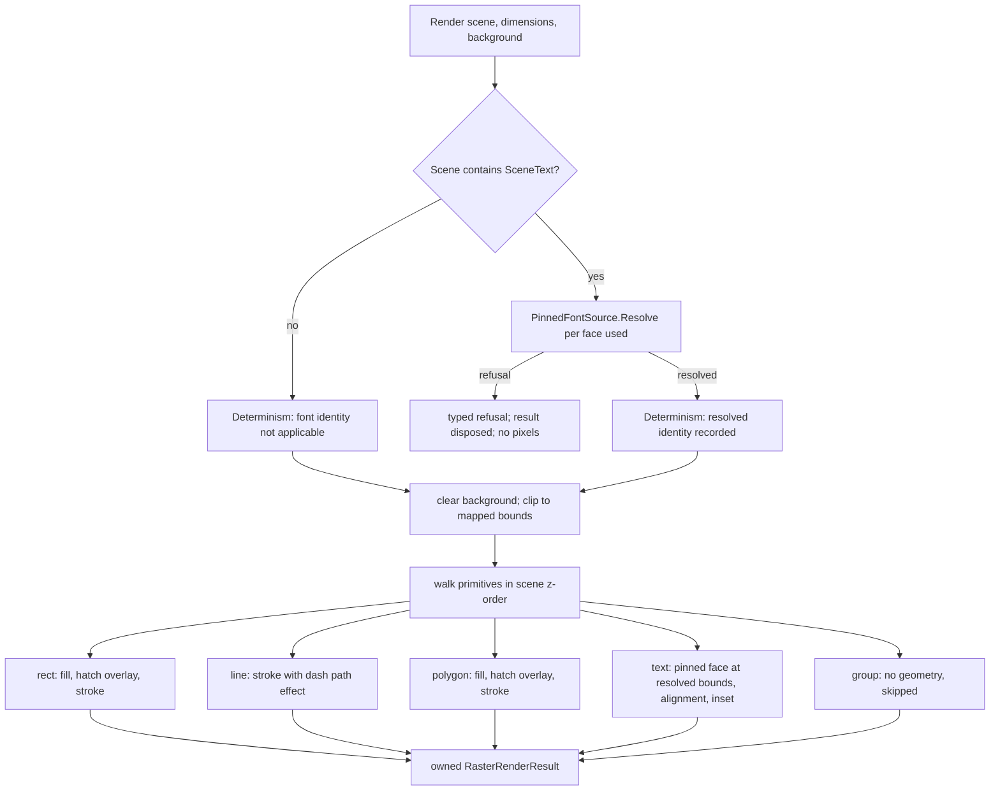

# R8.3 — Deterministic text and hatch/pattern rendering: analysis and implementation plan

> **Plan status**: authored 2026-11-23 (architect mode) for work item
> [`R8.3`](../docs/work-items/R8.3-text-hatch-rendering.md) (Tier A, binding,
> revised 2026-11-22 per the
> [`phase8-plan-critical-review`](phase8-plan-critical-review.md); prerequisites
> R8.2a and R8.2 landed 2026-11-23). Governing sources read in full: the work
> item, [`ADR-0070`](../docs/adr/0070-font-pinning.md) (Option B, the four-face
> pin, fail-closed policy, D1–D5), [`ADR-0071`](../docs/adr/0071-skia-raster-renderer-dependency.md),
> [`02-ARCHITECTURE`](../docs/02-ARCHITECTURE.md) (scene-first, rounding policy,
> PNG renderer), [`04-TEST-STRATEGY`](../docs/04-TEST-STRATEGY.md) (raster tests,
> golden images), [`07-GANTT-ENTITY-GUIDE`](../docs/07-GANTT-ENTITY-GUIDE.md)
> (§22, §procurement hatch, typography tokens, the metric-token table),
> [`08-TEST-CHECKLIST`](../docs/08-TEST-CHECKLIST.md) (E, G),
> [`phase8-png-export-review`](phase8-png-export-review.md), the live source of
> every type the row consumes
> ([`SceneRasterRenderer`](../src/GanttCreator.Raster/SceneRasterRenderer.cs),
> [`RasterTransform`](../src/GanttCreator.Raster/RasterTransform.cs),
> [`RasterDeterminism`](../src/GanttCreator.Raster/RasterDeterminism.cs),
> [`SceneText`](../src/GanttCreator.Core/Scene/SceneText.cs),
> [`SceneStyle`](../src/GanttCreator.Core/Scene/SceneStyle.cs),
> [`GanttHatchPattern`](../src/GanttCreator.Core/GanttCatalogueTokens.cs)),
> and the landed test surface
> ([`SceneRasterRendererTests`](../tests/GanttCreator.Raster.Tests/SceneRasterRendererTests.cs),
> [`FontProbeTests`](../tests/GanttCreator.Raster.Tests/FontProbeTests.cs),
> [`GoldenRasterBaselineTests`](../tests/GanttCreator.Raster.Tests/GoldenRasterBaselineTests.cs)).

---

## 1. Problem statement

**What must be built.** The text and pattern halves of the raster channel,
inside [`src/GanttCreator.Raster/`](../src/GanttCreator.Raster/):

1. **Deterministic text drawing.** The renderer's `SceneText` branch —
   currently an explicit skip in
   [`SceneRasterRenderer.Render`](../src/GanttCreator.Raster/SceneRasterRenderer.cs:82) —
   draws each text primitive with the **pinned Aptos faces** (ADR-0070 Option B:
   the Office-installed cloud fonts through the explicit
   `SKTypeface.FromFile` route with a fail-closed per-face identity check), at
   the scene's **already-resolved** bounds, side, alignment, and inset. The
   renderer never re-measures and never reselects (work item D1; entity guide
   §22 "Text measurement").
2. **The production font pin.** `PinnedFontSet` (the single pin authority for
   the four faces) and `PinnedFontSource` (the single resolver with the typed
   refusals `FontFileMissing`/`LoadFailed`/`FamilyMismatch`/`PostScriptMismatch`/
   `VersionMismatch`/`UnitsPerEmMismatch`/`ParseFailure`), resolved **once per
   process** and shared by the renderer and the R8.2a probe, so a probe that
   disagrees with the renderer is structurally impossible (ADR-0070 D3/D5).
3. **Hatch/pattern drawing.** `GanttHatchPattern`
   (None/ForwardDiagonal/BackwardDiagonal/Cross) rendered at the
   `HatchPitchPt` (4, range 2–18) and `HatchLinePt` (0.5, range 0.25–3) metric
   tokens — which the Excel host **cannot** honour (`MsoPatternType` has no
   member for either, the R4.6 Step-0 probe) but SkiaSharp can draw exactly.
   The raster channel is therefore *more* faithful than the live chart, and
   that deviation direction is recorded rather than hidden (work item D3).
4. **Stroke-dash drawing.** `GanttStrokeDash`
   (Solid/SquareDot/RoundDot/Dash/DashDot/LongDash) mapped to a closed,
   code-owned `SKPathEffect.CreateDash` interval table — the ADR-0044
   obligation the roadmap's Phase-8 note assigns to R8.2/R8.3: "the PNG is
   rendered from the scene, so the raster renderer must honour the outline's
   dash or the export silently stops matching the chart."

**Why.** Phase 8's PNG channel must reproduce the same chart the user sees.
R8.2 landed the primitive core (rect/line/polygon, clipping, z-order, the
category-1 golden); R8.2a landed the font decision and the reference-machine
probe. R8.3 closes the remaining mapping obligations the R8.2 renderer names
in its own remarks — "Hatch patterns, stroke dashes, and typography are
R8.3's mapping obligations (I3)" — and is the prerequisite for every later
golden image (R8.4's representative set, R8.8's end-to-end export).

**What success looks like** (from the work item's
[acceptance tests](../docs/work-items/R8.3-text-hatch-rendering.md:88)):

- `dotnet test tests/GanttCreator.Raster.Tests` is green with: pinned-font
  goldens (small perceptual tolerance **only** for text antialiasing, per
  policy; geometry exact); clipping tests; pattern pins (spacing/width
  measured); the missing-pin positive; determinism.
- The font policy is exercised **positively**: a constructed missing-pin case
  refuses with the typed reason, and no partial pixels are produced.
- Two renders of the same scene are byte-identical, and the determinism
  descriptor carries the resolved font identity (ADR-0070 D4's "extension of
  `RasterDeterminism` with the resolved identity").
- Release build 0 warnings; XML docs on the new public surface;
  [`REPO-MAP`](../docs/REPO-MAP.md) Raster row and
  [`STATUS`](../docs/STATUS.md) current; checklist sections **E, G**
  self-certified in the commit message.
- No Office gate (roadmap row: None) — stated as `Not run` with that reason.
  The **reference-machine** font run is the font gate (ADR-0070 D4).

**What is explicitly excluded** (work item
[Exclusions](../docs/work-items/R8.3-text-hatch-rendering.md:65)):

- No font-decision changes — R8.2a owns the decision; this row **consumes**
  ADR-0070 and never revisits the option.
- No PDF/vector text.
- No re-measurement — R3.6's `ITextMetrics` owns measurement; the raster
  renderer consumes resolved bounds only.
- No golden **baselines beyond the pattern/text primitives** — R8.4 owns the
  representative set. R8.3's baselines are primitive-level (golden categories
  2–3 per the phase-8 plan: text alignment/clipping; hatches).
- No PNG encoding (`pHYs`), file writing, preview UI, or command surface
  (R8.5/R8.6/R8.7/R8.8).
- No Core production changes and no new package references — SkiaSharp
  4.157.0 is already pinned (ADR-0071); the Raster→Core reference already
  exists.
- No bundling or fallback implementation duties — ADR-0070 chose Option B, so
  the work item's "if Option A/C" clause is inert.

---

## 2. Verified current state (facts, read from source)

| Statement | Evidence |
| --- | --- |
| The renderer skips `SceneText` and `SceneGroup` explicitly | [`SceneRasterRenderer.cs`](../src/GanttCreator.Raster/SceneRasterRenderer.cs:82) — "R8.3 draws text; a group carries no geometry" |
| The renderer maps fill colour, stroke colour, stroke width only; a no-width stroke draws the 1-px hairline | [`SceneRasterRenderer.cs`](../src/GanttCreator.Raster/SceneRasterRenderer.cs:182) `CreateStrokePaint` |
| Hatch, dash, and typography are named as this row's obligations | The renderer's own remarks (I3) |
| `SceneText` carries `Text`, `TextBounds`, `Style`, `Alignment`, `LeftInsetPt` | [`SceneText.cs`](../src/GanttCreator.Core/Scene/SceneText.cs) |
| `SceneStyle` carries `HatchPattern`, `StrokeDash`, `FontFamily`, `FontSizePt`, `Bold`, `TextColour` | [`SceneStyle.cs`](../src/GanttCreator.Core/Scene/SceneStyle.cs) |
| The scene does **not** carry the hatch pitch/line tokens; they are chart metrics | ADR-0007 D7 — "the pitch and stroke width come from `GanttCatalogues.Metrics`" |
| The reference scene carries **no hatched primitive** — every reference style resolves `HatchPattern` to `None` | Entity-guide Procurement equivalence row; the phase-8 plan's finding G; the critical review's confirmation |
| The R8.2a probe holds the four-face pin as **private test records** (`PinnedFace`, `FontIdentity`, `ProbeRefusal`) | [`FontProbeTests.cs`](../tests/GanttCreator.Raster.Tests/FontProbeTests.cs:338) |
| The probe's five facts pass on the reference machine; the routine gates exclude `Category=FontProbe` | ADR-0070 "Probe evidence"; [`ci-parity.Tests.ps1`](../scripts/ci-parity.Tests.ps1) pins the exclusion |
| The category-1 golden carries one text primitive **only to prove the R8.2 skip**; no text is drawn | [`GoldenRasterBaselineTests.cs`](../tests/GanttCreator.Raster.Tests/GoldenRasterBaselineTests.cs:21) remarks |
| The R8.2 suite pins the text skip as a behaviour | [`SceneRasterRendererTests.cs`](../tests/GanttCreator.Raster.Tests/SceneRasterRendererTests.cs:191) `A_scene_with_text_and_groups_renders_only_the_non_text_primitives` |
| `RasterDeterminism` is `(SurfaceKind, Antialias, SkiaVersion)`; the golden metadata's font fields are "not applicable" | [`RasterDeterminism.cs`](../src/GanttCreator.Raster/RasterDeterminism.cs) |
| The transform maps points→pixels once per axis, `ToEven` rounding, `Length()` floors at 1 px | [`RasterTransform.cs`](../src/GanttCreator.Raster/RasterTransform.cs) |
| The raster mapping formula and the "renderers consume, never reselect the side" rule | [`02-ARCHITECTURE.md`](../docs/02-ARCHITECTURE.md) "Coordinate and rounding policy" |
| The golden-image policy: pinned identity, reference-machine baselines, human approval, perceptual tolerance only for text AA | [`04-TEST-STRATEGY.md`](../docs/04-TEST-STRATEGY.md) "Golden images" |
| Hatch tokens: `HatchPitchPt` 4 (2–18), `HatchLinePt` 0.5 (0.25–3) | [`07-GANTT-ENTITY-GUIDE.md`](../docs/07-GANTT-ENTITY-GUIDE.md) metric-token table |
| The procurement default is a transparent/white background with diagonal hatch and outline in the stroke colour family, 45°, token pitch and line width | Entity guide §procurement "Default style" |

---

## 3. Design decisions

### D1 — Consume the scene's text facts (work item D1, unchanged)

Position, side, bounds, alignment, and inset come from
[`SceneText`](../src/GanttCreator.Core/Scene/SceneText.cs); the renderer maps
them through the one [`RasterTransform`](../src/GanttCreator.Raster/RasterTransform.cs)
and never re-measures, never reselects, and never re-derives a side. The pin is
the R8.2 shape: a text primitive whose bounds are deliberately **not
derivable from its content** must land on those exact bounds (the
`The_renderer_draws_the_scene_bounds_verbatim` precedent, text side).

### D2 — One pin, one resolver, resolved once per process (work item D2 + ADR-0070 D3/D5)

`PinnedFontSet` is the single pin (the four face identities from ADR-0070 D2's
table, promoted from the probe's private records into production);
`PinnedFontSource` is the single resolver. The source:

- resolves each face from the Office cloud-font cache root
  (`%LOCALAPPDATA%\Microsoft\FontCache\4\CloudFonts`, injectable for tests)
  through `SKTypeface.FromFile`;
- validates family, PostScript name, `name`-table version, `head` revision,
  `UnitsPerEm = 2048`, and the file's SHA-256 **before the first text draw**;
- returns the typed refusals; the render aborts and no partial result
  escapes (the existing catch-dispose-rethrow in
  [`SceneRasterRenderer.Render`](../src/GanttCreator.Raster/SceneRasterRenderer.cs:96)
  is exactly this shape);
- caches **successful** resolutions process-wide (keyed by family × bold), so
  the second render pays nothing; failures are not cached, so an environment
  change mid-process is observed, not frozen;
- is consumed by **both** the renderer and the refactored
  [`FontProbeTests`](../tests/GanttCreator.Raster.Tests/FontProbeTests.cs) —
  the probe's private `PinnedFace`/`FontIdentity`/`ProbeRefusal` records are
  deleted, not duplicated (ADR-0070 D5: "a probe that disagrees with the
  renderer is structurally impossible").

`SKFontManager.MatchFamily` and `SKTypeface.FromFamilyName` are forbidden in
the text path — the probe proved they return null or a silent Segoe UI
substitution (ADR-0070 "The observed font-route constraint").

### D3 — Lazy resolution: only scenes that contain text touch the font

`Render` scans the primitive list for any `SceneText` (a cheap linear scan).
A scene with text resolves the font set **before any pixel is drawn** — the
strongest fail-closed ordering, and the honest one for "no partial PNG". A
scene with **no** text never touches the font, which keeps:

- every text-free scene (including the whole R8.2 suite and the hatch/dash
  tests of this row) **host-free** — runnable and green on the GitHub-hosted
  CI runner that has no Office cloud fonts;
- the routine gate meaningful instead of skipped wholesale.

The scan is not a re-derivation: it reads only the primitive kind, which the
renderer already switches on.

### D4 — Patterns are patterns, drawn at the tokens (work item D3)

The hatch draws at `HatchPitchPt`/`HatchLinePt` read from
`GanttCatalogues.Metrics` (the same authority the Office renderer's metric
reads come from — the tokens are chart metrics, not per-entity scene values,
so reading them is not a renderer recalculation). The raster channel honours
the tokens **exactly**, where the Excel host cannot (`MsoPatternType` is a
fixed set with no pitch or width member — the R4.6 Step-0 probe). The
deviation direction — raster more faithful than host — is recorded in the
work item and becomes the equivalence evidence in this row's and R8.4's
goldens; it never ships silently.

**Hatch mapping details:**

- the hatch lines draw in the style's `StrokeColour` (the guide's "selected
  planned/actual/baseline colour family");
- the hatch overlays the fill of any filled primitive kind that carries it
  (rect and polygon; a line has no fill area) — the procurement bar is a
  rect, and the mapping stays kind-total rather than type-special;
- a hatched primitive with **no** fill still draws the hatch clipped to its
  area (the guide's default is a "transparent/white background with diagonal
  hatch");
- a hatched style with **no** stroke colour draws the fill only — the null
  member has nothing to paint, the R8.2 null-mapping precedent, pinned by
  test;
- `HatchPattern.None` draws no hatch (the reference set's state — pinned so
  the default scene is provably unchanged).

### D5 — Dash is a closed, code-owned interval table (the ADR-0044 obligation)

`GanttStrokeDash` maps to `SKPathEffect.CreateDash(float[] intervals, float phase)`
through one closed table with intervals stated in **points** and scaled by the
transform, so a retuned token or export width moves the dash with the scene.
Solid maps to no path effect. The table is exhaustive over the enum and a new
enum member fails a completeness guard (the
[`OfficeStyleMapper`](../src/GanttCreator.Office) matrix-completeness
precedent); an unmapped member is unreachable by construction. The visual
deviation from Excel's `MsoLineDashStyle` rendering is the same class as D4's
hatch note — the raster draws the pattern deterministically where the host's
appearance is host-defined — and is recorded once, not per test.

### D6 — Null-member policy for text: consistent with R8.2, fail-closed where substitution would hide

Two fixture-reachable edges need a stated policy (the scene guarantees every
real label carries a resolved family, size, and colour, so these are mapping
details, not product states):

- **A `SceneText` whose style resolves no `TextColour` paints nothing.** The
  renderer never chooses a colour — "a renderer that chose a text colour
  would be the substitution the architecture's scene-first rule forbids"
  ([`SceneStyle.TextColour`](../src/GanttCreator.Core/Scene/SceneStyle.cs)
  remarks) — and the R8.2 null mapping already paints nothing for a null
  fill/stroke pair. The pin is the exact analogue of
  `A_primitive_with_neither_fill_nor_stroke_paints_nothing`.
- **A `SceneText` whose style names no font family/size, or a family outside
  the pinned set, is a typed refusal.** Unlike a missing colour (which merely
  leaves nothing to paint), an unresolvable font is precisely the "silent
  substitution" ADR-0070 D3 forbids; failing closed with the typed refusal is
  the ADR's own policy. The positive test constructs the case host-free via
  the injected source.

If the owner prefers fail-closed for the null colour as well, that is a
one-arm change recorded in the work item; the recommendation here keeps the
renderer's null mapping uniform.

### D7 — The category-1 golden stays host-free; the superseded skip-proof is retired

The category-1 fixture's text primitive exists "only to prove the R8.2 text
skip" ([`GoldenRasterBaselineTests`](../tests/GanttCreator.Raster.Tests/GoldenRasterBaselineTests.cs)
remarks). R8.3 removes that premise, so the plan is:

- **remove the text primitive from the category-1 fixture and its builder** —
  its purpose is superseded by this row's own text coverage. The rendered
  pixels are unchanged (the text never drew), so the committed
  `category-1-primitives.bgra` stays **byte-identical** and the routine CI
  gate keeps verifying the primitives baseline host-free. The fixture edit is
  its own commit with the reason stated; the baseline does not move.
- **rewrite** `A_scene_with_text_and_groups_renders_only_the_non_text_primitives`:
  the group half survives as a group-skip pin (a group carries no geometry —
  still true); the text half is replaced by this row's draw pins and refusal
  pins. The supersession is recorded in the test remarks, not hidden.

The alternative — keeping the text primitive and making the category-1 test
font-dependent — would move the entire primitives baseline out of routine CI
for no coverage gain, and is rejected.

### D8 — Hatch API: probe first, then the lowest-risk rung that draws the tokens exactly

The work item's Step 0 requires the hatch approach for the pinned SkiaSharp
4.157.0 to be probed and recorded. The two candidates, in ponytail-ladder
order:

| Approach | Rung | Assessment |
| --- | --- | --- |
| `SKPathEffect.Create2DLine(width, matrix)` stamped lines, rotated 45° via the matrix, applied to the shape's paint | stdlib / installed dependency | One paint draw per primitive; the exact stamp/edge behaviour on 4.157.0 must be probed (the R8.2 `SKPathBuilder` obsolescence lesson: never code from an assumed API shape) |
| Explicit diagonal line path clipped to the primitive's shape, stroked at the token width | native platform (explicit geometry) | Zero API risk; fully deterministic; O(area/pitch) lines bounded by the primitive's own size; more code but every pixel is ours |

The probe (P0.1) renders the same hatched rect both ways and records which
expresses `HatchPitchPt`/`HatchLinePt` within a documented sub-pixel
tolerance; the plan recommends **whichever passes the probe with the smaller
explanation**, defaulting to the explicit clipped lines if the stamp route
shows any edge artefact — the work item's stop condition ("the hatch API
cannot express `HatchPitchPt` within a documented tolerance → record and
stop if material") is armed by the same probe. A `SKShader`-based bitmap
pattern is rejected outright: a rasterised pattern image would be a second
determinism input the pin does not cover.

### D9 — Determinism extends to text (work item D4)

Two renders of the same scene and dimensions are byte-identical, including
text. The pinned inputs are already enumerated — CPU raster surface,
antialias on, SkiaSharp version — and this row adds the resolved font
identity to [`RasterDeterminism`](../src/GanttCreator.Raster/RasterDeterminism.cs)
(additive, with a not-applicable value for text-free renders so the R8.2
descriptor contract and the category-1 metadata stay coherent). The
identity is also reported in test output (work item D2: "reported
(family/version) in test output"), so a golden failure names its own font
cause. Exact text pixels are preferred; the test strategy's "documented
small perceptual tolerance only for text antialiasing **if** exact text
pixels are unstable" is the fallback, and the P0.2 probe decides which, with
the decision recorded — a tolerance is never adopted to make a red run green.

### D10 — Font pixel size rides the X-axis scale

`FontSizePt` maps to pixels through the transform's X scale — the
user-selected export width drives it, and
[`ExportSize`](../src/GanttCreator.Raster/ExportSize.cs) derives the height
to preserve the scene aspect, so the X and Y scales agree to within a
rounding pixel. The choice is stated in the code remarks and pinned by a test
with a deliberately non-square canvas, so a future "average the scales"
rewrite cannot pass silently. Vertical placement centres the glyph run in
the mapped bounds via `SKFontMetrics` (ascent/descent), the raster reading
of §22's "vertically centred".

---

## 4. Solution architecture

### 4.1 Type decomposition (all in `src/GanttCreator.Raster/`)

```text
PinnedFontSet.cs        the four-face pin (immutable records; the single authority)
PinnedFontSource.cs     the resolver: cloud-font root -> SKTypeface + identity check
                        + typed refusals + process-wide success cache
PinnedFontRefusal.cs    the closed refusal enum (FontFileMissing, LoadFailed,
                        FamilyMismatch, PostScriptMismatch, VersionMismatch,
                        UnitsPerEmMismatch, ParseFailure)
HatchPatternPainter.cs  the D8-chosen hatch draw (one public entry: paint a
                        clipped hatch over a shape path at the token pitch/width)
StrokeDashMap.cs        the closed GanttStrokeDash -> SKPathEffect table (D5)
SceneRasterRenderer.cs  gains the SceneText branch, the text-presence scan,
                        the fail-closed font resolution, and the hatch/dash
                        wiring in CreateFillPaint/CreateStrokePaint
RasterDeterminism.cs    gains the resolved font identity (additive)
```

No Core changes, no new package references, no project-graph changes. The
Raster project already references Core (for `GanttCatalogues.Metrics` reads)
and SkiaSharp (ADR-0071).

### 4.2 API contracts

```csharp
// The pin (production twin of the probe's private records — the probe's
// copies are deleted, not kept):
public sealed record PinnedFontFace(
    string Family, string PostScriptName, string FileName,
    string NameTableVersion, double HeadRevision, int UnitsPerEm, string Sha256);

public static class PinnedFontSet
{
    public static IReadOnlyList<PinnedFontFace> Faces { get; }
    public static PinnedFontFace FaceFor(string fontFamily, bool bold); // Aptos | Aptos Narrow x bold
}

public sealed class PinnedFontSource
{
    public PinnedFontSource(string? cloudFontsRoot = null); // null = the Office cache root
    public PinnedFontResolution Resolve(string fontFamily, bool bold);
}

public sealed record PinnedFontResolution(
    bool Succeeded, SKTypeface? Typeface, PinnedFontRefusal? Refusal,
    PinnedFontFace? Observed);   // Observed carries the mismatch evidence

// The renderer gains one optional parameter — the test seam; every existing
// call site is unchanged:
public static RasterRenderResult Render(
    GanttScene scene,
    PixelDimensions dimensions,
    RasterBackground background,
    PinnedFontSource? fontSource = null);   // null = the process-default source
```

Failure surfaces as a typed exception carrying the `PinnedFontRefusal` (the
`Render` contract already throws `ArgumentOutOfRangeException` for invalid
bounds; a typed font refusal is the same shape, and the existing
catch-dispose-rethrow guarantees no partial result escapes). The
`fontSource` parameter is the host-free injection point for the missing-pin
positive and the refusal matrix.

### 4.3 Render pipeline (after R8.3)



### 4.4 Validation, error handling, observability

- **Validation at the boundary:** the font identity check runs before the
  first text draw (D3); the hatch/dash mapping tables are closed and
  exhaustive; every new `if (bad) { error }` arm ships its positive test in
  the same commit (the AGENTS.md rule).
- **Error handling:** typed refusals, never silent substitution, never a
  catch-and-ignore; the renderer's dispose-on-throw path is already pinned
  by R8.2's `Dispose_is_idempotent` and the exception-path ownership remark.
- **Observability:** `RasterDeterminism` carries the surface, AA setting,
  SkiaSharp version, and now the resolved font identity; the font-dependent
  tests write the identity to xUnit output (the probe's
  `ToEvidenceLine` precedent); a golden failure therefore names its own
  cause. No logging framework is introduced — the determinism descriptor
  **is** the observability contract for a deterministic renderer.

### 4.5 Security and licensing controls

- No font bytes enter the repository, the add-in payload, or any build
  output (ADR-0070 D1 — the proprietary-fonts stop condition is respected by
  construction, not by policy text).
- The SHA-256 pin doubles as an integrity check: the renderer consumes only
  font bytes whose hash matches the pin.
- Offline operation preserved: the cloud-font cache is a local read; no
  network, telemetry, or licence check is added.
- No new dependency; the SkiaSharp MIT notice remains the only third-party
  obligation (ADR-0071, R10.7).

### 4.6 Performance and scalability

- Lazy resolution + the process cache: a text-bearing scene pays the
  identity check once per process, not per render or per primitive.
- No re-measure: the scene already measured every label; the renderer draws
  at resolved bounds (D1), so text adds one draw call per primitive.
- The hatch draws O(shape area / pitch) lines — bounded by the primitive's
  own size; the explicit-lines route (D8) keeps the cost proportional and
  allocation-light (one path per primitive).
- The architecture's 5,000-pixel-wide PNG budget (under 3 s, under 500 MB) is
  R8.4/R8.10's measurement row; this row adds no unbounded work that would
  threaten it.

### 4.7 Asynchronous workflow

None is introduced, deliberately. The render is a synchronous CPU pass over
an immutable scene; there is no COM to marshal (the no-`Task.Run` rule is
about COM, and the raster channel is host-free by design). Cancellation and
deadline checkpoints for long renders are R9.1's row and are not pre-built
here — building them now would be the abstraction nobody asked for.

---

## 5. Implementation phases

Ordered by dependency; each phase ends on a green targeted suite, and every
commit carries its tests (one concern per commit, Conventional Commit
prefixes). **No effort-time estimates are given — the workspace protocol
forbids them; sequencing and deliverables are the plan's currency.**

### Phase 0 — Step 0 probes and decision close-out (no product code)

| Task | Detail | Deliverable |
| --- | --- | --- |
| P0.1 Hatch/dash API probe | Render one hatched rect via `SKPathEffect.Create2DLine` **and** via explicit clipped lines on the pinned SkiaSharp 4.157.0; measure pitch/width fidelity; probe `CreateDash` interval behaviour. Disposable spike, deleted after recording | The D8 choice recorded in the work item's evidence ledger with the probe output |
| P0.2 Text determinism probe | Draw a representative string with the pinned face; check exact-pixel stability across two renders and a re-process; draw a Unicode sample (the glyph-coverage stop condition); decide exact vs the documented perceptual tolerance | The D9 tolerance decision recorded; the Unicode coverage evidence |
| P0.3 Policy confirmation | Present D6 (null colour / unknown family) and D7 (category-1 fixture edit) to the owner for confirmation if they are read as contract-affecting; the recommendations are stated above | The two rulings recorded in the work item |

### Phase 1 — `PinnedFontSet` / `PinnedFontSource` (the pin becomes production)

| Task | Detail | Deliverable |
| --- | --- | --- |
| P1.1 The pin types | `PinnedFontFace`, `PinnedFontSet`, `PinnedFontRefusal`, `PinnedFontSource` with the identity check, the injectable root, and the process-wide success cache | The single pin authority in `src/GanttCreator.Raster/` |
| P1.2 Probe refactor | `FontProbeTests` consumes the production types; the private `PinnedFace`/`FontIdentity`/`ProbeRefusal` records are deleted; the five probe facts stay green on the reference machine | Probe and renderer share the pin (ADR-0070 D5) |
| P1.3 Host-free unit pins | Pin-data integrity (four faces, upem 2048); `FaceFor` mapping; the refusal matrix via injected roots (missing root → `FontFileMissing`; corrupt temp file → `LoadFailed`); the identity comparison as a pure-function theory over synthetic identities (the probe's `Mismatch` logic, now production, tested host-free) | The resolver pinned without a host |

### Phase 2 — Text drawing in `SceneRasterRenderer`

| Task | Detail | Deliverable |
| --- | --- | --- |
| P2.1 The text branch | The text-presence scan, fail-closed resolution before any draw, the `SceneText` draw (bounds, alignment, inset, colour, typography, D10 size rule), the optional `fontSource` seam, the `RasterDeterminism` extension | Deterministic, fail-closed text rendering |
| P2.2 R8.2 test reconciliation | Rewrite the text-skip test per D7 (group half survives); edit the category-1 fixture (baseline byte-identical, own commit, reason stated) | The superseded skip-proof retired honestly; CI keeps the primitives baseline |
| P2.3 Host-free pins | Missing-font typed refusal (injected source) with zero partial pixels; unknown-family refusal; null-`TextColour` paints nothing; determinism-descriptor value pins | The refusal and null-mapping arms positively tested |
| P2.4 Font-dependent pins (`Category=FontProbe`) | Text at resolved bounds for all three alignments, bold, narrow, inset; clipping (partial and fully outside); the no-recalculation positive (D1); two-render byte identity; Unicode coverage; identity in test output | The work item's pinned-font golden prerequisites, reference-machine gated |

### Phase 3 — Hatch/pattern and dash mapping

| Task | Detail | Deliverable |
| --- | --- | --- |
| P3.1 The hatch painter | `HatchPatternPainter` per D8's probed choice; wired into the rect/polygon fill path; tokens read from `GanttCatalogues.Metrics` | Token-faithful hatch rendering |
| P3.2 The dash map | `StrokeDashMap` closed table (D5); wired into `CreateStrokePaint`; Solid = no effect | The ADR-0044 obligation closed |
| P3.3 Host-free pattern pins | **Synthesized hatched styles** (the reference set resolves `None` — the tests cannot ride the reference fixture, per the critical review's finding G): measured pixel period at `HatchPitchPt` 4 and line width at `HatchLinePt` 0.5; Forward vs Backward orientation discrimination; Cross = both; hatch over fill; hatch over transparent fill; hatch with no stroke colour → fill only; `None` → unchanged; each `GanttStrokeDash` member's period pin; the closed-table completeness guard; hatch/dash determinism | The work item's "pattern pins (spacing/width measured)" |

### Phase 4 — Golden baselines (reference machine, human-approved)

| Task | Detail | Deliverable |
| --- | --- | --- |
| P4.1 Category-2 text baseline | A small text scene (alignments, bold, narrow, inset) via `GANTTCREATOR_RASTER_GOLDEN_OUT`; committed `.json` + `.bgra` + review `.png`; the font identity recorded in the metadata; dedicated commit, human review, stated reason | The pinned-font golden |
| P4.2 Category-3 hatch/dash baseline | A hatch/dash primitives scene, same mechanism (host-free-verifiable if the scene carries no text — preferred, so CI can also compare it byte-for-byte) | The pattern golden |
| P4.3 Reference-machine evidence run | The ADR-0070 D4 command plus the full Raster suite on the reference machine; the record quoted in the work item | The font gate's observed output |

### Phase 5 — Gates, documentation, handoff

| Task | Detail | Deliverable |
| --- | --- | --- |
| P5.1 Evidence commands | `dotnet build GanttCreator.slnx /p:Configuration=Release /warnaserror`; `dotnet test tests/GanttCreator.Raster.Tests`; `pwsh ./scripts/verify-quick.ps1` (exit 0); `git diff --check` (no output); the reference-machine FontProbe run | The work item's evidence block, observed |
| P5.2 Documentation | [`REPO-MAP`](../docs/REPO-MAP.md) Raster row (text/hatch/dash drawn; `PinnedFontSet`/`PinnedFontSource` entry points; the FontProbe exclusion note); [`STATUS`](../docs/STATUS.md) entry; the work-item status line; the manifest row R8.3 → Landed | Every mapped surface current in the same change |
| P5.3 Certification | Checklist sections **E, G** self-certified and listed in the commit message; handoff per the `06-llm-protocol` format (`Outcome / Changed / Proof / Office / Risk / Deferred / Next`); any gate not run stated as `Not run` with the reason | The honest close-out |

---

## 6. Test-driven development strategy (traceable to the acceptance criteria)

The work item's acceptance line is:
`dotnet test tests/GanttCreator.Raster.Tests` — pinned-font goldens (small
perceptual tolerance *only* for text antialiasing, per policy; geometry
exact); clipping tests; pattern pins (spacing/width measured); missing-pin
positive; determinism. No Office gate.

The suite splits by **font dependence**, because the routine CI runner has
no Office cloud fonts (ADR-0070 D4) and the plan keeps the routine gate
meaningful:

| Acceptance criterion | Test class | Host | Category |
| --- | --- | --- | --- |
| Pinned-font goldens | `GoldenRasterBaselineTests` (category-2) + text-draw pins | Reference machine | `FontProbe` (excluded from routine gates, pinned by `ci-parity`) |
| Clipping tests | Text-bounds clipping pins (partial/fully outside) | Reference machine | `FontProbe` |
| Pattern pins (spacing/width measured) | Hatch/dash pins over synthesized hatched styles | Any host | routine |
| Missing-pin positive | Injected-source refusal + the real absent-cache case | Any host | routine |
| Determinism | Two-render byte identity (text: reference machine; hatch: any host) | Both | split |
| D1 no-recalculation | Odd-bounds text drawn verbatim | Reference machine | `FontProbe` |
| D6 null-mapping arms | Null colour / unknown family pins | Any host | routine |
| Closed mapping tables | Hatch kind-totality + dash completeness guards | Any host | routine |
| Probe integrity (ADR-0070 D5) | The five refactored probe facts | Reference machine | `FontProbe` |

**TDD ordering:** every behaviour lands red-first — the failing pin is
written against the unimplemented branch (the R8.2 suite already fails
trivially for text because the branch does not exist; the hatch/dash pins
are written first and fail against the fill-only renderer). Every new
validator arm (the refusals, the closed tables, the null mappings) ships its
positive test in the same commit, per the AGENTS.md rule. Non-vacuity is
proven by mutation for the load-bearing guards (the repo's standing
discipline): disabling the identity check must fail the mismatch pin;
narrowing the hatch pitch arithmetic must fail the measured-period pin.

**Integration and end-to-end boundaries:** this row's "integration" is the
golden baseline comparison (bytes vs committed baseline) and the
reference-machine probe run; the true end-to-end PNG export is R8.8's row
and is explicitly out of scope. The Office gate is `None` by roadmap row —
stated as `Not run` with that reason, never silently skipped.

---

## 7. Risks, assumptions, and mitigations

| # | Risk / assumption | Mitigation |
| --- | --- | --- |
| R1 | Text antialiasing pixels differ across machines/Skia builds, breaking byte-exact goldens | The pinned inputs (CPU surface, AA on, SkiaSharp version, the four-face identity in `RasterDeterminism`) make the reference machine deterministic; cross-machine equality is **not claimed** (ADR-0070 D4) — the identity pin makes a different machine's failure legible; the documented perceptual tolerance is the last resort, adopted only on P0.2 evidence, never to green a red run |
| R2 | The pinned font cannot render a required glyph (Unicode labels) — the work item's stop condition | P0.2 probes a Unicode sample before any golden is committed; a failure stops the row and revisits the ADR's options — never a silent swap |
| R3 | The hatch API cannot express `HatchPitchPt` within tolerance — the second stop condition | The D8 probe runs both candidate routes; the explicit clipped-lines fallback has no API risk; a material deviation is recorded and stops (R8.4's visual-diff gate would fail anyway) |
| R4 | CI hosts have no Office cloud fonts, so font tests cannot run in the routine gate | D3's lazy resolution keeps every text-free test host-free; font-dependent tests carry the excluded `FontProbe` category and skip with a stated reason on a direct non-reference run (ADR-0070 D4's second bullet); the missing-pin positive runs **for free** on CI (the absent cache is the constructed case) |
| R5 | The category-1 baseline drifts when text starts drawing | D7 removes the superseded text primitive; the `.bgra` stays byte-identical (verified by the committed comparison in CI); the fixture edit is its own commit with the reason |
| R6 | An Office font update changes a face's version/hash | Intended early-warning behaviour (ADR-0070): the probe fails loudly; the pin, `FontAdvanceTable`, and the affected baselines are updated together with human review |
| R7 | The X/Y transform scales diverge (non-square canvas), making the font-size scale ambiguous | D10 states the X-scale rule and pins it with a non-square-canvas test |
| A1 | ADR-0070 Option B stands (no bundling/fallback duties land here) | The ADR is Accepted; the work item's Option A/C clause is inert |
| A2 | The reference machine (the development host) carries the Office cloud fonts for the reference gates | Established by the R8.2a probe record (2026-11-23) |
| A3 | The scene guarantees every emitted label carries resolved typography and colour; the null/unknown cases are fixture-reachable only | D6 pins them as mapping details; the scene's own guarantee is cited, not re-implemented |
| A4 | R8.4 owns the representative goldens; this row's baselines are primitive-level | Stated exclusion; the category split (2–3 here, 4–6 in R8.4) follows the phase-8 plan |

---

## 8. Definition of done

From the work item's
[definition of done](../docs/work-items/R8.3-text-hatch-rendering.md:119) plus
`AGENTS.md` and checklist sections **E, G**:

- Text, pattern, and clipping pins green — the host-free set in the routine
  gates, the font-dependent set observed on the reference machine.
- The font policy exercised **positively**: the constructed missing-pin case
  refuses with the typed reason and produces no partial pixels.
- Determinism proven: two renders byte-identical; `RasterDeterminism`
  carries the resolved font identity; the identity reported in test output.
- The probe and the renderer share the one pin (the probe's private records
  deleted, not duplicated).
- Golden baselines human-approved in dedicated commits with stated reasons;
  the category-1 baseline byte-identical.
- Release build 0 warnings; XML docs on every new public member.
- `verify-quick.ps1` exit 0; `git diff --check` clean; the Office gate
  stated `Not run` (row: None) with the reference-machine font run recorded.
- [`REPO-MAP`](../docs/REPO-MAP.md), [`STATUS`](../docs/STATUS.md), the
  work-item status line, and the manifest row current.
- Checklist sections E, G self-certified and listed in the commit message;
  handoff in the `06-llm-protocol` format.

---

## 9. Evidence-ledger seeds

| Statement | Status | Evidence |
| --- | --- | --- |
| The renderer skips text today; hatch/dash/typography are this row's obligations | fact | [`SceneRasterRenderer.cs`](../src/GanttCreator.Raster/SceneRasterRenderer.cs) remarks (I3) |
| The four pinned faces and their identities; the explicit-loader route; the system-manager negative control | fact | ADR-0070 D2 and the probe record |
| The scene carries resolved text facts; renderers consume and never reselect the side | fact | [`SceneText.cs`](../src/GanttCreator.Core/Scene/SceneText.cs); entity guide §22 "Text measurement" |
| Hatch tokens: `HatchPitchPt` 4 (2–18), `HatchLinePt` 0.5 (0.25–3); the Excel host cannot honour them | fact | Entity-guide metric table; the R4.6 Step-0 probe (`MsoPatternType` has no pitch/width member) |
| The reference scene carries no hatched primitive; pattern tests must synthesize | fact | Entity-guide Procurement equivalence row; phase-8 plan finding G |
| Tolerance is permitted only for text antialiasing, never geometry | fact | [`04-TEST-STRATEGY.md`](../docs/04-TEST-STRATEGY.md) "Golden images" |
| The chosen SkiaSharp version's hatch/dash API surface and text AA stability | unknown until probed | P0.1 / P0.2 probes (pinned version) |
| The D6 null-colour and unknown-family policies; the D7 fixture edit | proposal (owner-confirmable) | This plan §3 |
