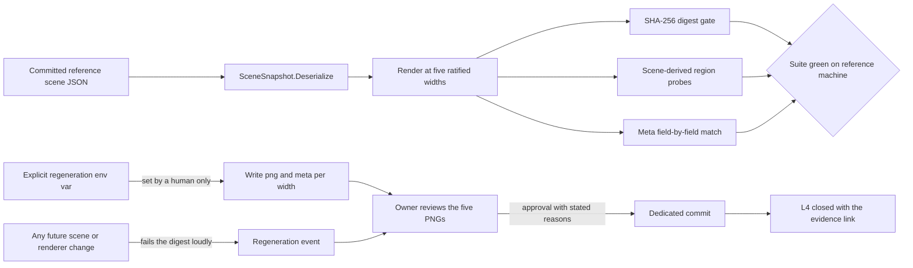

# R8.4 — representative render: work-item analysis and implementation plan

> **Plan status**: authored 2026-11-23 (architect mode) for owner review before
> implementation. Governing work item:
> [`../docs/work-items/R8.4-representative-render.md`](../docs/work-items/R8.4-representative-render.md)
> (Tier A, revised 2026-11-22 per the independent review
> [`phase8-plan-critical-review.md`](phase8-plan-critical-review.md), findings F2 and F3).
> **Owner rulings folded in (2026-11-23)**: the approved-widths list — the work item's
> explicit stop-point — is ratified as the proposed five (§3.1), and the baseline storage
> format is ruled digest + human-review PNG + metadata sidecar (§3.2).
> **Depends on**: R8.2/R8.2a/R8.3 landed; ADR-0070 and ADR-0071 approved; the committed
> golden scene [`../tests/golden/scene/reference-scene.json`](../tests/golden/scene/reference-scene.json).

---

## 1. Problem definition

**Outcome (work item).** The complete representative Gantt renders at several approved
widths with exact dimensions and human-approved golden baselines, and
[`../docs/KNOWN-LIMITATIONS.md`](../docs/KNOWN-LIMITATIONS.md) **L4** ("Golden PNG baseline
directory does not exist yet") is re-dated/closed against this row's first approved
representative render — the replacement gate the roadmap's Phase-3 note deferred here.

**What already exists (verified against source and [`../docs/STATUS.md`](../docs/STATUS.md),
2026-11-23).**

- The renderer: [`SceneRasterRenderer`](../src/GanttCreator.Raster/SceneRasterRenderer.cs)
  (R8.2), the pinned-font text branch and `HatchPatternPainter`/`StrokeDashMap` (R8.3), all
  pinned to SkiaSharp 4.157.0 by [ADR-0071](../docs/adr/0071-skia-raster-renderer-dependency.md)
  and the four Aptos faces by [ADR-0070](../docs/adr/0070-font-pinning.md).
- The fixture: the committed golden scene
  [`reference-scene.json`](../tests/golden/scene/reference-scene.json) — the R3.12 minimum
  visual reference fixture, 82 primitives, `ChartBounds` **600 × 326 pt** (aspect ≈ 1.84),
  guarded serialize-side by `GoldenSceneSnapshotTests` with the explicit
  `GANTTCREATOR_GOLDEN_OUT` regeneration route.
- The harness pattern: [`GoldenRasterBaselineTests`](../tests/GanttCreator.Raster.Tests/GoldenRasterBaselineTests.cs)
  (categories 1 and 3, host-free) and [`GoldenRasterTextBaselineTests`](../tests/GanttCreator.Raster.Tests/GoldenRasterTextBaselineTests.cs)
  (category 2, `Category=FontProbe`, `.identity` sidecar naming the four faces).
- The width authority: [`ExportSize`](../src/GanttCreator.Raster/ExportSize.cs) — the sole
  width parser and the single rounding boundary (the R8.1 feed contract).
- The six-baseline golden policy (test strategy "Golden images"): items 1–3 landed with
  R8.2/R8.3; **items 4–6 (representative construction; multi-event/milestone/delineator;
  narrow/wide aspects) are this row's remaining debt**, plus L4.

**What is missing (the problem to solve).**

1. No representative baseline exists: the committed scene has never been rendered at
   approved widths into human-approved, metadata-pinned golden artefacts.
2. Two review-mandated prerequisites are unlanded: the **snapshot round-trip guard** (F2)
   and the **EditableExport/Raster profile-equivalence pin** (F3). Without them, the
   baselines' fixture route (deserialize a committed scene) is unproven lossless, and the
   baselines' Raster-profile scene differs from R8.8's EditableExport production scene by
   an unproven label.
3. The approved-widths list was unspecified (stop-point) — **now ratified, §3.1**.
4. L4 is open, waiting for this row's evidence.

**Precise scope statement.** R8.4 is a **test-infrastructure and documentation row**: it
adds golden baselines, the comparison harness that guards them, two Core prerequisite
facts, and the L4/docs closure. It adds **no production code** — no renderer change, no
PNG encoding (R8.5/R8.6), no ribbon/command surface (R8.7/R8.8), no schema, catalogue, or
dependency change. The project boundaries therefore cannot move, and no new ADR is
required; the two owner rulings are recorded in this plan, the work item's Step-0 outcome
note, and [`../docs/STATUS.md`](../docs/STATUS.md) (the R8.1 rounding-ruling precedent —
owner rulings on test contracts land in the work item, not as ADRs).

---

## 2. Scope clarification

| In scope | Out of scope (owner of the excluded work) |
| --- | --- |
| `tests/golden/raster/` representative baselines: five ratified widths, artefact set per §3.2 | New rendering of any kind (R8.2–R8.3, landed) |
| The golden-comparison harness: exact dims, digest gate, region probes, metadata match, determinism, tolerance ladder | PNG encoding/metadata/atomic write (R8.5/R8.6 — the goldens compare raster output, not files) |
| The never-regenerate-in-CI guard with its **positive test** | Automatic baseline updates, ever (test-strategy rule) |
| Core fact: snapshot round-trip guard (F2) | Ribbon width controls and preview (R8.7) |
| Core fact: EditableExport/Raster profile-equivalence pin (F3) | The export command and live unwritable-path evidence (R8.8) |
| `KNOWN-LIMITATIONS` L4 closed with the evidence link | Any Office gate (roadmap row: **None**) |
| `REPO-MAP`, `STATUS`, work-item status line + Step-0 outcome note | Production `src/` changes of any project |

**Boundary statement.** Core gains test facts only; Raster gains test code and one csproj
copy entry; AddIn and Office are untouched. The architecture suite and the
`CoreBoundaryTests` forbidden-reference list need no change (no package, no reference).

---

## 3. Ratified decisions (owner, 2026-11-23)

### 3.1 The approved widths — ratified as proposed

The Phase-8 plan's preset-derived set, ratified without modification. Pixel dimensions are
**derived, never hand-typed**: each preset arm's width comes from
[`SizePresets`](../src/GanttCreator.Core/SizePreset.cs) `WidthPt` converted to cm at full
double precision (the 2.54 factor cancels in the cm→px conversion, so the pixel width
equals `WidthPt × 300 / 72` rounded once at `ExportSize`'s single boundary); the pixel arms
are the ratified literals.

| Arm | Width source | Width request | Exact pixels (600 × 326 pt scene) | Raw BGRA (inference, computed) |
| --- | --- | --- | --- | --- |
| A4 landscape | `SizePresets.A4Landscape.WidthPt` → cm | `29.7cm` | 3508 × 1906 | ~26.7 MB |
| Presentation 16:9 | `SizePresets.Presentation16x9.WidthPt` → cm | `45.15555555555556cm` | 5333 × 2898 | ~61.8 MB |
| Presentation 4:3 | `SizePresets.Presentation4x3.WidthPt` → cm | `36.12444444444444cm` | 4267 × 2318 | ~39.6 MB |
| Narrow | ratified literal | `800px` | 800 × 435 | ~1.4 MB |
| Wide | ratified literal | `2400px` | 2400 × 1304 | ~12.5 MB |

Coverage against the golden policy: the three preset arms are the print targets (item 4's
"representative construction" at production-relevant widths); the narrow/wide arms are
item 6's aspect extremes; the committed scene itself already carries item 5's content
(three stacked events on one lane, same-date milestones, two same-date delineators —
entity guide "Minimum visual reference fixture"). The 4:3 arm's 4267 (not 4266) is the
single-boundary rounding of 4266.67 and is pinned by the exact-dims assertion, so a wrong
derivation fails loudly rather than silently.

### 3.2 Baseline storage — digest + human-review PNG + metadata sidecar

Ruled over the committed-`.bgra` precedent. The measured reason: the five raw buffers
total ≈ 142 MB (largest single file ~62 MB — above GitHub's 50 MB warning), every future
regeneration re-commits that size, and a taller reference scene could push the largest arm
past GitHub's 100 MB per-file block. The ruled format:

- **`representative-<key>.png`** — the human-review reference image (D1's approval
  artefact; also the tolerance-fallback comparison source, §5.5).
- **`representative-<key>.meta`** — the D3 metadata sidecar **including the SHA-256 digest
  of the rendered BGRA buffer** (§5.3). The digest is the exact whole-buffer gate.
- No `.bgra`, no per-width scene JSON — the scene is the shared committed
  `tests/golden/scene/reference-scene.json` (zero fixture duplication, Revision A).

Trade-off accepted by the ruling: a digest failure names the width but not the pixels —
attribution comes from the scene-derived region probes (§5.4) and a local PNG diff, and
the tolerance fallback compares against the decoded PNG (§5.5).

---

## 4. Governing contracts and prior decisions

Source-of-truth order applied (AGENTS.md): the work item first, then the product
invariants, then the entity guide, then ADRs, then the roadmap/test strategy, then landed
code. The contracts this plan is bound by:

1. **Test strategy "Golden images"** — the six-baseline set; per baseline: scene fixture,
   pinned renderer/OS/culture/DPI/font/antialias, an exact-pixel region test for hard
   geometry, a documented small perceptual tolerance **only if** exact text pixels are
   unstable, a human-approved reference image; never regenerate automatically in CI; a
   baseline update is a separate commit whose message states why every changed image is
   correct.
2. **Entity guide "Minimum visual reference fixture"** — the committed scene's contents
   contract; the guide's Procurement row records the reference set resolves `HatchPattern`
   to `None`, so the representative baselines legitimately carry no hatch (category 3
   already covers hatch pixels with a synthetic style).
3. **Architecture "PNG renderer"** — exact scene bounds are the crop bounds, no
   surrounding whitespace; the renderer maps `scene.ChartBounds` to the canvas
   ([`RasterTransform.Create(scene.ChartBounds, dimensions)`](../src/GanttCreator.Raster/SceneRasterRenderer.cs)).
4. **ADR-0070** — the four pinned Aptos faces, fail-closed identity checks, and D4's
   reference-machine policy: font-dependent facts carry `Category=FontProbe` and are
   excluded from routine gates/CI (pinned by `ci-parity.Tests.ps1`).
5. **ADR-0071** — the renderer dependency and the measured technology selection.
6. **Roadmap Phase-3 note** — L4's replacement gate is this row's first approved
   representative render.
7. **R8.1 feed contract** — `ExportSize` is the sole width parser and the single rounding
   boundary; the harness consumes it and never restates its mathematics.

**Technology selection (comparative evaluation, already measured — this row adds no
technology).** The renderer-technology comparison was probed and recorded at R8.2 Step 0
and ADR-0071: SkiaSharp 4.157.0 (MIT, `net10.0` managed + native assets, deterministic CPU
raster) over `System.Drawing.Common` 11.0.0 (weaker GDI+ AA/DPI determinism),
`SixLabors.ImageSharp` 4.1.3 (split licence, Drawing lagging), Direct2D/WIC (raw COM) and
WPF `RenderTargetBitmap` (dispatcher). R8.4 rides that decision unchanged. The row's only
technology choice is the **baseline storage format**, evaluated and ruled in §3.2:

| Option | Exact gate | Tolerance fallback | Repo cost | Verdict |
| --- | --- | --- | --- | --- |
| Committed `.bgra` (categories 1–3 precedent) | byte compare, native | native (buffer compare) | ~142 MB now, ×N regenerations; largest file ~62 MB | Rejected (owner ruling) |
| **Digest + PNG + `.meta`** | SHA-256 over the rendered buffer | decoded-PNG compare, premul-aware tolerance | ~2–5 MB total | **Ruled (owner, 2026-11-23)** |
| Gzip-compressed `.bgra` container | byte compare after decompress | native | ~2–8 MB | Not chosen: a new container mechanism for no gain over the digest |

**Asynchronous workflow design — none, by design.** The row is a synchronous, host-free,
single-threaded test path: no COM, no Office host, no threads. The forbidden patterns
(`Task.Run` around COM, `Thread.Sleep`) cannot arise. The only workflow is the
human-approval lifecycle (§5.6).

---

## 5. Solution architecture

### 5.1 Fixture route (Revision A, verified lossless)

The representative suite loads the committed scene through the **public**
[`SceneSnapshot.Deserialize`](../src/GanttCreator.Core/Scene/SceneSnapshot.cs) — strict
parse, `JsonUnmappedMemberHandling.Disallow`, versioned — exactly as the review revised
the work item. The internal `ReferenceSceneFixture` is not referenced (it belongs to the
Core test project). One byte-pinned input, zero fixture duplication; any scene change
flows through the existing human-reviewed golden regeneration process and invalidates all
five baselines in one cascade (a recorded, accepted cost — §10 R4).

The Raster test project gains one copy entry beside the existing golden glob:

```xml
<None Include="..\golden\scene\reference-scene.json" Link="golden\scene\reference-scene.json">
  <CopyToOutputDirectory>PreserveNewest</CopyToOutputDirectory>
</None>
```

### 5.2 The width table and dimension derivation

A small code-owned table in the test file: five arms, each carrying its derivation
(preset member or ratified pixel literal) and its expected exact pixels. Every run
**re-derives** the width from `SizePresets` (never a hand-typed literal — the review's F5
discipline) and asserts `ExportSize.ToPixels(ExportSize.ParseWidth(derived), 600, 326)`
equals the recorded pixels. The `.meta` sidecar records the derived width string; the
compare path asserts recorded == re-derived, so a hand-edited width fails the dims
assert.

### 5.3 The `.meta` sidecar (D3's pinned metadata + the digest)

One file per width, key = value lines, written by the regeneration route and asserted
field-by-field by the compare path — every mismatch names its field:

```text
width=29.7cm
pixels=3508x1906
dpi=300
surface=cpu-raster
antialias=True
skiasharp=4.157.0.0
font-identity=<RasterDeterminism.FontIdentity — each used face's PostScript name, name-table version, upem>
os=<Environment.OSVersion.VersionString>
culture=<CultureInfo.CurrentCulture.Name>
digest=sha256:<lowercase hex of the rendered BGRA buffer>
mode=exact
```

`mode` records the D2 ladder state (§5.5). The `font-identity` line keeps ADR-0070 D5's
rule — a font change is a measured change. OS/culture/DPI are harness-side facts (the
producing environment), deliberately **not** new `RasterDeterminism` members: the
determinism descriptor stays the render-input authority (surface, antialias, library,
fonts), and the sidecar adds the environment the bytes were produced on. A different
machine fails loudly on the `os`/`font-identity` lines — that is D3's brittleness
mitigation working, not a defect.

### 5.4 The comparison layers

Per ratified width, in one new file
`tests/GanttCreator.Raster.Tests/GoldenRasterRepresentativeTests.cs`
(`[Trait("Category", "FontProbe")]` — the scene carries text, so the suite needs the
pinned Office cloud fonts and follows the category-2 exclusion from routine gates/CI; the
reference-machine command is
`dotnet test tests/GanttCreator.Raster.Tests -c Release --filter "Category=FontProbe"`):

1. **Exact dimensions** — `ExportSize.ToPixels` over the derived width equals the
   recorded pixels (the acceptance "exact dims").
2. **Digest gate** — SHA-256 over `RasterRenderResult.Pixels` equals the recorded digest
   (the exact whole-buffer gate; the strongest single assertion in the suite).
3. **Metadata match** — every `.meta` field equals the current run's facts
   (`RasterDeterminism` + environment), each mismatch naming its field.
4. **Hard-geometry region probes** — named regions derived from the scene's own geometry
   and style tokens (the chart background interior, an alternate-band interior, one
   activity-bar interior, one milestone-diamond interior), mapped through
   `RasterTransform.Create(scene.ChartBounds, dims)` and asserted **exact** at
   fully-opaque interior pixels. Tests may recompute expectations (renderers may not);
   the probes give the digest failure its attribution and satisfy D2's "region tests
   assert exact pixels for hard geometry". Probes deliberately avoid thin strokes and
   shape edges, whose antialiased pixels are partial-alpha by construction.
5. **Repeat-render determinism** — two renders at one width produce identical digests
   (in-process determinism at representative scale, extending the R8.3 probe's
   cross-process text-stability evidence).

### 5.5 The D2 text-tolerance ladder

Primary mode is `mode=exact`: the digest gates the whole buffer byte-exactly, text
included — viable because the R8.3 Step-0 probe measured byte-identical text renders
in-process and across two separate test processes for all four pinned faces. The
documented fallback fires **only on measured instability** at representative scale: the
harness then compares text-bearing regions against the **decoded committed PNG** with a
documented per-channel tolerance (initial value 2 per channel, recorded in the test
remarks with the measured reason), and the baselines are regenerated in `mode=text-tolerance`
— a dedicated, human-reviewed commit. The tolerance also absorbs the PNG container's
premul↔straight alpha round-trip delta (≤ 1 per channel on partial-alpha pixels — the
only pixels a tolerance region contains). A tolerance is never introduced to make a
failing exact comparison pass; it is introduced only when exactness is measured unstable,
and the switch is evidence.

### 5.6 The regeneration route and the no-auto-regeneration guard

Regeneration stays the explicit `GANTTCREATOR_RASTER_GOLDEN_OUT` route (the landed
mechanism, never set in CI): pointed at a directory, the suite writes exactly
`representative-<key>.png` + `representative-<key>.meta` per ratified width and nothing
else. The guard is made testable through one internal virtual seam
(`ResolveRegenerationDirectory`, the `WindowsClipboardFormatReader` precedent) and pinned
by **positive facts**:

- a tampered digest (the bad input constructed in the test) is **reported as a named
  mismatch** and the helper never reports `Regenerated` with the seam returning null —
  the comparison path fails rather than silently refreshing (the work item's positive
  test);
- a tampered metadata field fails with the field named;
- the regeneration route, seam-overridden to a temp directory, writes exactly the
  artefact set and a `.meta` that parses back.

The routine scripts already exclude `Category=FontProbe` (landed R8.2a, pinned by
`ci-parity.Tests.ps1`) — no script change; CI therefore never regenerates and never
compares these baselines, and the reference-machine run is the recorded evidence (the
R8.2a precedent: recorded, not hidden).

### 5.7 The Core prerequisite facts (F2 + F3, prerequisites of the baselines)

**F2 — the snapshot round-trip guard**
([`GoldenSceneSnapshotTests`](../tests/GanttCreator.Core.Tests/Scene/GoldenSceneSnapshotTests.cs),
the file that already owns the committed scene's serialize-side pin). Two directions, one
guard purpose ("a future `SceneText`/`SceneStyle` field fails loudly here instead of
silently defaulting in every deserialized baseline"):

1. **Byte identity** (the work item's wording): `Serialize(Deserialize(committed))` is
   byte-identical to the committed JSON. Catches a document field the
   `FromDocument` mapping drops or mis-maps — the re-serialize diverges, the guard fires.
2. **Scene-object equality** (the strengthening the wording's purpose requires):
   `Deserialize(committed)` equals, as a scene object, the fixture-built scene the file
   already produces. Catches the other direction — a model field never added to the
   snapshot document: the built scene carries the non-default value, the deserialized
   scene defaults it, record equality fails. Byte identity alone cannot see this
   direction (both serializations omit the field); the object comparison closes it, and
   the fixture is internal to the same test project, so the fact costs one assertion.

**F3 — the EditableExport/Raster profile-equivalence pin** (new
`tests/GanttCreator.Core.Tests/Scene/SceneProfileEquivalenceTests.cs`). The review verified
the profile gates in [`SceneBuilder`](../src/GanttCreator.Core/Scene/SceneBuilder.cs) test
only `== LiveExcel`; the pin makes the equivalence proven rather than assumed, because the
R8.4 baselines are a Raster-profile fixture scene while R8.8's production scene is
`EditableExport` via the resolver:

- the chart-only reference request built under both profiles serializes byte-identically
  (compared through `SceneSnapshot`, the strongest form);
- a panel-carrying export request (the R6.3 `CreateExport` shape) under both profiles
  serializes byte-identically;
- a **sensitivity control** proving the comparison can detect a profile change: the same
  request under `LiveExcel` differs (the recorded discriminator is the `chart:plot:bottom`
  geometry, ADR-0068 D11 — inset half a stroke on the live sheet, exact on the export
  boundary). Without this control the pin could pass vacuously.

### 5.8 Project boundaries and dependencies

| Project | Change | Kind |
| --- | --- | --- |
| Core | none in `src/` | — |
| Raster | none in `src/` | — |
| Core.Tests | round-trip guard + profile-equivalence pin | test |
| Raster.Tests | `GoldenRasterRepresentativeTests` + csproj copy entry | test |
| AddIn / Office | untouched | — |
| docs | KNOWN-LIMITATIONS L4, REPO-MAP, STATUS, work-item status | docs |

No new package, reference, schema version, or catalogue value. The architecture suite and
`ProtectionGuardFirstTests` need no registration (no mutating adapter). The mutation gate
in `verify.ps1` judges no changed Core production files (test-only row — the R7.7
precedent for the empty changed-Core set).

### 5.9 The baseline lifecycle



---

## 6. API contracts consumed (existing seams — no new production API)

| Seam | Contract this row relies on |
| --- | --- |
| [`SceneSnapshot.Serialize`](../src/GanttCreator.Core/Scene/SceneSnapshot.cs) / `Deserialize` | strict, versioned, canonical; the fixture route and both Core facts |
| [`SceneRasterRenderer.Render`](../src/GanttCreator.Raster/SceneRasterRenderer.cs) | pure host-free walk; maps `scene.ChartBounds` to the passed `PixelDimensions`; returns `Pixels` + `Determinism` |
| [`ExportSize.ParseWidth`](../src/GanttCreator.Raster/ExportSize.cs) / `ToPixels` | the sole width parser and the single rounding boundary (R8.1 feed contract) |
| [`RasterDeterminism`](../src/GanttCreator.Raster/RasterDeterminism.cs) | surface, antialias, SkiaSharp version, `FontIdentity` — the `.meta` render-input fields |
| [`SizePresets`](../src/GanttCreator.Core/SizePreset.cs) | the preset arms' width source, never new literals |
| `SceneCompositionProfile` | the equivalence pin's two non-live members and the `LiveExcel` control |
| `GANTTCREATOR_RASTER_GOLDEN_OUT` | the explicit regeneration route (unchanged mechanism, extended writer) |

---

## 7. Phased task breakdown

Sequenced by dependency; no effort estimates (policy). Each phase ends green.

**Phase 0 — Step 0 verification (no code).**
Confirm R8.3's landed state (the REPO-MAP entry still says "in progress" while the STATUS
top entry records the text branch landed 2026-11-23 — verify the tree, and if the map is
stale it is corrected in Phase 4's docs commit); confirm ADR-0070/0071 are approved;
confirm the committed-scene guards are green (`GoldenSceneSnapshotTests`,
`SceneBuilderTests.BuildScene`); confirm the FontProbe exclusion wiring
(`test-non-office.ps1`, `verify.ps1`, `ci-parity.Tests.ps1`). Record the Step-0 outcome in
the work item.

**Phase 1 — the Core prerequisite facts (F2 + F3).**
The round-trip guard's two directions in `GoldenSceneSnapshotTests`; the
profile-equivalence pin's three facts in the new `SceneProfileEquivalenceTests`. Targeted
run: `dotnet test tests/GanttCreator.Core.Tests`. **Deliverable: commit 1** (`test:` —
Core test-only; the prerequisites are green before any baseline exists, which is what
"prerequisite" requires).

**Phase 2 — the harness.**
The width table with its derivation rule; the csproj copy entry; the representative suite
(dims, digest, metadata, region probes, determinism); the `.meta` writer/reader; the
regeneration seam and the guard positives. The suite is written against baselines that do
not exist yet — it is expected to fail (the TDD red state) until Phase 3 generates them.

**Phase 3 — generation and human approval (D1).**
On the reference machine, run the regeneration route for the five widths; measure and
record the actual PNG sizes (the ~2–5 MB total is an inference until measured); the owner
reviews the five PNGs against the entity guide's visual contracts and **approves with the
per-image reasons recorded**. An agent never approves its own rendered output.

**Phase 4 — commit and docs closure.**
**Deliverable: commit 2** — the five approved baseline sets + the harness + the docs
closure: `KNOWN-LIMITATIONS` L4 closed with the evidence link (the commit and the approved
baseline set); the REPO-MAP R8.4 entry points (the suite, the artefact set, the copy
entry, the Core facts, the ratified width table, and the R8.3 staleness fix if Phase 0
found it); the STATUS entry with observed outputs; the work-item status line and Step-0
outcome note carrying both owner rulings. The commit message states why each of the five
images is correct (D1).

**Phase 5 — gates.**
`dotnet build GanttCreator.slnx /p:Configuration=Release /warnaserror` (0 warnings);
`dotnet test tests/GanttCreator.Core.Tests`; the reference-machine
`--filter "Category=FontProbe"` run green; `pwsh ./scripts/verify-quick.ps1` host-free
green (FontProbe excluded by the landed wiring); `git diff --check` clean; branch-final
`pwsh ./scripts/verify.ps1` on the clean tree when this row closes the branch. **No Office
gate — roadmap row: None.** Self-certify checklist sections **G, I** and name them in the
commit message.

---

## 8. TDD strategy — acceptance-criteria traceability

| Acceptance criterion (work item) | Test | Layer | Notes |
| --- | --- | --- | --- |
| Visual-diff at approved widths, **exact dims** | `The_representative_scene_renders_at_every_approved_width_with_exact_dimensions` (Theory × 5) | Raster, FontProbe | dims via `ExportSize.ToPixels` over the derived width — never restated |
| **Region exactness** (D2 hard geometry) | `..._hard_geometry_regions_are_exact` (Theory × 5) | Raster, FontProbe | scene-derived opaque-interior probes; attribution for the digest |
| **Text tolerance** (D2, only if unstable) | the §5.5 ladder; `mode=` in `.meta` | Raster, FontProbe | primary is byte-exact (R8.3 probe evidence); the tolerance is a measured switch, never a green-making device |
| **Metadata-match assertion** (D3) | `..._metadata_matches_the_recorded_run` (Theory × 5) | Raster, FontProbe | field-by-field, mismatch names the field |
| **No-auto-regeneration guard — positive test** | `A_tampered_digest_is_reported_as_a_mismatch_and_never_regenerates` + `A_tampered_metadata_field_fails_with_the_field_named` + `The_regeneration_route_writes_exactly_the_artefact_set` | Raster, FontProbe | bad inputs constructed in the test; the repo's validator-positive rule applied to test infrastructure |
| **Snapshot round-trip guard** (F2, Core, same change) | `The_committed_scene_survives_the_serialize_deserialize_round_trip` + the object-equality arm | Core | the fixture route's losslessness proof |
| **EditableExport/Raster profile equivalence** (F3, Core, same change) | `The_builder_emits_identical_output_for_the_raster_and_editable_export_profiles` (chart-only + panel arms) + the `LiveExcel` sensitivity control | Core | the baselines' profile label is proven equal to production's |
| Determinism at representative scale | `A_repeated_render_at_one_width_produces_an_identical_digest` | Raster, FontProbe | extends the R8.3 cross-process stability probe |
| L4 closure (D4) | the Phase-4 docs diff itself | docs | evidence link in the row |

Unit/integration/end-to-end positioning, stated honestly: this row's entire automated
surface is **unit-level and host-free** (Core facts + the Raster suite on the reference
machine); there is no integration or end-to-end layer because the roadmap row's Office
gate is None and the production command that would consume these widths is R8.8. The
"end-to-end" proof this row owns is the human-approved representative render itself — the
product's common visual comparison across renderers, per the entity guide.

---

## 9. Risks, assumptions, mitigations

| # | Risk / assumption | Mitigation |
| --- | --- | --- |
| R1 | Baseline brittleness across machines (the work item's main risk) | Pinned `.meta` metadata asserted per run (a different OS/font fails loudly, naming the field); `Category=FontProbe` keeps CI from false-reading a fontless runner; baselines are reference-machine artefacts by policy (ADR-0070) |
| R2 | Text instability at representative scale breaks the exact digest | Not expected — the R8.3 probe measured byte-identical text across processes for all four faces; the §5.5 ladder switches to the decoded-PNG tolerance only on measured instability, as a dedicated human-reviewed commit |
| R3 | Premul↔straight round-trip delta in the tolerance arm's PNG container | The tolerance (2/channel) absorbs the ≤1/channel delta on partial-alpha pixels; if the arm fires, a probe fact records the measured delta |
| R4 | Scene-regeneration cascade: any scene change invalidates the golden scene and all five baselines in one event | Accepted cost of the byte-pinned fixture route (Revision A); the cascade is one dedicated, human-reviewed regeneration commit — the same policy the golden scene already follows |
| R5 | Digest-only gate gives no pixel attribution | Region probes (scene-derived) + the committed PNG for local diffing; the `.meta` mismatch names its field |
| R6 | A wrong width derivation silently shifts dims | The derivation rule (§3.1) plus the exact-dims assert: 4267-not-4266 is pinned, and a hand-edited `.meta` width fails the recorded==re-derived assert |
| R7 | R8.3's REPO-MAP entry says "in progress" while STATUS records it landed | Phase 0 verifies the tree; the docs commit corrects the map if stale (the map's own rule) |
| A1 | Assumption: R8.3 fully landed (text + hatch + dash + category 1–3 goldens) | Phase 0 verifies before any baseline work |
| A2 | Assumption: the reference machine has the four pinned Aptos faces at the ADR-0070 D2 identities | The FontProbe run's identity facts fail closed otherwise (fail-closed is the design) |
| A3 | Assumption: no `src/` production change is needed | Verified against `RasterDeterminism` (the sidecar carries OS/culture/DPI harness-side); if implementation discovers a need, that is a stop-and-report, not a silent addition |

---

## 10. Definition of done

From the work item + `AGENTS.md` + checklist sections **G, I**:

- The five ratified baselines exist under `tests/golden/raster/` (`.png` + `.meta` each),
  **human-approved**, with the commit message stating why each image is correct.
- The visual-diff suite green on the reference machine (FontProbe run); the routine gate
  green host-free; the two Core prerequisite facts green; the round-trip guard and the
  profile-equivalence pin landed in the same change.
- `KNOWN-LIMITATIONS` L4 closed with the evidence link; REPO-MAP/STATUS/work-item status
  current; the two owner rulings recorded.
- Release build 0 warnings; XML docs on the new test types (the documented-test-class
  convention the existing golden files follow); `git diff --check` clean.
- Branch-final `verify.ps1` observed when the row closes the branch; the mutation gate
  judged no changed Core production files (test-only row). Any gate not run is reported
  `Not run` with the reason.
- Handoff in the `06-llm-protocol` format: `Outcome / Changed / Proof / Office / Risk /
  Deferred / Next`.

---

## 11. Evidence ledger

| Statement | Status | Evidence |
| --- | --- | --- |
| The six-baseline golden policy; pinned metadata; human approval; never auto-regenerate; separate-commit updates | fact | test strategy "Golden images" |
| L4's replacement gate is this row's first approved representative render | fact | roadmap Phase-3 note + KNOWN-LIMITATIONS L4 |
| Exact scene bounds are the crop bounds; the renderer maps `scene.ChartBounds` | fact | architecture + [`SceneRasterRenderer`](../src/GanttCreator.Raster/SceneRasterRenderer.cs) |
| The committed scene's `ChartBounds` are 600 × 326 pt; 82 primitives; Raster profile | fact | [`reference-scene.json`](../tests/golden/scene/reference-scene.json) + `SceneBuilderTests` |
| The snapshot fixture route is lossless today (`LeftInsetPt`, `TextColour`, `StrokeDash`, `HatchPattern`, font fields) | fact | the review's §2 re-verification |
| Profile gates in `SceneBuilder` test only `== LiveExcel` | fact | the review's source verification |
| Text renders byte-identical in-process and across processes for all four pinned faces | fact | R8.3 Step-0 probe (STATUS 2026-11-23) |
| The approved widths are the five in §3.1 | fact (owner ruling, 2026-11-23) | this session's ratification |
| The storage format is digest + PNG + `.meta` | fact (owner ruling, 2026-11-23) | this session's ratification |
| The five raw buffers total ≈ 142 MB; largest ~62 MB; exact pixel dims per §3.1 | inference (computed from the scene aspect, not yet rendered) | §3.1 table; measured at Phase 3 |
| The committed PNGs total ~2–5 MB | inference | to measure at Phase 3 |
| Premul↔straight PNG round-trip delta ≤ 1 per channel on partial-alpha pixels | inference | probe if the tolerance arm fires |
| R8.3 fully landed | assumption A1 | Phase 0 verifies (REPO-MAP/STATUS divergence) |
| Text stays byte-stable at representative scale | expectation, not a fact | the digest gate decides; the §5.5 ladder is the fallback |
