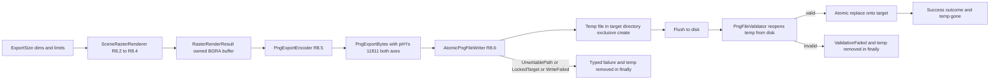

# R8.5 + R8.6 — PNG encode/metadata and atomic write/validator: work-item analysis and implementation plan

> **Plan status**: authored 2026-11-23 (architect mode) for owner review before
> implementation. Governing work items:
> [`../docs/work-items/R8.5-png-metadata.md`](../docs/work-items/R8.5-png-metadata.md)
> and [`../docs/work-items/R8.6-atomic-write-validator.md`](../docs/work-items/R8.6-atomic-write-validator.md)
> (both Tier A, upgraded 2026-11-22 at the Phase-7 exit; R8.6 revised the same
> day per [`phase8-plan-critical-review.md`](phase8-plan-critical-review.md)
> findings F7–F9 and review Revisions B and C). **Depends on**: R8.1–R8.4
> landed (R8.4 branch-final gate green on commit `9467843d`, 2026-11-23);
> SkiaSharp 4.157.0 pinned by
> [ADR-0071](../docs/adr/0071-skia-raster-renderer-dependency.md). **Branch**:
> `feat/r8-png-export` (continues the Phase-8 branch). **Two roadmap rows =
> two commits**; this one plan covers both because R8.6 consumes R8.5's bytes
> and the owner review is one session. **Critical review folded in
> (2026-11-23)**:
> [`R8.5-R8.6-plan-critical-review.md`](R8.5-R8.6-plan-critical-review.md)
> (judgment *approve with revisions*); findings W1–W13 are folded into this
> revision, and CP2 carries the review's adjusted recommendation.

---

## 1. Problem definition

**Outcome (R8.5 work item).** The PNG encoder writes the `pHYs` 300-DPI
metadata chunk correctly — exact chunk order, valid CRCs, metre unit, `11811`
pixels per metre on both axes (subject to integer rounding) — pinned by
chunk/CRC/unit/value tests that parse the produced bytes directly, with no
image-library trust.

**Outcome (R8.6 work item).** PNGs are written through an atomic path and
every write is re-validated — signature, dimensions, density, non-empty
content — with corrupt, locked, invalid, and partial-file failures proven safe
(no partial file left, one actionable error, one technical record).

**What already exists (verified against source and
[`../docs/STATUS.md`](../docs/STATUS.md), 2026-11-23).**

- The pixel source: [`SceneRasterRenderer`](../src/GanttCreator.Raster/SceneRasterRenderer.cs)
  (R8.2/R8.3) renders a text-free or text-bearing scene host-free into a
  [`RasterRenderResult`](../src/GanttCreator.Raster/RasterRenderResult.cs) —
  an owned, disposable BGRA `SKBitmap` wrapper whose
  [`Pixels`](../src/GanttCreator.Raster/RasterRenderResult.cs) span is the
  encode input. R8.4 proved the full representative render at five ratified
  widths (3508×1906 … 2400×1304) with digest-pinned baselines.
- The size authority: [`ExportSize`](../src/GanttCreator.Raster/ExportSize.cs)
  — the sole width parser, `Dpi = 300`, `CmPerInch = 2.54`, per-axis 65,535 and
  total 100,000,000-pixel limits, and the single rounding boundary. `IHDR` dims
  come from here; R8.5 adds no second arithmetic.
- The encode primitive: the R8.2 Step-0 spike (deleted after recording)
  already proved pinned SkiaSharp 4.157.0 encodes a CPU `SKBitmap` to PNG
  host-free with an exact signature and `300x150` IHDR. What the spike did
  **not** establish is the encoder's `pHYs` behaviour — the R8.5 ledger marks
  that `unknown until probed`, and the review's F9 forbids assuming it.
- The downstream consumer: R8.8's D1 pipeline is already fixed —
  `ExportSize → render → encode+metadata (R8.5) → atomic write + validate
  (R8.6) → success only after validation` — with the AddIn gaining its first
  Raster project reference there. R8.5/R8.6 therefore land **library code with
  no UI and no command**, and their public contracts must be shaped for that
  consumption.
- The failure-injection obligation: test-strategy "Failure injection" and
  checklist K name this row's stages explicitly — *file dialog, temporary
  file, encode, metadata, move, and validation* — with the dialog assigned to
  R8.8 (Revision B) and the rest owned here.
- The owed-gate convention: R8.6's live unwritable-path case is **Required and
  owed until R8.8's exit evidence** (Revision C, F8) — recorded in STATUS,
  never silently unrun.

**What is missing (the problem to solve).**

1. No PNG byte production exists in `src/` at all: the Raster project can
   render pixels but cannot emit a PNG file, and nothing anywhere writes
   `pHYs` density metadata.
2. No file-writing path exists: nothing writes an export to disk, no atomic
   replace discipline exists, and no post-write validator re-opens a written
   file.
3. Two Step-0 facts are unknown and decide the design: (a) the pinned
   encoder's actual `pHYs` behaviour; (b) the exact Windows same-volume
   replace semantics (`File.Replace` vs `File.Move`) and the sharing-violation
   exception shape on a locked target.
4. The Phase-8 exit matrix row (**unwritable PNG path**) needs its host-free
   failure arm proven now so R8.8 can discharge the live arm.

**Precise scope statement.** R8.5 and R8.6 are **pure Raster-library rows**:
they add the encode/metadata step and the atomic write/validate step of the
export pipeline inside `src/GanttCreator.Raster/` plus tests in
`tests/GanttCreator.Raster.Tests/`. No UI (R8.7), no command or file-dialog
port (R8.8), no pixel/rendering change (R8.4), no Core/Office/AddIn change,
no new package dependency, no schema or catalogue change. The project
boundaries cannot move; the architecture suite needs no new fact.

---

## 2. Scope clarification

| In scope | Out of scope (owner of the excluded work) |
| --- | --- |
| R8.5: PNG encode of a `RasterRenderResult` + `pHYs` 300-DPI metadata with byte-level pins | File writing of any kind (R8.6) |
| R8.6: atomic temp-then-replace writer + post-write validator + typed failure taxonomy | UI, ribbon controls, preview (R8.7) |
| R8.6: host-free failure matrix — corrupt, locked, invalid, partial, unwritable-path refusal | The file-dialog port and Export PNG command (R8.8, Revision B) |
| Step-0 probes: encoder `pHYs` behaviour; Windows replace/lock semantics | The live unwritable-path demonstration (R8.8 exit evidence, Revision C — recorded as owed here) |
| Test-side independent byte parser (no library trust, no production-parser trust) | Pixel/geometry changes (R8.4, landed) |
| `REPO-MAP`, `STATUS`, work-item Step-0 outcome notes, status lines | New production dependencies (System.IO.Hashing or any PNG library — rejected, §4.3) |
| | Network paths, truncate-then-write, success before validation (exclusions, R8.6) |

**Boundary statement.** Raster gains production files and tests; Core,
Office, and AddIn are untouched. Raster keeps exactly its two references
(Core project + SkiaSharp packages); no `PackageReference` is added, so
`Directory.Packages.props` is unchanged and ADR-0071 remains the complete
dependency record for the raster pipeline. The writer uses only BCL
`System.IO`; the file-dialog boundary stays injected-and-absent until R8.8.

---

## 3. Solution architecture

### 3.1 Pipeline position

The two rows complete the middle of the Phase-8 export pipeline. Everything
upstream is landed; everything downstream is already contracted by R8.8's
Tier-A guide.



### 3.2 Execution model — synchronous by design

Phase 8 ships **synchronous** execution on Excel's STA command thread (review
F7, ratified as R8.8 D6): no `Task.Run`, no background encode, no cancellation
surface. Cancellation/deadline for long non-COM operations is R9.1's row and
consumes R8.6's writer as its "longest non-COM operation" seam. The
worst-case legal frame is bounded by `ExportSize.MaxTotalPixels`
(100,000,000 px ≈ 400 MB BGRA); typical widths are ~3–10M pixels. This plan
adds no threading and records the trade rather than inventing any.

### 3.3 Project decomposition

| New unit | Row | Responsibility |
| --- | --- | --- |
| `PngCrc32` | R8.5 | The one CRC-32 authority (table-driven, standard check value pinned) |
| `PngChunkReader` (internal) | R8.5 | Byte-level chunk walk: signature, length/type/data/CRC, order |
| `PngExportEncoder` | R8.5 | Encode `RasterRenderResult` → PNG bytes; guarantee `pHYs` per the probe-decided strategy |
| `PngExportBytes` | R8.5 | Immutable encode output: bytes + expected `PixelDimensions`; density is pinned by the encoder contract, never carried per-instance (W3) |
| `PngFileValidator` | R8.6 | Re-open a written file from disk; signature/IHDR-dims/pHYs/non-empty summed IDAT/CRC checks |
| `AtomicPngFileWriter` | R8.6 | Temp-then-replace write with the typed failure taxonomy and `finally` cleanup |
| `PngWriteOutcome` / `PngWriteRefusal` | R8.6 | Closed typed result set; one actionable message + one technical record each |

Names are proposals the implementation may adjust; the contracts below are
the binding part. Every public member carries XML documentation (CS1591 is
warnings-as-errors).

---

## 4. Design decisions and comparative evaluation

### 4.1 PNG production route — scene-first raster, not Excel-native export

The roadmap's Phase-8 goal states the route outright: *"export an exact-size
PNG from the scene without depending on the Excel clipboard."* The
alternatives were evaluated when R8.2 landed and are recorded here because
this row is where the bytes first exist:

| Route | Verdict | Reason |
| --- | --- | --- |
| Excel-native `Chart.Export` / clipboard paste-then-save | Rejected | Clipboard dependence (the phase goal forbids it); no control over `pHYs` density or exact crop; host-coupled, untestable host-free |
| Open XML SDK / VSTO document generation | Rejected | Wrong layer: the PNG is a raster of the scene, not a document; VSTO adds a second add-in technology the architecture never sanctioned |
| Scene-first CPU raster (SkiaSharp) → PNG encode | **Chosen (landed R8.2–R8.4)** | Host-free, deterministic, exact-pixel pinned, density controlled at the byte level — which is exactly what R8.5 needs |

R8.5/R8.6 continue the chosen route; no Excel automation is involved in
producing or writing the file, which is why both rows' gates are host-free.

### 4.2 R8.5 encoder strategy — the Step-0 probe decides inside a pre-ruled tree

The work item's Step 0 mandates probing the pinned SkiaSharp 4.157.0 encoder's
`pHYs` behaviour **before** any strategy is coded, and F9 forbids prose that
pre-assumes the outcome. The decision tree, with the boundaries already ruled:

| Probe outcome | Strategy | Status |
| --- | --- | --- |
| Encoder already writes correct `pHYs` (11811/11811, unit 1) | Verify-and-pass-through; tests pin the values | In-tree, no extra code |
| Encoder writes wrong or missing density | **Post-encode chunk patcher**: parse the encoder's own output; if a `pHYs` is already present, **replace it in place** — inserting a second would make the PNG invalid (W4) — otherwise insert a spec-ordered `pHYs` after `IHDR` before the first `IDAT`; compute the new chunk's CRC, leave every other chunk byte-identical; the wrong-density-present arm is positive-tested | In-tree — the review explicitly rules this is *not* the stop-condition boundary |
| Patching proves impossible on the encoder's output shape | Minimal writer reusing the encoder's `IDAT` stream (signature + `IHDR` + `pHYs` + `IDAT` + `IEND` assembled around it) | In-tree, larger diff; record in work item + STATUS |
| Either fallback grows into a full custom PNG encoder (own `IDAT` compression) | **Stop condition** — the work item's own stop: a bigger dependency surface than the row implies; the human decides | Stop and ask |

The working hypothesis (review §3, ledger-marked *inference*) is the patcher:
Skia's public encode APIs expose no density knob. The probe is a **disposable
spike** — run, output quoted in the work item's Step-0 note, deleted — the
R8.2/R8.3 precedent. It is not a permanent test because the landed byte-level
pins themselves guard the behaviour forever after: a package bump that changes
density behaviour fails `PngMetadataTests` loudly.

PNG spec facts (chunk layout, CRC-32 algorithm, `pHYs` 9-byte layout, the
before-`IDAT` ordering rule, the 300 DPI → 11811 px/m integer conversion) are
re-read from the primary source at implementation and cited in the evidence
row — per the work item, not from memory or from this plan.

### 4.3 CRC-32 authority — hand-rolled, no new package

| Option | Verdict | Reason |
| --- | --- | --- |
| `System.IO.Hashing` NuGet (`Crc32`) | Rejected | A new production dependency trips the AGENTS.md stop condition for no gain |
| Hand-rolled table-driven CRC-32 | **Chosen** | ~30 lines, zero dependencies, pinned by the standard check vector (`"123456789"` → `0xCBF43926`) plus per-chunk recomputation tests |

One authority (`PngCrc32`) serves the patcher, the validator, and nothing
else; tests recompute CRCs through their own independent implementation
(§9.2), so a wrong table fails both directions.

### 4.4 R8.6 atomic mechanism — temp-then-replace on the same volume

| Option | Verdict | Reason |
| --- | --- | --- |
| Truncate-then-write the target | **Forbidden** (row exclusion) | A partial file appears at the user's path — exactly the failure class the row exists to prevent |
| Write temp → `File.Replace` onto existing target; `File.Move` for a new target | **Chosen (D1)** | Atomic on NTFS within one volume; the temp lives **in the target directory**, so same-volume is by construction; `File.Replace` needs an existing destination, `File.Move` refuses one — the writer branches on target existence |
| Write temp in `%TEMP%` → cross-volume move | Rejected | Cross-volume moves are copy+delete, not atomic |

**Validate-before-replace (D1/D2 reconciliation).** D1's sequence is binding:
write temp → flush to disk (`FileStream.Flush(true)`) → **validator re-opens
the temp file from disk** (never the in-memory buffer — D2's point is that
success is grounded in bytes that exist on disk) → atomic replace → success.
Invalid bytes therefore never reach the target path at all, which is strictly
stronger than replace-then-validate and leaves no non-atomic window. The
validator's read-back is the "never report success without verification" rule
applied to files, the file-side twin of R7.3's paste verification.

The validator's CRC recompute is a **deliberate, recorded superset** of the
architecture's four checks (signature, dimensions, density, non-empty): the
row's own corrupt matrix arm cannot be caught by those four alone, and D2's
"non-empty-IDAT/decode check" anticipates exactly this strength — recorded
here so a future reader does not mistake it for contract drift. The existence
branch (Move for a new target, Replace for an existing one) has a
check-then-act race: the target can appear between check and Move. A wrong
guess fails cleanly as a typed `IOException`-mapped outcome, never a partial
write — accepted and stated (W13).

**Step-0 probe (R8.6).** Verify on the reference machine: `File.Replace`
atomicity and exception shape on an NTFS target; `File.Move` refusal on an
existing destination; the sharing-violation exception (and HRESULT) raised by
`File.Replace`/`File.Move` against a target held with `FileShare.None`; and
`Flush(true)` behaviour. Disposable spike, output quoted in the work item —
the R8.2/R8.3 precedent. If atomic replace proves non-atomic on the target
volume/OS combination, that is the row's own stop condition: stop and ask
before any validate-then-delete fallback.

### 4.5 Typed failure taxonomy (D3) and exception mapping

Closed refusal set, one actionable message + one redaction-ready technical
record each (operation ID is stamped by the command boundary in R8.8; the
record carries stage, reason, and the exception class/HRESULT — never
schedule content):

| Refusal | Detected by | Deterministic host-free test arm |
| --- | --- | --- |
| `UnwritablePath` | Pre-checks + `UnauthorizedAccessException`, `DirectoryNotFoundException`, `NotSupportedException` (invalid chars/parent-is-a-file) | Path with illegal characters; target whose parent path is an existing **file**; read-only attribute on an existing target — **probe-dependent** (W5): 0.3 pins the read-only-destination outcome before this arm asserts a typed refusal |
| `LockedTarget` | Sharing-violation `IOException` on replace (probe pins the HRESULT) | Target held open with `FileShare.None` for the write attempt |
| `WriteFailed` | Any other `IOException` class (disk-full-class) | Seam-injected mid-write `IOException` |
| `ValidationFailed` | Validator rejects the temp bytes (signature/dims/density/empty-IDAT/CRC) | Seam-fed corrupt bytes: wrong dims, wrong density, empty `IDAT`, flipped CRC |

Argument faults (null bytes, empty path, dims mismatch against the bytes'
`IHDR`) throw `ArgumentException`-family exceptions — the repo's convention
for contract faults (the `Render` precedent) — each with a positive test.
Operational faults return typed outcomes — the "expected user/data errors
return typed results" rule. No catch-and-ignore anywhere; the `finally`
removes the temp on every failure arm (D1's positive test asserts the target
is byte-identical after an injected mid-write failure).

### 4.6 Failure-injection seams (checklist K)

The writer takes an optional **public** seam — the `PinnedFontSource?`
injection precedent from `Render`, a public parameter on a public member, so
no `InternalsVisibleTo` is introduced (W6):

```text
Write(PngExportBytes png, string targetPath, PngWriteSeam? seam = null)
```

`PngWriteSeam` exposes delegates for temp-stream creation and the replace
step, defaulting to the real BCL calls. Tests inject: create-failure,
mid-write failure after N bytes, flush failure, replace failure, and
validator-rejecting bytes. No `Thread.Sleep`, no timing games — every arm is
a synchronous injected exception.

### 4.7 Temp-file security

The temp name uses `Path.GetRandomFileName()` (cryptographically strong) with
an exclusive `File.Create` — a predictable temp name in a user-writable
directory is a pre-create/symlink TOCTOU hazard. The temp is removed in
`finally` on every path. No network paths (row exclusion — the writer never
validates or special-cases UNC beyond the typed failure mapping). Technical
records carry the target path (user-chosen, not schedule content) and never
pixel or scene data.

A process crash between temp creation and the `finally` can strand a
random-named temp in the target directory; in-scope cleanup is impossible
(random names cannot be distinguished from user files), so this is a
recorded, accepted residue owned by R9.7's crash-recovery matrix
consolidation.

### 4.8 Existing-file policy (D4) — recorded, not re-litigated

Replacing an existing file at the user-chosen path is the explicit
consequence of the user choosing that path in R8.8's dialog; the atomic
replace is the mechanism. No confirm-dialog is invented here (R2.7a governs
destructive *data* commands; this is a user-initiated file save). The success
test with a pre-existing, different-content target pins: replaced atomically,
old content gone, no backup residue.

---

## 5. API contracts (proposed; binding shape, adjustable names)

```text
// R8.5 — density is pinned by the encoder contract (11811 px/m, unit 1),
// never duplicated as per-instance DPI fields (W3).
public sealed record PngExportBytes(
    byte[] Bytes,
    PixelDimensions Dimensions);

public static class PngExportEncoder
{
    // Encode result → PNG bytes with pHYs 11811/11811 unit 1, chunk order legal.
    // Throws ArgumentException-family on contract faults (null result,
    // non-positive dims). Never writes a file.
    public static PngExportBytes Encode(RasterRenderResult result);
}

// R8.6
public enum PngWriteRefusal { UnwritablePath, LockedTarget, WriteFailed, ValidationFailed }

// On Succeeded: Refusal is null. On failure: Refusal, ActionableMessage and
// TechnicalRecord are all non-null and non-empty — asserted by every
// failure-arm test (W11).
public sealed record PngWriteOutcome(bool Succeeded, PngWriteRefusal? Refusal,
    string? ActionableMessage, string? TechnicalRecord);

public sealed class AtomicPngFileWriter
{
    // Temp in target dir → flush(true) → validate temp from disk → atomic
    // replace → success. Temp removed in finally on every failure arm.
    public PngWriteOutcome Write(PngExportBytes png, string targetPath,
        PngWriteSeam? seam = null);
}

public sealed class PngFileValidator   // also directly testable
{
    // Re-reads bytes from a file path: signature, IHDR dims == expected,
    // pHYs 11811/11811 unit 1, non-empty summed IDAT across all IDAT
    // chunks (W8), recomputed chunk CRCs.
    public PngValidationResult Validate(string path, PixelDimensions expected);
}
```

Consumption contract with R8.8 (already fixed by its D1): the command calls
`Encode` then `Write`, reports success only after `Write` returns
`Succeeded`, and logs the technical record through the command boundary with
an operation ID. R8.7 consumes nothing here (it previews `ExportSize` output
only).

---

## 6. Cross-cutting concerns

**Validation.** Three layers, each with positive tests: (1) encode-input
contract (result non-null, dims positive and matching the bitmap); (2) chunk
structure of the encoder's own output before patching (signature, `IHDR`
first, `IDAT` present, `IEND` last — a malformed-encoder-output arm proves
the guard fires); (3) the written file (validator, §4.4). All numeric code
follows checklist A: culture-invariant, no unguarded `double`→`int` casts.
The 11811 conversion is **double** arithmetic over the `const double`
`ExportSize.Dpi` and `CmPerInch` — `300 × 100 / 2.54 = 11811.0236…` —
rounded once through one guarded `Math.Round` at a single boundary (W1: never
described as integer arithmetic).

**Error handling.** Typed outcomes for operational faults; thrown
`ArgumentException`-family for contract faults; one command boundary (R8.8)
translates and logs. No message boxes, no scattered lower-layer messaging.

**Observability.** Raster stays log-free: failures carry their technical
record as data; the AddIn boundary logs it (operation ID, stage, HRESULT —
the architecture's COM/logging convention applied at the file stage). The
success record states path + exact dimensions (counts/sizes only).

**Security.** §4.7. Additionally: exclusive-create temp, atomic replace (no
window where the target is absent *and* being written), no content in
records, offline operation unchanged (no network code introduced).

**Performance.** No new budget obligation in these rows; the recorded
pipeline budget (5,000-px-wide render under 3 s / 500 MB) is measured at
R8.8's exit demonstration. Design keeps the cost linear and single-pass:
encode streams from the owned bitmap (no BGRA copy — the R8.2 I5 no-duplicate
rule), the patcher rebuilds the byte array once, the validator reads the file
once. The 100M-pixel worst case is the F7-recorded synchronous trade, not a
new risk. Encode determinism (same bitmap → identical bytes) is deliberately
**not** pinned at the full-digest level: metadata-level pins are the chosen
granularity, because a SkiaSharp bump may legitimately change compressed
bytes while the pinned chunk facts stay asserted (W9).

**Maintainability.** One CRC authority, one chunk reader (shared by patcher
and validator), zero duplication of `ExportSize` facts, immutable records,
XML docs on every public member, analyzers untouched, REPO-MAP's Raster row
extended to name the new units.

---

## 7. Phased implementation plan

Effort is expressed as dependency-ordered commit slices with relative size
(S/M/L — magnitude of diff, **not** calendar time; the architect-mode contract
forbids time estimates). One roadmap row = one commit; tests land in the same
commit as the behaviour they pin.

### Phase 0 — Step-0 probes (disposable spikes, no commit of spike code)

| # | Task | Depends on | Size | Deliverable |
| --- | --- | --- | --- | --- |
| 0.1 | Probe the pinned encoder's `pHYs` behaviour on a small render; record the full chunk layout | — | S | Quoted output in R8.5 work-item Step-0 note; strategy selected from §4.2's tree |
| 0.2 | Re-read PNG spec facts from the primary source; record citations | — | S | Citations in the R8.5 evidence row |
| 0.3 | Probe `File.Replace`/`File.Move` semantics, sharing-violation HRESULT, `Flush(true)` on NTFS | — | S | Quoted output in R8.6 work-item Step-0 note; exception-mapping table confirmed |

### Phase 1 — R8.5 commit: PNG encode + `pHYs` metadata

| # | Task | Depends on | Size | Deliverable |
| --- | --- | --- | --- | --- |
| 1.1 | `PngCrc32` + check-vector tests | 0.2 | S | The CRC authority |
| 1.2 | `PngChunkReader` (internal) + structure tests, including the malformed-output positive | 1.1 | M | The chunk walk |
| 1.3 | `PngExportEncoder` per the probe-selected strategy + `PngExportBytes` | 0.1, 1.2 | M | Encode contract of §5 |
| 1.4 | `PngMetadataTests`: signature, exact `IHDR` dims, `pHYs` 11811/11811 unit 1 both axes, chunk order, every CRC recomputed, wrong-density fixture **fails the comparator** (positive) | 1.3 | M | The row's automated gate |
| 1.5 | Encode a text-free scene host-free and pin its bytes' metadata (routine arm); optionally add a `Category=FontProbe` representative-scene encode pin for the reference machine (W2: the R8.4 representative scene carries text, so it is not host-free) | 1.3 | S | Pipeline-integration pin, two arms |
| 1.6 | Docs: REPO-MAP Raster row, STATUS entry, work-item Step-0 note + status line | 1.4 | S | Traceability |

### Phase 2 — R8.6 commit: atomic writer + post-write validator

| # | Task | Depends on | Size | Deliverable |
| --- | --- | --- | --- | --- |
| 2.1 | `PngFileValidator` + validation tests (signature/dims/density/non-empty/CRC, each rejection a positive) | 1.3, 0.3 | M | The D2 validator |
| 2.2 | `AtomicPngFileWriter` + `PngWriteSeam` + typed taxonomy | 2.1, 0.3 | M | The D1 writer |
| 2.3 | Failure matrix tests: mid-write, locked target, invalid path (three arms), read-only target, validator-rejecting bytes — each asserts no partial target + one typed failure + temp cleaned; success path asserts validator-green + temp gone; existing-target replace arm (D4) | 2.2 | M | The row's automated gate |
| 2.4 | Docs: REPO-MAP, STATUS entry recording the **owed** live unwritable-path case (F8), work-item Step-0 note + status line | 2.3 | S | Traceability |

### Phase 3 — gates and close-out (per row, at its commit)

Targeted `dotnet test tests/GanttCreator.Raster.Tests` →
`pwsh ./scripts/verify-quick.ps1` → `git diff --check` for both rows.
`pwsh ./scripts/verify.ps1 -MutationSince <row-base>` at R8.6's close is
**discretionary branch hygiene, not an owed gate** — the R8.6 work item's
evidence commands list `verify-quick.ps1` only, and the branch is not final
until R8.8 (W12); if run, both rows change no Core file, so the
changed-Core mutation set is empty — the R8.4-predicted outcome; record it,
never assume it. R8.5's Office gate is **None**. R8.6's live
unwritable-path case is **Required and owed until R8.8** — the STATUS entry
says so explicitly; the routine `verify-office.ps1` run is an owner
checkpoint (§12, CP2).

---

## 8. Test-driven development strategy

### 8.1 Method

Every behaviour lands test-first or test-same-commit (the repo's
validator-positive rule): each new `if (bad) { error }` arm ships with a
`[Fact]` constructing the bad input and asserting the arm fires. All tests
are host-free (no Office; the routine encode tests use text-free scenes or
direct bitmaps, so the routine CI entry points run them). The optional
representative-scene encode pin, if added, is `Category=FontProbe` and runs
only on the reference machine (W2).
Filesystem tests use a unique temp directory per test with `finally` cleanup
(the harness rule); no `Thread.Sleep` — the locked-target arm is a
synchronous `FileShare.None` handle held across the write call.

### 8.2 Independence rule (R8.5 D1, R8.8 D2)

The test project carries its **own minimal PNG parser** (signature walk,
chunk iteration, local CRC-32 table) — independent of `PngChunkReader`,
`PngCrc32`, and of any image library. The production parser never grades its
own homework; R8.8's later independent-inspection requirement inherits this
parser.

### 8.3 Acceptance-criteria traceability

| Acceptance criterion (work item) | Test(s) |
| --- | --- |
| R8.5: signature + exact `IHDR` dims | `PngMetadataTests` dims pins at multiple `ExportSize` arms (cm/in/px) |
| R8.5: `pHYs` x=11811, y=11811, unit=1, both axes | density pins; a single-axis-wrong fixture fails (positive) |
| R8.5: chunk order legal (`pHYs` after `IHDR`, before `IDAT`) | order pin over the full chunk walk |
| R8.5: every chunk CRC recomputed and compared | CRC pins via the independent parser |
| R8.5: wrong-density fixture fails the comparator (**positive**) | crafted 96-DPI fixture → comparator mismatch reported by name |
| R8.5: encoder strategy documented + tested (D3) | probe output quoted in work item; strategy arm pinned by the same byte pins |
| R8.6: mid-write failure → target untouched, temp cleaned (**positive**) | seam-injected failure after N bytes; target bytes compared pre/post |
| R8.6: locked target → typed `LockedTarget` | `FileShare.None` handle; HRESULT per probe |
| R8.6: invalid path → typed `UnwritablePath` | illegal-chars arm, parent-is-a-file arm, read-only-target arm |
| R8.6: validator-rejecting bytes → `ValidationFailed`, no target damage | corrupt-bytes arms: wrong dims, wrong density, empty `IDAT`, bad CRC |
| R8.6: disk-full-class → `WriteFailed` | seam-injected `IOException` |
| R8.6: success → validator-green, temp gone, exact bytes at target | success arm + existing-target replace arm (D4) |
| R8.6: one actionable message + one technical record per failure | every refusal arm asserts both strings non-null, non-empty, and distinct (W11) |
| R8.5 W4: wrong-density-present patch arm | crafted encoder-output fixture carrying a wrong `pHYs` → patcher replaces in place; exactly one `pHYs` in the result |
| R8.6 W8: non-empty IDAT across chunked output | multi-`IDAT` fixture → validator sums all `IDAT` lengths |
| Checklist K: encode injection point (W10) | input-contract positives (null result, non-positive dims) — the encode stage's controllable failures |
| Checklist K: metadata injection point (W10) | malformed-encoder-output guard arm + the W4 wrong-density-present positive |

### 8.4 Coverage

Raster's line/branch targets are 90/85; the project currently sits below
(80.6/67.19, the pre-existing deferred warning). The new units must land
near-fully covered (the failure matrix drives branch coverage by
construction); the pre-existing deficit is not this row's debt and must not
move backwards. The mutation gate judges changed Core files only — empty for
both rows, recorded as the predicted fact.

---

## 9. Risks, assumptions, and mitigations

| # | Risk / assumption | Mitigation |
| --- | --- | --- |
| 1 | **Assumption (inference, to probe)**: SkiaSharp 4.157.0's encoder writes no/wrong `pHYs` | Step-0 probe 0.1 decides; the patcher path is pre-ruled in-tree; the custom-writer growth is a stop condition |
| 2 | Atomic replace semantics vary by volume/OS | Step-0 probe 0.3 on the reference machine; non-atomic finding is the row's stop condition |
| 3 | Sharing-violation HRESULT misclassified as generic `IOException` | Probe pins the HRESULT; the mapping table is positive-tested per class |
| 4 | Read-only-directory simulation is unreliable on Windows (directory ReadOnly attribute does not block file creation) | The unwritable-path arms use deterministic mechanisms only: illegal chars, parent-is-a-file, read-only target **file** attribute; ACL-deny listed as an optional extra arm, never the sole proof |
| 5 | Encoder emits unexpected ancillary chunks (sRGB/gAMA) that complicate the patch | The patcher is general (insert after `IHDR`, before first `IDAT`); the probe records the actual layout; tests pin the pinned-version layout |
| 6 | Large-frame encode cost on the 100M-pixel worst case | F7-recorded synchronous trade; no new budget; R8.8 measures the real pipeline; R9.1 owns cancellation |
| 7 | Checklist-section discrepancy: R8.6's DoD names section **J** (COM ownership) but the row touches no COM | Reported, not silently resolved (§12): certify E and K; record J as not applicable with the reason — AGENTS.md forbids claiming non-applicable sections |
| 8 | The owed live gate is forgotten | F8 convention: the R8.6 STATUS entry records the live unwritable-path case as owed until R8.8's exit evidence; the roadmap matrix row is cross-checked at phase exit |
| 9 | The encoder emits a wrong-valued `pHYs` and a literal patcher inserts a second one → invalid PNG | W4 revision: the patch arm branches replace-vs-insert; the wrong-density-present arm is positive-tested |
| 10 | A crash strands a random-named temp in the target directory | Accepted residue, recorded in §4.7; owned by R9.7's crash-recovery matrix; random names preclude safe in-scope cleanup |

---

## 10. Definition of done

**R8.5** (checklist sections **A, G**): byte-level metadata pins green with
the wrong-density positive; the probe outcome and spec citations recorded in
the work item; Release build 0 warnings; XML docs; REPO-MAP/STATUS current;
`dotnet test tests/GanttCreator.Raster.Tests` + `verify-quick.ps1` observed
green; Office gate None (stated, not skipped silently).

**R8.6** (checklist sections **E, K**; J recorded not-applicable per §12):
the failure matrix green with every positive; the live unwritable-path case
recorded as **owed until R8.8** with host builds named; Release build 0
warnings; XML docs; REPO-MAP/STATUS current; targeted tests +
`verify-quick.ps1` observed green; `verify.ps1` only if run, then labelled
discretionary (W12); `git diff --check` clean.

**Both**: handoff in the `Outcome / Changed / Proof / Office / Risk /
Deferred / Next` format; every gate not run reported as `Not run` with a
reason; no analyzer suppression, no test deletion, no threshold change.

---

## 11. Stop conditions (item-specific, restated)

- The `pHYs` patch grows into a full custom PNG writer → stop (R8.5).
- Atomic replace is not atomic on the target volume/OS → stop (R8.6).
- Success could be reported before validation → stop (R8.6 D2).
- Any probe contradicts a fact this plan treats as pinned → stop and report
  the conflict; do not silently pick a side.

## 12. Owner checkpoints for plan approval

1. **J-section certification** (risk 7): certify E + K and record J
   not-applicable, or follow the work-item letter and claim J vacuously —
   the plan recommends the former, and R8.6's doc-update task should also
   revise the work item's own DoD line ("sections E, K, J") so the guide and
   the certification rule agree at the source.
2. **Routine `verify-office.ps1` at R8.6's close** (W7): the work item's
   evidence-command block still lists `verify-office.ps1 # Required` —
   residue of the pre-Revision-C wording that Revision C's edit did not
   touch — and the Raster-only diff cannot affect the Office suites (the
   AddIn gains its Raster reference only at R8.8, so no Office test loads
   the new code). **Recommendation (adjusted per the critical review)**:
   record `Not run` with the two-part reason (Raster-only diff, no Office
   surface; the row's live case is owed to R8.8 per Revision C) **and**
   revise the stale evidence-command line in R8.6's own doc-update task so
   the guide and the ruling agree. If the owner prefers belt-and-braces,
   run it — labelled belt-and-braces, never Required.
3. **Encoder-choice record**: work-item Step-0 note + STATUS (the R8.3
   hatch-decision precedent — a permanent rendering-strategy choice recorded
   without an ADR, while ADR-0070/0071 accompanied new dependencies and the
   patcher adds none), with ADR-0072 reserved for the custom-writer
   stop-condition path. The defensible counter-argument: the patch couples
   every future exported PNG's byte layout to the pinned encoder's output
   shape, a permanent maintenance coupling an ADR would make harder to
   forget. Both readings are legitimate; confirm the default or rule an ADR
   regardless of probe outcome.
