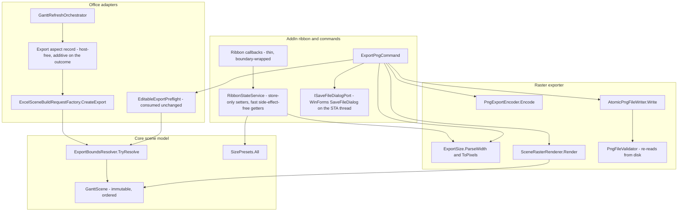

# R8.7 & R8.8 implementation plan — PNG width controls, live preview, and the Export PNG command

Plan status: authored 2026-11-23 in architect mode, against the landed tree at the
Phase-8 mid-point (R8.1–R8.6 landed; R8.7/R8.8 owed). Governing sources, in the
repository's source-of-truth order: the two Tier-A work items
([`R8.7-width-controls-preview.md`](../docs/work-items/R8.7-width-controls-preview.md),
[`R8.8-export-png-command.md`](../docs/work-items/R8.8-export-png-command.md)),
[`AGENTS.md`](../AGENTS.md), [`02-ARCHITECTURE.md`](../docs/02-ARCHITECTURE.md)
("PNG renderer", "Ribbon and commands"), the R8.1 feed contract
([`R8.1-width-parsing-residual.md`](../docs/work-items/R8.1-width-parsing-residual.md)),
the independent review
([`phase8-plan-critical-review.md`](phase8-plan-critical-review.md), findings
F1–F12 already folded into the work items), and the landed code cited below.
**Owner ruling recorded 2026-11-23:** R8.7 D4 is **Option A** — the per-refresh
cached export aspect with dedicated ribbon controls (the work item's primary
reading); this also fixes the Step-0 control-surface choice to dedicated ribbon
controls, and the choice is recorded here with its reason.

Per the repository protocol, work is sized by commit/diff scope and sequenced by
dependency, **not by time estimates** — one work item in progress, one concern
per commit, the smallest coherent diff that proves one behaviour. Tasks below
carry a relative diff-scope size (S = a focused single-concern commit; M = a
multi-file commit that still proves one behaviour; L = a commit series) rather
than any hour/day figure.

---

## 1. Problem definition

Phase 8 must close with the user able to type a width in `cm`, `in`, or `px`,
see the calculated height and pixel dimensions **before** saving, and click one
command that writes a verified 300-DPI PNG of the exact scene crop. Two rows
remain:

- **R8.7** — the Ribbon's PNG width/unit controls and the calculated-height
  preview. The preview is delegated math: it must equal
  [`ExportSize`](../src/GanttCreator.Raster/ExportSize.cs) output for the
  current input, with no second formula anywhere. The preview's aspect input is
  the owner-ruled per-refresh cached record. The empty state (no completed
  render yet), workbook-switch clearing, and disabled-until-valid gating are
  part of the contract, not decoration.
- **R8.8** — the **Export PNG** command: the verified pipeline end to end
  (preflight → parse → pixels → render → encode → atomic write → validate), the
  injected file-dialog port, the first AddIn→Raster reference, and the
  **Phase-8 exit evidence** (the all-unit live demonstration, the compatibility
  matrix subset including R8.6's owed live unwritable-path case, and the
  Phase-9 Tier-B guide upgrade).

### Scope clarification (in/out)

| In scope | Out of scope (owner of the excluded work) |
| --- | --- |
| Width/unit/preset ribbon controls + preview label in `grpExport` | Any parser change ([`ExportSize`](../src/GanttCreator.Raster/ExportSize.cs) is normative; R8.1 verified no residual) |
| The additive export-aspect record on the refresh outcome (Office) | Rendering/encoding/writing changes (R8.2–R8.6 own them; consumed unchanged) |
| `ExportPngCommand` + `btnExportPng` + the injected save-dialog port | New settings or persistence of the last-used width (a settings addition is a recorded stop-point) |
| The AddIn's first `GanttCreator.Raster` project reference | Cancellation/deadline for long renders (R9.1's row; Phase 8 records the synchronous boundary) |
| Phase-8 exit evidence assembly + Phase-9 guide upgrade | Release packaging of the native asset (R10.2) and the SBOM/third-party notice (R10.7) |
| REPO-MAP/STATUS/status-line updates in the same commits | Any second helper worksheet, any Core production change, any new package |

### The one scope reconciliation the plan makes explicit

The R8.8 work item assigns the AddIn's first `GanttCreator.Raster` reference to
its own commit, but **R8.7's preview is the first `ExportSize` consumer**, and
[`ExportSize`](../src/GanttCreator.Raster/ExportSize.cs) lives in Raster. The
reference therefore lands with **R8.7** (the first consumer), and R8.8's
work-item note is discharged by recording the landed fact. The REPO-MAP AddIn
dependency row (corrected to `Core, Office` on 2026-11-22) gains `Raster` in
the same R8.7 commit. No behaviour rides on the reconciliation — only the commit
in which the reference appears.

---

## 2. Verified baseline (what these rows build on)

Every load-bearing premise was re-verified against source in this planning
session:

| Premise | Verified state |
| --- | --- |
| The width parser is single-authority | [`ExportSize.ParseWidth`](../src/GanttCreator.Raster/ExportSize.cs) + [`ToPixels`](../src/GanttCreator.Raster/ExportSize.cs) — cm `Value / 2.54 * 300`, in `Value * 300`, px verbatim; `MaxPixelDimension` 65,535 per axis; `MaxTotalPixels` 100,000,000 combined; zero/sub-pixel rejection before allocation; 25 methods / 41 cases in `ExportSizeTests` |
| The preview feed contract exists | R8.1's "Preview-value feed contract": producer members, grammar (value+unit, tolerated whitespace, invariant culture), the owner-ruled rounding reading (height from the unrounded width, each dimension rounded once, `MidpointRounding.ToEven`), error contracts, and R8.7's consumer obligations |
| The shared export preflight exists and is consumed unchanged | [`EditableExportPreflight.Run`](../src/GanttCreator.AddIn/EditableExportPreflight.cs) — read → configuration → validate → measure → export request → selection → bounds, with the post-resolution guard; R8.8 D5 pins the command to it |
| The scene rides the bounds outcome | [`ExportBoundsOutcome`](../src/GanttCreator.Core/Scene/ExportBoundsResolver.cs) carries `Bounds` (zero-origin) **and** `Scene`; the resolver pins the `EditableExport` profile and refuses unanchored requests |
| The host-free export-request seam exists | [`ExcelSceneBuildRequestFactory.CreateExport`](../src/GanttCreator.Office/ExcelSceneBuildRequestFactory.cs) over (events, settings, registry, grid, themed metrics) — the exact pair of seams R8.7 D4 names for the aspect record |
| The raster pipeline is landed and pinned | [`SceneRasterRenderer.Render`](../src/GanttCreator.Raster/SceneRasterRenderer.cs) (CPU surface, pinned fonts, hatch/dash), [`PngExportEncoder.Encode`](../src/GanttCreator.Raster/PngExportEncoder.cs) (single `pHYs` 11811/11811 metre), [`AtomicPngFileWriter`](../src/GanttCreator.Raster/AtomicPngFileWriter.cs) (temp-beside-target, flush, re-open, validate, atomic replace; `PngWriteRefusal.{UnwritablePath, LockedTarget, WriteFailed, ValidationFailed}`), [`PngFileValidator`](../src/GanttCreator.Raster/PngFileValidator.cs) (reads from disk, never the writer's buffer) |
| The command pattern is established | [`SendToPowerPointCommand`](../src/GanttCreator.AddIn/SendToPowerPointCommand.cs) — `RunForExcel()` production entry, injected `Run(request)` with delegate seams, typed refusals → one actionable message each, CA1031 presenter guard, `NotifyRibbonStateChanged` after every run |
| The Export group is gated and leaves the two members unstubbed | [`Ribbon.xml`](../src/GanttCreator.AddIn/RibbonResources/Ribbon.xml) `grpExport` carries `btnCopyEditable` + `btnSendToPowerPoint` with the comment naming R8.7/R8.8 as the arriving members; [`RibbonControlIds`](../src/GanttCreator.AddIn/RibbonControlIds.cs) names the group and both buttons with the `Mode == Ready` + active-Gantt-sheet gate |
| Preset widths have one authority | [`SizePresets.All`](../src/GanttCreator.Core/SizePreset.cs) — A4 portrait 595.28 pt, A4 landscape 841.89 pt, 16:9 1280 pt, 4:3 1024 pt, exact and derived-aspect; the R8.4 goldens already render at these widths expressed in cm (29.7 / 45.16 / 36.12) plus the 800/2400 px arms |
| No file-dialog port exists | Zero `FileDialog` hits in `src/` (review-verified 2026-11-22, re-confirmed by the review's §2 table) |
| The native-asset route is measured | R8.2 Step 0: managed packing into the XLL works; the packed native alone fails; **beside-the-XLL** passes in-host — R10.2 owns the release copy, so the R8.8 live gate must ensure `libSkiaSharp.dll` sits beside the packed XLL it registers |

---

## 3. Solution architecture

### 3.1 End-to-end view



Two consumers, one pipeline. The **preview** (R8.7) reads the cached aspect and
calls `ExportSize`; the **command** (R8.8) re-runs the shared preflight, uses
its own fresh `Resolution.Bounds` as the aspect input, and drives the landed
render→encode→write→validate stages. Both aspect inputs flow through the same
[`ExportSize`](../src/GanttCreator.Raster/ExportSize.cs), so the mathematics
cannot diverge — only the aspect *input* can differ, by design, when the table
changed after the last completed render. The command never trusts the cache for
its own pipeline; the cache is presentation-only.

### 3.2 The aspect record (R8.7 D4, Option A — owner-ruled)

- **What:** `GanttRefreshOutcome` (Office) gains an additive, default-null
  `ExportAspect` member — a small immutable record `ExportAspectPt(double
  WidthPt, double HeightPt)` with construction guards (finite, strictly
  positive) and their positive tests. Every existing caller is unchanged.
- **Who computes it:** the refresh orchestrator, once per **successful** pass,
  host-free over the inputs it already holds (validated events, settings,
  registry, measured grid, themed metrics): the same two seams the preflight
  uses — `CreateExport` then `TryResolve` — with the same selection rule
  ([`EditableExportPreflight.SelectExportSelection`](../src/GanttCreator.AddIn/EditableExportPreflight.cs)
  over the persisted `ExportIncludeDataPanel` setting) and the same panel-theme
  resolution. The aspect is the resolved `Bounds` extent. A refused refresh
  carries null and the AddIn keeps the previous cached value — the aspect
  describes the **last completed render**, the same authority the on-screen
  chart has.
- **Where it is cached:** the AddIn's ribbon state service, workbook-scoped,
  cleared on workbook switch (the R1.5 rule the warnings snapshots already
  follow). The empty state (D5): before any completed render records an aspect,
  the preview shows the not-available text and the export readiness fact is
  false. The cleared state is transient by construction: the ADR-0058
  activation reconcile runs a completed pass on workbook activation (it is
  never suspended), so switching back to a workbook re-records its aspect —
  unless that pass refuses, in which case the empty state is the honest answer
  for a workbook that cannot render.
- **Cost:** measured and recorded — the orchestrator's existing
  `gantt.refresh phases` trace line gains an `aspectms=` field (the
  protection-close precedent: split the cost inside the one line the facts
  already assert, rather than adding a second record). The orchestrator
  contract test that pins every field gains the field.
- **The pin that makes it honest:** a host-free test asserting that, given the
  same (events, settings, registry, grid, metrics), the aspect helper's output
  equals the preflight's `Resolution.Bounds` extent — the preview's input and
  the command's input are the same function of the same inputs.

### 3.3 The control surface (R8.7)

`grpExport` gains, after `btnSendToPowerPoint`:

1. **`ebxPngWidth`** — a width `editBox` (`sizeString` per the R5.1 precedent),
   free-form entry in the selected unit. `onChange` commits through a
   store-only setter and `getText` serves the stored text back (the R5.1
   store-only pair); the value is session-scoped in-memory state only (the
   work item's exclusion: no persistence, a settings addition would be a
   stop-point). Default: `SizePresets.A4Landscape.WidthPt` expressed in cm
   (29.7 cm — the first R8.4 ratified width; derived from the preset contract,
   never a new literal). The width/unit controls are enabled whenever the
   group is visible — the user may pre-type a width before any render; only
   the export action carries the readiness gate.
2. **`ddnPngUnit`** — a three-item dropdown (`cm` / `in` / `px`). Unit
   switching is deterministic (D3): changing the unit never converts the
   number — the number means "value in the selected unit" — and the preview
   recomputes. Pinned.
3. **`ddnPngSize`** — a preset dropdown whose items are projected from
   [`SizePresets.All`](../src/GanttCreator.Core/SizePreset.cs) (D6): each item
   labelled with the preset's display name and its width at full precision in
   cm (e.g. "A4 (landscape) — 29.7 cm"); selecting one sets the width text and
   the unit atomically. Free-form entry remains the architecture's contract;
   the preset is a shortcut, not a constraint. A completeness test asserts the
   item set equals `SizePresets.All` — a new preset fails the gate rather than
   silently missing from the menu.
4. **`lblPngPreview`** — a `labelControl` whose `getLabel` is the fast,
   side-effect-free preview getter: valid input + available aspect → text
   stating the calculated height in the selected unit and the pixel
   dimensions, e.g. "29.7 cm wide → 16.1 cm tall → 3508 × 1906 px" (the
   R8.4 ratified baseline numbers); invalid input → the actionable
   validation message naming the limit; no aspect → the not-available state.
5. **`btnExportPng`** — lands with R8.8 (the group's XML comment already
   reserves it), gated on the Ready + active-Gantt-sheet gate plus the R8.7
   readiness fact (valid input AND aspect available).

R8.7 implements and pins the **readiness fact** (`PngExportReady`) in the state
service even though the button that consumes it arrives with R8.8 — the honest
split, so R8.8's commit wires a pinned fact rather than inventing one.

**The invalidation requirement (the R5.18h lesson):** every width, unit, and
preset commit path ends with the ribbon invalidation (the R5.1
single-`Invalidate()` precedent), so Excel re-queries the preview label and the
export button's enabled state. An incomplete invalidation set is the exact
defect class this repository has shipped twice — controls that could never
enable because Excel kept the state it computed at load — and a test pins that
each commit path invalidates.

### 3.4 The command pipeline (R8.8 D1)

`ExportPngCommand.Run(request)` executes, in order, each stage injectable for
tests and each refusal stopping the later stages:

1. **Preflight** — [`EditableExportPreflight.Run`](../src/GanttCreator.AddIn/EditableExportPreflight.cs)
   unchanged (D5). The preparation carries the fresh `Resolution` (scene +
   zero-origin bounds).
2. **Parse + pixels** — re-read the stored width text at execution (the
   bespoke-command rule), `ExportSize.ParseWidth`, then
   `ExportSize.ToPixels(request, Resolution.Bounds.Width,
   Resolution.Bounds.Height)` — the command's **own fresh** bounds, never the
   preview cache. Safety rejection happens here, before allocation. This
   stage can refuse where the preview was valid: the preview validates
   against the cached aspect while the command validates against the fresh
   bounds, so a table changed mid-flight can push a previously-legal width
   over a limit — the typed refusal names the limit.
3. **Dialog** — the injected `ISaveFileDialogPort` on Excel's main STA thread
   (never `Task.Run`, which is forbidden around COM — review F12). Cancelled →
   silence, nothing written. A chosen path proceeds. The WinForms
   `SaveFileDialog` adapter sets `Filter = "PNG image (*.png)|*.png"`,
   `AddExtension`, and `OverwritePrompt` (the user is asked before the atomic
   replace; the writer's `File.Replace` remains the mechanical authority).
   **The dialog is the last gate before the expensive render:** every
   input-dependent refusal (preflight, parse, pixel budget) precedes it, so a
   refused export never makes the user pick a path first.
4. **Render** — [`SceneRasterRenderer.Render`](../src/GanttCreator.Raster/SceneRasterRenderer.cs)
   with the explicit `RasterBackground` filled by the themed chart background
   colour (the `ChartBackgroundColour` setting, catalogue-token fallback) so
   the edge pixels carry the chart background, not transparency. Synchronous on
   Excel's command thread (D6 — recorded trade, R9.1 owns cancellation).
5. **Encode** — [`PngExportEncoder.Encode`](../src/GanttCreator.Raster/PngExportEncoder.cs)
   → `PngExportBytes` with the single `pHYs` 11811/11811 metre chunk.
6. **Write + validate** — [`AtomicPngFileWriter.Write`](../src/GanttCreator.Raster/AtomicPngFileWriter.cs);
   success only after [`PngFileValidator`](../src/GanttCreator.Raster/PngFileValidator.cs)
   re-reads the bytes from disk (R8.6 D2: success never precedes validation).
7. **Report** — typed failures → one actionable message each (the established
   translations); success states the written path and the exact dimensions —
   counts and sizes only, never schedule content. One `gantt.export` technical
   record (path, dimensions, duration; redaction-ready) joins the rolling log.

---

## 4. Design decisions (carried from the work items, plus the plan's reconciliations)

| # | Decision | Source |
| --- | --- | --- |
| D1 | The preview is delegated math — preview == `ExportSize` output for the current input; the equality pin lands in the AddIn suite over a table of inputs | R8.7 D1 / R8.1 D2 |
| D2 | Validation is immediate and precise — every violation (non-finite, out of range, over a safety limit, sub-pixel) shows the actionable message naming the limit; the readiness fact stays false until valid; **a positive test per violation** | R8.7 D2 |
| D3 | Unit switching is deterministic — no silent conversion; the preview recomputes; pinned | R8.7 D3 |
| D4 | The aspect source is the per-refresh cached record (Option A, owner-ruled 2026-11-23) — host-free, additive on the refresh outcome, cost measured and recorded | R8.7 D4 + this session's ruling |
| D5 | The empty state is part of the contract — workbook-scoped cache, cleared on switch, not-available preview and false readiness until a completed render records an aspect; the aspect describes the last completed render and the command re-resolves fresh | R8.7 D5 + this plan's precision |
| D6 | Preset widths come from `SizePresets.All` at full precision, never new literals; free-form entry remains | R8.7 D6 / roadmap rev-10 note |
| D7 | One command, the verified pipeline — preflight → parse/pixels → dialog → render → encode → write/validate; every input-dependent refusal precedes the modal dialog; success only after validation; typed failures → one message each | R8.8 D1 + this review's ordering fix |
| D8 | Independent verification — the test's dims/density/crop/aspect assertions come from a separate minimal parser in the AddIn test project, never the writer's helpers | R8.8 D2 |
| D9 | Exact crop — the image contains exactly the scene bounds; an edge-pixel probe asserts the first/last rows and columns carry the chart background, not empty margin (positive test on a fixture with known edges) | R8.8 D3 |
| D10 | The scene is the shared export composition — the command consumes `EditableExportPreflight` unchanged; the editable-export scene **is** the raster scene (R8.4's profile-equivalence fact); no re-labelling to a `Raster` profile | R8.8 D5 |
| D11 | The render is synchronous on Excel's command thread — typical widths ~3–10 M pixels; `MaxTotalPixels` bounds the legal worst case (~400 MB frame); cancellation/deadline is R9.1's row; Phase 8 records the accepted behaviour | R8.8 D6 / review F7 |
| D12 | The dialog runs on the main STA thread from the ribbon callback — the WinForms dialog family precedent; stated to preempt any `Task.Run` suggestion | review F12 |
| D13 | The AddIn→Raster reference lands with R8.7 (first consumer), and R8.8 records the landed fact — this plan's reconciliation of the R8.8 scope bullet | this plan |
| D14 | The aspect helper mirrors the preflight's composition rule (same factory + resolver + selection/theme rule) and is pinned equal to it for the same inputs | this plan |

---

## 5. Technology selection and Excel-automation approach comparison

The renderer technology decision is **landed and closed** ([ADR-0071](../docs/adr/0071-skia-raster-renderer-dependency.md));
this plan carries it and records why the alternatives were rejected, so the
comparison is not re-litigated mid-phase:

| Approach | Verdict | Reason |
| --- | --- | --- |
| **SkiaSharp 4.157.0 CPU raster of the scene** (chosen) | Landed | Deterministic exact-pixel output, MIT, pinned fonts (ADR-0070), host-free testability, Core-only project graph preserved (Raster references Core only) |
| Excel `Chart.Export` / `Shape.CopyPicture` → image | Rejected | Clipboard/screen-DPI dependent; no 300-DPI density control; no exact-crop guarantee; the architecture's Phase-8 premise is a clipboard-independent channel; a temporary chart object is a second composition surface the scene-first rule forbids |
| GDI+ (`System.Drawing.Common`) | Rejected (R8.2 Step 0) | MIT but weaker antialiasing/DPI determinism; exact-pixel goldens not viable |
| SixLabors ImageSharp | Rejected (R8.2 Step 0) | Split licence; Drawing capability lags the pinned version |
| Direct2D/WIC | Rejected (R8.2 Step 0) | Raw COM; violates the ports/adapters discipline for zero gain |
| WPF `RenderTargetBitmap` | Rejected (R8.2 Step 0) | Dispatcher dependency; wrong threading model inside Excel |

The **file dialog** is WinForms `System.Windows.Forms.SaveFileDialog` — no new
package (the AddIn already targets the .NET Desktop SDK for the TaskDialog
family), run on the STA thread behind an internal injectable port. The **native
asset** route is beside-the-XLL (R8.2 Step 0 measured; R10.2 owns the release
copy). No new production dependency exists anywhere in these two rows.

---

## 6. Domain model and API contracts (new types)

All new types are additive; every validator ships with its positive test in the
same commit.

**Office layer** (the aspect record):

- `ExportAspectPt(double WidthPt, double HeightPt)` — immutable record;
  construction refuses non-finite or non-positive extents (the `RectD` guard
  style); positive tests for both guards.
- `GanttRefreshOutcome.ExportAspect` — additive, default null. Null on any
  refused pass; the AddIn keeps its previous cache.
- The orchestrator's aspect computation: a small internal helper (beside the
  orchestrator or on the factory) composing `CreateExport` +
  `ExportBoundsResolver.TryResolve` with the preflight's selection/theme rule;
  returns null on any refusal (the preview's empty state, not an error).

**AddIn layer** (state, command, port):

- `RibbonState` gains: `PngWidthText` (string), `PngUnit` (`ExportUnit`),
  `ExportAspect` (the cached record or null), and the derived
  `PngExportReady` fact (valid input AND aspect available). The preview getter
  returns a small discriminated result (dimensions text | validation message |
  not-available text) so the label callback stays a thin projection.
- `RibbonControlIds` gains: `PngWidth = "ebxPngWidth"`, `PngUnit =
  "ddnPngUnit"`, `PngSize = "ddnPngSize"`, `PngPreview = "lblPngPreview"`,
  `ExportPng = "btnExportPng"` — each with the gate documented on the constant,
  and each joining the pinned gated-controls contract test.
- `ISaveFileDialogPort` (internal) — `SaveFileDialogResult Show()` with the
  closed result set `{ PathChosen(string path), Cancelled, Refused(string
  reason) }`; the WinForms adapter is thin and STA-bound; contract tests drive
  a fake.
- `ExportPngCommand` — `RunForExcel()` (production composition from
  `ExcelDnaUtil.Application`, the `SendToPowerPointCommand` shape) and
  `Run(ExportPngRequest?)` where the request carries the delegate seams
  (preflight dependencies, dialog port, width-text source, presenters,
  technical record). The outcome is a typed record: success (path +
  `PixelDimensions`) or one typed refusal; every expected state is a result,
  never an exception across the boundary.

**RibbonX** ([`Ribbon.xml`](../src/GanttCreator.AddIn/RibbonResources/Ribbon.xml)):
the four R8.7 controls and the R8.8 button, with `getImage`/`getLabel`/
`getEnabled`/`onAction`/`getItem*` callbacks following the landed dynamic
dropdown pattern; glyphs via the committed Lucide pipeline
(`gen-ribbon-glyphs.ps1` + the `check-ribbon-glyphs.ps1` gate); keytips
checked against the tab's existing set for collisions.

---

## 7. Threading and workflow model

- **No new asynchrony.** The repository forbids `Task.Run` around COM; the
  render is deliberately synchronous on Excel's command thread (D11), and the
  dialog is modal on the same thread (D12). The only "workflow" asynchrony in
  the product remains the coalesced automatic refresh (debounce +
  `QueueAsMacro`), which is what re-records the aspect after chart-affecting
  edits — the mechanism that keeps the preview live without any new timer or
  thread.
- **The aspect lifecycle:** chart-affecting edit → coalesced automatic pass →
  completed render records the aspect (or the pass refuses and the chart, and
  therefore the aspect, both describe the last good state). Workbook switch →
  cache cleared → empty state. This is the whole state machine; there is no
  invalidation signal, no polling, and no second render path.
- **The command's own freshness:** the preflight re-reads the table at
  execution, so an export never renders a stale scene even if the preview's
  cached aspect is one render behind. The success message states the exact
  written dimensions, so a mid-flight table change is visible in the result
  rather than hidden.

---

## 8. Validation, error handling, logging, and observability

**Validation (each with its positive test, per the repository rule):**

- Width text: empty, non-numeric, zero/negative, non-finite, unknown unit,
  per-axis overflow (names `MaxPixelDimension`), combined-budget overflow
  (names `MaxTotalPixels`), sub-pixel rounding to zero — all surfaced through
  `ExportSize`'s existing typed exceptions, translated to one actionable
  message each in the preview and the command.
- Aspect record guards: non-finite/non-positive extents refused at
  construction.
- Dialog port: cancelled (silence, nothing written), refused (typed, nothing
  written), path chosen (proceeds).
- Command stage refusals: each pipeline stage injectable; a refusal at stage
  N proves stages N+1… never ran (the `Assert.Empty`-on-the-call-list pattern
  from R4.8A).

**Error handling:** typed refusals end-to-end; the command boundary owns
logging and presentation; a presenter failure degrades to no dialog (CA1031
guard, the established pattern); the render's `PinnedFontException` (a machine
without the Office cloud fonts fails closed per ADR-0070) maps to its own
actionable message naming the cause. A scene-contract fault from the render
(`ArgumentException` — a text primitive with no resolvable font family or size)
is a defect this repository owns, not a host refusal: it escapes `Run` to the
command boundary's generic arm (one record, one dialog), never a typed
"the host said no" message — the R4.6 contract-fault precedent.

**Logging/observability:** one `gantt.export` technical record per attempt
(outcome, path, dimensions, duration — counts/sizes only, redaction-ready);
the `gantt.refresh phases` line gains `aspectms=`; the R8.6 writer's existing
refusal records carry the write-stage failures. No new log file, no new sink —
the rolling log and its redaction contract are unchanged.

---

## 9. Security and safety controls

- **No silent writes:** the target path is always user-chosen through the
  dialog; the atomic writer's exclusive-create temp beside the target and
  `File.Replace`/`File.Move` sequence prevents partial and torn files; the
  temp is removed on every arm.
- **No data leakage in messages:** success and failure messages carry counts,
  sizes, and paths only — never schedule content; technical records are
  redaction-ready through the existing `Redactor`.
- **Offline invariant preserved:** no telemetry, no network call, no font
  download — the pinned-font loader reads local files only (ADR-0070), and
  SkiaSharp is a local native asset (ADR-0071; R10.7 records the MIT notice).
- **Host integrity:** the command creates no worksheet, no shape, no defined
  name; a refused export leaves the workbook byte-identical (the preflight's
  zero-mutation contract plus the writer's temp discipline).
- **Memory safety:** `MaxTotalPixels` rejects before allocation; the render
  result is `IDisposable` and disposed on every arm of the command.

---

## 10. Performance and scalability

- The per-refresh aspect cost is the one new recurring cost; it is measured
  (`aspectms=`) and recorded. The owner accepted it under Option A; **if the
  measurement shows an unexpected cost, that is a stop condition** — the
  recorded fallback is the export dialog that resolves once on open.
- The preview getter is parse + one `ToPixels` call over cached numbers —
  microseconds, no COM, no allocation beyond small strings; the
  side-effect-free pin asserts repeated calls issue no port calls.
- The render cost is bounded by `MaxTotalPixels` (D11) and is the recorded
  synchronous trade; typical widths are the R8.4-class 3–10 M pixel frames.
- No new O(N²) COM pattern is introduced: the command's COM surface is exactly
  the preflight's (already measured in R6/R7), plus one modal dialog.

---

## 11. Maintainability alignment

- One formula boundary ([`ExportSize`](../src/GanttCreator.Raster/ExportSize.cs)),
  one composition authority ([`EditableExportPreflight`](../src/GanttCreator.AddIn/EditableExportPreflight.cs)),
  one bounds authority ([`ExportBoundsResolver`](../src/GanttCreator.Core/Scene/ExportBoundsResolver.cs)),
  one preset authority ([`SizePresets`](../src/GanttCreator.Core/SizePreset.cs)) —
  the two rows add **zero** new authorities and duplicate **zero** existing
  ones.
- Additive-only surface: the outcome member, the state members, the controls,
  the port, and the command are all additive; every existing caller and test
  is unchanged except where a pin deliberately gains a field (the phases-line
  fact, the gated-controls contract).
- The architecture suite's boundary tests already anticipate Raster
  (`CoreBoundaryTests` enumerates SkiaSharp as a forbidden **Core** reference;
  the authority tests already scan `src/GanttCreator.Raster`) — no
  allowlist change is needed for the AddIn→Raster reference.
- The closed refusal enums and the delegate-seam command shape keep every
  failure path host-free testable, the property the whole R6–R8 chain has
  relied on.

---

## 12. Implementation phases

Sequenced by dependency; each task is one commit-sized concern (S/M/L is
diff scope, never a time estimate). R8.7 completes before R8.8 begins (the
command consumes the readiness fact and the landed reference).

### Phase A — R8.7: the aspect record (Office)

| Task | Content | Size | Depends on |
| --- | --- | --- | --- |
| A1 | Step 0 record: re-read the R1.5 ribbon-state patterns, the Export group's landed set, `SizePresets.All` values, the R8.1 feed contract; confirm no file-dialog port; record the Option A ruling and the D13 reference reconciliation in the work item | S | — |
| A2 | `ExportAspectPt` + the additive `GanttRefreshOutcome.ExportAspect` + the orchestrator's host-free aspect helper (factory + resolver + the preflight's selection/theme rule) + the `aspectms=` trace field + tests: aspect == resolver bounds for a fixture; refused pass → null; determinism; helper == preflight composition for the same inputs (D14 pin); guard positives; the phases-line fact gains the field | M | A1 |
| A3 | `verify-quick.ps1` green on the Office slice; STATUS entry | S | A2 |

### Phase B — R8.7: ribbon state and controls (AddIn)

| Task | Content | Size | Depends on |
| --- | --- | --- | --- |
| B1 | The AddIn gains the `GanttCreator.Raster` project reference (D13); REPO-MAP's AddIn dependency row gains `Raster` in the same commit; the packed-XLL publish re-verified (managed packing already measured in R8.2 Step 0) | S | A3 |
| B2 | `RibbonState` members + `RibbonStateService` store-only setters, the workbook-switch cache clearing, the fast side-effect-free preview getter (valid → dimensions text; invalid → the actionable message; no aspect → not-available), and the derived `PngExportReady` fact + tests: the preview-equality table over cm/in/px × aspects (the R8.1 D2 pin landing); the validation matrix with a positive per violation; unit-switch determinism; empty-state and clearing pins; the side-effect-free pin (repeated getters, zero port calls) | M | B1 |
| B3 | The preset projection: `ddnPngSize` items from `SizePresets.All` at full precision, selection sets value+unit atomically + the completeness test (items == `SizePresets.All`) + the no-literal pin (values derived, never restated) | S | B2 |
| B4 | The RibbonX surface: `ebxPngWidth` (`onChange` + `getText`), `ddnPngUnit`, `ddnPngSize`, `lblPngPreview` in `grpExport`; `RibbonControlIds` constants; the gated-controls contract gains them; `GanttRibbon` thin callbacks; every commit path ends with the ribbon invalidation and a test pins the set (the R5.18h lesson: an incomplete set leaves Excel serving a stale disabled state); keytips; glyphs through the committed pipeline; the XML/callback parity tests | M | B3 |
| B5 | `RefreshSheetCommand` (both paths) hands the outcome's aspect to the state service; the wiring test (a completed refresh updates the cache; a refused refresh keeps it) | S | B4 |
| B6 | `verify-quick.ps1` green; Release 0 warnings; XML docs; STATUS/REPO-MAP; the R8.7 work-item implementation record | S | B5 |

### Phase C — R8.7: the Required live exercise

| Task | Content | Size | Depends on |
| --- | --- | --- | --- |
| C1 | Live: enter cm/in/px widths; confirm the displayed height and pixel preview match the independent calculation (per the R8.1 feed contract: replicate `MidpointRounding.ToEven` or avoid exact-midpoint inputs — Excel's `ROUND` is half-away-from-zero and would disagree by 1 px at midpoints); record host builds; `verify-office.ps1 -DeadlineSeconds 1800` (the recorded precedent for the measured suite time). The R8.7 gate is native-free by construction — the preview path touches no Skia type, `ExportSize` is pure math — so a green run doubles as the proof that the packed XLL's newly embedded managed Raster/SkiaSharp assemblies load without `libSkiaSharp.dll` beside them; the native requirement begins with R8.8's render | S (human-host gate) | B6 |

### Phase D — R8.8: the port and the command

| Task | Content | Size | Depends on |
| --- | --- | --- | --- |
| D1 | Step 0 record: R8.1–R8.7 verified landed; the final control set; the STA threading rule stated (D12); the native-beside-the-XLL requirement named for the live gate | S | C1 |
| D2 | `ISaveFileDialogPort` + the WinForms adapter + contract tests (cancelled → silence and zero writes; refused → typed; path → proceeds) | S | D1 |
| D3 | `ExportPngCommand`: `RunForExcel()` + injected `Run(request)`; the D7 pipeline order with per-stage injectable refusals and the `Assert.Empty`-on-later-stages pattern; the fresh-bounds aspect input (never the cache); the themed chart-background `RasterBackground`; the `gantt.export` record; typed failure mappings incl. `PinnedFontException` and the parse refusal; the CA1031 presenter guard; success message (path + exact dimensions, counts/sizes only) | L | D2 |
| D4 | `btnExportPng` in `grpExport`: the Ready + Gantt-sheet + `PngExportReady` gate; the glyph; the keytip; the gated-controls pin; `NotifyRibbonStateChanged` after every run; the R8.8 work-item note recording the reference landed with R8.7 (D13) | M | D3 |
| D5 | `verify-quick.ps1` green; Release 0 warnings; XML docs; STATUS | S | D4 |

### Phase E — R8.8: independent verification tests

| Task | Content | Size | Depends on |
| --- | --- | --- | --- |
| E1 | The separate minimal PNG parser in the AddIn test project (IHDR dims, `pHYs` density/unit, edge pixels — never the writer's helpers, D8). The duplication with the Raster test project's `PngTestSupport` is deliberate and honest: test projects do not cross-reference in this repository, so two minimal test-owned parsers is the shape the D8 "separate decoder path" demands. The edge-probe fixture is an inline minimal scene with a full-bounds background rect and known edge colours (D9's "fixture with known edges"), not a borrowed golden. Assertions: exact dims == the requested `PixelDimensions`; 11811/11811 metre; the edge-pixel no-whitespace positive; the aspect within a rounding step of the bounds ratio | M | D5 |
| E2 | The failure-mapping matrix tests: every `PngWriteRefusal` → one message; every preflight refusal → the established translation; dialog cancelled → silence; the stage-order pin | S | E1 |

### Phase F — Phase-8 exit evidence (R8.8 D4)

| Task | Content | Size | Depends on |
| --- | --- | --- | --- |
| F1 | The all-unit live demonstration: export from Excel at a cm, an in, and a px width; independently verify exact pixel dimensions, aspect, 300-DPI metadata, and no surrounding whitespace; **discharge R8.6's owed live unwritable-path case** (export to an unwritable path live; typed refusal; no partial file); record host builds; ensure `libSkiaSharp.dll` sits beside the packed XLL the gate registers (the R8.2 Step 0 measured route — if a publish/harness step change is needed it ships with its Pester test) | M (human-host gate) | E2 |
| F2 | The compatibility-matrix Phase-8 exit subset recorded (the demonstration's touched rows + the unwritable-path completion) | S | F1 |
| F3 | The Phase-9 Tier-B guide upgrade: the eight Phase-9 guides to Tier A with refresh dates; the manifest tiers updated | M | F2 |
| F4 | Branch-final `verify.ps1` (clean tree, `-MutationSince` the recorded branch base) + `verify-office.ps1` (Required); the STATUS close-out entry; the handoff record (`Outcome / Changed / Proof / Office / Risk / Deferred / Next`). The changed-Core mutation set is expected **empty** — these rows make zero Core production changes, so the gate passes on that stated fact (the R8.4 precedent) | S | F3 |

---

## 13. Test-driven development strategy

Every behaviour change ships with its tests in the same commit; every new
validator ships with a positive test in the same commit; no test is deleted or
loosened to reach green. Traceability from the work items' acceptance criteria
to the specific tests:

| Acceptance criterion (work item) | Layer / test | Phase |
| --- | --- | --- |
| R8.7: preview-equality table (preview == `ExportSize` output) | AddIn.Tests — the equality pin over cm/in/px × aspect inputs (the R8.1 D2 pin landing where its producer exists) | B2 |
| R8.7: validation matrix with positives | AddIn.Tests — one positive per violation (empty, non-numeric, zero/negative, non-finite, per-axis limit, combined budget, sub-pixel), each asserting the actionable message names the limit and the readiness fact stays false | B2 |
| R8.7: ribbon pins (controls, gating, preview getters side-effect-free) | AddIn.Tests — the XML/callback parity suite, the gated-controls contract, the repeated-getter zero-port-call pin | B4 |
| R8.7: unit-switch determinism; preset values from `SizePresets` | AddIn.Tests — the no-conversion pin; the completeness + no-literal pins | B2/B3 |
| R8.7: the aspect record (D4/D5) | Office.ContractTests — the D14 helper==preflight pin, refused→null, determinism, guard positives, the wiring test | A2/B5 |
| R8.7: live cm/in/px exercise with host builds | Office host (Required) — the recorded manual exercise + `verify-office.ps1` | C1 |
| R8.8: command pipeline order | AddIn.Tests — per-stage refusal injection, later stages `Assert.Empty` | D3 |
| R8.8: independent dims/density/crop/aspect | AddIn.Tests — the separate parser's assertions (D8) | E1 |
| R8.8: edge-pixel no-whitespace positive | AddIn.Tests — the known-edges fixture probe (D9) | E1 |
| R8.8: failure mappings | AddIn.Tests — the closed matrix incl. dialog-cancelled silence | E2 |
| R8.8: ribbon pins | AddIn.Tests — the button/gate/callback pins | D4 |
| R8.8: the exit demonstration (each unit; user flow, path, image) | Office host (Required) — the all-unit live record + the unwritable-path discharge | F1 |
| Phase-8 exit: matrix subset + Phase-9 upgrade | Docs/evidence records + the manifest tier update | F2/F3 |

Test layers follow the repository's catalogue: host-free unit/contract tests
in `GanttCreator.AddIn.Tests` and `GanttCreator.Office.ContractTests`; the
Raster suite is unchanged (its stages are already pinned by R8.2–R8.6); the
live gates are the human-host `OfficeIntegration` exercises recorded with host
builds. The architecture suite gains nothing new to maintain (the boundary
tests already anticipate Raster), but the gated-controls and
glyph/keytip pins extend in the same commits as the controls they pin.

---

## 14. Risks, assumptions, and mitigations

| # | Risk / assumption | Mitigation |
| --- | --- | --- |
| R1 | Preview/export divergence (a second formula creeps in) | The D1 equality pin; the command and the preview both call the one `ExportSize`; the D14 pin ties the aspect helper to the preflight's own composition |
| R2 | Crop-edge drift when scene bounds change | The edge-pixel probe re-runs on every suite run (the work item's named main risk) |
| R3 | A stale aspect shown against a changed table | Contract precision (D5): the aspect describes the last completed render — the same authority the on-screen chart has; the command re-resolves fresh; the success message states the exact written dimensions so a mid-flight change is visible |
| R4 | The per-refresh aspect cost is larger than accepted | Measured (`aspectms=`) and recorded; an unexpected cost is a **stop condition** with the owner's recorded fallback (the export dialog resolving once on open) |
| R5 | The live render fails in-host on the native asset | The R8.2 Step 0 measured route: `libSkiaSharp.dll` must sit beside the packed XLL the gate registers; F1 ensures it, and any harness/publish change ships with its Pester test |
| R6 | A machine without the Office cloud fonts fails the render | ADR-0070 fails closed by design; the command maps `PinnedFontException` to its own actionable message naming the cause |
| R7 | The synchronous render freezes the host on a legal-but-absurd width | Recorded trade (D11): `MaxTotalPixels` bounds the worst case (~400 MB); R9.1 owns cancellation/deadline; Phase 8 records, never invents threading |
| R8 | RibbonX `editBox` commit quirks (the R5.1 precedent family) | The store-only setter + `sizeString` pattern from the plot-date boxes; the callback-signature gate already pins arity |
| R9 | The `verify-office.ps1` default deadline vs the measured suite time (the recorded R7.7 conflict) | The live gates run with `-DeadlineSeconds 1800` per the recorded precedent; the default remains a separate owner decision this plan does not touch |
| R10 | The D13 reference reconciliation is missed by a reviewer | Recorded here and in the R8.7 work-item Step 0; the R8.8 commit records the landed fact; REPO-MAP updates in the same commit as the reference |
| A1 | Assumption: the owner's Option A ruling (given 2026-11-23) | Recorded in this plan and to be recorded in the R8.7 work item at implementation |
| A2 | Assumption: R8.1–R8.6 landed as STATUS records (verified this session) | The Step-0 records re-verify at each phase start |
| A3 | Assumption: the reference host carries the pinned Aptos faces (the R8.2a probe verified the exact files) | The live gate re-confirms with host builds |
| A4 | Assumption: no new production dependency (SkiaSharp pinned; the dialog is framework WinForms) | The dependency policy requires an ADR for any new one — none is needed |

---

## 15. Definition of done

**R8.7** (from the work item + `docs/08-TEST-CHECKLIST.md` sections **A, G, I**):
preview/validation pins green with positives; the equality pin landed; the
aspect-record pins green; the live unit exercise recorded with host builds;
Release build 0 warnings; XML docs on every new public member; REPO-MAP
(including the AddIn→Raster dependency row) and STATUS current;
`verify-quick.ps1` green per commit.

**R8.8** (sections **E, G, I**): independent-verification pins green with
positives (the separate parser); the edge-pixel positive; the failure matrix;
the exit demonstration + the matrix subset (including R8.6's owed live
unwritable-path case) recorded with host builds; the Phase-9 guides upgraded
to Tier A with refresh dates and the manifest tiers updated; REPO-MAP/STATUS
current; branch-final `verify.ps1` green on the clean tree; `verify-office.ps1`
green (Required). Any gate not run is reported `Not run` with its reason; the
closing handoff uses the `Outcome / Changed / Proof / Office / Risk / Deferred
/ Next` format.

**Phase-8 exit** (roadmap): enter a width in each supported unit, export, and
independently verify the exact pixel dimensions, aspect ratio, 300-DPI
metadata, and absence of surrounding whitespace — the F1 demonstration.

---

## 16. Evidence commands

```powershell
dotnet build GanttCreator.slnx /p:Configuration=Release /warnaserror
dotnet test tests/GanttCreator.Office.ContractTests   # the aspect record
dotnet test tests/GanttCreator.AddIn.Tests             # preview, command, independent parser
dotnet test tests/GanttCreator.Raster.Tests            # unchanged, re-run green
pwsh ./scripts/verify-quick.ps1      # every commit — expect exit 0
pwsh ./scripts/verify.ps1            # branch-final, clean tree — expect exit 0
pwsh ./scripts/verify-office.ps1 -DeadlineSeconds 1800   # Required — expect exit 0
git diff --check                     # expect no output
```
