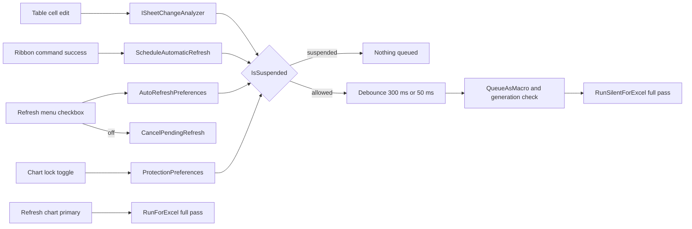

# Auto refresh on/off toggle — review and implementation plan

Status: revised after third-party review, 2026-11-16. Proposed work item **R5.20**
(`docs/work-items/R5.20-auto-refresh-toggle.md`). Nothing here is implemented yet.

Sources read: [`GanttRefreshScheduler.cs`](../src/GanttCreator.AddIn/GanttRefreshScheduler.cs),
[`RibbonStateService.cs`](../src/GanttCreator.AddIn/RibbonStateService.cs),
[`ToggleChartLockCommand.cs`](../src/GanttCreator.AddIn/ToggleChartLockCommand.cs),
[`ProtectionPreferences.cs`](../src/GanttCreator.Office/ProtectionPreferences.cs),
[`RefreshSheetCommand.cs`](../src/GanttCreator.AddIn/RefreshSheetCommand.cs),
[`Ribbon.xml`](../src/GanttCreator.AddIn/RibbonResources/Ribbon.xml),
[`GanttRibbonTests.cs`](../tests/GanttCreator.AddIn.Tests/GanttRibbonTests.cs),
[`GanttRefreshSchedulerTests.cs`](../tests/GanttCreator.AddIn.Tests/GanttRefreshSchedulerTests.cs),
[ADR-0050](adr/0050-empty-live-chart-and-coalesced-refresh.md), [R5.11](work-items/R5.11-refresh-only-enforcement.md),
[auto-refresh-streamlining](auto-refresh-streamlining.md).

## 1. The pipeline as it actually is

| Stage | Site | Fact |
|---|---|---|
| Cell-edit entry | [`OnSheetChanged`](../src/GanttCreator.AddIn/GanttRefreshScheduler.cs:177) | subscribed in `Activate()` through `IExcelApplicationAdapter.SubscribeSheetChanged` |
| Classification | [`ISheetChangeAnalyzer.ShouldAutoRefresh`](../src/GanttCreator.Office/ExcelSheetChangeAnalyzer.cs:31) | chart-affecting body columns; `Duration` excluded; header and outside ignored |
| Debounce | [`ResetTimer`](../src/GanttCreator.AddIn/GanttRefreshScheduler.cs:205) | 300 ms cell / 50 ms command window, generation counter discards stale callbacks |
| Command entry | [`ScheduleCommandRefresh`](../src/GanttCreator.AddIn/GanttRefreshScheduler.cs:149) | 8 commands plus 5 internal sites via [`ScheduleAutomaticRefresh`](../src/GanttCreator.AddIn/RibbonStateService.cs:382) |
| Marshal | [`OnTimerElapsed`](../src/GanttCreator.AddIn/GanttRefreshScheduler.cs:223) | `QueueAsMacro` then `_refresh()` |
| Refresh body | [`RunSilentForExcel`](../src/GanttCreator.AddIn/RefreshSheetCommand.cs:206) | full read, validation, complete scene build, delta reconcile, status bar only |
| Wiring | [`SubscribeToSheetChanges`](../src/GanttCreator.AddIn/RibbonStateService.cs:3643) | `new GanttRefreshScheduler(adapter, new ExcelSheetChangeAnalyzer(application))` |
| Existing suspension | `IsSuspendedByUnlock` ([`:115`](../src/GanttCreator.AddIn/GanttRefreshScheduler.cs:115); checks at `:151`, `:179`, `:233`) | reads `IProtectionPreferenceSource.ChartLocked` |

Paths that are **not** this pipeline and stay untouched: [`OnSheetActivated`](../src/GanttCreator.AddIn/RibbonStateService.cs:3708) and
[`OnWorkbookStateChanged`](../src/GanttCreator.AddIn/RibbonStateService.cs:3764) call `Refresh()` directly (ADR-0058 needs that pass),
and `btnRefreshSheet` calls `RunForExcel`.

## 2. Third-party review findings and dispositions

Reviewed as if by an external reviewer whose only brief is "do not break what works, add no processing time".

| # | Finding | Disposition |
|---|---|---|
| **B1** | The planned extra suspension check *inside* the queued macro is **redundant and changes shipped behaviour**. Switching off calls `CancelPendingRefresh`, which bumps `_timerGeneration` ([`:167`](../src/GanttCreator.AddIn/GanttRefreshScheduler.cs:167)), and the queued lambda already refuses on a generation mismatch ([`:241`](../src/GanttCreator.AddIn/GanttRefreshScheduler.cs:241)). The only effect of the extra check would be to swallow a pass on the *existing* chart-unlock path (queued while locked, unlocked before the macro runs) — a behaviour change with no new protection. | **Dropped.** Cancel-on-off plus the existing generation guard is the whole race closure. |
| **B2** | "One coalesced pass on re-enable" (old D5) spends a measured **130–200 ms** full pass (streamlining §1) to fix a staleness that the next edit resolves anyway, because an automatic pass always reads the whole table. It is the only part of the plan that adds processing time. | **Reversed.** Re-enabling schedules nothing. The next chart-affecting edit or an explicit Refresh reconciles. |
| **B3** | The owner's surface requirement — the toggle lives in a menu *inside* the Refresh button — is legal and has an in-repo precedent: `spbFix` is `splitButton → button + menu` ([`Ribbon.xml:21`](../src/GanttCreator.AddIn/RibbonResources/Ribbon.xml:21)), and `CT_SplitButtonRegular` allows exactly one `button`/`toggleButton` followed by a `menu`, whose children include `checkBox`. | **Adopted** (D7 below). Two follow-on fixes: `size="large"` must move to the splitButton (every existing split button puts it only there), and the primary's supertip currently promises "Edits also refresh automatically after a short pause", which becomes false while off. |
| **B4** | A glyph for the new control is unnecessary work: a menu `checkBox` renders its own state, and the Size menu rows already ship without pictures by owner ruling. `check-ribbon-glyphs.ps1` only validates controls that declare `getImage` ([`:254`](../scripts/check-ribbon-glyphs.ps1:254)), so omitting it is compliant. | **Dropped** from scope: no generator change, no new PNGs, no `RibbonGlyphCatalog` regeneration, no asset test. |
| **B5** | Adding `getEnabled` to a new `splitButton` joins the exhaustive pinned set, and the Sheet-group shape pin asserts two children today ([`GanttRibbonTests:151`](../tests/GanttCreator.AddIn.Tests/GanttRibbonTests.cs:151)). Both must move in the same commit or the gate fails (which is the pins working). `RibbonState.IsEnabled` is fail-open for unknown ids, so `spbRefresh` behaves exactly as `spbFix` does today. | **Adopted** as explicit steps; the primary keeps the real workbook gate. |
| **B6** | Functional consequences the switch must not hide: with it off, `Duration` (engine-derived) stays stale, row heights, outline levels, hidden columns, protection re-arm and error fills stay unreconciled until a pass, and the Warnings list keeps the last render's findings. These are the user's stated intent, not defects — but they must be written down and surfaced at the Refresh button, not only in a work item. | **Documented** in the ADR amendment and the supertip; no code change beyond that. |
| **B7** | Processing-time audit: the gate is one boolean read of a session singleton on the main thread, same order as the existing lock read; no COM call, no allocation, no new work on the render path, no schema bump, no catalogue re-pin, no golden image. Two timer-bound negative tests cost ≤ 400 ms each, following the existing pattern. | **Accepted.** Net added runtime cost: none. |
| **B8** | The new scheduler dependency defaults to null = enabled, so forgetting to pass it at the wiring site leaves the toggle inert while every unit test still passes. That is the single most likely silent failure. | **Mitigation:** a wiring fact asserting the scheduler built by `SubscribeToSheetChanges` observes `AutoRefreshPreferences.Shared`. |
| **B9** | `AGENTS.md` and [`02-ARCHITECTURE.md:192`](../docs/02-ARCHITECTURE.md:192) state the automatic refresh unconditionally, so the code change cannot ship on its own. | **ADR-0050 amendment (D6)** plus the doc, roadmap and skill edits land in the same batch. |
| **B10** | Keytip `AR` is already taken by `entBaselineProcurement`. Two controls on one tab cannot share a keytip. | **Use `AT`** (verified free by grep at implementation time). |

## 3. The gate — three sites, one predicate

```csharp
private bool IsSuspended => IsSuspendedByUnlock || _autoRefresh?.AutoRefreshEnabled == false;
```

1. [`ScheduleCommandRefresh`](../src/GanttCreator.AddIn/GanttRefreshScheduler.cs:149) — commands cannot queue.
2. [`OnSheetChanged`](../src/GanttCreator.AddIn/GanttRefreshScheduler.cs:177) — cell edits cannot queue.
3. [`OnTimerElapsed`](../src/GanttCreator.AddIn/GanttRefreshScheduler.cs:233) — last-moment re-check, so a switch pressed inside the debounce window wins.

Turning off additionally calls [`CancelPendingRefresh`](../src/GanttCreator.AddIn/GanttRefreshScheduler.cs:165), which discards an already-queued pass and clears the sticky `_commandRefreshPending` flag. That flag matters: left set, the first cell edit after re-enabling would be swallowed as "the command's own write".

Nothing is added to the orchestrator, the renderer, or Core.

## 4. Decisions

| # | Decision | Value | Rejected |
|---|---|---|---|
| D1 | State owner | new `AutoRefreshPreferences` + `IAutoRefreshPreferenceSource` in `GanttCreator.Office`, `Shared`, default `true` | on `ProtectionPreferences` — that type is the protection contract and resets on workbook change |
| D2 | Scope | session-wide, no `Reset()` on workbook switch | per-workbook reset, which re-enables what the user switched off |
| D3 | Persistence | session-only v1; a `tblGanttSettings` key is deferred (schema bump, hash re-pin, owner ruling) | shipping the key now |
| D4 | Coverage | edit- and command-driven passes only | also silencing ADR-0058's activation and workbook-switch reconciliation |
| D5 | Re-enable | **no render**; next edit or explicit Refresh reconciles | a coalesced pass (B2) |
| D6 | Chart lock | independent, composed with `OR` | one toggle owning the other |
| D7 | Surface | `btnRefreshSheet` becomes the primary of a new `spbRefresh` splitButton; a `checkBox` row sits in its `mnuRefresh` menu | a 4th stacked control (group grows), a loose toggle beside the stack, a two-state glyph pair |
| D8 | Picture | none on the row; the checkbox shows its own state | a `getImage` glyph or a state pair (B4) |

Label wording follows the lock-toggle precedent: state, not action — `Auto refresh on` / `Auto refresh off`
([`ChartLockLabel`](../src/GanttCreator.AddIn/RibbonStateService.cs:2053)).

## 5. Surface

```xml
<splitButton id="spbRefresh" size="large" getEnabled="GetEnabled">
  <button id="btnRefreshSheet" label="Refresh chart" getImage="GetGlyph" keytip="F"
          screentip="Refresh the Gantt chart"
          supertip="Rebuilds the chart from the whole table. Edits and commands also refresh automatically while Automatic refresh is ticked in this button's menu."
          getEnabled="GetEnabled" onAction="OnRefreshSheetClick"/>
  <menu id="mnuRefresh">
    <!-- Session preference, no workbook dependency, so it carries no getEnabled:
         the split button's own gate governs reachability. -->
    <checkBox id="chkAutoRefresh" getLabel="GetAutoRefreshLabel" keytip="AT"
              screentip="Switch the automatic refresh on or off"
              supertip="Ticked means edits and ribbon commands rebuild the chart after a short pause. Cleared means nothing rebuilds until you press Refresh chart." 
              getPressed="GetAutoRefreshPressed" onAction="OnAutoRefreshClick"/>
  </menu>
</splitButton>
```

New `RibbonControlIds.RefreshSplit = "spbRefresh"` and `RibbonControlIds.AutoRefresh = "chkAutoRefresh"`.
The primary keeps its id, so `RibbonControlIds.RefreshSheet` gating is unchanged.

## 6. Implementation steps

One commit per step, behaviour and tests together.

1. **Contract first**: `docs/work-items/R5.20-auto-refresh-toggle.md` + the ADR-0050 D6 amendment
   (automatic refresh is user-suspendable; suspension covers edit/command passes only; explicit
   Refresh and the ADR-0058 activation pass are unaffected; the staleness trades in B6 are accepted).
2. **`IAutoRefreshPreferenceSource` + `AutoRefreshPreferences`** in `GanttCreator.Office`
   (`AutoRefreshEnabled`, default `true`, `Shared`, XML docs stating D2/D3).
   Tests: default on; a mutation is visible through the interface.
3. **Scheduler gate**: optional 6th ctor parameter (null = always enabled, so every existing call
   site compiles), `IsSuspended`, the three check sites. No macro-body change (B1).
   Tests in [`GanttRefreshSchedulerTests`](../tests/GanttCreator.AddIn.Tests/GanttRefreshSchedulerTests.cs),
   mirroring [`An_unlocked_chart_suspends_both_scheduling_paths`](../tests/GanttCreator.AddIn.Tests/GanttRefreshSchedulerTests.cs:177):
   - positive control (on → a command queues), then off → neither path queues;
   - on again → queues;
   - off + `CancelPendingRefresh` → a pass queued while on does not refresh;
   - chart unlocked **and** auto refresh off → still nothing queues; locking the chart alone does
     not resurrect scheduling while the switch is off.
   Each is the positive test the repository requires for a new guard.
4. **`ToggleAutoRefreshCommand`** shaped like [`ToggleChartLockCommand`](../src/GanttCreator.AddIn/ToggleChartLockCommand.cs:60):
   assign the requested state (idempotent, never a blind flip), invoke an injected `cancelPending`
   delegate **only on the off transition**, trace through `CommandBoundary`, present nothing on success.
   Tests (`ToggleAutoRefreshCommandTests`): off sets and cancels; on sets and does not cancel; the
   same state twice is idempotent; guard on a null delegate.
5. **`RibbonStateService` wiring**: pass `AutoRefreshPreferences.Shared` at
   [`SubscribeToSheetChanges`](../src/GanttCreator.AddIn/RibbonStateService.cs:3657); add
   `ApplyAutoRefreshChange()`, `GetAutoRefreshPressed`, `GetAutoRefreshLabel`, and the
   `AutoRefreshLabel(bool)` wording function.
   Tests: pressed reflects the preference; wording in both states; **the wiring fact from B8** — the
   scheduler built by the activation path observes the shared instance.
6. **Ribbon XML + ids + `GanttRibbon` callbacks**: `OnAutoRefreshClick(IRibbonControl, bool)`,
   `GetAutoRefreshPressed(IRibbonControl)`, `GetAutoRefreshLabel(IRibbonControl)`; pinned by
   `RibbonCallbackSignatureTests`.
7. **Move the pins that are exhaustive**: rewrite
   [`The_sheet_group_puts_a_large_refresh_beside_one_stacked_column`](../tests/GanttCreator.AddIn.Tests/GanttRibbonTests.cs:151)
   to assert the splitButton shape (id, `size="large"`, primary `btnRefreshSheet`, menu `mnuRefresh`
   holding `chkAutoRefresh`, stack unchanged), add `spbRefresh` to the gated-controls pin, and add the
   new ids to the two label-test enumerations
   ([`DescriptionLabelRibbonTests:416`](../tests/GanttCreator.AddIn.Tests/DescriptionLabelRibbonTests.cs:416),
   [`DateLabelRibbonTests:455`](../tests/GanttCreator.AddIn.Tests/DateLabelRibbonTests.cs:455)) where those
   sets are exhaustive.
8. **Docs**: `AGENTS.md` invariant bullet, [`02-ARCHITECTURE.md:192`](../docs/02-ARCHITECTURE.md:192),
   `docs/03-ROADMAP.md` row, `docs/DECISIONS.md`, `docs/STATUS.md`, `docs/adr/0050` amendment;
   `sync-cline-skills.ps1` after the doc edits plus a hand refresh of the matching `.roo` mirrors;
   `docs/REPO-MAP.md` only if a mapped entry point moved.
9. **Gates**: targeted `dotnet test` per step → `verify-quick.ps1` each commit →
   `check-ribbon-glyphs.ps1` (must stay green with no new entry), `check-md-links.ps1`,
   `check-status.ps1`, `check-cline-skills.ps1` → `verify.ps1` branch-final on a clean tree →
   `verify-office.ps1` **owed**: that the menu renders, the checkbox paints and the switch actually
   stops a cell-edit render is host-only, and is recorded as owed rather than claimed.

## 7. Accepted trades and stop conditions

- **Staleness while off** (B6): `Duration`, row heights, outlines, hidden columns, protection re-arm,
  error fills and the Warnings list are reconciled only by a pass. Surfaced by the menu row's state and
  the primary's supertip; recorded in the ADR amendment.
- **State behind one click** (B3): the ribbon no longer shows at a glance whether automatic refresh is
  on. The menu row states it, and the alternative (a visible toggle) contradicts the owner's layout.
- **Nothing else moves**: no schema version, no catalogue hash, no golden image, no new glyph asset, no
  new COM call on any path.
- **Stop and ask** if the switch must persist in the workbook (D3 reversal), if activation and
  workbook-switch passes must also stop (D4 reversal, contradicts ADR-0058), or if the owner wants the
  toggle visible without opening the menu.


