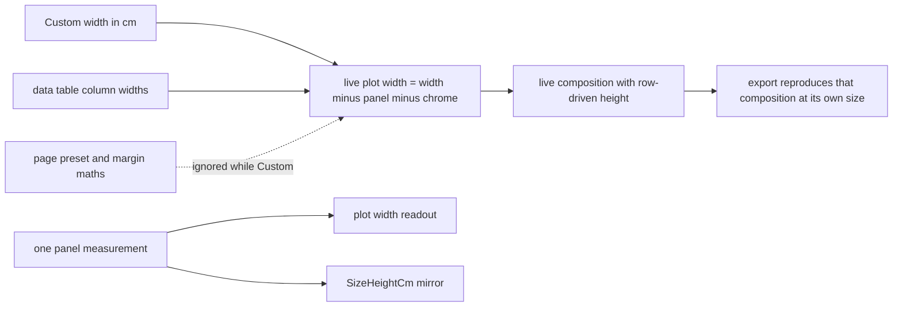

# Custom size in centimetres — WIDTH-ONLY, LIVE-READ plan

Status: **revised 2026-11-26 (twice).** The feature is a custom **width** only. The custom
height input, the derived-width ratio, the export canvas, the 1:1 letterbox and the
uniform-scale export are **withdrawn**. In their place the owner ruled that the ribbon shows
the **live** plot and composition width for presets as well as Custom, and that the stored
`SizeHeightCm` **reads live from the plot** rather than sitting at a fixed default.

The file name is historical (it was written as an export-canvas plan). The plan below is the
current contract.

Earlier status lines, kept so the history is not lost:

- The 2026-11-26 D0 clarification separated this workbook-level Size mode from the
  2026-11-23 per-export ruling.
- D1/D2 were approved as a width budget with refuse-and-clamp.
- D3–D9 were approved, including a custom **height** that defined a 1:1 export canvas.
- The height input is **withdrawn**: "custom height cannot be entered as it is not possible
  to back calculate width without forcing a fixed ratio."
- The live-width and live-height rulings were added after the implementation review.

## Outcome

The Size group gains a **Custom** choice. The user types **one width in centimetres**. That
width is the whole composition width: the data table keeps its column widths, and the plot
takes whatever the width leaves after the measured panel and the frame chrome. Page presets
and margin subtraction are ignored while Custom is active. Every export reproduces the live
composition at its own size.

The ribbon also shows, for presets and Custom alike, the **live plot width** and the **live
composition height**, recomputed from the same measurement the render uses. The stored
`SizeHeightCm` row mirrors that measured height; it is never an input.

## Why the height is not an input

The live height is the measured rows (ADR-0030 D1/D2). A typed height can only be honoured in
one of three ways, and all three are wrong:

| Way to hit a typed height | Why it is rejected |
| --- | --- |
| Change the row heights | The sheet belongs to the user; a size control must not resize their rows. |
| Scale the composition to fit | Text, strokes and hatch density change, so the exported chart is no longer the chart the user sees. |
| Back-calculate the width from a fixed ratio | Only closes if the derived width is an export-only number; feeding it into the live budget changes the content width without changing the rows, so the pair no longer shares an aspect and the export becomes a non-uniform stretch. |

The third row is the arithmetic the owner ruled out. With a base composition of 29.7 × 24 cm,
a typed height of 30 cm gives `k = 30/24 = 1.25` and a derived width of 37.125 cm. If
37.125 cm is also applied as the live width budget, the live content becomes 37.125 × 24, and
the "export target" 37.125 × 30 is then a 1.25× vertical stretch — text taller than it is
wide. There is no version of the height entry that avoids this, so the control is removed.

## Live width and the height mirror

Two rules, both owner rulings on 2026-11-26:

1. **The live width is always shown, presets included.** The plot width and the overall
   composition width are re-measured at every point a measurement is already taken:
   activation, workbook change, refresh, preset change, margin change, size change, and
   column-visibility change. A preset does not freeze the plot width, because a wider
   measured table shrinks the plot inside the same page; the user should see that happen.
   If the measurement refuses, the previous value stays and is marked stale — the display
   never blanks and the refresh never depends on it.
2. **`SizeHeightCm` reads live from the plot.** It is a derived mirror of the measured
   composition height, updated wherever the width is measured, and written with the layout
   group. It is never read as an input, never clamped, and never used to build the preset
   extent. The measurement is the authority; the stored value is a cache for the next
   activation and for support.

Prefill follows the same idea: selecting Custom adopts the **current composition width** —
whatever the active preset or the current measurement gives — and then applies the band and
workable-minimum clamps. A 16:9 user therefore lands on the width they were just looking at,
not on a fixed 29.7 cm.

## Verified current behaviour

| Fact | Evidence |
| --- | --- |
| A size preset carries exact WidthPt/HeightPt and is one of four fixed keys. | [`SizePreset`](../src/GanttCreator.Core/SizePreset.cs) |
| Only width is consumed: `plotWidth = preset.WidthPt - panelRight - leftChrome - rightChrome`. | [`PlotGeometryResolver.TryResolve`](../src/GanttCreator.Core/Scene/PlotGeometryResolver.cs) |
| The factory never page-bounds vertically (`boundVerticallyToPage: false`). | [`ExcelSceneBuildRequestFactory.cs`](../src/GanttCreator.Office/ExcelSceneBuildRequestFactory.cs) |
| Export bounds are the drawn scene's `ChartBounds`, not the preset. | [`ExportBoundsResolver.cs`](../src/GanttCreator.Core/Scene/ExportBoundsResolver.cs) |
| PNG pixels are the composition's bounds at 300 DPI, with its own size refusal. | [`ExportSize.cs`](../src/GanttCreator.Raster/ExportSize.cs), [`ExportPngCommand.cs`](../src/GanttCreator.AddIn/ExportPngCommand.cs) |
| Margins already support a Custom cm value, subtracted twice from width only. | [`PlotMargins.cs`](../src/GanttCreator.Core/PlotMargins.cs) |
| The ribbon Size group is `ddnSize`, `ddnMargin`, `edtMarginCm`, then the read-only plot W/H line, which formats centimetres. | [`Ribbon.xml`](../src/GanttCreator.AddIn/RibbonResources/Ribbon.xml) |
| The plot width is already measured for the display, and a refusal returns null. | `RibbonStateService.MeasurePlot` |
| `tblGanttSettings` validation requires the exact catalogue count and key order. | [`ExcelConfigCatalogueReader`](../src/GanttCreator.Office/ExcelConfigCatalogueReader.cs) |
| The schema is version 29, with `SizeWidthCm` and `SizeHeightCm` already appended. | [`GanttSchemaVersion`](../src/GanttCreator.Core/GanttSchemaVersion.cs), [`GanttCatalogues`](../src/GanttCreator.Core/GanttCatalogues.cs) |

## Decisions

| # | Decision | Status |
| --- | --- | --- |
| D0 | Custom is a workbook-level **Size mode**, not a per-export width prompt. | Approved 2026-11-26 |
| D1 | The custom **width only** creates the width budget; the four presets keep their current behaviour. | Approved 2026-11-26 |
| D2 | A width outside the band, or too narrow for a readable plot, is refused and clamped to the nearest usable value. | Approved 2026-11-26 |
| D3 | Margin controls stay visible and disabled while Custom is active; stored values survive. | Approved 2026-11-26 |
| D4 | The custom width band is 1.0–200.0 cm. | Approved 2026-11-26 |
| D5 | Stored default width 29.7 cm. Selecting Custom pre-fills from the **current composition width**, then clamps. | Approved 2026-11-26 (prefill source confirmed) |
| D6 | Schema 28 → 29 adds the two keys and repairs existing workbooks in place. | Approved and implemented |
| D7 | The repair is narrow (settings + config only) and names Repair, not Initialise. ADR-0073. | Approved and implemented |
| D8 | A custom height defines a 1:1 export canvas with both axes clamped. | **Withdrawn** |
| D9 | The export scales or letterboxes to the typed canvas. | **Withdrawn** |
| D10 | The live plot and composition width are shown for **presets too**, re-measured at every measurement point, with the last value kept on refusal. | Approved 2026-11-26 |
| D11 | `SizeHeightCm` is a **derived mirror** of the measured composition height, refreshed with every measurement and written with the layout group; never an input. | Approved 2026-11-26 |
| D12 | **No `pt` visual anywhere on the ribbon for width or height.** Every width and height readout is centimetres, and the two stale `pt` doc comments on the readout getters are corrected. | Approved 2026-11-26 |

## Chosen semantics



- Resolution is `valueCm * 10.0 * SizePresets.PointsPerMillimetre` — the same conversion
  `GanttPlotMargins.MarginPt` uses.
- **Live**: `plotWidth = customWidthPt - panelRight - leftChrome - rightChrome`, with
  `marginPt = 0`. The table does not move or widen; the plot absorbs the whole difference.
- **Export**: nothing is added. PNG, Copy Editable and PowerPoint read the composition's own
  bounds exactly as they do for a preset. A wider plot simply produces a wider export.
- Non-custom behaviour is byte-identical apart from the two new live readouts.

## Width budget

```
plotWidth = widthPt - panelRight - leftChrome - rightChrome
```

- `panelRight` is the measured table right edge, so the table's column widths are the
  constraint and the plot takes the rest.
- `leftChrome` is the live origin inset (zero on the export profile).
- `rightChrome` is the code-owned outer padding only; the R5.2 margin is not added while
  Custom is active because `marginPt = 0`.
- For a **preset**, `widthPt` is the preset width, so the same subtraction yields the live
  plot width shown in the ribbon.
- If the subtraction falls below `PlotGeometryResolver.MinimumPlotWidthPt`, the ribbon clamps
  the stored width to the smallest workable value; the factory's shortfall refusal remains
  the backstop for a hand-edited workbook.

## Design by layer

### Core — keep

- `CustomSizeCm` as the validated **width** (band, finite checks, points conversion). The
  height member goes; the preset extent is built from the width and is documented as "not a
  page" because nothing reads it.
- `SizePresets.CustomKey = "Custom"` and the runtime factory. `All` stays the four fixed
  presets and `ByKey` stays fixed-only.
- The factory's Custom branch: preset width from `SizeWidthCm` only, `marginPt = 0`. The
  reserved height must not gate the mode (review finding 2).

### Core — withdraw

- `ExportCanvas`, `ExportCanvasRefusal`, `ExportCanvasPlacement` and
  `ExportCanvasPlacementPlanner`.
- `ExportBounds.Canvas` and `ExportBounds.CanvasPlacement`.
- `ExportBoundsRefusal.ContentExceedsCanvas` and `ExportBoundsRefusal.InvalidExportCanvas`.
- `SceneBuildRequest.ExportCanvas`.

`ExportBounds.Bounds` and `PlacementDelta` are therefore untouched by this feature: the
export model has no custom-size branch at all.

### Office — keep

- `ExcelSceneBuildRequestFactory` resolves `SizePreset = Custom` from `SizeWidthCm` alone.
  An unreadable width refuses with `InvalidCustomSize`; an out-of-band width is clamped to
  the band at the read so the ribbon and the factory never disagree (review finding 3).
- The margin is zeroed while Custom, exactly as merged.

### Office — withdraw

- The canvas derivation in the factory and the extra `BuildRequest` parameter.
- The resolver's canvas proof; `ExportBoundsResolver` returns the same content bounds it
  returns for a preset.
- The `ContentExceedsCanvas` / `InvalidExportCanvas` arms in the copy, PowerPoint and PNG
  command message maps.

### Raster

No change. `ExportPngCommand` sizes itself from the composition bounds, so a custom width
produces a wider PNG with no new code. The existing `DimensionsRefused` message already names
the limit, which replaces the withdrawn pixel-budget clamp.

### AddIn — keep

- `ddnSize` gains `<item id="SizeCustom" label="Custom"/>` as index 4. RibbonX ids are
  global, so the item cannot be `Custom`: the margin dropdown already owns that id and the
  host refuses the tab with "The ID 'Custom' is duplicated" (live, 2026-11-27). The durable
  settings value stays `SizePreset = Custom`. `GetSize` returns `SizePresets.All.Count` for
  Custom and clamps the preset loop to that index.
- `OnSizeChange` special-cases Custom and cannot go through `ByKey`, which returns null.
- `edtSizeWidthCm` with a `cm` unit label: `GetSizeWidthCm`, `GetSizeWidthCmEnabled`,
  `OnSizeWidthCmChange`.
- Selecting Custom pre-fills the width from the current composition width (D5).
- `SetSizeWidthCm` clamps to the band **and** to the workable minimum, commits, re-measures,
  mirrors the height and persists.
- `ddnMargin` gets `GetMarginEnabled`; `edtMarginCm`'s gate is ANDed with `!IsCustomSize`.
  Both are disabled, not hidden; stored values survive. With a preset size, `Margin = Custom`
  still enables the cm box.
- `RibbonState.IsCustomSize` and `SizeWidthCm`; `ReadSizeWidthCm` restores the width on
  activation, clamped to the band so an out-of-band stored value cannot collapse the mode
  (finding 3).
- **One measurement feeds everything.** `MeasurePlot` returns the plot width, the measured
  body height and the composition width; the ribbon uses it for the width display, the
  Custom clamp and the `SizeHeightCm` mirror (D10, D11). The readouts are recomputed on
  activation, workbook change, refresh, preset/margin/size change and column-visibility
  change.
- The existing read-only W/H displays show centimetres only — no points anywhere on the
  ribbon (D12) — and the H display reads the **measured** composition height, not a stored
  one (finding 6). The `<returns>W 1024.00 pt</returns>` / `<returns>H 768.00 pt</returns>`
  doc comments on `GetPlotWidthLabel`/`GetPlotHeightLabel` are corrected to cm.
- `RibbonState.SizeHeightCm` is the derived mirror, not an input; it is copied by the
  snapshot and written by `TryPersistPlotLayout`.

### AddIn — withdraw

- `edtSizeHeightCm`, its label and unit label, `GetSizeHeightCm`,
  `GetSizeHeightCmEnabled`, `OnSizeHeightCmChange`, `SetSizeHeightCm`.
- `lblCustomSize` and `GetCustomSizeReadout`. The W/H readouts already show the numbers
  (finding 8).
- `RibbonState.LiveCompositionHeightPt` as a second height field: the mirror replaces it.

### Schema and the height mirror

- `SizeWidthCm` (`29.7`) is the mode's value and the only user-editable centimetre.
- `SizeHeightCm` **stays in the catalogue as a derived mirror** (D11). It cannot be removed:
  schema 29 is already shipped with the append-only repair, and removing a key is not
  append-only, so the narrow repair cannot perform it and Initialise is unreachable.
  Deleting the row would need a destructive schema-30 path and the metric loss ADR-0073
  exists to prevent. Instead it is refreshed from the measurement wherever the width is
  measured and written with the layout group, so it can never disagree with the plot for
  longer than one measurement cycle. It is never read as an input.
- `SizePreset = Custom` encodes the mode, so there is no third key.

## Proposed ribbon layout

```text
Size
  Size      [ A4 landscape (custom) v ]   SZ
  Margin    [ Normal v ]  [ 1.78 ] cm     (disabled while Custom)
  Measure   W [ 29.70 ] cm   H 24.00 cm   (W: preset's live width, or the stored width
                                           in Custom; H: measured, read-only)
```

One width box, not a pair, and every number is centimetres — the ribbon shows no points at
all (D12). The live line is present for presets and Custom: the W is the composition width
and the H is the measured composition height, not an input. The margin row stays in place but
greys out, so the user can see why it no longer applies. Owner ruling 2026-11-27 puts the
width box below the margin and below the live measures, because the W it edits is already
shown live above it and the H belongs beside that measured W, not beside the typed one.

## Edge cases and refusals

- Missing or unparsable `SizeWidthCm` while the preset is Custom → `InvalidCustomSize`,
  naming the key. Never defaulted.
- Width outside 1.0–200.0 cm → clamped to the nearest bound at both the setter and the read.
- Width below `panel + chrome + MinimumPlotWidthPt` → the setter clamps up to the workable
  minimum; the factory's shortfall refusal is the backstop.
- A stored width that cannot build a preset → clamped at the read, so the ribbon always shows
  a preset and never collapses to "none" while the workbook says Custom.
- Measurement refuses or the host is unavailable → the last displayed width and height stay,
  marked stale; nothing refuses because of the display.
- Zero visible columns (ADR-0065 D4) → the panel contributes no width and the whole budget
  goes to the plot.
- Switching Custom → preset restores the preset and re-enables margins; the stored width
  survives for the next Custom selection, which pre-fills from the current width.
- A PNG too large at the custom width → the existing `DimensionsRefused` path names the
  limit; there is no canvas or pixel-budget clamp to add.

## Test plan

Add or keep:

- Core: custom width-band facts; the factory's width budget, `InvalidCustomSize` and
  margin-ignored facts; an out-of-band stored width is clamped rather than refused.
- Core: a Custom preset resolves with `SizeWidthCm` alone when `SizeHeightCm` is absent,
  blank, or out of band (finding 2).
- AddIn: ribbon XML pin for `Custom` and `edtSizeWidthCm`; `GetSize` index 4;
  `ReadSizeWidthCm` restoring a clamped width; selecting Custom pre-fills from the current
  width; the band and workable-minimum clamps; the margin gate pair; the layout key set
  (`TimeScale`, `PeriodLabelFormat`, `Margin`, `MarginCm`, `SizePreset`, `SizeWidthCm`,
  `SizeHeightCm`).
- AddIn: one measurement updates the plot-width readout, the workable minimum and the
  `SizeHeightCm` mirror together; a refused measurement keeps the previous values.
- AddIn: the width readout is refreshed on a preset change, a margin change and a column
  visibility change, not only on a Custom edit (D10).
- AddIn: the W and H readouts end in `cm` and never contain `pt`, so a future edit cannot
  reintroduce a point visual (D12).
- Raster: no new test; the existing PNG dimension and refusal tests cover a wider composition.

Remove:

- `ExportCanvasPlacementPlanner` tests, the resolver canvas/refusal facts, the factory
  "carries the canvas" facts, the cm height-box pin, the height-clamp and readout facts, and
  the custom-readout XML pin.

## Documentation changes

- `docs/adr/0072-custom-export-canvas.md` → rewrite as **custom width** mode, with the live
  width/height mirror; record the height withdrawal and why.
- `docs/work-items/R8.9b-*.md` → rewrite as the width-only row; mark the canvas work as
  withdrawn rather than deferred.
- `docs/03-ROADMAP.md` R8.9/R8.9b descriptions → "custom width" and "exports inherit the live
  composition"; no W × H canvas, no 1:1 envelope.
- `docs/STATUS.md` → correct the R8.9b entry to say the canvas was withdrawn and the live
  readouts added.
- `AGENTS.md` PNG invariant → no change; the chart's-own-size rule is re-confirmed.

## Findings folded into this plan

### Original review (pre-implementation)

| Finding | Disposition |
| --- | --- |
| F1 staged envelope equals the canvas | **Withdrawn** — the envelope stays the content and the exact check is unchanged. |
| F2 `ReadPreset` null | **Narrowed and fixed** — rebuild from `SizeWidthCm`, clamped, never null. |
| F3 readout meaning | **Narrowed** — preset W/H readouts show the page size in cm; the custom readout is removed. |
| F4 margin gate | **Kept** — `GetMarginEnabled`; the cm gate is ANDed with `!IsCustomSize`. |
| F5 height clamp minimum | **Withdrawn** — no height input; the measured height is a display and a mirror. |
| F6 pixel budget | **Withdrawn** — the PNG dimension refusal covers an oversized image. |
| F7 snapshot fields | **Narrowed** — `SizeWidthCm`, the derived `SizeHeightCm` and `IsCustomSize` travel. |
| F8 PowerPoint expectation | **Withdrawn** — the expectation stays the content bounds. |
| F9 single authority | **Kept** — the width path is called from the factory only and shares `PlotWidth`. |
| F10 repair atomicity | **Done** — implemented and gated in ADR-0073. |
| F11 message | **Done** — the structural message names Repair. |
| F12 supertips | **Kept** — Size and margin help text explain Custom and that margins do not apply. |
| F13 work item and ADRs | **Kept** — ADR-0072/0073, the R8.9b guide, `check-status` and the docs gates. |

### Implementation review (2026-11-26)

| # | Finding | Disposition |
| --- | --- | --- |
| 1 | Withdrawn height box, custom readout and canvas are still in the code; ADR-0072 says the opposite of the ruling | **Must fix** — withdraw per the layer lists above. |
| 2 | `TryResolveCustomPreset` requires and validates `SizeHeightCm`, so a reserved key can refuse the whole mode | **Must fix** — read and validate the width only; covered by the new Core test. |
| 3 | An out-of-band stored width makes `ReadCustomPreset` return null, so the ribbon shows a preset while the workbook refuses | **Must fix** — clamp at the read; covered by the new AddIn test. |
| 4 | The approved workable-minimum clamp is not implemented; a narrow width refuses instead of correcting | **Must fix** — setter clamp plus a positive test. |
| 5 | Every layout commit writes the height key | **Superseded by D11** — it is written deliberately, as the measured mirror. |
| 6 | The page-H readout shows a stored height the export does not use | **Resolved by D10/D11** — the display reads the measurement. |
| 7 | Selecting Custom ignores the active preset width | **Resolved by D5** — pre-fill from the current width. |
| 8 | The custom readout duplicates the W/H readouts and leaks the stored height | **Must fix** — remove `lblCustomSize` and its getter. |
| 9 | The readout getters still document themselves as `W 1024.00 pt` / `H 768.00 pt`, and the plan's ribbon layout showed points | **Must fix** — cm-only readouts (D12); correct the two doc comments and pin the unit in a test. |

## Implementation order

1. **Withdraw the height and canvas code** (Core, Office, AddIn, commands) and delete the
   matching tests and XML pins.
2. **Width-only resolution**: factory reads `SizeWidthCm` alone; `ReadCustomPreset` clamps;
   add the two positive tests (findings 2 and 3).
3. **Workable-minimum clamp** in `SetSizeWidthCm`, with a positive test (finding 4).
4. **One measurement, three outputs**: plot width, workable minimum and the `SizeHeightCm`
   mirror; refresh them on activation, workbook change, refresh, preset, margin, size and
   column-visibility change (D10, D11); keep the last value on refusal.
5. **Pre-fill from the current width** when Custom is selected (D5).
6. **Remove every point visual** from the width and height surface: correct the two
   `pt` doc comments, keep the readouts in cm, and pin the unit in a test (D12).
7. **Rewrite the docs** listed above.
8. **Gate**: `verify-quick.ps1` on the staged tree, then `verify.ps1` on a clean tree.
9. **Live Office gate**: select Custom, type a width, refresh, confirm the plot takes the
   width, the table does not move, margins are disabled, the width and height readouts track
   the chart for presets and Custom, and PNG / Copy Editable / PowerPoint reproduce the
   composition. Not run in the planning session.
