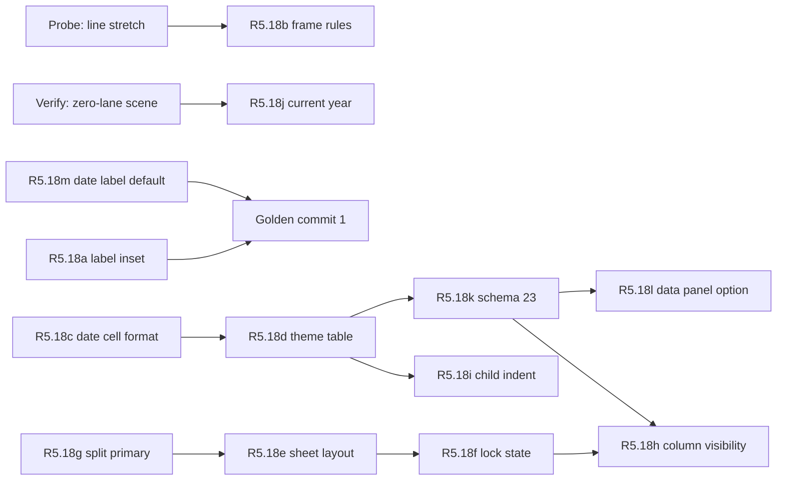

# Plan — Gantt Creator UI/UX alignment batch

> Status: **revised after owner decisions D1–D6 (2026-11-13)**. Ready to implement.
> Prepared against current source; every "today" claim below was read from the tree, not from a
> summary.
> Work items: **R5.18a–R5.18m**.

## 1. Outcome

The live Gantt reads as one object. Labels stop touching the rows above and below them. The chart
frame follows a column resize without a refresh. The sheet's cells carry the chart's own theme,
including borders and headings, and follow a theme change. The Sheet group is built around a large
Refresh, and each lock control names the state it is in. The Data group's split buttons remember the
last type chosen from their menu. The user can hide authoring columns from the ribbon, child rows
are indented, an empty workbook draws the current year instead of refusing, and a bar's date label is
a deliberate choice that defaults to none.

## 2. Owner decisions (resolved)

| ID | Decision |
|---|---|
| D1 | The lock controls describe the **current state** ("Chart locked" / "Chart unlocked"), and the glyph matches the state: closed padlock while locked, open padlock while unlocked |
| D2 | **Two mutually exclusive controls** per lock, each with its own verified `imageMso`, swapped with `getVisible` — no custom image pipeline |
| D3 | `None` is the resolved default for **every** date-bearing row; a stored `Auto` parses as the type default (so no cell has to be rewritten); `Both` becomes an explicit member |
| D4 | The **Data panel** description-label option is removed; the Splitter's default becomes `Plot centre` |
| D5 | The **live table's appearance is owned by the add-in**: borders and headings follow the chart's theme and must track the theme settings, reversing the 2026-10-21 "table keeps Excel's own borders" ruling |
| D6 | **Spacer column becomes column A, so `Type` is column B.** No migration sequence: there are no active users. Every repair, integrity and validation path must work with the new schema |
| D7 | **Lucide is available for every ribbon icon (owner ruling 2026-11-14), not just the column-visibility items.** This supersedes the `imageMso` measurement that forced D2's label-only variant: the missing open-padlock glyph is no longer a constraint, because a control can carry an embedded image through `getImage` instead of a static `imageMso`. It also retires D2's reason for existing (two swapped controls per lock). Not yet implemented — see §10 |

Two points the owner did not rule on, carried forward as the standing recommendation and marked
`(proposed)` in the work items: child notation is **indentation only**, and column visibility is
**persisted** in the workbook settings so a Repair cannot silently undo it.

## 3. Verification findings (current behaviour)

| # | Request | What the code does today | Evidence |
|---|---|---|---|
| 1 | Shrink labels 1pt top and bottom | The label box is exactly one row tall (18pt), centred on the bar, so it has no clearance against Excel's row rounding | [`LabelPlanner.TryGeometry`](src/GanttCreator.Core/Scene/LabelPlanner.cs:691), [`LabelMetrics.RowHeightPt`](src/GanttCreator.Core/Scene/LabelPlanner.cs:117), date labels at [`DateLabelBuilder`](src/GanttCreator.Core/Scene/DateLabelBuilder.cs:366) |
| 2 | Frame lines must stretch right on column resize | `chart:frame:top/bottom` are horizontal lines. Host sizing is vertical-only and a horizontal line is deliberately excluded, so they are written `xlMove` and never resize | [`FrameBandsBuilder.AddOuterFrame`](src/GanttCreator.Core/Scene/FrameBandsBuilder.cs:547), [`HostOwnedGeometry`](src/GanttCreator.Core/Scene/HostOwnedGeometry.cs:77), [`ExcelShapeWriter.RequiredPlacement`](src/GanttCreator.Office/ExcelShapeWriter.cs:1340) |
| 3 | Every Start/Finish cell formatted, even empty | No number format is written for the visible table; the only `NumberFormat` writes belong to the configuration sheet | [`ApplyColumnPresentation`](src/GanttCreator.Office/ExcelWorkbookInitialiser.cs:954) sets `Locked` and `Hidden` only |
| 4 | Table style follows the chart | The table gets a name and three flags, and nothing else: no font, alignment or borders | [`PresentDataTable`](src/GanttCreator.Office/ExcelWorkbookInitialiser.cs:917) |
| 5 | Move columns A–C after H | `Type` is column **D**; the schema remark records that moving the three hidden columns was rejected as an unrecorded order change | [`GanttTableSchema.Default`](src/GanttCreator.Core/GanttTableColumns.cs:195) and [line 179](src/GanttCreator.Core/GanttTableColumns.cs:179) |
| 6 | Refresh large, three controls stacked | The Sheet group is a 2 × 2 grid of normal-size controls | [`grpSheet`](src/GanttCreator.AddIn/RibbonResources/Ribbon.xml:165) |
| 7 | Lock shows an open padlock when unlocked | Both lock toggles carry a static `label` and a static `imageMso`; only the pressed state changes | [`btnToggleChartLock`](src/GanttCreator.AddIn/RibbonResources/Ribbon.xml:174), [`btnToggleCellLock`](src/GanttCreator.AddIn/RibbonResources/Ribbon.xml:175) |
| 8 | Split-button primary follows the last choice | Each primary is hard-wired to one type; menu items route through a generic handler | [`OnAddActivityClick`](src/GanttCreator.AddIn/GanttRibbon.cs:346), [`OnAddEntityClick`](src/GanttCreator.AddIn/GanttRibbon.cs:365) |
| 9 | What is Data panel | `DataPanelLeft` exists only for `Splitter`; it draws the description over the live data table, left of the plot, and is suppressed when no panel exists | [`_splitterLabelPositions`](src/GanttCreator.Core/EntityTypeCatalog.cs:60), [`SplitterBuilder`](src/GanttCreator.Core/Scene/SplitterBuilder.cs:264) |
| 10 | Date label needs Both, defaults to none | The enum is `Auto/Start/Finish/None`, and blank or `Auto` means **both** labels, so every bar shows two dates | [`GanttDateLabelPosition`](src/GanttCreator.Core/GanttDateLabelPosition.cs:22), [`SceneBuilder`](src/GanttCreator.Core/Scene/SceneBuilder.cs:1346) |
| 11 | Hide/unhide columns from the ribbon | No control and no user-owned visibility state; visibility is a schema constant applied on Initialise only | [`GanttTableColumn.IsHidden`](src/GanttCreator.Core/GanttTableColumns.cs:85) |
| 12 | Child indicator | Outline levels are written (child = 2) but no text indentation is applied | [`ExcelOutlineGroupWriter.ChildOutlineLevel`](src/GanttCreator.Office/ExcelOutlineGroupWriter.cs:74) |
| 13 | Initialise renders a chart | Initialise does schedule one refresh, but with no dated row the range resolver refuses `NoPlotRange` and the render aborts | [`InitialiseSheetCommand`](src/GanttCreator.AddIn/InitialiseSheetCommand.cs:53), [`PlotRangeResolver.TryResolve`](src/GanttCreator.Core/PlotRangeResolver.cs:73) |

Two capability facts that shape the design:

- **RibbonX cannot swap a built-in icon at runtime.** `dropDown` supports `getItemImage` with
  `showItemImage`, and `button`/`toggleButton` support `getImage`, but `imageMso` is a static
  attribute with no `getImageMso`. **Measured 2026-11-13:** the only padlock ids present in both
  `.microsoft/Office2010IconsGallery.docx` and `[MS-CUSTOMUI]-250218.docx` are `Lock` and `LockCell`
  — `ContainerLock` and `ApplyCoAuthoringLock` are in the gallery but absent from the idMso table,
  so [`check-ribbon-icons.ps1`](scripts/check-ribbon-icons.ps1) rejects them and there is **no
  open-padlock `imageMso` at all**. The owner therefore approved D2's label-only variant: one closed
  padlock stays and `getLabel` carries the state, with embedded images deferred.
  **Superseded 2026-11-14 by D7.** The constraint is real but no longer binding: `getImage` returns
  the same `IPictureDisp` the column-visibility items already produce from committed PNGs, so the
  open padlock is a Lucide asset rather than a gallery id. The deferred state glyph is now work,
  recorded in §10, not a capability limit.
- **The panel origin is the table's first column.** [`LiveDataPanelBounds`](src/GanttCreator.Core/Scene/SceneBuilder.cs:844)
  derives the panel rectangle from `grid.OriginLeftPt` and the measured column widths, and
  [`ExcelPanelGridMeasurement`](src/GanttCreator.Office/ExcelPanelGridMeasurement.cs:102) measures
  only the table's included columns. A spacer column outside the table is therefore invisible to the
  scene unless it is supplied as a measured leading gutter.

## 4. Work items

### Phase 1 — presentation, ribbon and render (no workbook-schema change)

- **R5.18a — Label box inset.** Every row-anchored label box loses 1pt at the top and 1pt at the
  bottom while staying centred on its row: description labels and date labels alike. The inset is a
  code-owned constant (no new metric token, so no schema bump); the entity guide's §22/§23 box
  definition is amended with the reason — a box exactly one row tall has no clearance against
  Excel's row rounding, which is what leaves a label behind after a group expands.
  Files: [`LabelPlanner.TryGeometry`](src/GanttCreator.Core/Scene/LabelPlanner.cs:672),
  [`DateLabelBuilder`](src/GanttCreator.Core/Scene/DateLabelBuilder.cs:360).
  Tests: bounds test (top = row top + 1, height = row − 2); an inset-0 control proves the old
  geometry is still expressible; golden update in its own reviewed commit.
  Office: expand a group without refreshing and confirm no label is left behind.

- **R5.18b — Horizontal chart rules stretch with columns.** A horizontal line that spans the
  plot/table-union width becomes host-sized, so it is written `xlMoveAndSize` and follows a column
  resize. Covers `chart:frame:top`, `chart:frame:bottom`, `chart:plot-closing` and the splitter's two
  major borders. The `HostOwnedGeometry` doctrine note that excludes horizontal lines is corrected
  with the measured reason.
  Files: [`HostOwnedGeometry`](src/GanttCreator.Core/Scene/HostOwnedGeometry.cs:65),
  [`SceneShapeRenderer.BuildLine`](src/GanttCreator.Office/SceneShapeRenderer.cs:285).
  Tests: Core classifier positives and negatives (a bar-length line, a label-width rule, a line that
  stops short of the plot); Office contract test asserting `xlMoveAndSize` for the four frame rules
  and `xlMove` for everything else.
  Probe first: that Excel stretches a sub-1pt horizontal line when a column widens. If it does not,
  the fallback is the ADR-0038 anchoring technique applied horizontally, and that becomes a decision
  rather than a silent workaround.

- **R5.18c — Start/Finish cells always carry the date format.** Write the workbook's
  `DateDisplayFormat` pattern to the whole worksheet columns behind `Start` and `Finish` on both the
  Initialise and Repair paths, so a blank or later-typed cell cannot show a serial number.
  Files: [`ApplyColumnPresentation`](src/GanttCreator.Office/ExcelWorkbookInitialiser.cs:954) and its
  mirror in [`ExcelWorkbookRecovery`](src/GanttCreator.Office/ExcelWorkbookRecovery.cs:1141);
  one new Excel-pattern helper beside [`GanttDateFormatting`](src/GanttCreator.Core/GanttDateDisplayFormat.cs:40)
  so no second pattern authority exists.
  Tests: both `EntireColumn.NumberFormat` writes including an empty body; a no-write case for an
  already-correct column; a positive test for an unknown stored format.
  Documented consequence: the whole-column format also applies to user cells below the table in those
  two columns. Formatting only table rows cannot satisfy "even if they are empty" for future rows.

- **R5.18d — Theme-owned table appearance.** The live table adopts the chart's theme: body text at
  `FontFamily`/`BodyFontSizePt`, heading row at `HeaderFontSizePt` bold on `HeaderFill`, table borders
  in `MajorGridStroke` at the chart's border weight, vertical centring for all five visible columns,
  horizontal centring for `Start`/`Finish`/`Duration` and left alignment for `Type`/`Description`.
  The write runs in the refresh pipeline, not only on Initialise, so a theme change restyles the
  table on the next refresh; every write compares first, so an unchanged sheet is a zero-write pass.
  Files: [`PresentDataTable`](src/GanttCreator.Office/ExcelWorkbookInitialiser.cs:917),
  [`GanttRefreshOrchestrator`](src/GanttCreator.Office/GanttRefreshOrchestrator.cs:524) (where the
  theme is already resolved), the recovery mirror, and the guide's §3/§4 amendment that records D5 —
  including the explicit reversal of the 2026-10-21 "table keeps Excel's own borders" ruling.
  Tests: one write-capture test per property group; a no-write test on an already-themed table; a
  theme-change test proving the borders and heading colours follow the settings; a guide-conformance
  pin that the colours come from the catalogue, never a literal.

- **R5.18e — Sheet group layout.** `Refresh chart` becomes a large button; `Warnings...`,
  `Lock cells` and `Lock chart` move into one vertical box beside it, in that order.
  Files: [`grpSheet`](src/GanttCreator.AddIn/RibbonResources/Ribbon.xml:165).
  Tests: one large control plus one vertical box in the group; keytip and icon uniqueness.

- **R5.18f — Lock controls state themselves.** D1/D2 as resolved by measurement: each toggle keeps
  its single verified glyph (`Lock` / `LockCell`) and states its **current state** through
  `getLabel` — "Chart locked"/"Chart unlocked" and "Cells locked"/"Cells unlocked" — because the
  pressed state already says what is true and no open-padlock `imageMso` exists. The wording lives in
  one function pair so it can be pinned without a host; the icon becomes an embedded image only when
  that seam is approved.
  **Landed as the label-only variant; the glyph half is reopened by D7 (2026-11-14).** The labels are
  in place and pinned. What D7 changes is the *reason* the glyph could not follow the state: with
  Lucide assets served through `getImage`, the open padlock exists, so D1's "the glyph matches the
  state" is deliverable and D2's two-control design has no remaining justification. Outstanding work
  is listed in §10.
  Files: [`RibbonControlIds`](src/GanttCreator.AddIn/RibbonControlIds.cs:101),
  [`GanttRibbon`](src/GanttCreator.AddIn/GanttRibbon.cs:289),
  [`RibbonStateService`](src/GanttCreator.AddIn/RibbonStateService.cs:1982), and the invalidation that
  already runs on every lock change at [line 3113](src/GanttCreator.AddIn/RibbonStateService.cs:3113),
  which is what makes the swap visible without a ribbon reload.
  Tests: visibility projection in both states, label projection, the two new ids in the enabled-state
  truth table, `check-ribbon-icons.ps1` for both new `imageMso` ids, and a live render check that the
  open padlock exists and is distinct.

- **R5.18g — Split-button primary follows the last menu choice.** Remember the last entity chosen
  per split button (session state, one remembered type per split, defaulting to today's default), route
  the primary through one dispatcher, and project the primary's label from `EntityTypeCatalog.Format`
  so no second name table exists. A remembered type that is not currently permitted (Critical Interval
  with no eligible parent) falls back to the split's default and the label follows the fallback.
  Files: [`OnAddEntityClick`](src/GanttCreator.AddIn/GanttRibbon.cs:365),
  [`RibbonStateService`](src/GanttCreator.AddIn/RibbonStateService.cs), the three primary buttons in
  [`Ribbon.xml`](src/GanttCreator.AddIn/RibbonResources/Ribbon.xml:28).
  Tests: remember, route, label projection, fallback when unpermitted, and the refusal path still
  speaking a message.

- **R5.18h — Column visibility dropdown.** A per-column dropdown for `Type`, `Description`, `Start`,
  `Finish`, `Duration` whose items carry a tick when the column is visible and a blank image when it
  is hidden (`showItemImage` plus `getItemImage`); selecting an item toggles the worksheet column
  behind it. Hiding the last visible authoring column is refused with an actionable message.
  **Owner rulings 2026-11-13 (supersede the "proposed" note):** the choice **is** persisted, so it
  survives opening another workbook instance, and the item images come from **Lucide** via the icon
  MCP. Two consequences follow and neither is free:
  - *Persistence is schema 24, not 23.* The original plan put the key in R5.18k's bump, but that
    landed as schema 23 with R5.18l riding on it. A new strictly-parsed settings key therefore takes
    the workbook to **24** with its own catalogue-hash re-pin, and a Repair must not clobber it.
  - *Lucide ships SVG, RibbonX wants `IPictureDisp`.* `imageMso` cannot vary per item state, so the
    dropdown needs `getItemImage`, which is the custom-image host seam this repo has avoided until
    now. The chosen glyphs are Lucide `check` (visible) and `minus` (hidden); they must be rasterised
    (16 px and 32 px) and committed as assets so the runtime carries no SVG renderer and no new
    production dependency, and the conversion to `IPictureDisp` needs a live-host check of its own.
  Slicing, so each commit is reviewable and green:
  1. Core visibility contract (toggleable columns, last-column refusal) + the schema 24 settings key
     + the Office port that reads and writes it. No host seam, no ribbon surface.
     **Landed:** `GanttColumnVisibility` (`Parse`/`Format`/`Toggle`, `LastVisibleColumn`),
     `HiddenColumns` in `GanttCatalogues.Settings`, schema 24 with the config anchor moved to A99
     (the 27th settings key consumed the old blank row — the anchor invariant test caught it, as
     designed) plus the hash re-pin, and `IColumnVisibilityPort` / `ExcelColumnVisibilityPort`
     reading and applying the five offered columns' `Hidden` flags by name, resolution before
     mutation, drift-only writes.
  2. The dropdown in `Ribbon.xml` and `RibbonStateService`, with **label** state first so the
     behaviour is testable offline. **Must also reconcile the two schema-driven writers**, or a
     user-hidden column reappears on the next Refresh/Repair:
     `ExcelColumnPresentationRestorer.EnsureClassification` and
     `ExcelWorkbookRecovery.ApplyColumnPresentation` both force `column.IsHidden` from the schema,
     so both must read the persisted set and write the effective visibility (engine-hidden ∪
     user-hidden) instead. `ExcelWorkbookInitialiser.ApplyColumnPresentation` runs only on a
     pristine sheet, so it needs no change.
     **Landed.** The reconciliation took the smaller of the two available shapes: rather than
     threading the persisted set into two adapters that have no settings reader, both writers now
     ask `GanttColumnVisibility.SchemaOwnsVisibility(column)` and skip a user-visible column's
     hidden flag entirely — the engine columns are still forced, and a visible column keeps
     whatever the user chose. That is the same result with no new dependency and no port-signature
     change. The dropdown is `ddnColumnVisibility` in a new `grpColumns` group, its items are
     `col` + the schema name, and each item's label states the live visibility ("Start (hidden)")
     until slice 3 replaces the wording with the tick. Selecting an item runs the Core `Toggle`,
     applies the set through `IColumnVisibilityPort`, then writes `Format(set)` to
     `HiddenColumns` — worksheet first, key second, so a failed hide cannot record a choice the
     sheet does not show. The last-authoring-column refusal and a refused apply both report and
     write nothing.
     **2b, landed with it:** a rebuild that recreates the worksheet now re-applies the stored
     choice. `ExcelWorkbookRecovery.ApplyStoredColumnVisibility` reads `tblGanttSettings` through
     `IConfigCatalogueReader`, parses `HiddenColumns` through `GanttColumnVisibility.Parse` — which
     is what finally makes the parse contract load-bearing rather than test-only — and applies it
     through `IColumnVisibilityPort` at the top of the presentation pass. It is best-effort and
     traced: an unreadable settings table, a value that does not parse, and a refused apply all
     leave the schema's presentation and say why in the log, because a repair that refused over a
     decoration would leave the user with no table at all. An absent or blank key is not applied at
     all: "nothing hidden" is already what the schema shows, so applying it would be a round trip
     that changes nothing. Five contract tests pin the applied case and each of the four
     do-nothing cases.
  3. `getItemImage` with the rasterised Lucide tick/blank, an addition to the ribbon
     callback-signature rules, and the live-host verification of the bitmap conversion.
  Files: new ids in [`RibbonControlIds`](src/GanttCreator.AddIn/RibbonControlIds.cs), a new dropdown
  in `Ribbon.xml`, a thin Office port that reads and toggles a named table column's visibility, the
  item projection in `RibbonStateService`, the settings key in `GanttChartSettings`/`GanttCatalogues`
  and the `IPictureDisp` seam.
  Tests: item count/ids/labels; tick image for visible and blank for hidden; toggle writes and the
  no-write path; last-column refusal positive test; a Repair that must not clobber a persisted choice;
  a stored key that does not parse is refused with a positive test rather than defaulted silently.

- **R5.18i — Child indentation (proposed: indentation only).** Indent the `Description` cell by
  hierarchy depth (`IndentLevel = depth − 1`, capped at the host maximum) in the same pass that writes
  outline levels, resetting non-child rows to zero. No value changes; outlines, copy/paste and the
  reader are untouched. A bold parent remains a deferred option.
  Files: [`ExcelOutlineGroupWriter.Apply`](src/GanttCreator.Office/ExcelOutlineGroupWriter.cs:120)
  with a pure depth plan in Core.
  Tests: depth plan (leaf, child of child, promoted row resets); Office write capture and no-write
  path; live check that the indent and the outline gutter agree.

- **R5.18j — Initialise renders the current year.** When both plot modes are automatic and no row
  carries a date, resolve the range to 1 January–31 December of the current year instead of refusing,
  so Initialise draws the headers, bands, frame and an empty plot. The current date is an explicit
  input, never an ambient clock, so Core stays deterministic.
  Files: [`PlotRangeResolver`](src/GanttCreator.Core/PlotRangeResolver.cs:34),
  [`ExcelSceneBuildRequestFactory`](src/GanttCreator.Office/ExcelSceneBuildRequestFactory.cs:596),
  guide §1/§3 amendment.
  Tests: fixed-`today` determinism; culture invariance; a dated table still wins; an explicit range
  still wins; an empty grid renders a scene instead of refusing.
  Verify first: whether a zero-lane scene is already renderable end to end. `allowEmptyRows: true` is
  passed at [`ExcelPanelGridMeasurement`](src/GanttCreator.Office/ExcelPanelGridMeasurement.cs:208),
  but `LaneMetricsResolver` still refuses `NoRows`; trace that path before coding.

- **R5.18m — Date-label default is none, with an explicit Both.** Add the `Both` member; make the
  resolved default `None` for every date-bearing row; keep a stored `Auto` parsing as "the type
  default" so no cell is rewritten; project the dropdown as `Both`/`Start`/`Finish`/`None` for spans
  and `Start`/`None` for start-only types, with `Default` still clearing the cell.
  Files: [`GanttDateLabelPosition`](src/GanttCreator.Core/GanttDateLabelPosition.cs:22),
  [`EntityTypeCatalog.GetAllowedDateLabelPositions`](src/GanttCreator.Core/EntityTypeCatalog.cs:510),
  [`SceneBuilder`](src/GanttCreator.Core/Scene/SceneBuilder.cs:1346), the validation path that accepts
  a stored date-label value, guide §23 amendment.
  Tests: capability matrix per date mode; `Both` emits both labels and `None` emits neither; stored
  `Auto` and a blank cell both resolve to the type default; an unknown stored value is still refused
  with a positive test; golden update in its own reviewed commit.

### Phase 2 — workbook schema 22 → 23 (owner-approved, no migration)

- **R5.18k — Spacer column A, `Type` in column B, hidden columns after `Duration`.**
  The schema becomes: spacer column (not part of the table), then `Type`, `Description`, `Start`,
  `Finish`, `Duration`, then `Id`, `LaneId`, `StackIndex` and the remaining engine columns. Schema
  version 22 → 23, with an ADR that replaces the "authoring columns lead the table" remark and states
  that no migration path is written because there are no active users.
  Schema and layout:
  [`GanttTableSchema.Default`](src/GanttCreator.Core/GanttTableColumns.cs:195),
  [`TableOriginColumnIndex`](src/GanttCreator.Core/GanttSheetLayout.cs:99) becomes 2,
  [`PlotAnchorColumnIndex`](src/GanttCreator.Core/GanttSheetLayout.cs:407) becomes
  `origin + column count`,
  [`TitleColumnIndex`](src/GanttCreator.Core/GanttSheetLayout.cs:136) is offset by the origin,
  [`GetHeaderRange`](src/GanttCreator.Office/ExcelWorkbookInitialiser.cs:1097) and the recovery
  header range start at the origin.
  Spacer geometry: its width must equal the framing rows' padding (`ChartPaddingRowHeightPt`,
  5.75pt). Excel column width is expressed in characters, so the write is a single
  measure-and-correct pass — set a provisional width, read `Range.Width` in points, correct once —
  and the measured width, not the provisional value, feeds the scene as a **leading gutter**.
  The gutter is a new measured input on the scene request, added to
  [`LiveDataPanelBounds`](src/GanttCreator.Core/Scene/SceneBuilder.cs:844) so the frame encloses the
  gutter exactly as it encloses the top and bottom padding rows. Panel projection and the plot anchor
  are unchanged by it.
  **R5.18k OFFICE GATE FAILED (2026-11-14) — 9 of 62 integration tests, all stale
  expectations from the reorder, none of them a product defect.** The gate had never been
  run for this item; `verify-office.ps1` on `805f8e3` produced two clusters and both are
  the test's literals, not the code's behaviour:
  1. *The plot anchor moved with the table, as designed.*
     `Initialise_adopts_a_blank_worksheet_and_builds_the_supported_state` and
     `Repair_restores_visibility_plot_anchor_and_typeoptions` expect
     `='Gantt Data'!$R$3` and the host reports `=…!$S$3`. `PlotAnchorColumnIndex` is
     `TableOriginColumnIndex + Columns.Count` = 2 + 17 = 19 = **S**, which is column
     after the last table column (B..R). The expectation is the pre-reorder A..Q layout.
     Fix: derive the expected reference from `GanttSheetLayout.BuildPlotAnchorRefersTo`
     instead of a literal.
  2. *The row helpers kept positional literals.* `AddRowIntegrationTests.AssertId` reads
     `row.Range.Cells[1, 1]`, which is now `Type`, so an Id assertion compares against
     "As-Planned Activity"; `AssertRow` passes `("Id", 1)`, `("Type", 4)`,
     `("StyleKey", 11)` to `ColumnValue`, whose whole point is the **cross-check** between
     the name and the index — `Id` is now position 6, so the cross-check fires before the
     cell is read. Fix: drop the literal arguments and let `ColumnValue` resolve the index
     from `GanttTableSchema`, which is what the helper already does internally;
     `AssertId` becomes `ColumnValue(range, "Id")`.
  3. The remaining three (`Insert_appends_all_three_command_rows_without_rendering`
     expecting 0 and seeing 1, `Repair_confirmed_identity_damage_cells`,
     and `ProtectionToggle…` at line 97) were triaged one at a time. Two were stale
     expectations and one was **not**: `ProtectionToggle…` read `headerCell.Locked = False`
     because `ListColumn.Range` includes the header cell, so the per-column lock write in all
     three presentation writers put an authoring column's *unlocked* flag over its own header.
     That was invisible while `Id` led the table and became the user-visible `Type` header once
     R5.18k moved the visible columns first — a real defect, fixed in `9a3d3ee` by locking
     `table.HeaderRowRange` once after the per-column pass in the initialiser, the restorer and
     the recovery, with the per-column comparison reading the body so a converged refresh stays
     write-free. `AddRow…`'s missing shape was a legacy Forms `Drop Down 1` control Excel
     materialises once a validated `Type` cell is selected (measured 0 → 1 after the first row
     selection); that test now asserts on the add-in's owned chart shapes, which is the claim it
     exists to make. **Measured after the fixes: `verify-office.ps1` PASS, 62/62**, leak signal
     38 (ceiling 38).
  **The line to keep from this block** is the first half: two of the nine were the tests' stale
  literals and the product was right. It is *not* a licence to assume every red integration test
  is stale — the third one was the opposite, and the only way it was found was by reading the
  writer rather than the expectation.

  **Repair, integrity and validation parity (explicit D6 requirement):**
  [`ExcelConfigIntegrityChecker`](src/GanttCreator.Office/ExcelConfigIntegrityChecker.cs:130) origin
  check and the positional header-alignment/structure-repair plans must accept origin column 2 and
  the new order; the spacer column must be treated as add-in owned, not as an "extra user column"
  finding; `GanttTableStructureRepair` must rebuild a missing table at column 2; the `Type` data
  validation range and the TypeOptions materialiser must use the new `Type` column; the
  column-presentation and visibility appliers are schema-indexed and need no new list, but their
  tests pin the new order.
  Tests: schema order and count pins; layout derivations (anchor, title, origin); integrity positives
  for a correct sheet, a legacy sheet and a spacer holding user content; a full rebuild-from-missing
  repair onto column 2; reader/writer round trip; the whole Office contract suite.
  **Part 1 landed as `0055d88`:** schema order, origin column B, the layout offsets, the
  initialiser/recovery header ranges and the hash re-pin. **Part 2, reviewed 2026-11-13 — required
  for the item to be done as intended:**
  1. *The width is set, once.* `Initialise` (and the repair mirror) sets the leading gutter column's
     width so its **measured** width in points equals `ChartPaddingRowHeightPt`. Excel's column
     width unit is characters, so this is one provisional write, one `Range.Width` read, one
     correction — not a loop. A column already at the target is not rewritten.
  2. *The measurement travels with the grid, not with the request.* The reviewed design differs from
     the first trace: `PanelCellGrid` already carries every other measured worksheet fact the scene
     consumes (`OriginLeftPt`, the padding rows, the anchor row), and it is the object the live
     measurement adapter builds. Adding a leading-gutter field there needs no change to
     `SceneBuildRequest`, the request factory signature, or the refresh orchestrator, and it keeps
     "measured geometry arrives as `PanelCellGrid`" true rather than adding a second carrier. The
     field defaults to zero, so an export composition and every existing caller are unchanged.
  3. *The frame encloses it.* `LiveDataPanelBounds` subtracts the gutter from `grid.OriginLeftPt`,
     so the panel — and the frame drawn on the union — starts one gutter left of the table.
     `OriginLeftPt` itself must NOT move: it is the title textbox's left edge, and shifting it would
     move the title onto the gutter.
  4. *Refusal.* A negative or non-finite gutter is refused with its own typed reason, and that
     refusal gets a positive test in the same commit.
  Tests: Core — the grid accepts zero and a positive gutter, refuses a negative one, and the
  panel rectangle starts `gutter` points left of the origin while the title column is unchanged;
  Office — the initialiser writes the corrected width once, does not rewrite a column already at
  the target, and the measured grid carries the column's measured width. Golden scene: unaffected
  while the gutter is zero, which is what makes this half reviewable without a golden churn — the
  golden moves only when the Office width pass lands and a composition carries a non-zero gutter.

- **R5.18l — Remove the Data panel description-label option (D4).** The Splitter's capability set
  becomes `Plot centre`/`Both`/`None`, and its default becomes `Plot centre`; `DataPanelLeft` remains
  a scene-level capability only for the splitter's own builder paths that still need it, or is retired
  outright if nothing else reads it. Guide §10/§22 and the splitter goldens are amended.
  Files: [`EntityTypeCatalog`](src/GanttCreator.Core/EntityTypeCatalog.cs:60),
  [`GanttCatalogues`](src/GanttCreator.Core/GanttCatalogues.cs:543),
  [`SplitterBuilder`](src/GanttCreator.Core/Scene/SplitterBuilder.cs:264).
  Tests: the capability set for a Splitter row; positive test that `DataPanelLeft` is now refused for
  a Splitter; a splitter's default renders its label at the plot centre.

## 5. Sequencing

Order of record: R5.18a and R5.18m first (they are the two visual rulings with the widest test
ripple), then the render/ribbon group, then schema 23, then the items that depend on it.

## 6. Gates and evidence

- Per work item: targeted `dotnet test` for the touched projects, then
  `pwsh ./scripts/verify-quick.ps1` on staged changes; branch-final `pwsh ./scripts/verify.ps1` on a
  clean tree after the last commit.
- `pwsh ./scripts/verify-office.ps1` is **required** for R5.18b, R5.18c, R5.18d, R5.18e, R5.18f,
  R5.18h, R5.18i, R5.18j and R5.18k. No item may claim "fully tested" without it.
- `pwsh ./scripts/check-ribbon-icons.ps1` for every new or changed `imageMso`, including the two new
  padlock ids.
- Two golden updates, each its own commit with a stated reason and human review: one for the label
  inset, one for the date-label default. The equivalence thin-slice expected bounds move with them.
- `docs/STATUS.md` and `docs/REPO-MAP.md` updated where an entry point, test location or command
  changed; one ADR for schema 23 and layout origin; one ADR (or a recorded amendment) for the
  reversal of the table-borders ruling in D5.

## 7. Risks

| Risk | Handling |
|---|---|
| `xlMoveAndSize` on a near-zero-height line may scale its height with row height | Probe before coding; the visible error is sub-point, and a badly behaved host moves the work to a two-anchor geometry |
| Whole-column date format reaches user cells below the table | Documented consequence in the guide; the alternative cannot cover future rows |
| Schema 23 changes the origin, the anchor and the title column at once | One ADR, one pinned derivation per value, and a repair rebuild test onto column 2 rather than a migration |
| Theme-driven table borders reverse a recorded ruling | Recorded as an explicit reversal with the owner's decision, not as a silent change |
| Removing `DataPanelLeft` narrows a documented capability | Guide §10/§22 amended in the same commit, with the refusal pinned |
| Custom images would add a new host seam | Avoided entirely by D2's two-control design |
| Reading stored `Auto` as "type default" | Pinned by a test so a future reader cannot reintroduce "Auto means both" |

## 8. Explicitly out of scope

- Any change to the `Type` catalogue values, the entity geometry contracts, or the configuration
  sheet's schema.
- Restyling the configuration worksheet.
- Persisting the split buttons' remembered type across sessions.
- A custom child indicator beyond indentation; bold summary rows are recorded as a deferred option.
- A migration path from schema 22: there are no active users, and Initialise remains the only
  creation path.

## 9. Mutation-survivor ledger (R5.18)

`verify.ps1` judges only the Core files the branch changed, and it judges them whole-file, so
touching `LabelPlanner`, `DateLabelBuilder`, `EntityTypeCatalog` or `SceneBuilder` pulls in those
files' pre-existing survivors. Part 1 moved the gate from 77.30 % to 77.66 % and part 2 from
77.66 % to 82.45 % (465 of 564 scored mutants killed, 87 survived, 12 no-coverage) against the
80 % threshold. The survivors that remain are recorded here so a later reader does not chase them
as untested behaviour.

| Kind | Examples | Why no test can kill it |
|---|---|---|
| Tolerance noise | `WithinBounds`'s `<=` versus `<` and its per-edge `±Epsilon`; `DateLabelBuilder.Contains`; the `occupant.Bounds.Right < right - Epsilon` guards | They differ only when a coordinate sits within 1e-6pt of a bound, and every candidate that reaches the check was clamped onto that bound exactly |
| Unreachable through `RectD` | `IsFinite(RectD)` in `LabelPlanner.ValidMetrics`; the same shape in `DateLabelBuilder.IsPositive` | `RectD`'s constructor refuses non-finite coordinates and extents, so the predicate is always true |
| Unreachable by any caller | the `or` chains in `LabelPlanner.TextAlignmentFor` and `DateLabelBuilder.Box` | `LabelRefusal.InvalidPosition` rejects every position that would reach those arms, and `None`/`Auto` are handled before geometry |
| Equivalent under the current constants | `2d * BoxVerticalInsetPt` versus `2d / BoxVerticalInsetPt`; `best = -1.0`; the `continue` in `TryWidestGap`; the right-anchor ternary | The inset is 1, a gap narrower than the marker is already refused, and the widest-gap box always spans the whole measured gap |
| Inherited, not created | the pre-existing `SceneBuilder`, `EntityTypeCatalog` and style-resolution survivors | Existing debt in code this branch did not change; it enters the judged set only because the file is in the diff |

### Measured survivors at the end of the batch

`verify.ps1 -MutationSince HEAD~8` judged the batch's ten Core files and returned
**83.87 % (624/744 scored killed, 105 survived, 15 no-coverage)**. The survivors divide as
follows, and the difference between the two halves matters:

| File | Survivors | Status of the argument |
|---|---|---|
| `SceneBuilder` | 32 | **Inherited and unexamined individually.** Pre-existing debt in a file this batch changed; the categories above are plausible for it but were not checked line by line |
| `LabelPlanner` | 38 | Partly argued: the 7 unreachable `TextAlignmentFor` arms, the 3 `IsFinite` mutants, the `RectD`-clamped `WithinBounds` pairs, and the inset arithmetic are each argued above or in the code's own remarks. The remainder (ellipsis/ordering/`Inside` branches) were not re-examined after part 2 closed the reachable ones |
| `DateLabelBuilder` | 15 | The `Contains` and `IsPositive` families are argued above; the `Unclipped` arithmetic and alignment ternaries are covered by the two fallback tests, so the residual set is the message strings and the unreached `or` arms |
| `PlotRangeResolver` | 6 | **One looks like a genuine gap.** `ValidateSettings` line 250 mutates `Max()` to `Min()` and survives, which means no test pins that setting's bound direction. The other five (a coalesce-assignment, a logical chain in `ParseExplicitDate`, an equality on the start-after-finish comparison, and two statement removals) are unexamined |
| `HostOwnedGeometry` | 6 | The four inclusive-tolerance boundary pairs, `NearlyEqual`'s strict comparison, and the `ThrowIfNull` guard. Each differs only at a value exactly on the tolerance boundary, which a test could pin but nothing yet does |
| `GanttTableColumns` | 4 | Three exception-message strings and the constructor's `ThrowIfNull`. Message-only mutants are unobservable through the public surface unless a test asserts the text |
| `EntityTypeCatalog` | 2 | A conditional that collapses to `null` on an empty display name (no entry has one, so it is equivalent in practice) and a `??` whose left side is never null |
| `GanttDateDisplayFormat` | 2 | The two exception messages of the format guards |

**Do not read this table as "all equivalent".** Two entries deserve a test rather than an
argument — the `ValidateSettings` bound direction in `PlotRangeResolver` and the tolerance
boundaries in `HostOwnedGeometry` — and the `SceneBuilder` set has not been examined at all.
They are recorded here so the next mutation pass starts from a list, not from a re-measure.

### R5.18h slice 1 (`mutation-gate.ps1 -Since HEAD~1`, commit `4eea0c0`)

**93.99 % (391/416 scored killed, 17 survived, 8 no-coverage)** against the 80 % threshold. Two
survivors were in the new `GanttColumnVisibility`, and they were not the same kind:

| Mutant | Outcome |
|---|---|
| `ColumnVisibilityOutcome.Succeeded`: `&&` mutated to `\|\|` | **A real gap — closed by a test.** No test asserted that a refusal is not a success, so `Hidden is not null \|\| Refusal is null` returned `true` for every refusal. `An_unknown_name_is_refused_rather_than_ignored` now asserts `Succeeded` is false alongside the refusal reason |
| `Toggle`'s `ArgumentNullException.ThrowIfNull(hidden)` removed | **Equivalent in practice.** The next statement is `new HashSet<string>(hidden, …)`, which throws the same exception type for the same input, so the guard's own test cannot distinguish them. Recorded rather than chased |

The remaining fifteen are the pre-existing whole-file survivors in `GanttCatalogues` (message
strings, `First()` versus `FirstOrDefault()`, and the metric/typography validation arms this change
did not touch) — that file enters the judged set only because the settings catalogue is in the diff.

## 10. Outstanding after the batch (audited 2026-11-14)

Everything below is work this batch either deliberately deferred or discovered and did not close.
It is a list of what is *not* done, not a wish list: each entry names the reason and what would
close it.

| # | Item | Why it is still open | What closes it |
|---|---|---|---|
| O1 | **R5.18f state glyphs, reopened by D7** | The label half landed; the glyph half was blocked by the measured absence of an open-padlock `imageMso`. D7 removes that block, and the column-visibility slice already built the pipeline (`ColumnVisibilityImages`, embedded PNGs, `IPictureDisp` marshalling, `getItemImage`) | Rasterise Lucide `lock`/`lock-open` at 16/32 px with the existing `gen-column-visibility-icons.ps1` pattern, serve them through `getImage` on both toggles, byte `imageMso` from those two controls, extend `check-ribbon-icons.ps1`'s expectation (27 → 25 ids), and retire D2's second control. A live check that the two images differ is then possible for the first time |
| O2 | **Live-host render check of the dashboard `getItemImage`** | `ColumnVisibilityImagesTests` pins the PNG → `IPictureDisp` marshalling through `AxHost`, but nothing in `verify-office.ps1` loads a ribbon, so the host-rendered bitmap is unverified. The plan's slice 3 asked for it explicitly | A live-Excel check that opens the dropdown and reads back that both item images resolved (or an accepted, recorded statement that this is manual-only, which R5.18h slice 1's "no host seam" note does not yet grant) |
| O3 | **Toggle → refresh → persist round trip in the host** | The Core toggle, the apply-then-persist ordering and the rebuild re-apply are each pinned in contract tests; no live test selects a dropdown item and then asserts the column stays hidden across a Refresh and a Repair. This is the one place where three separately-correct pieces meet | One `Category=OfficeIntegration` test: hide a column through `RibbonStateService.ToggleColumnVisibility`, run the restorer, assert hidden; run the recovery, assert hidden |
| O4 | **`PlotRangeResolver.ValidateSettings` bound direction** | A mutant that flips `Max()` to `Min()` survives and looks like a genuine gap: no test pins which side of the range each setting bound is checked against | One Core test asserting a value beyond each bound is refused with that bound's reason |
| O5 | **`HostOwnedGeometry` tolerance boundaries** | The four inclusive-tolerance boundary pairs and `NearlyEqual`'s strict comparison differ only at a value exactly on the boundary, which no test currently pins | Four boundary facts, one per geometry rule |
| O6 | **`SceneBuilder` mutation survivors never examined** | 32 survivors in a file this batch changed, categorised as "plausible but unchecked" — the only entry in the ledger with no line-by-line argument at all | A per-survivor pass over that file, killing what a test can kill and recording the rest |
| O7 | **`GanttColumnVisibility.Toggle`'s `ThrowIfNull`** | Recorded as equivalent: the next statement's `HashSet` constructor throws the same exception for the same input, so no test can distinguish them | Nothing; it stays in the ledger |
| O8 | **Branch-final `verify.ps1 -MutationSince`** | `verify-quick` judges changed Core files per commit with `mutation-gate.ps1`; the whole-branch score against the 80 % threshold has not been re-measured since the R5.18h slice 1 pass (93.99 %). Chapter `9`'s numbers are older than the last four commits | `pwsh ./scripts/verify.ps1 -MutationSince <batch base>` on a clean tree |
| O9 | **COM-proxy leak signal has no headroom** | The gate passed at exactly its ceiling (38 forced kills, ceiling 38). Any new test body that leaves a proxy alive fails the gate for a reason unrelated to what it tests | Retire one leaked chain, or raise the ceiling with a measured band as the script's own history requires — not by a quiet bump |
| O10 | **`docs/STATUS.md` / `docs/REPO-MAP.md` drift** | Status rows were written per item; the map's test locations and commands have not been re-read since the R5.18h port and the four new test classes landed | One pass over both, in the commit that closes this list |

Still explicitly out of scope, unchanged: the split buttons' remembered type is session-only, bold
summary rows and any child indicator beyond indentation, a custom ribbon image pipeline beyond
committed PNGs, and any schema-22 migration (`Initialise` and `Repair` remain the only creation
paths).
