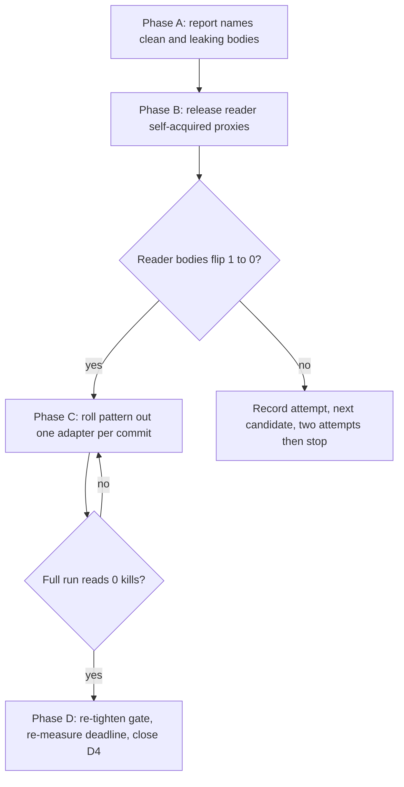

# Plan — clean Office teardowns: drive the 40 escalating gates to a graceful exit

**Goal.** Every `OfficeFixture` teardown exits gracefully — `Quit()` terminates Excel within the
graceful bound and `ForcedKillCount` reads 0 — so the COM-proxy leak signal reaches its stated end
state and the Office gate stops paying ~10 s per leaked body (40 of 52 teardowns today, roughly
400 s of the 717 s run).

**Baseline (measured, 2026-11-18, Excel 16.0.20527.20196).** 52 teardown records: 12 at 0, 40 at 1,
none above 1. The 12 clean bodies launch Excel without operating on a workbook, which proves the
fixture's own create/close/release ordering is not the chain. Reader bodies that do NOT load the
packed XLL still escalate, which excludes the loaded add-in as the shared chain and leaves the
adapter-acquired proxies as the live hypothesis.

**Non-negotiables carried from the contract.**

- Never release a shared root the caller owns (`Application`, `Workbook`, `Sheets`, the `Worksheet`
  handed in, the `ListObject`/`owner` returned through `out`). Only proxies the adapter acquired
  itself (`sheets[index]`, `worksheet.ListObjects`, `listObjects[index]`, `worksheet.Rows[i]`).
- Never use `OfficeFixture.SuppressLeakSignal` to improve the number.
- A release must never throw into Excel: best-effort, `Marshal.IsComObject`-guarded, recorded to the
  existing trace sink. Precedent: `ExcelPanelGridMeasurement` line 538 and
  `ExcelApplicationStateScope.ReleaseSelectionProxy`.
- One adapter per commit, its tests in the same commit; two evidence-led attempts per adapter, then
  stop and record (bounded-retry rule).
- The reader's documented contract "takes no ownership of shared roots" is preserved and restated:
  releasing a self-acquired proxy is not taking ownership of a caller's root.

---

## Phase 0 — land the current staged change

The gate recalibration (per-teardown verdict, fail-closed exit 5) is staged but uncommitted. Commit
it first so every measurement below is made against a green, exit-0 gate whose report names the
per-body attribution. No new work in this phase.

## Phase A — make the discriminator visible (harness only, no product code)

**A1. Report the clean teardowns too.** `verify-office.ps1` currently prints only bodies with
`Count > 0`. Add the zero-kill list (same line format, labelled `clean teardowns`) so every run log
answers "which bodies are already clean" without a probe. Pester: the stub writes one `Count: 0`
record and one `Count: 1` record; assert both lists print and the totals are unchanged.

**A2. Baseline run.** One `verify-office.ps1` run on the unchanged tree to capture the named clean
list (expect 12) and the per-body escalating list (expect 40). This is the comparison point for
every later phase; record it in `docs/STATUS.md`.

## Phase B — the reader chain (the experiment that proves or falsifies the hypothesis)

**B1. Release the reader's self-acquired proxies.** In
[`ExcelGanttTableReader`](../src/GanttCreator.Office/ExcelGanttTableReader.cs:245):

- `HasConfigurationSheet` and `HasGanttSheet`: each `GetSheetAt` result is a fresh RCW dropped on
  the floor today. Hold it, and release it through a new internal virtual seam
  `ReleaseAcquired(object proxy)` at the end of each iteration — including the sheet that matched
  (the method only reads `Name`; it owns nothing onward).
- `TryFindTable`: release each non-matching `ListObject` candidate, each sheet's `ListObjects`
  collection, and each sheet that did not own the table. Do NOT release the returned `table` or
  `owner` — the caller owns those.
- The seam: `internal virtual void ReleaseAcquired(object proxy)` guarded by
  `Marshal.IsComObject`, `try/catch (COMException)` recorded to the existing trace delegate, never
  throwing. Update the type remark (lines 24-26) to state the new rule in one sentence.

**B2. Contract tests in the same commit.** The existing Moq doubles are not COM objects, so the
guard alone would leave the release path untested — the exact shape this repository treats as a
defect. Tests: (1) `ReleaseAcquired` is called once per enumerated sheet in
`HasConfigurationSheet`/`HasGanttSheet`; (2) it is called for every non-matching candidate and the
`ListObjects` collection in `TryFindTable`; (3) it is NOT called for the returned `table`/`owner`;
(4) a seam that throws does not escape `Read` (the refusal path still wins). Drive them through a
`TestableReader` override that records calls.

**B3. Live proof, cheap first.** `dotnet test` filtered to `GanttTableReaderIntegrationTests`
(about 1 min) — success is those bodies' records flipping **1 → 0**. Then the full
`verify-office.ps1`. Record the new total/fraction in STATUS.

**B3 result (2026-11-18) — falsified, and it produced a better discriminator.** 4 of the 5 reader
bodies still forced one kill (10,094-10,114 ms). The one clean body,
`Read_refuses_a_1904_workbook`, is the only body that never calls
`ExcelWorkbookInitialiser.Initialise`. The reader fix is kept (genuine dropped proxies, three
contract tests) but it moved no counter. **The discriminator is `Initialise`, not `Read`**, so
attempt 2 targets the initialiser's acquired proxies instead of the normaliser named below.

**Stop condition.** If an attempt leaves the target bodies at 1, record it and move to the next
candidate the evidence names, not a guess. Two attempts on the same adapter, then stop and report.

## Phase C — roll the proven pattern out, one adapter per commit

**Attempt 2 result (2026-11-18) — the initialiser audit is WITHDRAWN, not pending.** The host probe
scoped above was extended to the mechanism itself. Run 1 of
[`probe-quit-cases.ps1`](../scripts/probe-quit-cases.ps1) stuck on two table cases and exited on
nine; run 2 of the identical script exited on **every** case, including all five table repeats and
both calculate variants. The flap is non-deterministic at the COM level and not attributable to an
operation, so releasing the initialiser's proxies has no supporting evidence. This is the
bounded-retry stop: two attempts made, both recorded, no speculative product change landed.

**Phase C0 result (2026-11-18) — the ordering hypothesis is falsified too, before any fixture change.**
[`probe-quit-ordering.ps1`](../scripts/probe-quit-ordering.ps1) ran the same leaking workload ten
times under **Quit then GC** and ten times under **GC then Quit**: **10/10 exited in both orders**.
A companion measurement — one leaking body under `dotnet test --filter` — still read **1 forced kill
at 10,098 ms**, so the flap is deterministic per body **inside the xUnit host** and does not reproduce
under PowerShell COM at all. No `OfficeFixture` change is authorised by this evidence.

## Phase C0' — collect the discriminator inside the harness

**Landed 2026-11-18.** `OfficeFixture` records `Quit` (returned / `com:0x…` / `error:Type` /
`not-attempted`) and `BodyMs` per teardown, one contract test pins the record shape, and
`verify-office.ps1` prints a `Quit()` outcome histogram beside the attribution.

**First measurement:** an isolated leaking body read `Quit:"returned"`, killed after
`GracefulExitMs:10083` — Excel accepted the quit and survived. Nulling the body's adapter local
changed nothing (`10086 ms`), so "Quit refused" and "adapter instance rooted" are both out.

**Full-run dataset (69/69 green):** 52 records, **all `Quit:"returned"`**, 40 leaking and 12 clean.
Body duration, captured at teardown entry, is 797-4,332 ms for leaking bodies and 676-3,261 ms for
clean ones: overlapping, so duration is not the discriminator. The packed add-in is not auto-opened
in those instances (no `OPEN*` value in the Excel `Options` key).

**Next experiment bisects the workbook structure** with this same record: a body that creates only
the Gantt table, one that creates only `_GanttCreatorConfig`, and one that creates both. Success is a
named mechanism, not a green count.

## Phase C — adapter releases, only after C0

Ordered by the evidence, which the Phase-B probe re-ranked. **Nothing here is landed until C0 says
whether the flap is harness-side:**

1. [`ExcelWorkbookInitialiser`](../src/GanttCreator.Office/ExcelWorkbookInitialiser.cs) — held back
   by the attempt-2 stop above; revisit only if C0 shows the flap is adapter-side.
2. [`ExcelRowHeightNormaliser`](../src/GanttCreator.Office/ExcelRowHeightNormaliser.cs:668) —
   `NormaliseLayoutRow`/`GetLayoutRow` drops a `worksheet.Rows[i]` Range per layout row (up to 6
   per normalisation); `TryGetTypeColumn`, `CellValueAt`, `GetBodyRowCount`, `GetBodyRowAt` drop
   `DataBodyRange`/`Rows`/cell ranges. Same seam, same tests, same live re-measure.
2. `ExcelGanttValidationReporter` — the `GetSheetAt` enumeration (line 415) mirrors the reader's.
3. `ExcelWorksheetProtectionPort.FindGanttWorksheet` and `ExcelShapeWriter.FindGanttWorksheet` —
   the same sheet-enumeration shape.
4. `ExcelConfigIntegrityChecker.FindConfigSheet`, `ExcelDateLabelPositionMutator.TryFindTable`,
   `ExcelGanttRowInserter.TryFindTable`, `ExcelPanelGridMeasurement.FindGanttTable`,
   `ExcelWorkbookRecovery` — same pattern, each its own commit.
5. Whatever the attribution still names after each run; the report from A1 makes the remaining set
   visible every run.

Each commit: seam + positive tests + `verify-quick`; each phase boundary: full `verify-office.ps1`
with the total/fraction recorded in STATUS.

## Phase D — close the loop and re-tighten the gate

**D1. End state.** A full gate run reading **0 forced kills** (or only the documented
`OfficeFixture.CreateWorkbook`/`Packed_XLL` flapping family, L19). Record the run, the duration
(the gate should fall from ~12 min toward ~5 min as the 10 s waits disappear), and the clean list.

**D2. Re-tighten.** Reintroduce a total ceiling at the measured value — 0, with one documented
allowance for the flapping family if it still flaps — so the ratchet ends where it always claimed:
no test should need a forced kill. `verify-office.Tests.ps1` pins the new number. Lower the
allowance in the same commit as each remaining flap retirement.

**D3. Re-measure the deadline.** With the kills gone, re-measure the suite duration and lower
`DeadlineSeconds` from 780 on the new figure (D5's rule: measure, never guess).

**D4. Close the work items.** `R5.18n` D4 and the R5.20 D4 reference close on the measured 0 (or
the documented allowance), the roadmap row and L19 record the end state, and STATUS carries the
final measurement.

---

## Decision flow

## Acceptance tests

- Phase A: Pester green on the extended report; baseline run recorded.
- Phase B: reader contract tests green; filtered live run shows reader bodies at 0; full gate green.
- Phase C: per-adapter contract tests green; the reported total falls monotonically across runs.
- Phase D: a gate run at 0 (or allowance-only) kills; the ceiling re-pinned; `verify-quick` and
  `verify-office` both green on the final tree; STATUS/L19/roadmap updated.

## Exclusions

- No change to `OfficeFixture` teardown ordering (already measured clean) and no new suppression.
- No change to the graceful-exit bound, the deadline, or any product behaviour beyond proxy
  release; no schema, scene, or renderer change.
- No blanket `GC.Collect`/`FinalReleaseComObject` sweeps anywhere.
