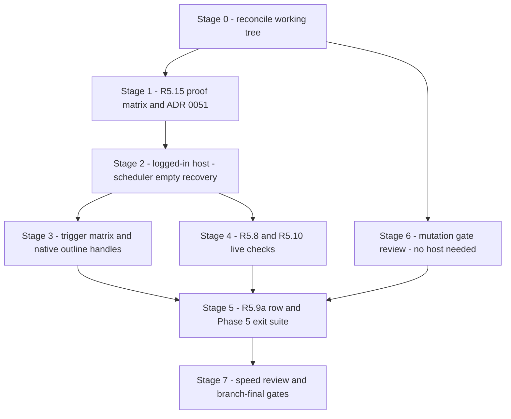

# Phase 5 closure — sequenced implementation plan (2026-11-01)

Architect-mode plan for closing R5.15, the R5.11 live-host evidence, the
trigger/non-trigger matrix, the R5.8/R5.10 live checks, the R5.9 scope
finalisation and Phase 5 exit suite, and the R3.13 mutation-baseline review
with manifest/status reconciliation. Sources read: `AGENTS.md`,
`docs/STATUS.md`, `docs/REPO-MAP.md`, `docs/03-ROADMAP.md` (Phase 5 notes
revision 14), and the work items
[`R5.15`](../docs/work-items/R5.15-managed-worksheet-protection.md),
[`R5.11`](../docs/work-items/R5.11-refresh-only-enforcement.md),
[`R5.8`](../docs/work-items/R5.8-warnings-panel.md),
[`R5.10`](../docs/work-items/R5.10-selection-overrides.md),
[`R5.9`](../docs/work-items/R5.9-ribbon-completion.md),
[`R3.13`](../docs/work-items/R3.13-mutation-testing.md),
plus [`mutation-gate.ps1`](../scripts/mutation-gate.ps1),
[`mutation-gate.Tests.ps1`](../scripts/mutation-gate.Tests.ps1),
[`verify.ps1`](../scripts/verify.ps1), and
[`verify-office.ps1`](../scripts/verify-office.ps1).

## Verified drift findings this plan must reconcile

1. **`R5.9a` does not exist.** R5.9's Option B decision table, the roadmap
   R5.9 row, and STATUS all defer implementation to "new roadmap row
   `R5.9a`" — but the roadmap table has no `R5.9a` row and
   `docs/work-items/` has no `R5.9a` file. A lowercase suffix normalises to
   `R5.9` in `check-status.ps1`, so the gate cannot catch the missing row.
2. **The R3.13 guide claims the local mutation step is a disabled stub.**
   [`verify.ps1`](../scripts/verify.ps1) step 15 now invokes
   `mutation-gate.ps1` for real. The work item text and the STATUS line
   "local mutation gate remains disabled … see the open gate-path defect
   below" are stale, and the "below" pointer dangles — no defect
   description follows.
3. **The R5.15 decision has no numbered ADR.** The decision ("retain the
   unprotected workflow") is recorded only inside the work item; the ADR
   ceiling is `0050`, so the decision belongs in `0051` with a
   `DECISIONS.md` index entry.
4. **The R5.15 proof matrix is incomplete.** The live-evidence table has
   three rows; the proof plan's table operations, outline, shape writes,
   reopen persistence, user-protection distinction, and failure-mode steps
   are unexecuted, and the roadmap row's Required column demands them.

## Execution order

The order follows the roadmap's own Phase 5 sequence (R5.15 first, then the
R5.11 foundation, feedback, trigger integration, exit evidence), with the
mutation-gate review running in parallel because it needs no live host.
Every stage ends in its own commit(s); nothing later depends on uncommitted
work.

## Stage 0 — reconcile the working tree

The R5.11 implementation (scheduler, delta cache, warnings state, host
tests) is uncommitted per the 2026-10-31 STATUS entries. Before any new
work: inspect `git status --short` and the full diff, run the targeted
suites (`Core`, `Office.ContractTests`, `AddIn`, `Architecture`, `Raster`,
non-tagged Office integration), then `verify-quick.ps1` on the staged tree.
Split the diff into one-concern Conventional Commits (scheduler/queue
adapter; delta reconciliation; warnings state; host tests; docs). No
behaviour change is made in this stage — only landing what exists. **Exit
evidence:** clean tree, green `verify-quick.ps1`, STATUS entry per commit.

## Stage 1 — R5.15 feasibility and decision (protected-sheet refusal preserved)

The current refusal policy stays in force throughout; no production
protection code is written. The work completes the proof plan already in the
work item:

- **API investigation:** reflect over the installed `ExcelDna.Interop`
  16.0.0 PIA for `Worksheet.Protect`/`Unprotect`/`ProtectContents`/
  `ProtectUserInterfaceOnly` and every `Allow*` parameter; record the host
  Excel build. Prefer vendor metadata over memory, per the protocol.
- **Prototype validation:** disposable probe scripts under `scripts/`
  (the `probe-*` convention) against a throwaway workbook: exact
  editable/locked ranges; add-in-class writes (shape create/update/delete,
  table insert/delete/resize, sort/filter, Type validation dropdown,
  outline expand/collapse, chart-anchor reads) under
  `Protect(UserInterfaceOnly:=$true)`; close/reopen persistence of the
  UI-only flag; a user-protected sheet receiving the existing typed
  no-mutation refusal (already guard-first per ADR-0008 D4).
- **Failure modes:** protect/refuse mid-write, application-state
  restoration, no partial mutation where preventable, one actionable
  feedback path.
- **Decision criteria, stated explicitly before the evidence is read:**
  (a) can the add-in maintain engine columns, shapes, and layout under
  protection without bypassing the common mutation guard; (b) is
  reopen/reapplication deterministic; (c) does adoption require any stop
  condition (schema change, extra sheet, security promise, Office-version
  change). Any "no" retains the current refusal.

On the evidence already recorded (COM writes to locked cells are blocked
even with `UserInterfaceOnly`), the expected outcome is **retain the
unprotected workflow** — but the criteria decide, not the expectation.
Deliverables: the completed evidence table in the R5.15 work item, a
numbered **ADR-0051** plus `DECISIONS.md` index entry, roadmap row status,
STATUS entry. **Exit evidence:** every proof-plan step has an observed
result row; the ADR records the decision and its criteria; no production
code changed.

## Stage 2 — logged-in Excel desktop session: scheduler-to-render, empty chart, recovery

**Environment prerequisites:** an interactive, logged-in console session on
the self-hosted host (Microsoft 365 x64 desktop Excel, build recorded —
`16.0.20527.20088` is the last observed). The prior failures with COM
`0x80070520` ("a specified logon session does not exist") came from Excel
class-factory activation outside an interactive logon session; the session
must not be a service, scheduled task, or detached remote context. Freshly
publish the packed XLL (`scripts/publish-addin.ps1`), close user-owned
Excel instances, note display scale, and run through
`scripts/verify-office.ps1` (deadline watchdog, COM-proxy ratchet ceiling
35, evidence under `scripts/_artifacts/office-evidence/`).

**Execution steps and expected render outcomes:**

1. The AddIn scheduler-to-render host test (source compiles; blocked only by
   the session): load the packed XLL, Initialise, enter a valid activity
   row, wait for the production scheduler's queued macro to render the
   label shape; a second description edit must update the live shape text.
   Pass = the shape exists with the first text, then carries the second
   text, with exactly one coalesced render per debounce generation.
2. Empty first initialization: one empty chart frame and title, exactly
   once; repeated Initialise neither duplicates nor clears.
3. Invalid-entry recovery: a blocking validation error preserves the last
   chart, surfaces non-modal feedback naming the row/field, and the next
   valid edit recovers via the normal coalesced pass.
4. COM-failure repair: an injected host failure after mutation begins marks
   the refresh incomplete, invalidates the delta cache, and the next pass
   performs a full reconciliation from actual workbook state.

**Logging:** the per-user add-in rolling log (session records), the
verify-office evidence directory, and the work-item evidence table with
test names and host build. **Exit evidence:** each of the four outcomes
observed and recorded; the `0x80070520` blocker discharged or escalated
under the bounded-retry rule (two failures = stop and report).

## Stage 3 — trigger and non-trigger matrix; native outline handles

Audit every command family R5.1–R5.7, R5.10, R5.12–R5.14 for
`ScheduleAutomaticRefresh` wiring after successful commit, and add the
missing matrix tests against the table in the R5.11 work item. **Pass/fail
definitions:** a trigger cell passes when a schedule call is observed after
a successful commit and bursts coalesce into one queued refresh; a
non-trigger cell (selection, navigation, dialog cancel, pre-mutation
refusal) passes when zero schedule calls AND zero shape-port calls are
observed; a post-mutation failure cell passes when dirty state is marked
and exactly one full revalidation is requested.

**Native outline handles — reproducible procedure:** a disposable live
probe subscribes to every measurable `AppEvents` member
(`SheetChange`, `SheetSelectionChange`, `SheetCalculate`, and the
activation/activate events) on a workbook with a real outline group, then
clicks the native `-`/`+` handle. **Observable evidence:** which events
fire, if any. The working hypothesis (row `Hidden` changes raise no
`SheetChange`) must be proven, not assumed. If no usable event fires, the
consequence is assessed live: a natively collapsed group's owned shape set
must be unchanged and the next scheduled refresh must produce zero shape
writes (lanes anchor to rows per ADR-0034, so hiding rows is presentation,
not scene content). If that holds, record "native handles never render" as
a fact with the probe as evidence; if it does not hold, stop for an owner
decision on the mechanism. **Exit evidence:** one contract or live test per
matrix cell, the probe script's recorded output, and the decision.

## Stage 4 — R5.8 and R5.10 live checks

**R5.8:** provoke each warning family live (clipped span, out-of-range
delineator, same-stack ambiguity, plot-range, missing data); the Warnings
action lists the last successful scene's warnings with timestamp, separate
from current validation findings; nothing mutates — the `Value2` matrix is
byte-identical around each provocation (D3 discipline). Invalid-entry
recovery: bad dates/colours retain the previous chart, identify the
correctable row/field, and never open a modal per edit. **R5.10:** the
selection-gating truth table live (zero rows, multiple rows, header,
collapsed roll-up, one expanded entity); capability gating per Type;
edit a rectangle fill and a diamond label position; blank inherits the
style default; the overrides persist through the coalesced refresh (D4);
selection changes never render. **Exit evidence:** host builds recorded in
both work items; regression coverage already automated stays green; the
live rows close each work item's Required column.

## Stage 5 — R5.9 scope finalisation and the Phase 5 exit suite

The Option B decision is made; the deferral target is not. Add the `R5.9a`
roadmap row (revision bump, uppercase-suffix so `check-status` enforces the
guide) and its Tier-B work item, or re-point the deferral with an owner
decision; reconcile the R5.9 work item status. Complete R5.9's own
presentation delta review (icons/keytips/labels/offline help pins) and the
live accessibility review (keyboard walkthrough, screen-reader labels,
high-contrast, screenshot layout). Then run the **full Phase 5 exit
evidence suite**: every R5.1–R5.15 Required host gate, the complete
`verify-office.ps1`, and `verify.ps1` branch-final, with end-to-end
traceability — each roadmap row's Required evidence named in its work item
with test names and host builds, and `IMPLEMENTATION-PLAN.md`,
`REPO-MAP.md`, and `STATUS.md` reconciled in the same change.

## Stage 6 — R3.13 mutation baseline reviewed from scratch

Review the implementation as if newly encountered: `mutation-gate.ps1`,
`mutation-gate.Tests.ps1`, the `verify.ps1` step, the `ci.yml` step,
`tool-versions.psd1`, and the baseline-archive policy. Suspected defects
found in this planning pass — each must be **verified with a positive test
before any fix**, never assumed:

1. `verify.ps1`'s judging of the gate's returned result: confirm a halted
   gate (non-zero Stryker exit surfaces as a terminating error) actually
   exits 1 — the snippet prints FAIL but the exit path must be proven; this
   is the L10 silent-pass class.
2. The zero-scored-mutants PASS branch: on `main` itself, `--since
   origin/main` diffs to nothing, making the gate vacuous there; confirm
   the exit-code judgement covers a `--since` merge-base failure.
3. The score denominator (`killed/(killed+survived+timeout+noCoverage)`)
   versus Stryker's own definition; the console line "killed/total" is
   misleading because `total` includes Ignored/CompileError mutants.
4. Core-only test-project scope: a Core mutant killed only by an Office
   contract or AddIn test counts as survived — the measurement
   underestimates; record as a limitation or extend the test-project set
   after checking Stryker's multi-project support.
5. The baseline archive is local-only (`scripts/_artifacts` is ignored):
   the 76.22% / 6,683-mutant baseline is not in git. Decide whether a
   committed summary (score plus top survived-mutant files) should be.
6. Stale texts: the R3.13 "disabled stub" claim and STATUS's dangling
   "open gate-path defect below" pointer.

**Test-effectiveness mining (answers "do the tests actually test the
code"):** rank Core files by survived mutants from the archived baseline;
cross-reference the repo's known vacuous-test classes (contract harnesses
that override `internal virtual` seams so production COM lines never
execute — the `GetCellAt` defect class — and fakes that discard their
arguments — the `FakeRowHeightNormaliser` class). Record findings; fix the
highest-value gaps with their own commits. **Exit evidence:** every
suspected defect confirmed or refuted with an observed positive test;
Pester guard green; reconciled docs.

## Stage 7 — verification speed review

Measure, then change, one thing at a time (the repo's own rule: no
threshold or ceiling moves without a measurement). Candidates: MSBuild node
reuse / max-cpu-count on the build steps; the already-single packed-XLL
publish cycle; `OfficeFixture` teardown ordering (release the workbook
before `Quit()`) which would both speed teardown and lower the COM-proxy
ratchet toward its end state of 0; Stryker stays changed-code-only. The W14
tripwire (exactly one `dotnet test` target) constrains test-sweep
parallelisation — any change there must keep parity. **Exit evidence:** a
before/after table of gate durations with accepted and rejected speedups
and their reasons.

## Final gate and handoff

Branch-final `verify.ps1` (clean tree, all 15 steps including the mutation
gate), full `verify-office.ps1` with the ratchet reading recorded,
`check-status`/`check-md-links`/`check-cline-skills` green, checklist
self-certification sections listed per commit, and the
`Outcome / Changed / Proof / Office / Risk / Deferred / Next` handoff. R4.10
remains explicitly excluded throughout: no benchmark code, flow, or
measurements are touched or claimed.

## Hardening addendum — owner direction, later on 2026-11-01

The owner directed a class-leading, non-interruptive standard for the live
refresh flow plus error surfacing, blank/error-row alignment, and mutation
guards. Source reads this session established what already exists in the
uncommitted R5.11 tree, so the addendum is a hardening-and-proof pass with
three genuinely new build areas, not a rebuild.

**Verified implementation facts.**

1. **Partial render is implemented.**
   [`GanttRefreshOrchestrator`](../src/GanttCreator.Office/GanttRefreshOrchestrator.cs)
   excludes blocking-error rows from the scene (they render blank), plots
   every valid row, and refuses only when *every* row is blocked. Row-level
   errors fill the whole row pastel red, cell-level issues highlight the
   offending cell, warnings take pastel amber, and the highlighter clears
   cells that no longer carry issues. The owner's "error rows never prevent
   plotting of valid rows" and "auto-clear resolved errors" are therefore
   implemented but not yet proven by the demanded test battery.
2. **Blank rows are skipped, not errors** (`IsSemanticallyEmptyRow` strict
   form), and under ADR-0034 row anchoring a row owning no lane leaves its
   own band empty — so table-to-Gantt 1:1 alignment holds *structurally*,
   but no test currently pins the blank-gap alignment property end to end.
3. **The scheduler is debounced (~300 ms) with a generation counter**,
   exposes `CancelPendingRefresh`, coalesces by timer reset, rejects macros
   invalidated after queueing, and the automatic path is silent
   (`RunSilentForExcel`: status bar only, no dialogs, targeted ribbon
   invalidation only).
4. **`Ribbon.xml` has zero `keytip`/`getScreentip`/`getSupertip`
   attributes** — R5.9's presentation delta is genuinely unbuilt work.
5. **The change analyzer** classifies body-column edits and excludes
   `Duration`, headers, and other sheets; the recalc, table-auto-expand
   resize, and filter cells of the trigger matrix are absent.

**Stage 2b — non-interruptive refresh audit (new).** Prove the four
qualities with deterministic tests and close the three missing matrix
cells. *Debounced/coalesced*: extend the scheduler tests to pin one queued
refresh per burst. *Cancellable*: pin `CancelPendingRefresh` and the
invalidated-macro rejection (the latter exists; add the workbook-switch
cancel path). *Idempotent*: the zero-write unchanged-payload proof exists;
extend it through the silent path. *Never interruptive*: pin that the
automatic path presents nothing (no modal, no focus change — the R4.8
activation guard bans `Activate`/`Select` on refresh; add the
scheduler-path pin), and record as a probed fact that Excel suspends
`SheetChange` while a cell is in edit mode, so a render can never fire
mid-keystroke. *New matrix cells*: **recalc** (`SheetCalculate` is not
subscribed; expected non-trigger — prove no subscription exists and none is
needed since `Duration` is engine-written), **table resize/auto-expand**
(typing below the table makes the table claim the row; verify the
classification against the post-expand body and add the trigger test),
**filter** (applying a filter raises no `SheetChange`; probe live whether
`xlMoveAndSize` shapes hide natively on filtered rows so no render is
required — expected non-trigger by host design, recorded with the probe as
evidence).

**Stage 4 expansion — error surfacing hardening.** Deterministic tests for
error *show* (row-level red fill, cell-level highlight, warning amber) and
*clear* (the next successful refresh clears cells that no longer carry
issues — positive test constructing a resolved row); warnings-panel copy,
grouping, and severity pins (`Severity → Row → Field → Code`, stable across
repeated refreshes); no stale badges (current-issues update on success and
refusal, last-rendered warnings only on success — pins exist, extend to the
auto-clear requirement); and a positive no-mutation test that the
warning/highlight path never writes schedule content (authoring-cell
`Value2` matrix byte-identical around provocation and around resolution).

**Stage 4b — blank/error-row 1:1 alignment (new).** Deterministic Core and
Office contract tests: a body with a blank row and an error row between
valid rows anchors the valid rows' lanes to their own measured rows, leaves
the blank/error bands intentionally empty, and never pulls later rows
upward; child entities plot on the parent's row (projection pin exists —
extend through the live anchored path); chart/plot bounds and axis geometry
are stable across repeated refreshes with gaps present. Live confirmation:
valid rows plot while blank and error rows show aligned gaps.

**Stage 4d — mutation guards (new).** Ribbon enablement *transitions* get
their own tests (workbook open/close, initialise, selection change,
post-refresh re-evaluation — the truth tables exist; the transition
sequences do not). No writes to schedule content from warning or repair
paths (positive tests). Confirm-required repair only per ADR-0011 (R2.10
pins exist — re-verify and extend to the new highlighter).
`UserInterfaceOnly` handling: the protection guard must refuse a UI-only
protected sheet exactly as any protected sheet — the R5.15 evidence says
COM writes are blocked under it, so a positive contract test pins the typed
refusal.

**Stage 5 expansion — R5.9 presentation delta is real build work.** Add
keytips (unique, verified), `getScreentip`/`getSupertip` hooks, resx
labels, and offline help links to `Ribbon.xml`/`RibbonResources`, with the
contract tests (keytip uniqueness, label/screentip coverage, no `http(s)`
links) and the live accessibility review (keyboard walkthrough,
screen-reader labels, high-contrast, screenshot layout).

**One contract observation folded into Stage 6c:** the R5.11 work item
still says "Blocking validation errors leave existing shapes untouched",
while the delivered semantics are per-row isolation (only an all-blocked
table refuses). The work item, the R5.8 plan revision, and STATUS must be
re-worded to the delivered semantics in the same reconciliation commit.
