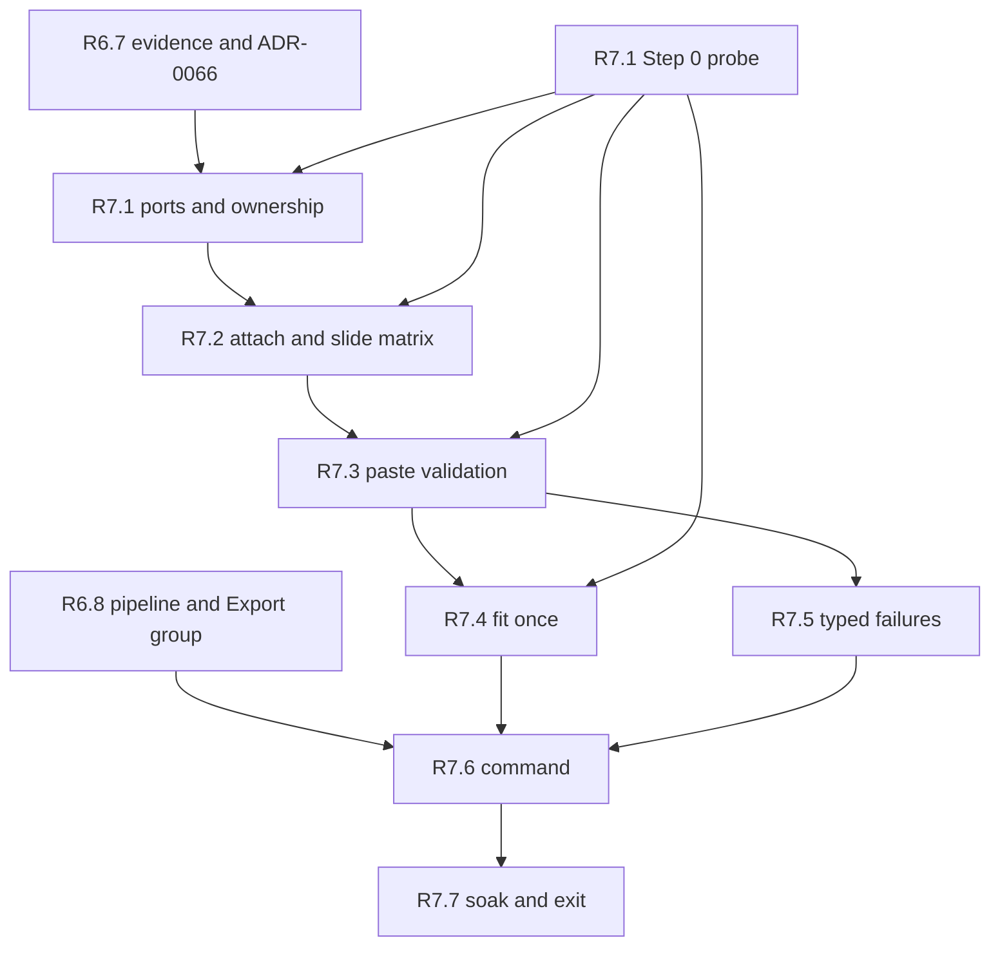
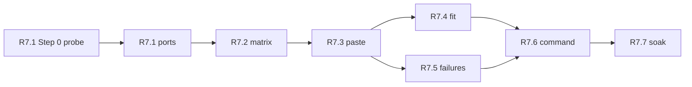

# Phase 7 review — direct PowerPoint transfer

> Architect review, 2026-11-21. Scope: the Phase 7 roadmap rows `R7.1`–`R7.7`, their
> Tier-A work-item guides, the governing architecture, the landed R6 export pipeline,
> ADR-0066 and ADR-0068, `docs/STATUS.md`, `docs/REPO-MAP.md`, the test strategy and the
> implementation-guide manifest. Every code claim below was checked against the current
> tree; every external API claim was checked against Microsoft Learn. Nothing in this
> document changes a product invariant. Where a change would, it is marked **STOP**.

## Resolution status (2026-11-21)

The work-item guides `R7.1`–`R7.7` were revised in place against this review. The
owner direction in the revision request changed two of this document's recommendations:
the late-bound `dynamic` route is **superseded by the typed PowerPoint PIA**, and the
host probe is **folded into R7.1 Step 0** rather than added as a roadmap row. Every
finding below is now carried by a guide:

| Finding | Resolution | Guide |
|---|---|---|
| `dynamic` / `Microsoft.CSharp` reliance | typed PIA; no `dynamic`; primitive ports | R7.1 D1, R7.3, R7.5, R7.7 |
| D-G6 contradiction | typed PIA decision; package check (reuse `ExcelDna.Interop` or pin `Microsoft.Office.Interop.PowerPoint` 16.0.0) + ADR | R7.1 Context/Step 0 |
| `Marshal.GetActiveObject` is .NET Framework-only | typed `new Application()`; `POWERPNT` pre/post snapshot decides `StartedByUs` | R7.1 Step 0; R7.2 Step 0 |
| Incomplete attach/slide matrix | view, slide-show, no-window, zero-slide, read-only, protected-view cases | R7.2 D1 |
| Paste range measured only at N=4 | production-scale probe; `1 + N` with one `msoGroup` | R7.3 Step 0/D1 |
| Range resize double-scales children | group-only resize; resize-route probe; label-fidelity gate | R7.4 D4/D5 |
| Deadline plus never-sleeps contradiction | bounded attempt count; measured HRESULT filter; `Stopwatch` diagnostics only | R7.5 D2 |
| No copy-to-cleanup hook | optional lifecycle `Transfer` seam and outcome | R7.6 Step 0/D1 |
| Duplicated pre-flight | shared `EditableExportPreflight` | R7.6 Step 0/D4 |
| `PowerPoint` profile mismatch | keep `EditableExport`; add transfer/copy scene parity pin | R7.6 D5 |
| Weak ownership sequence assertion | no-save port surface + source scans | R7.1 D5; R7.6 D2 |
| Soak exceeds the 780 s gate | `TransferSoak`-only category + dedicated measured script | R7.7 Step 0/D4 |
| PowerPoint PIDs invisible to the sweep | fixture writes the shared owned-PID manifest | R7.7 Step 0 |
| Fixture quits a user's PowerPoint | `StartedByUs` ownership; never close/quit a pre-existing presentation | R7.7 Step 0/D5 |
| `PlacementDelta` re-application risk | transfer consumes `ExportBounds.Bounds` only; the delta is already consumed by staging | R7.4 Step 0/D6 |
| `InvalidBounds` checks only the request | post-resolution finite/positive `Bounds` guard before staging | R7.4 Step 0; R7.6 Step 0 |
| Ribbon enables Copy Editable in NeedsRepair | `ExportGroup` visible only `Mode == Ready`; both buttons require a present configuration | R7.6 Step 0/D6 |
| `FinalReleaseComObject` / force release | `ReleaseComObject` only, reverse order, exactly once; no force release | R7.1 D2; R7.5 D4 |
| Event-connection detach | no Phase-7 events; any future connection is a single owned connection detached once | R7.1 D2; R7.5 D3 |
| PowerPoint activation | read `ActiveWindow`/`View.Slide`; PowerPoint-specific no-Activate scan | R7.1 D4; R7.2 D4 |

---

## 1. What Phase 7 intends

### 1.1 Business goal

An analyst who already owns the Gantt worksheet can place the same editable Gantt on a
PowerPoint slide with one click, without saving, closing or terminating the presentation
they already have open. The slide receives one editable shape group (not a picture), the
chart keeps its aspect ratio, and a failure never costs the user workbook or presentation
work. The phase is the second half of the export promise whose first half (the verified,
editable clipboard copy) shipped in `R6.8` on 2026-11-19.

### 1.2 Technical objectives

- One narrow, primitive-typed PowerPoint transfer surface in `GanttCreator.Office`; no
  interop type in any port signature (the R4.1 / CS0433 discipline).
- Attach to, or start, desktop PowerPoint according to a **recorded user-visible policy**,
  then use the **active editable presentation and slide** or create a presentation only
  when the button contract says so.
- Call `Shapes.PasteSpecial(ppPasteShape)` and treat the **measured** returned
  `ShapeRange` as the success signal — never a non-throwing COM call (`AGENTS.md`).
- Position and scale the pasted **group** once, inside the slide, preserving the export
  aspect ratio.
- Map protected presentation, no active slide, unsupported clipboard/partial document,
  COM busy/rejected call, PowerPoint absent and unsupported build to **distinct typed
  failures**, with a bounded, evidence-filtered retry that never sleeps.
- Never save, close, overwrite or terminate a user-owned PowerPoint instance; release
  only the proxies the add-in acquired.
- Prove stability with a 25-transfer soak that reuses the Office harness's PID-ownership
  discipline and records counters, timings and zero residue per iteration.

### 1.3 Functional scope

| In scope | Out of scope |
|---|---|
| A **Send to PowerPoint** button in the existing Export group | PNG export (Phase 8) |
| Attach/start, active-slide resolution, paste, validate, fit | Any new worksheet, table or schema change |
| Typed failures and one actionable message per failure | Saving, closing, quitting or file-picking PowerPoint |
| A live 25-transfer soak and Phase-7 exit evidence | Any Excel-side pipeline change beyond a shared pre-flight |
| Reuse of the R6 composition, grouping, copy and cleanup | A second clipboard verification or a second cleanup path |

### 1.4 Measurable outcomes

- `R7.1`: fake-adapter lifecycle and ownership pins are green; the port surface names no
  interop type; no save/close/quit member exists on the port.
- `R7.2`: the complete decision matrix is green, one positive per refusal; live
  existing-PowerPoint, new-PowerPoint, missing-slide and active-slide cases are recorded
  with host builds.
- `R7.3`: null, empty, zero-bound and wrong-type paste results each fail with a distinct
  typed result and a positive test; a real `ppPasteShape` paste is validated on the
  reference host at **production scale**.
- `R7.4`: the fit matrix is green for 4:3, 16:9 and custom slides; the applied aspect
  equals the export aspect within the documented tolerance; the group is scaled exactly
  once; labels remain legible after the scale.
- `R7.5`: every failure mode maps to one typed result; a non-transient failure never
  retries; no sleep primitive appears anywhere in the diff; cleanup runs on every path.
- `R7.6`: the pipeline order is pinned; no `Save`/`SaveAs`/`Close`/`Quit` is reachable;
  the live ownership gate confirms an unsaved user presentation survives intact.
- `R7.7`: 25 real transfers record zero staging residue per iteration, no unowned orphan
  process, a flat handle/memory trend within a recorded tolerance, and the Phase-8
  Tier-A guide upgrade.

---

## 2. Dependency map



The probe is folded into R7.1 Step 0 (see §6.1); no roadmap row is added.

---

## 3. Baseline: what the repository actually contains

### 3.1 No production PowerPoint code exists

- Every `PowerPoint` hit under `src/` is either the unused
  [`SceneCompositionProfile.PowerPoint`](../src/GanttCreator.Core/Scene/SceneCompositionProfile.cs:43)
  enum member or documentation. `docs/PRE-R4.9-DECISION-REGISTER.md` states the Phase-7
  renderer does not exist, and `docs/STATUS.md` repeats it.
- The only PowerPoint automation in the tree is **test-only**:
  [`PowerPointFixture`](../tests/GanttCreator.Office.IntegrationTests/PowerPointFixture.cs:57)
  (late-bound, created for `R6.7`), its host-free facts, and
  [`CopyAfterDeleteSpikeIntegrationTests`](../tests/GanttCreator.Office.IntegrationTests/CopyAfterDeleteSpikeIntegrationTests.cs:133).
- `Directory.Packages.props` pins Excel-DNA and Excel interop only; there is **no
  PowerPoint package** ([`Directory.Packages.props`](../Directory.Packages.props:29)).

### 3.2 The R6 pipeline R7 must reuse

- [`CopyEditableCommand.Run()`](../src/GanttCreator.AddIn/CopyEditableCommand.cs:314) is the
  pre-flight: table read → configuration read → validation → panel measurement → export
  request → selection → bounds. It is roughly 200 lines and ends by handing
  [`StagingLifecycle.Run()`](../src/GanttCreator.AddIn/CopyEditableCommand.cs:474) a
  request whose copy seam is hard-wired to
  [`StagedShapeCopier.Copy()`](../src/GanttCreator.AddIn/CopyEditableCommand.cs:479).
- [`StagingLifecycle.Run()`](../src/GanttCreator.Office/StagingLifecycle.cs:217) composes,
  groups, invokes the copy seam at
  [`StagingLifecycle.Run()`](../src/GanttCreator.Office/StagingLifecycle.cs:289), then
  cleans every staged shape in a `finally` at
  [`StagingLifecycle.Run()`](../src/GanttCreator.Office/StagingLifecycle.cs:301). **There
  is no hook between copy and cleanup today.**
- [`EditableExportRequest.Create()`](../src/GanttCreator.Office/ExcelSceneBuildRequestFactory.cs:1152)
  is the one export-assembly doorway; its remarks already name R7.6 as the consumer
  ([`EditableExportRequest`](../src/GanttCreator.Office/ExcelSceneBuildRequestFactory.cs:1137)).
- [`ExportBounds.Bounds`](../src/GanttCreator.Core/Scene/ExportBounds.cs:28) is the
  zero-origin rectangle (`0, 0, ChartBounds.Width, ChartBounds.Height`); its
  `PlacementDelta` is the translation the export contract carries.
- [`StagedShapeCopier.Copy()`](../src/GanttCreator.Office/StagedShapeCopier.cs:88) refuses
  success unless both measured drawing formats are present
  ([`StagedShapeCopier.RequiredDrawingFormatNames`](../src/GanttCreator.Office/StagedShapeCopier.cs:74)).

### 3.3 The evidence R7 inherits

- `R6.7` measured PowerPoint 16.0.20527.20196 on the reference host:
  `PasteSpecial(ppPasteShape)` returned a range of **5 = the group plus its 4 flattened
  children**, bounds 340 × 190 pt, and ungrouped to 4 editable children
  ([`PowerPointFixture.PasteSpecialShape()`](../tests/GanttCreator.Office.IntegrationTests/PowerPointFixture.cs:133),
  [ADR-0066](../docs/adr/0066-copy-after-delete-preserves-the-drawing-format.md:82)).
- ADR-0066 proves deleting the staging shapes after `ShapeRange.Copy` does **not**
  invalidate the clipboard, so a paste after cleanup is technically possible; the
  architecture still states paste as step 6 and cleanup as step 7
  ([`docs/02-ARCHITECTURE.md`](../docs/02-ARCHITECTURE.md:209)).
- `R6.8` measured 80 staged shapes and 340 primitives in the reference copy; the soak and
  the paste-range proof must use that scale, not the spike's 4-child toy group.

### 3.4 The harness

- [`OfficeFixture.RecordOwnedProcessId()`](../tests/GanttCreator.Office.IntegrationTests/OfficeFixture.cs:1312)
  writes the owned-PID manifest. `PowerPointFixture` has **no equivalent**: it tracks
  `_ownedProcessIds` privately and never reports them to the shell.
- [`verify-office.ps1`](../scripts/verify-office.ps1:41) has a **780 s** deadline and
  snapshots both `EXCEL` and `POWERPNT`
  ([`verify-office.ps1`](../scripts/verify-office.ps1:267)), with parentage as a fallback
  ([`verify-office.ps1`](../scripts/verify-office.ps1:436)).
- `PowerPointFixture.Initialize` always calls `Presentations.Add` and
  `Slides.Add`; `DisposeAsync` always calls `Saved = true`, `Close()` and `Quit()`
  ([`PowerPointFixture.DisposeAsync()`](../tests/GanttCreator.Office.IntegrationTests/PowerPointFixture.cs:294),
  [`PowerPointFixture.DisposeAsync()`](../tests/GanttCreator.Office.IntegrationTests/PowerPointFixture.cs:326)).
  See §5.6 for why this is a defect to fix **before** Phase 7 relies on it.

### 3.5 Ribbon and state

- [`grpExport`](../src/GanttCreator.AddIn/RibbonResources/Ribbon.xml:245) exists with one
  button, `btnCopyEditable`, and its XML comment names this phase's control as the next
  member.
- [`RibbonState.IsEnabled`](../src/GanttCreator.AddIn/RibbonState.cs:257) gates Copy
  Editable on `HasActiveWorkbook && SheetInitialised && ActiveSheetIsGanttSheet`, and
  [`RibbonState.IsVisible`](../src/GanttCreator.AddIn/RibbonState.cs:390) shows the
  Export group whenever `Mode != FirstRun`. **Both are wrong for Phase 7:**
  `SheetInitialised` is true in a `NeedsRepair` workbook whose configuration is missing
  (`ResolveMode`), so Copy Editable is enabled for a command that refuses at the
  configuration read. The corrected rule is in R7.6: `ExportGroup` visible only when
  `Mode == Ready`, and both export buttons enabled only when
  `Mode == Ready && ActiveSheetIsGanttSheet`.
- [`RibbonGlyphCatalog.g.cs`](../src/GanttCreator.AddIn/RibbonGlyphCatalog.g.cs:101) and
  `scripts/gen-ribbon-glyphs.ps1` are the glyph authority; `check-ribbon-glyphs.ps1` is
  the gate.

---

## 4. Item-by-item review

### 4.1 R7.1 — PowerPoint adapters and ownership

**Feasibility:** high. Greenfield, additive, and the R4.1 port pattern already exists.

**Outdated assumption 1 — the dependency (resolved 2026-11-21).** The guide's Step 0
originally scoped D-G6 to the late-bound route, while its scope still listed
`Directory.Packages.props` + an ADR row and the manifest still read "Open". The owner
direction in the revision request resolved the contradiction in favour of **statically
typed interop**: the adapter uses the typed PowerPoint PIA, the port stays primitive,
and `dynamic`/`Microsoft.CSharp` are removed. Step 0 verifies whether
`ExcelDna.Interop` 16.0.0 already exposes the PIA; if not,
`Microsoft.Office.Interop.PowerPoint` 16.0.0 is pinned and the dependency is
ADR-recorded.

**Outdated assumption 2 — "PIA implementations" (resolved).** The original scope's "PIA
implementations" was correct for the typed route and wrong for the late-bound one. The
guide now says "typed PIA implementation" explicitly, and the test fixture is migrated
off `dynamic` in the same row.

**Missing prerequisite — the port surface.** The architecture names
`IPowerPointTransfer` but no member list exists. A port that later grows a `Save` member
would defeat R7.6's ownership proof. The surface must be fixed before implementation and
must contain **no** save/close/quit member.

**Recommended shape (additive, Office only):**

```text
src/GanttCreator.Office/IPowerPointTransfer.cs
  IPowerPointTransfer            facade the AddIn consumes
  IPowerPointApplicationPort     attach/start, facts, presentation facts
  IPowerPointSlidePort           active-slide resolution, paste, group access
  IPowerPointProxyOwnership      acquire/release, reverse order, never FinalRelease
  records: PowerPointAttachOutcome, PowerPointSlideOutcome,
           PowerPointPasteOutcome, PowerPointPositionOutcome,
           PowerPointTransferRefusal
  (the target facts/decision are Core, §4.2)
src/GanttCreator.Office/PowerPointTransferAdapter.cs   typed PIA implementation
src/GanttCreator.Office/PowerPointProxyOwnership.cs    tested tracker
```

**Ownership rules to state in the adapter XML docs and pin by test:**

- Track every proxy this adapter creates; release in reverse order with
  `Marshal.ReleaseComObject`, never `FinalReleaseComObject`. This matches the landed
  Excel policy ([`ExcelGanttTableReader.ReleaseAcquired()`](../src/GanttCreator.Office/ExcelGanttTableReader.cs:643)).
- Never force-release or quit a pre-existing application; if `new Application()` returned
  an instance the adapter did not start, the adapter owns only its own RCW reference and
  releases that reference with `ReleaseComObject` at the end.
- Never call `Save`, `SaveAs`, `Close` or `Quit` from production, ever.

**Architecture tests:**

- Extend [`PortHygieneTests`](../tests/GanttCreator.Architecture.Tests/PortHygieneTests.cs:203)
  with a PowerPoint interop scan for `src/GanttCreator.AddIn` and the new port files.
- Add a structural test that the public PowerPoint port surface contains no member named
  `Save`, `SaveAs`, `Close`, `Quit` or `QuitAll`, with a positive control.

**The route is typed interop (revised 2026-11-21).** The owner directed statically typed
interop to remove `dynamic`/`Microsoft.CSharp`; the earlier late-bound recommendation is
superseded. The adapter uses the typed PowerPoint PIA. Step 0 verifies whether
`ExcelDna.Interop` 16.0.0 already exposes it; if not, pin
`Microsoft.Office.Interop.PowerPoint` 16.0.0 and record the dependency in the ADR. Ports
stay primitive so the AddIn never names an interop type.

---

### 4.2 R7.2 — attach/start and active-slide cases

**Feasibility:** high; the late-bound ROT mechanism is replaced by the typed single-instance call.

**Finding 1 — `Marshal.GetActiveObject` is not a .NET 10 API.** Microsoft Learn documents
it only for the `.NET Framework` moniker range (`netframework-1.1` … `4.8.1`); the page's
"Applies to" list has no .NET 5+ entry. The docs themselves advise P/Invoking
`oleaut32!GetActiveObject` when a ProgID is involved. A production adapter on
`net10.0-windows` must not assume the managed method exists.

**Finding 2 — the attach/start distinction may not need ROT at all.** The PowerPoint
`Application` object documentation states that `Set ppt = New PowerPoint.Application`
**starts PowerPoint if it is not already running**. That is the documented single-instance
behaviour: one typed `new Application()` is simultaneously "attach to the running
instance" and "start it". The adapter therefore needs:

1. a `POWERPNT` process snapshot **before** the call;
2. the `new Application()` call;
3. a post-call snapshot to decide `StartedByUs` (no process before, one after);
4. a typed outcome that never claims ownership of a pre-existing process.

This removes the ROT/P-Invoke risk entirely. **Revised 2026-11-21:** with the typed PIA,
the same single-instance call is `new Application()`; the adapter still snapshots
`POWERPNT` to decide `StartedByUs` and never quits a pre-existing host. The ROT/P-Invoke
alternative is no longer recommended.

**Finding 3 — the matrix is incomplete.** The guide's cases are running/not running and
presentation open/editable/protected/none and slide active/missing
([`R7.2-attach-slide-cases.md`](../docs/work-items/R7.2-attach-slide-cases.md:61)). The
missing cases are the ones PowerPoint actually refuses on:

| Missing case | Why it matters |
|---|---|
| Active view is `ppViewSlideSorter`, `ppViewOutline`, `ppViewThumbnails` or a master view | `Shapes.Paste`/`PasteSpecial` are documented for slide and notes views; other views cannot accept a shape paste |
| A slide show window is active | Pasting during a show is invalid and must be a typed refusal |
| `Presentations.Count > 0` but the active presentation has `Windows.Count == 0` | A presentation opened without a window has no active slide; creating a new presentation is the wrong remedy |
| `Presentation.Slides.Count == 0` | A blank presentation may have no slide; the active-slide resolution must not throw |
| The active presentation is read-only or password-protected | "Protected presentation" is not defined by any doc; the guide must define it (likely `Presentation.ReadOnly` plus the measured paste refusal) |
| PowerPoint is in Protected View | The automation object may expose no usable presentation; typed refusal |

**Finding 4 — the decision table belongs in Core.** The guide offers this as a Tier-A
choice ([`R7.2-attach-slide-cases.md`](../docs/work-items/R7.2-attach-slide-cases.md:47)).
It should be **Core**, as a pure table over primitive facts, so every branch is testable
without a host and the Office adapter only gathers the facts. Proposed:

```text
src/GanttCreator.Core/Export/PowerPointTargetFacts.cs
  bool StartedByUs, int PresentationCount, bool ActivePresentationReadOnly,
  bool ActiveWindowPresent, int ActiveViewType, bool SlideShowActive,
  int ActiveSlideCount, bool ActiveSlidePresent
src/GanttCreator.Core/Export/PowerPointTargetDecision.cs
  decision table + typed PowerPointTargetRefusal
```

**Finding 5 — the live gate must not destroy a user's session.** See §5.6: the current
`PowerPointFixture` quits whatever `CreateInstance` returned. R7.2's Required Office gate
cannot run until the fixture records pre-existing processes and only closes/quits what it
started.

**Revised acceptance:** add a positive test per view-type refusal, per presentation-state
refusal and per slide-state refusal; record the `StartedByUs` announcement rule; record
the chosen "protected" definition.

---

### 4.3 R7.3 — PasteSpecial and ShapeRange validation

**Feasibility:** high; the API and the expected form are measured.

**Finding 1 — production scale is unmeasured.** The 5-item range was measured for a
4-child group. The landed composition stages ~80 shapes on the reference fixture and 340
primitives in the copy benchmark (`docs/STATUS.md`). The guide's "group plus flattened
children" form must be re-measured at production scale before the validator is fixed; a
single-item or a group-only expectation is wrong at either scale only if the host changes
form, which nobody has measured.

**Finding 2 — "wrong-type" is undefined.** Add an explicit expectation: exactly one
`msoGroup` (6) shape must be present in the returned range, and the range count must equal
`1 + expectedChildCount`; a picture, placeholder, OLE object or a second group is a typed
failure. The expected child count is the staged child count from
`StagingLifecycleOutcome.Composition.StagedPrimitiveIds.Count`, which the command already
knows.

**Finding 3 — `PasteSpecial` itself can raise.** Microsoft Learn documents that an error
occurs if the clipboard has no data and that a partially downloaded source fails. Those
are **tool-stage failures**, not paste-validation failures; the mapper must distinguish
them.

**Finding 4 — tolerance.** PowerPoint exposes `ShapeRange.Width`/`Height` as `Single`.
Compare the applied aspect and the pasted bounds with
[`HostOwnedGeometry.GeometryMatchTolerancePt`](../src/GanttCreator.Core/Scene/HostOwnedGeometry.cs:56)
(0.01 pt) and record the measured delta; do not invent a second tolerance.

**Recommended shape:** a pure Core validator over a primitive expectation record, plus an
Office stage that reads the host and calls it:

```text
src/GanttCreator.Core/Export/PowerPointPasteExpectation.cs
src/GanttCreator.Core/Export/PowerPointPasteValidator.cs
src/GanttCreator.Office/PowerPointPasteStage.cs
```

The validator rejects: null range, zero count, count mismatch, no group member, more than
one group, non-finite/non-positive bounds, and a bounds/aspect mismatch outside tolerance.
Each is a positive test; the Office stage maps the validator's typed refusal to a
`PowerPointTransferRefusal`.

---

### 4.4 R7.4 — fit and position once

**Feasibility:** high, and the pure computation belongs in Core as the guide already
proposes.

**Finding 1 — never resize the returned range.** The measured range contains the group
**and** its flattened children. Setting `Width`/`Height` on the range would set each
member's size, scaling the children twice through the group. The only safe target is the
`msoGroup` member found by `Shape.Type == 6`. This must be stated as a correctness rule,
not left to the implementer.

**Finding 2 — the resize route is unprobed.** Three routes are plausible on a group:
(a) set `Width` and `Height` from one computed scale; (b) set `LockAspectRatio = msoTrue`
and set `Width`; (c) call `ScaleWidth`/`ScaleHeight` with the same factor. They can differ
in text scaling and in group-child fidelity. R7.4 must probe all three on the reference
host with the representative chart, then pin one. The work item currently assumes the
first.

**Finding 3 — text fidelity is not covered.** PowerPoint does not guarantee that a group
resize scales text with the geometry. A downscaled chart can overflow its labels even when
the geometry is exact. Add a live label-fidelity check at 4:3 and 16:9 (and one custom
size) to the Required gate; a geometry-only pass is not sufficient.

**Finding 4 — the margin policy is still owed (D-R7.4).** The guide's proposal — a uniform
inset derived from `ChartPaddingPt.Uniform` and scaled with the group — is implementable
and uses an existing Core type
([`ChartPaddingPt.Uniform()`](../src/GanttCreator.Core/Scene/ChartPaddingPt.cs:41)), but
the owner must record it before code. A fixed percentage is the alternative; either is
fine, neither is in a doc.

**Finding 5 — extreme custom slides.** `PageSetup.SlideWidth/SlideHeight` are `Single`
points. Guard a non-finite or non-positive slide size and a computed scale of zero or
below with a typed refusal; do not emit a degenerate shape.

**Recommended shape:**

```text
src/GanttCreator.Core/Export/SlideFit.cs
  Fit(RectD groupBounds, double slideWidthPt, double slideHeightPt,
      double insetPt) -> SlidePlacement { Left, Top, Scale, Width, Height }
  ratio-preserved by construction; one rounding via GeometryMath
src/GanttCreator.Office/PowerPointSlideFitter.cs
  applies SlidePlacement to the group shape once
```

The aspect source is [`ExportBounds.Bounds`](../src/GanttCreator.Core/Scene/ExportBounds.cs:28),
never `ChartBounds` and never a recomputed union; `PlacementDelta` is already consumed by
the staging composition and must not be re-applied. The office adapter takes the
placement as an argument; it performs no arithmetic. A fake-port sequence pin fails a
second placement call.

---

### 4.5 R7.5 — typed failures and bounded retry

**Feasibility:** high, but the guide contains one contradictory requirement.

**Finding 1 — "deadline" plus "never sleeps" cannot both be literal on the STA.** A
synchronous retry that waits for a time deadline without sleeping is a CPU spin; sleeping
is forbidden (`AGENTS.md`, architecture "PowerPoint automation"). The implementable rule
is:

- a **bounded attempt count** (for example three);
- a **measured HRESULT filter** (only the documented transient rejections);
- `Stopwatch` elapsed time used **for diagnostics and the refusal message**, not as a
  loop condition;
- no polling loop, no `Thread.Sleep`, no `Task.Run` around COM.

If the host is still busy after the bounded attempts, return `Busy` with a message that
names the elapsed attempts and tells the user to finish the PowerPoint dialog and retry.

**Finding 2 — the transient set must be measured.** The guide already says to record
`COMException.HResult` values ([`R7.5-transfer-failures.md`](../docs/work-items/R7.5-transfer-failures.md:40)).
The expected candidates are `RPC_E_CALL_REJECTED` `0x80010001`,
`RPC_E_SERVERCALL_RETRYLATER` `0x8001010A` and `RPC_E_SERVERCALL_REJECTED` `0x8001010B`;
the probe records which ones the reference host produces and the filter uses only those.
A missing member (`DISP_E_MEMBERNOTFOUND`) is an **unsupported build**, never a transient
retry.

**Finding 3 — the failure taxonomy needs the R7.2/R7.3 cases.** The four modes named by
the architecture (protected presentation, missing active slide, unsupported clipboard
format, COM busy/rejected) plus the added view-type, slide-show, partial-document,
no-presentation and unsupported-build cases. Each maps to one message and one technical
record with operation ID and HRESULT where available.

**Finding 4 — PowerPoint state.** `DisplayAlerts` is a user setting. If the adapter sets
it to `ppAlertsNone`, it must restore it in a `finally`. Do not reuse the Excel
`IApplicationStateScope` ([`IApplicationStateScope`](../src/GanttCreator.Office/IApplicationStateScope.cs:39));
it is Excel-shaped. A tiny `PowerPointStateScope` (only the settings actually changed) is
the correct additive type, or do not touch `DisplayAlerts` at all if the probe shows the
paste raises no prompt.

**Finding 5 — cleanup ownership is already solved.** The Excel-side cleanup is
`StagingLifecycle`'s `finally`; the failure path must not add a second cleanup. The only
PowerPoint cleanup is releasing the adapter's own proxies.

---

### 4.6 R7.6 — Send to PowerPoint command

**Feasibility:** medium-high; one architectural gap and one duplication risk.

**Finding 1 — the transfer has no hook between copy and cleanup.** The lifecycle invokes
the copy seam at
[`StagingLifecycle.Run()`](../src/GanttCreator.Office/StagingLifecycle.cs:289) and enters
the cleanup `finally` immediately
([`StagingLifecycle.Run()`](../src/GanttCreator.Office/StagingLifecycle.cs:301)). The
work item's D1 order is composition → staging → grouping → copy → attach → paste →
position → cleanup, which is **not expressible** without a change. Three options:

| Option | Diff | Verdict |
|---|---|---|
| A. Compose transfer inside the existing copy seam | no lifecycle change; `StagingCopyResult` overloaded to mean copy-or-transfer | smallest, but the typed result lies and the lifecycle's `CopyRefused` label is wrong |
| B. Add an optional `Transfer` seam and outcome to the lifecycle | additive optional parameter + `StagingLifecycleOutcome.Transfer` + `TransferRefused` | **recommended**: truthful typed result, cleanup stays in `finally`, existing R6 tests stay green |
| C. Paste after the lifecycle returns | no lifecycle change; ADR-0066 proves the clipboard survives cleanup | works, but changes the documented step order and runs after the Excel state scope is disposed; needs an ADR amendment |

Option B is source-compatible for every existing caller (an added optional positional
record parameter), additive for every test, and keeps one cleanup authority.

**Finding 2 — the pre-flight is duplicated if R7.6 copies it.** `CopyEditableCommand.Run`
owns ~200 lines of read/config/validate/measure/request/bounds
([`CopyEditableCommand.Run()`](../src/GanttCreator.AddIn/CopyEditableCommand.cs:314)).
The same chain is exactly what R7.6 needs. Extract it:

```text
src/GanttCreator.AddIn/EditableExportPreflight.cs
  EditableExportPreflight.Run(request) -> EditableExportPreparation
    { Events, Settings, Styles, Grid, Resolution, DroppedRowCount }
    or a typed EditableExportPreflightRefusal
```

`CopyEditableCommand` and `SendToPowerPointCommand` then share one pre-flight. The
existing 33 `CopyEditableCommandTests` facts stay green; add a parity fact that both
commands call the same pre-flight and produce the same resolution. This is the smallest
change that avoids two authorities for "what Copy Editable covers".

**Finding 2a — the resolved bounds are not checked.** The resolver refuses a
non-positive `request.PlotBounds`
([`ExportBoundsResolver.TryResolve()`](../src/GanttCreator.Core/Scene/ExportBoundsResolver.cs:141)),
but the resolved `ChartBounds` is returned unchecked. A clamped/frame-derived chart can
be degenerate, and the transfer would then stage or paste a zero-area group. R7.6's
shared pre-flight adds the post-resolution guard: `Bounds.Width` and `Bounds.Height` must
be finite and strictly positive before any staging shape is created; otherwise
`ExportBoundsRefusal.InvalidBounds`.

**Finding 3 — the composition profile is a silent mismatch.**
`SceneCompositionProfile.PowerPoint` exists
([`SceneCompositionProfile.PowerPoint`](../src/GanttCreator.Core/Scene/SceneCompositionProfile.cs:43))
and draws a panel, but `EditableExportRequest.Create` pins
`SceneCompositionProfile.EditableExport`. The ADR-0068 parity work is keyed to the
editable copy. Do **not** switch profiles silently. Recommendation: keep
`EditableExport` for the transfer and add a test that the transfer's scene equals the
copy's scene; document that `PowerPoint` remains a semantic alias until a renderer-specific
difference exists (or delete it in a separate, unrelated change).

**Finding 4 — ownership assertions should be structural.** "No `Save`/`Close`/`Quit`
appears in the observed sequence" is weaker than proving the port **cannot** express them.
Add the port-surface test from §4.1; the fake sequence test then proves only the expected
members were called.

**Finding 5 — ribbon wiring is mechanical.** Add `btnSendToPowerPoint` beside
`btnCopyEditable` in [`grpExport`](../src/GanttCreator.AddIn/RibbonResources/Ribbon.xml:245),
reuse the Copy Editable gate
([`RibbonState.IsEnabled`](../src/GanttCreator.AddIn/RibbonState.cs:257)), add
`RibbonControlIds.SendToPowerPoint`, a `send-to-powerpoint` glyph to
`gen-ribbon-glyphs.ps1` + `RibbonGlyphCatalog.g.cs`, and update the gated-controls pin in
`GanttRibbonTests`.

**Finding 6 — success text.** Use the staged child count and the dropped-row clause,
mirroring [`CopyEditableCommand.SuccessMessage()`](../src/GanttCreator.AddIn/CopyEditableCommand.cs:560).
Do not report the pasted range count (it is `1 + N` and would confuse the user).

**Finding 7 — the `RibbonState` gate is wrong in NeedsRepair.** `ExportGroup` is visible
whenever `Mode != FirstRun`, so it appears in `NeedsRepair`; `CopyEditable` is enabled on
`SheetInitialised` alone, which is true in a `NeedsRepair` workbook whose configuration
is missing. The command then refuses at the configuration read. The corrected rules are
`IsVisible(ExportGroup) => Mode == RibbonMode.Ready` and
`IsEnabled(CopyEditable|SendToPowerPoint) => Mode == Ready && ActiveSheetIsGanttSheet`;
add pins for FirstRun, NeedsRepair (table readable, config missing), Ready on the Gantt
sheet and Ready on another sheet.

---

### 4.7 R7.7 — 25-transfer soak and exit evidence

**Feasibility:** medium; the harness is close but has three gaps.

**Gap 1 — the soak will not fit the routine gate.** `verify-office.ps1` has a 780 s
deadline ([`verify-office.ps1`](../scripts/verify-office.ps1:41)). The reference suite
already runs ~11–12 minutes; 25 transfers each with a ~4.7 s copy plus paste/position and
cleanup adds several minutes. Adding the soak to the routine suite would fail on its own
clock. Recommendation: a separate `[Trait("Category","TransferSoak")]` body and a
dedicated `scripts/verify-transfer-soak.ps1` (or a `-IncludeSoak` switch), measured and
recorded; the Phase-7 exit runs both.

**Gap 2 — PowerPoint PIDs are invisible to the shell sweep.** `OfficeFixture` writes the
owned-PID manifest
([`OfficeFixture.RecordOwnedProcessId()`](../tests/GanttCreator.Office.IntegrationTests/OfficeFixture.cs:1312));
`PowerPointFixture` does not. On a test-host timeout, the PowerShell sweep falls back to
parentage and the process snapshot, which may be unable to attribute a PowerPoint the
fixture started. Add the same manifest write (or a shared
`OwnedProcessManifest.Record`) to `PowerPointFixture`, recording only PIDs it actually
started.

**Gap 3 — the fixture is destructive to a user's PowerPoint.** `PowerPointFixture.Initialize`
uses `Activator.CreateInstance`, which returns the running instance when PowerPoint is
already open; `DisposeAsync` then sets `Saved = true`, closes the presentation and calls
`Quit()` on it
([`PowerPointFixture.DisposeAsync()`](../tests/GanttCreator.Office.IntegrationTests/PowerPointFixture.cs:294),
[`PowerPointFixture.DisposeAsync()`](../tests/GanttCreator.Office.IntegrationTests/PowerPointFixture.cs:326)).
A developer with an unsaved deck open loses it. Fix before R7.7: snapshot before, adopt
only newly created PIDs, create only a test-owned presentation, and only close/quit when
`StartedByUs`. This is a **stop condition** for any soak that runs on a shared machine.

**Gap 4 — "proxy-counter trend" is not a measurable counter.** .NET exposes no public
live-RCW count. Use the work item's own fallback set: owned-process PID set, per-process
`GetProcessHandleCount`, `WorkingSet64`, PowerPoint shape counts per slide, and the Office
staging residue. Record the chosen counters with the result.

**Gap 5 — evidence assembly.** The Phase-8 Tier-A upgrade and the matrix subset are docs
work; keep them in R7.7, but do not treat the soak pass as a substitute for the matrix.

---

## 5. Cross-cutting findings

### 5.1 No schema, catalogue or workbook change

Phase 7 is Office-side only. The `_GanttCreatorConfig` contract, the `Type` catalogue, the
scene model and the golden snapshot are untouched. If a temptation appears to store
PowerPoint state, it is a **STOP** (product invariant).

### 5.2 Core stays Office-free

The three pure additions (`PowerPointTargetFacts`/`Decision`, `SlideFit`,
`PowerPointPasteValidator`) use primitives and `RectD`/`PointD`; they name no interop type
and are testable without a host. This is the same split the repository already uses for
the export bounds and the scene.

### 5.3 The Excel state scope is not reusable

[`IApplicationStateScope`](../src/GanttCreator.Office/IApplicationStateScope.cs:39) is
`SuppressScreenUpdating`/`SuppressEvents`/`SuppressAlerts`/`SuppressStatusBar`/selection —
Excel members. PowerPoint needs at most `DisplayAlerts` restore, and must never suppress
the user's whole application. Do not generalise the interface for a single new consumer.

### 5.4 Error boundary behaviour

[`CommandBoundary.Translator.cs`](../src/GanttCreator.AddIn/CommandBoundary.Translator.cs:50)
already maps COM interop failures to a safe message. The new command must still return
typed outcomes for expected failures, so the boundary is the last resort, not the normal
path.

### 5.5 Offline and dependency

Late-bound COM is local, adds no package and no network. The phase does not touch the
offline audit beyond adding PowerPoint to its evidence in `R9.8`.

### 5.6 The harness defect is a prerequisite, not a footnote

The single most concrete code-grounded risk in this review is that the only existing
PowerPoint automation in the repository **quits the user's PowerPoint**. It is test-only
today, but R7.7's soak and R7.2's live gate will both drive it, and R7.7 explicitly reuses
its PID-ownership ideas. Fixing the fixture is Phase-7 work item zero.

### 5.7 Breaking-change assessment

| Change | Compatibility |
|---|---|
| New Core export types | additive |
| New Office port + adapter | additive |
| Optional `Transfer` seam on `StagingLifecycleRequest` | source-compatible (optional positional parameter); binary shape changes, acceptable in-repo |
| `Microsoft.Office.Interop.PowerPoint` PIA | new production dependency if `ExcelDna.Interop` 16.0.0 does not expose it; ADR + pin |
| `RibbonState` `Mode == Ready` gate | behaviour change: Export group hidden in NeedsRepair; Copy Editable no longer enabled without a configuration |
| New AddIn command + ribbon control | additive; one gated-controls pin and one glyph gate update |
| `SceneCompositionProfile.PowerPoint` left unused | no behaviour change; documented |
| No schema/catalogue change | none |

---

## 6. Revised, prioritised, dependency-aware delivery approach

### 6.1 Phase 7 work items, revised

**R7.1 Step 0 — host probe (folded, no new roadmap row).**
One evidence commit records on the reference host:

1. whether `new Application()` attaches to a running PowerPoint or starts one;
2. the `POWERPNT` process delta for both cases;
3. `Presentation.ReadOnly` and the paste refusal for a protected/read-only deck;
4. `Application.ActiveWindow`, `View.Type`, `SlideShowWindow` and `Presentations.Count`
   behaviour for the matrix cases;
5. the returned range structure for a **production-sized** staged group (80+ children);
6. the three resize routes and their effect on text/geometry;
7. the HRESULTs produced by a busy PowerPoint and by a missing member;
8. whether `DisplayAlerts = ppAlertsNone` is needed and restorable.

Outputs: an evidence table in R7.1, an ADR (typed PIA, the attach-or-start rule, the
protected definition), and a fixed `PowerPointFixture` ownership model. R7.2/R7.3/R7.4/
R7.5/R7.7 consume the evidence. **No roadmap row is added**, so the phase row count and
dependencies are unchanged.

**R7.1 — ports and ownership.**
Implement the facade + sub-ports + tracker + typed PIA adapter; resolve D-G6 with the
package check and ADR; remove `dynamic`/`Microsoft.CSharp`; add the port-hygiene,
no-`dynamic`, no-Activate and no-save-surface tests.

**R7.2 — attach/start and slide matrix.**
Core decision table + Office fact gatherer + live cases. Add the view-type, slide-show,
no-window, zero-slide, read-only and Protected View cases. Record the D-R7.2 policy
(attach to the active editable presentation; create only when none is open; announce a
start or a create).

**R7.3 — paste and validate.**
Production-scale paste probe first; then the Core validator + Office stage; then the
null/empty/zero/wrong-type positives and the live `ppPasteShape` gate.

**R7.4 — fit once.**
Core `SlideFit` + Office applier; group-only resize; the resize-route probe; the
label-fidelity gate; record D-R7.4.

**R7.5 — typed failures.**
Failure mapper + bounded attempt count + measured HRESULT filter + `PowerPointStateScope`
(if needed); no sleeps; cleanup-on-every-path pins; live safe-failure reproductions.

**R7.6 — command.**
Shared `EditableExportPreflight`; lifecycle `Transfer` seam (option B); `SendToPowerPoint`
command + ribbon + glyph + ownership tests; keep the `EditableExport` profile with a
parity pin.

**R7.7 — soak and exit.**
Fix the fixture ownership first; dedicated soak gate with manifest reporting; 25
transfers with counters and zero residue per iteration; exit evidence + Phase-8 Tier-A
upgrade.

### 6.2 Execution order and gates



Every row: targeted tests → `pwsh ./scripts/verify-quick.ps1` → `git diff --check` →
`docs/STATUS.md`. Every `Required` Office row: `pwsh ./scripts/verify-office.ps1` with the
host build recorded. Phase exit: `pwsh ./scripts/verify.ps1` on a clean tree, plus
`pwsh ./scripts/verify-transfer-soak.ps1`, plus the Phase 6/7 matrix subset (slide sizes;
clipboard unavailable; PowerPoint absent/busy).

### 6.3 Validation steps to add to the plan

1. **Port-surface structural test** — no save/close/quit member (positive control
   included).
2. **Adapter ownership test** — every owned proxy released exactly once, in reverse
   order; the pre-existing application and presentations never released or closed.
3. **Decision-matrix test** — one positive per case, including the new view/slide-show/
   no-window cases.
4. **Paste validator positives** — null, empty, count mismatch, no group, two groups,
   non-finite bounds, aspect drift outside tolerance.
5. **Exact-once placement pin** — a second placement call fails the fake sequence.
6. **Aspect pin** — applied group width/height ratio equals `ExportBounds.Bounds` ratio
   within tolerance for every slide class.
7. **Failure-mapper positives** — one per mode, each with a distinct message and HRESULT
   record; a non-transient HRESULT never retries.
8. **No-sleep gate** — a source scan or analyzer rule over the new files.
9. **Pipeline-order pin** — the shared pre-flight is called once before any staging
   shape; the transfer runs after a successful verified copy and before cleanup.
10. **Soak counters** — PID set, handle count, working set, shape counts, zero residue per
    iteration; the trend tolerance is recorded with the result.

---

## 7. Recommendations

1. **Resolve the three open decisions before code:** D-G6 (typed PIA, package check),
   D-R7.2 (attach/create policy and the "protected" definition), D-R7.4 (fit inset).
2. **Run the host probe as R7.1 Step 0** (folded, one evidence commit); the phase has
   more unmeasured host behaviour than a Tier-A guide should carry.
3. **Fix `PowerPointFixture` ownership before any live gate**; never `Quit()` a process
   the fixture did not start and never close a presentation it did not create; write the
   shared owned-PID manifest.
4. **Keep the port surface minimal and save-free**; prove it structurally and remove
   `dynamic`/`Microsoft.CSharp`.
5. **Put the three pure computations in Core** (target decision, slide fit, paste
   validation); keep COM in one typed Office adapter.
6. **Add the lifecycle transfer seam (option B)** rather than overloading the copy seam
   or moving paste after cleanup.
7. **Extract the shared pre-flight** and add the post-resolution `InvalidBounds` guard.
8. **Keep `EditableExport`** and pin transfer/copy scene parity; do not silently switch
   to `SceneCompositionProfile.PowerPoint`.
9. **Correct the ribbon gate** to `Mode == Ready` for the Export group and both buttons;
   add the NeedsRepair and non-Gantt-sheet pins.
10. **Split the soak gate** from the routine 780 s Office run, add the PowerPoint PID
    manifest, and record the measured soak deadline.
11. **Update the docs in the same commits:** architecture PowerPoint section, roadmap
    Phase-7 notes, work items, REPO-MAP, STATUS, IMPLEMENTATION-PLAN, and the typed-PIA
    ADR.

---

## 8. Evidence ledger

| Statement | Status | Evidence |
|---|---|---|
| No production PowerPoint code exists | fact | `src/` search; `PRE-R4.9-DECISION-REGISTER.md`; `STATUS.md` |
| The R6.7 PowerPoint automation is test-only and late-bound; production must be typed | fact | [`PowerPointFixture`](../tests/GanttCreator.Office.IntegrationTests/PowerPointFixture.cs:38) |
| Phase 7 production and test code must contain no `dynamic`/`Microsoft.CSharp` | fact | owner direction 2026-11-21 |
| `ExportBounds.Bounds` is zero-origin; `PlacementDelta` is separate and already consumed by staging | fact | `ExportBounds` source + R6.2/R6.3 composition |
| The resolver does not validate the post-build `ChartBounds` | fact | `ExportBoundsResolver` returns `result.Scene.ChartBounds` unchecked |
| `SheetInitialised` is true in a NeedsRepair workbook with a missing configuration | fact | `RibbonStateService.ResolveMode` |
| The current Copy Editable gate enables in that state | fact | `RibbonState.IsEnabled` |
| `PasteSpecial(ppPasteShape)` returned group plus 4 children at 340 × 190 pt | fact | ADR-0066; R6.7 notes |
| Production-scale paste range is unknown | unknown | only N=4 measured |
| `Marshal.GetActiveObject` is documented for .NET Framework only | fact | Microsoft Learn moniker range |
| `New PowerPoint.Application` starts PowerPoint if not running | fact | Microsoft Learn Application object remarks |
| PowerPoint single-instance attach returns the running instance | inference | documented "starts if not already running"; probe required |
| `Shapes.PasteSpecial` errors with no clipboard data or a partial document | fact | Microsoft Learn PasteSpecial remarks |
| `PageSetup.SlideWidth`/`SlideHeight` are `Single` points | fact | Microsoft Learn PageSetup |
| The returned range contains the group and its flattened children | fact | `PowerPointFixture` measured comment |
| Setting range width/height would double-scale children | inference | range includes group + children; probe required |
| `StagingLifecycle` has no copy-to-cleanup hook | fact | [`StagingLifecycle.Run()`](../src/GanttCreator.Office/StagingLifecycle.cs:289) |
| `CopyEditableCommand` owns a 200-line pre-flight | fact | [`CopyEditableCommand.Run()`](../src/GanttCreator.AddIn/CopyEditableCommand.cs:314) |
| The Excel state scope is Excel-shaped | fact | [`IApplicationStateScope`](../src/GanttCreator.Office/IApplicationStateScope.cs:39) |
| `PowerPointFixture` does not write the owned-PID manifest | fact | `PowerPointFixture` vs [`OfficeFixture.RecordOwnedProcessId()`](../tests/GanttCreator.Office.IntegrationTests/OfficeFixture.cs:1312) |
| `PowerPointFixture` quits an attached instance | fact | [`PowerPointFixture.DisposeAsync()`](../tests/GanttCreator.Office.IntegrationTests/PowerPointFixture.cs:326) |
| The Office gate deadline is 780 s | fact | [`verify-office.ps1`](../scripts/verify-office.ps1:41) |
| The soak will exceed the routine gate | inference | measured suite duration + 25 transfers; measure in R7.1 Step 0 |
| No schema or catalogue change is needed | fact | Phase 7 touches no worksheet/config writer |
