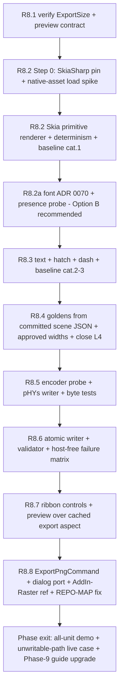

# Phase 8 review and revised delivery plan — 300-DPI PNG export

Reviewed 2026-11-22 in Architect mode against the landed tree at the Phase-7 exit
(R7.7 closed; all nine R8 guides upgraded to Tier A on 2026-11-22). Sources
consulted: [`../docs/03-ROADMAP.md`](../docs/03-ROADMAP.md) Phase 8 rows and notes,
the nine Tier-A work items
([`R8.1`](../docs/work-items/R8.1-width-parsing-residual.md) …
[`R8.8`](../docs/work-items/R8.8-export-png-command.md)),
[`../docs/02-ARCHITECTURE.md`](../docs/02-ARCHITECTURE.md) "PNG renderer",
[`../docs/04-TEST-STRATEGY.md`](../docs/04-TEST-STRATEGY.md) "Raster tests" and
"Golden images", [`../docs/07-GANTT-ENTITY-GUIDE.md`](../docs/07-GANTT-ENTITY-GUIDE.md)
renderer-equivalence tables, [`../docs/STATUS.md`](../docs/STATUS.md),
[`../docs/REPO-MAP.md`](../docs/REPO-MAP.md),
[`../docs/KNOWN-LIMITATIONS.md`](../docs/KNOWN-LIMITATIONS.md) L4,
[`../docs/work-items/IMPLEMENTATION-PLAN.md`](../docs/work-items/IMPLEMENTATION-PLAN.md)
manifest (D-G4/D-G5), and the source under `src/` and `tests/`.

> **Post-review revision (2026-11-22).** The independent appraisal
> ([`phase8-plan-critical-review.md`](phase8-plan-critical-review.md))
> judged this plan *approve with revisions*; findings F1–F12 are folded
> into the nine Tier-A work-item guides in the same change, the
> profile-equivalence pin is promoted to a prerequisite of R8.4, and
> the REPO-MAP dependency-row drift is corrected immediately rather
> than at R8.8.

---

## 1. What Phase 8 intends

**Business goal.** Give the analyst a third, clipboard-independent export channel:
a print-quality 300-DPI PNG of the Gantt (chart, and the data table when the
workbook's export selection includes it) that can be dropped into reports,
emails and documents without opening PowerPoint or relying on the Office
clipboard. It completes the export story begun by Copy Editable (R6.8) and
Send to PowerPoint (R7.6), and it is the only channel whose output is a file
rather than a paste.

**Technical objective.** A SkiaSharp-based raster renderer inside
[`GanttCreator.Raster`](../src/GanttCreator.Raster/GanttCreator.Raster.csproj)
(reference graph: Core only) that consumes the same immutable scene the Excel
and editable-export renderers consume, maps points to pixels through the one
architecture formula, encodes a PNG carrying `pHYs` 300-DPI metadata, writes it
atomically, and re-validates the written bytes before success is reported. The
renderer never recalculates dates, lanes, labels, colours or z-order
(scene-first; [`../docs/02-ARCHITECTURE.md`](../docs/02-ARCHITECTURE.md)
"Scene-first rendering").

**Functional scope (nine rows).**

| Row | Deliverable |
| --- | --- |
| R8.1 | Verify the landed `ExportSize` parser; pin the R8.7 preview feed; link acceptance criteria to the existing tests |
| R8.2 | SkiaSharp primitive renderer: rectangles, lines, polygons, clipping, z-order; determinism pin |
| R8.2a | ADR deciding pinned-font provisioning (installed vs bundled vs fallback) + font-presence probe + golden-image font policy |
| R8.3 | Deterministic text and hatch/pattern rendering, including the ADR-0044 outline-dash obligation |
| R8.4 | Representative Gantt rendered at approved widths with human-approved golden baselines; closes KNOWN-LIMITATIONS L4 |
| R8.5 | PNG `pHYs` 300-DPI metadata writer with byte-level chunk/CRC tests |
| R8.6 | Atomic file writer + post-write validator with a corrupt/locked/invalid/partial failure matrix |
| R8.7 | Ribbon width/unit controls with a calculated-height/pixel preview driven by `ExportSize` |
| R8.8 | Export PNG command: verified pipeline, exact scene crop, phase-exit evidence, Phase-9 guide upgrade |

**Measurable outcomes (phase exit).** Enter a width in each supported unit
(`cm`, `in`, `px`), export, and independently verify: exact pixel dimensions,
aspect ratio, 300-DPI `pHYs` metadata (11811 px/m, metre unit), and the absence
of surrounding whitespace (the crop is exactly the scene bounds). The
compatibility-matrix subset "failure (unwritable PNG path) at the approved
widths" is exercised live. L4 ("Golden PNG baseline directory does not exist
yet") closes at R8.4's first approved representative render.

**Constraints that bind every row.** Core keeps no Office/Excel-DNA/SkiaSharp
dependency; Raster references Core only; every new `if (bad) { error }`
validator ships a positive test in the same commit; golden baselines are
human-approved, never auto-regenerated, and each regeneration is its own
reviewed commit; no `Thread.Sleep`, no analyzer suppression, no
catch-and-ignore; deterministic identifiers, ordering, culture and rounding;
core operation offline; one row is normally one commit.

---

## 2. Verified codebase baseline (facts, with evidence)

- **`ExportSize` is landed and hardened** —
  [`ExportSize.cs`](../src/GanttCreator.Raster/ExportSize.cs): culture-invariant
  `ParseWidth` (`cm`/`in`/`px`), `ToPixels` with per-axis
  `MaxPixelDimension = 65_535`, combined `MaxTotalPixels = 100_000_000`,
  zero and sub-pixel rejection before allocation. Tests:
  [`ExportSizeTests.cs`](../tests/GanttCreator.Raster.Tests/ExportSizeTests.cs)
  (Raster suite currently 41 facts, coverage 96.72/89.13 against the 90/85
  thresholds). R8.1's "landed early" claim is **verified true**.
- **The scene model is complete for raster consumption** —
  [`SceneRect`](../src/GanttCreator.Core/Scene/SceneRect.cs),
  [`SceneLine`](../src/GanttCreator.Core/Scene/SceneLine.cs),
  [`ScenePolygon`](../src/GanttCreator.Core/Scene/ScenePolygon.cs),
  [`SceneText`](../src/GanttCreator.Core/Scene/SceneText.cs) (resolved
  `TextBounds`, `Alignment`, `LeftInsetPt`),
  [`SceneStyle`](../src/GanttCreator.Core/Scene/SceneStyle.cs) carrying
  `FillColour`, `StrokeColour`, `OutlineWidthPt`, `HatchPattern`,
  `FontFamily`, `FontSizePt`, `Bold`, `Alignment`, `TextColour`,
  `StrokeDash`, and [`ZLayer`](../src/GanttCreator.Core/Scene/ZLayer.cs)
  (11 layers). [`GanttScene.TryCreate`](../src/GanttCreator.Core/Scene/GanttScene.cs)
  returns primitives in deterministic draw order.
- **The raster mapping formula is pinned** —
  [`../docs/02-ARCHITECTURE.md`](../docs/02-ARCHITECTURE.md) "Coordinate and
  rounding policy": `pixels = round(points / 72 * dpi * scale)`, one
  edge-rounding pass; the entity guide repeats "one edge-rounding pass … or
  raster pixels".
- **The crop-bounds authority exists** —
  [`ExportBounds`](../src/GanttCreator.Core/Scene/ExportBounds.cs): zero-origin
  `Bounds` plus `PlacementDelta`; the entity guide §1 states the delta must be
  carried into "an export or PNG crop" or exactly `ChartOuterPaddingPt` of
  margin is silently lost.
  [`ExportBoundsResolver.TryResolve`](../src/GanttCreator.Core/Scene/ExportBoundsResolver.cs)
  builds the export scene once and rides it on the outcome
  (`ExportBoundsOutcome.Scene`), so the PNG can consume the exact scene the
  bounds describe.
- **The shared export pre-flight exists** —
  [`EditableExportPreflight.cs`](../src/GanttCreator.AddIn/EditableExportPreflight.cs):
  read → configuration → validate → measure → export request → selection →
  bounds, with typed refusals; both existing export commands consume it.
- **The scene's text measurement is Office-free and deterministic** —
  [`AptosTextMetrics`](../src/GanttCreator.Core/Scene/AptosTextMetrics.cs)
  measures from the committed [`FontAdvanceTable`](../src/GanttCreator.Core/Scene/FontAdvanceTable.cs)
  with a 3% margin; nothing reads a font at runtime in Core. The raster
  renderer consumes resolved bounds and never re-measures.
- **The canonical scene is committed and deserializable** —
  [`SceneSnapshot.Deserialize`](../src/GanttCreator.Core/Scene/SceneSnapshot.cs)
  (public, strict, versioned) over
  [`tests/golden/scene/reference-scene.json`](../tests/golden/scene/reference-scene.json);
  [`SceneBuilderTests.BuildScene`](../tests/GanttCreator.Core.Tests/Scene/SceneBuilderTests.cs)
  builds it with `SceneCompositionProfile.Raster`.
- **The Export ribbon group exists with room for the PNG controls** —
  [`Ribbon.xml`](../src/GanttCreator.AddIn/RibbonResources/Ribbon.xml) `grpExport`
  carries `btnCopyEditable` and `btnSendToPowerPoint` and explicitly documents
  that the PNG controls "arrive with their own rows". Gating pattern
  ([`RibbonState.cs`](../src/GanttCreator.AddIn/RibbonState.cs)):
  `Mode == RibbonMode.Ready && ActiveSheetIsGanttSheet` for the commands,
  `Mode == RibbonMode.Ready` for the group.
- **SkiaSharp is not yet pinned** —
  [`Directory.Packages.props`](../Directory.Packages.props) carries no SkiaSharp
  entry; R8.2 adds it under the dependency policy (probe first, pin, record the
  evidence row).
- **The AddIn does NOT reference Raster today** —
  [`GanttCreator.AddIn.csproj`](../src/GanttCreator.AddIn/GanttCreator.AddIn.csproj):
  "No Raster reference: Phase 8 export/render work is not implemented yet".
  **Drift found:** [`REPO-MAP.md`](../docs/REPO-MAP.md)'s dependency table
  claims AddIn → "Core, Office, Raster"; the 2026-11-17 STATUS entry confirms
  the Raster project entry was removed from the AddIn lock graph. The map is
  wrong today and must be corrected in the same change that adds the reference
  (R8.8).
- **No file-dialog port exists** — a repo-wide search for `FileDialog` in
  `src/` returns nothing. R8.6's "if not already landed" is a real
  prerequisite, not a formality.
- **The hatch field is unexercised in the reference scene** — the entity
  guide's Procurement equivalence row records that the reference style set
  resolves `HatchPattern` to `None` for every style, so no committed scene
  primitive carries a hatch. R8.3's pattern tests must synthesize a hatched
  style; they cannot ride the reference fixture.
- **Latest ADR is ADR-0069** ([`../docs/DECISIONS.md`](../docs/DECISIONS.md));
  the R8.2a font ADR will be **ADR-0070**. Manifest decision **D-G4**
  (pinned-font provisioning) is Open and licence-sensitive; **D-G5**
  (code-signing certificate) must start no later than Phase 8.
- **Office-gate policy conflict is open** — the R7.7 close-out records that
  the routine `verify-office.ps1` suite measures ~19 m 30 s against the
  script's 780 s default deadline; the owner must either restate the
  acceptance bound or sanction a deadline-policy change. Phase 8's Required
  Office gates (R8.6/R8.7/R8.8) run through this gate, so the conflict should
  be resolved before Phase-8 Office evidence is recorded.

---

## 3. Per-item feasibility findings

### R8.1 — width parsing residual: **accurate as written; one sequencing clarification**

The row's premise is verified: `ExportSize` implements parsing, aspect,
rounding and safety with tests, and the architecture's three unit formulas
match the code exactly (`cm / 2.54 * 300`, `in * 300`, `px` verbatim). The
residual is genuinely small. **Clarification:** the "preview-feed pin" the row
names as a new acceptance test cannot exist until R8.7 builds the preview
producer; R8.1's commit should deliver the documented contract (the
type/shape `ExportSize` expects) plus the acceptance-criteria links, and the
pin itself lands in R8.7's suite, which the row's own D2 anticipates. No
design change; no risk.

### R8.2 — Skia primitive renderer: **feasible; the phase's largest packaging risk is here and must be probed first**

Everything the renderer consumes is in place (primitives, deterministic order,
style members, the mapping formula). Two prerequisites are real:

1. **Package pin.** SkiaSharp must be added to
   [`Directory.Packages.props`](../Directory.Packages.props) with the version
   probed against installed NuGet metadata (per the dependency policy), not
   chosen from memory. The pin's native-asset layout (`runtimes/win-x64/native`)
   must be recorded as evidence.
2. **Native-asset deployment (D5).** The AddIn packs into one XLL via
   Excel-DNA; managed assemblies pack, native `libSkiaSharp` does not
   automatically. The work item's stop condition ("cannot ship in the add-in
   payload → stop; the packaging story needs an ADR") is correct and must be
   probed at Step 0: verify the packed add-in can load the native library
   (deploy-beside-the-XLL vs Excel-DNA unpack-to-temp vs load-from-bytes),
   and record the chosen route. This feeds R10.2 packaging and R10.7's
   SBOM/third-party-notices freeze directly (the R8.2 guide's earlier
   "R9.5" label was a stale row reference, corrected 2026-11-22).

The renderer itself is a pure walk of `GanttScene.Primitives` in order with
the single rounding pass and a canvas clip at the scene bounds; its
acceptance pins are the work item's own — exact-pixel region pins for
rect/line/polygon, the z-order draw-sequence pin, the clipping pin,
byte-identical re-render determinism, and the **no-recalculation
positive** (the phase's core architectural claim, under the repo's
positive-test rule). The architecture boundary is safe: SkiaSharp is a
package, not a project reference, so Raster's Core-only project graph is
unchanged and
[`GanttCreator.Architecture.Tests`](../tests/GanttCreator.Architecture.Tests/)
keeps passing. Determinism (D4) is achievable with pinned surface settings
and no text in this row.

### R8.2a — font pinning ADR: **correctly sequenced; recommendation prepared for the owner**

The decision is D-G4, human choice required, and the ADR will be ADR-0070.
Evidence the ADR can already cite: the entity guide pins `FontFamily: Aptos`
and requires "missing fonts produce a clear error or approved fallback, never
an unreported substitution"; the scene's label boxes are sized from the
committed Aptos advance table with a 3% margin
([`AptosTextMetrics`](../src/GanttCreator.Core/Scene/AptosTextMetrics.cs)),
so a raster font with metrics close to Aptos fits the resolved boxes.

**Recommendation (for the owner to ratify in the ADR): Option B — require
the installed font.** Aptos ships with Microsoft 365, which the add-in already
requires; bundling it is almost certainly barred by Microsoft's font
redistribution licence (Option A), and an open fallback (Option C) would make
the PNG's typography differ from the live chart the user sees. Consequences to
record: golden baselines are reference-machine artefacts (the test strategy
already says so); the font-presence probe must use the same resolution route
the renderer uses (SkiaSharp's font manager), so the probe reports what the
renderer will actually resolve; a missing font is a typed, actionable error
with a positive test (D1's "never silent substitution").

### R8.3 — text and hatch rendering: **feasible; one gap the guide itself records**

Text: draw at `TextBounds` with `LeftInsetPt`, `Alignment`, and the style's
`TextColour`/`FontSizePt`/`Bold`/`FontFamily`; never re-measure (the scene
already measured). The pinned font resolves once per process (D2) with the
missing-pin positive test.

Hatch/dash: the raster renderer can be *more* faithful than Excel here —
[`ThemeEditRequest.cs`](../src/GanttCreator.Core/ThemeEditRequest.cs) records
that the live host cannot honour `HatchPitchPt`/`HatchLinePt`
(`MsoPatternType` has no member for either), while SkiaSharp path effects can
draw the tokens exactly. The obligation set is closed and small:
[`GanttHatchPattern`](../src/GanttCreator.Core/GanttCatalogueTokens.cs)
(None/ForwardDiagonal/BackwardDiagonal/Cross) and
[`GanttStrokeDash`](../src/GanttCreator.Core/GanttCatalogueTokens.cs)
(Solid/SquareDot/RoundDot/Dash/DashDot/LongDash — the deliberate
`MsoLineDashStyle` subset). **Gap:** the reference scene carries no hatched
primitive (the guide records the field is unexercised), so the pattern tests
must construct a synthetic style with `HatchPattern != None` and pin pitch
(4pt) and line (0.5pt) geometry directly. The ADR-0044 dash obligation rides
here as the roadmap's revision-12 note states.

### R8.4 — representative render: **feasible; the fixture route in the work item is wrong — revise**

The work item assumes R3.12's `ReferenceSceneFixture` is consumable. It is
`internal` to [`GanttCreator.Core.Tests`](../tests/GanttCreator.Core.Tests/Scene/ReferenceSceneFixture.cs)
— the Raster test project cannot reference another test project's internals
without an unusual `InternalsVisibleTo`. **Revision A (see §4):** load the
committed canonical scene
[`tests/golden/scene/reference-scene.json`](../tests/golden/scene/reference-scene.json)
through the public
[`SceneSnapshot.Deserialize`](../src/GanttCreator.Core/Scene/SceneSnapshot.cs).
This is strictly better than the work item's assumption: the raster renderer
consumes the exact byte-pinned scene the golden snapshot test already guards,
there is zero fixture duplication, and any scene change flows through the
existing human-reviewed golden regeneration process. The scene JSON is
strict-parsed and versioned, so drift fails loudly.

The approved-widths list remains a genuine stop-point (no doc specifies it).
**Proposed set for owner approval:** the three R4.7H size-preset page widths
expressed in `cm` (A4 landscape, Presentation 16:9, Presentation 4:3 — the
roadmap's revision-10 note already binds R8.7 to the size-preset contract, so
the widths come from [`SizePreset`](../src/GanttCreator.Core/SizePreset.cs),
never new literals) plus one narrow and one wide pixel width (e.g. 800 px and
2400 px) to cover the aspect extremes the golden policy's item 6 requires.

L4 closes here with the first human-approved baseline; the six-baseline set
distributes as the test strategy lists: category 1 (primitives/z-order) lands
with R8.2, categories 2–3 (text alignment/clipping; hatches/critical
overlays) with R8.3, categories 4–6 (representative; multi-event/milestone/
delineator; narrow/wide) with R8.4.

### R8.5 — PNG `pHYs` metadata: **feasible; the encoder probe is mandatory and decides the patch step**

Skia's PNG encoder is not known to expose `pHYs` through SkiaSharp's public
encode APIs — an inference the Step-0 probe ("SkiaSharp's encoder must be
probed for its `pHYs` behaviour first") decides rather than assumes. The
working hypothesis is a **deliberate post-encode chunk patcher** (insert
`pHYs` after `IHDR`, recompute CRCs, keep chunk order legal) or a minimal
writer reusing Skia's encoded `IDAT`. That is inside the row's own
stop-condition boundary only if it grows into a full custom writer — a
chunk patcher over the encoder's output is not. Byte-level tests parse the
produced bytes directly (signature,
`IHDR` dims, `pHYs` x=y=11811 unit=1, chunk order, recomputed CRCs) with a
wrong-density positive, exactly as the row specifies. PNG spec facts to be
re-cited from the primary source at implementation, per the row.

### R8.6 — atomic write + validator: **feasible; two prerequisites the row hedges on are real**

1. **The file-dialog port does not exist.** The row's "if not already landed
   for this purpose" resolves to *not landed*. **Revision B (see §4):** the
   dialog port is created in R8.8, where the user flow that needs it lives;
   R8.6 stays a pure Raster-side writer/validator with no UI surface. This
   matches the row's own exclusion ("No UI (R8.7)") and keeps one concern per
   commit.
2. **The row's Required Office gate ("live: the unwritable-path case … plus a
   normal save") is not fully exercisable before the command exists.**
   **Revision C (see §4):** R8.6's automated failure matrix is host-free by
   construction (temp directories, read-only directories, locked targets,
   validator-rejecting bytes are all creatable in tests), and the *live*
   unwritable-path demonstration moves to R8.8's exit evidence, which is where
   the compatibility-matrix obligation ("Phase 8 exit: adds failure
   (unwritable PNG path)") is owned anyway. This is a gate-wording revision,
   not a scope cut: the same live case is still run once, inside the phase.

The atomic strategy itself (temp file in the target directory → flush →
validate → `File.Replace`/`File.Move` atomic replace, temp removed in
`finally`, positive test per failure) is sound on Windows; the Step 0 probe of
replace semantics on the target volume stays.

### R8.7 — width/unit controls + preview: **feasible; one unaddressed design fact — the preview needs an aspect source**

The row pins the important parts: preview = `ExportSize` output (no duplicate
math), immediate precise validation, deterministic unit switching. What it
does not name is **where the preview's aspect ratio comes from**.
`ExportSize.ToPixels` needs `sceneWidthPt`/`sceneHeightPt`, and the PNG crops
the *export composition* bounds (table + chart union), which are only known
after measurement and scene build. A ribbon state getter must be fast and
side-effect-free, so it cannot build a scene on demand.

**Revision D (see §4), recommended shape:** the refresh outcome gains an
additive recorded export aspect (width/height in points of the resolved
`ExportBounds.Bounds`), computed once per completed refresh by running the
already-available inputs (validated events, settings, registry, measured
grid, themed metrics) through the host-free
[`ExcelSceneBuildRequestFactory.CreateExport`](../src/GanttCreator.Office/ExcelSceneBuildRequestFactory.cs)
+ [`ExportBoundsResolver.TryResolve`](../src/GanttCreator.Core/Scene/ExportBoundsResolver.cs)
— no COM, no shapes, milliseconds. The preview getter is then pure
arithmetic over the cached aspect. Cost is measured and recorded; if the owner
rejects the per-refresh cost, the fallback is a small export dialog (the
existing [`PlotDatePickerForm`](../src/GanttCreator.AddIn/PlotDatePickerForm.cs)
family) that resolves the aspect once when opened. The control choice
(editBox + unit dropdown + preview label + export button in the existing
`grpExport`) follows the architecture's "The Ribbon exposes width, unit, and
export action" and the R5.16a layout discipline; the glyph/keytip/layout gates
re-run because the group gains controls.

### R8.8 — Export PNG command: **feasible; three concrete revisions**

1. **Scene/profile route.** The PNG must consume the export composition
   (panel + chart, title over the table) — that is exactly what the
   equivalence table's PNG column describes, and it is exactly what
   [`ExportBoundsResolver`](../src/GanttCreator.Core/Scene/ExportBoundsResolver.cs)
   builds: it pins `Profile = EditableExport` ("the profile is the export
   contract itself") and rides the scene on the outcome.
   [`SceneBuilder`](../src/GanttCreator.Core/Scene/SceneBuilder.cs) treats
   every non-live profile identically (title shown, export coordinates, no
   live panel bounds), so the `EditableExport` scene *is* the raster scene.
   **Revision E (see §4):** reuse
   [`EditableExportPreflight`](../src/GanttCreator.AddIn/EditableExportPreflight.cs)
   unchanged — smallest diff, one scene authority, the same bounds the Copy
   Editable path crops — and add one Core test pinning that `SceneBuilder`
   emits identical primitives for `EditableExport` and `Raster` profiles
   given the same request, so the equivalence is proven rather than assumed.
   Re-labelling the pipeline to `SceneCompositionProfile.Raster` end-to-end
   would require changing the resolver's documented pin and the factory's
   `profile == EditableExport` gates — a contract change with no behavioural
   gain; not recommended.
2. **AddIn → Raster reference + REPO-MAP correction.** The command needs the
   renderer, so R8.8 adds the project reference the csproj explicitly
   anticipates, and **fixes the stale REPO-MAP dependency row in the same
   commit** (the map currently claims a reference that does not exist).
3. **File-dialog port.** Created here (Revision B): an injected internal port
   backed by the WinForms `SaveFileDialog` (`UseWindowsForms` is already
   enabled for the dialog family), PNG filter, cancel is not an error.

Pipeline order (D1): pre-flight → `ExportSize` (width from the R8.7 controls)
→ render the pre-flight's scene cropped to `ExportBounds.Bounds` with
`PlacementDelta` applied uniformly (entity guide §1's rule) → encode + `pHYs`
→ atomic write + validate → success states path + exact dimensions.
Independent verification (D2) reads the written bytes back through a separate
minimal parser in the tests. The edge-pixel no-whitespace positive (D3) runs
on a fixture with known edges. The PNG honours the same workbook
export-selection setting the editable export honours (no new setting — the
row's own exclusion forbids one). Exit evidence (D4): the all-unit live
demonstration, the matrix subset including the live unwritable-path case
(Revision C), and the Phase-9 Tier-B guide upgrade.

---

## 4. Consolidated revisions

| # | Revision | Replaces | Justification | Impact |
| --- | --- | --- | --- | --- |
| A | R8.4 fixture route: load [`tests/golden/scene/reference-scene.json`](../tests/golden/scene/reference-scene.json) via public `SceneSnapshot.Deserialize` | The work item's assumption that `ReferenceSceneFixture` (internal to the Core test project) is consumable | Removes a cross-test-project dependency that cannot compile as written; the raster consumes the byte-pinned canonical scene; zero duplication | Smaller R8.4; no new shared project; stronger traceability |
| B | File-dialog port created in R8.8 (injected, WinForms-backed) | R8.6's "if not already landed" hedge | No dialog port exists; the command owns the user flow; keeps R8.6 UI-free per its own exclusions | R8.6 shrinks; R8.8 grows by one small port + tests |
| C | Live unwritable-path demonstration runs in R8.8's exit evidence; R8.6's gate is the host-free failure matrix | R8.6's Required Office gate wording ("plus a normal save") | Not exercisable before the command exists; the matrix obligation is owned at phase exit anyway | Same live coverage, honest sequencing; no coverage loss |
| D | R8.7 preview aspect: additive per-refresh export-aspect recording (host-free `CreateExport` + `TryResolve` over inputs the refresh already holds); dialog fallback if the owner rejects the cost | Unstated assumption that the preview has an aspect source | `ToPixels` needs scene points; ribbon getters must be side-effect-free; the export aspect is only known after composition | One additive outcome member + one measured cost; keeps the architecture's ribbon-surface wording |
| E | R8.8 reuses `EditableExportPreflight` + the `EditableExport` scene; a new Core test pins EditableExport/Raster profile equivalence | Any implicit plan to build a separate Raster-profile pipeline or to re-label the resolver's pinned profile | `SceneBuilder` treats non-live profiles identically; the resolver's pin is documented contract; one scene authority already feeds Copy Editable and Send to PowerPoint | Smallest diff; no contract change; equivalence proven by test |
| F | R8.2 Step 0 elevates the native-asset load probe to a named spike with recorded evidence and an ADR fallback | The work item's D5 note | Excel-DNA packs managed assemblies into one XLL; native `libSkiaSharp` deployment is unproven and is the phase's largest packaging unknown | De-risks R8.2 before renderer code; feeds R9.5/R10.2 |
| G | R8.3 hatch tests synthesize hatched styles | Riding the reference fixture for pattern coverage | The guide records the hatch field is unexercised (reference set resolves `HatchPattern = None`) | Tests are honest about what exists |
| H | R8.1 delivers the documented preview-feed contract + acceptance links; the equality pin lands in R8.7 | The row's "new preview-feed pin" acceptance test | The pin's producer (the preview) does not exist until R8.7 | Sequencing clarity only |
| I | REPO-MAP AddIn dependency row corrected in R8.8's commit | The stale "Core, Office, Raster" claim | The csproj has no Raster reference today; the map's own update rule requires the same-change fix | One-line docs fix, same commit |

---

## 5. Revised delivery sequence

Order follows the roadmap (R8.1 → R8.2 → R8.2a → R8.3 → R8.4 → R8.5 →
R8.6 → R8.7 → R8.8); the revisions above fold in without reordering rows.

**Validation gates per step.**

- Every commit: `pwsh -NoProfile -File scripts/verify-quick.ps1` (includes the
  Raster suite and the architecture boundary tests).
- R8.2/R8.3/R8.4/R8.5/R8.6: `dotnet test tests/GanttCreator.Raster.Tests`
  targeted, then the full quick gate; golden baselines human-approved in their
  own commits with stated reasons.
- R8.7/R8.8: `dotnet test tests/GanttCreator.AddIn.Tests` plus the ribbon
  layout/glyph gates (`check-ribbon-glyphs.ps1` runs inside verify-quick).
- Phase exit (R8.8): `pwsh -NoProfile -File scripts/verify.ps1` on a clean
  tree, and `pwsh -NoProfile -File scripts/verify-office.ps1` for the Required
  live gates — noting the open 780 s deadline conflict the owner must resolve
  first (the measured suite is ~19 m 30 s; the R7.7 close-out records the
  policy question).
- Coverage: Raster must hold its 90/85 thresholds as renderer code lands;
  AddIn stays above its current line with the deferred warning unchanged.

**Human decision points (stop-points) to schedule now.**

1. **D-G4 font choice** (R8.2a): ratify Option B (require installed Aptos,
   typed error on missing) or direct otherwise — licence evidence required
   either way.
2. **R8.4 approved widths**: ratify the proposed preset-derived set (three
   `SizePreset` page widths in cm + narrow/wide pixel widths) or supply the
   list.
3. **R8.7 aspect source**: accept the per-refresh export-aspect recording
   (measured cost recorded) or choose the dialog fallback.
4. **Office-gate deadline policy**: restate the acceptance bound or sanction
   a deadline change, so Phase-8 Office evidence is recordable.
5. **D-G5 code-signing procurement**: start during Phase 8 per the Phase-10
   note — external lead time, human action.

---

## 6. Risks and recommendations

- **Native-asset packaging is the phase's only genuinely unknown engineering
  risk** (Revision F). Probe it before writing renderer code; if no route
  loads `libSkiaSharp` from the packed add-in, the ADR fallback (deploy beside
  the XLL with the installer) is a packaging change, not a renderer change,
  and R10.2 owns its determinism.
- **Golden-image brittleness** is mitigated by the existing policy (pinned
  metadata, human approval, reference-machine artefacts); the font ADR's
  Option B consequence (baselines tied to the reference machine's Aptos
  version) is already the test strategy's stated position.
- **Text fidelity**: the scene's label boxes carry a 3% measurement margin
  over the committed Aptos advances; the raster font must be Aptos (or the
  ADR's approved fallback) or labels can clip — this is why the ADR precedes
  R8.3, exactly as the roadmap notes.
- **Out of Phase-8 scope, deliberately**: the R7.4 open owner decision (four
  text children overflowing at 4:3 in the staged composition) is Phase-7
  residue on the editable-export side; the PNG renders from the scene and is
  unaffected by paste-time group scaling. Do not absorb it into Phase 8.
- **Maintainability**: the renderer lands as one new Raster namespace
  (`GanttCreator.Raster`), one new AddIn command + port, one Core test
  addition, and zero Core production changes — the smallest surface that
  satisfies the phase, consistent with the minimal-diff ladder.

## Evidence ledger

| Statement | Status | Evidence |
| --- | --- | --- |
| `ExportSize` landed with safety limits and tests | fact | [`ExportSize.cs`](../src/GanttCreator.Raster/ExportSize.cs), [`ExportSizeTests.cs`](../tests/GanttCreator.Raster.Tests/ExportSizeTests.cs) |
| Scene primitives/style/z-order complete for raster | fact | [`SceneStyle.cs`](../src/GanttCreator.Core/Scene/SceneStyle.cs), [`ZLayer.cs`](../src/GanttCreator.Core/Scene/ZLayer.cs), [`GanttScene.cs`](../src/GanttCreator.Core/Scene/GanttScene.cs) |
| Crop authority is `ExportBounds` + delta; scene rides the outcome | fact | [`ExportBounds.cs`](../src/GanttCreator.Core/Scene/ExportBounds.cs), [`ExportBoundsResolver.cs`](../src/GanttCreator.Core/Scene/ExportBoundsResolver.cs) |
| `SceneBuilder` treats non-live profiles identically | fact (read from source) | [`SceneBuilder.cs`](../src/GanttCreator.Core/Scene/SceneBuilder.cs) profile gates at lines 954/1032/1059 |
| `ReferenceSceneFixture` is internal to the Core test project | fact | [`ReferenceSceneFixture.cs`](../tests/GanttCreator.Core.Tests/Scene/ReferenceSceneFixture.cs) |
| AddIn has no Raster reference; REPO-MAP claims one | fact (drift) | [`GanttCreator.AddIn.csproj`](../src/GanttCreator.AddIn/GanttCreator.AddIn.csproj) vs [`REPO-MAP.md`](../docs/REPO-MAP.md) dependency table |
| No file-dialog port exists | fact | repo search, zero `FileDialog` hits in `src/` |
| Reference scene carries no hatched primitive | fact | entity-guide Procurement equivalence row |
| Skia encoder cannot write `pHYs` via public SkiaSharp APIs | inference (to probe) | R8.5 Step 0 probe; do not code from this assumption |
| Native `libSkiaSharp` loads from the packed XLL | unknown (spike) | R8.2 Step 0, Revision F |
| Aptos bundling is licence-barred | inference (to verify in ADR) | primary licence sources required by R8.2a |
| Per-refresh export-aspect cost is milliseconds | inference (to measure) | host-free composition over inputs the refresh already holds |
