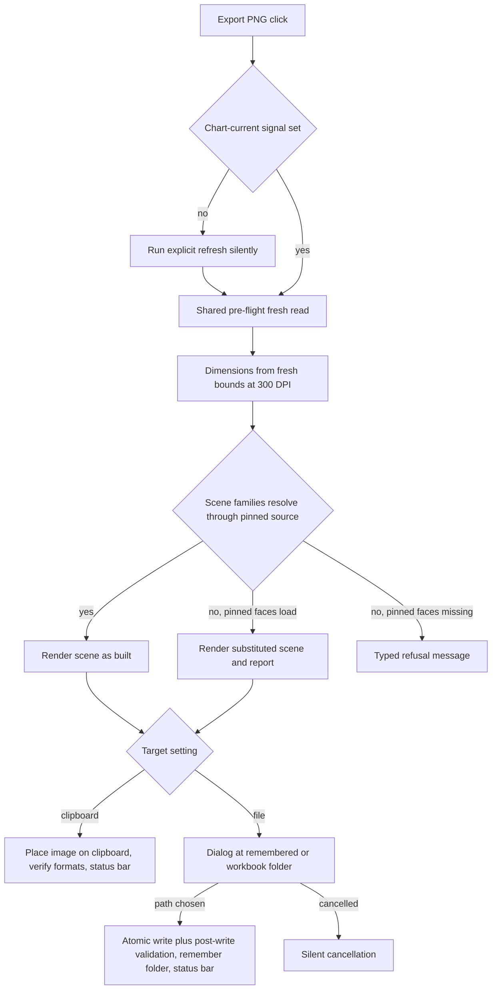

# Phase 8 revision plan — chart-faithful PNG export with clipboard-first delivery

Reviewed 2026-11-23 in Architect mode against the landed tree at the R8.8 live
confirmation ([`../docs/STATUS.md`](../docs/STATUS.md) top). Sources consulted:
[`ExportPngCommand.cs`](../src/GanttCreator.AddIn/ExportPngCommand.cs),
[`PngPreview.cs`](../src/GanttCreator.AddIn/PngPreview.cs),
[`Ribbon.xml`](../src/GanttCreator.AddIn/RibbonResources/Ribbon.xml),
[`RibbonStateService.cs`](../src/GanttCreator.AddIn/RibbonStateService.cs),
[`ExportComposition.cs`](../src/GanttCreator.Office/ExportComposition.cs),
[`GanttCatalogues.cs`](../src/GanttCreator.Core/GanttCatalogues.cs),
[`SceneStyle.cs`](../src/GanttCreator.Core/Scene/SceneStyle.cs),
[ADR-0070](../docs/adr/0070-font-pinning.md), the R8.1/R8.7/R8.8 work items,
[`../docs/03-ROADMAP.md`](../docs/03-ROADMAP.md) Phase 8 rows, and
[`phase8-png-export-review.md`](phase8-png-export-review.md).

> **Owner ruling (2026-11-23).** The landed PNG export process is revised:
> the image uses the chart's own fonts and the chart's own page size/width; the
> separate width/unit/preset/preview surface is removed; the image is copied to
> the clipboard by default with a status-bar success line; a split-button
> sub-menu toggles clipboard/file as the main button's target; the file target
> defaults to the workbook's folder and remembers the user's folder choice;
> the pipeline still identifies font compatibility with the raster engine and
> falls back to the current pipeline's pinned-font handling when not
> compatible (owner-confirmed 2026-11-23: pinned-font raster substitution,
> reported in the status bar — not a host `CopyPicture` route, which
> [`R8.7-R8.8-png-width-controls-and-export-command-plan.md`](R8.7-R8.8-png-width-controls-and-export-command-plan.md)
> already rejected); the user never has to refresh manually before a
> first export after opening a file — the command runs the refresh itself
> only when required.

---

## 1. What is wrong with the landed process (verified facts)

| # | Extra step today | Evidence | Why it is wrong per the ruling |
| --- | --- | --- | --- |
| F1 | The user must type a width, pick a unit, optionally pick a preset, and read a preview before exporting | [`Ribbon.xml`](../src/GanttCreator.AddIn/RibbonResources/Ribbon.xml) lines 252–269 (`ebxPngWidth`, `ddnPngUnit`, `ddnPngSize`, `lblPngPreview`); [`PngPreview.cs`](../src/GanttCreator.AddIn/PngPreview.cs) | The PNG must use the chart's own width — the export composition's bounds — not a second, export-only size authority |
| F2 | The export is file-only; the user must pick a path even when they want the image on the clipboard | [`ExportPngCommand.cs`](../src/GanttCreator.AddIn/ExportPngCommand.cs) stage 3 (line 344) — the dialog is unconditional | The image should be copied to the clipboard by default; file is the secondary target |
| F3 | The Export PNG button is disabled until a completed refresh records an export aspect | [`RibbonStateService.cs`](../src/GanttCreator.AddIn/RibbonStateService.cs) `PngExportReady` (line 2350) requires `_exportAspect is not null` | A user who just opened the file must be able to export immediately; the command ensures chart currency itself |
| F4 | A per-refresh aspect resolution runs on every completed reconcile purely to feed the preview | [`ExportComposition.cs`](../src/GanttCreator.Office/ExportComposition.cs) `TryResolveAspect`; the orchestrator's `ExportAspectResolve` seam and `aspect=` trace; `RefreshSheetCommand` `PublishExportAspect` | With the preview gone this is dead cost on every refresh; the R8.7 D4 acceptance existed only for the preview |
| F5 | A font the raster engine cannot resolve is a hard refusal of the whole export | [`ExportPngCommand.cs`](../src/GanttCreator.AddIn/ExportPngCommand.cs) stage 4 catch (line 364); ADR-0070 D3 fail-closed | The pipeline must identify compatibility and fall back to the pinned-font render with a status-bar report (owner-approved fallback — the entity guide's "approved fallback, never an unreported substitution") |
| F6 | The scene's font family is the code-owned catalogue token resolved through the pinned Aptos faces — the fonts are already the chart's fonts | [`GanttCatalogues.cs`](../src/GanttCreator.Core/GanttCatalogues.cs) `LabelFontFamily` (line 694); [`SceneText.cs`](../src/GanttCreator.Core/Scene/SceneText.cs) line 59 applies `WithLabelFontFamilyIfMissing` | No font *source* change is needed — the revision keeps the pinned resolver as the engine's font mechanism and adds the compatibility gate + substitution fallback on top |

The renderer, encoder, atomic writer, validator, and golden baselines
(R8.2–R8.6) are **not** wrong: they render the scene, carry `pHYs` 300-DPI
metadata, and write verified files. This revision changes what feeds them
(size, target, freshness, font policy) and removes the export-only input
surface around them.

## 2. The revised export contract

1. **Size — the chart's own.** Pixel dimensions derive from the pre-flight's
   fresh export-composition bounds (points) at 300 DPI — `round(pt × 300/72)`
   per axis, one rounding boundary, with the existing per-axis 65,535 and
   total 100,000,000 safety limits. The A4-landscape chart (841.89 pt) yields
   3508 px — the same number as the ratified R8.4 golden, so no golden
   regenerates. No user width input exists anywhere.
2. **Target — clipboard by default.** The main button copies the rendered
   image to the clipboard and reports success on the status bar. A sub-menu on
   the split button toggles *Copy to clipboard* / *Save to file*; the choice is
   persisted as a workbook setting (default clipboard), mirroring the R5.20
   auto-refresh switch living in the Refresh split button's menu.
3. **File target — workbook folder first, remembered after.** The save dialog's
   initial directory is the remembered folder when one exists, else the
   workbook's own folder (`workbook.Path`), else the dialog default for an
   unsaved workbook. A successful write persists the chosen folder as a
   workbook setting; a cancelled dialog remembers nothing.
4. **Freshness — ensured, never demanded.** The button is gated on the same
   state as Copy Editable (Ready + active Gantt sheet). Stage 0 of the command
   checks a *chart-current* signal (a completed refresh has run since the
   workbook state last changed); when it is false the command runs the
   explicit-refresh pipeline itself (presentation suppressed) before
   proceeding. When true, no refresh runs. First-export-after-open cost is
   owner-accepted.
5. **Fonts — identified, with an approved fallback.** Before any target
   action, the command resolves the scene's distinct text families through the
   renderer's own pinned-font resolver. All resolvable → render as built. A
   family unresolvable while the pinned faces load → render a
   substituted-scene (the label family replaced by the pinned family) and
   report the substitution in the status-bar success line and the technical
   record. The pinned faces themselves missing → the existing typed refusal
   (nothing to substitute with; unchanged behaviour).
6. **Success reporting.** One status-bar line per outcome (the existing
   `SelectSuccessPresenter` channel): clipboard — "PNG copied to the clipboard
   (W × H px)."; file — "Exported W × H px to <path>."; the font-fallback
   note appends to the same line. Refusals keep the one-actionable-line rule
   and every input-dependent refusal still precedes the dialog.

## 3. Removals — the extra steps and their dead code

Nothing removed here may survive as a dead function; every removal below ships
with the caller grep that proves no other consumer exists.

| Surface | What is removed | Files |
| --- | --- | --- |
| Ribbon controls | `boxPngWidth` (`lblPngWidth`, `ebxPngWidth`, `lblPngUnit`, `ddnPngUnit` + 3 items), `boxPngSize` (`lblPngSize`, `ddnPngSize`), `boxPngPreview` (`lblPngPreview`) — 7 controls; the group comment block rewritten to the new contract | [`Ribbon.xml`](../src/GanttCreator.AddIn/RibbonResources/Ribbon.xml) |
| Ribbon callbacks | The nine width-surface callbacks (width getText/onChange, unit getSelectedItemIndex/onAction, preset getItemCount/getItemID/getItemLabel/getSelectedItemIndex/onAction, preview getLabel) and their internal seams | [`GanttRibbon.cs`](../src/GanttCreator.AddIn/GanttRibbon.cs) |
| Session state | `_pngWidthText`, `_pngUnit`, `SetPngWidth`, `SetPngUnit`, `SetPngPreset`, `GetPngWidthText`, `GetPngUnit`, `GetPngUnitIndex`, `GetPngPresetIndex`, `GetPngPreviewText`, `PngInputValid`; `PngExportReady` retargeted to Ready + active Gantt sheet; `_exportAspect` + `UpdateExportAspect` replaced by a chart-current flag cleared in the same workbook-state handler | [`RibbonStateService.cs`](../src/GanttCreator.AddIn/RibbonStateService.cs) |
| Preview type | The whole of `PngPreview` (`PngEvaluation`, `Evaluate`, `ComposeInput`, `FormatPreview`, unit/preset id mapping, `CmText`, `DefaultWidthText`) | [`PngPreview.cs`](../src/GanttCreator.AddIn/PngPreview.cs) deleted |
| Control ids | `PngWidth`, `PngUnit`, `PngSize`, `PngUnitCm/In/Px`, `PngSizeItemPrefix` and the `GetEnabled` arms that answer them | [`RibbonControlIds.cs`](../src/GanttCreator.AddIn/RibbonControlIds.cs), [`RibbonStateService.cs`](../src/GanttCreator.AddIn/RibbonStateService.cs) |
| Width grammar | `ExportSize.ParseWidth`, `ExportUnit`, `WidthRequest`, the `ToPixels(WidthRequest, …)` overload, and `CmPerInch` if the caller grep confirms no other consumer; replaced by one points→pixels entry carrying the same limits and single-rounding rule | [`ExportSize.cs`](../src/GanttCreator.Raster/ExportSize.cs) |
| Aspect machinery | `ExportComposition.TryResolveAspect` + `ExportAspectPt` (`SelectExportSelection` **stays** — Copy Editable and Send to PowerPoint consume it), `GanttRefreshOutcome.ExportAspect`, the orchestrator's `ExportAspectResolve` seam and `aspect=` trace field, `RefreshSheetCommand.PublishExportAspect` | [`ExportComposition.cs`](../src/GanttCreator.Office/ExportComposition.cs), [`GanttRefreshOrchestrator.cs`](../src/GanttCreator.Office/GanttRefreshOrchestrator.cs), [`RefreshSheetCommand.cs`](../src/GanttCreator.AddIn/RefreshSheetCommand.cs) |
| Command stages | The width parse and pixel-budget stages (stage 2) and the `InvalidWidth`/`WidthRefused` refusal members; `ConstructionMessage` reworded (the command now self-heals freshness) | [`ExportPngCommand.cs`](../src/GanttCreator.AddIn/ExportPngCommand.cs) |
| Tests | The preview/equality/validation suites, the R8.7 ribbon surface and routing pins, the `ExportSize` grammar arms, the six orchestrator aspect facts, the `ExportComposition` aspect arms (selection half kept) — each replaced by the revised contract's tests in the same commit | [`tests/GanttCreator.AddIn.Tests`](../tests/GanttCreator.AddIn.Tests), [`tests/GanttCreator.Raster.Tests/ExportSizeTests.cs`](../tests/GanttCreator.Raster.Tests/ExportSizeTests.cs), [`tests/GanttCreator.Office.ContractTests`](../tests/GanttCreator.Office.ContractTests) |

**Kept unchanged:** the R8.4 representative goldens and their five widths
(renderer baselines at multiple scales — the recorded pixel numbers are
reproduced exactly by the points entry, so no baseline regenerates and no
human image review is required); the FontProbe suite; the R8.5/R8.6 encode and
write paths; `SelectExportSelection`; the `btnExportPng` glyph entry in
[`RibbonGlyphCatalog.g.cs`](../src/GanttCreator.AddIn/RibbonGlyphCatalog.g.cs).

## 4. Additions

- **Split button.** `btnExportPng` becomes the child button of
  `spbExportPng` (size/getEnabled on the splitButton, per the repo's
  splitButton convention); the menu carries two `toggleButton` items —
  *Copy to clipboard* and *Save to file* — with `getPressed`/`onAction`
  wired to the persisted target setting. The main button's label names the
  current target (a `getLabel` seam, the `GetToggleCellLockLabel` precedent)
  so the button's ability is visible without opening the menu. Keytips,
  screentips, supertips and the accessible-label pin follow R5.9. The two
  toggles declare no `getImage`, so the glyph catalogue is untouched, but the
  control-count pins in [`scripts/check-ribbon-glyphs.ps1`](../scripts/check-ribbon-glyphs.ps1)
  and [`scripts/check-ribbon-icons.ps1`](../scripts/check-ribbon-icons.ps1)
  are updated with the new pinned counts.
- **Clipboard image port.** A new AddIn-internal port places the rendered
  image on the clipboard through WinForms `Clipboard.SetImage` (a GDI+ bitmap
  built from the raster result's BGRA buffer — no re-encode) on Excel's STA
  command thread, then **verifies** the clipboard carries an image format by
  reading formats back — the R6.6 discipline that a non-throwing call is
  never success ([`IClipboardFormatReader.cs`](../src/GanttCreator.Office/IClipboardFormatReader.cs)
  is the read-back precedent). No `Task.Run`, no new thread.
- **Settings (two new approved keys).** `PngExportTarget`
  (`clipboard`|`file`, default `clipboard`) and `LastPngExportFolder` (a
  path, absent by default). Both live in `tblGanttSettings` on the
  VeryHidden configuration worksheet — configuration metadata, never schedule
  data — written through the existing
  [`ExcelConfigCatalogueWriter.WriteSettings`](../src/GanttCreator.Office/ExcelConfigCatalogueWriter.cs)
  (present values preserved, missing defaults appended, so existing workbooks
  self-heal). The ADR-0007 D3 approved-key set gains the two keys with a dated
  note.
- **Chart-current signal.** A `RibbonStateService` flag set by the same
  completed-reconcile hook that today publishes the aspect, cleared in the same
  workbook-state handler that today clears `_exportAspect`. The export's
  stage 0 consumes it; nothing else does.
- **Ensure-current stage.** When the flag is false the command runs the
  explicit-refresh pipeline through its existing entry with presentation
  suppressed — never a second refresh implementation — then proceeds. The
  command's "no protection window" remark is amended: the export's own stages
  stay read-only; the conditional refresh owns its own windows.
- **Font gate + substituted-scene fallback.** The command resolves the
  scene's distinct families through the pinned source before any target
  action. On an unresolvable family it builds a substituted scene (text
  styles rebuilt through the validated `SceneStyle` constructor with the
  pinned label family — the scene stays immutable; the renderer is untouched)
  and reports the substitution. The pinned set itself missing keeps today's
  typed refusal.

## 5. Design decisions

| # | Decision | Alternatives rejected |
| --- | --- | --- |
| D1 | Dimensions come from the pre-flight's fresh export-composition bounds at 300 DPI — never a cached value, never a user width | A width dialog on click (re-adds the removed step); the cached aspect (sizes for a chart that may not exist — the landed command already refuses this) |
| D2 | Clipboard is the default target; the toggle is a persisted workbook setting | Session-only toggle (resets silently — the R5.20 switch precedent persists); file-first (contradicts the ruling) |
| D3 | The file dialog keeps its place on the file target only, with the remembered/workbook initial directory; the folder persists on successful write | No dialog with a direct write (the user could never choose a folder, contradicting "remembering the user's folder choice"); persisting on dialog-OK (a cancelled export would move the remembered folder) |
| D4 | Stage 0 refreshes only when the chart-current flag is false; the flag replaces the aspect machinery one-for-one (same setter site, same clear site) | Always refreshing (unneeded cost on every export); never refreshing (a stale live chart would disagree with the exported image — the WYSIWYG the ruling asks for); a table-fingerprint comparison (new machinery for a case the flag already covers) |
| D5 | Font fallback = pinned-font raster substitution with a status-bar + trace report, per the owner's 2026-11-23 confirmation | Host `CopyPicture` route (screen-DPI, no exact-crop guarantee — already rejected in the R8.7/R8.8 plan); silent substitution (forbidden by the entity guide); fail-closed refusal (the ruling replaces it for the export path) |
| D6 | The substitution is implemented as a substituted scene built by the command (policy owner), leaving [`SceneRasterRenderer.cs`](../src/GanttCreator.Raster/SceneRasterRenderer.cs) pure | A renderer fallback-mode parameter (moves policy into the renderer and complicates the golden contract) |
| D7 | The width grammar (`ParseWidth`/`ExportUnit`/`WidthRequest`) is deleted, not deprecated — the ruling removes the user width entirely, and a kept parser would be a dead authority | Keeping the grammar "for future use" (dead code the ruling forbids) |
| D8 | The R8.4 goldens and FontProbe suite are untouched — they pin the renderer, which this revision does not change | Regenerating baselines (no renderer change, so a regeneration would be an unapproved golden edit) |

## 6. Documentation revisions (land before any code — the work-item-first rule)

- [`R8.1`](../docs/work-items/R8.1-width-parsing-residual.md): dated revision
  note — the width grammar is withdrawn by the owner ruling; `ExportSize` is
  re-scoped to the points→pixels conversion with the same limits and
  rounding; the preview-feed contract section is replaced by the
  chart-size feed contract.
- [`R8.7`](../docs/work-items/R8.7-width-controls-preview.md): dated revision
  note — the control surface is withdrawn and removed; D4's aspect machinery
  is retired with the per-refresh cost it carried; the row's acceptance
  (cm/in/px live exercise) is superseded.
- [`R8.8`](../docs/work-items/R8.8-export-png-command.md): dated revision note
  — the revised command contract (targets, chart size, ensure-current, font
  gate, folder memory) and the reworded phase-exit demonstration: export to
  clipboard and to file at the chart's own size from a freshly opened
  workbook, independently verifying dimensions, density, crop and aspect.
- [`../docs/03-ROADMAP.md`](../docs/03-ROADMAP.md): a dated Phase-8 revision
  note amending the R8.1/R8.7/R8.8 gate cells and the phase-exit wording; the
  compatibility-matrix subset gains the font-fallback row.
- [`../docs/02-ARCHITECTURE.md`](../docs/02-ARCHITECTURE.md): the "PNG
  renderer" section — the Ribbon exposes the export action and its target
  toggle, not width/unit controls; the Export-group command rules updated.
- [`AGENTS.md`](../AGENTS.md): the PNG invariant line is revised (size from
  the chart's own bounds at 300 DPI; clipboard default with a file target;
  folder memory) — an owner-sanctioned product-contract change, recorded as
  such with the ruling date.
- [`ADR-0070`](../docs/adr/0070-font-pinning.md): dated D3 amendment — the
  export path identifies compatibility and substitutes the pinned faces with
  a report (the owner-approved fallback the entity guide permits); fail-closed
  is retained for the missing-pinned-set case; the golden-image policy is
  unchanged.
- ADR-0007 D3 key-set note for the two new settings keys.
- [`../docs/STATUS.md`](../docs/STATUS.md) per commit;
  [`../docs/REPO-MAP.md`](../docs/REPO-MAP.md) if a mapped entry point or
  control list changes.

## 7. Test obligations (same commit as each behaviour)

- Every new `if (bad) { error }` validator ships its positive test: the
  chart-current-false path, the unresolvable-family path, the
  pinned-set-missing path, the unsaved-workbook folder path, the
  clipboard-format-verification failure path.
- Command order pins re-established: freshness → pre-flight → dimensions →
  font gate → target action; every input-dependent refusal precedes the
  dialog; a cancelled dialog stays the silent `Cancelled` outcome.
- Clipboard target: the port is driven through a seam; the format read-back
  is asserted; success is never reported on a non-throwing call alone.
- File target: initial-directory precedence (remembered → workbook →
  default), folder persisted on success, not on cancel.
- `ExportSize` points-entry tests: exact rounding at the 300/72 boundary,
  per-axis and total limits, zero/sub-pixel rejection — the grammar arms
  removed with the grammar.
- Ribbon pins: the revised Export group's control set and document order,
  the split-button/toggle wiring, the target-setting persistence, the
  retargeted `GetEnabled` arm.
- Golden suite: `GoldenRasterRepresentativeTests` re-derived through the
  points entry with the recorded pixel numbers asserted unchanged — proof the
  revision is size-neutral for the renderer.
- Live Office gate (Required, human host): the revised exit demonstration —
  freshly opened workbook, one click exports to clipboard with a status-bar
  line and no manual refresh; toggle to file, dialog opens at the workbook
  folder; choose another folder, export, reopen, dialog remembers it; the
  image independently inspected (dimensions, 300-DPI density, crop, aspect).

## 8. Commit sequence and gates

| Commit | Content | Gate |
| --- | --- | --- |
| 1 `docs:` | This plan + every §6 revision (work items, roadmap, architecture, AGENTS invariant, ADR-0070/ADR-0007 notes) | `verify-quick.ps1` (markdown links, status accuracy, skill sync) |
| 2 `refactor:` | §3 removals — the width surface, its state, the grammar, the aspect machinery; the command's dimension stage re-scoped to the chart's size; the button gate retargeted; every affected test reworked in the same commit; the ribbon control-count gates updated | `dotnet build -warnaserror`, targeted suites, `verify-quick.ps1` |
| 3 `feat:` | §4 additions — split button + persisted target, clipboard port with verification, file dialog folder memory, chart-current signal + ensure-current stage, status-bar success lines | targeted suites, `verify-quick.ps1` |
| 4 `feat:` | The font gate + substituted-scene fallback with its report, and the positive tests for all three font arms | targeted suites, `verify-quick.ps1` |
| 5 evidence | `verify.ps1` on the clean tree; the live Office demonstration; the owed-list reconciliation; STATUS/REPO-MAP close-out | `verify.ps1`, `verify-office.ps1` |

## 9. Risks and stop conditions

- **Settings-key schema question — VERIFIED in commit 1's Step 0: a bump IS
  required.** `GanttSchemaVersion`'s own contract explicitly includes "the
  exact `tblGanttSettings` key/value contract", and the version history shows
  the precedent three times (v13 `PlotStartDate`/`PlotFinishDate`, v14
  `Margin`/`MarginCm`, v25 `AutoRefreshEnabled`). Schema **27 → 28**; the
  settings table now reaches row 100, so `ConfigAnchor` moves `A100 → A102`;
  a version-27 workbook reports a catalogue-hash mismatch and the remedy is
  Repair (ADR-0029 D6), which preserves present values and appends the two
  defaults. ADR-0007 D3 carries the dated key-set amendment.
- **Clipboard format probe (commit 3 Step 0):** confirm on the reference host
  that `Clipboard.SetImage` output pastes into Excel, PowerPoint and Paint,
  and that the format read-back observes the expected image formats. If
  Office apps demand the exact PNG bytes, the recorded alternative is dual
  placement (registered `PNG` format plus the bitmap) — a probe decision, not
  a silent switch.
- **BGRA-to-bitmap wrapping (commit 3 Step 0):** confirm
  `RasterRenderResult`'s buffer exposes stride/pixel-format facts the AddIn
  can wrap without a copy; if not, the wrap is the smallest additive member
  on the raster result, not a buffer copy.
- **Ensure-current entry (commit 3 Step 0):** confirm the explicit-refresh
  pipeline can be invoked with presentation suppressed without a second
  refresh implementation; if the only silent entry is the scheduled one
  (which skips repairs), the decision is re-taken with the owner, not
  silently downgraded.
- **Stop conditions inherited:** a crop showing whitespace; success before
  validation; a silent font substitution; any dead function surviving the
  removal commit (the caller grep is part of the commit's evidence).

## 10. Owed-items reconciliation (from the STATUS.md top entry)

| Owed item | Disposition under this revision |
| --- | --- |
| R8.7 cm/in/px live exercise | **Superseded** — no width input exists; the revised exit demonstration replaces it |
| R8.8 exit demonstration (each unit, chosen path, image inspected) | **Revised** — clipboard + file at the chart's own size, first-open flow, folder memory |
| R8.6 live unwritable-path case | **Still owed** — discharged in commit 5's live run |
| Compatibility-matrix subset | **Still owed** — gains the font-fallback row |
| Phase-9 Tier-A guide upgrade | **Still owed** — unchanged |
| `verify.ps1` on a clean tree | **Still owed** — commit 5 |
