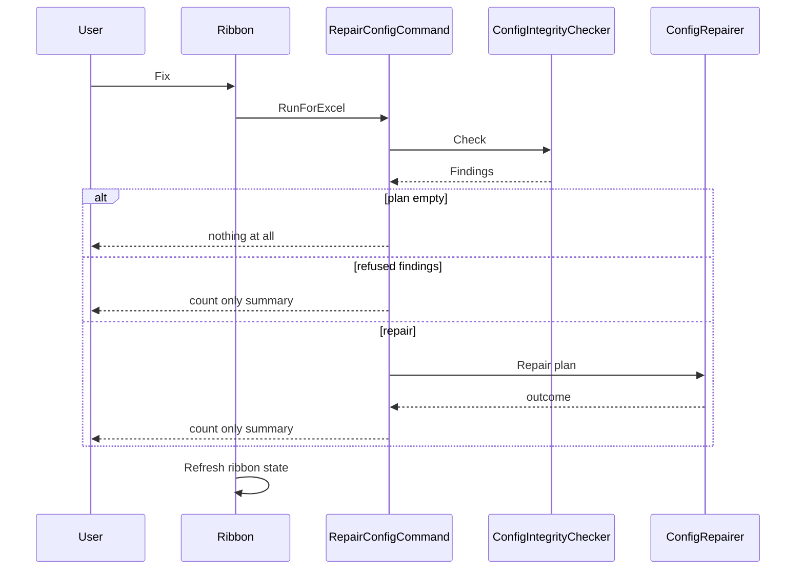
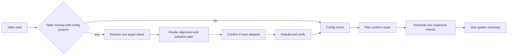

# R5.17 review — Fix recovery when the table or the hidden sheet is lost

- **Status:** review and design only. No product code changed.
- **Date:** 2026-11-11
- **Governed by:** [R5.17 work item](../docs/work-items/R5.17-repair-rebuilds-a-missing-data-table.md), [ADR-0057](../docs/adr/0057-repair-rebuilds-a-missing-data-table.md), [ADR-0011](../docs/adr/0011-config-safe-repair-policy.md), [docs/02-ARCHITECTURE.md](../docs/02-ARCHITECTURE.md), [docs/07-GANTT-ENTITY-GUIDE.md](../docs/07-GANTT-ENTITY-GUIDE.md)

## 1. The question this review answers

1. How must **Fix** behave when **all** of `tblGanttData` is gone?
2. How must it behave when **part** of the table is gone: a header cell, a column, all body rows, or the table object only?
3. Can `_GanttCreatorConfig` actually be deleted, and if it can, what does Fix do?
4. Does Fix work **entity by entity**, end to end, and does each kind of broken element have exactly one owning repair path?

## 2. Verified facts

Each line is read from the named source, not inferred.

| Fact | Evidence |
|---|---|
| Fix builds a configuration plan and returns **silently** when the plan is empty. | [`RepairConfigCommand.Run`](../src/GanttCreator.AddIn/RepairConfigCommand.cs) |
| The configuration checker does **not** report a missing data table. It only validates rows when the table read succeeds. | [`ExcelConfigIntegrityChecker.Check`](../src/GanttCreator.Office/ExcelConfigIntegrityChecker.cs) |
| A missing table is therefore invisible to the checker, which is why Fix does nothing. | same lines |
| A missing required header and a missing table both produce `TableMissing`, because `TryBuildColumnMap` failure calls `RefuseTableMissing`. | [`ExcelGanttTableReader.Read`](../src/GanttCreator.Office/ExcelGanttTableReader.cs), [`RefuseTableMissing`](../src/GanttCreator.Office/ExcelGanttTableReader.cs) |
| The test suite pins that conflation: a table with a deleted `Type` header refuses as `TableMissing`. | [`Read_refuses_when_a_required_header_is_missing`](../tests/GanttCreator.Office.ContractTests/GanttTableReaderTests.cs) |
| On `TableMissing`, the reader reports whether `_GanttCreatorConfig` exists. | [`HasConfigurationSheet`](../src/GanttCreator.Office/ExcelGanttTableReader.cs) |
| The configuration check treats `ConfigSheetMissing` as **Refuse**. | [`ConfigIntegrityPlan.Classify`](../src/GanttCreator.Core/ConfigIntegrity/ConfigIntegrity.cs) |
| `Initialise` refuses when the config sheet exists, and separately when `tblGanttData` exists anywhere. | [`ExcelWorkbookInitialiser.Initialise`](../src/GanttCreator.Office/ExcelWorkbookInitialiser.cs) |
| `Initialise` adopts the active sheet only when it is pristine; otherwise it creates a new sheet with a free label. | [`IsPristy`](../src/GanttCreator.Office/ExcelWorkbookInitialiser.cs), [`ResolveAvailableLabel`](../src/GanttCreator.Office/ExcelWorkbookInitialiser.cs), [`CreateTargetSheet`](../src/GanttCreator.Office/ExcelWorkbookInitialiser.cs) |
| The header row is a fixed layout constant, row 3. The plot anchor is built from that same constant, not from the live table. | [`GanttSheetLayout.HeaderRowIndex`](../src/GanttCreator.Core/GanttSheetLayout.cs), [`BuildPlotAnchorRefersTo`](../src/GanttCreator.Core/GanttSheetLayout.cs) |
| `Initialise` writes the header at that fixed row, creates the table over the header range only, and applies column presentation. | [`WriteHeaderRow`](../src/GanttCreator.Office/ExcelWorkbookInitialiser.cs), [`AddDataTable`](../src/GanttCreator.Office/ExcelWorkbookInitialiser.cs), [`ApplyColumnPresentation`](../src/GanttCreator.Office/ExcelWorkbookInitialiser.cs) |
| `Initialise` does **not** write the title cell or normalise reserved row heights. The refresh does that. | [`ExcelRowHeightNormaliser`](../src/GanttCreator.Office/ExcelRowHeightNormaliser.cs), [`GanttRefreshOrchestrator`](../src/GanttCreator.Office/GanttRefreshOrchestrator.cs) |
| `Initialise` schedules an automatic refresh on success; Fix does not. | [`InitialiseSheetCommand.RunForExcel`](../src/GanttCreator.AddIn/InitialiseSheetCommand.cs), [`GanttRibbon.OnRepairConfigClick`](../src/GanttCreator.AddIn/GanttRibbon.cs) |
| The Repair ribbon command only invalidates ribbon state; it never renders or schedules a refresh. | [`NotifyRibbonStateChanged`](../src/GanttCreator.AddIn/GanttRibbon.cs) |
| Identity repair is genuinely per entity: only the damaged `Id` cells and affected `ParentId` cells are rewritten. | [`ExcelGanttRowIdentityRepairer.Repair`](../src/GanttCreator.Office/ExcelGanttRowIdentityRepairer.cs) |
| Shape repair is per stable entity identifier: update, create, delete by scene ID after a complete scene is built. | [`ShapeReconciler.Plan`](../src/GanttCreator.Office/ShapeReconciler.cs) |
| The checker uses `Ordinal` for the config sheet name; `Initialise` uses `OrdinalIgnoreCase`. | [`FindConfigSheet`](../src/GanttCreator.Office/ExcelConfigIntegrityChecker.cs), [`NameTakenByOtherSheet`](../src/GanttCreator.Office/ExcelWorkbookInitialiser.cs) |
| Ribbon mode is `Ready` whenever the table reads, regardless of configuration health. | [`CaptureMode`](../src/GanttCreator.AddIn/RibbonStateService.cs) |
| Fix is enabled whenever a workbook is active, including in `Ready`. | [`RibbonState.IsEnabled`](../src/GanttCreator.AddIn/RibbonState.cs) |

## 3. What Fix does today, end to end



The missing link is the **table**. Fix never reads it, never checks whether the table exists, never rebuilds it, and never requests a render. The ADR-0057 flow requires all four.

## 4. Scenario matrix

The observable state, not the user gesture, defines each row. `L` means the `ListObject` named `tblGanttData`; `H` means the header cells; `B` means body cells; `C` means `_GanttCreatorConfig`.

### 4.1 Data table scenarios

| # | State | Detection today | Fix today | Required behaviour | Where |
|---|---|---|---|---|---|
| T1 | `L` gone, `H` intact at row 3, `B` present, `C` present | `TableMissing` + `ConfigurationPresent` | silently nothing | rebuild table over row 3 and existing body, adopt rows with confirmation, then repair, then refresh | R5.17 |
| T2 | `L` gone, `H` intact, `B` empty, `C` present | same | silently nothing | rebuild automatically, then repair, then refresh | R5.17 |
| T3 | `L` gone, `H` partially blank but remaining names align by position | same | silently nothing | fill only the blank header cells from the schema, rebuild, adopt rows | R5.17 |
| T4 | `L` gone, `H` renamed or shifted by a deleted column | same | silently nothing | **refuse** with a typed reason; positional rewrite would mislabel data | R5.17 |
| T5 | `L` present under a different name, schema headers intact | `TableMissing` | silently nothing | rename the table to `tblGanttData`; no cell mutation and no adoption | decision, see 8.4 |
| T6 | `L` present under the contract name, one required header missing | `TableMissing` | silently nothing | distinct `TableUnreadable` outcome; never treat as T1; actionable message | R5.17a |
| T7 | `L` present, one required column deleted | `TableMissing` | silently nothing | distinct `TableColumnsMissing` refusal; do not append or rebuild positionally | R5.17a |
| T8 | `L` present, required header has an unknown value in a row | reader succeeds, validator reports | Fix may repair identity only | report as validation, not configuration damage; Fix must not invent a Type | already correct |
| T9 | `L` present, all body rows deleted | reader succeeds with zero rows | plan may be empty | speak "nothing to repair"; refresh renders an empty chart | R5.17 |
| T10 | `L` present, one body row deleted | reader succeeds | no repair | expected user action; refresh removes that entity's shapes | already correct |
| T11 | `L` and `H` and `B` all cleared, `C` present | `TableMissing` + config | silently nothing | automatic rebuild over an empty body | R5.17 |
| T12 | `L` gone, no sheet labelled `Gantt Data` | `TableMissing` + config | silently nothing | typed refusal naming the missing target sheet | R5.17 |
| T13 | `L` gone, two sheets labelled `Gantt Data` variants | `TableMissing` + config | silently nothing | typed refusal naming ambiguity | R5.17 |
| T14 | header at a row other than 3 because rows were inserted or deleted above | `TableMissing` or `TableUnreadable` | silently nothing | refuse: the layout and plot anchor are fixed to row 3 | R5.17 |
| T15 | `L` gone and `C` gone, a standard-labelled Gantt sheet still exists | `TableMissing` + no config | ribbon says FirstRun; `Initialise` refuses nothing, then creates `Gantt Data (2)` when that sheet is not the active sheet | **invariant violation**: a second visible Gantt sheet appears | R5.17b, urgent |

### 4.2 Hidden configuration sheet scenarios

| # | State | Detection today | Fix today | Required behaviour | Where |
|---|---|---|---|---|---|
| C1 | `C` deleted, `L` intact | ribbon says `Ready`; checker says `ConfigSheetMissing` | count only refusal | recreate `_GanttCreatorConfig` from code defaults, keep the visible table and rows | R5.17b, needs ADR-0011 amendment |
| C2 | `C` deleted, `L` also gone | `TableMissing` + no config; ribbon FirstRun | `Initialise` creates a second Gantt sheet | rebuild config **and** table on the existing Gantt sheet | R5.17b |
| C3 | `C` renamed, case changed only | reader says config absent; `Initialise` says config exists | dead end | use one case-insensitive lookup everywhere; repair the name or accept it | R5.17c |
| C4 | `C` renamed to another name | reader says config absent; `Initialise` refuses because the table exists | dead end | detect a VeryHidden sheet carrying the catalogue tables; offer rename or refuse with the name | R5.17c |
| C5 | second `_GanttCreatorConfig` copy exists | checker finding, classified Refuse | count only refusal | keep refusal, but name the duplicate sheet and the action | follow-up |
| C6 | `C` made visible | checker `WrongVisibility` | repairs visibility | already correct | — |
| C7 | catalogue table missing or corrupt | checker finding | repairs catalogue | already correct | — |
| C8 | `C` protected | repair refuses | count only refusal | message names protection; no partial claim | already correct |

## 5. Can `_GanttCreatorConfig` be deleted?

**Yes, it is reachable; the ADR's "impossible" wording should be read as "not reachable from the normal Excel UI".**

Verified from primary documentation:

- `xlSheetVeryHidden` means the sheet is absent from the normal Unhide list and "the only way to make the sheet visible again is by setting this property to True". The property can be set by code. ([XlSheetVisibility enumeration](https://learn.microsoft.com/office/vba/api/excel.xlsheetvisibility))
- Microsoft documents that very hidden sheets are created by setting `Visible` to that value, and can be reversed by code. ([Hide sheets and use the xlVeryHidden constant in a macro](https://learn.microsoft.com/troubleshoot/microsoft-365-apps/excel/hide-sheet-and-use-xlveryhidden))
- The Excel JavaScript API explicitly documents the host refusal the ADR measured: deleting a `VeryHidden` worksheet fails, and the documented remedy is to change visibility to hidden or visible first, then delete. ([ExcelScript.Worksheet.delete](https://learn.microsoft.com/javascript/api/office-scripts/excelscript/excelscript.worksheet?view=office-scripts))
- The VBA `Worksheet.Delete` documentation itself states no VeryHidden restriction and notes the confirmation dialog and `DisplayAlerts` behaviour. ([Worksheet.Delete](https://learn.microsoft.com/office/vba/api/excel.worksheet.delete))

Reachable routes, in decreasing likelihood:

1. A macro, VBA immediate window, or third-party add-in sets `Visible = xlSheetVisible` or `xlSheetHidden`, then calls `Delete`.
2. A workbook edited outside Excel; sheet removal in the OOXML package is not constrained by Excel's UI.
3. Workbook corruption or repair dropping the sheet.
4. A future add-in version or maintenance script performing a destructive migration.

The correct posture is therefore: **the config sheet is absent-able, and every path must have a typed, spoken outcome.** The existing `ConfigSheetMissing` refusal is not enough, because the architecture already promises recovery.

Owner qualification (D2, approved 2026-11-11): **deletion is only possible when the affected cells are unlocked.** ADR-0055 unlocks the table's data cells before protecting, and the config sheet is never protected, so the damaged states are reachable without the add-in forcing them. A user-protected sheet or locked cells make a mutating recovery refuse `TargetProtected`; the add-in never unlocks a user's cells to force a repair.

## 6. Source-of-truth conflicts to resolve before implementation

1. **Header origin.** ADR-0057 point 3 says the rebuild writes the header at "the sheet's used-range origin". D1 and the code use the fixed `GanttSheetLayout.HeaderRowIndex` (row 3), and the plot anchor is built from that constant. A used-range origin after a table deletion is usually row 2 because the title row has content, so the ADR wording would write the header one row too high. **Recommendation:** the ADR is wrong; amend it to "the contract header row, row 3", and refuse when the used range no longer aligns.
2. **Missing config sheet.** [docs/02-ARCHITECTURE.md:120](../docs/02-ARCHITECTURE.md) promises: "If a user copies only the visible worksheet into another workbook, the add-in detects the missing configuration sheet and offers to initialise it from code defaults." ADR-0011 and the current classifier do the opposite: `ConfigSheetMissing` is `Refuse`, and "Repair never creates or deletes a worksheet". **This is a real conflict, not a gap in one file.** The owner must choose which wins before C1 and C2 are implemented.
3. **Reserved row heights.** The R5.17 work item requires "the reserved rows at the expected heights", but `Initialise` does not set them; the refresh's `ExcelRowHeightNormaliser` does. The rebuild should follow `Initialise` plus the scheduled refresh, not duplicate the normaliser, and the acceptance wording should say "after the automatic refresh".
4. **Table present under another name.** The work item's D3 says "a sheet with a table" is a refusal, but a renamed `tblGanttData` is loss-free to repair by renaming it. A refusal leaves a dead end for an easy user action. Decide whether renaming is in R5.17 or a follow-up.
5. **"Impossible to delete by hand".** ADR-0057 point 3 of Context states deletion is impossible. Section 5 shows it is not. The ADR should say "not exposed by the normal Excel UI; reachable by code, external editing, or corruption".

## 7. Entity-level repair responsibility

The product already has the right shape for per-entity repair; Fix must stop being the aggregate exception.

| Broken element | Correct owner | Scope | Fix today | Required end-to-end |
|---|---|---|---|---|
| `tblGanttData` object | Fix, R5.17 | one table | silent | rebuild, verify, schedule refresh |
| One table row deleted | user / refresh | one entity | no repair | refresh deletes that entity's owned shapes |
| One row `Id` malformed or duplicated | Refresh step 5 and Fix identity repair | one row at a time, plus affected `ParentId` cells | works automatically on refresh; Fix also offers it | refresh repairs and re-reads; Fix confirms and schedules a refresh |
| One row `Type` invalid | validation and the user | one cell | not a configuration defect | blocking validation, no guessing |
| One shape deleted by hand | Refresh reconciliation | one stable scene ID | not Fix | create missing shape from the scene |
| One shape moved by hand | Refresh reconciliation | one stable scene ID | not Fix | geometry update or verified skip |
| One catalogue row missing | Fix catalogue write | whole code-owned table | works | already correct |
| One user style row unparseable | Fix, confirm-required | one row quarantined | works | already correct |
| One defined name missing | Fix | one name | works | already correct |
| One reserved row height wrong | Refresh normaliser | one row | not Fix | refresh normalises |
| `GanttCreator.TypeOptions` missing or stale | Add Row or Fix | one name and one validation range | not repaired | refresh never calls the materialiser |
| Plot anchor missing or stale | Fix | one sheet-scoped name | not repaired | refresh never calls the repairer |
| Config sheet visibility wrong | Fix | one sheet property | not repaired | refresh reads it and ignores it |
| Untagged or renamed owned shape | **no owner today** | one shape | not repaired | manual; R5.17f proposed |
| Config sheet deleted | **no owner today** | whole workbook config | refuses | R5.17b, approved |
| Config sheet renamed | **no owner today** | whole workbook config | dead end | R5.17c, approved |

The end-to-end contract for R5.17 should be:



## 8. Proposed R5.17 design, narrow scope

### 8.1 Trigger

Add a table read to the Fix command, injected as a port. The rebuild pre-step runs only when:

```text
read.Succeeded == false
and read.Refusal == TableMissing
and read.ConfigurationPresent == true
```

No other state triggers a rebuild. A `DateSystemUnsupported` or `NoActiveWorkbook` refusal is presented as today.

### 8.2 Target resolution

Walk every worksheet in `ActiveWorkbook`:

- Match `GanttWorkbookContract.GanttSheetLabel` with `OrdinalIgnoreCase`.
- The reader has already established that no `tblGanttData` exists anywhere.
- Record sheets that carry any `ListObject`.

Outcomes:

| Observed | Outcome |
|---|---|
| exactly one labelled sheet, no table | proceed |
| exactly one labelled sheet, one table whose headers align with the schema | optional rename repair, see 8.4 |
| exactly one labelled sheet, one table with foreign or misaligned headers | `RebuildTargetHasForeignTable`, no mutation |
| zero labelled sheets | `RebuildTargetMissing`, no mutation |
| two or more labelled sheets | `RebuildTargetAmbiguous`, no mutation |
| labelled sheet protected | `RebuildTargetProtected`, no mutation |

### 8.3 Header alignment and adoption

This is the safety core, and it is what makes "parts of the table deleted" safe.

Read row 3, the contract header row, across the schema column count.

| Header row state | Action |
|---|---|
| every cell matches the schema name at its position | adopt, no header write |
| row is fully blank | write the schema header, adopt an empty body |
| some cells blank, every non-blank cell matches its schema position | write only the blank cells, adopt |
| any non-blank cell differs from the schema name at its position | refuse `HeaderMisaligned`; do not overwrite |
| row 3 holds body data because rows moved | the positional check refuses; `HeaderMisaligned` |

Body range:

- First body row is `header + 1`.
- Last body row is the last row at or below the first body row that has a non-blank value in any schema column, stopping at the last non-blank row. Trailing all-blank rows are not adopted.
- Body row count greater than zero makes the rebuild confirm-required; the confirmation states the count. Zero body rows is automatic.
- No row content is rewritten. Adopted rows are user data.

Why positional alignment rather than name-only mapping: a deleted column shifts every later header left, so name-at-position fails. A renamed header fails. A blanked header cell with the rest intact passes and is safely filled. This is the smallest rule that repairs what can be repaired without guessing.

### 8.4 Table present under another name

Recommend extending D3: if the labelled sheet carries exactly one table whose headers align positionally with the schema, rename it to `tblGanttData` and present "table name restored". This is loss-free, needs no adoption, and closes a dead end. If the owner keeps the work item's refusal, the message must say the table is present and how to make it recoverable.

### 8.5 Mutation order and rollback

1. Capture the pre-state needed for rollback: header cell values that will be written, column hidden flags that will change, whether a table is created.
2. Enter the application-state scope: `ScreenUpdating`, `EnableEvents`, `DisplayAlerts`, status bar, selection save-restore (ADR-0020).
3. Write only the missing header cells.
4. Create the table over the header plus the adopted body range.
5. Name it, disable autofilter and banding through the same code path as `Initialise`.
6. Apply column presentation.
7. Verify: re-read the table by name, confirm every required header resolves, confirm body row count equals the adoption count.
8. On any failure, roll back to the captured pre-state and return a typed refusal; never claim success from a non-throwing COM call.
9. Do not normalise row heights or write the title here; the scheduled refresh owns both.

### 8.6 Then the ordinary repair

Run the configuration check **after** the rebuild. This ordering is mandatory: before the rebuild the checker cannot see the table, so it cannot report a missing `TypeOptions` name or a plot-anchor disagreement. After the rebuild both findings appear and the existing repair path fixes them.

### 8.7 Speak on every path and render

- Rebuild outcome, configuration plan outcome, and skipped or refused counts are combined into one message that names what was rebuilt and what was repaired.
- An empty plan with no rebuild presents "nothing to repair" (positive test on the message).
- A declined confirmation presents "cancelled, nothing changed".
- If anything was mutated, call `RibbonStateService.Instance.ScheduleAutomaticRefresh()` exactly once, matching `Initialise`. Without it the table returns but the chart does not, and the ADR-0057 live gate fails.
- The existing `NotifyRibbonStateChanged` then moves `NeedsRepair` to `Ready`.

### 8.8 New types

- `GanttTableReadRefusalReason.TableUnreadable` for a contract table that exists but whose required headers or columns do not resolve (R5.17a can use it; R5.17 should at least stop conflating it).
- `GanttTableRebuildRefusalReason`: `NoActiveWorkbook`, `TargetProtected`, `TargetMissing`, `TargetAmbiguous`, `TargetHasForeignTable`, `HeaderMisaligned`, `TableCreateFailed`, `HeaderWriteFailed`, `VerificationFailed`.
- `GanttTableRebuildOutcome`: succeeded, adopted row count, header cells written, and the refusal.
- Every new `if (bad) { error }` path gets a positive test that constructs the bad state and asserts the refusal with zero mutation.

## 9. Test plan

### Core and AddIn

- Rebuild trigger fires only for `TableMissing` and `ConfigurationPresent`; not for `TableUnreadable`, not for config absent.
- Empty plan with no rebuild presents the nothing-to-repair message.
- Combined summary names the rebuild and the repair.
- Declined adoption confirmation mutates nothing and speaks.
- Successful rebuild schedules exactly one automatic refresh; no rebuild and empty plan schedules none.
- Header alignment table: exact, blank row, partial blank, one renamed, one deleted column, rows moved.
- Target resolution: zero, one, two, one with foreign table, protected.
- Rollback: header write succeeds and table create fails; table create succeeds and naming fails; verify no partial table remains.
- Reader: `TableUnreadable` is distinct from `TableMissing`; configuration presence is still reported on both.

### Office integration, human host

- Delete the table object with Convert to Range; press Fix; table returns on the same sheet; body rows are adopted; Type dropdown works; chart renders; summary names the rebuild.
- Press Fix again; nothing to repair, no mutation.
- Delete only the header row cells below the reserved rows; Fix fills them and rebuilds.
- Rename the table; Fix restores the name or reports the documented refusal.
- Delete one required column; Fix refuses and does not shift data.
- Insert two rows above the header; Fix refuses because the header is no longer row 3.
- Delete `_GanttCreatorConfig` through a VBA visibility change; record what Fix does today; this is the R5.17b gate, not an R5.17 gate.
- Delete both the config sheet and the table; confirm no second Gantt sheet is created. This is the R5.17b gate.

### Probes to run before coding

- `scripts/probe-fix-table-state.ps1`: measure the observable state after Convert to Range, Delete Table Rows, clear header cells, delete one column, rename the table, and insert rows above.
- Extend the config-sheet probe: `Visible = xlSheetVisible` then `Delete`, and direct `Delete`, recording the HRESULT for each.
- Record whether creating a `ListObject` raises `SheetChange`; this decides whether the explicit `ScheduleAutomaticRefresh` is the only safe trigger.

## 10. Work-item split

The full implementation plan for every row below is in the R5.17 work item:
[recovery family work plan](../docs/work-items/R5.17-repair-rebuilds-a-missing-data-table.md#recovery-family-work-plan--r517-r517a-r517b-r517c-r517d).

| Item | Scope | Decision |
|---|---|---|
| **R5.17** | Whole table object missing, config present; header alignment; adoption; typed refusals; no silent path; scheduled refresh | approved |
| **R5.17a** | `TableUnreadable`: required header or column missing while the table exists; safe positional repair, otherwise refusal | approved, automatic when provable |
| **R5.17b** | Missing config sheet: recreate VeryHidden sheet from code defaults; both-missing case; never create a second Gantt sheet | approved |
| **R5.17c** | Config sheet renamed or case-renamed; one case-insensitive lookup; repair or name the sheet | approved |
| **R5.17d** | No labelled Gantt sheet but config present; confirmed creation | approved |
| **R5.17e** | Single-chart locator seam for a future multi-chart extension | approved as a seam, not a feature |
| **R5.17f** | Orphan-shape, moved-origin, extra-column, schedule-data-on-config, and table-on-unexpected-sheet findings | proposed, not approved |

Recommended order: R5.17 first, because it is accepted and closes the reported defect. R5.17b is the next highest severity: it is the one route that can currently produce a second visible Gantt sheet, and the architecture already says it should be recoverable.

## 11. Unknowns

- The exact gesture the owner used when "deleting the table" is not recorded. The scenario matrix is defined by observable state instead, so the gate can reproduce any route.
- Excel's behaviour when a `ListObject` header row is deleted by a row operation, and whether the table object survives, is unmeasured. Probe required.
- Whether `ListObjects.Add` raises `SheetChange` is unmeasured. The explicit refresh scheduling makes it irrelevant, but the probe should confirm no double refresh.
- The live host may refuse a table create on a sheet that is UI-only protected by our own arming. The rebuild must use the same protection guard as `Initialise` and be proved live.
- Whether the adopted body's last non-blank row is a reliable boundary when the user has formatted blank rows below it. The trim rule above is the proposal; the live gate must include a formatted blank spacer.
- Whether `ListOwned` can report enough detail to identify an untagged orphan without a host round trip per shape; the inventory line already logs the name and geometry, so the probe is about presentation, not detection.

## 12. What a full refresh cannot repair

A full refresh is broad, but it is not a container repair. It reads the table and the configuration first; if either read refuses, it mutates nothing. The verified repair steps are in the work plan section 11.1. The items with no refresh repair are:

| Broken element | Why refresh cannot fix it | Owner today |
|---|---|---|
| Table object missing, renamed, or unreadable | the read refuses before any step | R5.17 / R5.17a |
| Required header or column missing | column restoration refuses `SchemaColumnMissing` before any write | R5.17a |
| Config sheet missing, renamed, or corrupt | the config read refuses before any step | R5.17b / R5.17c |
| Schema or catalogue hash mismatch | the config read refuses | Fix catalogue writer; newer schema needs a newer add-in |
| `GanttCreator.TypeOptions` missing or stale | refresh never calls the materialiser | Add Row or Fix |
| Plot anchor missing or stale | refresh never calls the repairer | Fix |
| Config sheet visibility wrong | refresh reads it and does not change it | Fix |
| Second helper sheet | refresh ignores it | Fix refuses; manual cleanup |
| Schedule data on the config sheet | refresh ignores it; the finding kind is never emitted | **no owner** |
| Table style, autofilter, or banding drift | only Initialise writes the neutral values | **no owner**, cosmetic |
| Header row moved, table shifted off column A, or extra columns | the fixed layout, title, and anchor assume the contract origin | **no owner**; manual move or follow-up |
| Untagged or renamed owned shape | invisible to `ListOwned`; never deleted | **no owner**; manual |
| Parent cycles, ambiguous or orphan `ParentId`, unknown Type, invalid dates | validation blocks; refresh deliberately does not guess | user data |
| Workbook or sheet protection not owned | refresh refuses before mutation | user unprotects |
| 1904 date system | table read refuses | user changes the workbook setting |
| Schema newer than the add-in | config read refuses | upgrade the add-in |
| `tblGanttData` on an unexpected sheet | reader finds it by name and renders there | **no owner**; add a finding |
| Copied Gantt sheet with an auto-renamed table | the copy is ignored | multi-chart gap |

The **no owner** rows are the actionable follow-ups. They should become R5.17f rather than being folded into the recovery family, because each needs its own detection and confirmation policy. The full detail, including code references, is in the work plan section 11.3.

## 13. Multi-chart extension

More than one Gantt chart sheet is technically possible but is a product-contract and workbook-schema change, not a recovery slice. The investigation and seam are in the work plan section 12. The short version:

- **What helps:** the label suffix convention already exists; the plot anchor is sheet-scoped; one VeryHidden configuration sheet can serve many charts; types, styles, and metrics are shared.
- **What blocks:** one workbook-unique table name found by name everywhere, workbook-scoped settings, one `WorkbookId` row set, a singleton delta cache, session-global protection ownership, one Ribbon snapshot, and every command's implicit single table.
- **Seam approved (R5.17e):** a `GanttChartRef` and `IGanttChartLocator` with a single-chart implementation, injected everywhere that currently hardcodes the table or sheet label. No schema write, no table rename, no invariant change.
- **Future ADR:** stored chart identity, a unique table-name scheme, per-chart settings, per-chart cache and per-sheet protection ownership, active-chart Ribbon and export, and an AGENTS/docs/02/docs/07 amendment replacing the one-visible-worksheet invariant.
