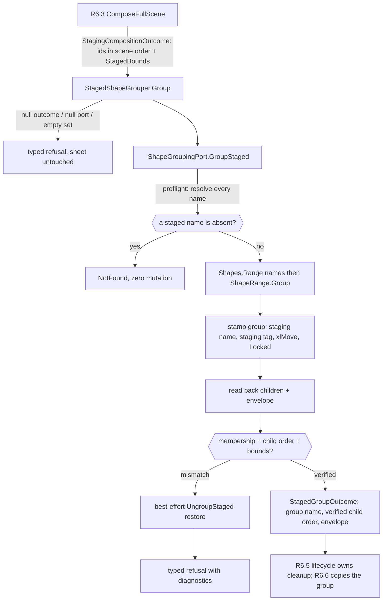

# R6.4 — Group all temporary shapes with stable, deterministic child order

Implementation plan for [docs/work-items/R6.4-grouping.md](../docs/work-items/R6.4-grouping.md).
Owner-confirmed structural decision (2026-11-18): a **new narrow port**
(`IShapeGroupingPort` + `ExcelShapeGrouper`), not an extension of
[`IShapeWritePort`](../src/GanttCreator.Office/IShapeWritePort.cs) — whose contract is
deliberately single-shape-by-identifier and whose fakes must not churn.

## What the work item demands (restated)

- **D1** — Group exactly the temporary set; membership = every staged shape, nothing
  else. **The group shape itself is a temporary shape (amended 2026-11-18):** it carries
  the staging name prefix and the staging ownership tag, registers into the R6.5
  lifecycle at creation, and is never visible to the live reconciler.
- **D2** — Child order = the scene's deterministic order (the staged creation order).
  Office re-order quirks are probed and pinned, never silently accepted.
- **D3** — After ungroup (inspection only, not a feature), every expected child remains
  editable with geometry/style intact.
- Acceptance: membership pins, child-order pins, sentinel-not-grouped **positive**,
  group-bounds pin (equals the R6.3 bounds — the architecture's step-3 check reused);
  live gate: group and ungroup in Excel, edit one child, record host builds.
- Exclusions: no clipboard (R6.6), no lifecycle/cleanup ownership (R6.5 — grouping only
  *registers* the group via the staging identity), no user-facing ungroup command.

## Evidence gathered (facts, not assumptions)

| Statement | Status | Evidence |
| --- | --- | --- |
| Staged names are `GanttCreatorStaging:{primitiveId}`; tag is `GanttCreator.Staging.v1:{hash}` recomputed from the name | fact | [`ShapeStagingTag`](../src/GanttCreator.Office/ShapeStagingTag.cs) |
| Every scene primitive id contains a colon (`{ownerId}:{role}` from `ScenePrimitive.CreateId`) | fact | `CouldBeOwnedName` remarks in [`ExcelShapeWriter`](../src/GanttCreator.Office/ExcelShapeWriter.cs) |
| A name is scanned for a tag only when it could be ours (colon-bearing or `ChartTitle`) | fact | `CouldBeOwnedName`, ADR-0054 O4 |
| The staged set's union equals the R6.1 export bounds; `StagedEnvelopeCheck` is the single comparison R6.4's group-bounds pin must reuse | fact | [`StagedEnvelopeCheck`](../src/GanttCreator.Core/Scene/StagedEnvelopeCheck.cs) remarks |
| The composer pre-flights `ListOwned().Count > 0` and refuses `StagingAlreadyPopulated`; on host refusal it deletes staged-so-far in reverse order | fact | [`EditablePanelStagingComposer`](../src/GanttCreator.Office/EditablePanelStagingComposer.cs) |
| Architecture step 3: "Group all temporary shapes and verify group bounds against the scene bounds"; step 4 copies the group | fact | [`02-ARCHITECTURE`](../docs/02-ARCHITECTURE.md) export process |
| R6.5's registry is keyed on the staging identity; cleanup walks the registry, never a sheet scan; cleanup deletes group first, then children | fact | [R6.5 work item](../docs/work-items/R6.5-staging-lifecycle.md) D1/D2 |
| Office child-order semantics through `ShapeRange.Group` are **unknown until probed** | unknown | work-item ledger seed; live gate + PIA probe at Tier-A upgrade |
| Host stores shape geometry in single precision; live read-backs use `HostOwnedGeometry.GeometryMatchTolerancePt`, never a widened scene tolerance | fact | R6.3 STATUS entry (measured 2026-11-18) |

## Design

### 1. Group identity — one addition to `ShapeStagingTag`

- `GroupPrimitiveId = "export-group"` — **no colon**, so it is structurally distinct
  from every scene primitive id (which always contains one) and can never collide with
  a staged child name.
- `GroupName = NamePrefix + GroupPrimitiveId` → `GanttCreatorStaging:export-group`.
  The full name contains the prefix's colon, so `CouldBeOwnedName` accepts it and the
  staging `ListOwned` scan reaches its tag.
- Tag = `ForStagedName(GroupName)` — the `tag = f(name)` invariant is preserved, so the
  group is provably staging-owned, invisible to the live scheme, deletable by the
  staging writer's `Delete(GroupPrimitiveId)` (deleting a group deletes its children —
  exactly what R6.5's group-first cleanup needs), and counted by the composer's
  `StagingAlreadyPopulated` pre-flight.

### 2. `IShapeGroupingPort` + `ExcelShapeGrouper` (new files, Office)

Narrow port, no interop type crosses it:

```text
ShapeGroupReadback GroupStaged(IReadOnlyList<string> shapeNames)
ShapeWriteOutcome   UngroupStaged(string groupName)
```

- `ShapeGroupReadback`: the group's name, the child names in the host-reported order
  (`GroupItems[1..Count]`), and the group envelope as `RectD`; refusal reuses
  `ShapeWriteRefusal` (`NoActiveWorkbook`, `WorksheetMissing`, `TargetProtected`,
  `NotFound`, `HostRejected` all fit — no new enum).
- Adapter behaviour, mirroring [`ExcelShapeWriter`](../src/GanttCreator.Office/ExcelShapeWriter.cs):
  - Target resolution: application → active workbook → sheets → Gantt worksheet →
    protection guard against the **resolved target** → `Shapes`; each COM proxy held in
    a local and released; virtual seams for Moq (indexed COM properties cannot appear
    in expression trees, CS0855 — same pattern as the writer).
  - **Preflight, then commit** (the `ApplyZOrder` rule): resolve and prove every name
    before the first mutation. A missing staged name refuses `NotFound` with **zero**
    COM mutation — `Shapes.Range` with a missing name raises, so the preflight is
    mandatory, not decorative.
  - `Shapes.Range(names)` → `ShapeRange.Group()` → stamp the group: `Name =
    ShapeStagingTag.GroupName`, `AlternativeText = ForStagedName(GroupName)`,
    `Placement = xlMove` (D1 R6.3: temporary shapes never enter the ADR-0052
    host-owned resize class), `Locked = true` (every writer create stamps it;
    ADR-0055). A failure to stamp discards/ungroups the group — an untagged group is
    worse than no group (the writer's own rule).
  - Read back children and envelope; return the readback.
- `UngroupStaged` proves the staging tag before ungrouping (ownership, not name,
  authorises — the port's standing rule) and is used by the stage's rollback and by the
  live gate's D3 inspection. It is **not** exposed to any command (work-item exclusion).

### 3. `StagedShapeGrouper` — the pure grouping stage (new file, Office)

Static class over the port, the `EditablePanelStagingComposer` shape:

```text
StagedGroupOutcome Group(StagingCompositionOutcome staged, IShapeGroupingPort port)
```

- Refusals (typed enum, mirroring `StagingCompositionRefusal`):
  `NullOutcome`, `NullPort`, `NothingToGroup` (empty staged set — Excel cannot group
  nothing; the caller decides what an empty composition means), `HostRejected` (port
  refusal rides on the outcome), `MembershipMismatch`, `ChildOrderMismatch`,
  `BoundsMismatch`.
- Verification, in order:
  1. **Membership (D1):** child count == staged count AND the child name set equals
     the expected `GanttCreatorStaging:{id}` set. Diagnostics name the offending
     child/missing id, never just a boolean.
  2. **Child order (D2):** children in the host-reported order equal the staged
     creation/scene order, index by index.
  3. **Bounds (step-3 check reused):** `StagedEnvelopeCheck.Evaluate([groupEnvelope],
     staged.StagedBounds)` — one envelope against the same comparison the R6.3 pin
     uses; exact `GeometryMath.Epsilon` in the contract harness, host tolerance only in
     the live read-back.
- **Rollback on a verification mismatch:** best-effort `UngroupStaged` to restore the
  pre-group state (CA1031-suppressed exactly like `CleanupStaged` — the refusal being
  reported must never be replaced by a cleanup exception), then the typed refusal. This
  is the stage's own restore, not lifecycle ownership: a wrong group left behind would
  also block every later composition via `StagingAlreadyPopulated`, and the composer's
  discipline is "a refused operation leaves the sheet as it found it".
- Success outcome carries: the group name, the verified child order, the group
  envelope. No new state, no caching — R6.6/R6.8 consume the outcome downstream.

### 4. What deliberately does NOT change

- `IShapeWritePort` and every existing fake — untouched (owner-confirmed).
- Core — untouched. `StagedEnvelopeCheck` is consumed as-is; no schema version, no
  catalogue hash, no scene baseline moves. The changed-code mutation gate therefore
  judges only Office files.
- The live reconciler, the composer, the ribbon — untouched. Nothing is exposed
  through a command until R6.8.

## Mermaid — the grouping stage in the export pipeline



## Tests (same commit as the behaviour; every validator arm gets a positive test)

### Contract — `tests/GanttCreator.Office.ContractTests/`

New `StagedShapeGrouperTests` with a fake `IShapeGroupingPort` (the
`FullSceneStagingComposerTests` fixture shape, plus quirk injection):

- Membership pin: children are exactly the staged names.
- Child-order pin: children in the scene's back-to-front order.
- **Sentinel-not-grouped positive (D1):** an unowned sentinel shape overlapping the
  staged envelope is never selected (selection is by name) — the sentinel stays
  top-level and absent from the readback.
- Group-bounds pin: the group envelope equals `StagedBounds` through
  `StagedEnvelopeCheck`.
- Positives for every refusal arm: `NullOutcome`, `NullPort`, `NothingToGroup`,
  `HostRejected` (port refuses), `MembershipMismatch` (fake drops/duplicates a child),
  `ChildOrderMismatch` (fake reorders), `BoundsMismatch` (fake returns a wrong
  envelope) — each asserting the typed refusal **and** that the rollback ungroup ran.
- Group identity: the expected group name/tag handed to the port is
  `ShapeStagingTag.GroupName` / `ForStagedName(GroupName)`; `GroupPrimitiveId` contains
  no colon (the structural no-collision pin).

New `ExcelShapeGrouperTests` (Moq seams, the `ExcelShapeWriterTests` pattern):

- Preflight refuses `NotFound` before any mutation when one staged name is absent.
- Protection refusal against the resolved target; no active workbook; worksheet
  missing.
- The group is stamped name + tag + `xlMove` + `Locked`; a host refusal while stamping
  leaves no group (ungroup/discard).
- Readback fidelity: child names in `GroupItems` order, envelope as `RectD`.
- Proxy release through the ownership helper.

### Live — `tests/GanttCreator.Office.IntegrationTests/StagedGroupingIntegrationTests`

Tagged `OfficeIntegration`, the `FullSceneStagingIntegrationTests` production chain
(initialise → rows → export request → resolve → `ComposeFullScene` via the staging
writer inside the R4.2 state scope), then:

1. Group through the real `ExcelShapeGrouper`; assert the group exists under
   `GanttCreatorStaging:export-group` with a valid staging tag, `Placement = xlMove`,
   and is invisible to the live writer's `ListOwned` while the staging writer's
   `ListOwned` reports exactly the group.
2. **D2 live pin (the Tier-A probe):** `GroupItems` count == staged count and child
   names in host order == the scene order. A host re-order quirk here is the work
   item's stop condition — record evidence, do not widen the assertion.
3. Group envelope == `StagedBounds` within `HostOwnedGeometry.GeometryMatchTolerancePt`.
4. The R4.8 sentinel shape and witness cell are untouched; view state unchanged.
5. **D3 live:** ungroup (inspection), assert every child is top-level again with
   geometry/style intact, **edit one child** (move it), read the new position back,
   then delete the set through the staging writer, assert zero residue.

## Verification and gates

```text
dotnet build GanttCreator.slnx /p:Configuration=Release /warnaserror
dotnet test tests/GanttCreator.Office.ContractTests
pwsh ./scripts/verify-quick.ps1        # every commit
pwsh ./scripts/verify-office.ps1       # Required; exit-0 caveat recorded in R6.7 (pre-existing D4 leak ratchet)
git diff --check
```

- Self-certify `docs/08-TEST-CHECKLIST.md` sections **E, J** (work-item definition of
  done) and name them in the commit message.
- Update `docs/REPO-MAP.md` (Office row: the grouping stage, port, and test locations)
  and `docs/STATUS.md` in the same change.
- One commit (`feat(office): …`) is the intent — the row is one concern; split only if
  the diff becomes hard to review (identity+adapter vs stage+tests).
- Handoff per `06-llm-protocol`: `Outcome / Changed / Proof / Office / Risk / Deferred /
  Next`; any gate not run is `Not run` with the reason.

## Risks and stop conditions

- **Child-order opacity (main risk):** if the host cannot preserve or expose child
  order, the stage refuses and the live gate records the evidence — the work item's
  stop condition, an ADR decision, never a shrug or a widened assertion.
- **Grouping corrupts editability on a supported build** → stop (scope-change path).
- **`GroupItems` on a single-shape group:** Excel special-cases a one-shape
  `ShapeRange.Group` (it may return the shape itself rather than a group). The
  contract fake and the live gate both cover the one-staged-shape case explicitly.
- Rollback is `git revert`; no schema, no migration, no dependency.
