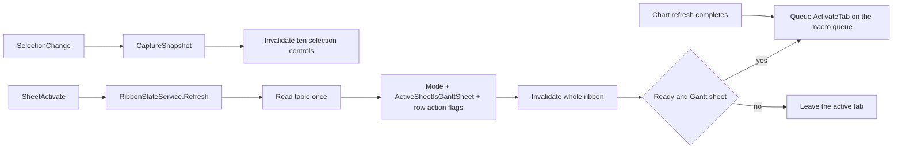

# Ribbon review, compact re-layout, icon pass, and context-aware enablement

**Status:** v5 — all seven owner rulings are implemented and all three rows have landed in code.
**R5.16a landed**: layout, merged groups, Repair/Elements labels, `ddnSize`, the icon pass, the
imageMso uniqueness pin and [`check-ribbon-icons.ps1`](../scripts/check-ribbon-icons.ps1).
**R5.9b landed**: the Core `RowActionAvailability` rules, `SelectionFacts.ActiveCellBodyIndex`, the
snapshot facts and gates, the ten-control selection invalidation, and a positive matrix test.
**R5.16b landed**: [ADR-0058](../docs/adr/0058-ribbon-tab-context-and-active-sheet-gating.md), the
reader's `ActiveSheetIsGanttSheet` fact, the inert-by-default `SubscribeSheetActivated` port and
its one `AppEvents_SheetActivate` connection, `ActivateGanttTab` on every refresh and on sheet
entry, the active-sheet gate on every non-exempt control, and `HasGroups` for Expand/Collapse.
Work item: [`R5.16b`](../docs/work-items/R5.16b-ribbon-tab-context-and-active-sheet-gating.md).
**Owed on every row:** the live-host checks in section 9; no interactive Excel session has been
run, so nothing here claims host-verified rendering or host-verified tab behaviour.
**Owner constraint (2026-11-12):** the **Data** group content and split-button structure are the owner's
tooled preference and stay as built. The owner has ruled that the two visible labels change to **Repair**
and **Elements** (D-3); apart from those labels and the icon pass, the group is untouched. Everything else
in the tab is open for revision, but **no control may be removed and no command may become unreachable**.
**Rulings that change scope against v1:** D-3 (Data wording), D-4 (re-activate the tab after **every** chart
refresh, not only on sheet activation), D-7 (read-only boxes become labels). D-1, D-2, D-5 and D-6 confirm
the v1 recommendation.
**Extensions:** [`R5.16`](../docs/work-items/R5.16-ribbon-first-run-and-data-group.md) (ribbon surface,
three modes, Data-group consolidation) and [`R5.9`](../docs/work-items/R5.9-ribbon-completion.md) (icons,
keytips, labels, pinned presentation contracts). New rows proposed: **R5.16a**, **R5.9b**, **R5.16b**.
**Owner-stated priority:** interaction speed and visual clarity. Accessibility is **explicitly low
priority**; the existing keytip/screentip/supertip pins stay green but no accessibility work is added.

---

## 1. Evidence ledger

| # | Statement | Class | Evidence |
|---|---|---|---|
| 1 | The tab declares 11 groups; 10 are visible at `Ready` | fact | [`Ribbon.xml`](../src/GanttCreator.AddIn/RibbonResources/Ribbon.xml:14) |
| 2 | The group holding Refresh, Warnings and the two locks is still labelled **Gantt Creator** (id `grpPlaceholder`) | fact | [`Ribbon.xml`](../src/GanttCreator.AddIn/RibbonResources/Ribbon.xml:192), [`RibbonControlIds.cs`](../src/GanttCreator.AddIn/RibbonControlIds.cs:284) |
| 3 | Nine interactive controls share `imageMso="TableInsertExcel"` (Data ×5, Promote, Demote, Up, Down) | fact | [`Ribbon.xml`](../src/GanttCreator.AddIn/RibbonResources/Ribbon.xml:22) |
| 4 | Style/Theme, Chart title, Warnings carry **no** icon at all | fact | [`Ribbon.xml`](../src/GanttCreator.AddIn/RibbonResources/Ribbon.xml:125) |
| 5 | Only eight `imageMso` ids are pinned by test; `Refresh`, `Lock`, `LockCell` are used but **unverified** | fact | [`GanttRibbonTests.cs`](../tests/GanttCreator.AddIn.Tests/GanttRibbonTests.cs:711) |
| 6 | The existing Data group has two split buttons whose menus have no section separators | fact | [`Ribbon.xml`](../src/GanttCreator.AddIn/RibbonResources/Ribbon.xml:31) |
| 7 | Plot Area, Plot Time Scale and Plot Size are three groups for one subject (16 controls, 3 labels, 3 paddings) | fact | [`Ribbon.xml`](../src/GanttCreator.AddIn/RibbonResources/Ribbon.xml:128) |
| 8 | Ordering holds a 2-level nested box; Outline holds a vertical box of 2 | fact | [`Ribbon.xml`](../src/GanttCreator.AddIn/RibbonResources/Ribbon.xml:66) |
| 9 | `Promote`, `Demote`, `Up`, `Down`, `Remove` enable on workbook + initialised only | fact | [`RibbonState.cs`](../src/GanttCreator.AddIn/RibbonState.cs:233) |
| 10 | The four order buttons are already invalidated by the refresh path but **not** on selection change | fact | [`RefreshSheetCommand.cs`](../src/GanttCreator.AddIn/RefreshSheetCommand.cs:221), [`RibbonStateService.cs`](../src/GanttCreator.AddIn/RibbonStateService.cs:2975) |
| 11 | Planner refusals already name every no-op condition the ribbon should grey out | fact | [`HierarchyMutations.cs`](../src/GanttCreator.Core/HierarchyMutations.cs:37) |
| 12 | `SelectionFacts` exposes only "exactly one body row"; no active-cell body index | fact | [`ISelectionIdentifier.cs`](../src/GanttCreator.Office/ISelectionIdentifier.cs:12) |
| 13 | The table reader finds `tblGanttData` **anywhere in the workbook**; it reports no active-sheet fact | fact | [`ExcelGanttTableReader.cs`](../src/GanttCreator.Office/ExcelGanttTableReader.cs:65) |
| 14 | Application events wired today are `WorkbookActivate`, `WorkbookDeactivate`, `NewWorkbook`; no `SheetActivate` | fact | [`ExcelApplicationAdapter.cs`](../src/GanttCreator.Office/ExcelApplicationAdapter.cs:287) |
| 15 | `IRibbonUI` in Excel-DNA 1.9 exposes `ActivateTab*` as well as `Invalidate*` | fact | [`R1.5`](../docs/work-items/R1.5-ribbon-state-service.md:176) |
| 16 | A custom tab cannot be made contextual in RibbonX; custom contextual tabs exist only for Office JS add-ins (RibbonApi 1.2 + shared runtime) | fact | Microsoft Learn, *Create custom contextual tabs in Office Add-ins* (retrieved 2026-11-12) |
| 17 | `IRibbonUI.ActivateTab` selects a **custom** tab and returns `S_FALSE` when the ribbon is collapsed | fact | Microsoft Learn, `IRibbonUI.ActivateTab` / `IRibbonUI members` (retrieved 2026-11-12) |
| 18 | The Table Design tab is Excel's built-in contextual tab set; RibbonX can only hide it statically, not suppress it dynamically | inference | schema shape of `<tab idMso=... visible=.../>` plus doc 16; **needs host confirmation** |
| 19 | `ActivateTab` fired from inside `SheetActivate` may be ignored or re-enter the host; queueing it is the safe pattern | inference | matches the existing macro-queue discipline in [`GanttRefreshScheduler`](../src/GanttCreator.AddIn/GanttRefreshScheduler.cs:66); **needs host confirmation** |

---

## 2. Research answers

### 2.1 Can the Gantt Creator tab be pinned like Table Design?

**No.** Table Design is a *contextual tab set*: Excel owns it and shows it when the selection enters a
`ListObject`. In RibbonX, `<contextualTabs>` only lets you **customise a built-in tab set by `idMso`**;
there is no markup that registers a *new* contextual tab. Custom contextual tabs are an Office JS
add-in capability (RibbonApi 1.2 + shared runtime) and do not apply to an Excel-DNA COM add-in
(evidence 16). Since the add-in's whole data surface is a real Excel table, Excel will keep taking the
tab row whenever a table cell is selected — with or without our add-in.

Three supported mitigations, in order of preference:

1. **Activate our tab when the Gantt sheet becomes active, and again after every chart refresh** —
   `IRibbonUI.ActivateTab("tabGanttCreator")` on `SheetActivate` (and `WorkbookActivate`), and at the end
   of both refresh paths, queued through the existing macro queue so it runs after the event returns.
   This is the closest thing to "pinned": returning to the Gantt sheet puts the user back on our tab
   without a click, and the refresh's own selection restore — the moment Excel pulls up Table Design —
   cannot leave the user on the wrong tab. **Owner ruling D-4.**
2. **Keep the tab visible and grey it out on other sheets** — §5. The tab then reads as "this is the
   Gantt surface" rather than an always-live toolbar.
3. **Do not fight the Table Design takeover.** Calling `ActivateTab` on every selection change would
   yank the ribbon away from the user mid-edit; that is worse than the takeover. Explicitly rejected.

### 2.2 Can the Table tab be unpinned so it does not switch on cell selection?

**No supported way, and the workarounds are worse than the problem.**

- Built-in tab visibility in RibbonX is **static**: `<tab idMso="TabTableToolsDesign" visible="false"/>`
  hides it *for every workbook, for the whole session*, and removes native table formatting and
  structured-reference UI. That is a functionality loss for the user's other workbooks and trips the
  `AGENTS.md` stop condition (changes Office behaviour outside our document contract). **Rejected.**
- There is no runtime toggle, no settable property, and no supported way to re-order Excel's
  contextual tab sets.
- The `idMso` for the tab (`TabTableToolsDesign`) is itself unverified in this repo — it would need the
  same two-base verification as an `imageMso` before any use, and it is not used by this plan.

### 2.3 Can the ribbon be disabled when a Gantt sheet is not active?

**Yes, with one new host fact and one new event.** Today `SheetInitialised` is workbook-wide (evidence
13), so every table button stays live on an unrelated sheet. The change:

- `GanttTableReadOutcome` gains `ActiveSheetIsGanttSheet` (does the active worksheet own
  `tblGanttData`, or carry the standard Gantt label when the table is missing).
- `IExcelApplicationAdapter` gains `SubscribeSheetActivated(Action)` (`Application.SheetActivate`,
  same attach/detach discipline as the existing workbook-state subscription).
- `RibbonStateService` refreshes on that event and the truth table multiplies the existing gates by the
  new fact.

**Exempt from the sheet gate:** **Initialise sheet**, **Repair**, **Validate**, **Diagnostics**, **Open log**.
Rationale is ADR-0056's own rule: a recovery action must never be hidden behind the state it recovers
from. A user on any sheet of a damaged workbook can still repair it.

**The tab itself stays visible.** Hiding the tab breaks first run (no table exists yet, so the tab would
never appear) and makes the ribbon shift as the user moves between sheets.

---

## 3. Review findings

### 3.1 Grouping and names

| # | Finding | Impact | Proposal |
|---|---|---|---|
| F1 | `grpPlaceholder` is labelled **Gantt Creator** inside the Gantt Creator tab | Reads as an unfinished build | Rename group and id to **Sheet** / `grpSheet` |
| F2 | **Ordering** and **Outline** are two groups of structural row actions | A label and a padding for four controls that belong together; Excel's own vocabulary for grouping is "outline" | Merge into **Outline**: Promote, Demote, Up, Down, Expand all, Collapse all (2 × 3) |
| F3 | **Plot Area**, **Plot Time Scale**, **Plot Size** are three groups for "what the chart covers" and "how it is sized" | 3 labels, 3 paddings, 2 storeys; Time Scale is a group of one control | Merge area+scale into **Chart**; rename Plot Size to **Size** |
| F4 | **Style and Theme** is a two-word label for two dialog buttons | Long label, no added meaning | Rename to **Style** |
| F5 | **Labels** captions repeat the group name ("Description label", "Date label", "Custom style") | Wasted width, three times | Captions **Description**, **Date**, **Style**; the group label supplies the context |
| F6 | Data menus have no separators | Nine span types read as one undifferentiated list | `menuSeparator title="Activities" / "Procurement"` inside Add activity; keep item order = catalogue order |
| F7 | "Fix" never says what it repairs; "Additional elements" is the longest label in the tab | The primary recovery action is hard to find by name | **Ruled (D-3):** labels become **Repair** and **Elements**. Control ids, menu structure and command routing do not change |

### 3.2 Layout and interaction

| # | Finding | Proposal |
|---|---|---|
| L1 | Start/Finish each use three storeys (caption, auto row, box) | Caption + box + inline `Auto` checkbox on **one** row per date: 3 storeys → 2 |
| L2 | Four preset buttons occupy a 2 × 2 block | One **Size** dropdown (A4 portrait / A4 landscape / 16:9 / 4:3) that also **shows the current preset**; same commands, one control, −3 buttons |
| L3 | Width/Height are permanently disabled edit boxes with separate unit labels (6 controls) | Two `labelControl`s rendering `W 1024.00 pt` / `H 768.00 pt` (2 controls, no fake input fields) |
| L4 | `Auto` is a `labelControl` beside a caption-less checkbox (2 controls per date) | `checkBox label="Auto"` carries its own caption |
| L5 | Sheet group is one 4-wide row | 2 × 2 grid; toggles show pressed state, so the state is visible without clicking |
| L6 | Excel collapses groups right-to-left when the window is narrow | Order groups by frequency so the first to collapse are Diagnostics, Sheet, Size — never Data |

**No functionality leaves the tab.** The only command-shape change is L2 (four buttons → one dropdown
with four items); the same preset-apply path that `OnPresetClick` uses today is called from the
dropdown's `onAction`.

### 3.3 Icons — the largest defect

The tab currently has **one glyph for nine controls** and **no glyph for three controls** (evidence 3,
4). `imageMso` fails silently: an unknown id renders nothing, with no error and no log (this is exactly
how `Information` and `OfficeDiagnostics` failed before, per the pinned test's comment). Three
consequences:

1. The user cannot scan the Data group — Fix, Add activity, Add milestone, Additional elements and
   Remove are visually identical.
2. Promote / Demote / Up / Down are also identical, so the Ordering block cannot be learned by shape.
3. `Refresh`, `Lock`, `LockCell` are **not** covered by any pin, so three shipped glyphs have never been
   verified against the two-base protocol.

Proposal: every control gets a **distinct, two-base-verified** glyph, and a new contract test asserts
`imageMso` **uniqueness across the tab**, so the duplicate-glyph regression cannot return.

---

## 4. Proposed layout

Rules applied: max 3 storeys per group; group = one subject; label = one or two words; frequency
descending left to right; one glyph per control; every command still reachable in one or two clicks.

### 4.1 First run — unchanged

```text
+--------------------------------------------------------------------------+
|  Gantt Creator                                                           |
+--------------------------------------------------------------------------+
|   +-------------------+                                                  |
|   |                   |      Diagnostics: Diagnostics, Open log file     |
|   |  Initialise sheet |                                                  |
|   |                   |                                                  |
|   +-------------------+                                                  |
|      Get started                                                         |
+--------------------------------------------------------------------------+
```

### 4.2 Ready — proposed

```text
+-------------------------------------------------------------------------------------------------------------+
| Gantt Creator                                                                                                |
+-------------------------------------------------------------------------------------------------------------+
| DATA            OUTLINE          LABELS        STYLE     CHART              SIZE          SHEET     DIAGNOSTICS
| +--------+      Promote Demote   Description   Theme…    Start [26-01-15]  Size   [A4…]  Refresh   Diag
| | Repair |v     Up      Down     [Left     v]  Title…    Finish[26-03-31]  Margin [Nor…] Warnings  Log
| +--------+      Expand  Collapse             ☑Auto      Scale  [MMM  v]   W 1024 H 768 ☑Lock ☑Lock
| Add activity v          All      Date         ☑Auto                          pt     pt    chart cells
| Add milestone v                 [Auto     v]
| Elements     v                  Style
| Remove                          [Preset A v]
+-------------------------------------------------------------------------------------------------------------+
```

Group-by-group detail (storeys top to bottom, controls left to right):

```text
DATA            (content unchanged; labels Repair / Elements per D-3; otherwise icons only)
  large: Repair v | Add activity v | Add milestone v | Elements v | Remove

OUTLINE         (was Ordering + Outline)
  row 1: Promote      | Demote
  row 2: Up           | Down
  row 3: Expand all   | Collapse all

LABELS          (captions shortened; dropdowns unchanged and catalogue-projected)
  row 1: Description  [Left v]
  row 2: Date         [Auto v]
  row 3: Style        [Preset A v]

STYLE
  row 1: Theme settings...
  row 2: Chart title...

CHART           (was Plot Area + Plot Time Scale)
  row 1: Start  [26-01-15] ☑Auto
  row 2: Finish [26-03-31] ☑Auto
  row 3: Scale  [Month (MMM) v]

SIZE            (was Plot Size)
  row 1: Size    [A4 (landscape) v]        <- replaces four preset buttons
  row 2: Margin  [Normal (1.78cm) v] [1.78 cm]
  row 3: W 1024.00 pt   H 768.00 pt        <- read-only labelControls

SHEET           (was grpPlaceholder, labelled "Gantt Creator")
  row 1: Refresh chart   | Warnings...
  row 2: ☑ Lock chart    | ☑ Lock cells

DIAGNOSTICS     (unchanged)
  row 1: Diagnostics | Open log file
```

Group count: **9 declared / 8 visible at Ready** (from 11 / 10). Ordering group eliminated; Time Scale
group eliminated; two storeys removed from the date block; three buttons removed from the size block.

### 4.3 Dropdown contents

```text
Repair  v
  Repair configuration            (primary button; the arrow opens this list)
  --------------------------------
  Validate                        (check only, changes nothing)

Add activity  v
  As-Planned Activity             (primary)
  As-Built Activity
  Baseline Activity
  Custom Activity
  Delay Event
  Critical Interval               (disabled when no row can own one)
  --------------------------------  "Procurement"
  As-Planned Procurement
  As-Built Procurement
  Baseline Procurement

Add milestone  v
  As-Planned Milestone            (primary)
  As-Built Milestone
  Baseline Milestone
  Critical Milestone
  Custom Milestone

Elements  v
  Delineator                      (primary)
  Spacer
  Splitter

Description  v          projected from the selected row's type
  Default / Auto
  Left
  Right
  Inside
  TopLeft / TopRight / BottomLeft / BottomRight   (delineators)
  DataPanelLeft / PlotCentre / Both              (splitters)

Date  v                 projected from the selected row's type
  Auto
  Start
  Finish                  (span types only)
  None
  (a delineator instead offers the corner positions)

Style  v                user-created keys only, from the configuration registry

Scale  v
  Month (MM)
  Month (MMM)
  Quarter
  Week

Size  v                 NEW - replaces the four preset buttons
  A4 (portrait)           A4Portrait
  A4 (landscape)          A4Landscape
  16:9                    Presentation16x9
  4:3                     Presentation4x3
  (no stored preset -> nothing selected, never a phantom item)

Margin  v
  Narrow (0.635 cm)
  Normal (1.78 cm)
  Wide (2.54 cm)
  Custom
```

Menus stay **projections**, not hand-authored lists: ids are `GanttEntityType` names, labels come from
`EntityTypeCatalog.DisplayName`, and the union of the three entity menus must equal the catalogue
partition (already pinned).

---

## 5. Enablement matrix — every control, and what should grey it out

New facts on the snapshot (computed in the same `Refresh` pass that already reads the table):

| Fact | Meaning | Source |
|---|---|---|
| `ActiveSheetIsGanttSheet` | the active worksheet owns `tblGanttData` (or carries the Gantt label when the table is missing) | reader |
| `ActiveCellBodyIndex` | the active cell's 1-based body row, even inside a multi-row selection | `SelectionFacts` extension |
| `BodyRowCount` | rows in `tblGanttData` | existing read |
| `HasGroups` | any row has a non-empty `ParentId` | existing read |
| `CanPromote` / `CanDemote` / `CanMoveUp` / `CanMoveDown` | one pure Core evaluation per snapshot | new `RowActionAvailability` |

Rules, all taken from the planner refusals that already exist (evidence 11) so the ribbon cannot invent a
different rule:

- **CanPromote** — the row is a child, owns no children, and its type permits promotion
  (`NotAChild`, `HasChildren`, `PromotionForbiddenForType` false).
- **CanDemote** — the row is not a child, its type may be a child, and at least one eligible parent exists
  above it (`IsEligibleParent`: may own children, is not itself a child, has room).
- **CanMoveUp** — some row above shares the active row's parent scope (`ParentId`, null-aware).
  This is the honest boundary: the first child of a group cannot move up even when it is body row 9.
- **CanMoveDown** — some row below shares the same scope.
- **CanCollapseAll / CanExpandAll** — `HasGroups`. Collapsed state is deliberately **not** read: it is a
  COM outline query on every refresh for a condition the command already treats as a no-op. Recorded as
  an explicit deferral, not a defect.

| Control | Current gate | Proposed gate | Positive test that must exist |
|---|---|---|---|
| `btnInitialiseSheet` | workbook | unchanged, **sheet-gate exempt** | — |
| `btnRepairConfig` (Repair) | workbook | unchanged, **sheet-gate exempt** | — |
| `btnValidateSheet` | workbook | unchanged, **sheet-gate exempt** | — |
| `btnAddActivity` + 9 menu items | workbook + initialised | + **active Gantt sheet** | menu item disabled on another sheet |
| `btnAddMilestone` + 5 items | workbook + initialised | + active Gantt sheet | as above |
| `btnAddDelineator` + 3 items (Elements) | workbook + initialised | + active Gantt sheet | as above |
| `entCriticalInterval` | + eligible parent exists | + active Gantt sheet | milestone-only table ⇒ disabled (exists) |
| `btnRemove` | workbook + initialised | + active Gantt sheet + **a body row under the active cell** | header selected ⇒ disabled; body row ⇒ enabled |
| `btnPromoteToParent` | workbook + initialised | + body row + **`CanPromote`** | top-level row ⇒ disabled; child row ⇒ enabled |
| `btnDemoteToChild` | workbook + initialised | + body row + **`CanDemote`** | spacer/splitter or no parent above ⇒ disabled |
| `btnMoveUp` | workbook + initialised | + body row + **`CanMoveUp`** | first body row ⇒ disabled; first child of a group ⇒ disabled |
| `btnMoveDown` | workbook + initialised | + body row + **`CanMoveDown`** | last body row ⇒ disabled; last child of a group ⇒ disabled |
| `btnExpandAllGroups` | workbook + initialised | + active Gantt sheet + `HasGroups` | flat table (no `ParentId`) ⇒ disabled |
| `btnCollapseAllGroups` | workbook + initialised | + active Gantt sheet + `HasGroups` | as above |
| `ddnDescriptionLabel` | + single body row | + active Gantt sheet | other sheet ⇒ disabled |
| `ddnDateLabel` | + single body row | + active Gantt sheet | as above |
| `ddnCustomStyle` | + style-key row + ≥1 custom key | + active Gantt sheet | as above |
| `btnThemeSettings` | workbook + initialised | + active Gantt sheet | as above |
| `btnChartTitle` | workbook + initialised | + active Gantt sheet | as above |
| `chkPlotStartAuto` / `chkPlotFinishAuto` | workbook + initialised | + active Gantt sheet | as above |
| `edtPlotStartDate` / `edtPlotFinishDate` | + not auto | + active Gantt sheet | explicit mode + other sheet ⇒ disabled |
| `ddnPlotTimeScale` | workbook + initialised | + active Gantt sheet | as above |
| **`ddnSize`** (new) | — | workbook + initialised + active Gantt sheet | no stored preset ⇒ index −1, not a throw |
| `ddnMargin` | workbook + initialised | + active Gantt sheet | as above |
| `edtMarginCm` | margin == Custom | + active Gantt sheet | preset margin ⇒ disabled (exists) |
| `lblPlotWidth` / `lblPlotHeight` | disabled edit boxes | **read-only labelControls**, never gated | rendered text matches the resolver |
| `btnToggleChartLock` / `btnToggleCellLock` | workbook + initialised | + active Gantt sheet | other sheet ⇒ disabled, pressed state preserved |
| `btnRefreshSheet` | workbook + initialised | + active Gantt sheet | other sheet ⇒ disabled |
| `btnWarnings` | workbook + initialised | + active Gantt sheet | as above |
| `btnDiagnostics` / `btnOpenLog` | workbook / log availability | unchanged, **sheet-gate exempt** | — |
| every `labelControl` | not interactive | stays not interactive | — |

Invalidation: `OnSelectionChanged` currently invalidates five controls. It must invalidate the ten that
depend on the selection (`DescriptionLabel`, `DateLabel`, `CustomStyle`, `PromoteToParent`,
`DemoteToChild`, `MoveUp`, `MoveDown`, `Remove`, `ToggleChartLock`, `ToggleCellLock`). The refresh path
already invalidates the four order buttons (evidence 10), so this only closes the selection gap.
Snapshot stickiness is unchanged: an unreadable table keeps the previous flags rather than greying
everything.

### 5.1 Event flow



---

## 6. Icon plan

Verification protocol is already the repo's rule and stays unchanged: an id must (1) exist in
`Office2010IconsGallery.docx`'s embedded `customUI14.xml`, (2) name a command in the Excel `idMso` table
of `[MS-CUSTOMUI]-250218.docx`, and (3) render in the live host. **Nothing is pinned from memory.**
Names below marked *candidate* are hypotheses for that protocol to accept or reject — they are not claims.

| Control | Today | Preferred glyph | If rejected |
|---|---|---|---|
| Initialise sheet | `TableInsertExcel` (verified) | keep | — |
| Repair | `TableInsertExcel` | `DataValidation` (name confirmed in the MS idMso list; host render owed) | keep `TableInsertExcel` |
| Validate | `Spelling` (verified) | `DataValidationCircleInvalid` (same status) | keep `Spelling` |
| Add activity | `TableInsertExcel` | `TableRowsInsertExcel` *candidate* | `TableInsertExcel` until found |
| Add milestone | `TableInsertExcel` | `CalendarInsert` *candidate* | `TableInsertExcel` until found |
| Elements | `TableInsertExcel` | `ShapesInsertGallery` *candidate* | `TableInsertExcel` until found |
| Remove | `TableInsertExcel` | `TableRowsDeleteExcel` *candidate* | `TableInsertExcel` until found |
| Promote | `TableInsertExcel` | the Excel outline **ungroup** glyph, resolved by its idMso row (label "Ungroup"); candidates to test: `UnGroup`, `Ungroup`, `Outdent` | stop for the owner — do not duplicate another glyph |
| Demote | `TableInsertExcel` | the Excel outline **group** glyph; candidates: `Group`, `Indent` | as above |
| Up | `TableInsertExcel` | a directional move glyph resolved from the Excel idMso table; candidates: `MoveUp`, `ArrowUp`, `NavigateUp` | as above |
| Down | `TableInsertExcel` | mirror of Up | as above |
| Expand all | `OutlineExpand` (verified) | keep | — |
| Collapse all | `OutlineCollapse` (verified) | keep | — |
| Theme settings | none | `ThemeColors` *candidate* | stop for the owner |
| Chart title | none | `ChartTitle` *candidate* | stop for the owner |
| Size dropdown | n/a | no control glyph; items carry `PageOrientationPortrait` / `PageOrientationLandscape` (verified) | items without glyphs |
| Margin | none | no glyph (dropdown has none today) | — |
| Width/Height readouts | disabled boxes | no glyph (`labelControl`) | — |
| Refresh chart | `Refresh` (**unpinned**) | `RefreshAll` *candidate* or keep `Refresh` once verified | keep `Refresh`, now pinned |
| Warnings | none | `ErrorChecking` *candidate* | stop for the owner |
| Lock chart | `Lock` (**unpinned**) | keep `Lock`, now verified and pinned | `ProtectSheet` *candidate* |
| Lock cells | `LockCell` (**unpinned**) | keep `LockCell`, now verified and pinned | — |
| Diagnostics | `Help` (verified, human-confirmed) | keep | — |
| Open log file | `FileOpen` (verified) | keep | — |

Two contract changes make this permanent:

1. **Uniqueness pin** — a test asserting no two controls in `Ribbon.xml` share an `imageMso`. Today it
   fails with nine `TableInsertExcel` duplicates; after the pass it passes.
2. **Gallery gate** — `scripts/check-ribbon-icons.ps1` unzips the gallery reference, asserts every
   `imageMso` in `Ribbon.xml` is present, and asserts each is in the pinned Excel-idMso allow-list.
   When `.microsoft/` is absent (it is git-ignored, so CI has no copy) the script reports
   `Skipped: reference absent` and exits 0 — it never silently passes. Wired into `verify-quick.ps1`
   beside the other document gates, with a positive test that a fabricated id fails.

Rejected alternative: iconoop.com (owner's first choice). It is unreachable with this session's tooling
(there is no general web fetch), and adding a network dependency for build assets would break the
offline invariant. The Microsoft fallback is adopted, exactly as R5.16 ruling 5 already records.

---

## 7. Work plan

Three rows, each independently shippable, each leaving the suite green. Order: presentation first
(cheap, obvious), then enablement (pure logic), then host context (new port + host risk).

### R5.16a — Ribbon layout, grouping and icon revision

*Presentation only. No command, no gate, no workbook change beyond the four preset buttons becoming one
dropdown that calls the same preset-apply path.*

| Step | Change | Gate |
|---|---|---|
| 1 | Governance: roadmap row `R5.16a`, work item, `docs/DECISIONS.md` entry recording the group reflow, the `grpPlaceholder` rename, the ruled **Repair** / **Elements** labels, and the Data group otherwise staying owner-frozen | docs gates |
| 2 | `Ribbon.xml` reflow: Data labels → **Repair** / **Elements** (label, screentip and supertip text only, ids unchanged), merge Ordering+Outline into **Outline** (2×3), merge Plot Area+Plot Time Scale into **Chart** (2 date rows + scale), Plot Size → **Size**, `grpPlaceholder` → `grpSheet` labelled **Sheet** (2×2), shorten Labels captions, `Auto` checkbox carries its own label, width/height become labelControls | AddIn tests; pinned XML tests updated in the same commit |
| 3 | `ddnSize` replaces the four preset buttons; `GetSize` / `OnSizeChange` call the existing preset-apply path; no stored preset reads as no selection | new tests: each item applies its preset; null preset ⇒ −1; unknown item id ⇒ no write |
| 4 | `menuSeparator` titles in the Add activity menu | catalogue-partition test unchanged; separator has no id |
| 5 | Icon pass per §6; add the uniqueness pin; add `scripts/check-ribbon-icons.ps1` + positive test; wire into `verify-quick.ps1` | AddIn tests, script test, live host render check |
| 6 | Docs/evidence: `REPO-MAP`, `STATUS`, ADR-0056 + R5.16 amendment notes for the group set and the Repair/Elements labels, a sweep of every doc that quotes the old labels (`03-ROADMAP`, `R5.16`, `R5.17`, `DECISIONS`), live screenshots of FirstRun / Ready / NeedsRepair | `check-status`, `check-md-links` |

Acceptance: 9 declared groups / 8 visible at Ready; no group exceeds 3 storeys; no two controls share an
`imageMso`; every `imageMso` is gallery-verified and Excel-command-verified; four preset commands still
reachable from one dropdown; keytips still unique; the Data group differs from today only by `imageMso`
and the two ruled labels — no id, action, menu item, keytip or split structure changes.

### R5.9b — Context-aware control enablement

*Pure logic plus the truth table. No new event subscription.*

| Step | Change | Gate |
|---|---|---|
| 1 | Core `RowActionAvailability.Evaluate(rows, activeBodyIndex)` returning `CanPromote`, `CanDemote`, `CanMoveUp`, `CanMoveDown`; one positive test per rule; a parity test asserting the flags agree with the existing promote/demote planner refusals across a fixture matrix | Core tests |
| 2 | `SelectionFacts.ActiveCellBodyIndex` + adapter + contract tests (multi-row selection still reports the active row) | Office contract tests |
| 3 | `RibbonState`: new facts and the truth-table rows from §5; `RibbonStateService` fills them in the single pass it already performs; selection-change invalidation grows to ten controls | AddIn state tests; one positive test per gate |
| 4 | Update the pinned gated-control list; keep `getEnabled` on the same callback so no XML surgery is needed beyond `ddnSize` | AddIn ribbon tests |
| 5 | Live gate: select the top row, the bottom row, a parent, a child, a spacer, a header cell, another sheet | `verify-office.ps1` + manual walk |

Acceptance: every row of §5 has a test; no gate turns a working command into a dead end (a disabled
control always corresponds to a planner refusal or a host fact); a table read failure keeps the previous
flags.

### R5.16b — Tab context: active-sheet gating and tab activation

*One new port member, one new reader fact, one ADR.*

| Step | Change | Gate |
|---|---|---|
| 1 | ADR-0058 (next free number): a custom tab cannot be contextual in RibbonX; the Table Design takeover cannot be suppressed; the tab stays visible and the controls grey out; `ActivateTab` on sheet activation **and after every completed refresh** (D-4); recovery commands exempt. Records the rejected alternatives from §2 | `check-md-links`, DECISIONS row |
| 2 | `GanttTableReadOutcome.ActiveSheetIsGanttSheet` + reader implementation (name comparison on the same workbook; the table-owning sheet is found by the existing search) + contract tests | Office contract tests |
| 3 | `IExcelApplicationAdapter.SubscribeSheetActivated` + `AppEvents_SheetActivate` implementation with the same attach/detach/inert-subscription discipline as `WorkbookStateSubscription`; guard tests for attach, detach, double-dispose, and no-events | Office contract + architecture guard tests |
| 4 | `RibbonStateService` subscribes on `Activate`, refreshes on activation, and queues `ActivateTab` (a) when the sheet becomes the Gantt sheet and (b) **at the end of both refresh paths** — `RunForExcel` and `RunSilentForExcel` — in `Ready` mode; a collapsed ribbon (`S_FALSE`) and any COM failure are best-effort and never user-visible | AddIn tests: called once per sheet entry and once per completed refresh, never on selection change, never in FirstRun, never when not the Gantt sheet |
| 5 | Apply the sheet gate to every non-exempt row of §5 | AddIn state tests + live gate |
| 6 | Live gate: switch between the Gantt sheet, another sheet and a chart sheet; confirm greying, tab switch-back, that a manual and a coalesced refresh both put our tab back after Excel shows Table Design, no flicker loop, and that Table Design still takes over on table selection — recorded as accepted behaviour, not a defect | `verify-office.ps1` + recorded evidence |

Acceptance: every control in §5 greys on a non-Gantt sheet except the five exempt ones; `ActivateTab`
fires once when entering the Gantt sheet and once per completed refresh (manual and coalesced), never on
selection change; a workbook with no Gantt sheet still shows the first-run surface; no new dependency,
permission or schema change.

### Cross-row rules

- One concern per commit; the four gated buttons do not change behaviour in R5.16a.
- Every new validator (each new `if (bad) { error }`) ships a positive test in the same commit.
- `docs/08-TEST-CHECKLIST.md` sections to certify: **G, I** for all three rows; **C** for R5.9b
  (Core rules) and R5.16b (reader/adapter contract).
- `AGENTS.md` stop conditions that apply: a new Office permission or external service (none expected);
  a workbook-schema change (none — a *setting* to disable tab activation would be one, hence D-4 below);
  an icon that cannot be resolved to a distinct verified glyph (stop, do not duplicate).

---

## 8. Owner rulings (2026-11-12) — all closed

| ID | Question | Ruling | Effect on this plan |
|---|---|---|---|
| **D-1** | Four preset buttons, or one **Size** dropdown? | **Dropdown** | §3.2 L2 and §4.2 stand as written: one `ddnSize` with four items, current preset shown |
| **D-2** | Merge Ordering into Outline (6 controls, 2×3) | **Merge** | §3.1 F2 and §4.2 stand: one **Outline** group of 3 storeys, Ordering group deleted |
| **D-3** | Data-group wording | **Change to the proposed wording: Repair, Elements** | Labels, screentips and supertips change; ids (`btnRepairConfig`, `btnAddDelineator`) and menus do not. Docs that quote the old labels are swept in R5.16a step 6 |
| **D-4** | Tab activation | **Always on when the Gantt sheet becomes active, and after every chart refresh**, so a refresh cannot leave the user on Table Design | `ActivateTab` is queued at the end of `RunForExcel` and `RunSilentForExcel` as well as on activation; still never on selection change; still best-effort and guarded by `Ready` + not-collapsed |
| **D-5** | Hide Excel's Table Design tab | **Do not hide** | §2.2 stays as written: static hide rejected, takeover accepted |
| **D-6** | Quick Access Toolbar | **No** | No `<qat>` markup; the user's QAT is untouched |
| **D-7** | Width/Height read-only boxes | **Yes, read-only boxes** | §3.2 L3 and the §5 rows stand: two `labelControl`s replace six controls |

---

## 9. Verification

```powershell
dotnet build GanttCreator.slnx /p:Configuration=Release /warnaserror
dotnet test tests/GanttCreator.AddIn.Tests
dotnet test tests/GanttCreator.Core.Tests
dotnet test tests/GanttCreator.Office.ContractTests
pwsh ./scripts/check-ribbon-icons.ps1     # new gate, skips with a reason when .microsoft/ is absent
pwsh ./scripts/verify-quick.ps1
pwsh ./scripts/verify.ps1
pwsh ./scripts/verify-office.ps1          # Required for all three rows
pwsh ./scripts/check-md-links.ps1
pwsh ./scripts/check-status.ps1
```

`verify-office.ps1` is **Required**: group reflow, dropdown rendering, per-control `imageMso` rendering,
`getEnabled` results for menu items, group and tab visibility, and `ActivateTab` behaviour cannot be
proven by XML tests. Any gate not run is reported as `Not run` with the reason.

## 10. Risks

| Risk | Mitigation |
|---|---|
| Excel caches a menu item's enabled state | Invalidate the affected controls on every selection change and prove it in the host, not only in XML tests |
| The merged Outline group reads as a grab-bag | Labels stay verb-first and short; the two rows are hierarchy then order then expand — the same order the commands run in |
| `ActivateTab` fights the user or re-enters Excel | Fire only on sheet/workbook activation and at the end of a completed refresh, only in `Ready`, only when the ribbon is not collapsed, and only from the macro queue |
| Refresh-driven activation pulls a user who deliberately opened another tab | Accepted by owner ruling D-4 for refresh and sheet entry only; never fired on selection change; one call per completed refresh; queued so it cannot re-enter the refresh |
| A sheet-activation refresh adds COM work to every sheet switch | Reuse the read `Refresh` already performs; no extra table read and no per-control probe |
| The Size dropdown hides one-click presets | Keep the preset-apply path unchanged; the four commands remain one dropdown + one item |
| An `imageMso` candidate fails verification | Stop for that control; never ship a duplicate or blank glyph. The uniqueness pin makes the failure loud |
| Renaming `grpPlaceholder` breaks pinned tests | Rename id and constant in one commit with the pin update; the group id is not persisted in any workbook |
| The Repair/Elements labels drift the docs that quote the old names | Sweep `03-ROADMAP`, `ADR-0056`, `R5.16`, `R5.17` and `STATUS` in the same commit; control ids and command names do not change |
| `ActivateTab` trips the `NoSheetActivationTests` guard | The guard matches a member named `Activate` on a worksheet-shaped receiver; `IRibbonUI.ActivateTab` matches neither, so no exemption is added |
