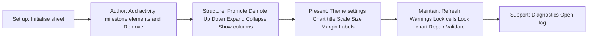
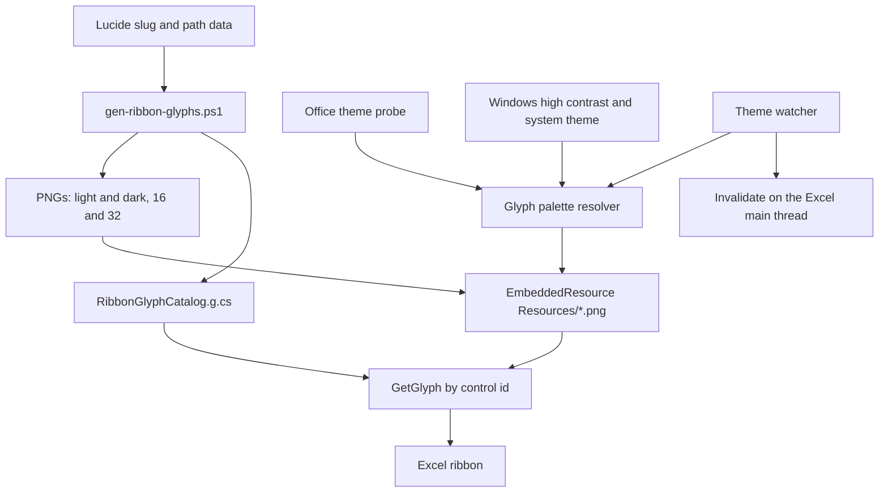

# Ribbon icon system and theme-reactive glyphs — work plan

Status: **revised after critical review — awaiting owner approval**
Scope owner: product owner (icon language) + architecture (theme probe)
Inputs read: [`Ribbon.xml`](../src/GanttCreator.AddIn/RibbonResources/Ribbon.xml), [`GanttRibbon.cs`](../src/GanttCreator.AddIn/GanttRibbon.cs), [`RibbonImages.cs`](../src/GanttCreator.AddIn/RibbonImages.cs), [`LockGlyphImages.cs`](../src/GanttCreator.AddIn/LockGlyphImages.cs), [`ColumnVisibilityImages.cs`](../src/GanttCreator.AddIn/ColumnVisibilityImages.cs), [`gen-column-visibility-icons.ps1`](../scripts/gen-column-visibility-icons.ps1), [`check-ribbon-icons.ps1`](../scripts/check-ribbon-icons.ps1), [`R5.16a-ribbon-layout-and-icons.md`](../docs/work-items/R5.16a-ribbon-layout-and-icons.md), [`R5.18n-deferred-close-out.md`](../docs/work-items/R5.18n-deferred-close-out.md), [`03-ROADMAP.md`](../docs/03-ROADMAP.md), [`verify-quick.ps1`](../scripts/verify-quick.ps1)

---

## 1. Outcome

One icon system for the whole Gantt Creator tab:

1. **Every actionable control carries a Lucide glyph** — 21 control-level controls and 23 menu rows. No large button is left blank and no control mixes Office gallery icons with Lucide ones.
2. **Glyphs are theme-reactive.** The same geometry is rasterised twice, near-black for light Office themes and near-white for Dark Gray and Black, and the callback that answers Excel picks the pair from the user's current theme.
3. **One source of truth, one callback.** The generator owns the glyph catalogue and emits both the PNGs and the C# catalogue; a single `getImage` handler serves every control by id.
4. **The gate matches the assets.** A script proves every declared glyph exists in both palettes at its declared size, is a real PNG, is drawn in an approved stroke colour, and that no `imageMso` remains.

Out of scope: chart styling tokens (R5.6 D1 keeps the chart deliberately independent of Office themes), ribbon layout and grouping (R5.16a is settled), keytips, labels and supertips (R5.9 / R5.17 are settled), and the WinForms dialogs the buttons open.

---

## 2. Evidence ledger

| # | Claim | Kind | Basis |
|---|---|---|---|
| E1 | The tab declares 9 groups, 21 control-level actionables and 23 menu rows | fact | [`Ribbon.xml`](../src/GanttCreator.AddIn/RibbonResources/Ribbon.xml:14) counted element by element |
| E2 | 21 `imageMso` ids are pinned today and `mnuColumnVisibility` has **no glyph at all** | fact | [`Ribbon.xml`](../src/GanttCreator.AddIn/RibbonResources/Ribbon.xml:119) and [`R5.16a`](../docs/work-items/R5.16a-ribbon-layout-and-icons.md:66) |
| E3 | Committed PNG glyphs are drawn with a fixed opaque black pen, so they cannot adapt to a dark ribbon | fact | [`gen-column-visibility-icons.ps1`](../scripts/gen-column-visibility-icons.ps1:151) — `Color.FromArgb(255, 0, 0, 0)` |
| E4 | Only 8 PNG assets exist: tick, dash, and two padlocks at 16 and 32 px | fact | `src/GanttCreator.AddIn/Resources/` |
| E5 | `customUI` accepts a `loadImage` delegate; controls accept `image` and `getImage` | fact | [MS-CUSTOMUI] 2.3.39 `CT_CustomUI`, quoted on [CustomUI class](https://learn.microsoft.com/dotnet/api/documentformat.openxml.office2010.customui.customui) |
| E6 | The supported Office theme API (`Office.context.officeTheme`, `isDarkTheme`) is Office.js only and does not exist for COM/Excel-DNA add-ins | fact | [Office.OfficeTheme interface](https://learn.microsoft.com/javascript/api/office/office.officetheme) |
| E7 | Office themes are Colorful, White, Dark Gray and Black; the last two are the dark pair | fact | same page, `isDarkTheme` remarks |
| E8 | Windows exposes high contrast and the system app theme in-process | fact | [Set dark mode](https://learn.microsoft.com/windows-hardware/customize/desktop/set-dark-mode), plus `SystemInformation` / `SystemColors` already available through WinForms |
| E9 | `Invalidate()` reliably re-queries `getImage`; a `loadImage` id is a load-time channel | inference | Host behaviour; drives per-control `getImage` |
| E10 | Office recolours its own gallery glyphs, which is why today's mixed ribbon looks inconsistent in dark themes | inference | [CommandBars.GetImageMso](https://learn.microsoft.com/office/vba/api/office.commandbars.getimagemso) notes the icon redesign; not observed live |
| E11 | The Office UI theme **is** persisted at `HKCU\Software\Microsoft\Office\16.0\Common` as `UI Theme`, `REG_DWORD`, with one distinct value per state: **Colorful `7`, White `5`, Dark Gray `3`, Black `4`, Use system setting `6`** | fact | Observed on this machine, one theme change per reading, 2026-11-16. The key is version-scoped: `15.0` and the unversioned `Office\Common` have no such value. Microsoft documents the four theme *names* and the dark predicate but no numeric mapping, so this table is the only authority the code may use |
| E12 | `tag` is a valid attribute on each customUI control and is surfaced by Excel-DNA's `IRibbonControl` | **unknown** | Deliberately **not relied on** after review — see §12, finding F1 |
| E13 | `item` has **no** `getImage`; `dropDown` does. `CT_Item` declares only `id`, `label`, `image`, `imageMso`, `screentip`, `supertip`; `AG_Image` — which documents "only one of image, imageMso, or getImage may be specified" — is referenced by `CT_DropDownRegular`, not by `CT_Item` | fact | `.microsoft/[MS-CUSTOMUI]-250218.docx`, `CT_Item` and `AG_Image` schema fragments, read in this session |
| E14 | The Colorful theme paints the active tab in the app accent colour, so a glyph background is not always `#F3F3F3` | **unknown** | Not sampled in this session; Step 0 samples the real background of each theme rather than assuming one |
| E15 | Antialiased strokes produce many intermediate colours, so an exact single-colour asset check would fail by design | fact | GDI+ smoothing is used by the existing generator |
| E16 | `getImage` is queried per control per invalidation, and this add-in invalidates on every sheet change and state transition | fact | [`RibbonStateService.cs`](../src/GanttCreator.AddIn/RibbonStateService.cs:2784) and its many call sites |

Anything marked **unknown** is closed by Step 0 before code is written. No numeric registry mapping is assumed anywhere.

---

## 3. What every button does in the workflow

The tab is a pipeline; glyphs say *where in the pipeline a control sits*.

### 3.1 Set up

| Control | Id | Behaviour | Gate |
|---|---|---|---|
| Initialise sheet | `btnInitialiseSheet` | Creates the Gantt table, the chart area and the VeryHidden configuration sheet; one per workbook; rolls back on failure | The only control visible in first-run mode |
| Repair (primary) | `btnRepairConfig` | Checks `_GanttCreatorConfig` and repairs safe damage; a repair that could touch visible rows asks first | Workbook present |
| Validate (Repair menu) | `btnValidateSheet` | Reads every row, reports errors and warnings as cell notes; never mutates schedule data | Workbook present |

### 3.2 Author

| Control | Id | Behaviour |
|---|---|---|
| Add activity (split) | `btnAddActivity` | Appends or inserts an activity row, selection- and group-aware; label and glyph follow the last menu pick |
| As-Planned / As-Built / Baseline / Custom activity | `entAsPlannedActivity` … `entCustomActivity` | One row of the chosen type |
| Delay event | `entDelayEvent` | Child row under an activity |
| Critical interval | `entCriticalInterval` | Child row of the nearest eligible activity; disabled when none can own it |
| Procurement rows | `entAsPlannedProcurement` … `entBaselineProcurement` | Procurement variants |
| Add milestone (split) | `btnAddMilestone` | Milestone row; plots from `Start` only |
| Five milestone variants | `entAsPlannedMilestone` … `entCustomMilestone` | As-planned, as-built, baseline, critical, custom |
| Elements (split) | `btnAddDelineator` | Delineator or structural row |
| Delineator / Spacer / Splitter | `entDelineator`, `entSpacer`, `entSplitter` | Full-height line at `Start`; blank separator row; splitter band |
| Remove | `btnRemove` | Deletes the selected row, re-homes children, confirms unless opted out |

### 3.3 Structure

| Control | Id | Behaviour |
|---|---|---|
| Promote | `btnPromoteToParent` | Moves the row out of its group and resequences the top level |
| Demote | `btnDemoteToChild` | Moves the row into the group above and re-homes its own children |
| Up / Down | `btnMoveUp`, `btnMoveDown` | Swaps with the neighbour; a boundary is a quiet no-op |
| Expand all / Collapse all | `btnExpandAllGroups`, `btnCollapseAllGroups` | Drives Excel's own outline for every group at once |
| Show columns (large menu) | `mnuColumnVisibility` + 5 `col*` rows | Toggles one authoring column; label and tick/dash state visibility; at least one of Type/Description/Start/Finish/Duration stays visible |

### 3.4 Present

| Control | Id | Behaviour |
|---|---|---|
| Theme settings | `btnThemeSettings` | Chart theme dialog (entity styles, chrome, custom styles); chart tokens are explicit, never Office-theme derived |
| Chart title | `btnChartTitle` | Sets or clears the chart title |
| Start / Finish + Auto | `edtPlotStartDate`, `chkPlotStartAuto`, `edtPlotFinishDate`, `chkPlotFinishAuto` | Explicit range or automatic from the data |
| Scale | `ddnPlotTimeScale` | Month MM, Month MMM, Quarter, Week |
| Size / Margin | `ddnSize`, `ddnMargin`, `edtMarginCm` | Page or slide preset, margin preset, custom margin |
| Width / Height readouts | `lblPlotWidth`, `lblPlotHeight` | Outputs, drawn as labels |
| Description / Date / Style | `ddnDescriptionLabel`, `ddnDateLabel`, `ddnCustomStyle` | Per-row label position, date-label mode, custom style key |

### 3.5 Maintain

| Control | Id | Behaviour |
|---|---|---|
| Refresh chart | `btnRefreshSheet` | Full validation and repair pass; also the recovery action after a chart unlock |
| Warnings | `btnWarnings` | Read-only list of render warnings and validation findings |
| Lock cells (toggle) | `btnToggleCellLock` | Protects everything outside the visible table; the table always stays editable |
| Lock chart (toggle) | `btnToggleChartLock` | Releases or re-applies shape locking; automatic refresh pauses while unlocked |

### 3.6 Support

| Control | Id | Behaviour |
|---|---|---|
| Diagnostics | `btnDiagnostics` | Version, Office version, bitness, log link |
| Open log | `btnOpenLog` | Opens the rolling log file |

---

## 4. Icon design system

### 4.1 Rules

- **Source:** Lucide only, 24 × 24 view box, stroke width 2, round caps and joins — already the rule in [`R5.16a`](../docs/work-items/R5.16a-ribbon-layout-and-icons.md:57) D4/D5 and owner ruling D7 of 2026-11-14.
- **Sizes:** 32 px for `size="large"` controls, 16 px for normal controls and menu rows. Two rasterisations of one geometry.
- **Palette:** `light` stroke and `dark` stroke, final values set from Step 0's background sampling (§5.2) rather than assumed. Neutral, no accent colour.
- **One glyph per control**, menu rows exempt exactly as R5.16a D4 states.
- **Menu rows inherit their family glyph.** Nine activity types do not get nine glyphs.
- **No two glyphs share a silhouette family** at 16 px — see §4.3.

### 4.2 Mapping

Every slug below was resolved through the Lucide icon service in this session.

| Control | Lucide slug | Size | Why |
|---|---|---|---|
| Initialise sheet | `square-chart-gantt` | 32 | Creates the whole framed chart surface |
| Repair | `wrench` | 32 | Repair, not edit |
| Validate | `list-checks` | 16 | A checked list of rows |
| Add activity (primary + 9 rows) | `chart-no-axes-gantt` | 32 / 16 | A Gantt bar *is* an activity |
| Add milestone (primary + 5 rows) | `milestone` | 32 / 16 | The signpost, matching the diamond in the chart |
| Elements / delineator (primary + row) | `separator-vertical` | 32 / 16 | A vertical rule through the plot |
| Spacer row | `move-vertical` | 16 | Pushes content apart vertically |
| Splitter row | `table-rows-split` | 16 | A band that divides the table |
| Remove | `trash-2` | 32 | Destructive, unmistakable |
| Promote | `list-indent-decrease` | 16 | Outline level down |
| Demote | `list-indent-increase` | 16 | Outline level up |
| Up / Down | `arrow-up` / `arrow-down` | 16 / 16 | Row order inside a sibling run |
| Expand all / Collapse all | `chevrons-up-down` / `chevrons-down-up` | 16 / 16 | Paired chevrons, no vertical rule |
| Show columns | `columns-3` | 32 | The one large control with no glyph today |
| Column shown / hidden | `check` / `minus` | 16 / 16 | Existing pair, recoloured |
| Theme settings | `palette` | 16 | Look and feel |
| Chart title | `type` | 16 | A text mark, not markup semantics |
| Refresh chart | `refresh-cw` | 32 | Rebuild, and the recovery action |
| Warnings | `triangle-alert` | 16 | Warning, not error |
| Lock cells closed / open | `lock` / `lock-open` | 16 / 16 | Existing pair, recoloured |
| Lock chart closed / open | `lock-keyhole` / `lock-keyhole-open` | 16 / 16 | Distinct from the cell lock |
| Diagnostics | `gauge` | 16 | Instrument readout, not a medical metaphor |
| Open log | `file-text` | 16 | A text artifact |
| Size dropdown (`ddnSize`) | `rectangle-horizontal` | 16 | The four preset *rows* cannot carry a theme-reactive glyph (E13), so the glyph moves to the control itself |

**No glyph** on `labelControl`, `editBox`, `checkBox`, or the four small dropdowns in Labels and Chart: a picture beside a two-word inline label crowds the row, and the row label already identifies it.

### 4.3 Collision review

The first draft put four "vertical line with arrows" glyphs on one tab — `separator-vertical` (delineator), `move-vertical` (spacer), `unfold-vertical` (expand all) and `fold-vertical` (collapse all). At 16 px they are near-indistinguishable. The revision gives expand and collapse the `chevrons-*` pair, which has no vertical rule at all, leaving the delineator and the spacer as the only line glyphs and separating them by axis: left/right arrows versus up/down arrows. No two glyphs on the tab now share a silhouette family.

Deliberately **not** used: `stethoscope` (medical), `heading` (markup semantics), `unfold-vertical` / `fold-vertical` (collision), and any glyph whose meaning depends on colour rather than shape.

---

## 5. How theme reaction works

**Palette resolution order** (one pure function, fully testable):

1. `SystemInformation.HighContrast` → black or white stroke from `SystemColors.Window` luminance.
2. Office probe says Dark Gray or Black → `dark`.
3. Office probe says Colorful or White → `light`.
4. Probe absent, unrecognised or unreadable → Windows `AppsUseLightTheme` (`0` = dark).
5. Everything unreadable → `light`, plus one diagnostic line.

A third neutral asset set is therefore unnecessary: high contrast, the system fallback and the Office themes all collapse onto two palettes.

### 5.1 The Office theme probe

The Windows theme is **not** the answer: Office theme is a separate Office setting, and only `Use system setting` follows Windows. Windows Light with Office Black is a normal configuration — exactly the case where today's black PNGs vanish.

There is no supported in-process signal: `officeTheme`/`isDarkTheme` are Office.js only (E6), and the Excel object model has no theme property. The remaining routes are a registry read, pixel-sampling the live ribbon window, or UI Automation. Pixel sampling breaks under collapsed ribbons, DPI scaling and animations; UI Automation exposes no background colour. The registry read is isolated behind one interface so its brittleness is contained.

| Order | Source | Read | Notes |
|---|---|---|---|
| 1 | High contrast | `SystemInformation.HighContrast`, then `SystemColors.Window` luminance | System colours win before any Office read |
| 2 | Office UI theme | `HKCU\Software\Microsoft\Office\{version}\Common` → `UI Theme` | `{version}` comes from Excel at `OnLoad` (`Application.Version`), read once, cached, never hard-coded |
| 3 | Office "Use system setting" | same value mapped to the system branch | Only when the observed value means follow-system |
| 4 | Windows system theme | `HKCU\Software\Microsoft\Windows\CurrentVersion\Themes\Personalize` → `AppsUseLightTheme` | `1` light, `0` dark; also the fallback for absent or unrecognised values |
| 5 | Nothing readable | `light` | One log line, never a throw |

**Step 0 procedure and required output:**

1. Set Office to **Colorful**, **White**, **Dark Gray**, **Black**, then **Use system setting** with Windows light and again dark.
2. Record the key path, value name, registry type and the observed value for all six states in the work item.
3. Sample the **actual ribbon background behind a glyph** in each theme (a screenshot and its pixel value), because the Colorful theme's active tab is accent-coloured, not neutral (E14). Final palette hexes come from this sample, not from assumption.
4. Encode only recorded pairs as a closed set. An unrecognised value logs once and falls through to step 4 — never guessed.
5. If the value does not change with the theme, the probe is **rejected**: decision A falls back to the neutral palette, recorded rather than worked around.
6. The recorded table becomes the resolver's test data, so the tests assert observation rather than belief.

### 5.2 Invalidation, cost and lifetime

The palette is read per `getImage` call and cached, so any repaint is already correct; the watcher exists only to make Excel ask again. Reuse the coalescing-timer pattern in [`GanttRefreshScheduler.cs`](../src/GanttCreator.AddIn/GanttRefreshScheduler.cs:209): one registry read on a tick, compare, and `ExcelAsyncUtil.QueueAsMacro(...)` an `Invalidate` only on change. No `Thread.Sleep`, no blocking wait, disposed with the add-in lifecycle, never running before `OnLoad`.

**Why `getImage` per control.** One shared callback, invoked per control per invalidation (E16). The picture cache means no PNG decode, but 44 interop callbacks where 2 exist today is a real cost on the UI thread this repository already guards with a COM-leak ratchet. Step 10 measures the invalidation path against the existing performance harness before the change is called done.

---

### 5.3 Step 0 evidence gathered so far

| Item | Result |
|---|---|
| Registry path | `HKCU\Software\Microsoft\Office\16.0\Common` → `UI Theme`, `REG_DWORD` = `0x4` |
| Version scoping | `16.0` only; `15.0` and the unversioned `Office\Common` have no `UI Theme`, so the version segment must come from Excel |
| Windows theme | `AppsUseLightTheme` = `0` (dark) |
| `item` image support | no `getImage`; `image` and `imageMso` only (E13) |
| `dropDown` image support | `AG_Image` applies, so `getImage` is available on the dropdown control itself |
| High-contrast API | `SystemInformation.HighContrast` returns `False`, `System.Drawing.SystemColors.Window` resolves — both usable in-process |
| **Value-to-theme mapping** | **Closed.** All five states observed and distinct: Colorful `7`, White `5`, Dark Gray `3`, Black `4`, Use system setting `6` |
| Dark set | `{3, 4}` — matches Microsoft's documented predicate that only Black and Dark Gray are the dark pair (E7) |
| Light set | `{5, 7}` |
| System-following sentinel | `6`, which defers to `AppsUseLightTheme` (currently `0`, dark) |
| Values outside the set | Treated as unknown and resolved through the Windows branch, never guessed |

Two earlier probe attempts reported `0x4` for every state because the theme was never actually changed between prompts; the readings were discarded rather than reasoned from. The mapping above comes from five deliberate theme changes, one reading each.

---

## 6. Open decisions

| Id | Decision | Options | Recommendation |
|---|---|---|---|
| **A** | Theme strategy | (a) Office probe + dual palette; (b) no probe, one neutral mid-grey that clears 3:1 on both backgrounds; (c) probe with Windows and high-contrast fallbacks | **(c) approved.** The key is verified to exist and be version-scoped; only its value mapping is outstanding, and an unrecognised value already falls through to the Windows branch |
| **B** | Work-item identity | `R5.18o` inside the closed R5.18 batch, or a new `R5.19` row | **`R5.19`** — a new subsystem plus an environment probe |
| **C** | The four Size preset rows | keep orientation glyphs, drop them, or keep `imageMso` on those rows only | **Resolved by fact.** The owner's condition was "keep them if the host supports `getImage` on items"; it does not (E13), and a static `image` would stay theme-stale until relaunch. The four row glyphs are dropped and one theme-reactive glyph moves to `ddnSize` itself. Recorded, not silent |
| **D** | Theme-change detection | coalescing timer, registry change notification, or none | **Timer**, reusing the coalesced-refresh pattern |
| **E** | Per-entity menu glyphs | family glyph per menu (31 asset pairs) or a glyph per entity type | **Family glyph**; per-type glyphs are a later polish pass |
| **F** | Runtime plumbing | glyph identity in a generated C# catalogue keyed by control id, or in RibbonX `tag` | **Generated catalogue.** `tag` saves one table but depends on an unverified host channel at run time; a table cannot fail silently (see §12) |

---

## 7. Risks and ceilings

| Risk | Mitigation | Residual |
|---|---|---|
| Office theme key undocumented and may move between builds | One interface, per-call fallback chain, ADR records the mechanism and evidence | Wrong palette only when Office theme differs from Windows **and** the value is unreadable or unrecognised |
| Replacing `imageMso` loses Office's high-contrast adaptation | Explicit high-contrast branch before the Office probe | None expected; asserted by test |
| Colorful theme accent-coloured tab reduces contrast | Palette hexes derive from sampled backgrounds; contrast asserted at 3:1 minimum | A future Office accent may need a re-sample |
| 44 `getImage` callbacks per invalidation | Cached pictures; Step 10 measures the invalidation path and the COM leak signal | A measurable, reported cost rather than an assumed one |
| Returning one cached `IPictureDisp` to 44 controls | Existing pattern; leak ratchet re-measured in the Office gate | Host picture-release behaviour is only observable live |
| ~62 new binary assets | Deterministic generator, checker, one dedicated human-reviewed commit | Review effort only |
| Tests that pin `imageMso` fail the moment the XML changes | Replaced one-for-one by glyph-contract tests in the same commit, never deleted | None |
| Theme-dependent rendering cannot be proved in-process | Office gate across four themes plus high contrast, recorded observation | Human gate |
| `RibbonResources.Designer.cs` doc comment still shows an `imageMso` sample | Updated in the same commit as the XML | None |

---

## 8. Work breakdown

Sequencing changed after review: the mechanism is proved on **two controls in the live host** before the other 42 are migrated, so a failed probe cannot leave a half-converted ribbon.

| Step | Work | Proof |
|---|---|---|
| 0 | **Close the unknowns:** read the local `[MS-CUSTOMUI]` for `item` image attributes; run the theme probe across all six Office/Windows states and **sample each theme's real glyph background**; confirm `SystemInformation.HighContrast` and `SystemColors.Window` under a high-contrast theme | Evidence table in the work item; no code |
| 1 | **Work item** `docs/work-items/R5.19-ribbon-icon-system.md` plus its roadmap row, carrying the mapping table, the recorded theme table and §9 | `check-status.ps1` passes |
| 2 | **ADR** for the probe and the two-palette system, stating that chart tokens remain Office-theme independent; **and** a `docs/DECISIONS.md` entry for the icon mapping and palette, because that part is reversible presentation, not architecture | ADR and decision entry reviewed |
| 3 | **Generator as single source.** `scripts/gen-ribbon-glyphs.ps1` holds the verified Lucide geometry plus the control-to-glyph table and emits **both** the PNGs and `RibbonGlyphCatalog.g.cs`. Only the (slug, size) pairs the table references are produced | Byte-identical rerun locally; a generated-file freshness test |
| 4 | **Assets committed** in a dedicated human-reviewed commit (26 geometry slugs across two palettes; expected 62 PNGs, or 66 if decision C keeps the size glyphs) | Diff reviewed, PNGs eyeballed |
| 5 | **Resolver and callback.** `RibbonGlyphPalette` (pure, documented fallback chain), `RibbonGlyphAssets` (suffix grammar and cache key), `GanttRibbon.GetGlyph`. Delete `LockGlyphImages` and `ColumnVisibilityImages` rather than keeping two thin wrappers | Positive test per branch: dark, light, high contrast both ways, unreadable probe, unknown control id returns null without throwing |
| 6 | **Vertical slice in the live host.** Convert `btnRefreshSheet` (32 px) and `btnWarnings` (16 px) only; build, load in Excel, switch Light → Black → Colorful and confirm the glyph changes without a restart. **Stop and re-decide if it does not** | Recorded observation; this is the plan's kill-switch |
| 7 | **Migrate the remainder.** Every `imageMso` replaced by `getImage`; `mnuColumnVisibility` gains its glyph; tick/dash and padlock callbacks move to the palette-aware cache; Designer doc comment corrected | XML contract test: no `imageMso`, every button, toggle, menu and menu row declares `getImage`, catalogue covers the XML, slugs unique outside menu rows |
| 8 | **Gate script.** `check-ribbon-glyphs.ps1` replaces `check-ribbon-icons.ps1`: self-test first, then no residual `imageMso`, every declared glyph present in both palettes at its declared size, real PNG of the right dimensions, stroke colour verified **antialias-tolerantly** (dominant opaque colour, not every pixel), no orphan asset; wired into `verify-quick.ps1` | Self-test proves a fabricated glyph, a missing palette variant, a wrong size and a wrong stroke each fail |
| 9 | **Test migration.** `GanttRibbonTests`, `AddRowRibbonTests`, `ParentChildRibbonTests`, `CollapseGroupsRibbonTests`, `LockGlyphImagesTests`, `ColumnVisibilityImagesTests` move from `imageMso` pins to glyph pins | AddIn project green; test count does not drop |
| 10 | **Measure, then decide.** Run the existing performance harness over an invalidation with 44 `getImage` controls, and re-measure the COM leak signal | Numbers recorded in the work item; a regression is reported, not hidden |
| 11 | **Theme watcher.** Coalescing timer, change detection, `Invalidate` on the Excel thread, disposal on shutdown | Change / no-change / queued-invalidate tests; no `Thread.Sleep` |
| 12 | **Office gate.** All four themes plus high contrast, live theme switch without restart, no blank square, menu row heights unchanged | `verify-office.ps1` plus the recorded human matrix |
| 13 | **Docs and gates.** `STATUS.md`, `REPO-MAP.md` (new files, new script name, changed verification command), then `verify-quick.ps1` and `verify.ps1` on a clean tree | Gates observed, `Checklist:` sections named |

---

## 9. Acceptance criteria

- **A1** `Ribbon.xml` contains no `imageMso`.
- **A2** Every `button`, `toggleButton`, `menu` **and every button inside a menu** declares `getImage`, and every id resolves through the generated catalogue to a committed asset in both palettes at its declared size.
- **A3** `check-ribbon-glyphs.ps1` passes, and its self-test fails a fabricated glyph, a missing palette variant, a wrong pixel size and a stroke colour outside the approved set.
- **A4** `RibbonGlyphPalette` returns `dark` for a dark Office theme, `light` for a light one, the high-contrast pair under a high-contrast theme, and `light` when every probe is unreadable; an unknown control id returns null rather than throwing.
- **A5** The existing `imageMso` uniqueness and completeness tests are replaced one-for-one; the test count does not drop.
- **A6** A theme change repaints the ribbon without restarting Excel, observed on all four Office themes and under high contrast.
- **A7** No new NuGet dependency, no network access, no chart-token change: nothing under `src/GanttCreator.Core/` changes and the golden scene is byte-identical.
- **A8** The invalidation-path cost of 44 `getImage` controls and the COM leak signal are measured and recorded.
- **A9** `verify-quick.ps1` and `verify.ps1` pass; `Checklist:` sections named in the commit message.

---

## 10. Definition of done

The tab renders one coherent Lucide language in every Office theme, a user on Dark Gray or Black sees glyphs rather than ghosts, the asset set is generated and gated rather than hand-drawn, the theme mechanism is an isolated fallback-guarded probe with live evidence, and the cost of serving images on this many controls is measured rather than assumed.

---

## 11. Not in this pass

Per-entity glyphs for the 18 menu variants (decision E), theming the WinForms dialogs, any change to chart style tokens, ribbon layout or keytips, and image support on inline controls.

---

## 12. Critique log — what this review changed

| # | Finding | Severity | Resolution in this revision |
|---|---|---|---|
| F1 | Glyph identity was to travel in the RibbonX `tag` attribute. It saves a table but depends on an unverified host channel at run time; if Excel-DNA does not surface `Tag` on the control handed to `getImage`, every glyph silently disappears — the exact failure class this work exists to remove | high | Replaced by a **generated C# catalogue** keyed by control id, emitted by the same script that emits the PNGs (decision F, Step 3) |
| F2 | Steps 4–6 committed the whole ribbon rewrite before anything proved that a theme switch repaints a `getImage` glyph. A failed assumption would leave 44 converted controls and no working mechanism | high | New **vertical slice** Step 6 on two controls, declared as the kill-switch, with mass migration after it |
| F3 | The palette was chosen against an assumed `#F3F3F3` ribbon. The Colorful theme paints the active tab in the app accent colour, so a near-black glyph can land on dark green | high | Step 0 now **samples the real background per theme**; hexes derive from measurement (E14) |
| F4 | Exact-colour asset validation cannot work: antialiasing produces intermediate colours, so the gate would fail its own output | medium | Gate checks the **dominant opaque colour** and dimensions, tolerating the antialias ramp (E15) |
| F5 | Four glyphs shared a "vertical line plus arrows" silhouette and would be indistinguishable at 16 px | medium | Expand/collapse moved to `chevrons-*`; a collision review is now a rule (§4.3) |
| F6 | Dropping the Size preset glyphs was proposed as a silent default, removing an existing affordance | medium | Escalated to **decision C requiring owner sign-off**, with the `item` capability check first |
| F7 | 44 `getImage` callbacks per invalidation was an unmeasured performance risk on a codebase with a COM-leak ratchet | medium | New measure-then-accept Step 10 and acceptance A8 |
| F8 | An ADR was proposed for reversible presentation | low | Split: ADR for the probe, `DECISIONS.md` entry for the mapping and palette |
| F9 | A2 omitted menu-row buttons, and §1 said "no control" while dropdowns and edits deliberately get none | low | Wording corrected in both places |
| F10 | An unrecognised Office theme value would have silently mis-paletted | low | Now logs once and falls through to the Windows branch |
| F11 | Two thin wrapper classes would survive the migration for no reason | low | Deleted rather than migrated, per the repository's deletion-over-addition rule |
| F12 | Step numbering implied assets could ship after the XML switch, which would commit a glyphless ribbon | low | Assets commit before the XML switch; the XML change and its tests are one commit |
