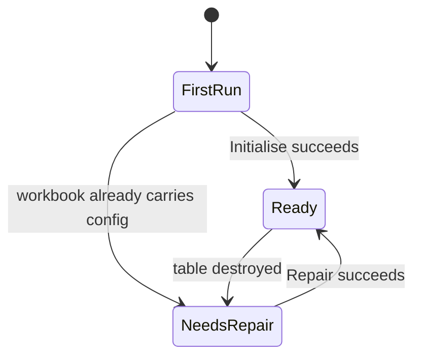

# Ribbon UX redesign — first-run surface, Data-group consolidation, selection-aware insertion

**Status:** revised draft v5 — planning only. No source change yet.
**Proposed work item:** `docs/work-items/R5.16-ribbon-first-run-and-data-group.md` (next free row after `R5.15`).
**Owner rulings incorporated:** 2026-11-10. v1 proposed a literal "nothing but Initialise" first-run surface and a positional child-by-default insert for every type. v2 proposed stripping group-aware parenting from every type except Critical Interval. **v3 restores the R5.13 rule for types that can be children** and keeps only the narrow exception for types that cannot; D-2 is resolved to the Microsoft idMso `DataValidation` / `DataValidationCircleInvalid`.

---

## 1. Outcome

The Gantt Creator tab has two faces.

- **First run** (no add-in configuration on the workbook): a large **Initialise sheet** button, plus the **Diagnostics** group. Nothing else, no other group label, no other control.
- **Initialised**: the Initialise button is gone and the full ribbon is present. The **Data** group is five large controls — **Fix** (default Repair configuration, arrow Validate), **Add activity**, **Add milestone**, **Additional elements**, **Remove**. **Add child** is gone; **Demote** is the way to make a row a child.

Insertion is **selection and location aware**. **Critical Interval** attaches to the nearest existing activity that can own it — searched upward from the selection first, then downward — and is inserted inside that parent's child run, so the outline stays valid wherever the user clicked. The item is disabled only when the table holds no row that can accept it. Every other entity is top-level by default, **but when it is inserted inside an existing group's contiguous child run it joins that group** — the current R5.13 behaviour. Spacer and splitter never join a group because the hierarchy catalogue forbids it; when their position falls inside a run they are appended at the end of the table.



---

## 2. Owner rulings and their effect

| # | Ruling | Effect on this plan |
|---|---|---|
| 1 | Insert-type constraints are **cell-selection aware** | `entCriticalInterval` gets `getEnabled`: disabled only when the table holds no row that can own the interval, so the error window is prevented without hiding the action |
| 2 | **Critical Interval** is added as a child; other entities are top-level by default, but an entity inserted inside a group's child run joins that group | R5.13 is **retained and extended**, not superseded. Critical Interval gains a hard parent requirement; spacer and splitter gain a documented exception because they can never be children |
| 3 | No separate **Add child** option; the user demotes a row instead | `ddnAddChild`, its callbacks, and the `AddChildCommand` / `ExcelAddChildMutator` chain are deleted |
| 4 | Keep **Diagnostics** visible on Get started | First run = large Initialise **plus** the Diagnostics group. This overrides v1's literal "nothing else" |
| 5 | Prefer iconoop.com icons, otherwise the best Microsoft icon; keytips and icons matter, accessibility is not a priority | iconoop.com could not be reached with the tooling available here (only Microsoft Learn and package documentation are wired — there is no general web fetch). The Microsoft `imageMso` fallback is adopted, with verification before pinning |

Ruling 2 does **not** overturn R5.13; it fixes the default for the case where the insertion point is not inside a group. The change therefore needs no supersession record — only a `docs/DECISIONS.md` entry stating (a) Critical Interval's nearest-parent attachment rule, (b) the append-to-end exception for rows that cannot be children, and (c) the data-driven enablement gate, plus extended R5.13 acceptance tests. It is not a workbook-schema or export-fidelity change, so it does not trip an `AGENTS.md` stop condition.

---

## 3. Evidence from the current code

| Current fact | Source |
|---|---|
| The Data group is a flat row of 7 controls plus the Add child dropdown | [`Ribbon.xml`](../src/GanttCreator.AddIn/RibbonResources/Ribbon.xml:11) |
| `ddnAddChild` is a `dropDown` because Excel-DNA 1.9 exposes no menu callback type | [`Ribbon.xml`](../src/GanttCreator.AddIn/RibbonResources/Ribbon.xml:24) |
| Every Data control is `getEnabled` only; no control uses `getVisible` anywhere in the tab | [`Ribbon.xml`](../src/GanttCreator.AddIn/RibbonResources/Ribbon.xml:12) |
| Enabled is a pure truth table with a fail-open unknown branch | [`RibbonState.cs`](../src/GanttCreator.AddIn/RibbonState.cs:181) |
| `AddChild` enables on `PermittedChildTypes is { Count: > 0 }` | [`RibbonState.cs`](../src/GanttCreator.AddIn/RibbonState.cs:228) |
| `SheetInitialised` is `refusal != TableMissing`, so **no active workbook** currently counts as initialised | [`RibbonStateService.cs`](../src/GanttCreator.AddIn/RibbonStateService.cs:1831) |
| The selection capture projects permitted child types from the hierarchy catalogue and reuses the previous list on any failure | [`RibbonStateService.cs`](../src/GanttCreator.AddIn/RibbonStateService.cs:2652) |
| Selection change re-captures the snapshot and invalidates exactly five controls | [`RibbonStateService.cs`](../src/GanttCreator.AddIn/RibbonStateService.cs:2923) |
| Group-aware parenting runs after the row insert and only when an outline writer exists | [`ExcelGanttRowInserter.cs`](../src/GanttCreator.Office/ExcelGanttRowInserter.cs:242) |
| The decision is a neighbour-pair heuristic: active-and-below share a parent, or active is a parent whose first child is below | [`ExcelGanttRowInserter.cs`](../src/GanttCreator.Office/ExcelGanttRowInserter.cs:627) |
| The insert position is the active row plus one, or append at the last row / outside the table | [`ExcelGanttRowInserter.cs`](../src/GanttCreator.Office/ExcelGanttRowInserter.cs:352) |
| `AddChildPlanner.Plan` already encodes every hierarchy rule for a new child | [`AddChildPlanner.cs`](../src/GanttCreator.Core/AddChildPlanner.cs:74) |
| Ownership sets: activities, procurement, delay and custom own children; milestones and critical interval are leaves; spacer and splitter are excluded | [`EntityHierarchyCatalog.cs`](../src/GanttCreator.Core/EntityHierarchyCatalog.cs:66) |
| The neutral row already exposes `Id`, `TypeText`, and `ParentId`, so the ribbon can gate on them without new DTO members | [`GanttRowDto.cs`](../src/GanttCreator.Core/GanttRowDto.cs:163) |
| `HierarchyProjection.FromRows` converts DTO rows to the `GanttEvent` list the planner consumes | [`HierarchyProjection.cs`](../src/GanttCreator.Core/HierarchyProjection.cs:42) |
| Row-insert refusals are a closed enum of five reasons | [`GanttRowInsertOutcome.cs`](../src/GanttCreator.Office/GanttRowInsertOutcome.cs:4) |
| Tests pin the exact gated-control list, keytip uniqueness, visible labels, and every `imageMso` | [`GanttRibbonTests.cs`](../tests/GanttCreator.AddIn.Tests/GanttRibbonTests.cs:406) |
| `splitButton` (large, primary button plus menu), `getVisible` on a group, `getLabel`/`getEnabled` on a button, and a titled `menuSeparator` are all part of the customUI 2009/07 schema | [`[MS-CUSTOMUI]-250218.docx`](../.microsoft/%5BMS-CUSTOMUI%5D-250218.docx) |

---

## 4. Ribbon state model

Three states, a pure function of workbook presence, table readability, and configuration-sheet presence.

| State | Condition | Groups visible | Initialise | Fix | Add / Remove |
|---|---|---|---|---|---|
| **First run** | no active workbook, **or** no table **and** no `_GanttCreatorConfig` | `Get started` + `Diagnostics` | large, enabled when a workbook exists | hidden | hidden |
| **Needs repair** | workbook exists, `_GanttCreatorConfig` exists, table missing or unreadable | everything | hidden | large, enabled | visible, disabled until the table is readable |
| **Ready** | table readable | everything | hidden | large, enabled | enabled |

Why three states, not two:

- A workbook that carries `_GanttCreatorConfig` but has lost its table returns `TableMissing`. Under a two-state rule that hides **Fix**, while **Initialise** refuses with "use Repair configuration" — a hidden command. The user cannot recover from the ribbon.
- **Needs repair** is not a first run: the workbook is already an add-in workbook. Showing the full surface with table-dependent buttons disabled is honest, and Fix is the one enabled action.
- **Diagnostics** stays visible in every state (ruling 4). First run therefore shows the large Initialise button **and** Diagnostics / Open log. Diagnostics is enabled only when a workbook exists, exactly as today.

### Implementation shape

- Add `RibbonMode { FirstRun, NeedsRepair, Ready }` to `RibbonState`.
- Add `ConfigurationPresent` to `GanttTableReadOutcome`, set by `ExcelGanttTableReader` on the `TableMissing` path — one worksheet lookup on the failure path, not a new port.
- Fix `SheetInitialised` to require a successful read (`Succeeded`), not "anything except `TableMissing`". Every current consumer also requires `HasActiveWorkbook`, so this is a correctness fix with no visible regression.
- `RibbonStateService.Refresh` computes the mode once and stores it in the immutable snapshot.
- Add `RibbonControlIds` constants for every group: `GetStartedGroup`, `DataGroup`, `OrderingGroup`, `OutlineGroup`, `LabelsGroup`, `StyleThemeGroup`, `PlotAreaGroup`, `PlotTimeScaleGroup`, `PlotSizeGroup`, `RefreshGroup`, `DiagnosticsGroup`.
- Add `RibbonState.IsVisible(string groupId)`:

  ```text
  DiagnosticsGroup   => true
  GetStartedGroup    => Mode == FirstRun
  every other group  => Mode != FirstRun
  unknown id         => false   (fail-closed)
  ```

  Visibility is fail-closed, unlike enabled (fail-open): an unintended visible button is exactly the failure this change removes.
- Add `public bool GetVisible(IRibbonControl control)` on `GanttRibbon` and put `getVisible="GetVisible"` on **every** group, including Get started and Diagnostics, so the contract test has one rule and no exceptions.
- `RibbonStateService.Invalidate()` already re-queries every dynamic getter, and a successful Initialise already calls `NotifyRibbonStateChanged()` → `Refresh()` → `Invalidate()`, so the transition needs no new plumbing.

---

## 5. Proposed ribbon sketch

### 5.1 First run

```text
+--------------------------------------------------------------------------+
|  Gantt Creator                                                           |
+--------------------------------------------------------------------------+
|                                                                          |
|   +-------------------+                                                  |
|   |                   |                                                  |
|   |  Initialise sheet |      <-- large, 3 rows high                       |
|   |                   |                                                  |
|   +-------------------+                                                  |
|      Get started                                                         |
|                                                                          |
|   +--------------+                                                       |
|   | Diagnostics  |                                                       |
|   | Open log     |                                                       |
|   +--------------+                                                       |
|      Diagnostics                                                         |
|                                                                          |
+--------------------------------------------------------------------------+
```

No Data, Ordering, Outline, Labels, Style, Plot or Refresh group. The Diagnostics group is the single owner-approved exception to "nothing else".

### 5.2 Ready — Data group with five large controls

```text
+-------------------------------------------------------------------------------------------+
|  Gantt Creator                                                                            |
+-------------------------------------------------------------------------------------------+
|                                                                                           |
|  +---------+ +---------------+ +-----------------+ +----------------------+ +----------+  |
|  |   Fix   | | Add activity  | | Add milestone   | | Additional elements  | |  Remove  |  |
|  |      v  | |            v  | |              v  | |                   v  | |          |  |
|  +---------+ +---------------+ +-----------------+ +----------------------+ +----------+  |
|     Data                                                                                  |
|                                                                                           |
|  Ordering | Outline | Labels | Style and Theme | Plot Area | Plot Time Scale | Plot Size   |
+-------------------------------------------------------------------------------------------+
```

Every `v` is the split arrow; clicking the body runs the default action.

### 5.3 Flyouts

```text
Fix v                                    Add activity v
  Repair configuration  (default)          As-Planned Activity  (default)
  ------------------------------           As-Built Activity
  Validate                                 Baseline Activity
    Check only, change nothing             Custom Activity
                                           ------------------------------
                                           Delay Event
                                           Critical Interval   (needs a parent)
                                           ------------------------------
                                           As-Planned Procurement
                                           As-Built Procurement
                                           Baseline Procurement

Add milestone v                          Additional elements v
  As-Planned Milestone  (default)          Delineator  (default)
  As-Built Milestone                       Spacer
  Baseline Milestone                       Splitter
  Critical Milestone
  Custom Milestone
```

Flyout order mirrors `EntityTypeCatalog` order within each family, so the menus read as a projection of the catalogue rather than a second hand-authored list.

---

## 6. Menu contents and catalogue mapping

| Menu | Types | Family rule | Default |
|---|---|---|---|
| **Fix** | `IsRepairConfiguration`, `IsValidate` | one repair action and one read-only check | Repair configuration |
| **Add activity** | `AsPlannedActivity`, `AsBuiltActivity`, `BaselineActivity`, `CustomActivity`, `DelayEvent`, `CriticalInterval`, `AsPlannedProcurement`, `AsBuiltProcurement`, `BaselineProcurement` | every `EntityKind.Span` type | `AsPlannedActivity` |
| **Add milestone** | `AsPlannedMilestone`, `AsBuiltMilestone`, `BaselineMilestone`, `CriticalMilestone`, `CustomMilestone` | every `EntityKind.Milestone` type | `AsPlannedMilestone` |
| **Additional elements** | `Delineator`, `Spacer`, `Splitter` | the three structural types | `Delineator` |

Rules that keep the catalogue authoritative:

- Menu item **ids** are the durable `GanttEntityType` names (`entAsPlannedActivity`, `entCriticalInterval`, …).
- Menu item **labels** come from `getLabel="GetEntityMenuLabel"`, which reads `EntityTypeCatalog.GetDefinition(type).DisplayName`. No display name is typed into `Ribbon.xml`.
- Menu item **supertips** are authored offline text (the catalogue carries no description field). They are prose, not schema, so they cannot drift a contract.
- A contract test asserts that the union of the three entity menus equals the catalogue partition, each type appears exactly once, and each split button's primary action is the declared default.

---

## 7. Selection-aware insertion model

This is the core of ruling 1 and ruling 2.

### 7.1 Default placement by type

| Type | Outside a group | Inside a group's contiguous child run | Ribbon gating |
|---|---|---|---|
| As-Planned / As-Built / Baseline / Custom Activity | top level | child of that group's parent | none |
| Delay Event | top level | child of that group's parent | none |
| As-Planned / As-Built / Baseline Procurement | top level | child of that group's parent | none |
| As-Planned / As-Built / Baseline / Critical / Custom Milestone | top level | child of that group's parent | none |
| Delineator | top level | child of that group's parent (outline-only parent) | none |
| **Critical Interval** | **child of the nearest eligible parent, placed after that parent's last child** | same | **`getEnabled`** |
| Spacer | top level | **cannot be a child, so appended at the end of the table** | none |
| Splitter | top level | **cannot be a child, so appended at the end of the table** | none |

Three rules produce this table, and all come from the hierarchy catalogue rather than preference:

1. A row that **can** be a child joins the group it is inserted into — the R5.13 rule, unchanged.
2. A row that **cannot** be a child (spacer, splitter) must not be written into the middle of a child run, because the outline cannot represent that. It is appended as the last body row instead, which is always possible.
3. A **Critical Interval** does not follow the click: it joins the nearest eligible parent's child run, because a child placed above, or rows away from, its parent cannot be grouped.

A user who wants any of these under a different parent still uses **Demote to child**, which already exists and is the outline-authoritative command.

### 7.2 Critical Interval enablement truth table

`GetCriticalIntervalEnabled` is true when the current table contains **at least one eligible parent** — a row that may own children, is not itself a child, and owns fewer than seven children. The selected cell does **not** gate the item; it only anchors the search for the nearest parent.

| Condition | Critical Interval item |
|---|---|
| table has an eligible parent | enabled |
| selected row is itself an eligible parent | enabled — it is the parent |
| selected row is a milestone, delineator, spacer, splitter, critical interval, or a parent at capacity | enabled — the nearest eligible parent is used |
| table has no eligible parent (for example only milestones or structural rows) | disabled |
| no active workbook, or the sheet is not initialised | disabled (the split button is already disabled) |
| table read fails | previous value kept (snapshot stickiness) |

The gate is data-driven rather than selection-driven because the owner's rule is *refuse only when no parent exists*. A selection-based gate would disable the item in cases the command can satisfy, which is the same error window in reverse.

### 7.3 Replacing the add-child context capture

The per-item gate must not reuse `CaptureAddChildContext` ([`RibbonStateService`](../src/GanttCreator.AddIn/RibbonStateService.cs:2652)): it is selection-scoped and returns the previous list on any failure. Replace it with one fact on the snapshot:

- add `RibbonState.CriticalIntervalParentAvailable` (bool);
- compute it in `Refresh` from the table read that already produces `SheetInitialised` — one `Any` over `read.Rows` using `AddChildPlanner.IsEligibleParent`, with child counts grouped by `ParentId`;
- delete `CaptureAddChildContext`, `AddChildContext`, `UnavailableAddChildContext`, `GetPermittedChildTypes`, and `RibbonState.PermittedChildTypes` in the same commit as the dropdown removal;
- no selection-change invalidation is needed for this item, because its enablement does not depend on the selection.

Positive tests: a table containing only milestones leaves the item disabled; a table containing an activity enables it; an unreadable table keeps the previous value.

### 7.4 One rule authority

[`AddChildPlanner.Plan`](../src/GanttCreator.Core/AddChildPlanner.cs:74) already encodes: parent exists, parent may own children, child type may be a child, parent is not itself a child (depth), fewer than seven siblings. Two thin members expose the same body of rules, so the ribbon, the inserter, and the planner cannot disagree:

```csharp
// The single eligibility predicate: may own children, is not itself a child, has room.
public static bool IsEligibleParent(
    GanttEntityType type, GanttRowId? parentId, int existingChildCount);

// The rule body: null when the child would be accepted, otherwise the typed refusal.
public static AddChildRefusalReason? Evaluate(
    GanttEntityType? parentType,
    GanttRowId? parentId,
    GanttRowId? parentOfParentId,
    int existingChildCount,
    GanttEntityType childType);
```

`Plan` calls `Evaluate` and then computes `SiblingOrder`. The ribbon asks whether **any** row in the table satisfies `IsEligibleParent`; the inserter asks it while scanning the body for the nearest one. Exactly one implementation, three callers. Every refusal branch keeps its positive test.

### 7.5 Inserter changes

[`Insert`](../src/GanttCreator.Office/ExcelGanttRowInserter.cs:75) already receives the `GanttEntityType`, so no public signature changes.

1. **Decide before mutating.** [`GetInsertionPosition`](../src/GanttCreator.Office/ExcelGanttRowInserter.cs:352) runs before the row insert. Move the parent decision to the same point and refuse **before** any worksheet change. Inserting first and deleting on refusal would be the anti-pattern ADR-0008 D4 exists to prevent.
2. **Index arithmetic is unchanged.** All rows before the insert position keep their index, so the active row is `body[position - 2]` in both the pre- and post-insert body. The decision therefore reads the same row it reads today.
3. **Critical Interval.** Ignore neighbour adjacency and attach the interval to the nearest existing parent:
   - build the eligible-parent list from the pre-insert body with `AddChildPlanner.IsEligibleParent`, recording each row's child count;
   - anchor the search on the selected row, or on the last body row when the active cell is outside the table;
   - search **upward** from the anchor, then **downward**, and take the first eligible parent;
   - no eligible parent anywhere → **refuse** with `CriticalIntervalRequiresParent`, before any row is inserted;
   - place the new row immediately after that parent's last existing child (or immediately after the parent when it has none), then call `AddChildPlanner.Evaluate` and write `ParentId`.
   Placing the row in the parent's child run is what keeps the outline valid; inserting at the click point could put a child above, or rows away from, its parent. The selection chooses the parent, not the row position.
4. **Everything else — keep the R5.13 neighbour rule, then validate it.** Resolve the candidate parent with the existing active-row / row-below logic, then pass it through `AddChildPlanner.Evaluate`. If the type may not be a child, the parent is at capacity, or the parent is itself a child, the candidate is rejected and the row is written top-level instead.
5. **A rejected candidate must not split the group.** When the row was inside a child run and cannot join it, append it as the last body row. That is always possible and never splits a run. This is the only case in which the user's insertion point moves, and the catalogue forces it.
6. **Outline gate.** The current call is skipped when `_outlineGroups` is null. Critical Interval's `ParentId` is **data**, not only outline grouping, so the decision runs regardless; only the regroup stays conditional.

### 7.6 The append-to-end escape (resolved D-1)

R5.13 keeps a group's children in one contiguous run so the outline writer can represent the group. A row that joins the run preserves it; a row that **cannot** be a child would split it.

Only two types cannot be children: `Spacer` and `Splitter` ([`EntityHierarchyCatalog`](../src/GanttCreator.Core/EntityHierarchyCatalog.cs:153)). The same situation arises when a child-capable type's candidate parent is at capacity or is itself a child.

Rule: in those cases, **append the row as the last body row** and write it top-level. The end of the table is always a valid insertion point, so this branch cannot fail and cannot split a group. Every other case keeps the literal position **and** joins the group.

No extra scan is needed beyond reading the body's last index.

---

## 8. RibbonX shape

Sketch, not final XML.

```xml
<group id="grpGetStarted" label="Get started" getVisible="GetVisible">
  <button id="btnInitialiseSheet" label="Initialise sheet" size="large" .../>
</group>

<!-- ... existing groups, each with getVisible="GetVisible" ... -->

<group id="grpData" label="Data" getVisible="GetVisible">
  <splitButton id="spbFix" size="large" getEnabled="GetEnabled">
    <button id="btnRepairConfig" label="Fix" onAction="OnRepairConfigClick" .../>
    <menu id="mnuFix">
      <button id="btnValidateSheet" label="Validate" onAction="OnValidateSheetClick" .../>
    </menu>
  </splitButton>

  <splitButton id="spbAddActivity" size="large" getEnabled="GetEnabled">
    <button id="btnAddActivity" label="Add activity" onAction="OnAddActivityClick" .../>
    <menu id="mnuAddActivity">
      <menuSeparator id="sepActivities" title="Activities"/>
      <button id="entAsPlannedActivity" getLabel="GetEntityMenuLabel" onAction="OnAddEntityClick" .../>
      <!-- eight more span types -->
      <button id="entCriticalInterval"
              getLabel="GetEntityMenuLabel"
              getEnabled="GetCriticalIntervalEnabled"
              onAction="OnAddEntityClick" .../>
    </menu>
  </splitButton>

  <splitButton id="spbAddMilestone" size="large" getEnabled="GetEnabled">
    <button id="btnAddMilestone" label="Add milestone" onAction="OnAddMilestoneClick" .../>
    <menu id="mnuAddMilestone"><!-- five milestone types --></menu>
  </splitButton>

  <splitButton id="spbAddElements" size="large" getEnabled="GetEnabled">
    <button id="btnAddDelineator" label="Additional elements" onAction="OnAddDelineatorClick" .../>
    <menu id="mnuAddElements">
      <button id="entDelineator" .../>
      <button id="entSpacer" .../>
      <button id="entSplitter" .../>
    </menu>
  </splitButton>

  <button id="btnRemove" label="Remove" size="large" .../>
</group>

<group id="grpDiagnostics" label="Diagnostics" getVisible="GetVisible"><!-- unchanged --></group>
```

**Two constraints the tests will enforce:**

- `getEnabled` belongs on the **primary button inside** each `splitButton` and on `entCriticalInterval`, not on the `splitButton` element itself. `splitButton` has no primary-action semantics of its own; the enabled state must not be assumed to cascade.
- The primary button of a split button must win the label. Keep the human label on the primary button (`Fix`, `Add activity`, `Add milestone`, `Additional elements`) and let the menu item that duplicates the default read from the catalogue.

---

## 9. Callbacks

| Callback | Responsibility |
|---|---|
| `GetVisible(IRibbonControl)` | group visibility from `RibbonState.IsVisible` |
| `GetEntityMenuLabel(IRibbonControl)` | catalogue `DisplayName` by item id; empty string for an unknown id |
| `GetCriticalIntervalEnabled(IRibbonControl)` | `RibbonState.PermittedChildTypes` contains `CriticalInterval` |
| `OnAddEntityClick(IRibbonControl)` | parse the item id to `GanttEntityType`, route to `AddRowCommand.RunForExcel` |
| existing `OnAddActivityClick` / `OnAddMilestoneClick` / `OnAddDelineatorClick` | unchanged defaults |

`OnAddEntityClick` rejects an unparsable id with one user-safe message, never a throw into Excel.

---

## 10. Removing Add child

**Ribbon surface.** Delete `ddnAddChild`, `RibbonControlIds.AddChild`, the `RibbonState` arm, the `PermittedChildTypes` state and capture (already replaced by `CriticalIntervalParentAvailable` in step 5), the four `GetAddChild*` / `OnAddChildChange` callbacks, and [`AddChildRibbonTests.cs`](../tests/GanttCreator.AddIn.Tests/AddChildRibbonTests.cs).

**Dead chain.** [`AddChildCommand.cs`](../src/GanttCreator.AddIn/AddChildCommand.cs), `IAddChildMutator`, `ExcelAddChildMutator`, their outcome types, `AddChildCommandTests`, and `ExcelAddChildMutatorTests` have no consumer once the dropdown is gone. Remove them and drop the matching entries from [`ProtectionGuardFirstTests.cs`](../tests/GanttCreator.Architecture.Tests/ProtectionGuardFirstTests.cs).

**Kept and promoted.** [`AddChildPlanner`](../src/GanttCreator.Core/AddChildPlanner.cs) and [`EntityHierarchyCatalog`](../src/GanttCreator.Core/EntityHierarchyCatalog.cs) remain the only hierarchy authority and now serve three callers: the planner, the ribbon gate, and the inserter. The planner's own tests remain and gain the two `Evaluate` overloads.

> The user's assumption is correct that the pipeline is no longer needed as a *command* — but only because the rule authority is promoted, not deleted. Removing the planner would silently weaken hierarchy validation.

---

## 11. Diagnostics on Get started

Per ruling 4 the Diagnostics group is visible in every state. Consequences:

- First run shows two groups: **Get started** (one large button) and **Diagnostics** (two small buttons). Diagnostics is disabled while no workbook exists, because both actions need a workbook or a log path.
- The literal "not even disabled" wording from the original brief is **not** met for the no-workbook case. That is the owner's explicit choice; it is recorded here so a later reviewer does not read it as a defect.
- The Initialise failure path no longer depends on a hidden group, so no dialog change is needed.

---

## 12. Keytips and icons

### 12.1 Keytips

Every actionable control keeps a unique 1–3 character keytip. Existing keytips already occupy `I V R X P E U N G C T H K M W Z F D L AA AM AD DL DT CS SA SD FA FD MC WN LK CL` and `1–4`. The defaults keep their current keytips (`I`, `R`, `AA`, `AM`, `AD`, `X`).

| Control | Proposed keytip | Collision check |
|---|---|---|
| Fix primary (Repair) | `R` | existing, kept |
| Fix menu — Validate | `QV` | `Q` and `QV` unused |
| Add activity primary | `AA` | existing, kept |
| As-Planned Activity | `AP` | distinct from `AA` |
| As-Built Activity | `AB` | unused |
| Baseline Activity | `AL` | unused |
| Custom Activity | `AU` | unused |
| Delay Event | `AV` | unused |
| Critical Interval | `AI` | unused |
| As-Planned Procurement | `AQ` | unused |
| As-Built Procurement | `AR` | unused |
| Baseline Procurement | `AS` | unused |
| Add milestone primary | `AM` | existing, kept |
| As-Planned Milestone | `BP` | `B` and `BP` unused |
| As-Built Milestone | `BB` | unused |
| Baseline Milestone | `BL` | unused |
| Critical Milestone | `BI` | unused |
| Custom Milestone | `BU` | unused |
| Additional elements primary | `AD` | existing, kept |
| Delineator | `JD` | `J` and `JD` unused |
| Spacer | `JS` | unused |
| Splitter | `JP` | unused |
| Remove | `X` | existing, kept |

No proposed keytip is a prefix of another in the same scope. The existing uniqueness test is the adjudicator; a collision found there is resolved by changing the keytip, never by weakening the test.

### 12.2 Icons

iconoop.com is not reachable with the tooling available to this session (no general web fetch; Microsoft Learn and package documentation are the only wired sources). The Microsoft `imageMso` fallback is used.

| Control | `imageMso` | Status |
|---|---|---|
| Initialise sheet | `TableInsertExcel` | already pinned and verified |
| Fix | `DataValidation` | **idMso name confirmed** in the Microsoft idMSO list; must render in the Windows host before pinning |
| Fix menu — Validate | `DataValidationCircleInvalid` | **idMso name confirmed**; same render check |
| Add activity | `TableInsertExcel` | already pinned |
| Add milestone | `CalendarInsert` | **candidate — verify before pinning** |
| Additional elements | `ShapesInsertGallery` | **candidate — verify before pinning** |
| Remove | `TableRowsDeleteExcel` | **candidate — verify before pinning** |
| Diagnostics / Open log | `Help` / `FileOpen` | already pinned |

The Microsoft idMSO list at `https://learn.microsoft.com/office/vba/office-mac/idmsoexcelmac` names `DataValidation` (button), `DataValidationCircleInvalid` (button), and `DataValidationMenu` (splitButton). The Windows Excel idMso set is a superset of the Mac list, so the names are valid — but a name is not proof of a rendered glyph. The live host gate decides, and `Spelling` stays free for reuse if either id renders blank.

Each remaining candidate must appear in `Office2010IconsGallery.docx`, name an Excel idMso in the `[MS-CUSTOMUI]-250218.docx` table, and render in the live host before it is pinned in [`Ribbon_buttons_use_gallery_verified_imageMsoIds`](../tests/GanttCreator.AddIn.Tests/GanttRibbonTests.cs:406). Until a candidate passes, the already-verified `TableInsertExcel` is reused rather than inventing a glyph.

---

## 13. Implementation sequence

Each step is one reviewable commit and leaves the suite green.

1. **Governance.** Add the R5.16 work item, the roadmap row, the manifest entry, and a `docs/DECISIONS.md` record covering: Critical Interval's nearest-parent attachment rule, the append-to-end escape (D-1), the data-driven enablement gate, Diagnostics on Get started (ruling 4), and the three-state model. No source.
2. **State facts.** `ConfigurationPresent`, `RibbonMode`, `RibbonState.IsVisible`, and the `SheetInitialised` correctness fix. Unit tests only; the ribbon renders as today.
3. **Visibility wiring.** Add `grpGetStarted`, move the large Initialise button into it, add `getVisible` to every group including Diagnostics, add `GanttRibbon.GetVisible`, pin the group list. The first-run surface goes live.
4. **Data-group split buttons.** Replace the flat Data group with the four `splitButton`s and the large Remove. Add the menu items, `GetEntityMenuLabel`, `OnAddEntityClick`, and the catalogue-partition tests.
5. **Critical Interval gating.** Add `IsEligibleParent`, add `RibbonState.CriticalIntervalParentAvailable` computed from the refresh read, add `GetCriticalIntervalEnabled`, and add the positive test where a milestone-only table leaves the item disabled.
6. **Insertion rule.** Add `AddChildPlanner.Evaluate`, keep the R5.13 group-join for child-capable types, validate every candidate parent, add the append-to-end escape, implement Critical Interval's nearest-parent attachment, and add `CriticalIntervalRequiresParent`. Extend the R5.13 tests rather than rewriting them.
7. **Remove Add child.** Delete the dropdown surface and the dead command/port chain; update the architecture guard list.
8. **Icons, keytips, pinned tests.** Verify or downgrade each candidate icon; pin the final keytip map.
9. **Docs and evidence.** `REPO-MAP`, `STATUS`, `ROADMAP`, the work item, and the live-host ribbon screenshots for all three states.

Ordering note: step 5 replaces the dropdown's selection-scoped context with a data-driven fact; step 7 then deletes the now-unused capture and the dropdown surface together.

---

## 14. Acceptance tests

### 14.1 Ribbon state and visibility (AddIn)

- `IsVisible(GetStartedGroup)` true in `FirstRun`, false in `NeedsRepair` and `Ready`.
- `IsVisible(DiagnosticsGroup)` true in all three.
- Every other group false in `FirstRun`, true otherwise.
- Unknown group id false. **Positive test:** an unmapped id is rejected.
- Every `<group>` declares `getVisible="GetVisible"`. **Positive test:** a document with a group missing it fails the validator.
- `grpGetStarted` contains exactly one control, `btnInitialiseSheet`, and it is `size="large"`.
- `SheetInitialised` is false when the table read fails with `NoActiveWorkbook`. **Positive test:** the old `refusal != TableMissing` expression is the bad input.

### 14.2 Data group and menus (AddIn)

- The Data group contains exactly the four split buttons plus `btnRemove`; `ddnAddChild` is absent.
- Each split button is `size="large"`, has one primary `button` and one `menu`, and the primary `onAction` is the declared default.
- The union of the three entity menus equals the catalogue partition: all and only `EntityKind.Span` under Add activity, all and only `EntityKind.Milestone` under Add milestone, `Delineator`/`Spacer`/`Splitter` under Additional elements, no duplicates.
- `GetEntityMenuLabel` returns the exact `DisplayName` for every menu id, and an empty string for an unknown id. **Positive test:** unknown id yields empty, not a throw.
- Every menu item id parses to a `GanttEntityType`.
- `OnAddEntityClick` routes each id to `AddRowCommand.RunForExcel` with the right type.
- `label`-or-`getLabel` coverage passes; a button with neither fails. **Positive test.**
- Keytips remain unique and 1–3 characters across every button, including menu items.
- `getEnabled` is declared on the inner primary buttons, on `entCriticalInterval`, and on `btnRemove`; the pinned gated-control list is updated by removing `AddChild` and adding `entCriticalInterval`, and must not silently accept anything else.

### 14.3 Critical Interval gating (AddIn)

- Table with an activity → enabled.
- Milestone selected → disabled.
- Delineator selected → disabled.
- Spacer selected → disabled.
- Splitter selected → disabled.
- Table whose only activity is itself a child of another activity → enabled by the outer activity; the inner one does not qualify.
- Table with only milestones, spacers, splitters, delineators, or critical intervals → disabled. **Positive test.**
- Empty table → disabled.
- One activity at seven children and no other parent → disabled; with a second activity → enabled.
- No active workbook, or sheet not initialised → disabled.
- Table read failure → previous value kept.
- No selection-change invalidation is asserted, because the fact does not depend on the selection.

### 14.4 Insertion (Core and Office contract)

- `AddChildPlanner.Evaluate` returns `TypeCannotBeChild` for `Spacer` and `Splitter`; `ParentCannotOwnChildren` for a milestone or delineator parent; `ParentAtCapacity` at seven; `TooDeep` for a child parent; `SelectionUnknown` for an unknown id. One positive test per branch.
- `IsEligibleParent` is false for a parent that is itself a child, false at seven children, false for a leaf type, true for an activity with room.
- Critical Interval inserted with an activity selected attaches to it and lands after its last child.
- Critical Interval inserted with a milestone, spacer, splitter, or delineator selected attaches to the nearest eligible parent above; with none above, the nearest one below.
- The inserted row sits inside the parent's child run, so the outline groups it without a second placement pass.
- Critical Interval in a table with no eligible parent returns `CriticalIntervalRequiresParent` **and the body row count is unchanged**.
- A milestone inserted below a group child still joins the group — the R5.13 test keeps passing unchanged.
- A milestone inserted inside a group whose parent already owns seven children is appended as the last body row, top-level.
- A spacer and a splitter inserted inside a group are appended as the last body row, top-level, and the group's child run is untouched.
- An entity whose candidate parent is itself a child is appended as the last body row rather than creating depth 3.
- The existing R5.13 tests are **extended**, not rewritten; the only behaviour change in that suite is the append-to-end escape for rows that cannot be children.
- `AddRowCommand` translates the new refusal to the actionable message.

### 14.5 Office host gate

- **First run:** blank workbook. Only Get started (one large button) and Diagnostics are visible. Initialise it; the button disappears and the full ribbon appears without a restart.
- **Ready:** click each primary action and each arrow; every menu item adds the right `Type`. Fix primary repairs; the arrow's Validate only reports.
- **Needs repair:** reproduce `_GanttCreatorConfig` with no table. Full surface, Fix enabled, table-dependent controls disabled, Initialise not offered.
- **Selection gating:** delete every activity so only a milestone remains; Critical Interval is visible and greyed. Add an activity; it becomes enabled.
- **Insertion:** select a group child and add a milestone; confirm it joins the group (R5.13). Select a milestone and add a Critical Interval; confirm it attaches to the nearest activity and lands in that activity's child run. Insert a spacer inside a group; confirm it lands at the end of the table, top-level.
- **Icons and keytips:** every new control renders a glyph (not a blank square) and its keytip sequence reaches it by keyboard.

---

## 15. Files likely changed

| Area | Files |
|---|---|
| Ribbon XML | [`Ribbon.xml`](../src/GanttCreator.AddIn/RibbonResources/Ribbon.xml) |
| Ribbon IDs / state | [`RibbonControlIds.cs`](../src/GanttCreator.AddIn/RibbonControlIds.cs), [`RibbonState.cs`](../src/GanttCreator.AddIn/RibbonState.cs), [`RibbonStateService.cs`](../src/GanttCreator.AddIn/RibbonStateService.cs) |
| Ribbon callbacks | [`GanttRibbon.cs`](../src/GanttCreator.AddIn/GanttRibbon.cs) |
| Table-read outcome | [`GanttTableReadOutcome.cs`](../src/GanttCreator.Office/GanttTableReadOutcome.cs), `ExcelGanttTableReader.cs` |
| Insertion | [`AddChildPlanner.cs`](../src/GanttCreator.Core/AddChildPlanner.cs), [`ExcelGanttRowInserter.cs`](../src/GanttCreator.Office/ExcelGanttRowInserter.cs), [`GanttRowInsertOutcome.cs`](../src/GanttCreator.Office/GanttRowInsertOutcome.cs), [`AddRowCommand.cs`](../src/GanttCreator.AddIn/AddRowCommand.cs) |
| Removed chain | `AddChildCommand.cs`, `IAddChildMutator.cs`, `ExcelAddChildMutator.cs` and their tests |
| Tests | [`GanttRibbonTests.cs`](../tests/GanttCreator.AddIn.Tests/GanttRibbonTests.cs), `RibbonStateServiceTests.cs`, `AddChildPlannerTests.cs`, `GanttRowInserterTests.cs`, `AddRowIntegrationTests.cs`; delete `AddChildRibbonTests.cs`, `AddChildCommandTests.cs`, `ExcelAddChildMutatorTests.cs` |
| Architecture guards | [`ProtectionGuardFirstTests.cs`](../tests/GanttCreator.Architecture.Tests/ProtectionGuardFirstTests.cs) entries for the removed mutator and port |
| Docs | `docs/03-ROADMAP.md`, `docs/DECISIONS.md`, `docs/REPO-MAP.md`, `docs/STATUS.md`, an extension note in `docs/work-items/R5.13-group-aware-row-insert.md`, new R5.16 work item |

No workbook schema change. No change to `_GanttCreatorConfig` contents or the visible worksheet contract. No new production dependency, Office permission, or signing requirement.

---

## 16. Risks, mitigations, and stop conditions

| Risk | Mitigation |
|---|---|
| The insertion change is mistaken for a new hierarchy model | R5.13 stays; only the Critical Interval requirement and the escape rule are new, and the existing group-join tests must keep passing |
| Per-item `getEnabled` on a menu is cached by the host | Invalidate `entCriticalInterval` on every selection change and prove it in the live host, not only in XML tests |
| The data-driven gate goes stale when the table changes | Recompute it in `Refresh` from the same read as `SheetInitialised`; keep the previous value only when the read fails |
| A row that cannot be a child splits the outline group | Append it as the last body row (D-1); test both the resulting position and the regroup |
| Removing Add child weakens hierarchy validation | Keep `AddChildPlanner`; route the ribbon gate and the inserter through it; one positive test per refusal |
| `splitButton` does not allow `dynamicMenu` | Static item ids with `getLabel` from the catalogue; partition pinned by test |
| An unverified `imageMso` renders a blank square | Verify against the gallery and the idMso table; reuse a verified id until then; check in the live host |
| `getVisible` on a group behaves differently in the live host | The Office gate exercises all three states; XML tests are not accepted as proof |

**Stop and ask** if:

- the nearest-parent rule produces a placement the owner does not accept, such as the row moving into the parent's child run;
- the owner wants Add child retained after all (that reverses ruling 3);
- a new production dependency, Office permission, or schema change becomes necessary;
- the live host shows a split-button, menu-item `getEnabled`, or group `getVisible` limitation the schema does not describe.

---

## 17. Verification

```powershell
dotnet build GanttCreator.slnx /p:Configuration=Release /warnaserror
dotnet test tests/GanttCreator.AddIn.Tests
dotnet test tests/GanttCreator.Core.Tests
dotnet test tests/GanttCreator.Office.ContractTests
pwsh ./scripts/verify-quick.ps1
pwsh ./scripts/verify.ps1
pwsh ./scripts/verify-office.ps1
pwsh ./scripts/check-md-links.ps1
pwsh ./scripts/check-status.ps1
```

`verify-office.ps1` is **Required**: split-button layout, menu-item `getEnabled`, and group `getVisible` cannot be proven by XML tests alone. Any gate not run is reported as `Not run` with the reason.

---

## 18. Decisions

All three decisions were answered by the owner on 2026-11-10. No open decisions remain.

| ID | Decision | Status and resolution |
|---|---|---|
| **D-1** | Where an entity lands when inserted inside a group | **Resolved.** Keep R5.13: a child-capable row joins the group. Spacer, splitter, and any candidate rejected by the planner are appended as the last body row |
| **D-2** | Fix icon | **Resolved.** `DataValidation` for the primary and `DataValidationCircleInvalid` for Validate; both names are confirmed in the Microsoft idMSO list and must render in the live host before pinning |
| **A-1** | How a Critical Interval gets a parent when the selected row cannot own one | **Resolved.** Never create a parent. Attach the interval to the nearest existing eligible parent (upward search first, then downward), refuse only when none exists, and place the row inside that parent's child run |
