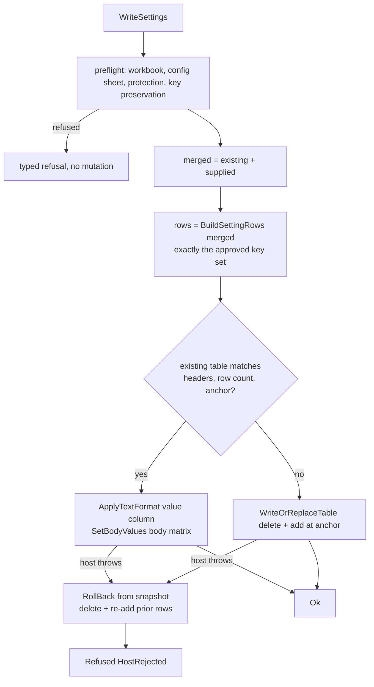

# Settings in-place write — design plan

> **Status**: Design, awaiting approval.
> **Proposed work item**: `docs/work-items/R5.24-settings-in-place-write.md` (R5.23 is taken by the type-change transition).
> **Relates to**: ADR-0007 (config-sheet catalogues, D4 regeneration), ADR-0058 (tab context, amendment 2026-11-14), R5.20 (auto-refresh toggle), R5.6d (Text-format defect).
> **Settles**: review findings 1–5 and 8 from the tab-focus/flicker review.

## Outcome

`ExcelConfigCatalogueWriter.WriteSettings` stops deleting and re-creating `tblGanttSettings` when the live table already matches the contract shape, and writes the body in place. The observable settings contract does not change. The reason is host behaviour: the delete/re-add perturbs Excel's selection context, and a following full ribbon rebuild activates the contextual Table Design tab (ADR-0058 amendment; review evidence).

## Non-goals (hard scope fence)

- No ribbon restore removal and no invalidation narrowing. `ActivateGanttTab` stays in `Refresh`, `FinishRefresh`, `SetAutoRefresh` and `ApplyHiddenColumns`. That is a separate slice needing its own work item and ADR-0058 note.
- No change to `WriteOrReplaceTable`, `Write`, `WriteThemed`, `UpgradeAdditiveSchema`, additive repair, or `RollBack` semantics.
- No schema version bump, no settings-key change, no anchor move, no reader change.

## Decisions

| # | Decision | Rationale |
|---|---|---|
| D1 | In-place only when **all** hold: table found by name; headers equal `GanttCatalogues.SettingsHeaders` (count + ordinal names); body row count equals the catalogue row count; table origin equals `GanttCatalogues.SettingsAnchor` | Shape equality makes the write safe; the origin check preserves today's snap-to-anchor behaviour and the blank-row invariant |
| D2 | Write order: `ApplyTextFormat(valueColumn)` then `SetBodyValues(bodyRange, matrix)`; never write the header row | Format-before-write is what keeps locale-sensitive strings (`10/01/2025`) verbatim; writing headers into a live `ListObject` is the risky COM call |
| D3 | Rollback stays the existing `TableSnapshot` → `RollBack` path; add a seam so the in-place failure is injectable | The no-mutation guarantee and its positive test must survive; today's test triggers on `AddTable`, which the new path never calls |
| D4 | Record the body extent in `written` for both paths | `RollBack`'s absent-table clear stays correct; harmless on the existing-snapshot path |
| D5 | No `ListObject.Resize`; a row-count mismatch falls back to delete/re-add | The row count is catalogue-defined, so a mismatch means the table is off-contract; resize is the call that can collide with the next anchor |

## Flow



## Contract preserved

- **Exact key set**: `BuildSettingRows` still iterates `GanttCatalogues.Settings`, so an unapproved key is never carried forward.
- **Present values preserved**: `merged` is built from `TryReadKeyValues` before any mutation.
- **No mutation on refusal**: every refusal happens before the branch, and a mid-write failure rolls back through the existing snapshot.
- **Free text stays text**: Text format is applied to the Value column *before* the strings are written; a round-trip test pins it.
- **Anchor stability**: the origin check in D1 keeps the table where the contract puts it.

## New seams

All `internal virtual`, matching the file's existing seam convention (`AddTable`, `GetTableBody`, `GetBodyValues`, `ApplyTextFormat`, `GetColumnAt`):

```csharp
/// <summary>Writes the settings body in place. Test seam over the COM Value2 assignment.</summary>
internal virtual void SetBodyValues(Excel.Range body, object[,] matrix) => body.Value2 = matrix;

/// <summary>Reads a range's top-left origin. Test seam over the COM Row and Column reads.</summary>
internal virtual (int Row, int Column) GetRangeOrigin(Excel.Range range) =>
    (range.Row, range.Column);
```

Reused as-is: `GetTableBody` (`table.DataBodyRange`), `ApplyTextFormat`, `GetColumnAt`, `ReadHeaders`, `ReadBodyRows`, `GetCellRange`, `GetResizedRange`, `AddTable`, `ClearContents`, `GetListObjects`.

## Tests

All in `tests/GanttCreator.Office.ContractTests/ConfigCatalogueWriterTests.cs`, driving `ConfigSheetFake` through the real `WriteSettings`.

| # | Test | Asserts |
|---|---|---|
| 1 | `WriteSettings_rewrites_the_settings_body_in_place` | Second commit performs no `Delete` and no `AddTable`; values applied; reader still succeeds |
| 2 | `WriteSettings_falls_back_when_the_settings_shape_differs` | Extra body row or renamed header → delete + add observed, write succeeds, key set exact |
| 3 | `WriteSettings_falls_back_when_the_settings_table_is_off_anchor` | Origin mismatch → delete + add observed |
| 4 | `WriteSettings_restores_the_settings_table_when_the_in_place_write_fails` | `SetBodyValues` throws → `HostRejected`, prior rows restored. Replaces today's `FailAddAt` trigger so the rollback validator keeps a positive test |
| 5 | `WriteSettings_preserves_a_locale_sensitive_date_string` | `PlotStartDate = 10/01/2025` round-trips verbatim through the in-place path |

Existing tests must stay green unchanged except the trigger in (4). `ConfigSheetFake` needs: a body-write model on `TableFake`, a configurable table origin, and an updated `Delete` comment (it currently documents delete-then-recreate as the only path).

## Documentation

1. New work item `docs/work-items/R5.24-settings-in-place-write.md` with D1–D5, the tests, and the live acceptance gate.
2. ADR-0007 amendment, new clause **D4a**:

   > **D4a — In-place rewrite of the settings table.** The settings table is rewritten in place when the live table already matches the approved shape: the same anchor, the two approved headers in order, and exactly one row per catalogue setting. Otherwise it is regenerated by delete-and-recreate. Both paths write exactly the approved key set, preserve present values, and roll back from a pre-write snapshot, so D4's observable contract is unchanged. The in-place path exists because delete-and-recreate perturbs the host's selection context, and a full ribbon rebuild after it activates Excel's contextual Table Design tab (ADR-0058 amendment, 2026-11-14 and 2026-11-28 evidence).

3. `docs/GanttCreator_StageInspect_Code_Audit.md:597` — mark the delete/re-add sentence as the pre-R5.24 behaviour.
4. `docs/STATUS.md` entry. `docs/REPO-MAP.md` — no change expected; confirm no mapped entry point or test location moved.

No ADR-0058 change in this slice.

## Gates

1. Targeted `GanttCreator.Office.ContractTests`.
2. `pwsh -NoProfile -File scripts/verify-quick.ps1` (staged).
3. `pwsh -NoProfile -File scripts/verify.ps1` (clean tree, last commit).
4. `verify-office.ps1` — **Required**. Host acceptance: chart locked, automatic refresh off, change Scale and Size; the Gantt Creator tab must not move to Table Design. Record the result in the work item. If the takeover survives the in-place write, the next rung is the invalidation narrowing as a separate work item; no restore is added.

## Risks

| Risk | Mitigation |
|---|---|
| The host still perturbs its context on a body write, so the takeover survives | The live gate decides; the fallback is the separate invalidation slice, not a restore |
| Excel refuses a `Value2` write into a live table body | Caught by the existing `catch` → `RollBack` → typed `HostRejected`; test 4 pins it |
| A user-edited or pre-upgrade table has the wrong shape | D1 falls back to the proven delete/re-add path; test 2 pins it |
| The Text format is lost or never existed on a legacy sheet | D2 formats before writing; test 5 pins the outcome |
| `ConfigSheetFake` cannot model body writes | Test-infrastructure step runs first, before the production branch |
